> 부전승공취, 이불수기공자흉, 명왈비류. 고왈, 명주려지, 양장수지. — 이긴 뒤 성과를 다듬지 않으면 승리가 비용으로 굳는다.

---
## 1. 원문 + 독음 + 직역 + 한자어 뜻풀이

夫戰勝攻取, 而不修其功者凶, 命曰費留. 故曰, 明主慮之, 良將修之. 부전승공취, 이불수기공자흉, 명왈비류. 고왈, 명주려지, 양장수지.

	**직역**

	무릇 싸워 이기고 공격하여 취하고도 그 공을 닦지 않는 자는 흉하니, 이를 일러 비류라 한다. 그러므로 밝은 군주는 이를 깊이 생각하고, 좋은 장수는 이를 닦는다.

	앞 구절은 불과 물이 공격을 돕는 수단일 뿐이라고 한계를 그었다. 이번 구절은 한 걸음 더 나아가, 전투에서 이기고 목표를 빼앗은 뒤에도 일이 끝나지 않는다고 경고한다. **戰勝**과 **攻取**는 눈앞의 승리이고, **修其功**은 그 승리를 국가의 안전과 지속 가능한 이익으로 정리하는 후속 작업이다. 점령지를 지키고 병력을 수습하며 비용을 계산하고 정치적 목적에 맞게 성과를 굳히지 않으면, 이미 얻은 승리도 **費留**—비용만 오래 머무는 상태—가 된다.

	#### 夫戰勝攻取(부전승공취) — 승리와 획득은 끝이 아니라 정리할 대상을 만든다

	**夫**(지아비 부)는 논의를 크게 열어 “무릇”이라는 뜻을 낸다. **戰**(싸울 전)은 창과 무력이 맞부딪치는 전투이고, **勝**(이길 승)은 그 대결에서 우세를 확정하는 일이다. **攻**(칠 공)은 적의 성·진지·조직을 깨는 행동이며, **取**(가질 취)는 그 결과를 손에 넣는 일이다. 네 글자는 전투의 흐름을 `싸움 → 승리 → 공격 → 획득`으로 밀어간다. 그러나 손자는 이 화려한 연쇄 뒤에 곧바로 접속사 **而**를 놓아, 얻었다는 사실과 얻은 것을 제대로 살리는 일을 갈라 놓는다.

	#### 而不修其功者凶(이불수기공자흉) — 성과를 닦지 않으면 승리가 흉한 씨앗이 된다

	**修**(닦을 수)는 길게 늘어진 것을 가지런히 정돈하고 보완한다는 뜻을 품는다. 여기서는 공적을 자랑하거나 기록한다는 뜻에 머물지 않는다. 전후 병력 재편, 점령지 안정, 보급 회복, 포상과 책임 정리, 다음 정치 목적과의 연결처럼 이미 얻은 **功**(공 공)을 실제 효용으로 완성하는 일이다. **不修**는 승리가 있는데도 그 뒤를 돌보지 않는 상태다. **凶**(흉할 흉)은 패전만을 가리키지 않는다. 승리의 비용이 성과보다 커지고, 점령이 반란을 낳으며, 지친 군대가 다음 위험에 노출되는 불길한 전환을 가리킨다.

	#### 命曰費留(명왈비류) — 비용은 나가고 성과 전환은 멈춘다

	**命曰**(명왈)은 이런 상태에 이름을 붙여 기억하게 한다는 말이다. **費**(쓸 비)는 재물·군량·병력·시간이 소모되는 것이고, **留**(머무를 류)는 나가야 할 것이 제때 풀리지 못하고 걸려 있는 상태다. 전통 주석은 費留를 비용이 헛되이 머물거나 군비를 써 놓고도 이익을 거두지 못하는 상태로 풀어 왔다. 따라서 비류는 단순한 ‘낭비’보다 구체적이다. 자원은 이미 투입되었지만 승리가 국가의 안전·질서·지속 가능한 이익으로 전환되지 못한 채 묶여 있는 병목이다.

	#### 明主慮之, 良將修之(명주려지, 양장수지) — 군주는 목적을 따지고 장수는 성과를 완성한다

	**明主**(명주)는 눈앞의 전과에 취하지 않고 전쟁의 목적과 대가를 밝게 보는 군주다. **慮**(생각할 려)는 호랑이처럼 두려운 위험을 마음속에서 거듭 헤아린다는 결을 지녀, 시작 전 계산과 승리 뒤 재계산을 함께 뜻한다. **良將**(양장)은 잘 싸우는 데서 멈추지 않고 얻은 결과를 정리할 줄 아는 장수다. 같은 **修**가 다시 등장하면서 문장의 책임을 닫는다. 군주는 이 승리가 국가에 무엇을 남기는지 숙고하고, 장수는 현장에서 그 성과가 새 위험으로 무너지지 않게 다듬어야 한다.

	#### 글자들이 완성하는 한 장면

	성문은 열렸고 전투는 끝났으며 깃발도 바뀌었다. 그러나 병사들은 지쳤고 군량은 줄었으며 새로 얻은 땅에는 행정과 경계가 아직 서지 않았다. 군주가 승리의 목적과 비용을 다시 헤아리고 장수가 병력·보급·질서를 정리하지 않으면, 전과는 장부의 지출과 점령지의 불안으로 남는다. **승리는 획득한 순간이 아니라, 그 성과를 보전하고 목적에 연결했을 때 비로소 완성된다.**

---
## 2. 전통 주석 기반 분석

- **조조(曹操)** — “싸워 이기고 성을 취했더라도 그 공을 보전하고 키우지 않으면 비용만 들고 이익은 남지 않는다. 이긴 뒤를 반드시 정리하라.”
- **이전(李筌)** — “전쟁은 백성과 재물을 쓰는 큰일이다. 이미 얻은 공을 나라의 이익으로 돌리지 못하면 강한 수단을 쓴 보람이 사라지니, 시작과 마침을 함께 살펴라.”
- **두목(杜牧)** — “공을 닦는다는 말을 이름을 새기고 상을 세우는 일로 좁히지 마라. 점령한 곳을 안정시키고 병사를 쉬게 하며 얻은 형세를 굳혀야 전공이 완성된다.”
- **매요신(梅堯臣)** — “勝과 取 뒤에 修가 따르는 문장 순서를 보아라. 승리와 획득은 한때의 일이고, 닦고 보전하는 일은 그 성과를 오래가게 한다.”
- **장예(張預)** — “전쟁에 이기고도 공을 닦지 않으면 앞의 비용이 모두 헛되다. 군주는 전체 이익을 헤아리고 장수는 현장의 군공을 수습해 서로 책임을 나누어라.”
- **왕석(王晳)** — “費는 자원이 소모됨이고 留는 그 소모가 성과로 풀리지 못함이다. 전과의 크기만 세지 말고 투입한 비용이 무엇으로 돌아왔는지 따져라.”
- **가림(賈林)** — “적의 성과 땅을 얻은 뒤 방비·군량·민심을 놓치면 다시 잃는다. 취한 것을 지킬 준비까지 공격 계획 안에 넣어라.”
- **두우(杜佑)** — “군비를 일으킨 뒤에는 포상·군정·수비·운송을 정돈해야 한다. 제도가 공을 이어받지 못하면 일시적 승리는 국가의 장기 부담이 된다.”
- **진호(陳皞)** — “이 구절은 승전을 부정하지 않고 승전 뒤의 태만을 경계한다. 이익을 충분히 검토한 군주와 마무리를 다하는 장수가 함께 있어야 흉함을 피한다.”

#### 주석가들의 차이와 보완

조조·가림·두목의 초점은 `修其功`, 곧 취한 성과를 보전하고 안정시키는 후속 행동에 있다. 승리의 표지만 세우는 것이 아니라 병력·점령지·보급·민심을 수습해야 한다는 실무적 독법이다. 이전과 진호는 이 경고를 전쟁 전체의 신중함으로 넓혀, 강한 수단을 썼다는 사실이 아니라 처음 세운 국가 목적에 도달했는지를 묻는다.

왕석은 `費留`의 구조를 가장 날카롭게 드러낸다. 비용은 이미 빠져나갔는데 성과가 다음 효용으로 흐르지 못하면, 승리는 자원을 묶어 두는 병목이 된다. 장예와 두우는 이 병목을 막는 책임을 군주와 장수, 정책과 현장, 포상과 군정의 결합에서 찾는다. 아홉 주석을 합치면 **승리 뒤에 목적·비용·보전·제도화를 다시 확인해야 전공이 완성된다**는 결론에 이른다.

#### 리링의 고증과 현대적 독법

리링(李零)의 해설 취지에 따라 문장 구조를 보면 `戰勝攻取`라는 전과의 연쇄가 `不修其功`에서 꺾이고, 그 실패 상태에 `費留`라는 이름이 붙는다. 이어 `明主慮之`와 `良將修之`가 군주와 장수의 서로 다른 동사를 나란히 둔다. 군주는 전쟁의 전체 손익과 목적을 **慮**하고, 장수는 이미 얻은 공을 현장에서 **修**한다. 별도의 이문을 억지로 만들기보다 이 동사 배분과 앞뒤 논리를 읽는 편이 중요하다.

`修其功`을 오늘날의 평판 세탁이나 공적 홍보로 옮기면 뜻이 좁아진다. 화공편은 강력하고 되돌리기 어려운 수단을 언제, 어떻게, 왜 쓸지를 다룬 뒤 성과의 후속 정리까지 요구한다. 따라서 여기서 ‘공을 닦는다’는 것은 파괴의 흔적을 미화한다는 뜻이 아니라, 군사적 성과를 정치적 목적·국가 안전·군대 보전으로 전환하고 그 비용을 더 키우지 않는다는 뜻으로 읽어야 한다.

---
## 3. 교차 설명

### ① 손자병법 내 교차

「작전편」의 `夫兵久而國利者, 未之有也`(부병구이국리자, 미지유야 — 전쟁을 오래 끌어 나라에 이로운 경우는 아직 없었다)는 費留의 시간적 배경을 보여 준다. 승리 뒤 정리 없이 병력이 계속 묶이면 군량·재정·사기가 소모되고, 전투에서 얻은 이익이 장기 주둔의 비용에 잠식된다.

「모공편」의 `百戰百勝, 非善之善者也`(백전백승, 비선지선자야 — 백 번 싸워 백 번 이기는 것이 최선 중 최선은 아니다)는 승리 횟수 자체를 최종 기준으로 삼지 않는다. 이번 구절은 그 경고를 승리 이후까지 잇는다. 전투에서 이겼더라도 국가 목적을 이루지 못하고 비용만 남기면 ‘승리’라는 표시는 전략적 성공을 보장하지 않는다.

「군형편」의 `勝兵先勝而後求戰`(승병선승이후구전 — 이기는 군대는 먼저 이길 조건을 갖춘 뒤 싸움을 구한다)은 전투 전 준비를 강조한다. `良將修之`는 그 대칭편이다. 좋은 장수는 전투 전에 이길 조건을 만들 뿐 아니라 전투 뒤에도 성과가 무너지지 않을 조건을 마련한다. 준비와 수습이 양끝에서 전투를 감싸야 한다.

### ② 클라우제비츠 『전쟁론』

클라우제비츠는 전쟁을 정치의 목적에서 떼어낸 독립 행위로 보지 않는다. 군사적 승리는 적의 의지를 꺾거나 협상 조건을 바꾸는 수단이며, 정치적 목적보다 비용이 커지면 계속 추구할 이유도 약해진다. 손자의 `戰勝攻取`와 `修其功` 사이에도 같은 층위 구분이 있다. 전술적 결과를 얻었다고 전략적·정치적 효용이 자동으로 생기지는 않는다.

다만 손자는 짧은 경구 안에서 군주와 장수의 역할을 분리하고 `費留`라는 비용 병목을 경고한다. 클라우제비츠의 전쟁 종결과 정치 목적 논의가 국가 수준의 긴장을 설명한다면, 손자는 그 긴장을 `慮`와 `修`라는 실무 책임으로 압축한다. 둘을 함께 읽으면 전투 후에는 “얼마나 크게 이겼는가”보다 “이 승리가 원래 목적을 얼마나 달성했고, 추가 비용 없이 유지될 수 있는가”를 물어야 한다.

### ③ 미야모토 무사시 『오륜서』

『오륜서』의 `枕をおさえる`(마쿠라오오사에루 — 베개를 누른다)는 상대의 행동이 완전히 펼쳐지기 전에 싹을 눌러 주도권을 놓치지 않는다는 뜻이다. 전투에서 한 번 앞섰어도 상대가 재정비할 틈을 주고 자신은 성과 정리를 미루면 주도권은 다시 움직인다. `修其功`은 이긴 뒤 방심하지 않고 성과가 되돌아가지 않게 마침을 붙이는 태도와 통한다.

무사시는 한 번의 기술이나 한 장면에 마음이 붙잡히는 것을 경계한다. 승리의 흥분에 붙잡혀 다음 국면을 보지 못하는 것도 같은 병이다. 다만 개인 검술의 잔심을 국가의 전후 통치와 곧바로 동일시해서는 안 된다. 공통점은 성공 직후가 오히려 판단이 느슨해지기 쉬운 순간이라는 데 있고, 손자는 그 문제를 군비·성과·국가 안전의 규모로 확장한다.

### ④ 오자병법과 육도

『오자병법』은 군대를 움직이는 데 명령의 통일, 상벌, 병사의 휴식과 교양이 함께 필요하다고 본다. 성을 얻은 뒤 부대를 재편하고 공을 공정하게 평가하지 않으면, 승리한 군대 안에서도 명령과 사기가 풀린다. 전과를 유지하는 일은 전투 기술만이 아니라 조직의 法을 다시 세우는 일이다.

『육도』는 군주의 도와 장수의 권한, 백성을 안정시키는 정치와 군사 운용을 연결한다. 적을 깨뜨린 뒤 백성의 생업과 질서를 회복하지 못하면 새로 얻은 땅은 이익이 아니라 계속 병력과 군량을 삼키는 부담이 된다. 이는 `明主慮之`와 `良將修之`가 분리되면서도 함께 작동해야 하는 이유를 보여 준다.

### ⑤ 현대 심리학·군사학

현대 군사학은 전투피해평가와 임무 달성 평가를 구분하고, 작전 뒤에는 안정화·전력 재생·민간 보호·보급 회복·지휘 관계 정리가 뒤따라야 한다고 본다. 목표 지점을 점령한 사실은 산출물이고, 그 점령이 더 큰 작전 목적을 실제로 달성했는지는 성과다. 산출물만 세면 `戰勝攻取`에서 멈추고, 성과의 지속성까지 확인해야 `修其功`에 이른다.

카너먼의 ‘보이는 것만이 전부’인 경향은 승리 직후 특히 강해질 수 있다. 눈에 띄는 숫자—점령한 거점, 해결한 티켓, 완료 표시—는 쉽게 떠오르지만, 유지 비용과 재발 위험, 후속 인계처럼 덜 보이는 정보는 판단에서 빠진다. 이때 시스템 1은 선명한 성공 장면으로 “끝났다”고 답하고, 시스템 2는 원래 목표·총비용·남은 위험을 다시 계산해야 한다.

매몰비용의 반대편 함정도 있다. 이미 큰 비용을 썼다는 이유로 성과 없는 주둔이나 실패한 후속 조치를 계속하는 것은 `費留`를 더 키운다. 그렇다고 승리 직후 무조건 철수하는 것도 답은 아니다. 유지했을 때의 추가 효용과 비용, 중단했을 때의 손실과 회수 가능성을 현재 시점에서 다시 비교해야 한다. **투입 비용이 아니라 앞으로 남길 순효과를 기준으로 성과를 닦거나 멈추는 것**이 현대적 교정법이다.

---
## 4. 역사적 실증 사례

### 서양 — 🏛️ 프랑스 제1제국 vs 🏛️ 러시아 제국 │ 1812년 러시아 원정(French invasion of Russia, 1812)

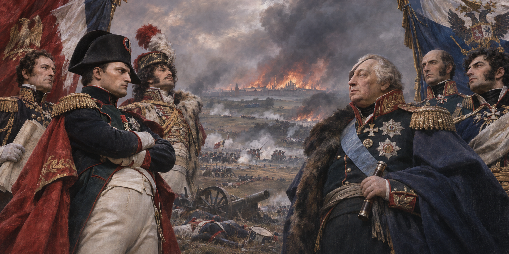

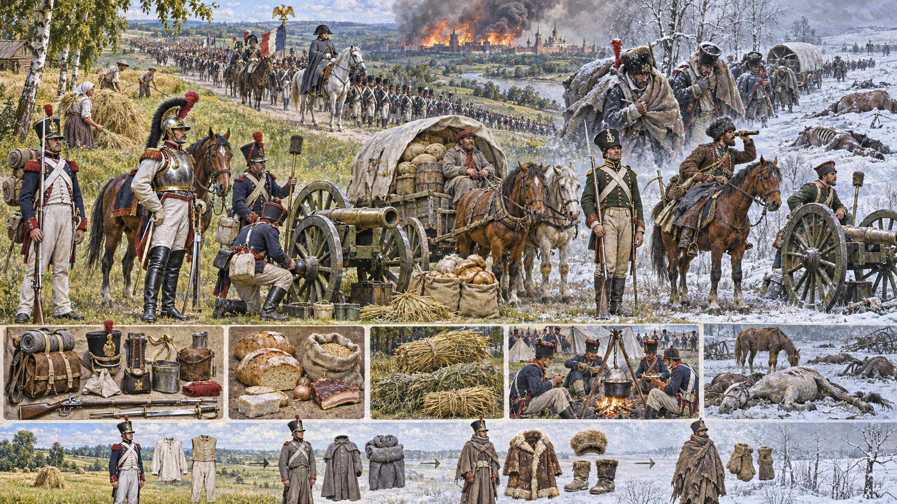

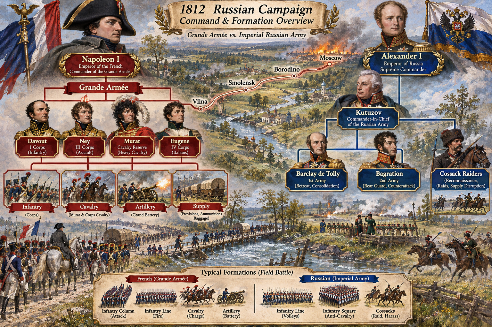

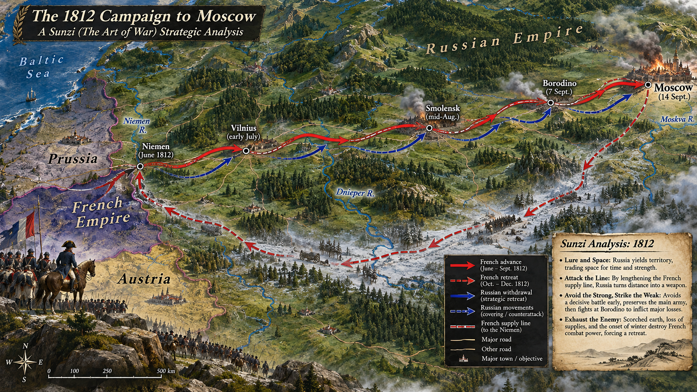

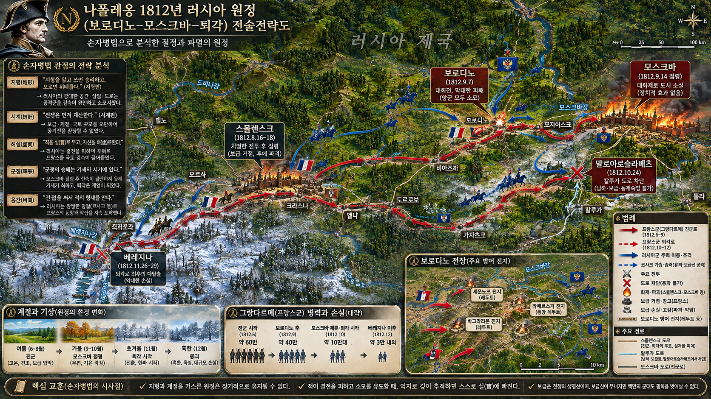

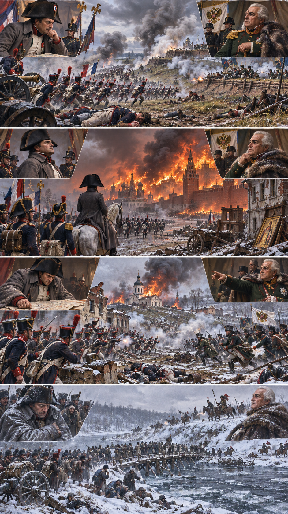

**뒤에서 반복될 지형을 먼저 잡아두기**

- 🌊 **네만강(Niemen River)**은 대육군이 1812년 6월 건넌 서쪽 출발선이다. 이 선을 넘을수록 프랑스의 보급 거리는 길어지고 러시아군은 자기 종심으로 물러났다.
- **▰** **스몰렌스크(Smolensk)**는 모스크바 도로의 중간 거점이었으나, 소진된 주변과 파괴된 시설은 전진군 전체를 안정적으로 먹여 살릴 기지가 되지 못했다.
- **▰** **보로디노(Borodino)**는 모스크바 서쪽의 결전지였다. 프랑스군은 전장을 차지했지만 러시아 야전군을 소멸시키지 못해 전술적 승리를 전쟁 종결로 바꾸지 못했다.
- 🌊 **모스크바강(Moskva River)**과 **▰** **모스크바(Moscow)**는 상징적 목표였지만 러시아 정부와 야전군의 항복을 자동으로 가져오는 정치적 중심은 아니었다.
- **▰** **타루티노(Tarutino)**는 **쿠투조프**가 남서쪽에서 군을 재편하며 칼루가 도로를 견제한 곳이다. 러시아군이 살아 있는 한 점령지는 안전한 성과가 아니었다.
- **▰** **말로야로슬라베츠(Maloyaroslavets)**는 남쪽의 덜 황폐한 칼루가 길을 둘러싼 분기점이었다. 여기서 막힌 **나폴레옹**은 이미 소진된 스몰렌스크 도로로 되돌아갔다.
- 🌊 **베레지나강(Berezina River)**은 철수군의 마지막 큰 병목이었다. 도하 성공은 전군의 붕괴를 늦췄지만 모스크바 점령을 전략적 성과로 되돌리지는 못했다.

#### 상세 전역 서사 — 모스크바를 얻고도 러시아의 항복을 얻지 못한 비용 병목

**나폴레옹 보나파르트(Napoleon Bonaparte)**는 러시아군을 국경 부근에서 결전으로 묶어 빠르게 굴복시키려 했지만, 러시아군은 후퇴하며 공간과 시간을 바꾸었다. 대육군은 승리를 거듭하고도 적의 주력을 파괴하지 못한 채 도로와 군량을 계속 소비했다. **▰** **보로디노(Borodino)**에서 프랑스군은 전장을 차지했으나 대규모 손실을 입었고, **미하일 쿠투조프(Mikhail Kutuzov)**의 러시아군은 질서를 잃지 않은 채 물러났다. 이어 **▰** **모스크바(Moscow)**를 점령했지만 러시아 황제의 평화 제안은 오지 않았다. 화재와 주민 이탈로 도시의 식량·숙영 가치는 크게 줄었고, 프랑스군은 상징적 점령을 유지하는 동안 보급과 철수 시간을 잃었다.

미 육군 군사사 연구는 대규모 군대가 한 지역에 오래 머물면 현지 조달이 빠르게 고갈된다고 설명하며, 모스크바의 화재·보급 부족·다가오는 겨울·보급로 습격이 철수를 강제했다고 정리한다. 즉 `戰勝攻取`는 있었지만 러시아의 정치적 의지와 야전군을 굴복시키는 `功`으로 전환되지 않았다. **나폴레옹**이 협상 가능성을 기다리는 동안 `費`는 매일 늘었고, 군대는 목적 없는 점령에 `留`했다. 10월 철수를 시작한 뒤 남쪽 칼루가 길이 **쿠투조프**에게 막히자, 대육군은 이미 파괴된 스몰렌스크 길로 되돌아가야 했다.

#### 전투에서 사용된 속임수 — 후퇴가 패배인지 종심 방어인지 오독하다

러시아군의 모든 후퇴를 하나의 중앙 기만 계획으로 단정할 수는 없다. 그러나 러시아군이 결전을 피하고 공간을 내주자 프랑스 지휘부는 다음 점령이 협상과 종결을 가져올 것이라는 기대를 유지했다. 실제 러시아군은 살아서 남쪽 보급축을 지키고 프랑스 보급로를 괴롭힐 수 있었고, 모스크바의 상징은 그 군사적 실체를 가렸다.

#### 속임수 작동 구조

**주체와 의도.** 러시아군은 야전군 보존과 종심 활용을 우선했고, 프랑스군은 수도 점령으로 정치적 결정을 얻으려 했다.

**보인 신호와 믿은 이유.** 연속 후퇴와 모스크바 포기는 러시아가 마지막 단계에 몰렸다는 신호처럼 보였다. 유럽 전쟁에서 수도 점령이 협상을 촉진한 경험이 그 기대를 강화했다.

**유발된 행동과 결과.** 프랑스군은 모스크바에서 협상을 기다리며 철수 적기를 소비했다. 러시아군은 재편해 칼루가 길을 막고 보급로에 압력을 가했다.

**사료의 경계.** 모스크바 화재의 책임과 통제 범위에는 논쟁이 있으며, 혹한 하나만으로 패배를 설명해서도 안 된다. 장거리 보급, 말 손실, 질병, 전투 손실, 지연된 철수가 결합했다.

#### 속임수 일곱 질문

1. **누가 누구를 속였는가?** 단일한 거짓 명령보다 러시아의 후퇴와 공간 양보가 프랑스의 기존 기대를 이용한 측면이 컸다.
2. **어떤 사실이 거짓이었는가?** “모스크바를 얻으면 러시아가 곧 평화를 청한다”는 프랑스의 전제가 사실이 아니었다.
3. **어떤 사실은 진실이지만 오해를 유도했는가?** 러시아군은 실제로 보로디노에서 물러났고 모스크바도 포기했다. 그러나 야전군과 국가의 저항 능력은 남아 있었다.
4. **상대는 왜 그것을 믿고 싶어 했는가?** 장거리 전진의 비용을 정당화하려면 눈앞의 수도가 전쟁 종결점이어야 했다.
5. **속임수가 없었어도 같은 오판이 발생했을까?** 가능성이 높다. 수도와 협상을 연결한 경험, 이미 투입한 비용, 보급 상태의 낙관이 독립적으로 같은 결론을 밀었다.
6. **속은 사람은 어떤 독립 확인을 생략했는가?** 러시아 정부의 실제 협상 의지, 야전군 재편 상태, 겨울 전 안전한 철수 시점과 남쪽 도로의 가용성을 하나의 중단 기준으로 묶지 못했다.
7. **신뢰·동의·안전을 해치지 않으면서 같은 원리를 어디서 연습할 수 있는가?** 보드게임이나 모의훈련에서 ‘거점 점령’과 ‘상대 전력 제거·보급 지속·정치 목표’를 별도 승리 조건으로 두고 판단을 연습할 수 있다.

#### 시계편 兵者詭道也 — 이 전장에 해당하는 속이는 길

<table fit-page-width="true" header-row="true">
<tr><td>해당 구절·독음·뜻</td><td>전장의 장면</td></tr>
<tr><td>近而示之遠 근이시지원 — 가까이 있으면서 멀리 있는 듯 보인다</td><td>러시아 야전군은 모스크바를 버렸지만 타루티노에서 남쪽 길을 지킬 수 있는 거리에 재편했다. 프랑스군은 도시 점령의 외형 때문에 살아 있는 적군의 접근성을 낮게 평가했다.</td></tr>
<tr><td>利而誘之 리이유지 — 이익을 보여 유인한다</td><td>의도적 미끼로 단정할 수는 없지만, 비어 있는 모스크바의 상징적 가치는 프랑스군을 더 깊고 오래 머물게 한 실제 유인이 되었다.</td></tr>
</table>

#### 法 한눈 비교 — 곡제·관도·주용

<table fit-page-width="true" header-row="true">
<tr><td>진영</td><td>곡제(편제)</td><td>관도(지휘)</td><td>주용(보급·지속)</td></tr>
<tr><td>**러시아군**</td><td>주력 야전군을 보존하고 코사크·경기병이 측후방을 압박했다.</td><td>**쿠투조프**가 전략 후퇴와 남쪽 차단을 연결했다.</td><td>자국 종심으로 물러날수록 보급과 증원이 가까워졌다.</td></tr>
<tr><td>**프랑스군**</td><td>다국적 군단을 넓은 도로망에 분산했으나 전진과 손실로 결속이 약해졌다.</td><td>**나폴레옹**의 중앙 결심은 빨랐지만 종결·철수 기준은 늦었다.</td><td>수백 킬로미터 보급선, 말 손실, 소진된 현지 조달이 지속 능력을 무너뜨렸다.</td></tr>
</table>

#### **나폴레옹 (패)**

<table fit-page-width="true" header-row="true">
<tr><td>요소</td><td>판단</td></tr>
<tr><td color="orange_bg">🤝 **道**</td><td>전역 초의 다국적 대군은 강했으나 장거리 행군·손실·기아 속에서 결속과 사기가 약해졌다. (지기·사기)</td></tr>
<tr><td color="blue_bg">🌤️ **天**</td><td>러시아 황제가 수도 상실 뒤에도 평화를 청하지 않을 가능성과 철수 가능한 날짜의 분포를 낮게 잡았다. 혹한은 원인이 아니라 이미 약해진 군을 덮친 증폭기였다. (지피·타이밍·확률 관점)</td></tr>
<tr><td color="green_bg">🧭 **地**</td><td>국경에서 모스크바까지의 원거리, 소진된 스몰렌스크 도로, 말로야로슬라베츠의 남쪽 길 차단이 점령을 고립으로 바꾸었다. (원근·험이·사생)</td></tr>
<tr><td color="purple_bg">🎖️ **將**</td><td>결전과 기동의 智·勇은 있었으나 러시아의 정치 의지를 전과와 동일시하고 철수 결심을 늦춘 점에서 과신의 위험이 드러났다. (지신인용엄·장유오위)</td></tr>
<tr><td color="yellow_bg">⚙️ **法**</td><td>군단제의 기동력은 전진을 가능하게 했지만 말·수레·식량·도로의 손실을 회복할 체계가 모스크바에 없었다. (곡제·관도·주용)</td></tr>
</table>

**직관·편향 한 줄:** **나폴레옹**이 보로디노와 모스크바 점령을 곧 협상으로 이어질 대표적 시나리오로 본 판단에는 과신과 단일 시나리오 집중이 작동했을 가능성이 있고, 그 결과 철수 시점을 늦췄다.

🏳️ **패군 측 결과**: 전술적 승리와 수도 점령을 얻었지만 러시아 야전군·정치 의지·지속 가능한 보급을 굴복시키지 못해 `北(배)`—적정과 지속 능력을 헤아리지 못한 후퇴—로 귀결되었다.

🔀 **패군 측 회피 분기점**: 보로디노 뒤 러시아군이 소멸하지 않았음을 인정하고 모스크바를 종결점으로 삼지 않았거나, 평화 제안의 기한을 짧게 정해 9월 안에 철수했다면 승리를 보장할 수는 없어도 겨울·보급 붕괴가 겹친 완패의 규모는 줄일 수 있었다.

#### **쿠투조프 (승)**

<table fit-page-width="true" header-row="true">
<tr><td>요소</td><td>판단</td></tr>
<tr><td color="orange_bg">🤝 **道**</td><td>수도를 내주는 정치적 충격을 감수하면서 야전군 보존을 국가 저항의 핵심으로 삼았다. 병력은 후퇴 뒤에도 재편되어 사기를 회복했다. (지기·사기)</td></tr>
<tr><td color="blue_bg">🌤️ **天**</td><td>날씨를 필연적 구원으로 기대하지 않고 시간·거리·적 보급의 누적이 유리한 결과의 확률을 높이도록 기다렸다. (지피·타이밍·확률 관점)</td></tr>
<tr><td color="green_bg">🧭 **地**</td><td>타루티노에서 남쪽 자원지대를 지키고 말로야로슬라베츠에서 칼루가 길을 막아 적을 황폐한 축으로 돌려보냈다. (원근·광협·사생)</td></tr>
<tr><td color="purple_bg">🎖️ **將**</td><td>상징적 수도보다 보존된 군대와 시간을 중시했고, 무리한 정면 결전보다 압박·차단·추격을 결합했다. (지신인용엄)</td></tr>
<tr><td color="yellow_bg">⚙️ **法**</td><td>정규군 재편과 코사크 습격, 지역 보급, 다방향 추격을 결합해 프랑스군의 지속 비용을 키웠다. (곡제·관도·주용)</td></tr>
</table>

🏆 **승군 측 결과**: `以虞待不虞者勝(이우대불우자승 — 대비한 채 대비 없는 적을 상대하는 자가 이긴다)`에 가깝게, 야전군과 남쪽 보급축을 보존하고 적의 점령이 비용으로 굳을 때까지 기다렸다.

##### 法을 압축하지 않고 보기 — 곡제·관도·주용

**곡제 曲制(곡제): 부대를 어떻게 나누고 결합했는가**
<table fit-page-width="true" header-row="true">
<tr><td>진영</td><td>실제 운용</td></tr>
<tr><td>**러시아군**</td><td>정규 야전군을 보존하고 🐎 코사크·경기병, 민병, 후방 부대를 측후방 압박에 결합했다.</td></tr>
<tr><td>**프랑스군**</td><td>군단별 독립 기동과 💣 포병 집중은 결전에 강했으나, 길어진 종대와 낙오로 상호지원 능력이 줄었다.</td></tr>
</table>

**관도 官道(관도): 누가 명령하고 어떻게 전달했는가**
<table fit-page-width="true" header-row="true">
<tr><td>진영</td><td>실제 운용</td></tr>
<tr><td>**러시아군**</td><td>**쿠투조프**의 주력 보존 결심 아래 정규군·전위·코사크가 도로와 측방에서 역할을 나눴다.</td></tr>
<tr><td>**프랑스군**</td><td>**나폴레옹**의 본영 명령은 군단을 통제했으나 거리·날씨·말 손실이 전령과 보고의 속도를 떨어뜨렸다.</td></tr>
</table>

**주용 主用(주용): 군량·장비·전투 지속 능력을 어떻게 썼는가**
<table fit-page-width="true" header-row="true">
<tr><td>진영</td><td>실제 운용</td></tr>
<tr><td>**러시아군**</td><td>자국 창고와 인구·말 자원에 가까워지는 방향으로 후퇴하며 손실을 보충했고, 적 보급로를 습격했다.</td></tr>
<tr><td>**프랑스군**</td><td>현지 조달과 수레에 의존했으나 소진된 도로, 화재가 난 모스크바, 말의 대량 손실로 식량·포·부상자 수송이 함께 무너졌다.</td></tr>
</table>

**출처:** [U.S. Army Combat Studies Institute — Warfare in the Age of Non-State Actors](https://www.armyupress.army.mil/Portals/7/combat-studies-institute/csi-books/WarfareInTheAgeOfNon-StateActors_2007.pdf) · [TRADOC G-2 — How Russia Fights in Large-Scale Combat Operations](https://api.army.mil/e2/c/downloads/2025/08/27/9d0d86ff/tradoc-g2-how-russia-fights-in-lsco-aug-25.pdf)

### 동양 — ⚔️ 초 연합·서초 vs 🏛️ 진·한 │ 항우의 함양 점령과 초한전쟁(秦亡·楚漢之爭, 기원전 206~202년)

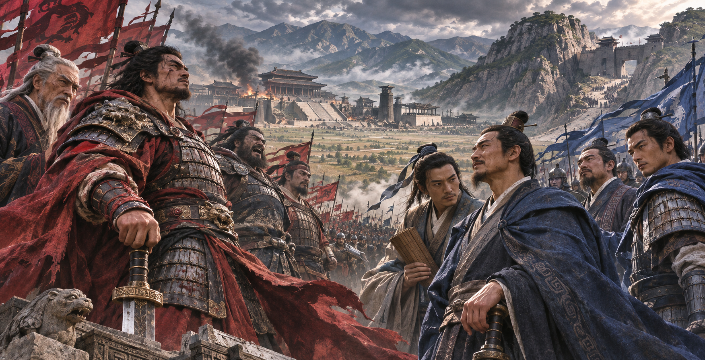

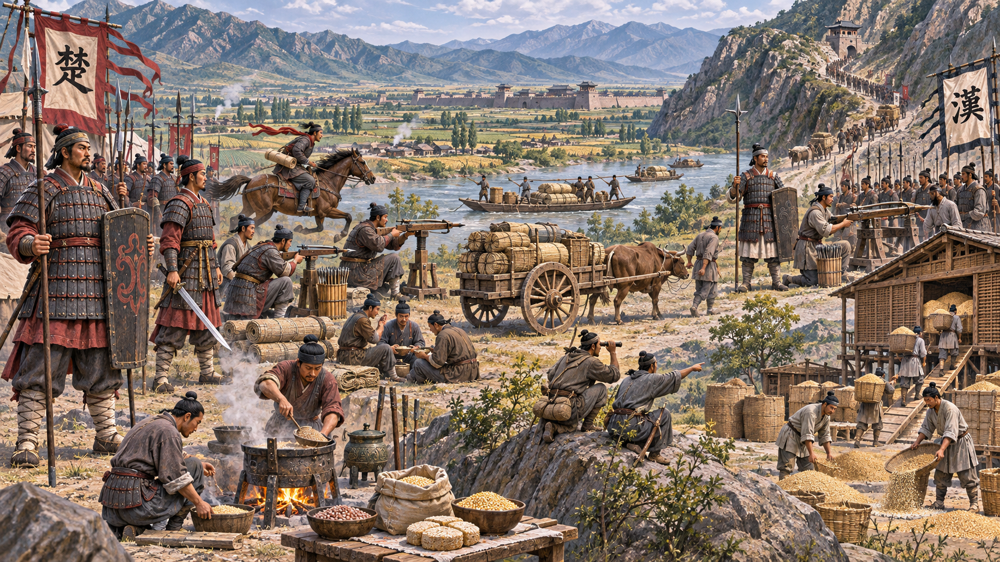

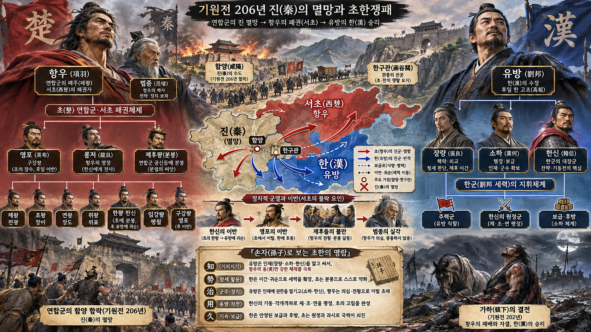

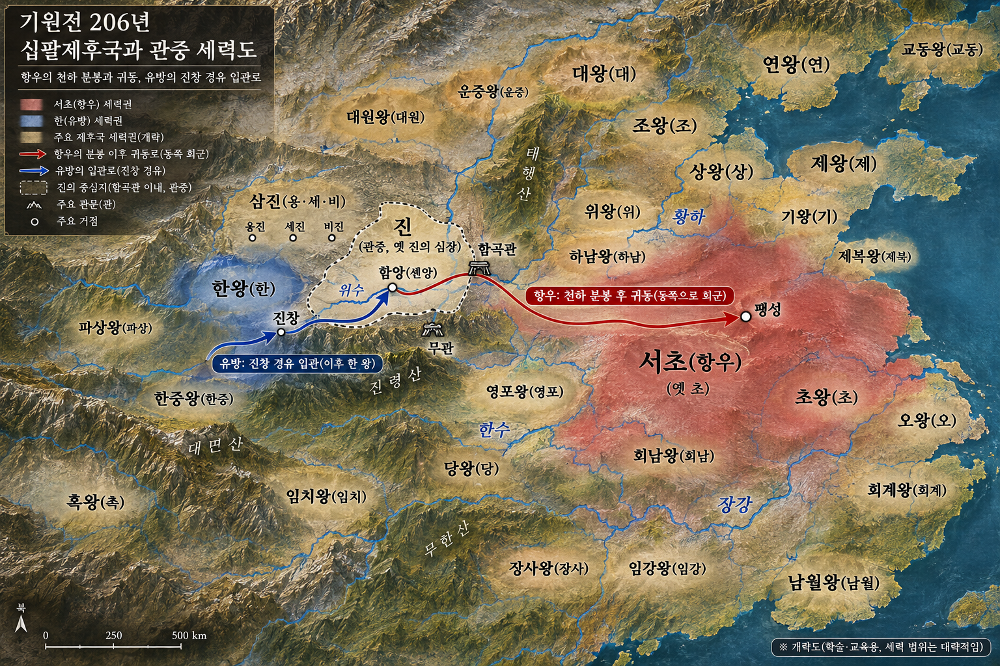

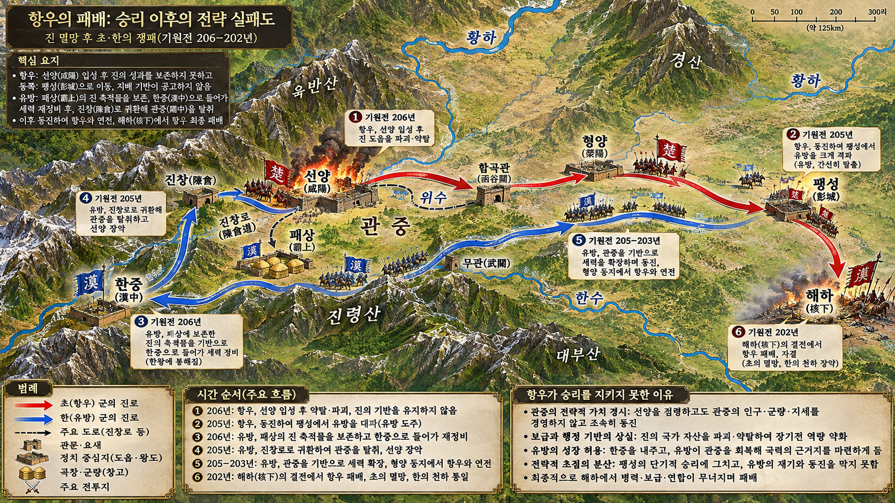

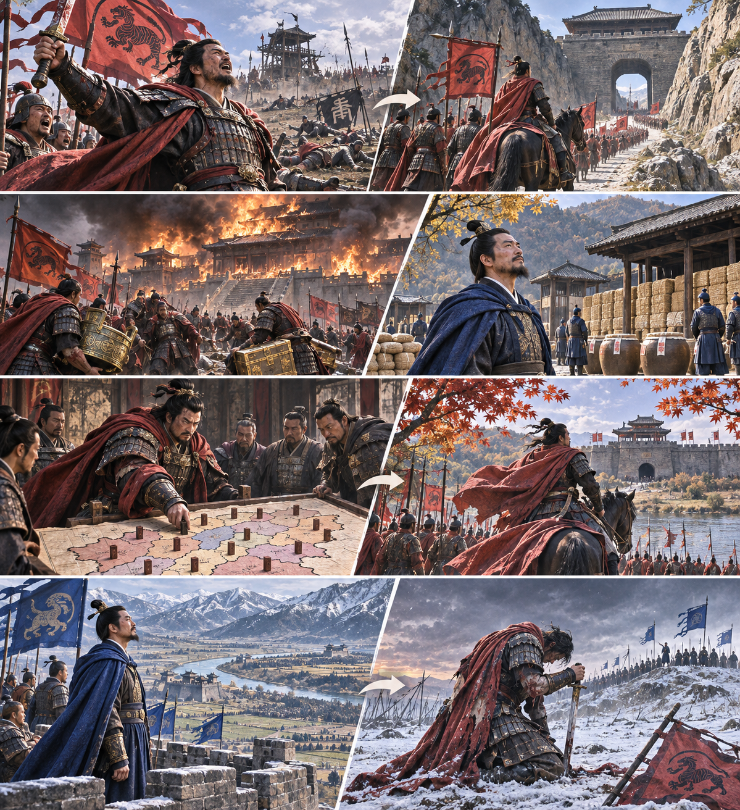

**뒤에서 반복될 지형을 먼저 잡아두기**

- ⛰️ **함곡관(函谷關)**은 관중으로 들어가는 동쪽 병목이다. 이 관문 안의 관중을 누가 안정적으로 통치하느냐가 진 멸망 뒤의 패권을 좌우했다.
- 🌊 **위수(渭水)** 북쪽의 **▰** **함양(咸陽)**은 진의 수도와 창고·궁실이 모인 정치·물자 중심이었다. 파괴할 표적이 아니라 이어받아 다스릴 기반이 될 수도 있었다.
- **▰** **패상(霸上)**은 먼저 함양에 들어간 **유방**이 궁실과 창고를 봉하고 군을 물린 곳이다. 점령을 약탈보다 질서 회복으로 연결한 대비점이다.
- ⛰️ **한중(漢中)**은 **유방**이 밀려난 산악 왕국이었지만, 병력과 곡물을 재정비해 관중으로 돌아오는 발판이 되었다.
- **▰** **진창(陳倉)**은 한군이 관중으로 되돌아오는 서쪽 통로였다. 항우가 세운 삼진 왕국의 방어를 깨고 관중을 장악하는 길이 열렸다.
- **▰** **팽성(彭城)**은 **항우**가 택한 서초의 중심이었다. 관중의 방어 지형과 진의 행정 기반을 버리고 동쪽 고향에 중심을 둔 선택은 전장을 넓혔다.
- **▰** **형양(滎陽)**과 오창은 동서 보급을 잇는 중간 축이었고, **▰** **해하(垓下)**는 보급과 동맹을 잃은 초군이 최종적으로 포위된 곳이다.

#### 상세 전역 서사 — 진을 무너뜨린 패권을 관중의 통치 기반으로 굳히지 못하다

**항우(項羽)**는 거록에서 진의 주력을 격파해 제후 연합의 최고 군사 지도자로 떠올랐다. 그러나 **유방(劉邦)**이 먼저 **▰** **함양(咸陽)**에 들어가 궁실과 창고를 봉하고 **▰** **패상(霸上)**으로 물러난 뒤, **항우**는 관중에 들어와 항복한 자영을 죽이고 수도를 파괴하며 재물을 나눴다고 『사기』는 전한다. 진을 멸한 `戰勝攻取`는 분명했지만, 진의 행정·창고·관중 지형을 새 질서의 기반으로 보전하는 `修其功`은 약했다.

**항우**는 옛 진 영역을 삼진으로 나누고 천하를 열여덟 왕국으로 분봉한 뒤 서초패왕을 칭했다. 그러나 분봉은 공과 지역 기반의 불균형 때문에 반발을 낳았고, 의제를 멀리 옮긴 뒤 죽게 한 일은 정치적 정당성을 더 약화했다. 관중에 남아 패권의 중심을 다지라는 조언보다 동쪽 귀환을 택하면서, 천연 장벽과 옛 제국의 물자·행정 기반을 경쟁자에게 열어 주었다. **유방**은 ⛰️ **한중(漢中)**에서 병력과 보급을 정비하고 진창을 거쳐 관중을 장악했다. 이후 **소하**가 후방의 인력과 곡물을 공급하고 **한신**이 별도 전선을 넓히면서, 한은 패배 뒤에도 다시 군을 만들 수 있는 구조를 갖췄다.

#### 전투에서 사용된 속임수 — 분봉의 외형이 통치의 실체를 대신하다

열여덟 왕국의 분봉은 공개된 정치 조치였지 단순한 군사 기만은 아니었다. 그러나 제후에게 왕위를 나눠 준 외형은 안정된 질서를 만든 듯 보였고, 실제로는 불만·고향 기반·군사력의 차이를 제도 안에 묶지 못했다. 반대로 **유방**의 한중 후퇴는 주변부로 밀려난 패배처럼 보였지만, 보급과 인재를 정리해 관중으로 되돌아오는 준비 기간이 되었다.

#### 속임수 작동 구조

**주체와 의도.** **항우**는 분봉으로 제후의 공을 보상하고 자신의 패권을 승인받으려 했고, **유방**은 당장의 열세를 받아들이며 생존 기반을 보전했다.

**보인 신호와 믿은 이유.** 서초패왕의 작위와 열여덟 왕국은 전쟁이 끝나 새 질서가 시작된 듯 보였다. **유방**의 한중 이동은 중심에서 제거된 것처럼 보였다.

**유발된 행동과 결과.** **항우**는 관중을 떠나 동쪽으로 돌아갔고, 각지의 반발을 진압하느라 전장을 왕복했다. **유방**은 관중을 차지해 인력·곡물·도로를 장기전의 기반으로 바꿨다.

**사료의 경계.** 사마천의 서사는 한 왕조 성립 뒤 편찬되었으므로 인물 성격을 단선적으로 읽어서는 안 된다. 다만 함양 파괴, 분봉, 관중 이탈, 한의 관중 재점령과 최종 승리라는 사건 연쇄는 여러 전승에서 일관된다.

#### 속임수 일곱 질문

1. **누가 누구를 속였는가?** 대표적 한 번의 거짓말보다 분봉의 안정된 외형과 한중 후퇴의 약한 외형이 서로 다른 판단을 만들었다.
2. **어떤 사실이 거짓이었는가?** 열여덟 왕국을 세웠다는 사실이 곧 제후의 충성과 지속 가능한 질서를 뜻하지는 않았다.
3. **어떤 사실은 진실이지만 오해를 유도했는가?** **유방**은 실제로 한중으로 밀려났지만, 그곳에서 다시 관중을 공략할 힘을 보존했다.
4. **상대는 왜 그것을 믿고 싶어 했는가?** 진을 멸한 압도적 전공과 제후의 형식적 복종은 패권이 이미 완성됐다는 결론을 지지했다.
5. **속임수가 없었어도 같은 오판이 발생했을까?** 가능성이 높다. 고향 귀환 선호와 군사적 명성에 대한 과신만으로도 관중 통치의 후속 비용을 낮게 볼 수 있었다.
6. **속은 사람은 어떤 독립 확인을 생략했는가?** 제후별 불만, 관중 민심, 삼진의 실제 방어력, 한중에서 한군이 재건되는 속도를 지속적으로 묶어 확인하지 못했다.
7. **신뢰·동의·안전을 해치지 않으면서 같은 원리를 어디서 연습할 수 있는가?** 프로젝트 모의훈련에서 직함 배분과 완료 선언 뒤에도 자원·책임·불만·재발 위험이 실제로 닫혔는지 별도 점검할 수 있다.

#### 시계편 兵者詭道也 — 이 전장에 해당하는 속이는 길

<table fit-page-width="true" header-row="true">
<tr><td>해당 구절·독음·뜻</td><td>전장의 장면</td></tr>
<tr><td>能而示之不能 능이시지불능 — 능하면서도 능하지 못한 듯 보인다</td><td>**유방**은 한중으로 물러난 약자의 처지였지만, 후방을 정비하고 관중으로 되돌아갈 능력을 키웠다. 다만 이것을 모두 의도된 기만으로 단정하지 않고 결과적 시형으로 구분해야 한다.</td></tr>
<tr><td>遠而示之近 원이시지근 — 멀리 있으면서 가까이 있는 듯 보인다</td><td>**항우**의 분봉은 넓은 천하를 지배하는 듯 보였지만 실제 지휘·보급·충성의 거리는 길었다. 외형상 패권과 실제 통제 범위가 달랐다.</td></tr>
</table>

#### 法 한눈 비교 — 곡제·관도·주용

<table fit-page-width="true" header-row="true">
<tr><td>진영</td><td>곡제(편제)</td><td>관도(지휘)</td><td>주용(보급·지속)</td></tr>
<tr><td>**한군**</td><td>후방 행정, 주력, 별동 전선을 나누고 인재에게 권한을 줬다.</td><td>**유방**이 **소하·장량·한신**의 서로 다른 기능을 결합했다.</td><td>관중과 오창의 곡물, 인구, 도로를 장기전의 재생 기반으로 삼았다.</td></tr>
<tr><td>**서초군**</td><td>강한 직속군과 제후 연합을 보유했으나 각 왕국의 이해를 안정된 체계로 묶지 못했다.</td><td>**항우** 개인의 전장 권위에 집중되어 넓은 분봉 질서를 상시 관리하기 어려웠다.</td><td>전투 현장의 강함에 비해 관중의 창고·행정·민심을 장기 기반으로 전환하지 못했다.</td></tr>
</table>

#### **항우 (패)**

<table fit-page-width="true" header-row="true">
<tr><td>요소</td><td>판단</td></tr>
<tr><td color="orange_bg">🤝 **道**</td><td>군사적 위엄은 제후를 복종시켰지만 함양 파괴와 불균형한 분봉은 관중 민심과 제후의 지속적 동의를 만들지 못했다. (지기·사기·충성)</td></tr>
<tr><td color="blue_bg">🌤️ **天**</td><td>진 멸망 직후의 권력 공백을 영구적 복종으로 일반화하고, 한중에서 경쟁자가 재건될 가능성을 낮게 보았다. (지피·타이밍·확률 관점)</td></tr>
<tr><td color="green_bg">🧭 **地**</td><td>함곡관 안 관중의 방어·곡창·중앙 위치를 버리고 동쪽 팽성에 중심을 둬 다수 전선을 오가게 됐다. (원근·험이·광협·사생)</td></tr>
<tr><td color="purple_bg">🎖️ **將**</td><td>전장에서의 智·勇·嚴은 두드러졌으나 반대 조언을 제도적 수정으로 받아들이는 信·仁과 넓은 연합 관리가 약했다. (지신인용엄·장유오위)</td></tr>
<tr><td color="yellow_bg">⚙️ **法**</td><td>분봉은 영토를 나눴지만 명령·보급·분쟁 조정의 지속 경로를 만들지 못했고, 승리의 제도화가 지연됐다. (곡제·관도·주용)</td></tr>
</table>

**직관·편향 한 줄:** **항우**가 진을 멸한 압도적 전공과 제후의 즉시 복종을 장기 통치 능력의 증거로 본 데에는 대표성 휴리스틱과 과신이 작동했을 가능성이 있고, 관중 보전과 경쟁자 재건 위험을 낮게 평가하게 했다.

🏳️ **패군 측 결과**: 진을 멸하고 천하를 분봉했으나 성과를 안정된 행정·보급·동맹 질서로 굳히지 못해 `亂(란)`—지휘와 질서가 넓은 연합을 일관되게 묶지 못한 패배—로 이어졌다.

🔀 **패군 측 회피 분기점**: 함양과 관중의 창고·행정을 보전하고, 먼저 입관한 유방과 제후의 공을 합의 가능한 기준으로 조정하며, 동쪽 귀환보다 관중 안정에 시간을 썼다면 패권의 붕괴를 늦추고 다전선 소모를 줄일 가능성이 있었다.

#### **유방 (승)**

<table fit-page-width="true" header-row="true">
<tr><td>요소</td><td>판단</td></tr>
<tr><td color="orange_bg">🤝 **道**</td><td>함양의 궁실·창고를 봉하고 패상으로 물러난 행동은 새 지배가 약탈만은 아니라는 신호가 되었고, 인재와 제후를 다시 결합할 여지를 만들었다. (지기·사기·충성)</td></tr>
<tr><td color="blue_bg">🌤️ **天**</td><td>한중 배치를 영구 패배로 보지 않고 항우의 분봉 불만과 관중의 공백이 열릴 가능성을 기다렸다. 성공을 필연으로 보지 않고 인재·정보·보급으로 확률을 높였다. (지피·타이밍·확률 관점)</td></tr>
<tr><td color="green_bg">🧭 **地**</td><td>한중의 후방성과 관중의 중앙성, 진창 통로, 형양·오창 보급축을 단계적으로 연결했다. (원근·험이·광협·사생)</td></tr>
<tr><td color="purple_bg">🎖️ **將**</td><td>자신보다 뛰어난 참모·행정가·장군에게 역할과 권한을 주고 패배 뒤에도 연합을 다시 만드는 능력을 보였다. (지신인용엄)</td></tr>
<tr><td color="yellow_bg">⚙️ **法**</td><td>소하의 후방 행정, 장량의 정치·책략, 한신의 전역 지휘를 분리 결합해 병력과 곡물이 계속 재생되게 했다. (곡제·관도·주용)</td></tr>
</table>

🏆 **승군 측 결과**: `將能而君不御者勝(장능이군불어자승 — 장수가 유능하고 군주가 함부로 억누르지 않으면 이긴다)`의 조건처럼 전문 인재의 권한을 결합하고 관중을 지속 가능한 기반으로 바꾸어 최종적으로 한 제국을 세웠다.

##### 法을 압축하지 않고 보기 — 곡제·관도·주용

**곡제 曲制(곡제): 부대를 어떻게 나누고 결합했는가**
<table fit-page-width="true" header-row="true">
<tr><td>진영</td><td>실제 운용</td></tr>
<tr><td>**한군**</td><td>관중 후방군·동부 주력·북방 별동 전선을 나누고 🪖 보병·🐎 기병·🏰 수비대를 장군별 임무로 결합했다.</td></tr>
<tr><td>**서초군**</td><td>강한 직속군과 제후군을 보유했으나 반란 진압과 한군 대응에 병력을 여러 방향으로 돌려야 했다.</td></tr>
</table>

**관도 官道(관도): 누가 명령하고 어떻게 전달했는가**
<table fit-page-width="true" header-row="true">
<tr><td>진영</td><td>실제 운용</td></tr>
<tr><td>**한군**</td><td>**유방**은 **소하**에게 후방, **한신**에게 독립 전역, **장량**에게 정치·책략을 맡겼다.</td></tr>
<tr><td>**서초군**</td><td>**항우**의 개인 지휘는 전투에서 강했지만 제후국의 보고·분쟁·보상을 상시 조정하는 관도는 약했다.</td></tr>
</table>

**주용 主用(주용): 군량·장비·전투 지속 능력을 어떻게 썼는가**
<table fit-page-width="true" header-row="true">
<tr><td>진영</td><td>실제 운용</td></tr>
<tr><td>**한군**</td><td>관중의 인구와 곡물, 오창의 저장, 도로와 수로를 후방 행정으로 묶어 패배 뒤에도 병력·식량을 보충했다.</td></tr>
<tr><td>**서초군**</td><td>함양의 물자·행정 기반을 온전히 이어받지 못했고, 동서 전장을 왕복하는 동안 보급과 동맹이 함께 닳았다.</td></tr>
</table>

**출처:** [『사기』 항우본기 — Chinese Text Project](https://ctext.org/shiji/xiang-yu-ben-ji) · [The Qin and Han Empires — De Gruyter Open Access](https://www.econstor.eu/bitstream/10419/270829/1/1836319509.pdf) · [Ziying and the Fall of Qin — Mouseia translation](https://en.mouseia.org/texts/first-emperor-annals/section-7)

---
## 5. 핵심 통찰 + 실생활 적용 + 생활루틴

### 핵심 통찰

이 구절은 패배가 아니라 ‘잘못 마친 승리’를 흉하다고 부른다. 싸워 이기고 목표를 얻는 능력만으로는 충분하지 않다. 성과를 원래 목적에 연결하고, 유지 비용을 낮추고, 사람과 제도를 정상 상태로 돌려놓아야 한다. 그러지 않으면 승리는 계속 자원을 먹는 미완료 작업이 된다.

`明主慮之`와 `良將修之`의 역할 분담도 중요하다. 방향을 정하는 사람은 이 성과가 전체 목표에 여전히 이로운지 다시 생각해야 하고, 실행하는 사람은 얻은 결과가 무너지지 않도록 구체적인 마무리를 해야 한다. 생각만 하고 정리하지 않거나, 정리만 하면서 목적을 묻지 않으면 둘 다 費留에 빠진다.

### 실생활 적용

3교대 현장에서 에러를 조치해 설비가 다시 움직였다고 곧바로 종료 처리하면 재발 위험이 남는다. 조치 시각·원인·바꾼 설정·시험 결과를 비엠시트와 인계에 남기고, 다음 조가 확인할 항목과 담당을 지정해야 `戰勝攻取`가 `修其功`으로 넘어간다. 조치자는 현장을 정상화하고, 조장은 반복 위험과 추가 비용을 검토해야 한다. 화면이 정상으로 돌아온 장면만 보고 끝내면 다음 교대가 같은 비용을 다시 치른다.

업무 개선에서도 오류 하나를 찾아 고친 뒤 알림·절차·책임 경로를 함께 고치지 않으면 성과가 오래가지 않는다. 패치 수나 처리 건수는 눈에 띄지만, 감시 기준과 인계가 없으면 성과는 담당자의 기억에만 묶인다. `수정 완료 / 재현 확인 / 모니터링 / 인계` 네 칸을 닫아야 비용이 남지 않는다.

운동이나 개인 프로젝트에서도 하루 목표를 달성한 뒤 기록과 회복을 생략하면 다음 행동으로 이어지지 않는다. 운동을 끝낸 뒤 중량·통증·다음 계획을 짧게 적고, 작업을 끝낸 뒤 결과물 위치·다음 시작점을 남기면 오늘의 성과가 내일의 준비가 된다. 성공 직후의 3분 정리가 성과를 기억과 시스템으로 옮긴다.

### 생활루틴

**에러·업무·운동을 끝낸 직후 `얻은 것 / 남은 위험 / 유지할 사람·절차 / 다음 확인 시각`을 기록하지 않으면 재수가 없다.** 완료 표시만 남기면 보이는 승리에 마음이 붙잡히고, 원인·비용·인계는 보이지 않는 곳에 머문다. 그 상태가 길어지면 같은 일을 다시 하고도 왜 반복되는지 설명하지 못하는 費留가 된다.

1. 완료 직후 3분 타이머를 켠다.
2. 원래 목표와 실제로 얻은 결과를 한 줄씩 비교한다.
3. 재발·유지 비용과 남은 위험을 하나씩 적는다.
4. 담당자·기록 위치·다음 확인 시각을 붙인다.
5. 후속 확인이 끝났을 때만 `성과 정리 완료`로 닫는다.

**한 줄 기억법:** 이긴 뒤 3분을 더 써라. 성과를 목적·기록·인계에 묶어야 비용이 아니라 공이 남는다.
