> 비리부동, 비득불용, 비위부전. 주불가이노이흥사, 장불가이온이치전. — 이익·성과·위험의 기준 없이 감정으로 움직이지 않는다.

---
## 1. 원문 + 독음 + 직역 + 한자어 뜻풀이

非利不動, 非得不用, 非危不戰. 主不可以怒而興師, 將不可以慍而致戰. 비리부동, 비득불용, 비위부전. 주불가이노이흥사, 장불가이온이치전.

	**직역**

	이익이 아니면 움직이지 않고, 얻음이 아니면 쓰지 않으며, 위태로움이 아니면 싸우지 않는다. 군주는 노여움 때문에 군사를 일으켜서는 안 되고, 장수는 분함 때문에 전투에 이르게 해서는 안 된다.

	앞 구절은 전투에서 이기고도 성과를 수습하지 않으면 비용만 머문다고 경고했다. 이번 구절은 그보다 앞선 문턱을 세운다. 군대를 움직일 **利**, 병력을 써서 얻을 **得**, 전쟁을 피할 수 없게 만드는 **危**가 객관적으로 확인되지 않으면 시작하지 말라는 것이다. 이어 군주의 **怒**와 장수의 **慍**을 끌어내어, 국가의 전쟁과 현장의 전투가 개인 감정의 배출구로 바뀌는 순간을 막는다.

	#### 非利不動(비리부동) — 움직임 앞에 이익의 문턱을 세운다

	**非**(아닐 비)는 막연한 부정이 아니라 조건을 충족하지 못한 선택을 잘라 내는 말이다. **利**(이로울 리)는 눈앞의 작은 이득이 아니라 국가와 군대를 보전하면서 목적에 가까워지는 순이익이다. **動**(움직일 동)은 생각이나 정찰이 아니라 군대가 주둔지를 떠나 비용과 위험을 실제로 발생시키는 행동이다. 따라서 이 문장은 “이익이 보이면 무조건 움직이라”가 아니라, 이동이 가져올 편익이 비용·노출·후속 부담을 넘어서는지 확인하기 전에는 군을 흔들지 말라는 금지선이다.

	#### 非得不用(비득불용) — 병력을 쓰려면 무엇을 얻는지 먼저 말할 수 있어야 한다

	**得**(얻을 득)은 전투 행위가 아니라 그 행위로 확보할 구체적 성과다. 거점·시간·정보·보급로·협상 조건처럼 전쟁 목적에 이어지는 결과가 있어야 한다. **用**(쓸 용)은 병력과 무기, 군량과 사람의 생명을 실제 과업에 투입하는 것이다. 무엇을 얻을지 설명하지 못한 채 “일단 해 보자”고 병력을 쓰면 수단이 목적을 대신한다. 앞 구절의 **費留**는 바로 이런 투입이 끝난 뒤 비용만 남은 모습이다.

	#### 非危不戰(비위부전) — 싸움은 화풀이가 아니라 피할 수 없는 위험에 대한 최후 수단이다

	**危**(위태로울 위)는 불쾌함이나 체면 손상이 아니라 국가·군대·핵심 이익이 실제로 위태로운 상태다. **戰**(싸울 전)은 살상과 파괴를 동반해 되돌리기 어려운 선택이다. 그러므로 위험의 존재, 심각성, 긴급성, 다른 수단의 가능성을 분리해 보아야 한다. 위험이 아닌데 싸우면 불필요한 적을 만들고, 위험인데도 싸우지 않으면 보전할 것을 잃는다. 손자의 절제는 소극성이 아니라 전쟁의 문턱을 정확히 세우는 능력이다.

	#### 主怒와 將慍(주노와 장온) — 서로 다른 감정이 서로 다른 규모의 재앙을 만든다

	**主**(임금 주)는 전쟁을 시작할 권한을 가진 정치적 결정자이고, **興師**(흥사)는 군대를 일으켜 국가 전체를 전쟁에 넣는 일이다. **怒**(성낼 노)는 밖으로 크게 드러나는 분노다. 반면 **將**(장수 장)은 현장에서 군대를 지휘하고, **致戰**(치전)은 병력을 실제 교전에 이르게 한다. **慍**(성낼 온)은 모욕·답답함·원망이 안에 쌓인 감정에 가깝다. 군주는 큰 분노로 전쟁을 시작할 수 있고, 장수는 쌓인 울분으로 눈앞의 전투를 당길 수 있다. 권한의 층위는 다르지만 둘 다 판단 기준을 감정으로 바꾸는 위험은 같다.

	#### 글자들이 완성하는 한 장면

	전쟁 회의에서 누군가는 모욕을 갚자고 하고, 전선의 장수는 적의 도발에 즉시 응전하자고 한다. 그러나 지도 위에는 먼저 세 질문이 놓인다. 움직여 얻을 국가적 이익이 있는가, 병력을 써서 확보할 구체적 성과가 있는가, 싸우지 않으면 핵심 이익이 실제로 위험해지는가. 셋 가운데 어느 것도 분명하지 않다면 군주의 怒도 장수의 慍도 출동 명령이 될 수 없다. **감정은 신호일 수 있지만, 전쟁을 허가하는 기준은 아니다.**

---
## 2. 전통 주석 기반 분석

- **조조(曹操)** — “이익이 없으면 군을 움직이지 말고, 얻을 것이 없으면 병력을 쓰지 말며, 위태롭지 않으면 싸우지 마라. 분노를 군사 행동의 명령으로 바꾸지 마라.”
- **이전(李筌)** — “군사를 일으키는 일은 백성과 나라의 존망을 건다. 한때의 성냄보다 종묘사직의 장기 이익을 먼저 계산하라.”
- **두목(杜牧)** — “利·得·危를 각각 따져라. 움직일 이유, 사용할 성과, 싸워야 할 위험이 분명하지 않다면 군주와 장수의 감정은 모두 멈춤의 대상이다.”
- **매요신(梅堯臣)** — “세 번의 非와 不를 보아라. 손자는 행동을 재촉하기 전에 세 겹의 금지선을 세우니, 까닭이 충분하지 않으면 한 단계도 넘어가지 마라.”
- **장예(張預)** — “군주는 나라의 분노를 대표한다는 핑계로 사사로운 怒를 섞지 말고, 장수는 현장의 모욕을 갚겠다는 慍으로 군을 결전에 몰지 마라.”
- **왕석(王晳)** — “利는 움직임의 계산이고 得은 사용의 성과이며 危는 전투의 필요다. 같은 말로 뭉개지 말고 결정 단계마다 다른 증거를 요구하라.”
- **가림(賈林)** — “적이 도발해도 아군이 얻을 바와 잃을 바를 먼저 보아라. 상대가 정한 감정의 시간표에 올라타면 스스로 주도권을 내준다.”
- **두우(杜佑)** — “흥사는 군주의 권한이고 치전은 장수의 집행이다. 위아래의 권한을 나누되 어느 자리에서도 사적 감정이 공적 병력을 쓰지 못하게 제도로 막아라.”
- **진호(陳皞)** — “싸우지 말라는 말로만 듣지 마라. 참으로 이롭고 얻을 것이 있으며 위태로운 때에는 움직여야 하니, 절제와 결단을 같은 기준 위에 세워라.”

#### 주석가들의 차이와 보완

조조·매요신·왕석은 문장의 반복 구조에 주목한다. `非利—不動`, `非得—不用`, `非危—不戰`은 같은 말을 세 번 되풀이한 것이 아니라 이동·병력 사용·교전이라는 점증하는 행위에 각각 별도 문턱을 둔 것이다. 두목과 진호는 이 문턱이 무조건적인 비전론이 아님을 보완한다. 조건이 없을 때는 멈추고, 조건이 충족되면 결단해야 한다.

이전·장예·두우는 권한과 책임을 나눈다. 군주는 전쟁을 시작하는 怒를 경계하고 장수는 전투를 촉발하는 慍을 경계해야 한다. 가림은 적의 도발이 감정을 자극해 아군의 시간표를 빼앗는다는 작전적 결과를 덧붙인다. 아홉 주석을 합치면 **행동 단계마다 객관적 조건을 확인하고, 정치와 군사의 어느 층위에서도 감정이 그 조건을 대체하지 못하게 하라**는 결론에 이른다.

#### 리링의 고증과 현대적 독법

리링(李零)의 해설 취지에 따라 문장 구조를 보면 앞부분은 `非 A 不 B`가 세 번 이어지고, 뒷부분은 `主—怒—興師`와 `將—慍—致戰`이 평행을 이룬다. 이 구조는 利·得·危를 하나의 막연한 ‘이익’으로 합치지 않고, 군대 이동에서 병력 사용과 실제 교전으로 갈수록 더 엄격한 문턱을 요구한다. 별도의 판본 차이를 꾸미기보다 이 점층과 직책별 동사 배분을 읽는 것이 중요하다.

이 구절을 “이득이 있으면 무엇이든 해도 된다”는 공리주의적 허가증으로 옮기면 손자의 제동 장치를 거꾸로 읽게 된다. 利와 得은 국가 목적·비용·후속 결과를 포함해 계산되어야 하고, 危는 감정적으로 느낀 위협이 아니라 전쟁을 감수해야 할 실제 위험이어야 한다. 바로 다음 구절이 분노와 기쁨은 되돌릴 수 있지만 망한 나라와 죽은 사람은 되돌릴 수 없다고 밝히는 까닭도 여기에 있다.

---
## 3. 교차 설명

### ① 손자병법 내 교차

「시계편」의 `主孰有道, 將孰有能`(주숙유도, 장숙유능 — 어느 군주에게 도가 있고 어느 장수에게 능력이 있는가)은 전쟁 전 군주와 장수를 따로 평가한다. 이번 구절도 군주의 興師와 장수의 致戰을 구분해, 전략적 개전과 전술적 교전이 서로 다른 권한과 검증을 필요로 함을 보여 준다.

「모공편」의 `不戰而屈人之兵, 善之善者也`(부전이굴인지병, 선지선자야 — 싸우지 않고 적군을 굴복시키는 것이 최선 중 최선이다)는 전투 자체를 성과로 착각하지 않게 한다. 得을 전투 횟수나 보복의 만족감으로 세면 싸움이 목적이 된다. 싸우지 않고도 국가 목적을 얻을 수 있다면 그것이 더 큰 得이다.

바로 다음 구절 `合於利而動, 不合於利而止`(합어리이동, 불합어리이지 — 이익에 맞으면 움직이고 맞지 않으면 멈춘다)는 이번 구절의 금지문을 양방향 판단으로 완성한다. 멈춤은 겁이 아니라 조건 불충족에 대한 결론이며, 움직임은 분노가 아니라 조건 충족에 대한 결론이다.

### ② 클라우제비츠 『전쟁론』

클라우제비츠는 전쟁을 정치적 목적을 위한 수단으로 보며, 군사적 목표의 크기는 정치적 목적의 가치와 그에 치를 대가에 맞아야 한다고 본다. 손자의 利·得·危도 군사 행동이 독립된 자기 목적이 되는 것을 막는다. 무엇을 위해 움직이고 무엇을 얻을지 말할 수 없다면, 전술적 능력이 있어도 전쟁을 정당화하지 못한다.

차이도 있다. 클라우제비츠는 적대감·우연·정치 목적이 얽힌 전쟁의 역동성을 이론적으로 펼치고, 손자는 군주와 장수의 감정에 즉각적인 금지문을 건다. 둘을 함께 읽으면 감정을 없애라는 비현실적 요구가 아니라, 감정이 정치적 목적과 군사적 필요를 바꾸어 쓰지 못하게 숙고와 지휘 절차를 두라는 뜻이 선명해진다.

### ③ 미야모토 무사시 『오륜서』

『오륜서』는 `観見二つの目付`(칸켄 후타츠노 메츠케 — 관과 견, 두 가지 눈매)를 말한다. 눈앞의 움직임을 보는 見과 전체 형세를 꿰뚫는 観을 함께 써야 한다는 뜻이다. 도발과 모욕은 見에 크게 잡히지만, 싸워 얻을 것과 잃을 것, 상대가 노리는 시간표는 観으로 보아야 한다.

무사시는 리듬에 끌려가지 않고 상대의 리듬을 무너뜨리는 것을 중시한다. 怒와 慍에 이끌린 즉응은 상대의 박자에 맞춰 주는 셈이다. 다만 개인 검술의 평정과 국가의 개전 결정을 그대로 같다고 할 수는 없다. 공통점은 강한 자극이 들어온 순간일수록 행동보다 기준을 먼저 되찾아야 한다는 데 있다.

### ④ 오자병법과 육도

『오자병법』은 `凡兵之所起者有五: 一曰爭名, 二曰爭利, 三曰積惡, 四曰內亂, 五曰因饑`(범병지소기자유오… — 전쟁이 일어나는 까닭에는 명예·이익·쌓인 원한·내란·기근이 있다)라고 원인을 나눈다. 명예와 원한도 실제 전쟁 원인이 되지만, 원인이라는 사실이 곧 정당한 개전 조건은 아니다. 손자의 세 문턱은 그런 동기를 국가적 利·得·危의 판단으로 다시 걸러 낸다.

『육도』는 군주의 정치와 장수의 군권을 잇되, 장수가 명을 받은 뒤에는 현장 지휘가 흔들리지 않아야 한다고 본다. 이번 구절은 권한 위임과 감정 통제를 함께 요구한다. 군주의 怒가 장수의 전술 판단을 압박해서도 안 되고, 장수의 慍이 위임받은 군대를 사적 보복에 써서도 안 된다.

### ⑤ 현대 심리학·군사학

현대 군사 의사결정은 목표·예상 효과·비용·위험·대안·철수 조건을 문서화해 결정자의 감정과 행동 충동을 분리한다. 이동 승인, 자원 투입, 무력 사용에 서로 다른 권한과 문턱을 두는 것도 같은 이유다. 한 번의 승인으로 모든 후속 행동이 자동 허가되지 않게 해야 상황 변화에 따라 멈출 수 있다.

카너먼의 관점에서 분노는 판단을 빠르고 확신에 차게 만들 수 있다. 도발의 선명함은 가용성 편향을 키우고, 상대의 악의만 찾는 확증편향은 다른 설명과 대안을 밀어낸다. 이때 먼저 결론을 내린 뒤 利·得·危를 끼워 맞추면 세 기준은 제동 장치가 아니라 합리화 도구가 된다.

교정 방법은 감정을 부정하는 것이 아니라 관찰 가능한 조건으로 번역하는 것이다. “화가 난다”를 “어떤 손해가 이미 발생했는가”, “지금 움직이면 무엇을 얻는가”, “싸우지 않을 때 어떤 위험이 언제 현실화되는가”로 바꾼다. 그리고 감정의 당사자가 아닌 한 사람이 같은 자료로 반대 결론을 검토하게 한다. 감정은 문제를 알리는 경보로 남기되, 행동의 허가는 증거가 내리게 하는 절차다.

---
## 4. 역사적 실증 사례

### 서양 — 🇷🇸 세르비아 왕국 vs 🏛️ 오스트리아-헝가리 제국 │ 체르 전투(Battle of Cer, 1914)

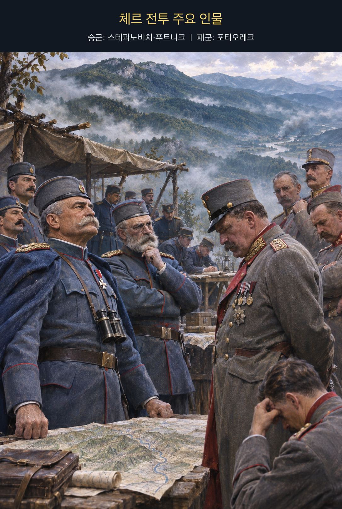

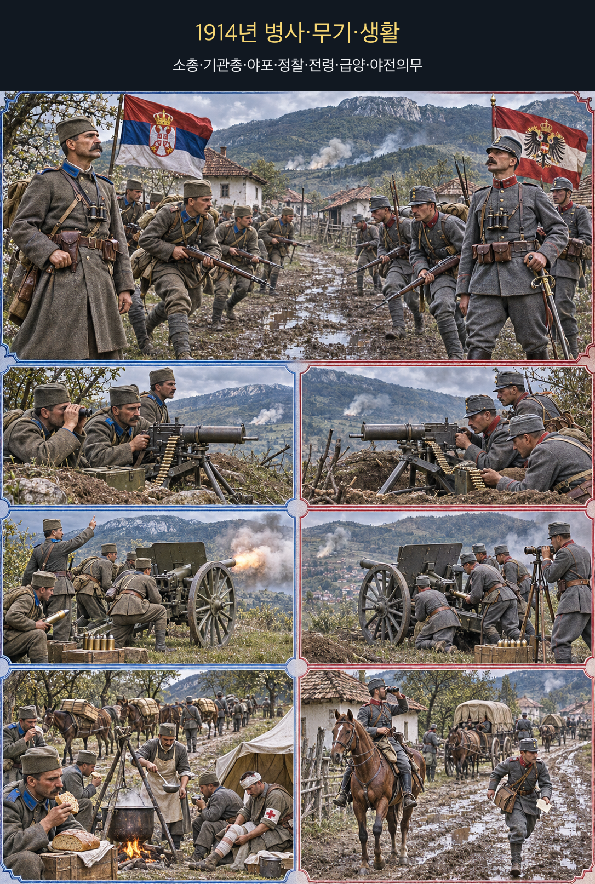

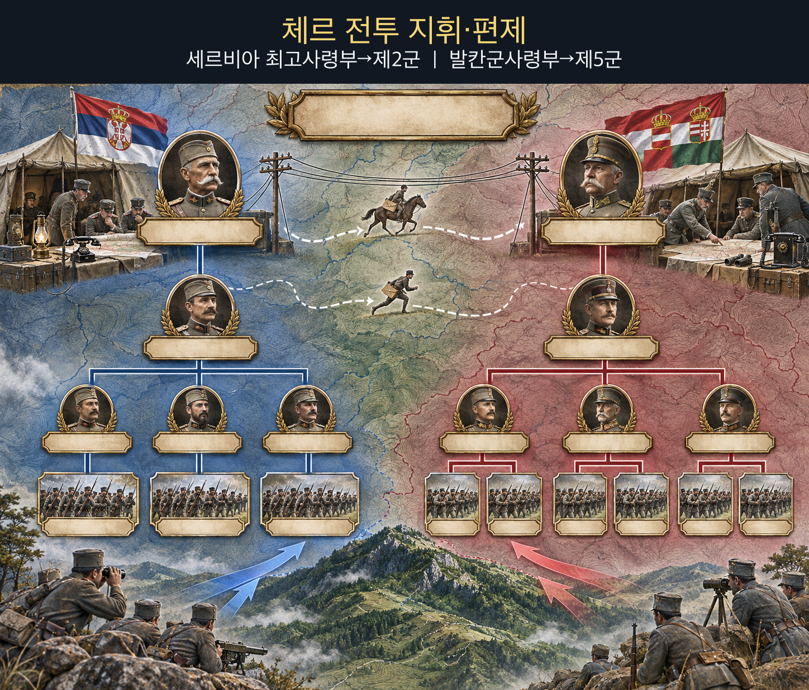

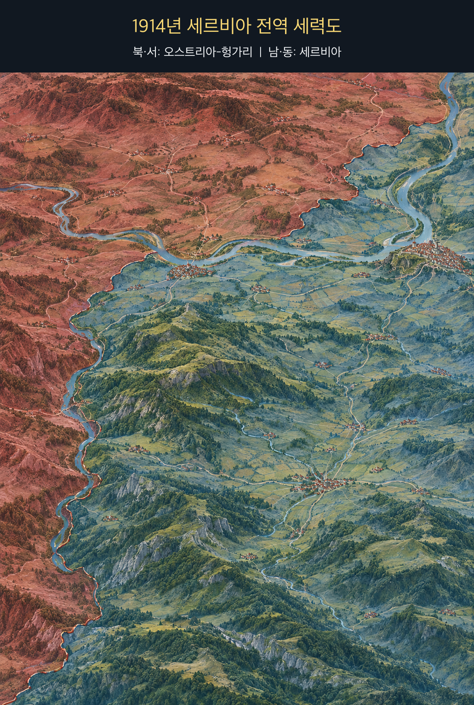

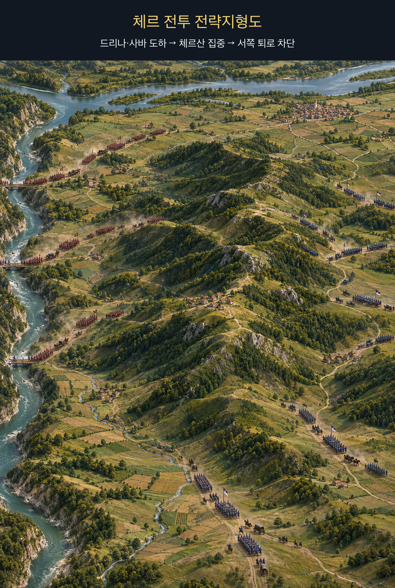

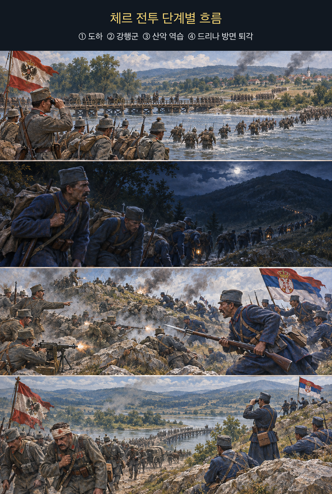

오스트리아-헝가리의 세르비아 공격은 사라예보 암살에 대한 대응이었지만, 암살 수사와 전쟁 결정은 같은 일이 아니었다. 빈 정부는 세르비아를 제압해 제국의 위신을 회복하고 발칸의 도전을 꺾으려 했고, 독일의 이른바 ‘백지수표’ 지원은 국지적 징벌전이 유럽 전쟁으로 번질 위험을 감수하게 했다. 따라서 이 사례의 핵심은 ‘화가 나서 아무 목적도 없었다’가 아니다. **정치적 목적은 있었지만, 얻을 성과와 확전 위험을 검증하는 절차보다 응징의 시간표가 앞섰다**는 데 있다.

**뒤에서 반복될 지형을 먼저 잡아두기**

- 🌊 **드리나강(Drina River)**은 보스니아와 세르비아 사이의 서쪽 장벽이다. 포티오레크는 이 강을 넘어 발예보로 진격하려 했으나, 도하 지점과 산악 도로가 병력 집중을 늦췄다.
- 🌊 **사바강(Sava River)**과 **▰** **샤바츠(Šabac)**는 북쪽 도하축이었다. 북쪽 시위와 서쪽 주공이 갈라지면서 세르비아 최고사령부는 주공을 늦게 판별했지만, 공격군도 상호 지원이 어려웠다.
- ⛰️ **체르산(Cer Mountain)**은 드리나 저지와 마치바 평야 사이의 능선 장벽이다. 이곳을 잡으면 발예보와 세르비아 내륙으로 이어지는 길을 통제할 수 있었다.
- **▰** **발예보(Valjevo)**는 오스트리아-헝가리군이 노린 내륙 결절점이었다. 세르비아군은 이곳과 체르 사이에서 제2군을 전환해 주공을 막았다.
- **테케리시(Tekeriš)–야다르(Jadar) 축**은 야간 접촉과 역습이 집중된 길목이다. 세르비아군이 이 능선을 지키자 공격군의 도하 교두보는 내륙 돌파로 연결되지 못했다.

#### 전투의 서사 — 징벌의 정치 시간표가 분산 도하와 산악 패주로 바뀌다

6월 28일 사라예보 암살 뒤 오스트리아-헝가리 지도부는 세르비아를 제압할 기회로 위기를 다뤘다. 7월 23일 제시한 최후통첩은 48시간 안에 광범위한 요구를 받아들이게 했고, 세르비아가 대부분을 수용했어도 외교관계는 끊어졌다. 7월 28일 선전포고 뒤 **오스카르 포티오레크(Oskar Potiorek)**는 발칸군을 지휘해 서쪽 보스니아에서 🌊 **드리나강(Drina River)**을 건너는 공세를 택했다. 공격 방향은 세르비아가 예상한 북쪽 모라바축과 달랐으나, 제5군의 도하와 북쪽 부대의 움직임이 분리돼 있었다.

세르비아 최고사령관 **라드미르 푸트니크(Radomir Putnik)**는 주공을 확인한 뒤 **스테파 스테파노비치(Stepa Stepanović)**의 제2군을 ⛰️ **체르산(Cer Mountain)**으로 돌렸다. 🪖 보병은 하루 수십 킬로미터를 행군했고, 8월 15~16일 밤 능선에서 양측 선두가 충돌했다. **스테파노비치**는 우발적 접촉을 국지전으로만 보지 않고 산악 전체의 주도권을 건 싸움으로 판단해 증원을 밀어 넣었다. 반면 **포티오레크**의 부대들은 강과 능선 사이에서 서로의 진척을 충분히 맞추지 못했다.

세르비아군의 역습이 테케리시와 능선의 거점을 되찾자 오스트리아-헝가리군은 🌊 **드리나강(Drina River)** 쪽으로 밀렸다. **▰** **샤바츠(Šabac)** 일대의 전투는 더 이어졌지만 첫 침공의 내륙 돌파는 실패했다. 이 승리를 세르비아의 의지 하나로 설명하면 부족하다. 공격군의 분산 도하, 불완전한 협동, 험한 접근로와 보급 부담이 세르비아의 빠른 집중과 결합했다. 징벌전으로 출발한 행동은 세르비아를 굴복시키지 못했고, 오히려 유럽 전쟁의 전선을 하나 더 열었다.

#### 전투에서 사용된 속임수 — 의도적 기만보다 더 중요했던 국지전이라는 희망

체르 전투의 승패를 가른 대표적 거짓 정보 작전은 확인되지 않는다. 오스트리아-헝가리의 서쪽 주공이 세르비아의 초기 배치를 흔들었지만, 이를 정교한 기만계획으로 단정하기보다 작전 방향의 선택과 정보 지연으로 보는 편이 안전하다. 더 큰 오독은 정치 단계에 있었다. 빈과 베를린은 세르비아에 대한 강압이 러시아·프랑스·영국을 잇는 연쇄 반응을 낳을 가능성을 알면서도 통제 가능한 위기로 취급했다.

#### 속임수 작동 구조

**주체와 의도.** 오스트리아-헝가리는 세르비아를 신속히 굴복시켜 발칸의 위신과 억지력을 회복하려 했다.

**보인 신호와 믿은 이유.** 독일의 전폭 지원과 세르비아의 상대적 소국 지위는 국지적 징벌이 가능하다는 확신을 강화했다. 이는 고의로 꾸민 전장 신호라기보다 동맹 보장과 과거 위기의 경험이 만든 위험한 기준점이었다.

**유발된 행동과 결과.** 외교적 숙고 시간이 줄고 최후통첩·동원·선전포고가 이어졌다. 실제 전장에서는 여러 도하축이 분산되고 체르산의 저항을 돌파하지 못해 첫 침공이 후퇴로 끝났다.

**사료의 경계.** 개인의 분노만으로 국가 결정을 설명할 수 없다. 제국 안보, 민족주의, 군부의 선제전쟁론과 동맹구조가 함께 작동했으며, 여기서 ‘怒’는 감정 하나가 아니라 응징 욕구가 비용·위험 검토를 압도한 결정 구조를 가리킨다.

#### 속임수 일곱 질문

1. **누가 누구를 속였는가?** 전투 승패를 결정한 단일 의도적 기만은 사료로 확인하기 어렵다.
2. **어떤 사실이 거짓이었는가?** 세르비아가 쉽게 굴복하고 전쟁이 국지적으로 통제될 것이라는 가정은 사실로 검증되지 않은 전망이었다.
3. **어떤 사실은 진실이지만 오해를 유도했는가?** 독일의 지원은 진실이었지만 그것이 러시아 개입과 다전선 비용을 제거하지는 않았다.
4. **상대는 왜 그것을 믿고 싶어 했는가?** 신속한 응징이 제국의 위신과 억지력을 회복한다는 정치적 기대가 있었다.
5. **속임수가 없었어도 같은 오판이 발생했을까?** 가능성이 높다. 오판의 핵심은 적이 만든 거짓보다 자기 확신과 확전 위험의 과소평가였다.
6. **속은 사람은 어떤 독립 확인을 생략했는가?** 러시아 동원 가능성, 세르비아군의 동원·지형 방어력, 분산 도하 뒤의 지속 가능성을 충분히 반증하지 못했다.
7. **신뢰·동의·안전을 해치지 않으면서 같은 원리를 어디서 연습할 수 있는가?** 위기 모의훈련에서 ‘국지적으로 끝난다’는 가정을 빼고 동맹·제3자 반응을 포함한 대안 시나리오를 만든다.

#### 시계편 兵者詭道也 — 이 전장에 해당하는 속이는 길

<table fit-page-width="true" header-row="true">
<tr><td>해당 구절·독음·뜻</td><td>전장의 장면</td></tr>
<tr><td>近而示之遠 근이시지원 — 가까우면서 멀리 있는 듯 보인다</td><td>서쪽 도하축은 세르비아가 북쪽 주공을 예상한 틈을 이용했으나, 이것이 정교한 기만 명령이었는지는 불명확하다.</td></tr>
</table>

#### 法 한눈 비교 — 곡제·관도·주용

<table fit-page-width="true" header-row="true">
<tr><td>진영</td><td>곡제(편제)</td><td>관도(지휘)</td><td>주용(보급·지속)</td></tr>
<tr><td>**세르비아군**</td><td>제2군을 주공에 전환하고 사단을 능선에 연속 투입했다.</td><td>최고사령부의 전환 명령과 스테파노비치의 현장 집중이 이어졌다.</td><td>자국 내선과 강행군으로 짧은 결전 구간에 전력을 모았다.</td></tr>
<tr><td>**오스트리아-헝가리군**</td><td>도하축과 군단이 강·산악으로 분리됐다.</td><td>포티오레크의 정치·군사 압박 아래 제5군과 북부 움직임의 협동이 약했다.</td><td>교량·강 건너 보급과 산악 도로가 공세 지속을 제약했다.</td></tr>
</table>

#### **오스카르 포티오레크 (패)**

<table fit-page-width="true" header-row="true">
<tr><td>요소</td><td>판단</td></tr>
<tr><td color="orange_bg">🤝 **道**</td><td>응징의 정치 목적이 병사에게 명료한 작전 종착점으로 번역되지 않았고, 첫 역습 뒤 사기가 흔들렸다. (지기·사기)</td></tr>
<tr><td color="blue_bg">🌤️ **天**</td><td>세르비아의 빠른 집중과 러시아 개입이라는 외부 변수를 낮게 보았다. 짧은 징벌전 전망에 과도한 확률을 주었다. (지피·타이밍·확률 관점)</td></tr>
<tr><td color="green_bg">🧭 **地**</td><td>강 도하 뒤 ⛰️ **체르산(Cer Mountain)**의 능선과 제한된 도로가 군단 결합을 끊었다. (원근·험이·광협)</td></tr>
<tr><td color="purple_bg">🎖️ **將**</td><td>**포티오레크**는 결단력은 있었으나 정치적 조급함을 군사적 준비보다 앞세웠다. (지·용 부족, 분속 위험)</td></tr>
<tr><td color="yellow_bg">⚙️ **法**</td><td>여러 도하축과 불완전한 보급선이 전투력을 동시에 집중하지 못하게 했다. (곡제·관도·주용)</td></tr>
</table>

🏳️ **패군 측 결과** 첫 세르비아 침공은 격퇴됐고, 六敗(육패) 중 `北`(배, 적정을 충분히 헤아리지 못하고 강행해 패주함)에 가깝다.

🔀 **패군 측 회피 분기점** 최후통첩 뒤 외교적 중재 시간을 확보하고, 전쟁을 택하더라도 북·서 도하축의 목표와 보급을 통합할 때까지 공세를 늦췄다면 체르에서의 급격한 패주는 줄일 수 있었다. 다만 유럽 동맹구조상 국지전 보장은 불가능했다.

**직관·편향 한 줄:** **포티오레크**의 서쪽 공세와 빈 정부의 징벌 구상은 ‘소국 세르비아는 빨리 굴복할 것’이라는 기준점·과신이 작동한 것으로 볼 수 있으며, 세르비아의 내선 집중과 확전 가능성을 축소했다.

#### **스테파 스테파노비치 (승)**

<table fit-page-width="true" header-row="true">
<tr><td>요소</td><td>판단</td></tr>
<tr><td color="orange_bg">🤝 **道**</td><td>침공 방어라는 목적이 분명했고, 피로한 🪖 보병도 능선 역습을 지속했다. (지기·사기)</td></tr>
<tr><td color="blue_bg">🌤️ **天**</td><td>초기 주공 오판을 고집하지 않고 새 정보에 따라 제2군을 돌렸다. 불확실성을 없애지 못했지만 빠른 집중으로 유리한 결과의 확률을 높였다. (지피·타이밍·확률 관점)</td></tr>
<tr><td color="green_bg">🧭 **地**</td><td>테케리시와 능선을 연결해 공격군이 강에서 멀어질수록 취약해지는 구조를 이용했다. (험이·사생)</td></tr>
<tr><td color="purple_bg">🎖️ **將**</td><td>**스테파노비치**는 야간 접촉을 전체 전장의 전환점으로 읽고 예비를 투입했다. (지·신·용)</td></tr>
<tr><td color="yellow_bg">⚙️ **法**</td><td>제2군 사단의 강행군과 연속 투입으로 국지적 수적 우세를 만들었다. (곡제·관도·주용)</td></tr>
</table>

🏆 **승군 측 결과** 세르비아군은 첫 침공을 격퇴했다. 五勝(오승) 중 `以虞待不虞者勝`(이우대불우자승, 대비한 채 대비하지 못한 적을 상대하는 자가 이긴다)과 `識衆寡之用者勝`(식중과지용자승, 많고 적은 병력의 쓰임을 아는 자가 이긴다)에 가깝다.

##### 法을 압축하지 않고 보기 — 곡제·관도·주용

**곡제 曲制(곡제): 부대를 어떻게 나누고 결합했는가**
<table fit-page-width="true" header-row="true">
<tr><td>진영</td><td>실제 운용</td></tr>
<tr><td>**세르비아군**</td><td>제2군의 콤비네이션 사단 등 가용 부대를 ⛰️ **체르산(Cer Mountain)** 방향으로 돌려 선두 접촉을 연속 증원했다.</td></tr>
<tr><td>**오스트리아-헝가리군**</td><td>제5군과 주변 부대가 서로 다른 강·도로를 사용해 선두가 고립되기 쉬웠다.</td></tr>
</table>

**관도 官道(관도): 누가 명령하고 어떻게 전달했는가**
<table fit-page-width="true" header-row="true">
<tr><td>진영</td><td>실제 운용</td></tr>
<tr><td>**세르비아군**</td><td>**푸트니크**의 최고사령부가 주공 판단을 갱신하고 **스테파노비치**가 제2군의 현장 집중을 지휘했다.</td></tr>
<tr><td>**오스트리아-헝가리군**</td><td>**포티오레크**가 발칸군을 통괄했으나 분산된 군단의 이동·보고가 산악과 강으로 지연됐다.</td></tr>
</table>

**주용 主用(주용): 군량·장비·전투 지속 능력을 어떻게 썼는가**
<table fit-page-width="true" header-row="true">
<tr><td>진영</td><td>실제 운용</td></tr>
<tr><td>**세르비아군**</td><td>탄약과 장비가 넉넉하지 않았지만 자국 내선에서 🪖 보병을 짧은 결전축으로 이동시켰다. 세부 일일 급양량은 사료상 불명이다.</td></tr>
<tr><td>**오스트리아-헝가리군**</td><td>도하교와 산악 도로에 수송이 묶였고, 후퇴 때 강을 다시 건너야 해 장비와 사상자 회수가 어려웠다.</td></tr>
</table>

**사료와 연구:** [세르비아 국방부 — 체르 전투](https://www.mod.gov.rs/lat/17052/cerska-bitka-prva-pobeda-antante17052) · [International Encyclopedia of the First World War — July Crisis 1914](https://encyclopedia.1914-1918-online.net/article/july-crisis-1914/) · [미 국무부 사료집 — 1914년 오스트리아-세르비아 위기](https://history.state.gov/historicaldocuments/frus1914Supp/d194)

---

### 동양 — 🏛️ 촉한 vs 🏛️ 손오 │ 이릉대전(夷陵之戰, 221~222)

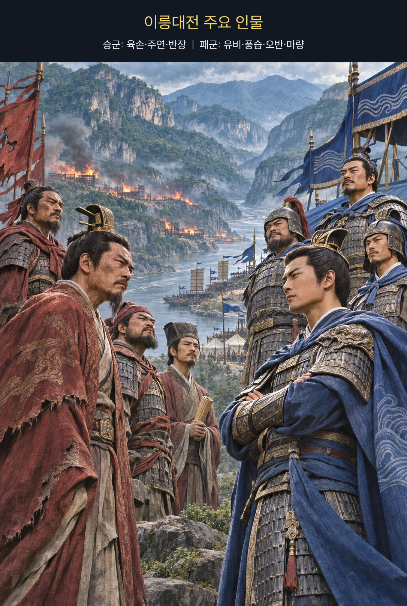

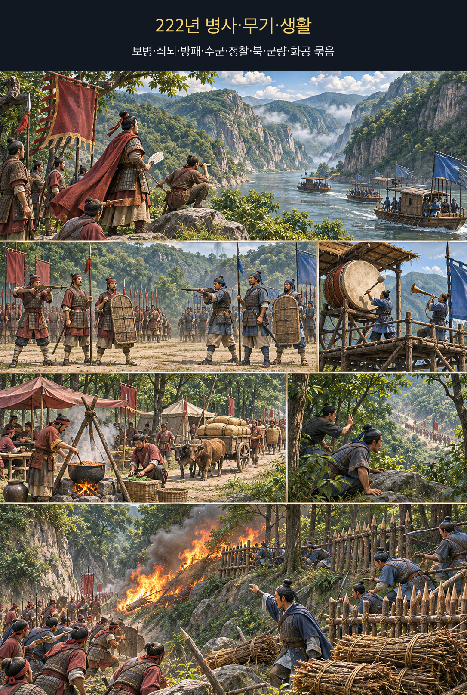

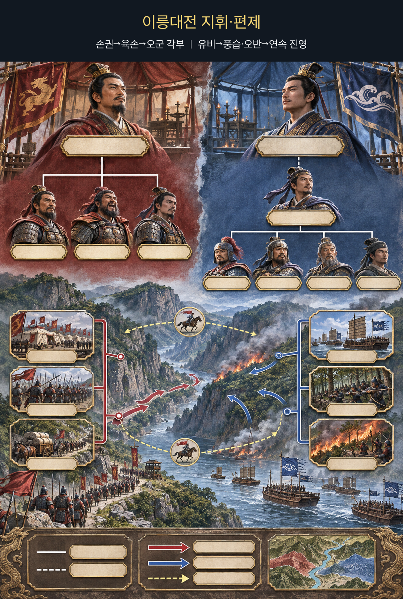

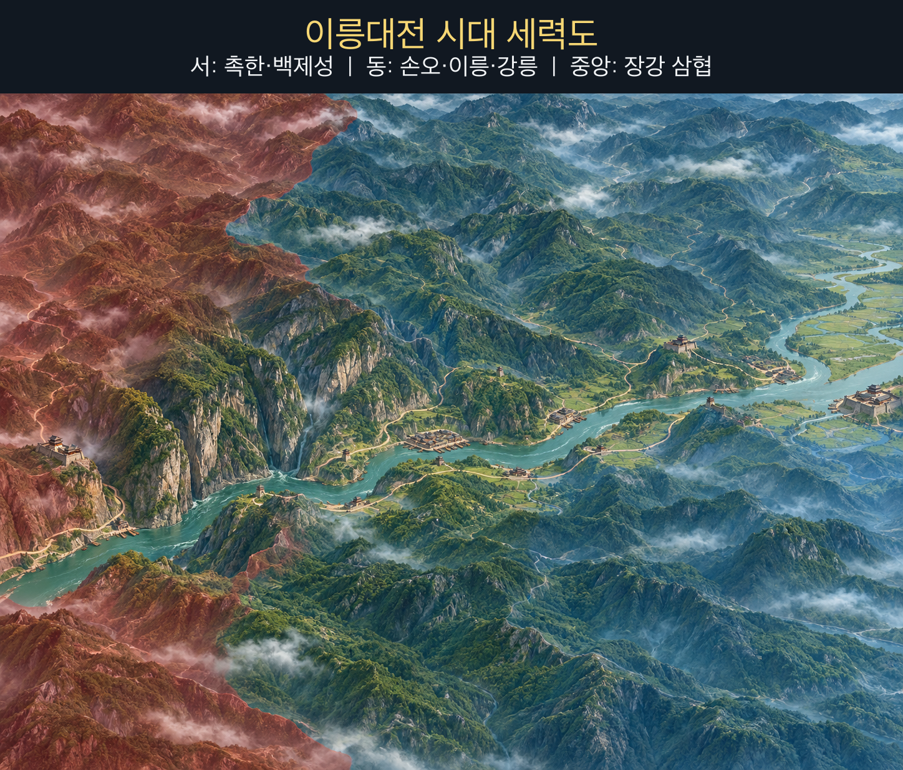

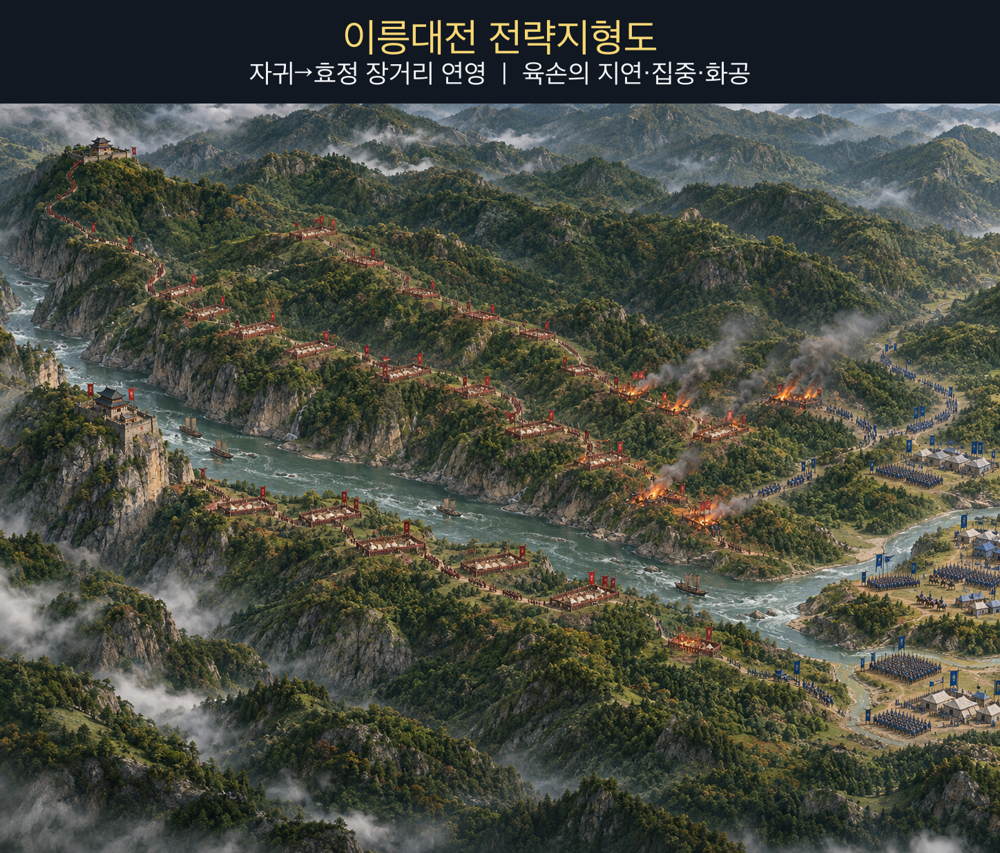

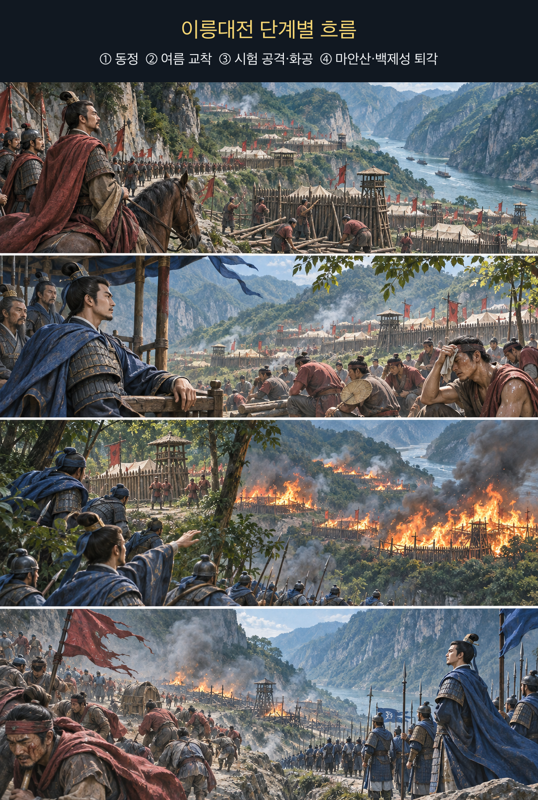

『삼국지』 선주전은 **유비**가 손권의 관우 습격에 분노해 동정을 준비했고, 손권의 화의 요청에도 “성대히 노하여” 허락하지 않았다고 기록한다. 그러나 이 전쟁에는 관우의 복수 외에도 형주 상실, 장강 중류의 전략축, 촉한 정권의 정통성과 동맹 재편이 얽혀 있었다. **사적 감정만으로 국가전략을 설명하지 않되, 감정이 화의와 대안 검토의 문턱을 낮춘 기록은 분명히 구분해 읽어야 한다.**

**뒤에서 반복될 지형을 먼저 잡아두기**

- **▰** **백제성(白帝城)**은 촉한의 동쪽 관문이자 패전 뒤 **유비**가 물러난 최종 방어거점이다.
- 🌊 **장강(長江)**과 ⛰️ **무협(巫峽)**은 서쪽 촉한에서 형주로 나가는 좁은 회랑이다. 수륙군과 보급이 같은 축에 길게 늘어졌다.
- **▰** **자귀(秭歸)**는 촉군의 전진 거점이었고, 이후 동쪽 연속 진영의 출발점이 됐다.
- **▰** **이릉(夷陵)**·**▰** **효정(猇亭)**은 삼협 출구의 병목이다. 육손은 이 선에서 더 물러나지 않고 촉군의 장기 주둔을 기다렸다.
- ⛰️ **마안산(馬鞍山)**은 패주 중 마지막으로 병력이 모인 고지였다. 진영이 연쇄 붕괴한 뒤에는 조직적 방어선이 되지 못했다.

#### 상세 전역 서사 — 화의를 거부한 동정이 수백 리 연영과 화공의 표적이 되다

219년 손권군이 형주를 빼앗고 관우를 죽인 뒤 촉한은 동쪽 전략축과 핵심 지휘관을 함께 잃었다. 221년 **유비(劉備)**는 황제에 오른 뒤 오 정벌을 시작했다. 손권은 화의를 청했지만 **유비**는 격노해 받아들이지 않았다. 촉군은 초기 교전에서 오군을 밀어내며 **▰** **자귀(秭歸)**에서 **▰** **이릉(夷陵)**·**▰** **효정(猇亭)** 방면으로 전진했다.

손권은 **육손(陸遜)**을 대도독으로 삼아 주연·반장·한당·서성·손환 등을 지휘하게 했다. 오군 장수들은 즉시 싸우거나 포위된 손환을 구하자고 재촉했지만 **육손**은 촉군의 예봉과 고지 진영을 이유로 거부했다. 촉군은 오반의 일부 병력을 평지에 내보내 도전하고 골짜기에 복병을 두었으나 **육손**은 응하지 않았다. 이 지연은 화려한 거짓말이 아니라 **적이 스스로 긴 전선을 만들 때까지 싸움의 시간을 내주지 않는 통제**였다.

교착이 길어지고 여름 더위가 심해지자 촉군의 수륙 협동은 약해졌다. 수백 리에 걸친 진영은 서로 지지하기 어려웠고, 숲과 나무 울타리는 불에 취약했다. **육손**은 먼저 한 진영을 시험 공격해 손실을 보았지만, 그 과정에서 화공 가능성을 확인했다. 오군은 병사들에게 마른 풀 묶음을 들게 하고 여러 진영에 불을 놓은 뒤 동시에 공격했다. 기록은 40여 진영이 무너지고 풍습·장남 등 촉 장수가 죽었다고 전한다.

**유비**는 ⛰️ **마안산(馬鞍山)**에 병력을 모았으나 포위를 견디지 못하고 밤에 도주해 **▰** **백제성(白帝城)**으로 들어갔다. 오군이 끝까지 추격하지 않은 데에는 위의 개입 위험도 있었다. 이 승패를 ‘불 한 번’으로 줄이면 핵심을 놓친다. 화공은 수개월의 지연, 촉군의 장거리 연영, 지휘·보급 분산, 시험 공격으로 확인한 취약점이 결합된 마지막 타격이었다.

#### 전투에서 사용된 속임수 — 촉군의 평지 도전과 육손의 거부

**유비**는 **오반**에게 수천 명을 평지에 주둔시켜 오군을 끌어내게 하고 골짜기에 복병을 두었다. 보인 것은 공격하기 쉬운 소수 진영이었고, 숨긴 것은 협곡의 매복이었다. 그러나 **육손**은 촉군이 강한 고지를 버리고 평지에 노출된 이유를 의심해 응전하지 않았다. 이 기만은 간파됐고, 오군의 지연은 반대로 촉군이 진영을 길게 늘이고 피로해지는 시간을 만들었다.

#### 속임수 작동 구조

**주체와 의도.** **유비**와 **오반**은 약한 선두를 보여 오군을 협곡 복병 앞으로 끌어내려 했다.

**보인 신호와 믿은 이유.** 평지의 소수 부대는 쉽게 공격할 수 있는 표적으로 보였다. 오군 장수들도 싸움을 재촉했으므로 유인은 당시 기대와 맞았다.

**유발된 행동과 결과.** **육손**은 비정상적으로 좋은 표적을 독립 확인하고 공격을 금지했다. 촉군 복병은 쓰이지 못했고, 장기 교착이 촉군에 불리하게 흘렀다.

**사료의 경계.** 오군의 지연 전체가 촉군을 속이기 위한 위장 후퇴였다고 단정할 수는 없다. 육손전이 분명히 기록하는 것은 촉군의 유인과 육손의 간파, 이후 조건이 바뀐 뒤의 화공이다.

#### 속임수 일곱 질문

1. **누가 누구를 속였는가?** **유비·오반**이 **육손과 오군 장수들**을 평지로 유인하려 했다.
2. **어떤 사실이 거짓이었는가?** 평지의 수천 명이 고립된 쉬운 표적이라는 인상이 거짓이었다.
3. **어떤 사실은 진실이지만 오해를 유도했는가?** 병력이 실제로 평지에 있었지만 뒤의 골짜기 매복을 숨겼다.
4. **상대는 왜 그것을 믿고 싶어 했는가?** 오군 장수들은 장기간 수세와 손환 구원 문제 때문에 즉시 싸우고 싶어 했다.
5. **속임수가 없었어도 같은 오판이 발생했을까?** 가능성은 중간이다. 조급함은 있었지만 육손의 지휘 통제가 독립 확인을 강제했다.
6. **속은 사람은 어떤 독립 확인을 생략했는가?** 육손은 생략하지 않았다. 표적이 지나치게 유리한 이유와 주변 골짜기를 함께 판단했다.
7. **신뢰·동의·안전을 해치지 않으면서 같은 원리를 어디서 연습할 수 있는가?** 체스·바둑·보드게임에서 일부 말을 노출하고 상대의 응수를 예상하되, 실제 조직에서는 ‘너무 좋은 기회’의 숨은 비용을 검토한다.

#### 시계편 兵者詭道也 — 이 전장에 해당하는 속이는 길

<table fit-page-width="true" header-row="true">
<tr><td>해당 구절·독음·뜻</td><td>전장의 장면</td></tr>
<tr><td>利而誘之 이이유지 — 이익을 보여 유인한다</td><td>**오반**의 평지 진영은 오군에게 쉬운 전과를 보여 골짜기 복병 앞으로 끌어내려 했다.</td></tr>
<tr><td>近而示之遠 근이시지원 — 가까우면서 멀리 있는 듯 보인다</td><td>눈앞의 소수 병력 뒤에 가까이 있던 복병의 실제 위협을 감췄다.</td></tr>
</table>

#### 法 한눈 비교 — 곡제·관도·주용

<table fit-page-width="true" header-row="true">
<tr><td>진영</td><td>곡제(편제)</td><td>관도(지휘)</td><td>주용(보급·지속)</td></tr>
<tr><td>**오군**</td><td>여러 장수의 부대를 육손 지휘 아래 묶고 반격 시점에 결합했다.</td><td>손권이 육손에게 가절을 주어 고참 장수를 통제하게 했다.</td><td>자국 방어선에 가까운 짧은 보급축에서 교착을 견뎠다.</td></tr>
<tr><td>**촉군**</td><td>수백 리에 걸친 수십 진영이 상호 지원하기 어려웠다.</td><td>유비의 친정 아래 별독들이 긴 축에 분산됐다.</td><td>삼협을 지난 장거리 보급과 여름 주둔으로 지속 능력이 낮아졌다.</td></tr>
</table>

#### **유비 (패)**

<table fit-page-width="true" header-row="true">
<tr><td>요소</td><td>판단</td></tr>
<tr><td color="orange_bg">🤝 **道**</td><td>관우의 죽음과 형주 회복은 강한 동원 명분이었지만, 화의 거부 뒤의 구체적 종착점과 감당 가능한 비용이 약했다. 패전 때 수십 진영이 연쇄 붕괴했다. (지기·사기)</td></tr>
<tr><td color="blue_bg">🌤️ **天**</td><td>**육손**의 장기 수세와 위의 개입 가능성을 충분히 활용하지 못했다. 초기 승리를 계속될 추세로 본 표본 일반화 위험이 있었다. (지피·타이밍·확률 관점)</td></tr>
<tr><td color="green_bg">🧭 **地**</td><td>🌊 **장강(長江)** 회랑을 따라 진영을 길게 늘여 숲·협곡·절벽이 상호 지원을 끊었다. (원근·험이·광협·사생)</td></tr>
<tr><td color="purple_bg">🎖️ **將**</td><td>**유비**는 경험과 용기는 강했으나 분노와 초기 성과가 철수·화의 재검토를 어렵게 했다. (지 부족·분속 위험)</td></tr>
<tr><td color="yellow_bg">⚙️ **法**</td><td>풍습을 대독으로 두고 여러 별독을 배치했으나, 수군과 육군·수십 진영의 지휘와 보급이 한 축으로 결합되지 못했다. (곡제·관도·주용)</td></tr>
</table>

🏳️ **패군 측 결과** 촉군은 40여 진영과 수륙 군수품을 잃고 **유비**는 **▰** **백제성(白帝城)**으로 물러났다. 六敗(육패) 중 `北`(배, 적정을 헤아리지 못한 패주)과 `亂`(란, 진영과 지휘 질서가 무너짐)이 겹친다.

🔀 **패군 측 회피 분기점** 손권의 화의 요청을 곧바로 수락하지 않더라도, 전쟁 목표·중단선·위의 개입 위험을 재검토하고 **▰** **자귀(秭歸)** 동쪽의 전선을 좁혔다면 수십 진영의 동시 붕괴는 피할 가능성이 있었다. 교착 뒤에는 수군을 육상 진영과 다시 결합하고 숲의 장기 숙영을 피했어야 했다.

**직관·편향 한 줄:** **유비**의 화의 거부와 장기 전진은 관우 피살이라는 생생한 손실이 가용성·손실회피를 키우고 초기 전과가 확증편향을 보탠 것으로 볼 수 있으며, 육손의 지연이 만든 새로운 위험을 늦게 반영했다.

#### **육손 (승)**

<table fit-page-width="true" header-row="true">
<tr><td>요소</td><td>판단</td></tr>
<tr><td color="orange_bg">🤝 **道**</td><td>고참 장수의 반발을 견디며 군령을 통일했고, 손환 구원을 위한 성급한 분산을 막았다. (지기·사기·충성)</td></tr>
<tr><td color="blue_bg">🌤️ **天**</td><td>촉군의 예봉이 강할 때 피하고 여름 교착으로 피로·진영 취약성이 커질 때 공격했다. 위의 움직임 때문에 추격 한계도 두었다. (지피·타이밍·확률 관점)</td></tr>
<tr><td color="green_bg">🧭 **地**</td><td>삼협 출구의 병목에서 더 물러나지 않고, 촉군의 긴 연영과 숲을 화공의 연결 표적으로 바꿨다. (험이·광협·사생)</td></tr>
<tr><td color="purple_bg">🎖️ **將**</td><td>**육손**은 유인을 간파하고 시험 공격의 손실에서 화공법을 찾아 여러 진영의 동시 붕괴로 연결했다. (지·신·엄)</td></tr>
<tr><td color="yellow_bg">⚙️ **法**</td><td>주연·반장·한당·서성·손환 등의 부대를 통제해 시험 공격 뒤 전군 동시 공격으로 전환했다. (곡제·관도·주용)</td></tr>
</table>

🏆 **승군 측 결과** 오군은 형주 서부 방어선을 지키고 촉한의 동정 주력을 격파했다. 五勝(오승) 중 `知可以戰與不可以戰者勝`(지가이전여불가이전자승, 싸울 때와 싸우지 않을 때를 아는 자가 이긴다)과 `將能而君不御者勝`(장능이군불어자승, 장수가 유능하고 군주가 간섭하지 않으면 이긴다)에 가깝다.

##### 法을 압축하지 않고 보기 — 곡제·관도·주용

**곡제 曲制(곡제): 부대를 어떻게 나누고 결합했는가**
<table fit-page-width="true" header-row="true">
<tr><td>진영</td><td>실제 운용</td></tr>
<tr><td>**오군**</td><td>**육손**이 주연·반장·한당·서성·손환 등 약 5만의 여러 부대를 통괄하고 반격 때 동시에 결합했다.</td></tr>
<tr><td>**촉군**</td><td>**풍습**을 대독으로 두고 오반·장남·보광·조융·요화·부융 등을 별독으로 나눴으나 진영이 수백 리에 분산됐다.</td></tr>
</table>

**관도 官道(관도): 누가 명령하고 어떻게 전달했는가**
<table fit-page-width="true" header-row="true">
<tr><td>진영</td><td>실제 운용</td></tr>
<tr><td>**오군**</td><td>**손권**이 **육손**에게 대도독·가절 권한을 주어 고참 장수들의 독자 행동을 막았다.</td></tr>
<tr><td>**촉군**</td><td>**유비**가 친정하고 **풍습** 이하 별독이 긴 전선의 각 진영을 맡아, 화공 때 보고와 상호 구원이 끊겼다.</td></tr>
</table>

**주용 主用(주용): 군량·장비·전투 지속 능력을 어떻게 썼는가**
<table fit-page-width="true" header-row="true">
<tr><td>진영</td><td>실제 운용</td></tr>
<tr><td>**오군**</td><td>형주 방어 기반과 🌊 **장강(長江)** 수로를 활용하고, 공격 시점을 늦춰 보급 부담을 상대에게 넘겼다. 세부 일일 급양량은 사료상 불명이다.</td></tr>
<tr><td>**촉군**</td><td>삼협을 지난 장거리 수륙 보급이 수백 리 진영으로 흩어졌고, 여름 숙영과 화재로 군수품을 한꺼번에 잃었다.</td></tr>
</table>

**사료와 연구:** [中國哲學書電子化計劃 — 『삼국지』 문제 관련 본기](https://ctext.org/text.pl?if=en&node=602030) · [『삼국지』 육손전 원문 자료](https://www.shidianguji.com/zh/book/SK0711/chapter/1l9yz2wga92qx) · [홍콩 교육자료 — 제갈량과 이릉대전](https://chiculture.org.hk/sites/mainsite/files/2019-08/0104_zhugeliang_pdf_hk.pdf)

---
## 5. 핵심 통찰 + 실생활 적용 + 생활루틴

### 핵심 통찰

이 구절의 중심은 냉정한 사람이 되라는 성격 훈련이 아니라, **되돌리기 어려운 행동 앞에 감정으로는 통과할 수 없는 세 문턱을 세우라**는 제도적 지혜다. 利는 왜 움직이는지, 得은 무엇을 얻는지, 危는 왜 지금 싸워야 하는지를 묻는다. 질문이 구체적일수록 분노는 행동 명령이 아니라 점검해야 할 정보가 된다.

또한 군주의 怒와 장수의 慍을 나눈 것은 지위가 높아도 감정에서 자유롭지 않다는 현실 인식이다. 오히려 권한이 클수록 한 사람의 감정이 더 많은 사람과 자원을 움직인다. 그러므로 감정 통제는 개인 수양에만 맡길 일이 아니라, 결정 사유·반대 검토·중단 조건을 남기는 절차로 보강해야 한다.

### 실생활 적용

3교대 현장에서 에러나 누락을 발견했을 때 화가 난 채 사람부터 몰아세우면, 원인 확인보다 책임 공방이 먼저 움직인다. 먼저 `지금 즉시 움직여 줄어드는 손실`, `이 조치로 얻을 정상 상태`, `조치하지 않을 때 커질 실제 위험`을 한 줄씩 적는다. 셋이 분명하면 담당과 시한을 정해 조치하고, 불분명하면 로그·알람·설비 상태를 더 확인한다. 감정은 이상 징후를 발견하게 했지만 조치 내용은 증거가 정해야 한다.

전씨가 단순 조치에서 흥분해 말을 반복하거나, 복잡한 조치에서 신경이 날카로워지는 것으로 관찰된 상황에서도 같은 원칙이 유효하다. 성격이나 의도를 단정해 맞서기보다 “지금 멈춰야 할 위험은 무엇인지, 어떤 버튼·기록·보고가 필요한지, 이 조치가 끝났다는 기준은 무엇인지”를 짧게 확인한다. 사용자는 상대의 목소리에 맞춰 필사적으로 반격하거나 과도하게 떠맡지 말고, 사실·담당·완료 조건을 공개된 언어로 고정해야 한다.

개인 생활에서도 화가 난 직후 메시지 전송, 구매, 일정 취소, 관계 단절처럼 되돌리기 어려운 행동은 같은 검사를 거친다. 지금 행동의 순이익, 얻을 구체적 결과, 미루면 생길 실제 위험을 적었는데 답이 “기분을 풀기 위해서”뿐이라면 전송과 결정을 늦춘다. 반대로 안전·기한·재산상 위험이 분명하다면 감정이 가라앉기만 기다리지 말고 필요한 최소 행동을 한다.

### 생활루틴

**화난 채로 이익·성과·위험을 적지 않고 결정하면 재수가 없다.** 감정이 결론을 먼저 만들면 눈앞의 도발만 크게 보이고, 조치의 목적과 후속 비용은 빠진다. 그러면 불필요한 말과 행동이 새 문제를 낳고, 처음에는 없던 위험까지 현실이 된다. 이는 怒와 慍이 利·得·危를 대신해 군을 움직이는 구조와 같다.

1. 되돌리기 어려운 행동 전 3분을 멈춘다.
2. `순이익 / 얻을 결과 / 미룰 때의 실제 위험`을 한 줄씩 쓴다.
3. 각 줄에 관찰 사실이나 기한이 없으면 즉시 행동하지 않는다.
4. 반대 결론을 낼 사람 한 명의 관점으로 다시 읽는다.
5. 행동할 때는 필요한 최소 범위와 중단 조건을 함께 정한다.

**한 줄 기억법:** 화는 경보다. 출동 명령은 이익·성과·위험이 내린다.
