<!-- sunzi-analysis-mode: light -->
> 합어리이동, 불합어리이지. 노가이복희, 온가이복열, 망국불가이복존, 사자불가이복생. — 감정은 되돌릴 수 있지만 나라와 생명은 되돌릴 수 없으니, 이익에 맞을 때만 움직인다.

---
## 1. 원문 + 독음 + 직역 + 한자어 뜻풀이

合於利而動, 不合於利而止. 怒可以復喜, 慍可以復悅, 亡國不可以復存, 死者不可以復生. 합어리이동, 불합어리이지. 노가이복희, 온가이복열, 망국불가이복존, 사자불가이복생.

	**직역**

	이익에 맞으면 움직이고, 이익에 맞지 않으면 멈춘다. 노여움은 다시 기쁨이 될 수 있고, 분함은 다시 즐거움이 될 수 있으나, 망한 나라는 다시 보존될 수 없고 죽은 사람은 다시 살아날 수 없다.

	화공편은 불을 놓는 방법만 가르친 뒤 끝나지 않는다. 불은 한 번 번지면 거두기 어렵고 전쟁은 한 번 시작하면 나라와 사람에게 돌이킬 수 없는 손실을 남긴다. 그래서 마지막 문장은 행동의 기준을 **利**에 맞추고, 일시적 감정과 비가역적 결과를 서로 맞세운다. 앞 구절의 `非利不動, 非得不用, 非危不戰`(비리부동, 비득불용, 비위부전 — 이익이 아니면 움직이지 않고, 얻음이 아니면 쓰지 않으며, 위태롭지 않으면 싸우지 않는다)이 세운 문턱을 이번 구절이 ‘움직임과 멈춤’의 대칭으로 완성한다.

	#### 合於利而動(합어리이동) — 움직임은 욕구가 아니라 조건에 맞아야 한다

	**合**(합할 합)은 서로 맞물려 기준에 들어맞는다는 뜻이고, **於**(어조사 어)는 판단이 기대는 대상을 표시한다. **利**(이로울 리)는 눈앞의 전과나 체면 회복이 아니라 국가 목적, 병력 보전, 비용, 후속 위험을 함께 계산한 이로움이다. **而**(말 이을 이)는 조건과 행동을 잇고, **動**(움직일 동)은 군대를 실제로 출동시키는 일이다. 따라서 ‘이익이 보이면 움직인다’가 아니라, 행동 전체가 공적 이익의 조건에 부합할 때 비로소 움직인다는 문장이다.

	#### 不合於利而止(불합어리이지) — 멈춤도 명령이고 능력이다

	**不合**(불합)은 기대했던 이익이 사라졌거나 비용과 위험을 합산하면 더는 기준에 맞지 않는 상태다. **止**(그칠 지)는 패배감에 굳어 버리는 것이 아니라 출동·공격·추격을 의식적으로 중단하는 판단이다. 상황이 바뀌었는데도 이미 내린 명령, 들인 비용, 상한 자존심 때문에 계속 나아가면 최초의 목적보다 과거 선택을 지키는 일이 앞선다. 손자는 動과 止를 같은 계산의 두 결론으로 놓아, 시작할 용기와 멈출 용기를 함께 요구한다.

	#### 怒可以復喜, 慍可以復悅(노가이복희, 온가이복열) — 감정은 강하지만 가역적이다

	**怒**(성낼 노)는 밖으로 크게 드러나는 분노이고 **慍**(성낼 온)은 모욕이나 원망이 안에 맺힌 감정이다. **可以**(가이)는 ‘할 수 있다’, **復**(다시 복)은 이전 상태로 돌아감을 뜻한다. **喜**(기쁠 희)와 **悅**(기쁠 열)은 오늘의 분노와 불쾌가 영구한 사실이 아님을 보여 준다. 새로운 정보, 시간의 경과, 사과와 조정으로 감정은 바뀔 수 있다. 바뀔 수 있는 감정을 당장 풀기 위해 바꿀 수 없는 결정을 내려서는 안 된다.

	#### 亡國不可以復存, 死者不可以復生(망국불가이복존, 사자불가이복생) — 판단의 마지막 기준은 회복 가능성이다

	**亡國**(망국)은 정치 공동체와 그 질서가 무너진 상태이고, **存**(있을 존)은 그것이 온전히 보존됨을 뜻한다. **死者**(사자)는 죽은 사람이며 **生**(날 생)은 살아 있음이다. 여기서 두 번 반복되는 **不可以復**(불가이복)은 앞의 `可以復`와 정면으로 대조된다. 감정은 되돌아오지만 멸망과 죽음은 같은 상태로 복구할 수 없다. 이 비대칭 때문에 권한이 큰 사람일수록 자기 감정보다 타인의 생명과 공동체의 존속을 먼저 계산해야 한다.

	#### 글자들이 완성하는 한 장면

	회의실에는 모욕적인 보고와 즉시 보복하자는 목소리가 올라온다. 그러나 지도 옆에는 두 갈래 명령이 놓인다. 국가의 장기 이익에 맞으면 움직이고, 맞지 않으면 멈춘다. 분노와 원망은 시간이 지나 기쁨과 평온으로 바뀔 수 있지만, 명령 때문에 사라진 나라와 죽은 사람은 돌아오지 않는다. **되돌릴 수 있는 감정이 되돌릴 수 없는 결정을 지휘하게 두지 않는 것**, 그것이 화공편의 마지막 안전장치다.

---
## 2. 전통 주석 기반 분석

- **조조(曹操)** — “이익에 맞을 때 움직이고 맞지 않으면 그쳐라. 분노는 풀릴 수 있어도 망국과 죽음은 되돌릴 수 없으니 군사를 삼가라.”
- **이전(李筌)** — “군주와 장수의 한때 감정은 바뀌지만 전쟁이 백성과 종묘사직에 남긴 손실은 바뀌지 않는다. 공적인 利로 사적인 怒를 눌러라.”
- **두목(杜牧)** — “合과 不合을 먼저 살피고 動과 止를 뒤에 정하라. 이미 움직였다는 이유로 계속하지 말고, 이익의 조건이 사라지면 멈춰라.”
- **매요신(梅堯臣)** — “喜·悅은 다시 얻을 수 있으나 存·生은 다시 얻을 수 없다. 가벼운 감정 때문에 무거운 결과를 만들지 마라.”
- **장예(張預)** — “군주의 분노와 장수의 울분은 자기 몸에서 끝나지 않고 군대 전체를 움직인다. 권한이 클수록 회복할 수 없는 손해를 먼저 두려워하라.”
- **왕석(王晳)** — “利는 탐욕스러운 이득이 아니라 나라와 백성을 온전히 하는 이로움이다. 나라를 망하게 하고 사람을 죽이면서 얻는 작은 전과는 合於利가 아니다.”
- **가림(賈林)** — “적은 모욕과 도발로 성냄을 재촉할 수 있다. 그때 즉시 움직이면 판단의 시기와 장소를 적에게 내주니, 멈추어 이익을 다시 헤아려라.”
- **두우(杜佑)** — “전쟁의 결정에는 시작 조건뿐 아니라 중단 조건도 있어야 한다. 利에 맞지 않게 된 순간 명령을 거두는 것이 나라를 보전하는 군정이다.”
- **진호(陳皞)** — “止를 비겁함으로 여기지 마라. 움직여야 할 때 움직이고 그쳐야 할 때 그치는 것이 모두 장수의 결단이며, 어느 쪽도 감정으로 정해서는 안 된다.”

#### 주석가들의 차이와 보완

조조·매요신은 `可以復`과 `不可以復`의 대조를 중심에 둔다. 감정은 다시 바뀔 수 있지만 국가의 멸망과 사람의 죽음은 원상복구할 수 없으므로, 결과의 무게가 행동의 문턱을 정해야 한다. 이전·장예는 이 비대칭을 권한의 윤리로 확장한다. 결정자의 감정은 개인 경험이지만 그 명령의 비용은 백성과 병사가 나누어 진다.

두목·두우·진호에게 動과 止는 한 쌍의 지휘 능력이다. 利가 사라졌는데도 계속하는 것은 결단력이 아니라 기준을 잃은 관성이다. 왕석은 利를 작은 전과와 구분하고, 가림은 적의 도발이 판단의 시간표를 빼앗을 수 있음을 경고한다. 아홉 주석을 합치면 **공적 이익을 계속 재평가하고, 감정이나 매몰비용이 아니라 현재 조건에 따라 시작과 중단을 모두 명령하라**는 결론이 된다.

#### 리링의 고증과 현대적 독법

리링(李零)의 해설 취지를 따라 문장 구조를 보면 `合—動 / 不合—止`, `怒—喜 / 慍—悅`, `亡國—存 / 死者—生`의 세 대구가 차례로 놓인다. 첫 대구는 판단 규칙, 둘째는 되돌릴 수 있는 감정, 셋째는 되돌릴 수 없는 결과다. 확인되지 않은 이문을 덧붙이기보다 `可以復`이 두 번, `不可以復`이 두 번 반복되며 가역성의 경계를 가르는 구조를 읽어야 한다.

이 문장은 利를 절대화한 이익지상주의가 아니다. 화공편 전체가 불이라는 파괴 수단의 조건과 대응을 다룬 뒤 망국과 죽음을 마지막에 놓았다는 점에서, 利는 국가 목적과 생명·비용·회복 가능성을 포함한 제약된 판단 기준이다. 수단의 위력이 클수록 ‘할 수 있는가’보다 ‘공적 목적에 맞는가, 중단할 수 있는가’를 먼저 물어야 한다.

---
## 3. 교차 설명

### ① 손자병법 내 교차

바로 앞 구절 `非利不動, 非得不用, 非危不戰`(비리부동, 비득불용, 비위부전 — 이익이 아니면 움직이지 않고, 얻음이 아니면 쓰지 않으며, 위태롭지 않으면 싸우지 않는다)은 출동·병력 사용·교전에 세 겹의 문턱을 세운다. 이번 구절은 그 문턱을 통과했더라도 利가 계속 유지되는지 살피고, 맞지 않으면 止하라고 한다. 개전 전 심사와 작전 중 재평가가 이어지는 구조다.

「모공편」의 `不戰而屈人之兵, 善之善者也`(부전이굴인지병, 선지선자야 — 싸우지 않고 적의 군대를 굴복시키는 것이 최선 중 최선이다)는 전투 자체를 利로 세지 못하게 한다. 싸우지 않고 정치적 목적을 이룰 수 있다면, 보복 전투의 만족보다 국가와 생명을 보전하는 쪽이 더 큰 이익이다.

「구지편」의 `合於利而動, 不合於利而止`와 호응하는 판단은 「군쟁편」의 `懸權而動`(현권이동 — 저울질한 뒤 움직인다)에서도 보인다. 저울질은 출발 전에 한 번 끝나는 계산이 아니다. 정보와 비용이 달라지면 저울도 다시 달아야 하며, 그 결과가 止라면 멈춤 역시 원칙에 맞는 행동이다.

### ② 클라우제비츠 『전쟁론』

클라우제비츠는 전쟁을 정치적 목적을 위한 수단으로 보고, 요구하는 희생이 정치적 목적의 가치와 균형을 잃으면 노력도 조정되어야 한다고 본다. 이는 合於利를 단발성 허가가 아니라 목적과 비용의 지속적인 비례 판단으로 읽게 한다. 군사 행동이 처음 목적보다 커져 스스로 목적이 되면 멈춤 기준을 잃는다.

차이도 있다. 클라우제비츠는 전쟁의 상호작용과 마찰 속에서 목적·수단의 변화를 분석하고, 손자는 喜·悅과 存·生의 대구로 결정자의 도덕적 책임을 압축한다. 둘을 함께 읽으면 전쟁의 불확실성을 인정하면서도, 비가역적 손실을 감정이나 군사적 관성에 맡기지 않을 제도적 재평가가 필요하다는 점이 드러난다.

### ③ 미야모토 무사시 『오륜서』

『오륜서』의 `観見二つの目付`(칸켄 후타츠노 메츠케 — 관과 견, 두 가지 눈매)는 눈앞의 자극을 보는 見과 전체 형세를 보는 観을 함께 요구한다. 怒와 慍은 당장의 모욕을 화면 가득 채우지만, 亡國과 死者는 행동 뒤에 나타날 전체 결과다. 観은 지금의 감정보다 긴 시간축에서 무엇이 남는지 보게 한다.

무사시는 한 번 잡은 박자에 매달리기보다 상대와 상황의 리듬 변화를 읽는다. 손자의 止도 굳어진 계획을 버리고 조건 변화에 맞추는 능력이다. 다만 개인 결투의 결단을 국가 전쟁의 책임과 그대로 같게 볼 수는 없다. 국가 결정에는 개인의 평정뿐 아니라 반대 검토, 권한 분리, 기록 가능한 중단 조건이 더 필요하다.

### ④ 오자병법과 육도

『오자병법』의 `凡兵之所起者有五: 一曰爭名, 二曰爭利, 三曰積惡, 四曰內亂, 五曰因饑`(범병지소기자유오… — 전쟁이 일어나는 까닭에는 명예·이익·쌓인 원한·내란·기근이 있다)는 전쟁 동기를 나누어 본다. 그 가운데 명예와 쌓인 원한은 怒·慍과 결합하기 쉽다. 원인이 존재한다는 사실과 전쟁이 공적 이익에 맞는다는 판단은 별개이므로, 각 동기를 合於利의 기준으로 다시 걸러야 한다.

『육도』는 군주의 정치 목적과 장수의 군권을 연결하면서도 장수가 백성과 군대를 보전할 조건을 갖추어야 한다고 본다. 이번 구절은 위임된 명령도 무조건 지속되는 것이 아니라는 경계를 준다. 현장 조건이 목적과 어긋나면 보고·재평가·중단할 통로가 있어야 공적 군권이 사적 분노나 조직의 체면으로 변하지 않는다.

### ⑤ 현대 심리학·군사학

현대 의사결정에서 중요한 것은 시작 승인만이 아니라 사전 중단 기준과 재검토 시점이다. 목표, 기대 이익, 허용 손실, 철수 조건을 미리 적으면 상황이 바뀐 뒤에도 “여기까지 왔으니 계속한다”는 매몰비용 오류를 줄일 수 있다. 合於利는 현재 자료로 계속 검증해야 하는 조건이지, 한 번 발급하면 취소되지 않는 허가증이 아니다.

카너먼의 관점에서 분노는 확신과 통제감을 높이고 위험을 작게 보게 할 수 있다. 손실을 인정하기 싫은 심리는 중단을 패배로 느끼게 하고, 이미 투입한 비용은 추가 투입의 근거처럼 보인다. 그러나 과거 비용은 회수되지 않는다. 앞으로 얻을 이익과 앞으로 감수할 손실만이 動과 止의 비교 대상이어야 한다.

군사학의 비례성·필요성·구별 원칙은 이 구절을 현대에 옮길 때 중요한 한계를 제공한다. 공적 이익이 있다고 주장하는 것만으로 무력 사용이 정당화되지는 않는다. 법적 권한, 민간인 보호, 대안의 존재, 예상 피해를 함께 심사해야 한다. ‘利’를 좁은 승리나 조직 이익으로 축소하면 망국과 죽음을 경계한 결구의 뜻을 거스른다.

---
## 4. 역사적 실증 사례

### 서양 — 🇺🇸 미국 vs 🏛️ 소련·🇨🇺 쿠바 │ 쿠바 미사일 위기(Cuban Missile Crisis, 1962)

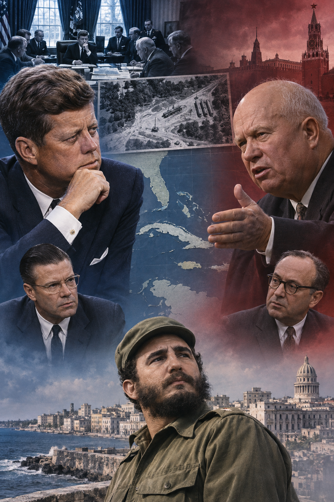
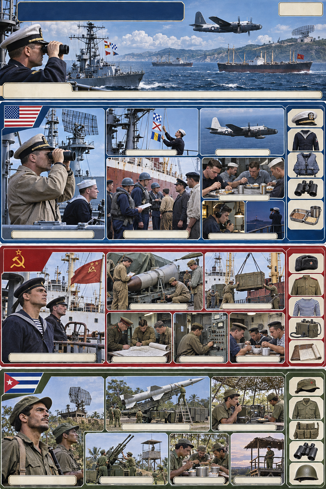
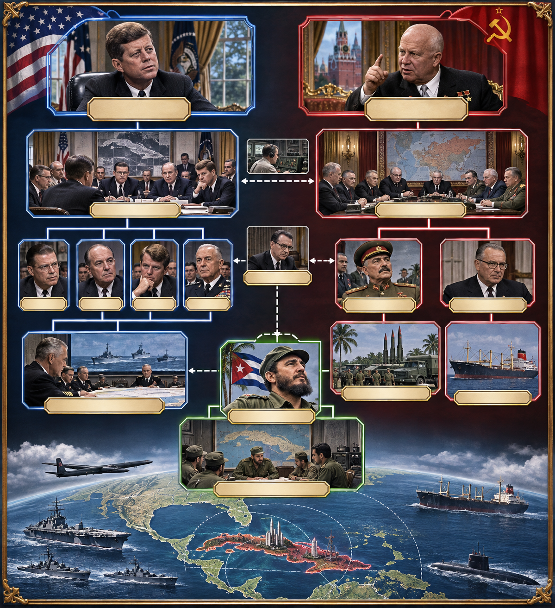
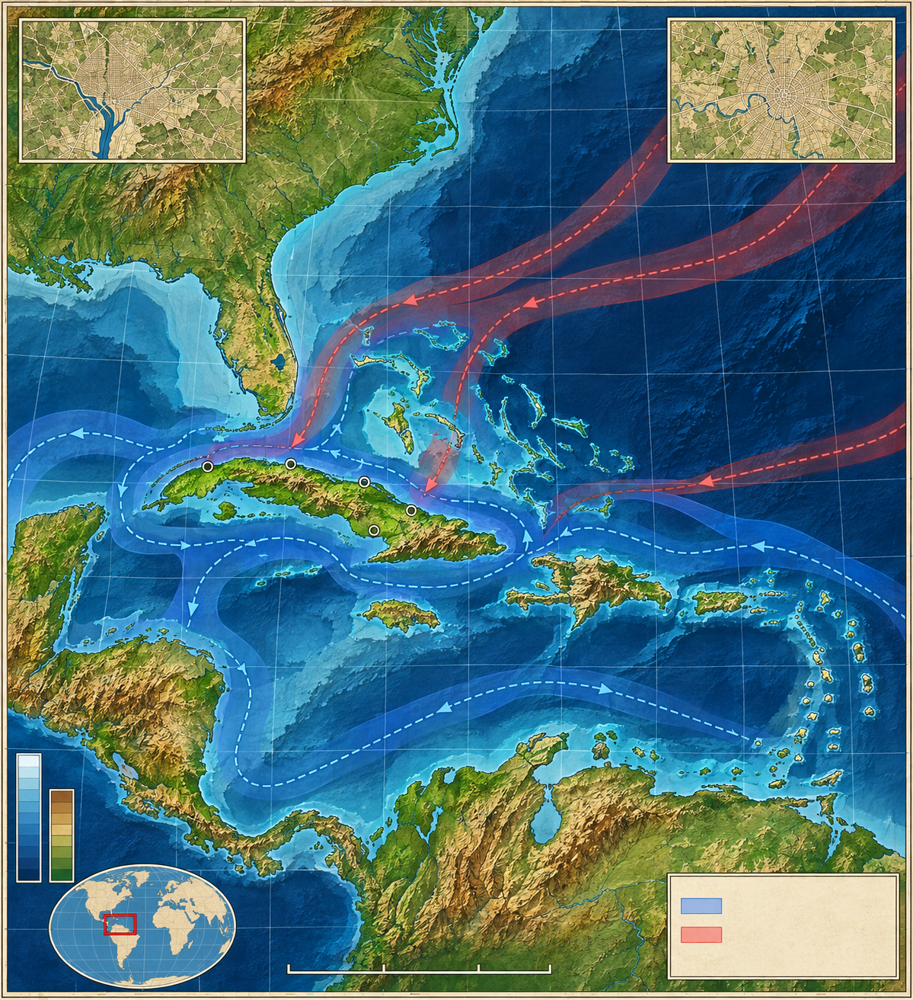
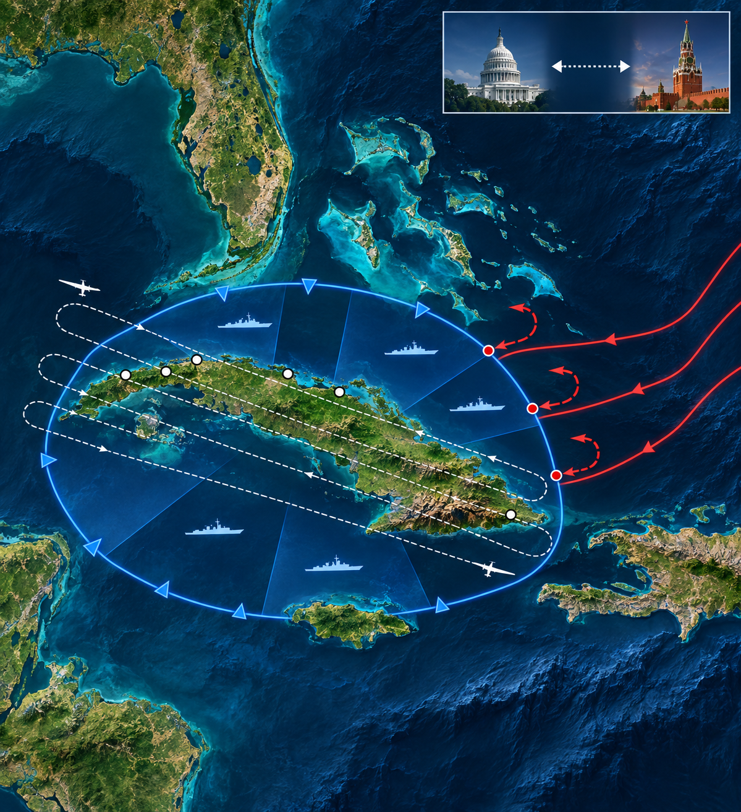
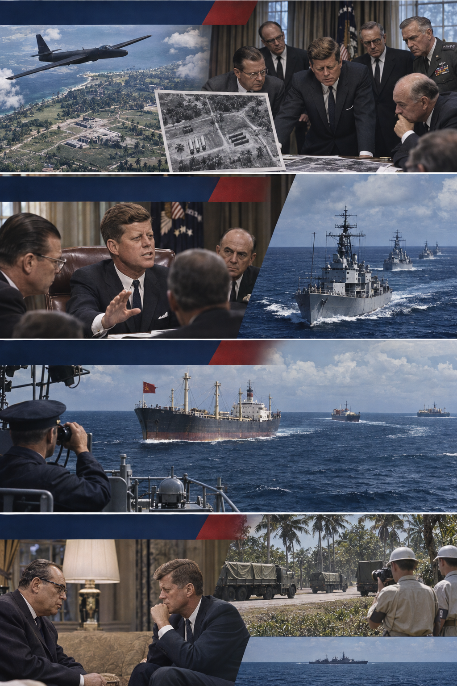

**뒤에서 반복될 지형을 먼저 잡아두기**

- **▰** **워싱턴(Washington, D.C.)**은 사진 판독·ExComm 심의·군사 명령이 모인 미국의 결정 중심이었다. 현장 함정의 접촉을 전쟁으로 바꿀 권한을 이곳에 묶는 일이 위기 통제의 핵심이었다.
- **▰** **모스크바(Moscow)**는 흐루쇼프의 공개 서한과 비공개 신호가 나온 소련의 결정 중심이었다. 워싱턴과의 통신 지연 때문에 한쪽의 행동은 상대의 다음 판단보다 먼저 현장에서 충돌할 수 있었다.
- 🇨🇺 **쿠바(Cuba)**의 산크리스토발·사과라그란데·레메디오스 일대에는 중거리 미사일 기지가 건설됐다. 미국에는 본토 위협이었고 소련에는 쿠바 침공을 억제할 전진 배치였다.
- 🌊 **플로리다 해협(Florida Straits)**과 🌊 **카리브해(Caribbean Sea)**는 미 해군의 격리선과 소련 상선의 접근로가 만나는 공간이었다. 이 선에서 식별·경고·검색·발포의 순서를 통제하지 못하면 외교 위기가 즉시 교전으로 바뀔 수 있었다.
- **▰** **관타나모(Guantánamo)** 기지는 쿠바 안의 미국 거점이었다. 위기가 침공으로 확대되면 가장 먼저 고립·공격될 수 있는 지점이라 방어와 민간인 대피가 필요했다.

#### 상세 전역 서사 — 공습보다 느린 격리를 택해 다음 결정을 위한 시간을 남기다

1962년 10월 14일 U-2 정찰사진은 쿠바에 소련의 공격용 미사일 기지가 건설되고 있음을 보여 주었다. **존 F. 케네디(John F. Kennedy)**는 이를 공개하기 전에 ExComm을 소집했고, 합참은 공습 뒤 침공을 강하게 주장했다. 그러나 공습이 모든 미사일과 핵탄두를 제거한다는 보장은 없었고, 소련의 보복이 쿠바·베를린·유럽 가운데 어디서 나올지도 알 수 없었다.

**케네디**는 즉시 공격 대신 해상 ‘격리’를 택했다. 봉쇄는 전쟁행위로 해석될 수 있었지만 공습보다 낮은 단계의 압박이었고, 접근 선박을 식별하며 소련 지도부가 선택할 시간을 남겼다. **니키타 흐루쇼프(Nikita Khrushchev)**도 일부 선박을 돌렸지만 쿠바의 공사는 계속됐다. 양쪽은 공격 준비를 유지하면서도 상대가 물러날 수 있는 출구를 찾았다.

10월 27일 쿠바 상공에서 미 U-2가 격추되어 루돌프 앤더슨이 사망하자 보복 요구가 커졌다. **케네디**는 즉각 폭격하지 않고 격추 명령의 지휘 경로를 확인하며 협상을 계속했다. 이미 생긴 죽음을 추가 죽음의 자동 근거로 만들지 않은 선택이었다. 미국은 공개적으로 쿠바 불침공을 약속하고, 비공개로 튀르키예의 주피터 미사일 철수 시차를 조정했다. 10월 28일 **흐루쇼프**가 쿠바 미사일 철수를 수용했고, 검증 뒤 11월 20일 격리가 해제됐다.

이 위기는 어느 한쪽이 완벽히 정보를 통제한 승리가 아니다. 오인된 잠수함 신호, U-2의 항로 이탈, 현장 방공 명령처럼 중앙이 즉시 통제하지 못한 위험이 여럿 있었다. 역사적 사실은 핵전쟁이 일어나지 않았다는 것이고, 반사실적 판단은 공습·보복·무기한 압박이 그 위험을 얼마나 키웠을지에 관한 것이다. 이 사례가 구절을 입증하는 지점은 감정을 없앤 데 있지 않다. **비가역적 파국 앞에서 되돌릴 수 있는 압박을 선택하고, 목적이 달성되자 멈춘 데** 있다.

#### 속임수와 정보의 경계 — 비밀 배치, 공개 사진, 비공개 거래

소련은 쿠바 배치를 비밀리에 진행했고 미국에는 공격용 무기 배치 의도를 부인했다. 미국은 U-2 사진을 공개해 이 비밀을 깨뜨렸지만, 튀르키예 주피터 미사일 철수 약속은 즉시 공개하지 않았다. 앞의 것은 상대의 판단을 속이기 위한 은폐였고, 뒤의 것은 합의를 가능하게 한 비공개 외교였다. 두 행위를 같은 ‘기만’으로 묶으면 목적·대상·위험이 사라진다.

#### 法 한눈 비교 — 곡제·관도·주용
<table fit-page-width="true" header-row="true">
<tr><td>진영</td><td>곡제(편제)</td><td>관도(지휘)</td><td>주용(보급·지속)</td></tr>
<tr><td>**미국(위기 통제)**</td><td>ExComm·해군 격리대·정찰·공격대기를 분리했다.</td><td>현장 발포를 단계별 규칙과 대통령 승인 아래 묶었다.</td><td>장기 격리와 정찰을 유지하면서 협상 시간을 벌었다.</td></tr>
<tr><td>**소련·쿠바(배치 철회)**</td><td>비밀 미사일 배치·방공·상선 수송이 서로 다른 지휘선에 걸렸다.</td><td>모스크바·현지군·쿠바 지휘부의 권한과 통신 지연이 위험을 키웠다.</td><td>해상 접근이 막히고 배치 비밀이 깨져 지속 조건이 약해졌다.</td></tr>
</table>

#### **흐루쇼프·소련 배치 측(철회)**
<table fit-page-width="true" header-row="true">
<tr><td>요소</td><td>판단</td></tr>
<tr><td color="orange_bg">🤝 **道**</td><td>쿠바 방어와 전략 균형이라는 목적은 있었으나 배치 비밀과 공개 부인이 동맹·상대의 신뢰를 함께 소모했다. (지기·정치)</td></tr>
<tr><td color="blue_bg">🌤️ **天**</td><td>미국이 배치를 늦게 발견하고 기정사실을 받아들일 가능성에 걸었으나 U-2 사진과 공개 압박이 그 가정을 무너뜨렸다. (지피·확률 관점)</td></tr>
<tr><td color="green_bg">🧭 **地**</td><td>쿠바의 근접성은 미국 본토를 위협했지만 🌊 **대서양(Atlantic Ocean)** 보급선은 미 해군의 격리에 노출됐다. (원근·사생)</td></tr>
<tr><td color="purple_bg">🎖️ **將**</td><td>**흐루쇼프**는 대담한 배치 뒤 전쟁을 피할 출구도 찾았으나, 비밀 작전의 노출 가능성과 현장 통제 위험을 과소평가했다. (지·용·엄)</td></tr>
<tr><td color="yellow_bg">⚙️ **法**</td><td>현지 핵전력·방공·상선·외교 메시지의 지휘와 공개 수준이 달라 중앙 통제와 현장 행동 사이에 간극이 생겼다. (곡제·관도·주용)</td></tr>
</table>
🏳️ **패군 측 결과** 소련은 쿠바 미사일을 철수했지만 쿠바 불침공 약속과 미국의 주피터 미사일 후속 철수를 얻었다. 이를 일방적 항복으로만 읽으면 위기를 끝낸 상호 출구가 보이지 않는다.

#### **케네디·미국 위기관리 측(목표 달성)**
<table fit-page-width="true" header-row="true">
<tr><td>요소</td><td>판단</td></tr>
<tr><td color="orange_bg">🤝 **道**</td><td>미사일 제거라는 제한 목표를 유지하고 모욕의 보복이나 쿠바 정권 교체로 목적을 넓히지 않았다. (지기·정치)</td></tr>
<tr><td color="blue_bg">🌤️ **天**</td><td>소련의 반응과 현장 우발을 통제할 수 없음을 인정해 공습보다 되돌릴 여지가 큰 격리를 택했다. (지피·타이밍·확률 관점)</td></tr>
<tr><td color="green_bg">🧭 **地**</td><td>🌊 **카리브해(Caribbean Sea)** 접근로를 압박 공간으로 쓰되 쿠바 본토 침공은 보류했다. (원근·광협)</td></tr>
<tr><td color="purple_bg">🎖️ **將**</td><td>**케네디**는 합참의 전문 의견을 듣고도 정치 목적과 핵 확전 위험을 함께 판단했으며, U-2 격추 뒤 즉각 보복을 멈췄다. (지·인·엄)</td></tr>
<tr><td color="yellow_bg">⚙️ **法**</td><td>ExComm 심의, 해군 교전규칙, 공개 서한과 비공개 채널을 분리해 압박과 출구를 동시에 운용했다. (곡제·관도·주용)</td></tr>
</table>
🏆 **승군 측 결과** 미국은 쿠바의 공격용 미사일 철수를 얻고 전면전을 피했다. 목적 달성 뒤 격리를 해제했기에 압박이 관성적 전쟁으로 변하지 않았다.

##### 法을 압축하지 않고 보기 — 곡제·관도·주용
**곡제 曲制(곡제): 부대를 어떻게 나누고 결합했는가**
<table fit-page-width="true" header-row="true">
<tr><td>진영</td><td>실제 운용</td></tr>
<tr><td>**미국**</td><td>정찰·해상 격리·공습 대기·외교를 서로 다른 수단으로 두고 대통령이 단계 전환을 통제했다.</td></tr>
<tr><td>**소련·쿠바**</td><td>미사일 부대·방공부대·상선·쿠바군이 분리되어 있었고 각자의 행동이 전체 위기를 바꿀 수 있었다.</td></tr>
</table>
**관도 官道(관도): 누가 명령하고 어떻게 전달했는가**
<table fit-page-width="true" header-row="true">
<tr><td>진영</td><td>실제 운용</td></tr>
<tr><td>**미국**</td><td>ExComm의 논쟁을 거쳐 대통령이 결론을 내리고 해군에는 식별·경고·검색·발포의 단계가 전달됐다.</td></tr>
<tr><td>**소련·쿠바**</td><td>모스크바와 현지 방공·쿠바 지도부 사이의 정보와 권한이 완전히 일치하지 않아 U-2 격추 같은 위험이 생겼다.</td></tr>
</table>
**주용 主用(주용): 군량·장비·전투 지속 능력을 어떻게 썼는가**
<table fit-page-width="true" header-row="true">
<tr><td>진영</td><td>실제 운용</td></tr>
<tr><td>**미국**</td><td>해군·정찰기·공군 대기를 유지할 물자와 기지를 갖고 있었지만, 장기화할수록 우발 충돌 확률도 누적됐다.</td></tr>
<tr><td>**소련·쿠바**</td><td>대서양 상선 수송과 쿠바 내 건설이 격리·정찰에 노출되어 배치를 은밀히 완성할 조건이 사라졌다.</td></tr>
</table>

**사료와 연구:** [미 국무부 역사실 — Cuban Missile Crisis](https://history.state.gov/milestones/1961-1968/cuban-missile-crisis) · [미 국립문서기록관리청 — Aerial Photograph of Missiles in Cuba](https://www.archives.gov/milestone-documents/aerial-photograph-of-missiles-in-cuba) · [미 국립문서기록관리청 — One Step from Nuclear War](https://www.archives.gov/publications/prologue/2012/fall/cuban-missiles.html)

### 동양 — 🏛️ 동진 북부부대 vs 🏛️ 전진군 │ 비수대전(淝水之戰, 383)

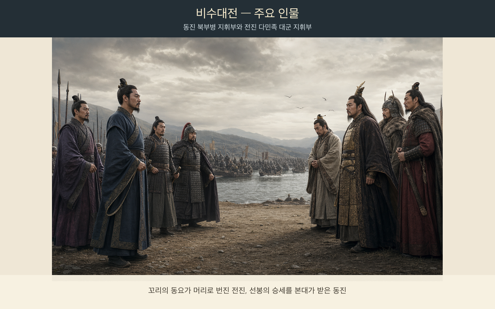
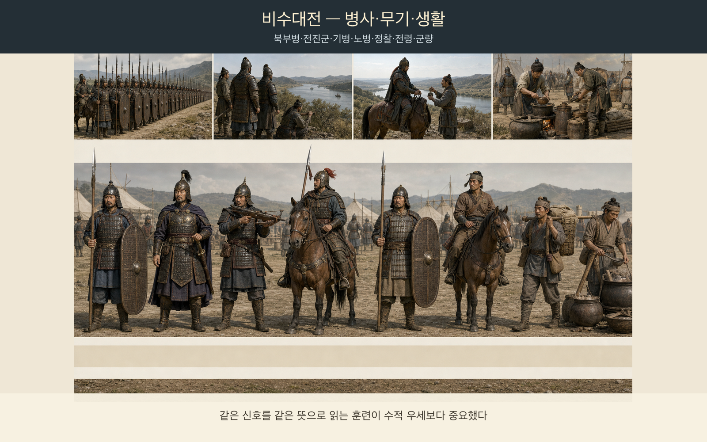
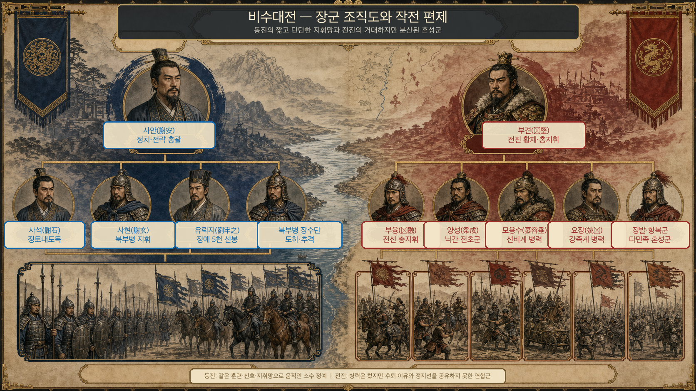
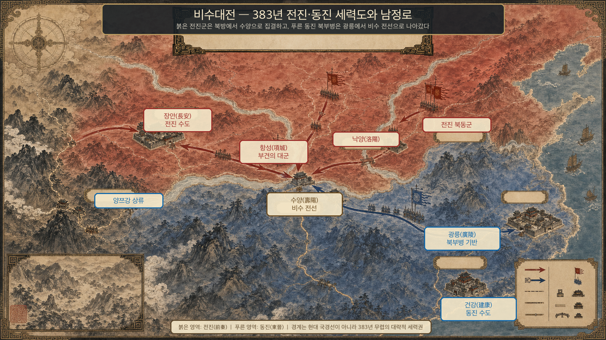
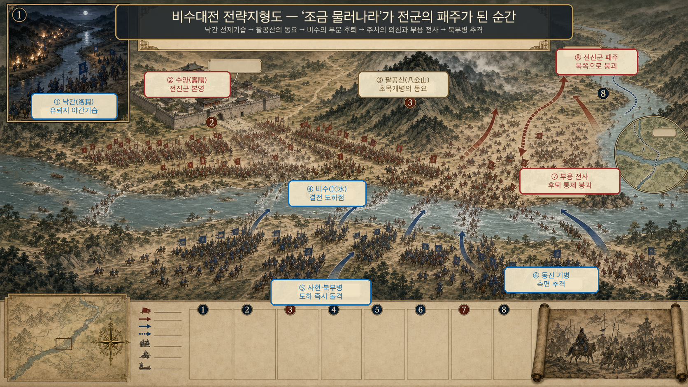
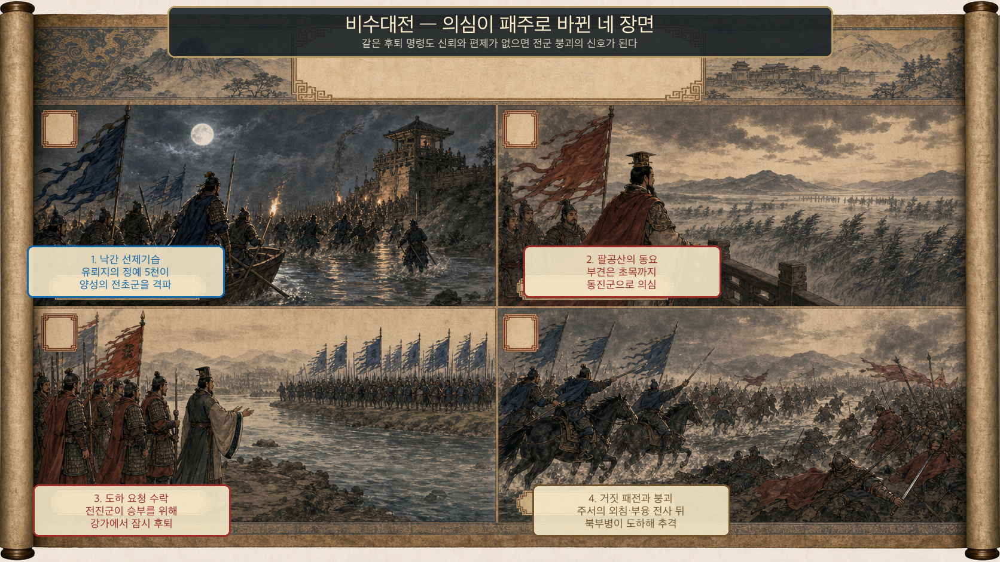

**뒤에서 반복될 지형을 먼저 잡아두기**

- **▰** **수양(壽陽)**은 전진 선봉의 전진기지였고 🌊 **비수(淝水)** 서안 진지와 가까웠다. 부견이 대군 전체보다 앞서 이곳에 와 선봉의 판단을 직접 끌었다.
- 🌊 **비수(淝水)**는 전진군이 서안, 동진군이 동안에 선 결전 수로였다. 강을 사이에 둔 채 기다리면 전진이 유리했지만, 후퇴 명령은 큰 혼성군 전체에 동시에 전달되지 못했다.
- 🌊 **낙간(洛澗)**은 결전 전 전진군이 먼저 패한 전초였다. 유뢰지의 승리는 동진군 사기를 높이고 전진군 내부에는 ‘이미 밀리고 있다’는 신호를 만들었다.
- **▰** **항성(項城)** 일대에는 전진의 후속 대군이 길게 늘어섰다. 병력 수의 장점은 선봉·중군·후속이 한 명령과 한 박자로 움직일 때만 실제 전력이 될 수 있었다.
- **▰** **광릉(廣陵)**에서 훈련된 북부병은 사현·유뢰지의 지휘 아래 비교적 통일된 편제를 갖췄다. 적은 병력이었지만 강을 건너는 순간에 힘을 집중할 수 있었다.

#### 상세 전역 서사 — 통일의 이익이 사라졌는데도 대군의 위세를 멈춤 기준으로 삼다

전진의 군주 **부견(苻堅)**은 북방을 통일한 뒤 동진 정벌을 추진했다. 중신들은 새로 편입된 여러 지역과 종족의 결속이 충분하지 않고 대규모 원정의 이익이 불분명하다고 반대했지만, **부견**은 병력 규모와 연전의 기세를 믿었다. 사료의 병력 숫자는 과장 가능성이 크므로, ‘백만’이라는 수치보다 선봉과 후속이 길게 분리된 거대한 혼성군이었다는 구조가 중요하다.

동진은 **사안(謝安)**이 전체 방어를 조정하고 **사현(謝玄)**이 북부병을 지휘했다. **유뢰지(劉牢之)**가 낙간에서 전진의 양성을 격파하자 수적 열세였던 동진군은 사기를 얻었다. 전진의 항장 주서가 내부의 허실을 알려 준 것도 동진이 결전을 서두르는 근거가 됐다.

🌊 **비수(淝水)** 서안의 전진군은 강을 막고 기다리면 됐다. **사현**이 군대를 조금 물려 동진군이 건너게 해 달라고 제안하자 전진 장수 다수는 반대했다. 그러나 **부견**과 **부융(苻融)**은 적이 반쯤 건넜을 때 치겠다는 계산으로 후퇴를 허용했다. 문제는 계책 자체보다, 대군이 질서 있게 잠깐 물러섰다가 다시 서라는 명령을 수행할 통제력이 없었다는 점이다.

후퇴가 시작되자 주서가 뒤에서 “진군이 패했다”고 외쳤고, 이미 낙간 패전과 불안한 결속을 안고 있던 전진군은 이를 사실로 받아들였다. **사현**의 정예가 도하해 공격했고 **부융**이 전사하면서 후퇴는 붕괴로 바뀌었다. 전진은 몇 해 안에 여러 정권으로 갈라졌다. 단 한 번의 전투가 모든 원인은 아니지만, 통합되지 않은 제국이 감당할 수 없는 전쟁을 멈추지 못한 것이 붕괴를 가속했다.

#### 속임수 작동 구조 — ‘조금 물러나라’는 제안과 자기기만

동진의 제안은 전진군이 자발적으로 유리한 강변 진지를 비우게 만든 유인이었다. 실제 의도는 안전하게 건널 공간을 얻어 전진의 후퇴가 대형 혼란으로 바뀌는 순간을 치는 것이었다. 그러나 전진 지휘부가 이를 믿은 이유는 단순한 어리석음이 아니라 압도적 병력으로 반도하격을 해낼 수 있다는 기존 기대였다. 주서의 외침은 혼란을 패전 신호로 굳혔지만, 통제 가능한 후퇴였다면 그 한마디만으로 전군이 붕괴하지는 않았을 것이다.

#### 法 한눈 비교 — 곡제·관도·주용
<table fit-page-width="true" header-row="true">
<tr><td>진영</td><td>곡제(편제)</td><td>관도(지휘)</td><td>주용(보급·지속)</td></tr>
<tr><td>**동진군(승)**</td><td>북부병 정예를 도하 순간에 집중했다.</td><td>사안–사석·사현–유뢰지의 역할이 비교적 선명했다.</td><td>짧은 방어선과 지역 기반으로 병력을 유지했다.</td></tr>
<tr><td>**전진군(패)**</td><td>선봉과 후속 대군이 길게 분산됐다.</td><td>부견의 판단이 현장 지휘를 압도했고 후퇴 명령이 통제되지 않았다.</td><td>대규모 원정군의 이동·보급·결속 비용이 누적됐다.</td></tr>
</table>

#### **부견·전진군(패)**
<table fit-page-width="true" header-row="true">
<tr><td>요소</td><td>판단</td></tr>
<tr><td color="orange_bg">🤝 **道**</td><td>새로 편입한 여러 세력과 병사의 전쟁 목적이 충분히 같지 않았고 후퇴 순간 사기가 급락했다. (지기·사기)</td></tr>
<tr><td color="blue_bg">🌤️ **天**</td><td>과거의 연승과 병력 우세를 이번 전쟁의 승산으로 일반화하고 낙간 패전·주서의 정보·동진군 사기 상승을 낮게 보았다. (지피·확률 관점)</td></tr>
<tr><td color="green_bg">🧭 **地**</td><td>유리한 강변 차단선을 스스로 비우고, 좁은 도하 정면에서 후퇴와 재공격을 동시에 하려 했다. (험이·광협)</td></tr>
<tr><td color="purple_bg">🎖️ **將**</td><td>**부견**은 대담했으나 반대 진언을 이익 재평가의 근거로 쓰지 않았고, **부융**은 붕괴한 대열을 되돌리다 전사했다. (지·용·엄)</td></tr>
<tr><td color="yellow_bg">⚙️ **法**</td><td>거대한 혼성군에 잠깐 후퇴·즉시 정지·반격을 실행할 통일된 신호와 예비가 부족했다. (곡제·관도·주용)</td></tr>
</table>
🏳️ **패군 측 결과** 전진군은 비수에서 붕괴했고 부견의 권위와 군사력이 크게 손상됐다. 六敗(육패) 가운데 `亂`(란, 지휘와 대오가 무너짐)과 `北`(배, 적정을 헤아리지 못한 패배)이 겹쳤다.

🔀 **패군 측 회피 분기점** 동진의 도하 제안을 거절하고 서안 진지를 유지했거나, 후퇴가 필요했다면 선봉 일부만 통제된 간격으로 움직이고 예비대를 세웠다면 한 번의 신호가 전군 붕괴로 번지는 일을 줄일 수 있었다. 더 이른 분기점은 남정을 연기하고 새로 통합한 북방의 지휘·보급·충성을 먼저 굳히는 것이었다. 이는 완전한 승리를 보장하지 않지만 제국 붕괴를 앞당긴 완패는 피할 가능성이 컸다.

#### **사현·동진군(승)**
<table fit-page-width="true" header-row="true">
<tr><td>요소</td><td>판단</td></tr>
<tr><td color="orange_bg">🤝 **道**</td><td>북부병의 훈련과 지휘 신뢰가 낙간 승리 뒤 결속으로 이어졌다. (지기·사기)</td></tr>
<tr><td color="blue_bg">🌤️ **天**</td><td>전진군의 불안한 결속과 후퇴 명령을 기회로 삼되, 수적 열세 자체를 없다고 과장하지 않았다. (지피·타이밍·확률 관점)</td></tr>
<tr><td color="green_bg">🧭 **地**</td><td>강을 건너야 하는 불리함을 상대가 진지를 비우는 순간 집중 도하로 바꿨다. (원근·험이·광협)</td></tr>
<tr><td color="purple_bg">🎖️ **將**</td><td>**사현**은 제안·도하·공격의 시간을 연결했고 **유뢰지**의 전초 승리를 전체 사기로 전환했다. (지·신·용)</td></tr>
<tr><td color="yellow_bg">⚙️ **法**</td><td>정예 선봉과 본대를 좁은 시점에 결합해 수적 열세를 국지적 우세로 바꿨다. (곡제·관도·주용)</td></tr>
</table>
🏆 **승군 측 결과** 동진군은 수도권과 🌊 **장강(長江)** 하류 방어를 지켰다. 五勝(오승) 중 `識衆寡之用者勝`(식중과지용자승, 많고 적은 병력의 쓰임을 아는 자가 이긴다)에 가깝다.

##### 法을 압축하지 않고 보기 — 곡제·관도·주용
**곡제 曲制(곡제): 부대를 어떻게 나누고 결합했는가**
<table fit-page-width="true" header-row="true">
<tr><td>진영</td><td>실제 운용</td></tr>
<tr><td>**동진군**</td><td>유뢰지의 전초 정예와 사현의 도하 주력을 연속해 투입했다.</td></tr>
<tr><td>**전진군**</td><td>선봉·중군·후속이 넓게 분리되어 비수 정면의 혼란을 흡수할 예비가 부족했다.</td></tr>
</table>
**관도 官道(관도): 누가 명령하고 어떻게 전달했는가**
<table fit-page-width="true" header-row="true">
<tr><td>진영</td><td>실제 운용</td></tr>
<tr><td>**동진군**</td><td>사안의 전략 조정 아래 사현이 현장을 지휘하고 유뢰지가 독립 선봉 임무를 수행했다.</td></tr>
<tr><td>**전진군**</td><td>부견·부융의 후퇴 판단이 대군에 전달됐지만 정지 지점과 재반격 신호가 통일되지 않았다.</td></tr>
</table>
**주용 主用(주용): 군량·장비·전투 지속 능력을 어떻게 썼는가**
<table fit-page-width="true" header-row="true">
<tr><td>진영</td><td>실제 운용</td></tr>
<tr><td>**동진군**</td><td>방어 기반에 가까운 정예군을 짧은 결전 구간에 집중해 피로와 보급 부담을 제한했다.</td></tr>
<tr><td>**전진군**</td><td>대규모 혼성군을 먼 거리로 이동시키면서 식량·숙영·명령 전달과 사기 유지 비용이 누적됐다.</td></tr>
</table>

**사료와 연구:** [中國哲學書電子化計劃 — 『資治通鑑』 관련 자료](https://ctext.org/datawiki.pl?if=gb&res=5998570) · [홍콩 교육국 — 비수대전 사료 학습자료](https://www.edb.gov.hk/attachment/sc/curriculum-development/kla/pshe/references-and-resources/chinese-history/war3_sc.pdf)

---
## 5. 핵심 통찰 + 실생활 적용 + 생활루틴

### 핵심 통찰

이 구절의 중심은 화를 참으라는 도덕 훈계보다 더 구체적이다. **되돌릴 수 있는 상태와 되돌릴 수 없는 결과를 구분하고, 비가역적 행동에는 더 높은 증거와 중단 기준을 요구하라.** 감정은 시간이 지나거나 정보가 바뀌면 달라지지만, 생명·안전·신뢰·중대한 데이터처럼 복구할 수 없거나 복구 비용이 큰 것은 한순간의 결정으로 잃을 수 있다.

또한 動과 止는 성격의 차이가 아니라 같은 판단 규칙의 두 출력이다. 시작했으니 끝까지 가는 것이 항상 책임감은 아니다. 목적, 비용, 위험이 바뀌면 멈추고 다시 설계하는 것이 오히려 최초 목적에 충실하다. 좋은 결정 체계는 출발 이유뿐 아니라 ‘어떤 신호가 나오면 멈출 것인가’를 실행 전에 정한다.

### 실생활 적용

3교대 현장에서 이상 신호가 발생했을 때는 즉시 조치가 필요한 안전 문제와, 잠시 확인해도 되는 품질·보고 문제를 구분한다. 설비 정지나 우회 조치가 필요하다면 기대 효과, 추가 위험, 복구 절차, 재가동 조건을 짧게라도 기록한다. 누군가의 날카로운 말이나 책임 공방 때문에 조치 범위를 키우지 않고, 관찰된 수치와 승인된 기준에 따라 움직인다.

서비스 배포나 데이터 변경에서는 실행 전 롤백 가능성을 먼저 묻는다. 되돌릴 수 있는 설정 변경은 작은 범위에서 시험할 수 있지만, 원본 삭제·일괄 발송·권한 변경처럼 되돌리기 어려운 작업은 백업, 검토자, 대상 목록, 중단 조건을 갖춘 뒤 수행한다. 이미 몇 시간을 들였다는 사실은 계속 배포할 이유가 아니다. 성공 조건이 사라졌다면 멈추는 것이 손실을 제한한다.

갈등 상황에서 화난 직후 공개 메시지, 관계 단절, 고액 구매, 퇴사 통보처럼 파급이 큰 결정을 내리지 않는다. 감정을 무시하라는 뜻은 아니다. 무엇이 침해되었는지 적고, 오늘 하지 않으면 생길 실제 위험과 하루 뒤에도 남을 필요를 분리한다. 안전이나 법적 기한이 걸렸다면 필요한 최소 조치를 즉시 하고, 그렇지 않다면 감정이 바뀔 시간을 확보한 뒤 결정한다.

### 생활루틴

**기분은 돌아와도 삭제한 것과 다친 사람은 저절로 돌아오지 않는다.** 그래서 되돌리기 어려운 행동일수록 실행 속도를 늦추고 검증 수를 늘려야 한다. 멈춤은 우유부단이 아니라 회복 불가능한 손실을 피하는 적극적 통제다.

1. 행동 전에 `되돌릴 수 있음 / 어렵지만 복구 가능 / 되돌릴 수 없음`으로 결과를 나눈다.
2. 기대 이익과 예상 손실을 앞으로 발생할 것만 기준으로 적는다.
3. 시작 전에 중단 신호와 중단 권한자를 정한다.
4. 분노·모욕·매몰비용이 근거에 섞였는지 다른 사람에게 한 번 검토받는다.
5. 조건이 맞으면 필요한 최소 범위로 움직이고, 맞지 않으면 기록을 남기고 멈춘다.

**한 줄 기억법:** 감정은 되돌아오지만 생명과 존속은 되돌릴 수 없다. 이익에 맞으면 움직이고, 맞지 않으면 멈춘다.
