<!-- sunzi-analysis-mode: light -->
> 고명군신지, 양장경지. 차안국전군지도야. — 큰 힘을 쥔 사람은 신중히 결정하고, 실행하는 사람은 계속 경계해야 나라와 조직을 온전히 지킬 수 있다.

---
## 1. 원문 + 독음 + 직역 + 한자어 뜻풀이

故明君愼之, 良將警之. 此安國全軍之道也. 고명군신지, 양장경지. 차안국전군지도야.

**직역**  
그러므로 밝은 군주는 이를 삼가고, 훌륭한 장수는 이를 경계한다. 이것이 나라를 편안하게 하고 군대를 온전히 보전하는 길이다.

	#### 한 글자씩 읽는 결구

	`故`(고)는 “그러므로”다. 앞 구절의 결론을 받는다. 분노와 불쾌감은 다시 기쁨과 즐거움으로 바뀔 수 있지만, 망한 나라는 다시 세울 수 없고 죽은 사람은 되살릴 수 없다는 비가역성의 판단이 이 한 글자를 통해 제도적 책임으로 넘어간다.

	`明君`(명군)은 단지 영리한 군주가 아니다. 무엇이 이익인지, 무엇이 되돌릴 수 없는 손실인지 밝게 분별하고 국가의 무력을 사적인 감정과 구별하는 군주다. `愼`(신)은 마음을 다잡아 함부로 하지 않는다는 뜻이다. 개전이나 확전처럼 국가 전체가 값을 치르는 결정 앞에서 목적·비용·대안·중단 조건을 거듭 살피라는 요구다. 정본은 `愼`으로 적으며, 오늘날 흔히 쓰는 `慎`과 뜻과 독음은 같다.

	`良將`(양장)은 싸움에 능한 장수를 넘어, 맡은 군대를 소모품처럼 다루지 않는 훌륭한 장수다. `警`(경)은 한 번 주의하고 끝내는 태도가 아니라 위험 신호를 놓치지 않도록 깨어 경계하는 일이다. 군주가 전쟁을 시작할 이유를 신중히 심사한다면, 장수는 실행 중에도 명령의 목적·전황·병력 손실·퇴로가 어긋나는지를 계속 감시해야 한다.

	`此`(차)는 바로 이 이중의 절제를 가리킨다. `安國`(안국)은 나라를 편안하고 안전하게 하는 것, `全軍`(전군)은 군대를 온전히 보전하는 것이다. `全`은 무조건 한 명도 잃지 않는다는 공상이 아니라, 정치적 목적과 무관한 소모를 막아 공동체가 다시 설 힘을 남기는 원칙이다. `道也`(도야)는 이것이 임시 요령이 아니라 군주와 장수가 반복해서 지켜야 할 길임을 못 박는다.

	#### 글자들이 완성하는 한 장면

	앞 구절은 돌이킬 수 없는 파국 앞에서 감정의 속도를 늦추었다. 이번 구절은 그 멈춤을 개인의 마음가짐에만 맡기지 않는다. 명군에게는 결정을 내리기 전의 `愼`, 양장에게는 명령을 실행하는 동안의 `警`을 나누어 맡긴다. 시작 권한과 현장 지휘가 서로 다른 자리에서 같은 파국을 막도록 한 것이다.

	따라서 `安國`과 `全軍`은 승리 뒤에 따라오는 덤이 아니다. 무엇을 위해 싸우는지, 그 목적이 아직 살아 있는지, 계속 싸울수록 지키려던 나라와 군대가 오히려 무너지는지를 묻는 최상위 기준이다. 화공편은 불을 잘 쓰는 기술로 시작했지만, 끝에서는 강한 수단을 쓸 줄 아는 것보다 그것을 절제할 정치적·지휘적 능력이 먼저라고 결론짓는다.

---
## 2. 전통 주석 기반 분석

- **조조(曹操)** — 군주께서는 앞에서 말한 망국과 죽음의 비가역성을 먼저 두고 전쟁을 삼가십시오. 장수께서는 명령을 받았다는 사실만으로 경계를 풀지 말고, 국가와 군대를 보전한다는 목적에서 전황을 계속 살피십시오.
- **이전(李筌)** — 군주께서는 분노가 국정을 대신하지 못하게 하십시오. 장수께서는 전장의 작은 이익이 나라의 큰 손실로 바뀌는 순간을 경계해야 하며, 싸움을 잘하는 재주보다 위태로움을 알아차리는 밝음을 앞세우십시오.
- **두목(杜牧)** — 군주께서는 군사를 일으키기 전에 이익과 위해를 깊이 계산하십시오. 장수께서는 출전한 뒤에도 이길 수 있다는 자신감에 취하지 말고, 병력의 보전과 백성의 부담이 감당할 범위를 넘는지 거듭 점검하십시오.
- **매요신(梅堯臣)** — 군주께서는 일을 시작할 때 신중함을 잃지 마십시오. 장수께서는 일이 진행되는 동안 경계심을 잃지 마십시오. 두 자리가 각자의 책임을 다할 때 나라가 편안하고 군대가 온전해집니다.
- **장예(張預)** — 군주께서는 명분 없는 군사 행동을 명령하지 말고, 장수께서는 유리하지 않은 싸움을 억지로 이어 가지 마십시오. `愼`과 `警`은 소극성이 아니라 국가의 근본을 보전하기 위한 적극적인 통제입니다.
- **왕석(王晳)** — 군주께서는 기쁨과 분노가 바뀔 수 있음을 알고 한때의 감정으로 대사를 결정하지 마십시오. 장수께서는 한번 정한 계획도 형세가 달라지면 다시 살피십시오. 그래야 군대의 존망을 우연에 맡기지 않습니다.
- **가림(賈林)** — 군주께서는 전쟁의 비용이 궁극적으로 백성과 국가에 돌아감을 잊지 마십시오. 장수께서는 병사를 아끼는 일이 명령을 거스르는 것이 아니라 명령의 공적 목적을 지키는 길이 될 수 있음을 아십시오.
- **두우(杜佑)** — 군주께서는 동원·군량·상벌·보고의 제도를 갖춘 뒤 움직이십시오. 장수께서는 현장의 경보가 위로 전달되고 중단 명령이 아래로 실행되는 통로를 평소에 마련하십시오. 신중과 경계는 제도가 뒷받침해야 오래갑니다.
- **진호(陳皞)** — 군주께서는 나라를 위태롭게 할 행동을 가벼이 허락하지 마십시오. 장수께서는 전공을 탐하여 군대를 다 소진하지 마십시오. 승리의 이름 아래 국가와 군대를 잃는다면 이 구절이 말한 길과 반대입니다.

#### 주석가들의 차이와 보완

아홉 주석의 초점은 세 갈래로 모인다. 첫째, 조조·이전·왕석은 앞 구절의 감정 경계를 이어 받아 군주의 판단을 사적 정념에서 분리한다. 둘째, 두목·매요신·장예·진호는 개전 전 신중함과 작전 중 경계심을 서로 다른 책임으로 나눈다. 셋째, 가림·두우는 나라와 군대의 보전을 백성의 부담, 군수, 보고, 중단 권한 같은 제도 문제로 구체화한다.

이들을 합치면 `愼`은 아무것도 하지 않는 주저가 아니고, `警`은 겁먹은 방어가 아니다. 군주는 행동의 목적과 허용 손실을 정하고, 장수는 현장의 변화가 그 기준을 깨는지를 감시하며, 둘 사이의 보고 체계는 불리한 사실도 지체 없이 올려야 한다. 그 구조가 있어야 강한 수단을 써도 국가와 군대가 수단의 포로가 되지 않는다.

#### 리링의 고증과 현대적 독법

리링의 해설 취지를 따라 문장 구조를 보면, 이 구절은 화공의 세부 기술을 하나 더 보태는 문장이 아니라 편 전체를 닫는 정치적 결론이다. `明君—愼 / 良將—警`은 주체와 덕목을 평행하게 배치하고, `安國—全軍`은 그 절제가 지켜야 할 두 대상을 짝지운다. 앞 구절의 `亡國 / 死者`라는 파국에 맞서, 결구는 `安國 / 全軍`이라는 보전의 목표를 세운다.

`愼`과 `警`을 개인 처세의 조심성으로만 줄이면 군사 문맥이 사라진다. 이는 국가가 폭력을 승인하는 단계와 지휘관이 폭력을 운용하는 단계에 각각 다른 통제 장치를 두라는 말이다. 현대에 적용할 때도 “항상 소심하라”가 아니라, 비가역적 권한일수록 사전 심사와 실행 중 재평가를 분리하고 서로 견제하게 하라는 구조로 읽어야 한다.

---
## 3. 교차 설명

### ① 손자병법 내 교차

「시계편」의 `兵者, 國之大事, 死生之地, 存亡之道, 不可不察也`(병자, 국지대사, 사생지지, 존망지도, 불가불찰야 — 전쟁은 국가의 큰일이며 생사와 존망의 길이므로 살피지 않을 수 없다)는 화공편 결구의 출발점이다. 첫 편의 `察`이 전쟁 전반을 살피라는 총칙이라면, 마지막 부분의 `愼`과 `警`은 그 총칙을 군주와 장수의 책임으로 나누어 완결한다.

「모공편」의 `全國爲上, 破國次之, 全軍爲上, 破軍次之`(전국위상, 파국차지, 전군위상, 파군차지 — 나라와 군대를 온전히 하는 것이 깨뜨리는 것보다 윗길이다)는 `安國全軍`의 가치 기준을 선명하게 한다. 전과를 크게 만드는 것보다 목적을 달성한 뒤 국가와 군대가 기능할 힘을 남기는 것이 상책이다.

「작전편」의 `故兵貴勝, 不貴久`(고병귀승, 불귀구 — 전쟁은 승리를 귀하게 여기고 오래 끄는 것을 귀하게 여기지 않는다)는 경계의 시간축을 보여 준다. 장수가 경계해야 할 것은 패배만이 아니다. 승리 가능성이 있더라도 시간이 늘어날수록 병력·재정·민생이 소진되어 `安國全軍`에서 멀어질 수 있다.

### ② 클라우제비츠 『전쟁론』

클라우제비츠는 전쟁을 정치의 수단으로 보며, 군사적 목표가 정치적 목적과 분리되어 스스로 커지는 일을 경계한다. 이는 군주에게 목적과 희생의 비례를 신중히 따지게 하고, 장수에게 작전의 성과가 정치적 목적을 여전히 돕는지 계속 보고하게 한다. 정치가 방향을 정하고 군사가 수단을 운용하되, 실제 전황은 다시 정치 판단을 수정해야 한다.

차이도 분명하다. 클라우제비츠는 전쟁의 상호작용과 마찰, 공격의 정점 같은 동학을 분석적으로 설명한다. 손자는 `愼`·`警`·`安國`·`全軍`이라는 짧은 대구로 권력자의 도덕적·제도적 책임을 압축한다. 둘을 합쳐 읽으면, 목표를 정하는 민간·정치 권한과 현장 전문성 사이에 복종만이 아니라 정확한 위험 보고와 재평가가 필요하다는 결론에 이른다.

### ③ 미야모토 무사시 『오륜서』

『오륜서』의 `観見二つの目付`(칸켄 후타츠노 메츠케 — 관과 견, 두 가지 눈매)는 가까운 징후를 보는 눈과 전체 형세를 보는 눈을 함께 요구한다. 장수의 `警`은 눈앞의 적 움직임만 감시하는 일이 아니다. 병력의 피로, 보급, 명령의 목적, 전후에 남을 힘까지 한 화면에서 보아야 한다.

무사시의 병법은 개인의 수련과 결투의 순간 판단을 강하게 다루지만, `安國全軍`은 국가와 조직 차원의 책임을 묻는다. 개인의 평정만으로는 부족하다. 서로 다른 정보에 접근하는 사람들이 반대 의견을 낼 수 있고, 위험 신호가 지휘관의 체면 때문에 지워지지 않으며, 멈출 권한이 실제로 작동해야 한다.

### ④ 오자병법과 육도

『오자병법』은 전쟁을 일으키는 여러 동기를 구분하고, 명분과 백성의 지지가 없는 군대가 오래 버티기 어렵다고 본다. 이는 군주의 `愼`을 개전 명분뿐 아니라 동원 이후의 사회적 비용까지 계산하는 일로 넓힌다. 군주의 감정이나 위신은 나라 전체가 부담할 충분한 이유가 될 수 없다.

『육도』는 군주와 장수의 역할을 나누고, 장수에게 권한을 맡긴 뒤에는 현장 지휘가 흔들리지 않아야 한다고 본다. 그러나 위임은 무제한 소모의 허가가 아니다. 명령의 목적, 병력 보전, 보고 규칙을 먼저 합의하고, 장수는 그 경계 안에서 자율적으로 판단해야 한다. 이것이 `愼`과 `警`을 서로 방해하지 않고 연결하는 방식이다.

### ⑤ 현대 심리학·군사학

현대의 고신뢰 조직은 사고가 드물다는 이유로 경계를 줄이지 않는다. 작은 이상 신호, 현장 실무자의 우려, 실패에 가까웠던 사건을 모아 시스템의 약한 연결을 찾는다. `警`은 늘 긴장하라는 정신론이 아니라, 나쁜 소식이 빨리 올라오고 중단·격리·복구가 가능한 절차를 설계하는 일이다.

카너먼의 관점에서 권한이 큰 사람일수록 과신, 계획 오류, 확증편향에 빠질 위험이 있다. 결정을 내린 뒤에는 자신의 선택을 지지하는 정보만 모으고 철회를 체면 손실로 느끼기 쉽다. 그래서 `愼`은 결정 전에 반대 시나리오와 기준율을 검토하는 장치가 되고, `警`은 실행 뒤 실제 결과가 예상과 달라졌을 때 계획을 수정하는 장치가 된다.

현대 군사 윤리와 법은 `安國全軍`을 자국의 보전만으로 좁혀 읽지 못하게 한다. 필요성·비례성·구별 원칙과 민간인 보호, 적법한 명령의 한계를 함께 고려해야 한다. 조직의 안전이라는 말로 타인의 생명과 권리를 무시하면, 강한 수단을 경계하라는 화공편의 결론을 거꾸로 사용하게 된다.

---
## 4. 역사적 실증 사례

### 서양 — 🏛️ 잉글랜드 왕국 함대 vs 🏛️ 스페인 왕국 무적함대 │ 칼레 화선 공격–그라블린 해전(1588)

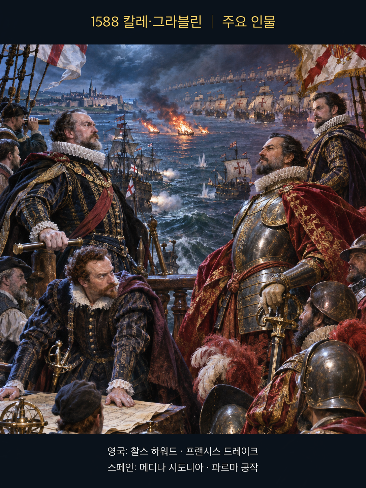
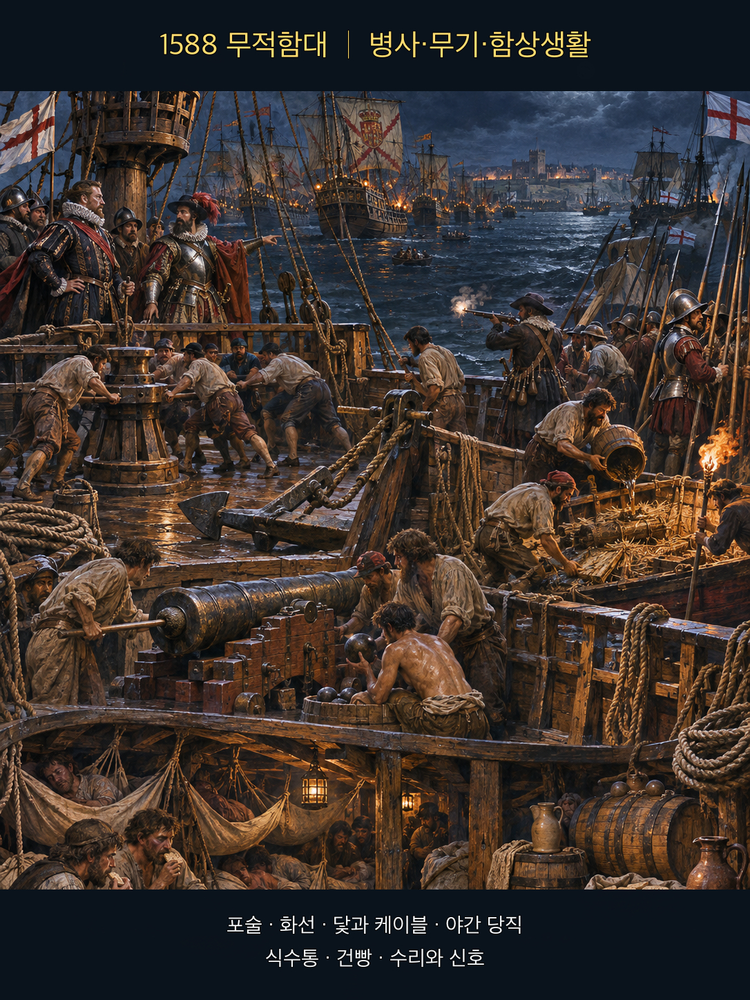
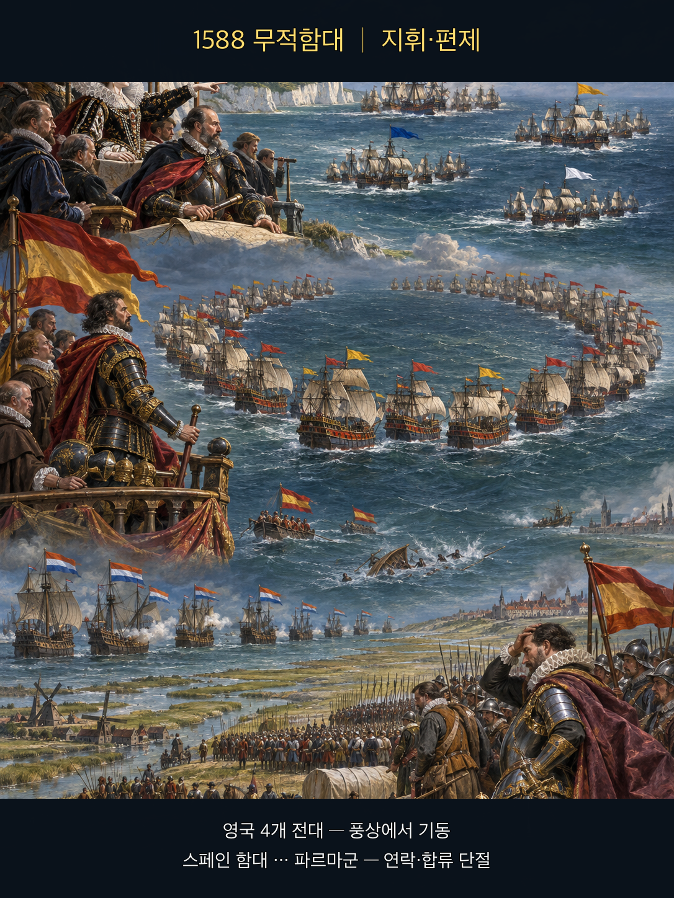
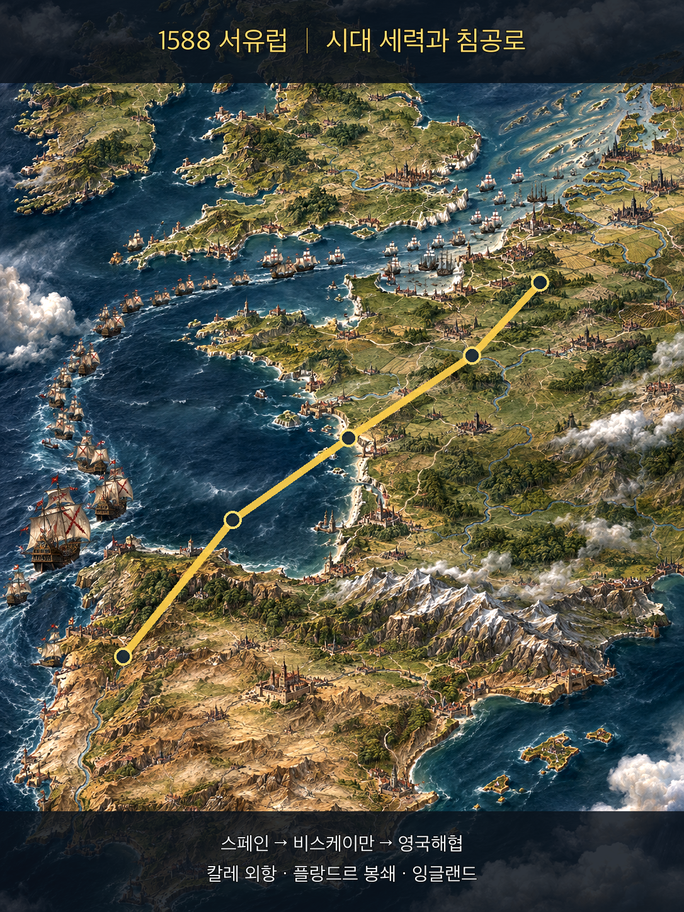
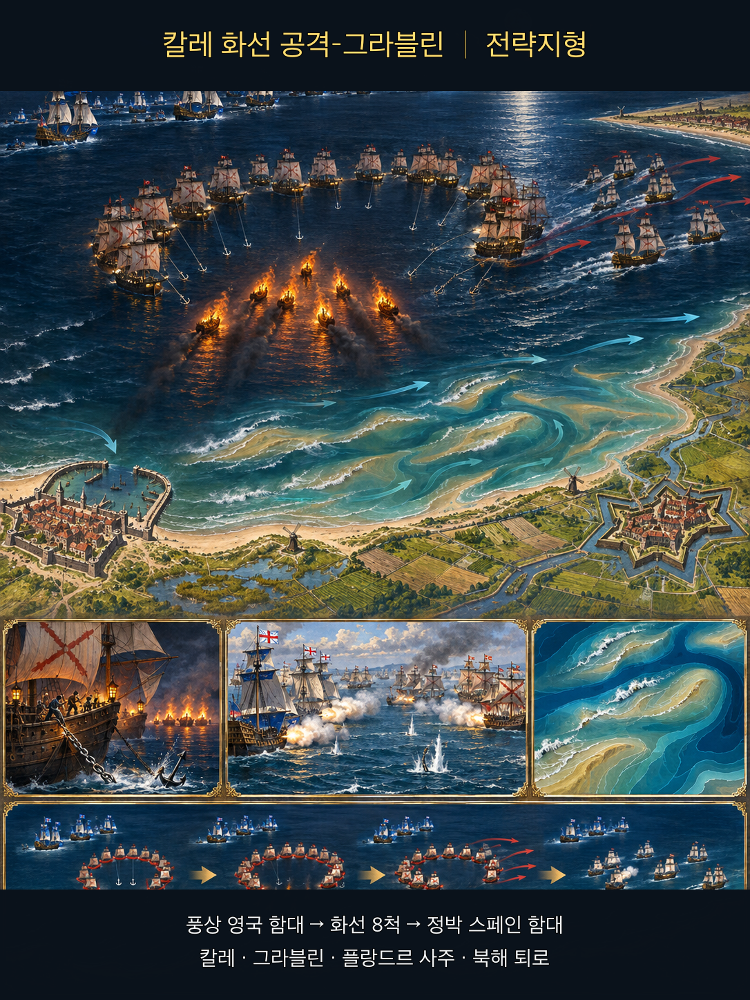
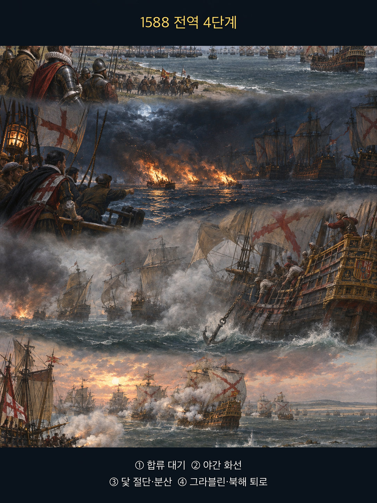

**찰스 하워드(Charles Howard)**와 **프랜시스 드레이크(Francis Drake)**가 이끄는 잉글랜드 함대는 풍상을 유지하며 원거리 포격과 기동전을 택했다. **메디나 시도니아 공작(Duke of Medina Sidonia)**의 무적함대는 **칼레(Calais)** 외항에서 **파르마 공작(Duke of Parma)**의 상륙군과 합류해야 했지만, 네덜란드 함대의 봉쇄 때문에 파르마군은 즉시 출항할 수 없었다. 이 사례의 핵심은 화선이 몇 척을 직접 태웠느냐가 아니다. **합류가 확인되지 않은 계획, 화재에 취약한 정박, 닻줄 절단 뒤 재집결 절차의 부재가 함대의 보전을 무너뜨린 과정**이다.

**뒤에서 반복될 지형을 먼저 잡아두기**

- 🌊 **영국해협(English Channel)** — 스페인 함대가 파르마군과 만나 잉글랜드로 건너가야 했던 좁은 수로다. 잉글랜드 함대가 풍상을 잡자 스페인 함대는 원하는 방향으로 전투를 끝내기 어려워졌다.
- **▰** **칼레(Calais)** 외항 — 합류를 기다린 정박지다. 닻을 내린 대형은 안정적이지만 야간 화선 앞에서는 회피 공간과 동시 기동이 제한됐다.
- **▰** **덩케르크(Dunkirk)**와 플랑드르 연안 — 파르마군의 출항로였으나 네덜란드 함대와 얕은 수로가 막았다. 함대와 육군의 계획이 지도 위에서는 가까워 보여도 실제로는 연결되지 않았다.
- 🌊 **그라블린 연안(Gravelines Roads)** — 화선 뒤 흩어진 함대가 잉글랜드군과 근접 포격전을 벌인 해역이다. 동쪽의 얕은 사주가 스페인 함대의 퇴로를 압박했다.
- 🌊 **북해(North Sea)** — 해협으로 돌아가지 못한 무적함대가 스코틀랜드·아일랜드를 돌아 귀환한 길이다. 전투 뒤의 항해·폭풍·보급 부족도 `全軍`의 범위에 들어간다.

#### 상세 전역 서사 — 합류가 불가능한 정박지에서 개별 회피가 함대 해체로 바뀌다

스페인 계획은 함대가 플랑드르의 파르마군을 호위해 잉글랜드로 건너간다는 결합 작전이었다. 그러나 파르마군의 병력은 항구에 한꺼번에 승선해 즉시 나올 준비가 되어 있지 않았고, 네덜란드 함대가 연안 수로를 봉쇄했다. **메디나 시도니아**는 칼레 외항에 닻을 내리고 연락을 기다렸지만, 합류의 시간표는 작전 명령만큼 확실하지 않았다.

풍상을 잡은 **하워드**는 8척의 화선을 밤의 조류에 실어 정박 함대로 보냈다. 당시 선원들은 화선 안에 폭약이 실렸을 가능성도 배제할 수 없었다. 스페인 함선들이 닻줄을 끊고 피한 판단은 개별 함선의 즉각적 생존에는 합리적이었다. 문제는 **어디에서 어떤 신호로 다시 모일지, 닻을 잃은 배를 누가 보호할지, 대형이 깨졌을 때 침공 목적을 계속할지**가 준비되지 않았다는 데 있었다.

새벽이 되자 초승달 대형은 흩어져 있었고 잉글랜드 함대는 **그라블린(Gravelines)** 앞에서 가까운 거리까지 접근해 포격했다. 스페인 함대는 싸워 버텼지만 파르마군과의 합류는 사실상 무산되었다. 바람이 바뀌지 않았다면 플랑드르 사주로 밀려 좌초할 위험도 컸다. 살아남은 함대는 북쪽으로 빠져나갔으나, 스코틀랜드와 아일랜드를 돌아가는 귀환에서 악천후·해도 부족·식수와 선체 손상 때문에 추가 손실을 입었다.

여기서 `愼`은 국왕의 명령을 두려워하라는 말이 아니다. **합류·정박·귀환이라는 전제 중 무엇이 사실이고 무엇이 희망인지 분리하라는 요구**다. `警`은 화선을 발견했을 때만 울리는 경보가 아니다. 닻 부표, 차단정, 예비 집결선, 손상선 호송처럼 위험 뒤에도 함대를 다시 군대로 만들 절차를 갖추는 일이다.

#### 전투에서 사용된 속임수 — 평범한 화선을 폭약선처럼 보이게 한 야간 공포

잉글랜드군의 실제 의도는 화선의 직접 충돌보다 정박 대형을 깨는 데 있었다. 불붙은 선박은 스페인 선원에게 폭약과 화약을 실은 특수 화선일 수 있다는 신호로 보였다. 좁은 정박지, 야간, 풍상에서 내려오는 불길, 앤트워프 폭약선의 기억이 그 위험을 현실적으로 만들었다. 닻줄 절단과 분산이 일어나자 잉글랜드군은 다음 날 흩어진 함대를 공격했다.

#### 속임수 작동 구조

**주체와 의도.** **하워드**와 잉글랜드 지휘부는 스페인 함선을 모두 불태우기보다 정박 대형과 지휘 연결을 깨려 했다.

**보인 신호와 믿은 이유.** 불붙은 8척은 충돌 자체보다 폭발 가능성과 연쇄 화재를 떠올리게 했다. 스페인군의 회피는 단순한 겁이 아니라 당시 정보에서 합리적인 위험 반응이었다.

**유발된 행동과 결과.** 함선들은 닻줄을 끊고 흩어졌고, 함대는 다음 날 대형·닻·통신의 일부를 잃은 채 그라블린 전투를 맞았다.

**사료의 경계.** 화선이 직접 침몰시킨 배보다 분산 효과가 중요했다. 모든 스페인 선원이 같은 이유로 행동했다고 단정하거나, 화선 하나만으로 전역의 패배를 설명해서는 안 된다.

#### 속임수 일곱 질문

1. **누가 누구를 속였는가?** 잉글랜드 함대가 스페인 정박 함대에 실제 파괴력보다 더 큰 폭발·연쇄 화재 위험을 보였다.
2. **어떤 사실이 거짓이었는가?** 8척 모두가 대형 폭약선이라는 인상은 확인된 사실이 아니었다.
3. **어떤 사실은 진실이지만 오해를 유도했는가?** 배에는 실제 불이 붙어 있었고 충돌하면 위험했지만, 주효과는 직접 소각보다 대형 붕괴였다.
4. **상대는 왜 그것을 믿고 싶어 했는가?** 믿고 싶었다기보다 야간 정박지에서 최악의 결과를 피해야 했다. 다만 집단적 회피를 통제할 절차가 없었다.
5. **속임수가 없었어도 같은 오판이 발생했을까?** 가능성은 낮다. 그러나 합류 지연과 불리한 정박 때문에 다른 위협에도 대형이 흔들릴 위험은 남아 있었다.
6. **속은 사람은 어떤 독립 확인을 생략했는가?** 화선의 수·접근각·차단 가능성을 전대별로 나누어 확인하고 공통 집결 명령을 유지하지 못했다.
7. **신뢰·동의·안전을 해치지 않으면서 같은 원리를 어디서 연습할 수 있는가?** 재난 모의훈련에서 화재 경보와 대피 뒤 재집결·인원 확인까지 한 묶음으로 연습할 수 있다.

#### 시계편 兵者詭道也 — 이 전장에 해당하는 속이는 길

<table fit-page-width="true" header-row="true">
<tr><td>해당 구절·독음·뜻</td><td>전장의 장면</td></tr>
<tr><td>亂而取之 난이취지 — 어지럽힌 뒤 취한다</td><td>화선이 정박 대형을 흩뜨린 뒤 잉글랜드 함대가 그라블린에서 각개 상태의 스페인 함대를 압박했다.</td></tr>
<tr><td>近而示之遠 근이시지원 — 가까이 있으면서 멀리 있는 듯 보인다</td><td>주공격은 다음 날의 포격이었지만, 야간 화선이 즉시 파괴의 중심인 것처럼 주의를 끌었다.</td></tr>
</table>

#### 法 한눈 비교 — 곡제·관도·주용

<table fit-page-width="true" header-row="true">
<tr><td>진영</td><td>곡제(편제)</td><td>관도(지휘)</td><td>주용(보급·지속)</td></tr>
<tr><td>**잉글랜드 함대**</td><td>기동성이 높은 전대를 나누어 풍상과 포격 거리를 유지했다.</td><td>**하워드** 아래 전대 지휘관들이 독립 기동했다.</td><td>본토 항구와 가까워 탄약·수리·정보 보충이 상대적으로 쉬웠다.</td></tr>
<tr><td>**스페인 함대**</td><td>수송·전투·대형선이 초승달 대형으로 결합했으나 닻 절단 뒤 재편이 어려웠다.</td><td>함대와 파르마군의 명령·연락이 분리되었다.</td><td>장거리 항해 뒤 닻·탄약·식수·선체 수리 여력이 줄었다.</td></tr>
</table>

#### **메디나 시도니아 공작(패)**

<table fit-page-width="true" header-row="true">
<tr><td>요소</td><td>판단</td></tr>
<tr><td color="orange_bg">🤝 **道**</td><td>개별 함장들은 격렬히 싸웠지만 함대·상륙군의 공통 목적은 실제 합류 능력과 분리되었다. (지기·사기)</td></tr>
<tr><td color="blue_bg">🌤️ **天**</td><td>풍향 변화가 사주 좌초를 막았으나, 합류 지연과 영국의 풍상 장악을 낙관적 시간표로 상쇄할 수 없었다. (지피·타이밍·확률 관점)</td></tr>
<tr><td color="green_bg">🧭 **地**</td><td>칼레 외항의 정박 안정성만 보고 화선·조류·플랑드르 사주가 만드는 병목을 충분히 흡수하지 못했다. (험이·광협·사생)</td></tr>
<tr><td color="purple_bg">🎖️ **將**</td><td>**메디나 시도니아**는 위기 속 질서를 회복하려 했지만 분리된 합동계획을 현장에서 바꿀 권한과 수단이 부족했다. (지신인용엄)</td></tr>
<tr><td color="yellow_bg">⚙️ **法**</td><td>화선 차단·닻 보존·재집결·귀환 호송을 하나의 절차로 묶지 못했다. (곡제·관도·주용)</td></tr>
</table>

**직관·편향 한 줄:** 합류가 곧 가능하다는 계획 기준점이 유지되어, 봉쇄와 승선 지연이라는 새 증거가 침공 가능성을 낮추는 정도를 충분히 반영하지 못한 것으로 볼 수 있다.

🏳️ **패군 측 결과** — 함대는 전멸하지 않았지만 침공 목적을 잃고 북해로 돌아야 했다. 六敗 중 `亂`(란, 지휘·배치가 일정하지 못해 혼란해짐)의 성격이 강하다.

🔀 **패군 측 회피 분기점** — 칼레 정박 전에 파르마군의 실제 출항 가능성을 독립 확인하고, 합류가 불가능하면 정박을 피하거나 화선 차단·예비 닻·재집결선을 준비했다면 완패가 아니라 질서 있는 철수와 더 큰 전력 보전 가능성이 높아졌을 것이다.

#### **찰스 하워드(승)**

<table fit-page-width="true" header-row="true">
<tr><td>요소</td><td>판단</td></tr>
<tr><td color="orange_bg">🤝 **道**</td><td>국가 방어라는 목표 아래 전대 지휘관의 재량과 공통 신호가 결합됐다. (지기·사기)</td></tr>
<tr><td color="blue_bg">🌤️ **天**</td><td>풍상·야간·조류를 이용하되 화선만으로 승리를 확정하지 않고 다음 날 포격으로 연결했다. (지피·타이밍·확률 관점)</td></tr>
<tr><td color="green_bg">🧭 **地**</td><td>해협과 플랑드르 사주가 스페인 함대의 기동을 제한하는 순간을 골랐다. (험이·광협)</td></tr>
<tr><td color="purple_bg">🎖️ **將**</td><td>**하워드**는 화선·포격·추격을 분리해 운용하고 전대의 기동성을 살렸다. (지신인용엄)</td></tr>
<tr><td color="yellow_bg">⚙️ **法**</td><td>본토 항구와 가까운 이점을 전대 교대·보급·수리에 연결했다. (곡제·관도·주용)</td></tr>
</table>

🏆 **승군 측 결과** — 잉글랜드 함대는 `以虞待不虞者勝`(이우대불우자승, 대비한 채 대비 없는 적을 상대하는 자가 이긴다)에 가까웠다. 화선을 독립된 묘수가 아니라 풍상·포격·추격의 연결 수단으로 썼다.

##### 法을 압축하지 않고 보기 — 곡제·관도·주용

**곡제 曲制(곡제): 부대를 어떻게 나누고 결합했는가**
<table fit-page-width="true" header-row="true">
<tr>
<td>진영</td>
<td>실제 운용</td>
</tr>
<tr>
<td>
**잉글랜드**
</td>
<td>복수 전대가 교대로 접근하며 사격했고 화선은 별도 임무로 투입됐다.</td>
</tr>
<tr>
<td>
**스페인**
</td>
<td>전투선과 수송선이 초승달 대형을 이뤘으나 분산 뒤 전대별 복구 기준이 약했다.</td>
</tr>
</table>

**관도 官道(관도): 누가 명령하고 어떻게 전달했는가**
<table fit-page-width="true" header-row="true">
<tr>
<td>진영</td>
<td>실제 운용</td>
</tr>
<tr>
<td>
**잉글랜드**
</td>
<td>
**하워드**의 총지휘 아래 전대장이 기동과 사격에서 재량을 가졌다.</td>
</tr>
<tr>
<td>
**스페인**
</td>
<td>
**메디나 시도니아**와 **파르마** 사이 연락이 늦고, 함대와 상륙군은 하나의 현장 지휘망으로 합쳐지지 않았다.</td>
</tr>
</table>

**주용 主用(주용): 군량·장비·전투 지속 능력을 어떻게 썼는가**
<table fit-page-width="true" header-row="true">
<tr>
<td>진영</td>
<td>실제 운용</td>
</tr>
<tr>
<td>
**잉글랜드**
</td>
<td>본토 항구와 가까웠지만 탄약 소비를 관리하며 근접전을 선택적으로 벌였다.</td>
</tr>
<tr>
<td>
**스페인**
</td>
<td>장거리 항해·닻 상실·선체 손상·식수 문제가 북해 우회 귀환에서 누적됐다.</td>
</tr>
</table>

**사료와 지도:** [Royal Museums Greenwich 연구가이드](https://www.rmg.co.uk/collections/research-guides/research-guide-p3-charts-spanish-armada-robert-adams-museum) · [National Museum of the Royal Navy, Armada Map 9](https://armadamaps.nmrn.org.uk/the-maps/map-9/) · [동시대 Robert Adams 계열 전략도 이미지](https://armadamaps.nmrn.org.uk/wp-content/uploads/2023/06/Armada_Map_09_Tile.png)

### 동양 — 🏛️ 손권·유비 연합군 vs 🏛️ 조조군 │ 적벽 전투(赤壁之戰, 208)

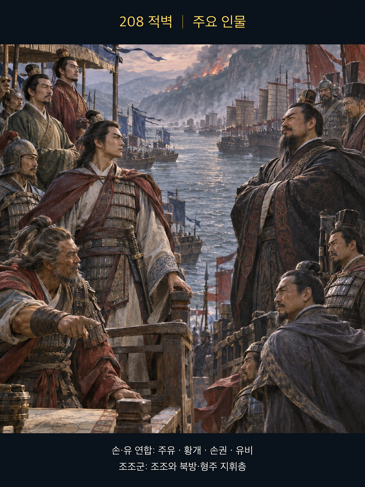
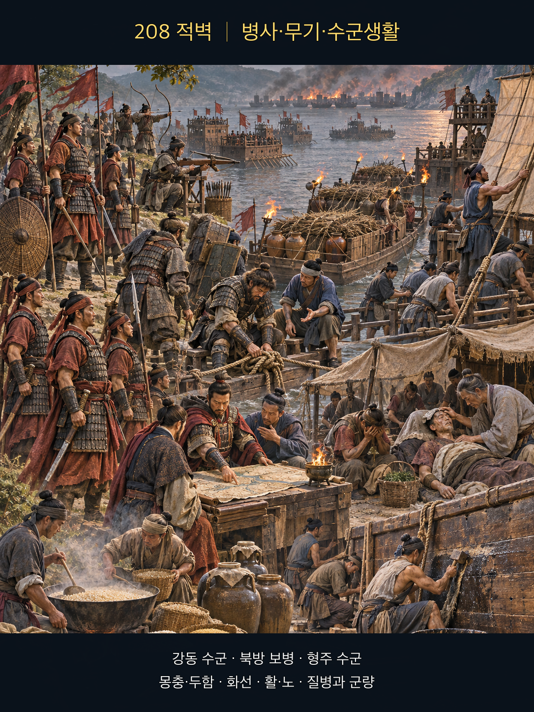
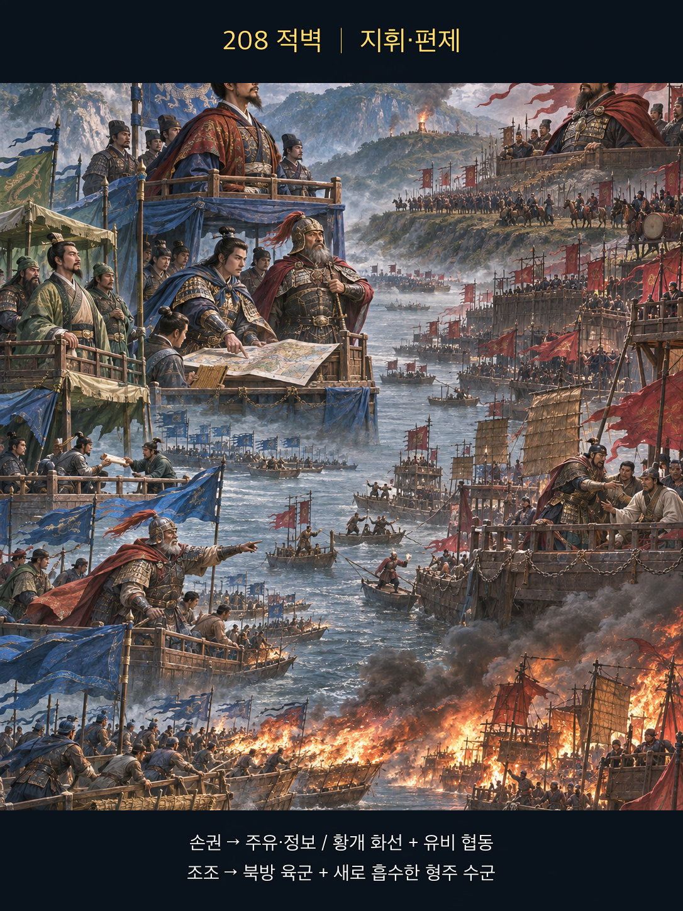
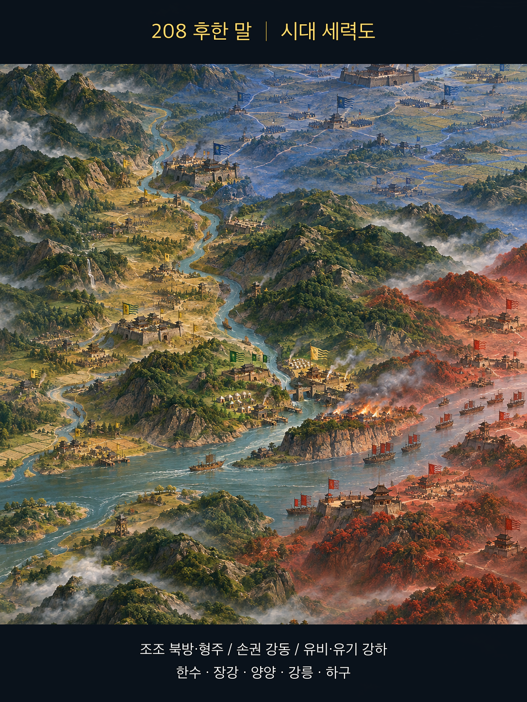
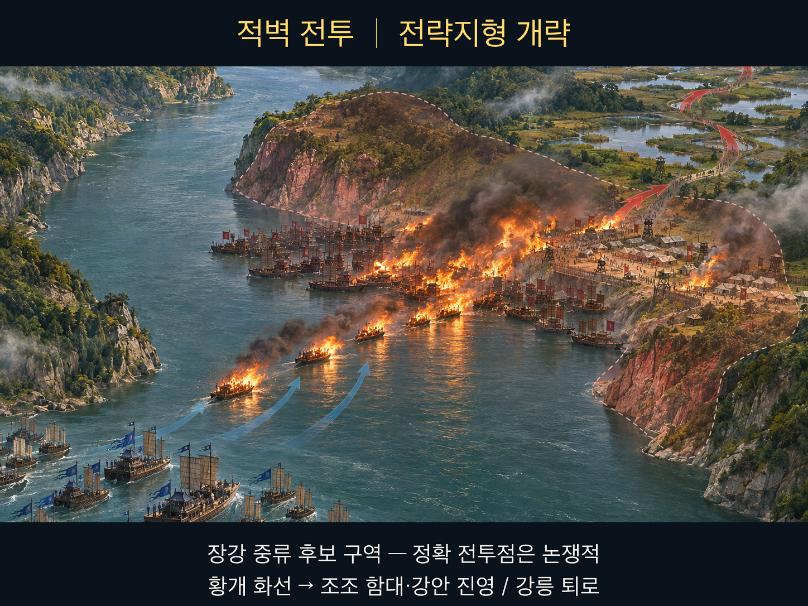
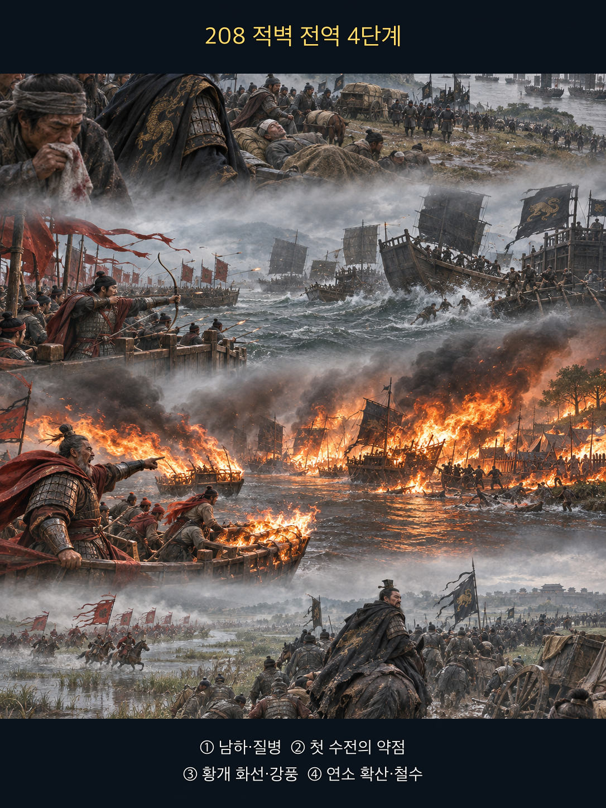

**조조(曹操)**의 군대는 형주를 장악한 뒤 장거리로 남하했으나, 북방 병사들은 수전에 익숙하지 않았고 질병과 피로가 퍼져 있었다. **주유(周瑜)**·**황개(黃蓋)**가 이끄는 손권군과 유비군은 장강에서 맞섰다. 정사에서 확인되는 핵심은 **황개**가 화공을 건의하고 화선을 접근시켜 **조조**의 선단과 강안 진영에 불이 번졌다는 것이다. 제갈량의 동남풍 기원, 방통의 연환계, 고육계의 세부는 후대 문학과 섞여 있으므로 사실층에서 제외한다.

**뒤에서 반복될 지형을 먼저 잡아두기**

- 🌊 **장강(長江)** 중류 — 육군의 수적 우세를 그대로 펼치기 어렵고 수군 숙련·선박 통제·바람이 중요한 전장이다.
- **▰** **양양(襄陽)**·**▰** **강릉(江陵)** 축 — **조조**가 형주를 장악하고 남하한 보급·퇴로 축이다.
- **▰** **하구(夏口)** — 유비·유기 세력과 손권군이 연결되는 장강의 전략 거점이다.
- ⛰️ **적벽(赤壁) 후보 구역**·**▰** **오림(烏林)** — 정확한 전투점은 논쟁적이다. 도판은 특정 좌표를 확정하지 않고 장강 양안의 후보 전장을 개략화했다.
- 🌲 **화용도(華容道) 일대 습지·도로** — 퇴각 서사가 전하는 방향이지만 세부 경로는 사료와 후대 전승을 구분해야 한다.

#### 상세 전역 서사 — 승리의 기세가 질병·수전 미숙·화재 구획의 부재를 가리다

**조조**는 형주를 빠르게 장악하고 손권에게 압박을 가했다. 그러나 새로 흡수한 형주 수군과 북방 육군은 한 지휘체계 안에서 충분히 숙달된 상태가 아니었다. 장거리 진군 뒤 병영에는 질병이 있었고, 첫 수전에서 조조군은 물러났다. 이때의 선택지는 병력을 회복시키고 정찰·소규모 교전으로 제한할지, 숫자와 기세를 믿고 결전을 계속할지였다.

**황개**는 화공을 건의했다. 투항을 가장한 선박이 접근했고, 바람을 받은 화선이 **조조**의 선단으로 돌입했다. 불은 배에서 강안 진영으로 번졌다. 정확히 얼마나 많은 배가 어떤 방식으로 묶였는지는 논쟁적이므로 “쇠사슬 연환계 하나가 모든 패배를 만들었다”고 단정할 수 없다. 다만 **밀집한 선단, 수전 미숙, 방화 구획과 접근 차단의 부족, 질병과 피로가 화재를 전역 붕괴로 키웠다**는 구조는 분명하다.

**조조**는 철수했고, 연합군은 추격해 형주 전선의 주도권을 바꾸었다. 이 사례에서 `愼`은 아예 남하하지 말라는 소극론이 아니다. 첫 수전 실패와 질병이라는 새 신호가 나타났을 때 작전의 목적·병력 상태·화재 위험을 다시 계산하라는 뜻이다. `警`은 투항서 한 장을 의심하는 데 그치지 않고 경계정·선박 간격·절단 가능한 연결·강안 방화 구획·퇴로를 준비하는 일이다.

#### 전투에서 사용된 속임수 — 황개의 투항 신호와 화선 접근

정사에는 **황개**가 화공을 건의하고 선박을 접근시킨 골격이 남아 있다. 투항을 가장한 세부는 전승에 따라 장식이 붙었으므로, 여기서는 **적대 선박이 가까이 올 수 있게 만든 신호와 그 뒤 화공이 이어졌다는 사실**만 확실성에 맞춰 쓴다. **조조군**은 접근 선박을 충분히 떨어진 곳에서 차단하지 못했고 불이 선단과 육상 진영으로 번졌다.

#### 속임수 작동 구조

**주체와 의도.** **황개**는 접근 허가를 얻어 불붙일 선박을 조조군 밀집 구역까지 보내려 했다.

**보인 신호와 믿은 이유.** 항복 또는 이탈의 신호는 형주를 빠르게 흡수한 **조조군**에게 현실성 있어 보일 수 있었다. 그러나 내면을 단정할 직접 기록은 부족하다.

**유발된 행동과 결과.** 접근 차단이 늦어 화선이 선단에 닿았고 강풍이 불을 배와 강안 진영으로 퍼뜨렸다.

**사료의 경계.** 고육계의 상세 대사, 제갈량의 바람 의식, 방통의 연환계는 정사로 확정하지 않는다. 화공은 질병·피로·수전 미숙과 결합한 한 요인이다.

#### 속임수 일곱 질문

1. **누가 누구를 속였는가?** **황개** 측이 **조조군**에게 적대 선박의 접근 의도를 감췄다.
2. **어떤 사실이 거짓이었는가?** 접근 선박이 안전한 투항선이라는 인상이 거짓 신호였다.
3. **어떤 사실은 진실이지만 오해를 유도했는가?** 형주 인력이 조조군에 새로 편입되던 시기라 실제 이탈 가능성 자체는 비현실적이지 않았다.
4. **상대는 왜 그것을 믿고 싶어 했는가?** 빠른 형주 장악의 연장선에서 추가 귀순을 기대했을 가능성이 있으나, 사료로 내면을 확정할 수 없다.
5. **속임수가 없었어도 같은 오판이 발생했을까?** 화재 재앙은 낮아지지만 질병·수전 미숙 때문에 작전 실패 위험은 여전히 높았다.
6. **속은 사람은 어떤 독립 확인을 생략했는가?** 접근 선박을 원거리에서 정선시키고 인원·적재물·풍향을 분리 확인하는 절차가 보이지 않는다.
7. **신뢰·동의·안전을 해치지 않으면서 같은 원리를 어디서 연습할 수 있는가?** 보안 훈련에서 신뢰된 발신자처럼 보이는 요청을 별도 채널로 확인하는 연습이 가능하다.

#### 시계편 兵者詭道也 — 이 전장에 해당하는 속이는 길

<table fit-page-width="true" header-row="true">
<tr>
<td>해당 구절·독음·뜻</td>
<td>전장의 장면</td>
</tr>
<tr>
<td>利而誘之 이이유지 — 이익으로 유인한다</td>
<td>투항 또는 귀순의 이익처럼 보이는 접근 신호가 조조군의 경계를 늦췄다.</td>
</tr>
<tr>
<td>攻其無備, 出其不意 공기무비, 출기불의 — 대비 없는 곳을 치고 뜻하지 않은 때에 나온다</td>
<td>바람을 이용한 화선이 밀집 선단과 강안 진영의 방화 취약성을 동시에 찔렀다.</td>
</tr>
</table>

#### 法 한눈 비교 — 곡제·관도·주용

<table fit-page-width="true" header-row="true">
<tr>
<td>진영</td>
<td>곡제(편제)</td>
<td>관도(지휘)</td>
<td>주용(보급·지속)</td>
</tr>
<tr>
<td>
**손·유 연합군**
</td>
<td>숙련 수군과 황개 화선 임무를 결합했다.</td>
<td>
**주유** 중심 지휘와 유비군의 협동이 목적상 맞물렸다.</td>
<td>장강 수로와 현지 수군 숙련을 이용했다.</td>
</tr>
<tr>
<td>
**조조군**
</td>
<td>북방 육군과 새로 흡수한 형주 수군의 통합이 불완전했다.</td>
<td>빠른 팽창 뒤 이질 부대의 보고·통제가 길어졌다.</td>
<td>장거리 진군·질병·낯선 수전이 지속 능력을 깎았다.</td>
</tr>
</table>

#### **조조(패)**

<table fit-page-width="true" header-row="true">
<tr>
<td>요소</td>
<td>판단</td>
</tr>
<tr>
<td color="orange_bg">🤝 **道**</td>
<td>새로 흡수한 형주 수군과 북방군의 결속·숙련이 충분히 검증되지 않았다. (지기·사기)</td>
</tr>
<tr>
<td color="blue_bg">🌤️ **天**</td>
<td>질병·강풍·적의 투항 신호를 독립 위험으로 재평가하지 못했다. (지피·타이밍·확률 관점)</td>
</tr>
<tr>
<td color="green_bg">🧭 **地**</td>
<td>장강의 수로·습지·배 위 전투가 북방 육군의 수적 우세를 제한했다. (험이·광협·사생)</td>
</tr>
<tr>
<td color="purple_bg">🎖️ **將**</td>
<td>
**조조**의 결단력은 강했지만 첫 수전 실패 뒤 중지·회복·분산을 택하지 않았다. (지신인용엄·장유오위)</td>
</tr>
<tr>
<td color="yellow_bg">⚙️ **法**</td>
<td>함선 간격·방화 구획·접근 차단·퇴로가 복합 위험을 흡수하지 못했다. (곡제·관도·주용)</td>
</tr>
</table>

**직관·편향 한 줄:** 형주를 빠르게 장악한 최근 성공이 대표성·과신의 기준점이 되어, 질병과 첫 수전 실패가 남하 작전의 성공확률을 낮추는 신호를 충분히 반영하지 못한 것으로 볼 수 있다.

🏳️ **패군 측 결과** — 선단과 강안 진영의 화재가 철수로 이어졌고 남방 통일의 기회가 꺾였다. 六敗 중 `北`(배, 적정을 헤아리지 못하고 약한 상태로 강한 조건에 맞섬)의 경고와 연결된다.

🔀 **패군 측 회피 분기점** — 첫 수전 실패와 질병을 확인한 시점에 결전을 늦추고 함대를 분산해 방화 구획과 경계정을 세웠다면, 승리를 보장할 수는 없어도 선단·강안 진영이 함께 타는 완패는 줄일 수 있었다.

#### **주유(승)**

<table fit-page-width="true" header-row="true">
<tr>
<td>요소</td>
<td>판단</td>
</tr>
<tr>
<td color="orange_bg">🤝 **道**</td>
<td>손권의 정치 결단, **주유**의 현장 지휘, **황개**의 제안이 하나의 목적에 연결됐다. (지기·사기)</td>
</tr>
<tr>
<td color="blue_bg">🌤️ **天**</td>
<td>적의 질병·수전 미숙과 강풍을 기회로 썼지만 단일 요인을 승리의 전부로 보지 않았다. (지피·타이밍·확률 관점)</td>
</tr>
<tr>
<td color="green_bg">🧭 **地**</td>
<td>장강에서 숙련 수군의 기동과 화선 접근을 결합했다. (험이·광협)</td>
</tr>
<tr>
<td color="purple_bg">🎖️ **將**</td>
<td>
**주유**는 적의 수적 우세보다 실제 운용 상태를 판단했고 **황개**의 화공안을 채택했다. (지신인용엄)</td>
</tr>
<tr>
<td color="yellow_bg">⚙️ **法**</td>
<td>화선을 별도 임무로 편성해 본대와 후속 추격에 연결했다. (곡제·관도·주용)</td>
</tr>
</table>

🏆 **승군 측 결과** — 연합군은 `識衆寡之用者勝`(식중과지용자승, 많고 적은 병력의 쓰임을 아는 자가 이긴다)에 가까웠다. 숫자보다 수전 숙련·밀집 위험·시간창을 계산했다.

##### 法을 압축하지 않고 보기 — 곡제·관도·주용

**곡제 曲制(곡제): 부대를 어떻게 나누고 결합했는가**
<table fit-page-width="true" header-row="true">
<tr>
<td>진영</td>
<td>실제 운용</td>
</tr>
<tr>
<td>
**손·유 연합군**
</td>
<td>숙련 수군 본대와 **황개**의 화선 선봉, 유비군의 후속 압박을 기능별로 결합했다.</td>
</tr>
<tr>
<td>
**조조군**
</td>
<td>북방 보병·형주 수군·대규모 선단을 빠르게 합쳤지만 숙련과 화재 대응은 균질하지 않았다.</td>
</tr>
</table>

**관도 官道(관도): 누가 명령하고 어떻게 전달했는가**
<table fit-page-width="true" header-row="true">
<tr>
<td>진영</td>
<td>실제 운용</td>
</tr>
<tr>
<td>
**손·유 연합군**
</td>
<td>손권의 결전 승인 아래 **주유**가 수군을 지휘하고 **황개**의 제안을 실행 임무로 바꿨다.</td>
</tr>
<tr>
<td>
**조조군**
</td>
<td>
**조조**의 중앙 지휘 아래 새로 편입된 형주 수군과 북방군의 보고·신호 체계가 짧은 시간에 통합돼야 했다.</td>
</tr>
</table>

**주용 主用(주용): 군량·장비·전투 지속 능력을 어떻게 썼는가**
<table fit-page-width="true" header-row="true">
<tr>
<td>진영</td>
<td>실제 운용</td>
</tr>
<tr>
<td>
**손·유 연합군**
</td>
<td>현지 수로 지식, 수군 숙련, 가연재를 실은 화선을 짧은 결전의 힘으로 집중했다.</td>
</tr>
<tr>
<td>
**조조군**
</td>
<td>장거리 남하와 질병으로 병력의 실제 가용성이 명목 숫자보다 낮았고, 선단·강안 진영의 화재가 보급과 숙영을 함께 파괴했다.</td>
</tr>
</table>

**사료와 지도:** [《삼국지》 황개전 원문](https://ctext.org/text.pl?if=gb&node=604246&remap=gb) · [Rafe de Crespigny, Cambridge History of China 제2권 미리보기](https://api.pageplace.de/preview/DT0400.9781108660464_A45555048/preview-9781108660464_A45555048.pdf) · [USNI Naval History](https://www.usni.org/magazines/naval-history-magazine/2023/february/flaming-ships-red-cliffs) · [전략지형 참고도](https://commons.wikimedia.org/wiki/Special:Redirect/file/Battle_of_Red_Cliffs_208_extended_map-en.svg)

---
## 5. 핵심 통찰 + 실생활 적용 + 생활루틴

### 핵심 통찰

이 구절의 핵심은 **결정 전 신중함과 실행 중 경계심을 서로 다른 책임으로 설계하라**는 데 있다. 중요한 결정을 승인하는 사람은 목적·비용·대안·비가역성을 따지고, 실행하는 사람은 현장의 변화·손실·중단 신호를 계속 살핀다. 승인자가 현장을 다 안다고 믿거나 실행자가 “이미 결정됐으니” 생각을 멈추면 두 안전장치가 함께 사라진다.

`安國全軍`은 아무 위험도 감수하지 말라는 말이 아니다. 지키려는 대상과 수단의 관계를 뒤집지 말라는 말이다. 성과를 얻느라 조직의 신뢰·사람·데이터·회복력을 소진한다면 수단이 목적을 파괴한 것이다. 좋은 결론은 눈앞의 승패뿐 아니라 행동 뒤에도 공동체가 기능할 힘을 남긴다.

### 실생활 적용

현장 작업이나 설비 조치에서는 승인자와 실행자의 확인 항목을 나눈다. 승인자는 조치 목적, 영향 범위, 대안, 허용 가능한 정지 시간을 정한다. 실행자는 실제 수치, 예상과 다른 반응, 안전선, 복구 가능성을 감시한다. 현장에서 새 위험이 보이면 최초 승인에 매달리지 않고 즉시 멈춰 다시 보고한다.

서비스 배포·데이터 변경에서는 변경 승인과 실시간 관찰을 한 사람의 자신감에만 맡기지 않는다. 배포 전에는 영향 범위, 백업, 롤백 절차, 성공·중단 지표를 검토한다. 배포 중에는 오류율·지연·사용자 영향을 관찰하고, 정한 선을 넘으면 원인 논쟁보다 먼저 중단하거나 되돌린다. “승인받았다”는 사실은 경계를 끝낼 이유가 아니다.

개인 생활에서도 큰 지출, 공개 발언, 퇴사, 관계 단절처럼 되돌리기 어려운 결정은 두 단계로 다룬다. 먼저 왜 해야 하는지와 하지 않을 대안을 적어 `愼`한다. 실행을 시작한 뒤에는 몸 상태, 비용, 관계의 변화, 새로 드러난 사실을 살펴 `警`한다. 처음 선택을 지키는 체면보다 삶의 기반을 보전하는 것이 우선이다.

### 생활루틴

**결정할 때 한 번 조심하는 것으로는 부족하다. 실행하는 동안에도 목적과 안전선이 살아 있는지 계속 확인해야 한다.** 신중함은 시작 전의 문턱이고, 경계심은 시작 뒤의 난간이다. 둘을 나누어 세울 때 성과와 보전을 함께 지킬 수 있다.

1. 큰 행동 전에 지킬 대상과 얻을 결과를 한 문장씩 쓴다.
2. 승인자는 목적·대안·허용 손실·중단 조건을 확인한다.
3. 실행자는 관찰 지표·보고 시점·복구 절차를 확인한다.
4. 예상과 다른 신호가 나오면 최초 계획을 변호하기 전에 멈추고 다시 평가한다.
5. 끝난 뒤에는 성과뿐 아니라 사람·신뢰·데이터·회복력이 얼마나 남았는지 검토한다.

**한 줄 기억법:** 결정자는 삼가고 실행자는 경계하라. 지키려던 것을 남기는 것이 진짜 성과다.
