<!-- sunzi-analysis-mode: light -->
> 손자왈: 범화공유오, 일왈화인, 이왈화적, 삼왈화치, 사왈화고, 오왈화대. — 불을 하나의 묘책으로 보지 말고, 사람·비축·수송·창고·대오 가운데 무엇을 끊을지 먼저 구분하라.

---
## 1. 원문 + 독음 + 직역 + 한자어 뜻풀이

孫子曰: 凡火攻有五, 一曰火人, 二曰火積, 三曰火輜, 四曰火庫, 五曰火隊. 손자왈: 범화공유오, 일왈화인, 이왈화적, 삼왈화치, 사왈화고, 오왈화대.

	**직역**

	손자가 말하였다. 무릇 불로 공격하는 데에는 다섯 가지가 있다. 첫째는 사람을 불태우는 것이고, 둘째는 쌓아 둔 물자를 불태우는 것이며, 셋째는 치중을 불태우는 것이고, 넷째는 창고를 불태우는 것이며, 다섯째는 대오와 그 장비를 불태우는 것이다.

	화공편은 불의 위력을 찬양하며 시작하지 않는다. 먼저 적의 전쟁 체계를 다섯 층으로 나눈다. 병사가 머무는 영채, 당장 꺼내 쓸 비축, 이동 중인 치중, 오래 저장하는 창고, 전투 대형과 병기·통로는 서로 다른 표적이다. 불을 붙였다는 사실보다 **어느 기능을 끊으려는가**, 그리고 그 손상이 적의 행동을 실제로 어떻게 바꾸는가가 먼저다. 뒤 구절이 시기·바람·내응·공격 연계를 따지는 까닭도 이 분류에서 출발한다.

	#### 火攻(화공)·有五(유오) — 강한 수단일수록 표적부터 나누다

	**火**(불 화)는 불꽃이 위로 타오르는 모양에서 나온 글자이고, **攻**(칠 공)은 공구로 대상을 쳐서 허무는 행위를 가리킨다. 그러나 여기서 火攻은 아무 데나 불을 지르는 한 가지 행동이 아니다. **有五**(유오, 다섯이 있다)는 불이라는 동일한 수단도 표적과 목적에 따라 작전 효과가 달라진다고 선을 긋는다. 불은 통제하기 어렵고 되돌리기 힘들기에, 분류 없이 쓰면 적의 체계를 끊기보다 민간·아군·필요한 자원까지 함께 태울 수 있다.

	#### 火人(화인) — 사람을 노리되 영채와 결속을 함께 보다

	**人**(사람 인)은 서 있는 사람의 옆모습을 본뜬 글자다. 이전(李筌)은 적의 영채를 태워 병사를 살상하는 것으로, 두목(杜牧)과 매요신(梅堯臣)은 울타리·진영과 주변의 마른 초목을 태워 공격을 돕는 것으로 풀었다. 따라서 火人은 개인을 하나씩 겨냥하는 말보다 **사람이 밀집해 쉬고 지휘받는 공간을 흔드는 공격**에 가깝다. 살상만 세면 영채의 질서가 무너지고 병력이 흩어지는 작전 효과를 놓친다.

	#### 火積(화적) — 쌓아 둔 소비 자원을 끊다

	**積**(쌓을 적)은 禾(벼 화)와 責(꾸짖을 책)이 결합해 곡식과 물자를 차곡차곡 모은다는 뜻을 이룬다. 여기에는 군량·사료·섶처럼 당장 소비할 비축이 중심에 놓인다. 병사를 직접 치지 않아도 먹고 움직일 시간을 줄이면 전투 가능한 선택지가 좁아진다. 火積은 파괴량을 자랑하는 공격이 아니라, **적이 앞으로 쓸 수 있었던 시간을 태우는 공격**이다.

	#### 火輜(화치)·火庫(화고) — 움직이는 보급과 머무는 저장을 가르다

	**輜**(짐수레 치)는 車(수레 거)를 품어 이동 중인 군수품·장비·의복을 실은 치중을 뜻하고, **庫**(곳집 고)는 广(집 엄) 아래 車가 들어가 수레와 물자를 보관하는 창고를 뜻한다. 두목은 이동하며 아직 정착하지 않은 물자를 輜, 성과 영채 안에 보관된 것을 庫로 구분했다. 둘 다 보급이지만 하나는 **운반망**, 다른 하나는 **저장 거점**이다. 치중을 끊으면 전선과 후방의 연결이 마르고, 창고를 끊으면 축적해 둔 지속 능력이 사라진다.

	#### 火隊(화대) — 대오·병기인가, 수송로인가

	**隊**(무리 대)는 언덕이나 높은 곳에서 사람이 줄지어 내려오는 모습과 관련해 대열·부대를 뜻한다. 이전·두목·장예는 隊를 대오와 병기·장비로 읽어, 불로 전투 질서와 전투 도구를 빼앗는다고 보았다. 그러나 일부 전승에는 `隊` 대신 `隧`(길 수)가 있고, 가림(賈林)은 이를 길로 읽어 군량 수송로를 불살라 끊는다고 했다. 사용자 승인 Notion 정본의 隊를 본문으로 보존하되, 고주가 남긴 두 독법을 함께 두면 마지막 항목은 **전투 대형과 그 대형을 살리는 통로**를 모두 경계하게 한다.

	#### 글자들이 완성하는 한 장면

	손자는 火를 밝히기 전에 有五라고 표적을 나눈다. 人을 치면 영채와 결속이 흔들리고, 積을 치면 당장 먹고 쓸 시간이 줄어든다. 輜를 치면 움직이는 보급이 끊기며, 庫를 치면 오래 모은 지속 능력이 사라진다. 마지막 隊는 병력의 대오·병기와 그것을 이어 주는 길을 가리킨다. 같은 불이라도 사람·시간·운반·저장·전투 질서 가운데 **어느 기능을 끊을지 분명히 해야 공격이 작전이 된다.**

---
## 2. 전통 주석 기반 분석

- **조조(曹操)** — "불은 붙일 수 있다는 이유만으로 쓰지 마라. 공격할 사람과 물자를 나누고, 뒤에서 말할 시기와 날짜까지 맞춰 실제 승리로 이어질 때만 써라."
- **이전(李筌)** — "火人은 영채와 병사를, 火隊는 대오와 병기를 노리는 것으로 보아라. 같은 불이라도 사람이 머무는 곳과 싸움의 도구를 치는 목적을 섞지 마라."
- **두목(杜牧)** — "積은 쌓아 둔 군량이고, 輜는 길 위의 치중이며, 庫는 성과 영채 안의 저장이다. 정지한 물자와 이동하는 물자를 가려야 적의 지속 능력을 정확히 끊을 수 있다."
- **매요신(梅堯臣)** — "영채를 태우면 공격을 돕고, 치중을 태우면 재물을 궁하게 하며, 창고를 태우면 축적을 비운다. 불꽃의 크기보다 적에게 생길 결핍을 먼저 헤아려라."
- **장예(張預)** — "화공에는 내응과 지형 지식이 필요하다. 먼 거리와 험하고 쉬운 길을 먼저 익히고, 병기와 보급이 실제로 모인 자리를 확인한 뒤 움직여라."
- **왕석(王晳)** — "불은 병력을 도와 승리를 취하는 수단이다. 태우는 데 그치고 적의 변화를 이용하지 못하면 헛되이 불만 낸 것이니, 뒤따를 군사 행동을 함께 준비하라."
- **가림(賈林)** — "隊를 隧로 전한 판본의 뜻도 살펴라. 적의 대오만 보지 말고 군량이 지나가는 길과 운반의 연결을 끊어야 전선의 힘이 마른다."
- **두우(杜佑)** — "불은 적의 내부를 어지럽히기 위한 시작이다. 안에서 불이 일어나면 밖의 군대가 때맞춰 응해야 하므로, 방화와 공격을 한 지휘 아래 묶어라."
- **진호(陳皞)** — "적이 아끼는 것을 태우면 구하러 병력을 나누게 할 수 있다. 파괴 그 자체보다 적의 마음과 배치를 흔들어 틈을 만드는 데 목적을 두어라."

#### 리링의 고증과 현대적 독법

리링(李零)의 해설 취지를 따라 읽으면 이 첫 문장은 화공의 성공담이 아니라 표적 분류표다. `火+목적어`가 다섯 번 반복되어 하나의 수단이 사람·비축·운반·저장·전투 체계에 서로 다른 효과를 낸다는 구조를 만든다. 그러므로 火를 현대의 특정 무기와 곧바로 등치하기보다, 고대 군대가 사람과 군수를 공간에 밀집해 두었던 조건부터 복원해야 한다.

판본상 마지막 글자는 `隊` 외에도 `隧`·`墜`·`燧`·`地` 등으로 전하는 예가 있다. 여기서는 승인 정본의 `隊`를 고치지 않는다. 다만 십일가주 안에서도 대오·병기라는 독법과 수송로라는 독법이 갈린다는 사실을 밝혀, 확정되지 않은 이문 하나로 뜻을 단정하지 않는다. 공통 핵심은 적의 전투 질서를 떠받치는 연결부를 불로 끊는다는 데 있다.

---
## 3. 교차 설명

### ① 손자병법 내 교차

바로 앞 구지편의 결구 `是故始如處女, 敵人開戶, 後如脫兔, 敵不及拒`(시고시여처녀, 적인개호, 후여탈토, 적불급거 — 그러므로 처음에는 처녀처럼 고요해 적이 문을 열게 하고, 뒤에는 벗어난 토끼처럼 빨라 적이 막지 못하게 한다)는 기회를 여는 리듬을 말한다. 화공편 첫 구절은 그 열린 문 안에서 무엇을 칠지를 다시 다섯 갈래로 나눈다. 빠르게 들어가는 것만으로는 부족하며, 人·積·輜·庫·隊 중 적의 실제 중심을 잘못 고르면 돌이킬 수 없는 수단을 쓰고도 효과는 작다.

「모공편」의 `上兵伐謀, 其次伐交, 其次伐兵, 其下攻城`(상병벌모, 기차벌교, 기차벌병, 기하공성 — 으뜸 병법은 모략을 치고, 다음은 외교를 치며, 다음은 군대를 치고, 가장 낮은 것은 성을 공격한다)은 표적의 층위를 가르라는 점에서 만난다. 화공은 물리적 파괴이지만 그 목적은 무차별 소각이 아니다. 적의 보급·지휘·대오를 무너뜨려 더 큰 살상과 장기전을 피할 수 있을 때만 전략적 의미가 생긴다.

### ② 클라우제비츠 『전쟁론』

클라우제비츠의 무게중심은 적의 힘이 한데 결집되는 핵심을 찾아 그 결속을 무너뜨리라는 사고다. 火人·火積·火輜·火庫·火隊는 무게중심의 후보를 미리 하나로 정하지 않는다. 어떤 군대는 숙련된 병력, 어떤 군대는 단 하나의 보급로, 어떤 군대는 창고와 운송 조직이 가장 약한 연결일 수 있다. 표적 분류는 파괴 수단보다 적 체계 진단이 먼저라는 점을 보여 준다.

다만 무게중심을 하나의 시설이나 표적으로 기계적으로 환원하면 안 된다. 클라우제비츠가 강조한 전쟁의 정치 목적과 마찰을 함께 보면, 창고 하나를 태웠다는 전술적 성과가 정치적 승리와 같지 않다. 손자 역시 뒤에서 불의 변화를 보고 공격하거나 멈추라고 한다. 양쪽 모두 효과가 이어지지 않는 파괴를 승리로 세지 않는다.

### ③ 미야모토 무사시 『오륜서』

『오륜서』 화지권의 `敵の身になる`(데키노 미니 나루 — 적의 몸이 되어 보다)는 상대 처지에서 두려움과 어려움을 헤아리라는 가르침이다. 다섯 火攻을 고를 때도 공격자의 눈에 잘 보이는 표적보다, 적의 몸에서 어느 기능이 끊길 때 명령·보급·전투가 함께 흔들리는지를 봐야 한다. 이것은 불의 세기를 높이는 문제가 아니라 적 체계 안으로 관점을 옮기는 문제다.

또한 `枕を押さゆる`(마쿠라오 오사유루 — 상대가 머리를 들기 전에 베개를 누르다)는 상대 행동이 완성되기 전에 싹을 눌러 끊는다는 뜻이다. 火輜와 火庫는 전투가 벌어진 뒤 병사를 정면으로 치기보다, 병력이 먹고 무장해 전투로 이어지는 앞단을 끊는다. 그러나 민간 물자와 군사 목표를 구별하지 않는다면 이 비유는 현대의 법과 윤리를 위반하는 폭력으로 변한다.

### ④ 오자병법과 육도

『오자병법』 「요적」은 적군이 황무지와 풀이 우거진 곳에 머물러 불로 없앨 수 있는 조건을 말한다. 이는 火人이 단순한 용맹이 아니라 영채의 재료·주변 식생·바람·퇴로를 함께 보는 환경 판단임을 보완한다. 조건이 맞지 않는데도 강한 수단을 고집하면 효과보다 역풍과 아군 피해가 커진다.

『육도』의 군용·병용 논의는 군량과 기구, 신호와 편제가 군대의 행동을 가능하게 한다고 본다. 이 관점에서 積·輜·庫·隊는 물건 목록이 아니라 하나의 흐름이다. 저장된 물자가 수레에 실려 길을 지나 부대에 닿고, 병기와 대오가 전투력으로 바뀐다. 어느 한 점을 끊을지 판단하려면 전체 흐름과 대체 경로를 함께 살펴야 한다.

### ⑤ 현대 심리학·군사학

카너먼의 관점에서 불꽃과 폭발처럼 생생한 사건은 가용성 휴리스틱을 자극해 실제 전략 효과보다 크게 평가되기 쉽다. 눈앞의 큰 화재를 보고 ‘적이 치명상을 입었다’고 단정하면, 분산 창고·대체 수송로·예비 병력 같은 보이지 않는 회복 능력을 놓친다. 그래서 다섯 표적은 결과 판단에도 쓰여야 한다. 무엇이 탔는지뿐 아니라 인원·재고·운반·저장·대오 중 어느 기능이 얼마나 오래 멈췄는지를 따로 확인해야 한다.

현대 군사학에서는 표적 체계를 기능과 연결망으로 보며, 민간인 보호·군사적 필요·구별·비례의 원칙을 지켜야 한다. 고대의 火人을 오늘날 일상이나 조직에 그대로 옮겨 사람을 공격하라는 뜻으로 읽을 수 없다. 현대적 적용은 사람을 태우는 수단이 아니라, 문제를 사람·재고·운반·저장·실행 대오로 분해해 **가장 적은 피해로 회복을 막는 병목을 고치는 진단법**에 있다.

---
## 4. 역사적 실증 사례

### 서양 — 🏛️ 잉글랜드 함대 vs 🏛️ 스페인 무적함대 │ 칼레 화선 공격과 그라블린 전투(Calais fireship attack and Battle of Gravelines, 1588)

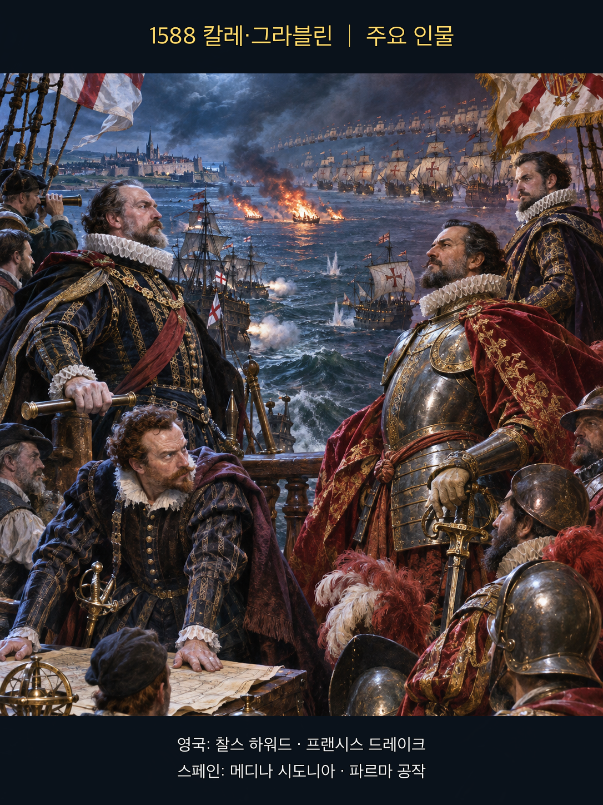

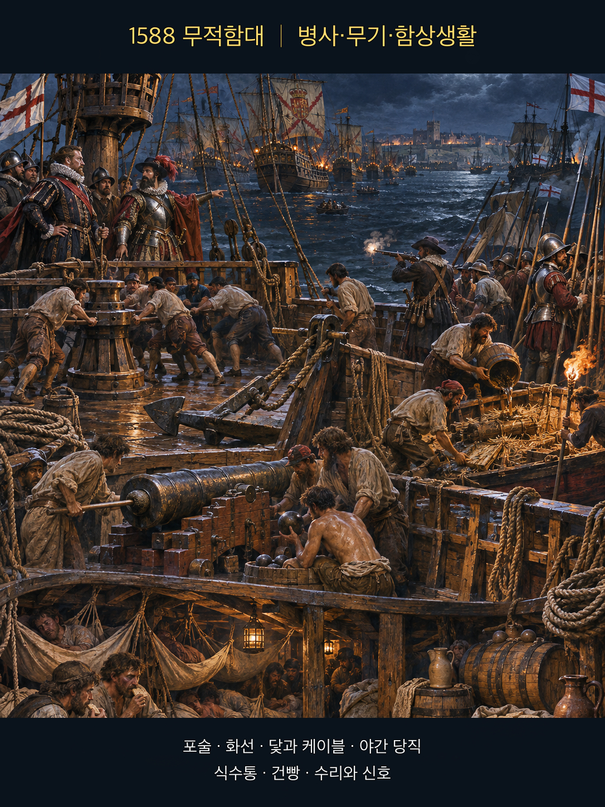

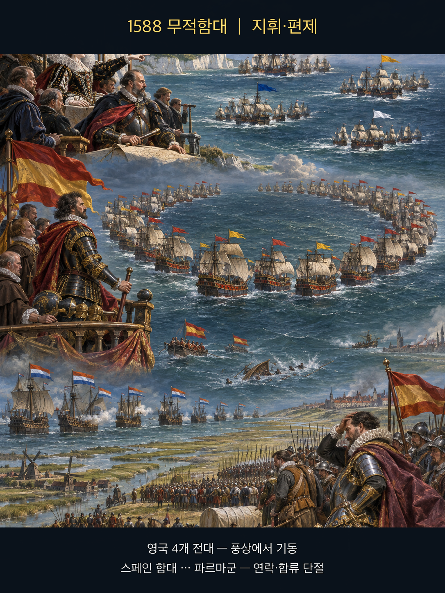

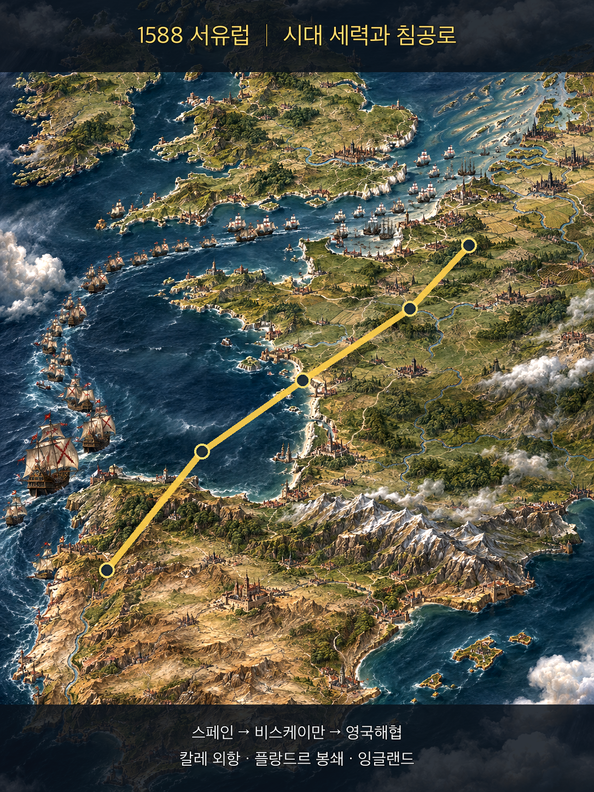

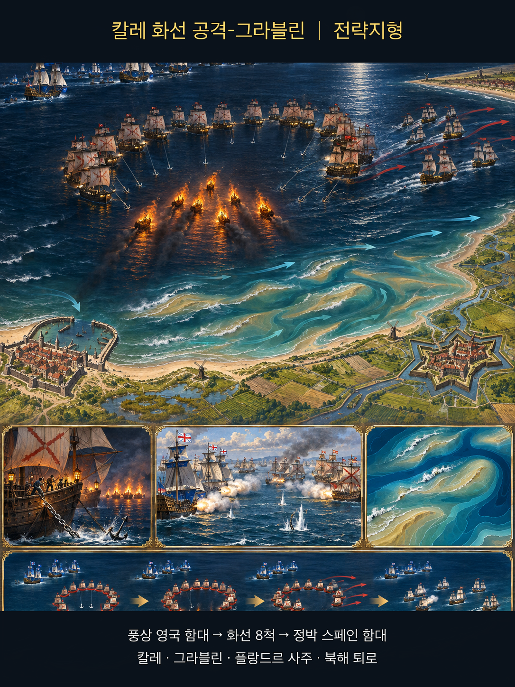

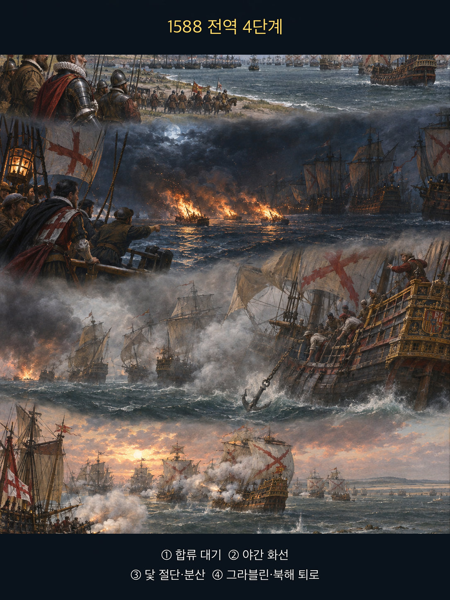

**뒤에서 반복될 지형을 먼저 잡아두기**

- 🌊 **영국해협(English Channel)**은 스페인 함대가 플랑드르의 파르마군과 합류하려 이동한 좁은 해상축이었다. 잉글랜드 함대는 이 축을 따라 그림자처럼 추적했다.
- **▰** **칼레(Calais)** 외항은 스페인 함대가 닻을 내린 대기 지점이었다. 밀집 정박은 방어 대형을 유지하게 했지만 화선이 접근했을 때 서로 피할 공간을 줄였다.
- **▰** **도버(Dover)**와 다운스의 동부 함대는 잉글랜드가 미리 준비한 증원축이었다. 화선 공격 전에 두 함대가 합류하면서 수적·작전 여유가 커졌다.
- 🌊 **그라블린 연안(Gravelines roadstead)**과 플랑드르의 모래톱은 닻줄을 끊고 흩어진 스페인 선박의 재정렬을 어렵게 했다. 이곳에서 다음 날 장거리 포격전이 이어졌다.

#### 전투의 서사 — 증원·낡은 선박·조류를 준비해 정박 대형을 깨다

이 사례에서 불의 직접 표적은 주로 **火隊(화대, 대오·병기)**였다. 잉글랜드 화선은 스페인 병사나 창고를 대량 소각한 것이 아니라 정박 대형을 풀어 전투 질서를 끊었고, 그 효과는 다음 날 그라블린 포격에서 나타났다. 따라서 화재 규모가 아니라 **불이 어느 기능을 멈추게 했는가**로 분류해야 한다.

스페인 함대의 임무는 영국 함대를 한 번에 격멸하는 것이 아니라 파르마 공작의 육군과 합류해 상륙을 호위하는 일이었다. 그러나 파르마군은 준비된 심해 항구와 수송선이 없었고, 네덜란드 측 봉쇄 때문에 즉시 합류할 수 없었다. **메디나 시도니아**는 **▰** **칼레(Calais)** 앞에 닻을 내리고 기다렸다. 그 사이 **하워드**·**드레이크**·**시모어**의 함대는 합류했고, 8척의 낡은 배에 가연물과 포를 남겨 화선으로 준비했다. 8월 7일 밤, 조류와 바람이 스페인 정박 대형으로 향할 때 화선을 놓았다. 스페인 수병들은 폭발선일 가능성까지 두려워해 닻줄을 끊고 피했고 초승달 대형이 흩어졌다. 화선이 대다수 선박을 직접 불태운 것은 아니지만, 다음 날 잉글랜드가 그라블린에서 분리된 함선을 집중 포격할 조건을 만들었다. 따라서 승패는 불 자체보다 **미리 갖춘 배·합류한 증원·적의 밀집 정박·야간 조류·즉시 이어진 함포 공격**이 한 시간표로 결합한 데 있었다.

#### 전투에서 사용된 속임수 — 평범한 화선을 폭발선처럼 보이게 하다

잉글랜드는 포와 가연물을 남긴 화선이 스페인 선원에게 1585년 안트베르펜의 폭발선 기억을 떠올리게 만들었다. 실제 주목적은 대규모 직접 소각보다 닻줄을 끊게 해 대형을 해체하는 것이었다. 화선은 보이는 불과 들리는 폭발로 실제 파괴력보다 큰 위험 신호를 보냈고, 스페인 함대가 독립 확인보다 즉시 회피를 택하도록 압박했다.

#### 속임수 작동 구조

**주체와 의도.** **잉글랜드 지휘부**는 화선으로 밀집 정박 대형을 풀어 다음 날 포격할 분리 표적을 만들려 했다.

**보인 신호와 믿은 이유.** 불붙은 배와 남겨 둔 포의 폭발은 과거 폭발선 공격을 연상시켰고, 좁은 외항에서 한 척이 폭발하면 연쇄 피해가 날 수 있다는 두려움은 합리적이었다.

**유발된 행동과 결과.** 스페인 함선들이 닻줄을 끊어 피하면서 대형과 위치를 잃었고, 다음 날 잉글랜드 함대가 그라블린에서 접근해 포격할 틈이 열렸다.

**사료의 경계.** 화선이 혼자 무적함대를 파괴했다는 통속적 서술은 과장이다. 직접 소각보다 대형 해체가 핵심이었고, 이후 함포전·보급 부족·귀환 항로의 폭풍을 분리해 보아야 한다.

#### 속임수 일곱 질문

1. **누가 누구를 속였는가?** 잉글랜드 지휘부가 스페인 정박 함대에 화선의 직접 파괴력이 실제보다 클 수 있다는 신호를 보냈다.
2. **어떤 사실이 거짓이었는가?** 화선이 모두 대형 폭발선이라는 인상은 사실이 아니었다.
3. **어떤 사실은 진실이지만 오해를 유도했는가?** 불과 포의 폭발은 실제였지만 목적은 직접 소각보다 대형 해체였다.
4. **상대는 왜 그것을 믿고 싶어 했는가?** 밀집 정박 상태와 폭발선의 역사적 기억 때문에 최악의 피해를 피하는 즉시 회피가 합리적으로 보였다.
5. **속임수가 없었어도 같은 오판이 발생했을까?** 가능성은 낮다. 야간 화선이 없었다면 닻줄을 한꺼번에 끊을 유인이 작았다.
6. **속은 사람은 어떤 독립 확인을 생략했는가?** 야간·조류·화재 상황에서는 화선의 적재물과 폭발 규모를 안전하게 확인할 시간이 거의 없었다.
7. **신뢰·동의·안전을 해치지 않으면서 같은 원리를 어디서 연습할 수 있는가?** 체스·바둑에서 위협의 실제 목적이 기물 획득인지 배치 붕괴인지 구분하는 연습이 적합하다.

#### 시계편 兵者詭道也 — 이 전장에 해당하는 속이는 길

<table fit-page-width="true" header-row="true">

<tr>
<td>해당 구절·독음·뜻</td>
<td>전장의 장면</td>
</tr>

<tr>
<td>近而示之遠 근이시지원 — 가까이 있으면서 멀리 있는 듯 보인다</td>
<td>화선의 직접 목적을 불태우기로 보이게 하면서 실제 후속 목적은 대형 해체와 다음 날 함포전이었다.</td>
</tr>

<tr>
<td>亂而取之 난이취지 — 혼란하게 한 뒤 취한다</td>
<td>야간 화선으로 닻과 대형을 흐트러뜨린 뒤 그라블린에서 분리된 함선을 집중 공격했다.</td>
</tr>

</table>

#### 法 한눈 비교 — 곡제·관도·주용

<table fit-page-width="true" header-row="true">

<tr>
<td>진영</td>
<td>곡제(편제)</td>
<td>관도(지휘)</td>
<td>주용(보급·지속)</td>
</tr>

<tr>
<td>**잉글랜드 함대**</td>
<td>기동 함대·동부 증원·화선 8척을 역할별로 결합했다.</td>
<td>**하워드** 아래 함대 지휘관들이 화선과 다음 날 포격을 연결했다.</td>
<td>본토 항구와 가까웠지만 화약 부족을 관리하며 근거리 포격에 집중했다.</td>
</tr>

<tr>
<td>**스페인 함대**</td>
<td>초승달 대형은 항해 중 강했으나 정박 중 화선 회피에는 취약했다.</td>
<td>**메디나 시도니아**는 파르마군과 직접 통신·합류하기 어려웠다.</td>
<td>탄약·식수·식량과 안전한 심해 항구가 부족해 장기 대기가 불리했다.</td>
</tr>

</table>

〈**메디나 시도니아의 스페인 함대 (패)**〉
<table fit-page-width="true" header-row="true">

<tr>
<td>요소</td>
<td>판단</td>
</tr>

<tr>
<td color="orange_bg">🤝 **道**</td>
<td>상륙군 합류라는 목적은 분명했지만 함대와 파르마군의 준비 상태가 맞지 않았다. (지기·결속)</td>
</tr>

<tr>
<td color="blue_bg">🌤️ **天**</td>
<td>야간 화선과 조류가 만든 최악의 손실 가능성에 즉시 반응했으나 후속 재집결 계획이 약했다. (지피·타이밍·확률 관점)</td>
</tr>

<tr>
<td color="green_bg">🧭 **地**</td>
<td>개방 정박지와 모래톱 가까운 연안에서 닻줄을 끊어 대형 복구가 어려웠다. (험이·사생)</td>
</tr>

<tr>
<td color="purple_bg">🎖️ **將**</td>
<td>**메디나 시도니아**는 함대를 보존했지만 합류 불능이라는 구조적 문제를 해결하지 못했다. (지신인용엄)</td>
</tr>

<tr>
<td color="yellow_bg">⚙️ **法**</td>
<td>대형·연락·보급이 서로 분리되어 화선 뒤 즉시 회복하지 못했다. (곡제·관도·주용)</td>
</tr>

</table>

🏳️ **패군 측 결과**
<table fit-page-width="true" header-row="true">
<tr>
<td>구분</td>
<td>판정</td>
</tr>
<tr>
<td color="red">⚔️ **전투 결과**</td>
<td>함대는 전멸하지 않았지만 상륙군 합류 임무를 이루지 못하고 북해로 밀려났다. 六敗의 亂에 가까운 대형·지휘 혼란이었다.</td>
</tr>
<tr>
<td color="orange">🔀 **패군 측 회피 분기점**</td>
<td>칼레 도착 전에 파르마군 수송 준비와 통신을 확인하고, 화선 방어선·예비 닻·재집결 지점을 정했다면 대형 붕괴와 임무 실패 위험을 줄일 수 있었다.</td>
</tr>

</table>

〈**하워드·드레이크의 잉글랜드 함대 (승)**〉
<table fit-page-width="true" header-row="true">

<tr>
<td>요소</td>
<td>판단</td>
</tr>

<tr>
<td color="orange_bg">🤝 **道**</td>
<td>해협 추적·동부 증원·화선 공격의 목적을 상륙 저지에 맞췄다. (지기·결속)</td>
</tr>

<tr>
<td color="blue_bg">🌤️ **天**</td>
<td>스페인 함대가 정박하고 조류가 목표로 흐르는 짧은 창을 이용했다. (지피·타이밍·확률 관점)</td>
</tr>

<tr>
<td color="green_bg">🧭 **地**</td>
<td>칼레 외항의 밀집과 그라블린 연안의 좁은 기동 공간을 연속해서 활용했다. (광협·사생)</td>
</tr>

<tr>
<td color="purple_bg">🎖️ **將**</td>
<td>**하워드**와 **드레이크**는 불을 목적이 아니라 다음 날 포격을 여는 수단으로 제한했다. (지신인용엄)</td>
</tr>

<tr>
<td color="yellow_bg">⚙️ **法**</td>
<td>낡은 배·가연물·포·증원 함대와 후속 포격을 하나의 작전으로 묶었다. (곡제·관도·주용)</td>
</tr>

</table>

🏆 **승군 측 결과**
<table fit-page-width="true" header-row="true">
<tr>
<td>구분</td>
<td>판정</td>
</tr>
<tr>
<td color="blue">⚔️ **전투 결과**</td>
<td>상륙 합류를 좌절시키고 주도권을 얻었다. 五勝 중 以虞待不虞者勝(이우대불우자승, 대비한 채 대비 없는 적을 상대하는 자가 이긴다)에 가깝다.</td>
</tr>

</table>

##### 法을 압축하지 않고 보기 — 곡제·관도·주용

**곡제 曲制(곡제): 부대를 어떻게 나누고 결합했는가**
<table fit-page-width="true" header-row="true">
<tr>
<td>진영</td>
<td>실제 운용</td>
</tr>
<tr>
<td>**잉글랜드 함대**</td>
<td>추적 함대, 동부 증원, 8척 화선을 분리 임무로 운용한 뒤 주력 포격으로 결합했다.</td>
</tr>
<tr>
<td>**스페인 함대**</td>
<td>수송선을 감싸는 초승달 대형은 항해 방어에 적합했지만 정박 중 화선 회피와 재결합 절차가 약했다.</td>
</tr>

</table>

**관도 官道(관도): 누가 명령하고 어떻게 전달했는가**
<table fit-page-width="true" header-row="true">
<tr>
<td>진영</td>
<td>실제 운용</td>
</tr>
<tr>
<td>**잉글랜드 함대**</td>
<td>**하워드**의 총지휘 아래 **드레이크** 등이 화선 실행과 후속 교전을 맡았다.</td>
</tr>
<tr>
<td>**스페인 함대**</td>
<td>**메디나 시도니아**는 해상 함대를 통솔했지만 육상의 파르마군과 신속히 명령을 주고받을 통로가 없었다.</td>
</tr>

</table>

**주용 主用(주용): 군량·장비·전투 지속 능력을 어떻게 썼는가**
<table fit-page-width="true" header-row="true">
<tr>
<td>진영</td>
<td>실제 운용</td>
</tr>
<tr>
<td>**잉글랜드 함대**</td>
<td>낡은 배를 소모성 화선으로 전환하고 본토 항구 가까이에서 탄약·수리를 지원받았다.</td>
</tr>
<tr>
<td>**스페인 함대**</td>
<td>장거리 원정으로 식량·식수·탄약이 줄었고 칼레에는 대형 함대를 안전하게 보급할 항구가 없었다.</td>
</tr>

</table>

**사료 출처:** [영국 국립문서보관소 교육 자료](https://cdn.nationalarchives.gov.uk/documents/education/spanish-armada.pdf) · [Royal Museums Greenwich 동시대 화선 도판 해설](https://www.rmg.co.uk/collections/objects/rmgc-object-11755) · [Robert Adams 해전도 연구 안내](https://www.rmg.co.uk/collections/research-guides/research-guide-p3-charts-spanish-armada-robert-adams-museum)

### 동양 — ⚔️ 주원장군 vs 🏛️ 진한군 │ 파양호 전투(鄱陽湖之戰, 1363)

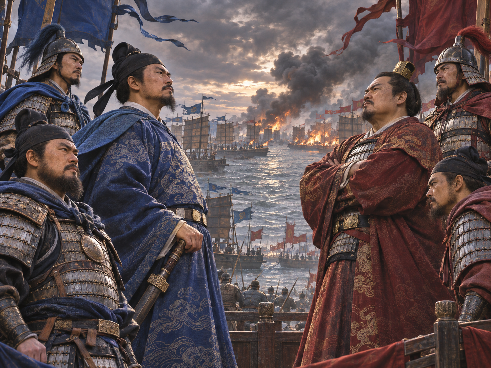

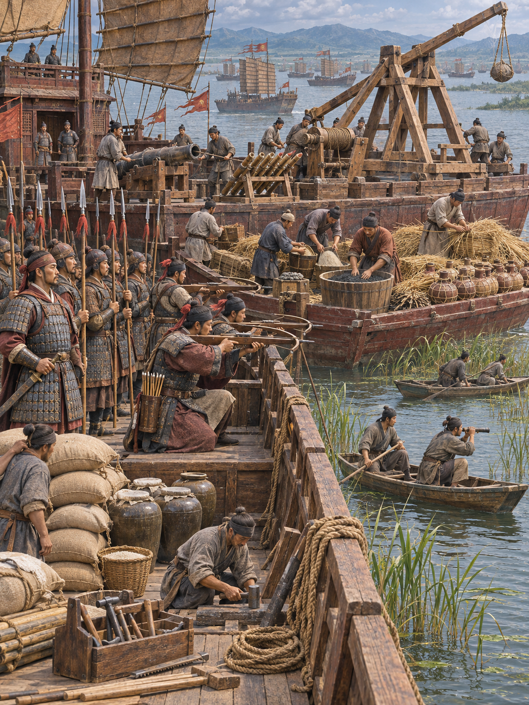

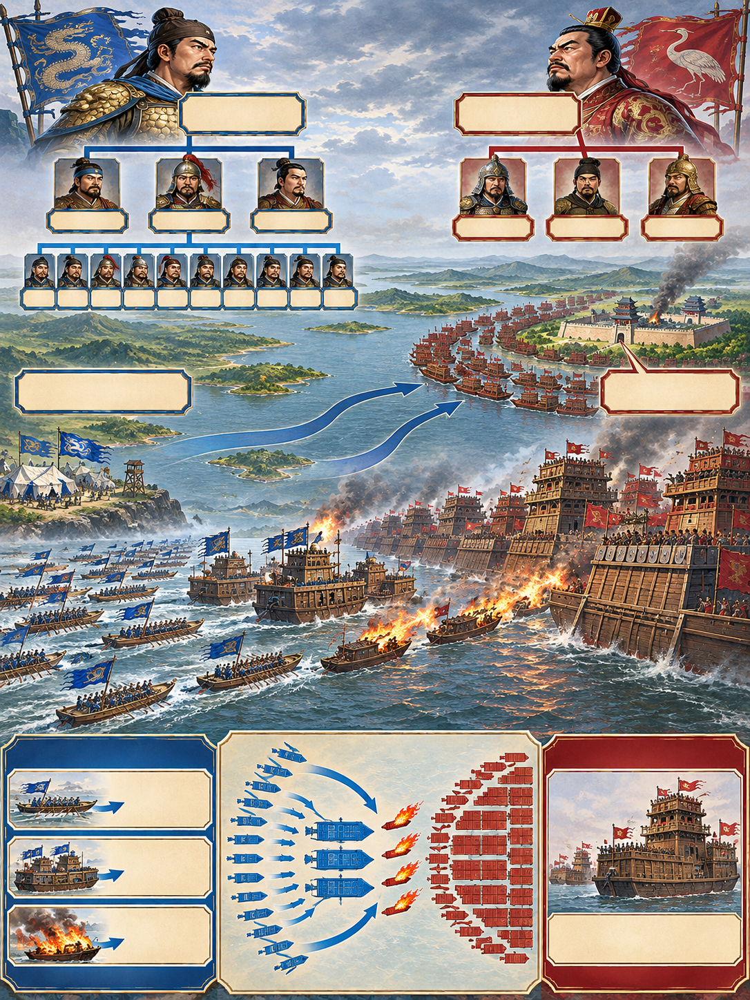

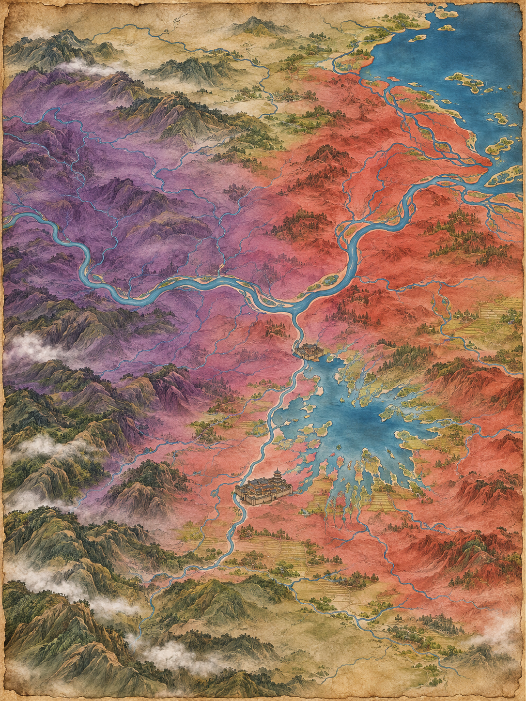

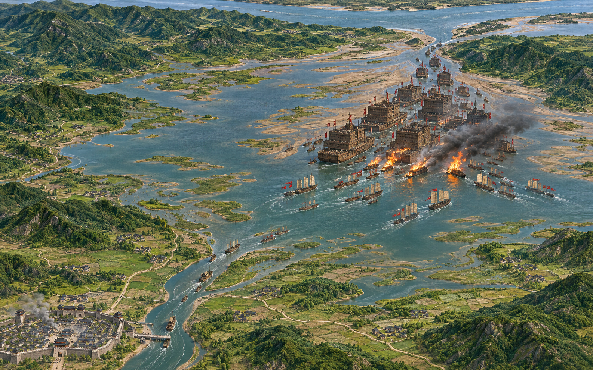

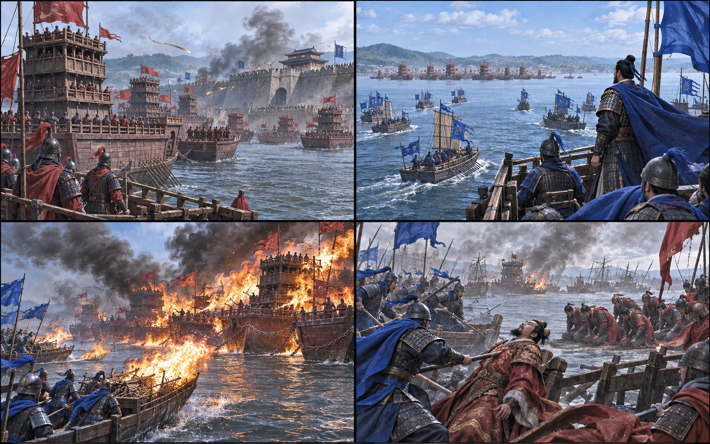

**뒤에서 반복될 지형을 먼저 잡아두기**

- **▰** **홍도(洪都, 오늘날 난창)**는 진우량군이 포위한 목표이자 주원장군이 구원해야 할 거점이었다. 성이 버티면서 호수 결전의 시간이 열렸다.
- 🌊 **파양호(鄱陽湖)**는 계절 수위가 낮아 대형 누선보다 흘수가 얕은 작은 함선이 기동하기 유리했다.
- ⛰️ **강랑산(康郎山) 수역**은 양군 주력이 처음 충돌한 구간으로, 연결된 진한 누선과 분할된 주원장 함대의 차이가 드러났다.
- 🌊 **호구(湖口)**는 파양호에서 장강으로 나가는 출구였다. 이곳을 막으면 진한 함대의 탈출과 보급을 함께 제한할 수 있었다.

#### 상세 전역 서사 — 홍도 방어가 번 시간에 화선과 호구 봉쇄를 결합하다

파양호의 화선도 중심 표적은 **火隊(화대, 연결된 대오와 함선)**였지만, 그 결과는 火人(화인, 승조원과 영채)과 火輜(화치, 함대가 싣고 움직이던 장비·군수)로 번졌다. 분류는 서로 배타적인 피해 목록이 아니라, 최초 표적과 연쇄 효과를 구분하는 도구다. 주원장군은 연결 누선이라는 대오의 약점을 먼저 쳤고, 인명·장비 손실은 그 뒤에 따라왔다.

**진우량**은 대형 누선을 이끌고 **▰** **홍도(洪都)**를 포위했지만 성은 장기간 버텼다. **주원장**은 구원 함대를 이끌고 도착하면서 별동대를 🌊 **호구(湖口)**에 보내 퇴로를 제한했다. 진한의 누선은 크고 높았으나 낮은 계절 수위와 연결 대형 때문에 선회와 분리가 느렸다. 주원장군은 작은 함선을 여러 대로 나누고 화기·궁노·근접전 부대를 순차 결합했다. 첫 교전의 손실 뒤에는 소형선에 화약·마른 갈대와 허수아비를 싣고 충돌 장치를 마련한 화선을 준비했다. 바람이 진한 함대로 향하는 창에 화선을 보내 연결된 선박 사이로 불을 번지게 하고 곧바로 함대 공격을 이었다. 전투는 한 번의 화공으로 끝나지 않았고 봉쇄와 돌파전으로 이어졌다. **진우량**이 돌파 과정에서 전사하면서 진한군의 지휘와 저항이 무너졌다. 핵심은 **홍도 수비가 번 시간, 미리 편성한 화선, 낮은 수위, 바람, 연결 누선, 호구 봉쇄와 후속 공격**의 결합이었다.

#### 전투에서 사용된 속임수 — 허수아비를 세운 화선으로 접근 의도를 늦게 드러내다

화선에 허수아비를 세운 것은 멀리서 일반 전투선처럼 보이게 해 접근 목적을 늦게 알아차리게 하는 장치였다. 불을 붙이는 순간까지 충돌·점화 의도를 감추고, 연결된 누선이 회피하거나 분리할 시간을 줄였다.

#### 속임수 작동 구조

**주체와 의도.** **주원장군**은 화선을 진한 누선에 밀착시켜 연결 대형 전체로 불을 번지게 하려 했다.

**보인 신호와 믿은 이유.** 허수아비와 전투선 같은 외형은 접근선의 실제 승조·임무를 즉시 구별하기 어렵게 했다.

**유발된 행동과 결과.** 진한 누선은 연결과 큰 선체 때문에 늦게 분리했고, 바람을 탄 화선이 접촉한 뒤 불과 후속 공격이 동시에 압박했다.

**사료의 경계.** 세부 화선 수와 병력 수는 기록마다 차이가 크다. 유리한 바람과 화선 사용은 교차 확인되지만 모든 손실을 화선 하나로 돌리면 봉쇄·수위·지휘 붕괴를 놓친다.

#### 속임수 일곱 질문

1. **누가 누구를 속였는가?** 주원장군이 진한 수군에 접근선의 실제 임무를 늦게 드러냈다.
2. **어떤 사실이 거짓이었는가?** 허수아비는 실제 승조원처럼 보였지만 사람이 아니었다.
3. **어떤 사실은 진실이지만 오해를 유도했는가?** 작은 배가 접근한다는 사실은 참이었지만 목적은 승선전이 아니라 충돌·점화였다.
4. **상대는 왜 그것을 믿고 싶어 했는가?** 큰 누선은 작은 배를 화력과 높이로 제압할 수 있다는 기존 기대가 있었다.
5. **속임수가 없었어도 같은 오판이 발생했을까?** 가능성은 중간이다. 연결 누선의 낮은 기동성은 남지만 화선을 더 일찍 식별했다면 분리·차단 시간이 늘었을 것이다.
6. **속은 사람은 어떤 독립 확인을 생략했는가?** 접근선의 승조 상태·적재물·바람 방향을 동시에 확인하고 외곽 차단선을 두는 절차가 부족했다.
7. **신뢰·동의·안전을 해치지 않으면서 같은 원리를 어디서 연습할 수 있는가?** 보드게임에서 미끼 기물과 실제 목표를 분리하고 상대가 확인할 신호를 설계하는 훈련이 적합하다.

#### 시계편 兵者詭道也 — 이 전장에 해당하는 속이는 길

<table fit-page-width="true" header-row="true">
<tr>
<td>해당 구절·독음·뜻</td>
<td>전장의 장면</td>
</tr>
<tr>
<td>近而示之遠 근이시지원 — 가까이 있으면서 멀리 있는 듯 보인다</td>
<td>일반 전투선처럼 접근한 화선이 충돌 직전 점화 의도를 드러냈다.</td>
</tr>
<tr>
<td>利而誘之 리이유지 — 이익으로 유인한다</td>
<td>작은 접근선이 쉬운 표적처럼 보여 누선이 연결 대형을 유지하게 했다.</td>
</tr>

</table>

#### 法 한눈 비교 — 곡제·관도·주용

<table fit-page-width="true" header-row="true">
<tr>
<td>진영</td>
<td>곡제(편제)</td>
<td>관도(지휘)</td>
<td>주용(보급·지속)</td>
</tr>
<tr>
<td>**주원장군**</td>
<td>작은 함선을 대별하고 화선·화기·궁노·근접전을 결합했다.</td>
<td>**주원장**이 함대를 지휘하고 별동대가 호구를 막았다.</td>
<td>구원군 보급과 호수 주변 거점을 이용하며 봉쇄를 지속했다.</td>
</tr>
<tr>
<td>**진한군**</td>
<td>대형 누선을 연결해 화력과 높이를 키웠으나 분리 기동이 느렸다.</td>
<td>**진우량** 중심 지휘가 그의 전사 뒤 급격히 무너졌다.</td>
<td>홍도 장기 포위와 호구 봉쇄로 식량·퇴로 압박이 커졌다.</td>
</tr>

</table>

〈**진우량의 진한군 (패)**〉
<table fit-page-width="true" header-row="true">
<tr>
<td>요소</td>
<td>판단</td>
</tr>
<tr>
<td color="orange_bg">🤝 **道**</td>
<td>대형 함대의 위세는 컸지만 장기 포위 실패와 지휘관 개인 의존이 결속을 약화했다. (지기·사기)</td>
</tr>
<tr>
<td color="blue_bg">🌤️ **天**</td>
<td>낮은 수위·바람·적 화선의 결합 가능성을 낮게 보았다. (지피·타이밍·확률 관점)</td>
</tr>
<tr>
<td color="green_bg">🧭 **地**</td>
<td>대형 누선이 얕은 호수와 좁은 출구에서 기동할 불리함을 감수했다. (험이·광협·사생)</td>
</tr>
<tr>
<td color="purple_bg">🎖️ **將**</td>
<td>**진우량**은 큰 함대와 정면 압박을 과신해 홍도·호구·화선이라는 복수 위험을 통합하지 못했다. (지신인용엄)</td>
</tr>
<tr>
<td color="yellow_bg">⚙️ **法**</td>
<td>연결 누선은 화력을 집중했지만 화재 때 분리·지휘·보급 회복력이 약했다. (곡제·관도·주용)</td>
</tr>

</table>

🏳️ **패군 측 결과**
<table fit-page-width="true" header-row="true">
<tr>
<td>구분</td>
<td>판정</td>
</tr>
<tr>
<td color="red">⚔️ **전투 결과**</td>
<td>함대가 봉쇄 속에서 소모되고 지휘관 전사 뒤 항복했다. 六敗의 北, 곧 적과 지형을 헤아리지 못한 패배에 가깝다.</td>
</tr>
<tr>
<td color="orange">🔀 **패군 측 회피 분기점**</td>
<td>홍도 포위가 길어진 시점에 연결 누선을 분산하고 호구 퇴로를 먼저 확보했다면 화선의 연쇄 효과와 완전 봉쇄를 줄일 수 있었다.</td>
</tr>

</table>

〈**주원장의 구원군 (승)**〉
<table fit-page-width="true" header-row="true">
<tr>
<td>요소</td>
<td>판단</td>
</tr>
<tr>
<td color="orange_bg">🤝 **道**</td>
<td>홍도 구원과 경쟁 세력 격파라는 목적 아래 수비대·함대·봉쇄대를 연결했다. (지기·사기)</td>
</tr>
<tr>
<td color="blue_bg">🌤️ **天**</td>
<td>화선이 준비된 뒤에도 바람이 연결 누선으로 향하는 실행 창을 기다렸다. (지피·타이밍·확률 관점)</td>
</tr>
<tr>
<td color="green_bg">🧭 **地**</td>
<td>얕은 호수에서 작은 배의 흘수와 호구의 병목을 함께 이용했다. (험이·광협·사생)</td>
</tr>
<tr>
<td color="purple_bg">🎖️ **將**</td>
<td>**주원장**은 첫 교전 손실 뒤 수단을 바꾸고 화공·봉쇄·후속전을 결합했다. (지신인용엄)</td>
</tr>
<tr>
<td color="yellow_bg">⚙️ **法**</td>
<td>함대를 나누어 화선·화기·궁노·근접전·출구 봉쇄의 역할을 명확히 했다. (곡제·관도·주용)</td>
</tr>

</table>

🏆 **승군 측 결과**
<table fit-page-width="true" header-row="true">
<tr>
<td>구분</td>
<td>판정</td>
</tr>
<tr>
<td color="blue">⚔️ **전투 결과**</td>
<td>진한의 주력을 격파하고 장강 중류의 주도권을 얻었다. 五勝 중 識衆寡之用者勝(식중과지용자승, 대군과 소수를 각각 쓸 줄 아는 자가 이긴다)에 가깝다.</td>
</tr>

</table>

##### 法을 압축하지 않고 보기 — 곡제·관도·주용

**곡제 曲制(곡제): 부대를 어떻게 나누고 결합했는가**
<table fit-page-width="true" header-row="true">
<tr>
<td>진영</td>
<td>실제 운용</td>
</tr>
<tr>
<td>**주원장군**</td>
<td>작은 함선을 여러 대로 나누고 화선·화기·궁노·근접전·호구 봉쇄 임무를 결합했다.</td>
</tr>
<tr>
<td>**진한군**</td>
<td>높은 누선을 연결해 정면 화력을 키웠으나 얕은 수역에서 분리와 선회가 느렸다.</td>
</tr>

</table>

**관도 官道(관도): 누가 명령하고 어떻게 전달했는가**
<table fit-page-width="true" header-row="true">
<tr>
<td>진영</td>
<td>실제 운용</td>
</tr>
<tr>
<td>**주원장군**</td>
<td>**주원장**이 주력을 지휘하고 구원·화공·출구 봉쇄를 분담시켰다.</td>
</tr>
<tr>
<td>**진한군**</td>
<td>**진우량**에게 지휘가 집중되어 그의 전사 뒤 명령·항전의 중심이 사라졌다.</td>
</tr>

</table>

**주용 主用(주용): 군량·장비·전투 지속 능력을 어떻게 썼는가**
<table fit-page-width="true" header-row="true">
<tr>
<td>진영</td>
<td>실제 운용</td>
</tr>
<tr>
<td>**주원장군**</td>
<td>화약·갈대·소형선을 소모성 화선으로 전환하고 호구 봉쇄로 장기전의 지속 조건을 확보했다.</td>
</tr>
<tr>
<td>**진한군**</td>
<td>대형 누선은 강한 화력을 제공했지만 홍도 포위 장기화와 출구 차단 뒤 식량·이동·수리 부담이 커졌다.</td>
</tr>

</table>

**사료 출처:** [Cambridge, Bruce A. Elleman, *The Making of the Modern Chinese Navy*](https://www.cambridge.org/core/books/abs/making-of-the-modern-chinese-navy/battle-of-lake-poyang-1363/D867DB972D2B8C9E3F4DA2E24F8EB9CA) · [University of Washington, *Fir and Empire*](https://uw.manifoldapp.org/read/fir-and-empire/section/d1fdd798-02e0-439b-9282-73f1bfd0d269) · [U.S. Naval Institute, “From River Pirate to Ming Emperor”](https://www.usni.org/magazines/naval-history-magazine/2010/june/river-pirate-ming-emperor)

---
## 5. 핵심 통찰 + 실생활 적용 + 생활루틴

### 핵심 통찰

화공편 첫 구절의 가장 예리한 점은 불이 아니라 분류다. 강렬한 수단을 손에 쥐면 사람은 무엇을 바꿀지보다 당장 사용할 수 있다는 사실에 끌리기 쉽다. 손자는 그 충동 앞에 有五를 놓아, 사람·비축·운반·저장·실행 체계를 구별하게 한다. **수단의 이름이 같아도 표적이 다르면 목적·효과·후속 조치가 모두 달라진다.**

이 원리를 생활에 옮길 때는 파괴의 은유를 그대로 반복하지 않는다. 직장과 일상에서 사람은 제거할 표적이 아니다. 대신 장애의 층위를 나눈다. 담당자가 모르거나 지친 문제인지, 필요한 정보가 쌓이지 않은 문제인지, 인계가 이동 중 끊긴 문제인지, 자료가 저장되지 않은 문제인지, 실행 순서와 역할이 무너진 문제인지 구분한다. 사람 탓 하나로 뭉치면 가장 생생한 원인만 붙잡고 실제 병목은 남는다.

### 실생활 적용

인물사건관찰시리즈의 D조 기록에는 에러 조치 후 상황실 모니터링, 비엠시트, 인폼이 서로 다른 사람에게 나뉘고, 한 단계가 빠지자 실제 조치자까지 함께 질책받은 장면이 있다. 이때 ‘누가 일을 안 했다’고 곧장 火人식 책임 추궁부터 시작하면 피로와 방어만 커진다. 먼저 다섯 칸으로 나누어 본다. `사람`은 담당자·컨디션·교육, `비축`은 미리 모아 둔 로그와 체크리스트, `치중`은 교대 중 전달되는 메신저·인계, `창고`는 비엠시트와 기록 저장소, `대오`는 조치―모니터링―기록―보고의 순서와 역할이다.

이 장면의 핵심 병목은 한 사람의 성격만이 아니라 이동하는 인계와 실행 대오가 끊긴 데 있다. 따라서 해결도 공개 질책보다 역할 수락 확인, 핵심 로그의 공용 위치 저장, 교대 전 인폼 전송 여부 점검으로 옮겨야 한다. 재수없음 시리즈가 반복해서 경계하는 ‘생각난 것을 바로 기록하지 않음’도 같은 구조다. 머릿속의 정보가 저장소와 다음 행동으로 이동하지 않으면, 개인의 기억력 문제가 아니라 火輜와 火庫 사이의 연결 장애가 된다.

### 생활루틴

에러·분쟁·일정 지연을 만났을 때 2분 동안 메모에 다섯 칸을 만든다. `사람: 누가 알고 움직일 수 있는가`, `비축: 지금 가진 정보·시간·체력은 무엇인가`, `운반: 무엇이 누구에게 전달되지 않았는가`, `저장: 어디에 기록되어 다시 찾을 수 있는가`, `대오: 다음 세 행동과 담당자는 누구인가`를 한 줄씩 적는다. 비어 있는 칸이 둘 이상이면 사람을 탓하거나 큰 결정을 내리지 말고, 가장 앞에서 흐름을 막는 한 칸부터 채운다.

**한 줄 기억법:** 문제를 전부 사람 탓으로 태우면 재수가 없다—사람·비축·운반·저장·대오 중 끊긴 곳을 먼저 찾아라.
