<!-- sunzi-analysis-mode: full -->
> 행화필유인, 연화필소구, 발화유시, 기화유일. — 큰 행동은 충동으로 시작하지 않는다. 성립 조건을 찾고, 도구를 평소에 갖추고, 실행할 때와 날짜를 따로 정하라.

---
## 1. 원문 + 독음 + 직역 + 한자어 뜻풀이

行火必有因, 煙火必素具, 發火有時, 起火有日. 행화필유인, 연화필소구, 발화유시, 기화유일.

	**직역**

	불을 운용하려면 반드시 의지할 조건이 있어야 하고, 불과 연기를 일으킬 기구는 반드시 평소에 갖추어 두어야 한다. 불을 놓는 데에는 맞는 때가 있고, 불길을 일으키는 데에는 맞는 날이 있다.

	첫 구절이 화공의 표적을 사람·비축·치중·창고·대오로 나누었다면, 이 구절은 그 수단을 실제 행동으로 옮기기 전의 네 문턱을 세운다. **因**은 공격이 성립하게 할 내부 협력자와 외부 조건, **素具**는 기회가 오기 전에 끝내 두는 준비, **時**는 건조함처럼 불이 번질 환경의 때, **日**은 바람을 예측해 실행일을 고르는 더 좁은 시간 단위다. 강한 수단일수록 ‘할 수 있다’와 ‘지금 해야 한다’를 구분해야 한다.

	#### 行火(행화)·有因(유인) — 실행은 의지할 조건에서 시작한다

	**行**(다닐 행)은 네거리의 길 모양에서 나와 움직이고 시행한다는 뜻이 되었고, **火**(불 화)는 불꽃이 타오르는 모습을 본뜬 글자다. 여기서 行火는 불을 발견하거나 말하는 일이 아니라 불을 작전 수단으로 실제 운용하는 일이다. **因**(인할 인)은 자리에 기대거나 무엇을 따라 의지한다는 뜻을 품는다. 조조와 이전은 적 내부의 간자·내응을 因의 핵심으로 보았고, 진호는 그것만이 아니라 쓸 수 있는 형편 전체라고 넓혔다. 가림과 장예는 건조함·바람·마른 영채와 풀·쌓인 꼴과 군량을 구체적 조건으로 들었다. 따라서 必有因은 단 하나의 원인을 요구하는 말이 아니라, **불이 표적에 닿고 번지며 아군의 후속 행동으로 이어질 인과 사슬**을 확인하라는 명령이다.

	#### 煙火(연화)·素具(소구) — 기회가 오기 전에 도구를 갖춘다

	**煙**(연기 연)은 火와 垔이 결합해 불에서 피어오르는 연기를 가리키며, 고주에서는 불을 붙이고 번지게 할 재료와 기구까지 아우른다. **素**(본디 소)는 꾸미기 전의 흰 비단에서 ‘평소·미리’라는 뜻으로 넓어졌고, **具**(갖출 구)는 필요한 물건을 빠짐없이 마련한다는 뜻이다. 이전은 섶·꼴·쑥·겨 같은 재료를, 두목은 갈대·땔나무·기름과 여러 방화 기구를 예로 들었다. 목록 자체보다 중요한 것은 **기회가 보인 뒤 준비를 시작하면 이미 늦다**는 시간 구조다. 준비에는 점화 재료뿐 아니라 운반, 신호, 아군 피해 방지, 중지 조건도 포함되어야 한다.

	#### 發火有時(발화유시) — 넓은 환경의 창을 기다린다

	**發**(필 발)은 묶인 힘을 풀어 밖으로 내보낸다는 뜻이고, **時**(때 시)는 해의 운행 속에서 맞는 때를 가리킨다. 다음 문장 `時者, 天之燥也`(시자, 천지조야 — 때란 하늘이 건조한 때다)가 時의 내용을 바로 설명한다. 즉 時는 막연히 좋은 순간이 아니라 연료의 건조도, 습도, 바람과 같은 환경이 불의 확산을 가능하게 하는 기간이다. 뜻이 옳고 장비가 있어도 환경이 받쳐 주지 않으면 수단은 작동하지 않거나 통제를 벗어난다.

	#### 起火有日(기화유일) — 준비된 기간 안에서도 실행일을 좁힌다

	**起**(일어날 기)는 몸을 일으켜 행동을 시작한다는 뜻이고, **日**(날 일)은 특정한 하루를 가리킨다. 뒤 문장은 달이 箕·壁·翼·軫에 드는 날을 바람이 일어나는 날로 보았던 고대의 천문·기상 지식을 설명한다. 그 예측 체계를 현대 과학과 그대로 같다고 할 수는 없지만, 時와 日을 나눈 문장 구조는 분명하다. ‘건조한 철’이라는 넓은 창 안에서도 실제 바람의 방향과 세기를 확인해 **행동 날짜를 다시 고르라**는 것이다.

	#### 네 개의 必·有가 세우는 준비의 문법

	문장은 `必有因`과 `必素具`로 반드시 갖출 조건을 먼저 못 박고, `有時`와 `有日`로 실행 시간을 두 단계로 좁힌다. 因이 없으면 공격이 성립하지 않고, 素具가 없으면 기회를 붙잡지 못한다. 時를 놓치면 수단이 힘을 내지 못하고, 日을 틀리면 바람이 적이 되어 아군으로 되돌아온다. 계획은 목적을 선언하는 데서 끝나지 않는다. 조건·준비·환경의 창·구체적 실행일이 서로 맞을 때에만 행동이 된다.

	#### 글자들이 완성하는 한 장면

	장수는 불씨를 든 채 곧장 달려가지 않는다. 먼저 적 안의 내응과 마른 연료, 바람처럼 불이 의지할 因을 찾는다. 기회가 오기 전에는 煙火의 재료와 신호·후속 병력을 素具한다. 하늘이 마르는 時를 기다리고, 그 기간 안에서도 바람이 맞는 日을 고른다. **강한 실행은 결심의 세기가 아니라 조건과 준비와 시간의 정렬에서 나온다.**

---
## 2. 전통 주석 기반 분석

- **조조(曹操)** — “因은 적 안의 간자다. 밖에서 불씨만 던져서는 충분하지 않다. **내부에서 표적과 시각을 맞추어 호응할 사람을 두어라.**”
- **이전(李筌)** — “내응을 미리 두고, 섶·꼴·쑥·겨처럼 **불을 붙일 재료를 늘 마련하라.** 사람의 연결과 물자의 준비가 함께 있어야 때가 왔을 때 움직일 수 있다.”
- **두목(杜牧)** — “쑥·갈대·땔나무·꼴·기름과 방화 기구는 **사전에 손질해 쓸 수 있게 해 두어라.** 기회를 본 뒤 장비를 찾으면 좋은 때를 흘려보낸다.”
- **매요신(梅堯臣)** — “숨어 있는 내응은 틈을 살피고 불씨와 마른 줄기를 든 사람은 먼저 준비하라. **일이 생기기 전에 갖추어야 한다.**”
- **장예(張預)** — “건조한 날씨, 초가 영채, 마른 대나무와 풀, 쌓인 꼴과 군량, 가까운 수풀, 바람이 **서로 맞물릴 때를 이용하라.**”
- **왕석(王晳)** — “因과 具가 있어도 時와 日이 맞지 않으면 불은 공격을 돕지 못한다. **어느 하나라도 끊겼다면 실행을 늦추어라.**”
- **가림(賈林)** — “**건조함과 바람을 빌려 태워라.** 자연의 힘을 이용한다는 말은 그 변화를 헤아려 역풍을 피한다는 뜻까지 포함한다.”
- **두우(杜佑)** — “방화 재료를 군수품처럼 상시 준비하고 **담당·운반·신호를 정해 두어라.** 개인의 임기응변만으로는 때맞춘 협동을 만들 수 없다.”
- **진호(陳皞)** — “**因을 간자 하나로 좁히지 마라.** 내부 협력자가 없더라도 지형·연료·바람과 후속 공격이 맞으면 因이 성립할 수 있다.”

#### 주석가들의 차이와 보완

조조와 이전은 因을 사람, 곧 적 내부의 내응으로 좁혀 읽는다. 가림과 장예는 건조함·연료·바람이라는 자연·물질 조건을 앞세우며, 진호는 양쪽을 포괄해 ‘쓸 수 있는 편의’를 얻는 것으로 넓힌다. 두목·매요신·두우는 그 조건이 나타나기 전부터 재료와 조직을 갖추어야 한다는 素具의 제도적 의미를 보탠다. 이 견해들은 서로 배타적이지 않다. **정보와 협력, 물자와 절차, 날씨와 바람, 후속 행동이 함께 있을 때만 화공은 우연한 화재가 아니라 작전이 된다.**

#### 리링의 고증과 현대적 독법

리링(李零)의 해설 취지를 따라 문장 구조를 보면, 이 구절은 앞의 ‘다섯 화공’과 뒤의 기상 설명을 잇는 준비 절이다. `必`은 작전 전에 충족해야 할 필요조건을, `有`는 실행에 알맞은 시간 구분이 따로 있음을 드러낸다. 因을 오늘날의 단일 원인처럼 좁히기보다 ‘의지하여 성립하는 조건’으로 읽어야 내응을 말한 고주와 바람·건조를 말한 고주를 함께 이해할 수 있다.

`煙火`는 현대어의 연기와 불만 가리키기보다 고주가 열거한 점화·연소 재료와 기구의 집합에 가깝다. 또한 다음 문장이 時를 건조함으로, 日을 바람이 일어날 특정일로 풀기 때문에, 여기서 時와 日은 단순 반복이 아니다. 넓은 계절·기상 조건과 좁은 실행 시점을 층위별로 나눈다. 고대의 별자리 예측을 현대 기상학으로 꾸미지 않되, 관측 가능한 조건에 따라 실행을 제한하려 한 사고는 분명히 살릴 수 있다.

---
## 3. 교차 설명

### ① 손자병법 내 교차

앞 구절 `凡火攻有五`(범화공유오 — 무릇 화공에는 다섯 가지가 있다)는 무엇을 칠지 나누었다. 이 구절은 표적을 정한 뒤에도 바로 불을 쓰지 않고 因·具·時·日을 통과하게 한다. 뒤 구절 `時者, 天之燥也`(시자, 천지조야 — 때란 하늘이 건조한 때다)는 그중 時를 구체화한다. 세 구절은 **표적 분류 → 성립 조건과 사전 준비 → 기상 판정**의 순서로 이어진다.

「시계편」의 `多算勝, 少算不勝, 而況於無算乎`(다산승, 소산불승, 이황어무산호 — 계산이 많으면 이기고 적으면 이기지 못하니, 하물며 계산이 없음에랴)는 준비의 양보다 검토할 조건의 누락을 경계한다. 火攻에서 계산할 것은 내응 하나가 아니라 연료·장비·건조·바람·후속 공격·중지 조건이다. 因과 具가 빠진 채 日만 정하는 것은 일정표를 계획으로 착각하는 일이다.

「군쟁편」의 `以迂爲直, 以患爲利`(이우위직, 이환위리 — 우회를 곧은 길로 만들고 우환을 이로움으로 만든다)도 조건을 바꾸어 기회를 만드는 사고와 닿는다. 그러나 화공은 위험이 비대칭적으로 크다. 불리한 조건을 의지로 밀어붙이는 것이 아니라, 위험이 이익으로 전환될 수 있도록 준비하고 맞지 않으면 멈추는 데 방점이 있다.

### ② 클라우제비츠 『전쟁론』

클라우제비츠의 마찰은 계획을 현실에서 어긋나게 만드는 수많은 작은 우연과 저항을 가리킨다. 行火의 因·素具·時·日은 마찰을 없앨 수 있다고 장담하지 않는다. 대신 내부 정보, 장비, 기상, 실행 시점을 미리 결합해 예측 가능한 마찰을 줄인다. 특히 불처럼 통제에서 벗어나기 쉬운 수단은 용기보다 준비된 여유와 중지 기준이 중요하다.

차이도 있다. 클라우제비츠는 전쟁 전체를 정치 목적에 종속시키고, 개별 전술의 성공이 목적을 대신하지 못한다고 본다. 손자의 이 네 조건도 기술적 점화 성공만을 말하지 않는다. 앞 구절의 표적과 뒤 구절의 후속 대응까지 연결되어야 한다. 현대적으로는 군사적 필요, 민간인 구별, 비례성, 환경 피해까지 별도의 상위 제한으로 두어야 하며, 고대의 ‘조건이 맞는다’는 판단만으로 정당성이 생기지 않는다.

### ③ 미야모토 무사시 『오륜서』

『오륜서』 화지권의 `渡を越す`(도오 코스 — 여울을 건너다)는 바다와 해협을 건널 때처럼 일의 고비를 알아차리고, 날씨·배의 상태·상대의 형편을 살핀 뒤 건너야 한다는 비유다. 이는 時와 日을 구분하는 사고와 닮았다. 넓게 가능한 시기와 실제로 건널 순간은 같지 않다.

또한 `拍子を知る`(효시오 시루 — 박자를 안다)는 병법에서 상황마다 다른 리듬을 알아야 한다는 말이다. 그러나 박자는 순간 감각만으로 생기지 않는다. 素具가 되어 있어야 맞는 박자에 움직일 수 있다. 준비가 부족한 사람은 기회를 보아도 행동하지 못하고, 조급한 사람은 준비됐다는 이유만으로 맞지 않는 날에 움직인다.

### ④ 오자병법과 육도

『오자병법』 「요적」은 적이 막 진을 옮겨 질서가 서지 않았거나, 험한 길을 지나 피로하거나, 물과 풀이 불편하거나, 황무지와 풀이 우거져 불로 공격할 수 있는 때를 공격 조건으로 든다. 여기서도 강한 수단의 이름보다 **적의 상태와 지형·식생이 만들어 주는 틈**이 먼저다. 有因은 바로 이런 조건 묶음을 식별하는 일이다.

『육도』는 기구·신호·병종을 미리 편성해 명령이 떨어졌을 때 각자가 움직이게 하는 제도적 준비를 중시한다. 이를 素具와 함께 읽으면 준비는 물건을 창고에 쌓는 데서 끝나지 않는다. 누가 운반하고, 누가 신호하며, 어느 조건에서 시작·중지하는지까지 정해 둬야 도구가 실제 능력이 된다.

### ⑤ 현대 심리학·군사학

골비처와 쉬런의 이행 의도 연구는 “상황 Y가 오면 행동 X를 한다”는 if–then 계획이 막연한 목표 의도를 실제 행동으로 옮기는 데 도움을 준다고 본다. 이 구절도 ‘불을 쓰겠다’는 의지를 因·時·日이라는 신호와 素具된 행동으로 바꾼다. 다만 조건을 하나만 정하면 새로운 정보에 둔감해질 수 있으므로, 실행 신호와 함께 취소·중지 신호도 적어야 한다.

현대 화재 행동 연구는 건조한 미세 연료가 습도와 기온 변화에 빠르게 반응하고, 바람의 속도·방향 변화가 화재 규모와 안전을 크게 바꿀 수 있음을 보여 준다. 이는 다음 구절의 燥와 風을 현대 과학으로 ‘증명’한다기보다, 고대 문장이 왜 준비와 기상 창을 분리했는지 이해하게 한다. 오늘날의 계획은 별자리 대신 관측·예보·현장 측정과 안전 규정을 사용해야 한다.

카너먼의 계획 오류 관점에서는 사람은 준비 시간과 실패 가능성을 과소평가하고 시작일을 낙관적으로 잡기 쉽다. `素具`는 일정 직전에 몰아서 준비하는 습관을 거부하고, `有時·有日`은 희망 날짜와 조건 충족 날짜를 나누게 한다. “금요일에 한다”가 아니라 “필요 자료가 검토되고 담당자가 확인되며 되돌릴 수 있는 창이 열리는 첫날에 한다”가 이 구절에 가까운 계획이다.

---
## 4. 역사적 실증 사례

### 서양 — 🏛️ 잉글랜드 함대 vs 🏛️ 스페인 무적함대 │ 칼레 화선 공격과 그라블린 전투(Calais fireship attack and Battle of Gravelines, 1588)

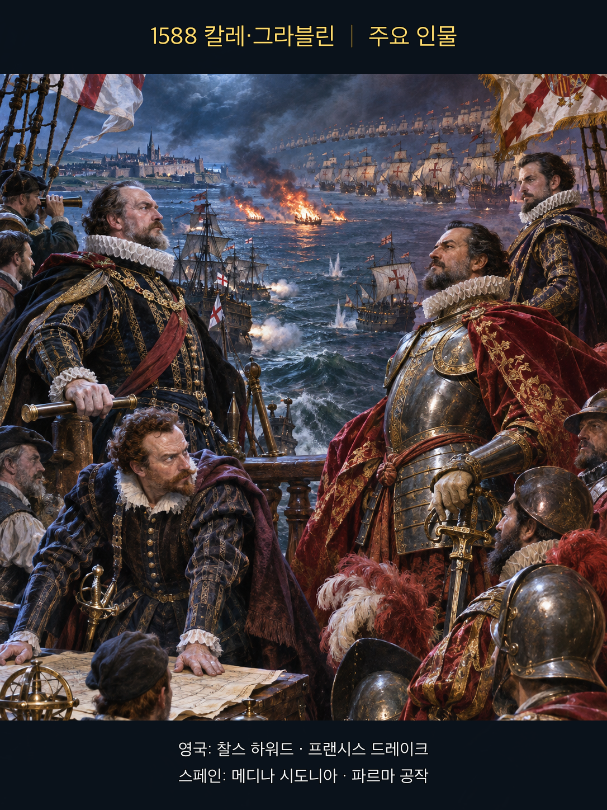

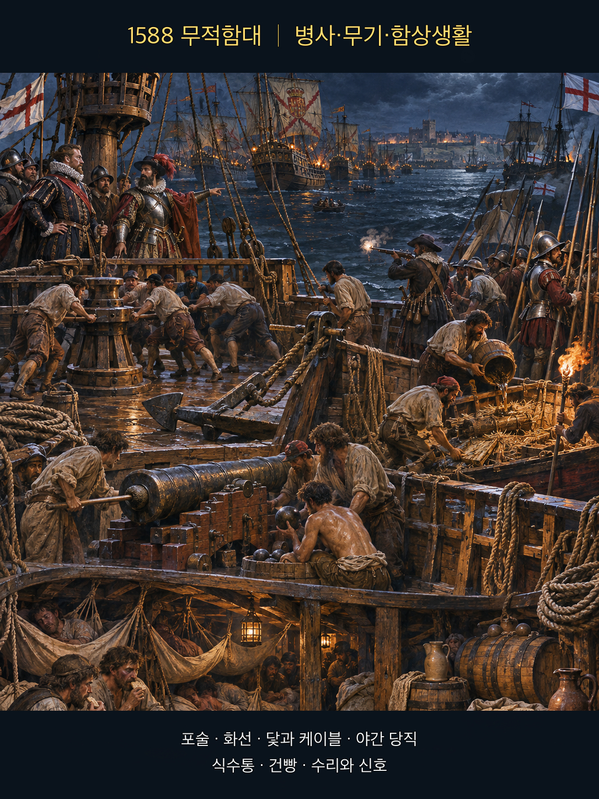

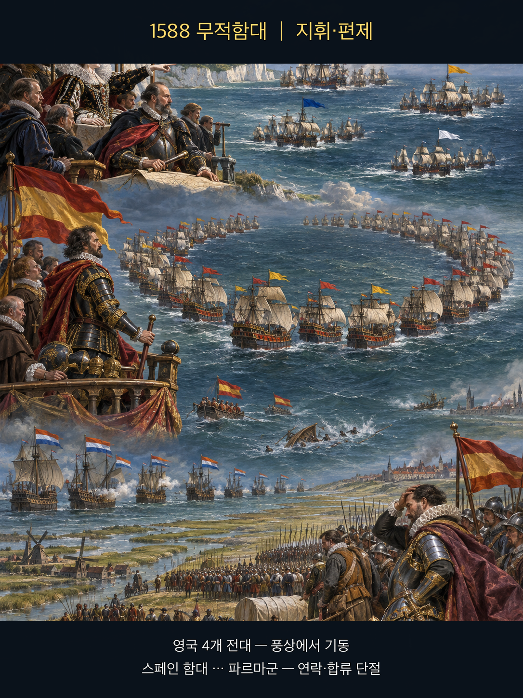

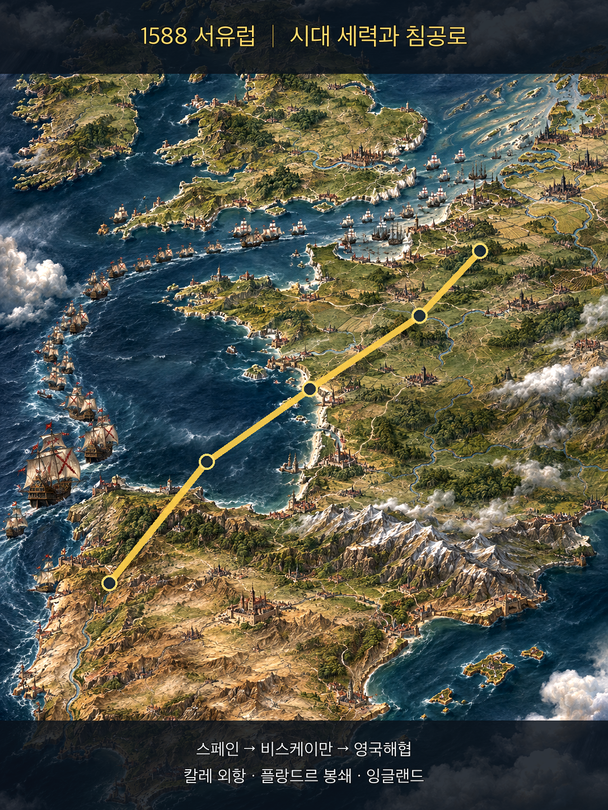

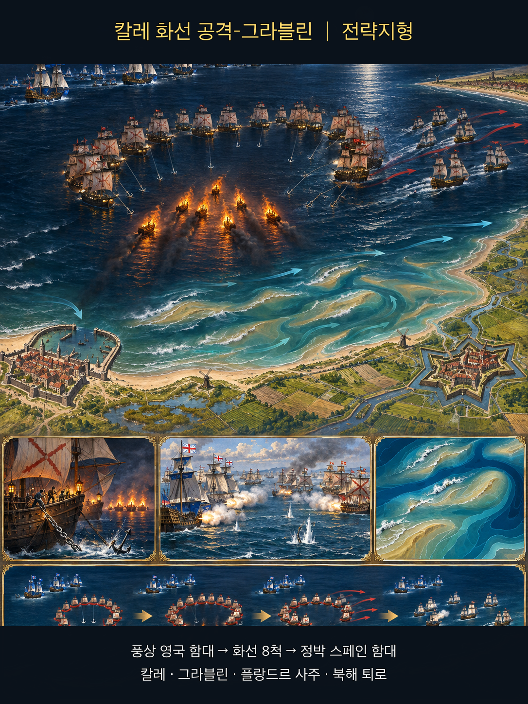

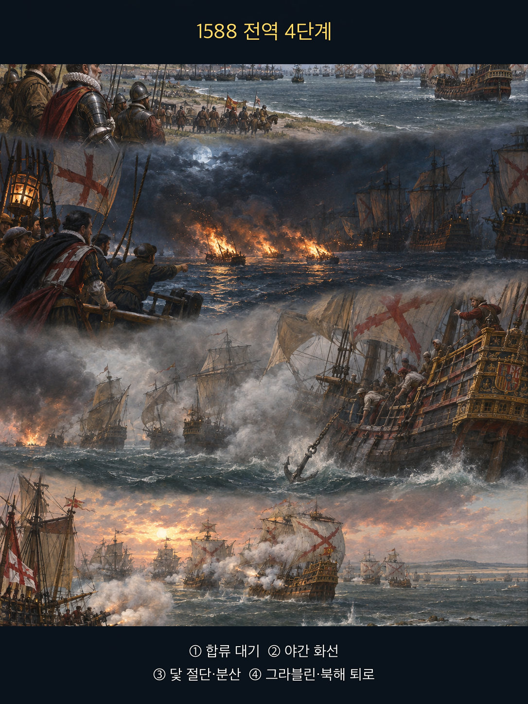

**뒤에서 반복될 지형을 먼저 잡아두기**

- 🌊 **영국해협(English Channel)**은 스페인 함대가 플랑드르의 파르마군과 합류하려 이동한 좁은 해상축이었다. 잉글랜드 함대는 이 축을 따라 그림자처럼 추적했다.
- **▰** **칼레(Calais)** 외항은 스페인 함대가 닻을 내린 대기 지점이었다. 밀집 정박은 방어 대형을 유지하게 했지만 화선이 접근했을 때 서로 피할 공간을 줄였다.
- **▰** **도버(Dover)**와 다운스의 동부 함대는 잉글랜드가 미리 준비한 증원축이었다. 화선 공격 전에 두 함대가 합류하면서 수적·작전 여유가 커졌다.
- 🌊 **그라블린 연안(Gravelines roadstead)**과 플랑드르의 모래톱은 닻줄을 끊고 흩어진 스페인 선박의 재정렬을 어렵게 했다. 이곳에서 다음 날 장거리 포격전이 이어졌다.

#### 전투의 서사 — 증원·낡은 선박·조류를 준비해 정박 대형을 깨다

스페인 함대의 임무는 영국 함대를 한 번에 격멸하는 것이 아니라 파르마 공작의 육군과 합류해 상륙을 호위하는 일이었다. 그러나 파르마군은 준비된 심해 항구와 수송선이 없었고, 네덜란드 측 봉쇄 때문에 즉시 합류할 수 없었다. **메디나 시도니아**는 **▰** **칼레(Calais)** 앞에 닻을 내리고 기다렸다. 그 사이 **하워드**·**드레이크**·**시모어**의 함대는 합류했고, 8척의 낡은 배에 가연물과 포를 남겨 화선으로 준비했다. 8월 7일 밤, 조류와 바람이 스페인 정박 대형으로 향할 때 화선을 놓았다. 스페인 수병들은 폭발선일 가능성까지 두려워해 닻줄을 끊고 피했고 초승달 대형이 흩어졌다. 화선이 대다수 선박을 직접 불태운 것은 아니지만, 다음 날 잉글랜드가 그라블린에서 분리된 함선을 집중 포격할 조건을 만들었다. 따라서 승패는 불 자체보다 **미리 갖춘 배·합류한 증원·적의 밀집 정박·야간 조류·즉시 이어진 함포 공격**이 한 시간표로 결합한 데 있었다.

#### 전투에서 사용된 속임수 — 평범한 화선을 폭발선처럼 보이게 하다

잉글랜드는 포와 가연물을 남긴 화선이 스페인 선원에게 1585년 안트베르펜의 폭발선 기억을 떠올리게 만들었다. 실제 주목적은 대규모 직접 소각보다 닻줄을 끊게 해 대형을 해체하는 것이었다. 화선은 보이는 불과 들리는 폭발로 실제 파괴력보다 큰 위험 신호를 보냈고, 스페인 함대가 독립 확인보다 즉시 회피를 택하도록 압박했다.

#### 속임수 작동 구조

**주체와 의도.** **잉글랜드 지휘부**는 화선으로 밀집 정박 대형을 풀어 다음 날 포격할 분리 표적을 만들려 했다.

**보인 신호와 믿은 이유.** 불붙은 배와 남겨 둔 포의 폭발은 과거 폭발선 공격을 연상시켰고, 좁은 외항에서 한 척이 폭발하면 연쇄 피해가 날 수 있다는 두려움은 합리적이었다.

**유발된 행동과 결과.** 스페인 함선들이 닻줄을 끊어 피하면서 대형과 위치를 잃었고, 다음 날 잉글랜드 함대가 그라블린에서 접근해 포격할 틈이 열렸다.

**사료의 경계.** 화선이 혼자 무적함대를 파괴했다는 통속적 서술은 과장이다. 직접 소각보다 대형 해체가 핵심이었고, 이후 함포전·보급 부족·귀환 항로의 폭풍을 분리해 보아야 한다.

#### 속임수 일곱 질문

1. **누가 누구를 속였는가?** 잉글랜드 지휘부가 스페인 정박 함대에 화선의 직접 파괴력이 실제보다 클 수 있다는 신호를 보냈다.
2. **어떤 사실이 거짓이었는가?** 화선이 모두 대형 폭발선이라는 인상은 사실이 아니었다.
3. **어떤 사실은 진실이지만 오해를 유도했는가?** 불과 포의 폭발은 실제였지만 목적은 직접 소각보다 대형 해체였다.
4. **상대는 왜 그것을 믿고 싶어 했는가?** 밀집 정박 상태와 폭발선의 역사적 기억 때문에 최악의 피해를 피하는 즉시 회피가 합리적으로 보였다.
5. **속임수가 없었어도 같은 오판이 발생했을까?** 가능성은 낮다. 야간 화선이 없었다면 닻줄을 한꺼번에 끊을 유인이 작았다.
6. **속은 사람은 어떤 독립 확인을 생략했는가?** 야간·조류·화재 상황에서는 화선의 적재물과 폭발 규모를 안전하게 확인할 시간이 거의 없었다.
7. **신뢰·동의·안전을 해치지 않으면서 같은 원리를 어디서 연습할 수 있는가?** 체스·바둑에서 위협의 실제 목적이 기물 획득인지 배치 붕괴인지 구분하는 연습이 적합하다.

#### 시계편 兵者詭道也 — 이 전장에 해당하는 속이는 길

<table fit-page-width="true" header-row="true">

<tr>
<td>해당 구절·독음·뜻</td>
<td>전장의 장면</td>
</tr>

<tr>
<td>近而示之遠 근이시지원 — 가까이 있으면서 멀리 있는 듯 보인다</td>
<td>화선의 직접 목적을 불태우기로 보이게 하면서 실제 후속 목적은 대형 해체와 다음 날 함포전이었다.</td>
</tr>

<tr>
<td>亂而取之 난이취지 — 혼란하게 한 뒤 취한다</td>
<td>야간 화선으로 닻과 대형을 흐트러뜨린 뒤 그라블린에서 분리된 함선을 집중 공격했다.</td>
</tr>

</table>

#### 法 한눈 비교 — 곡제·관도·주용

<table fit-page-width="true" header-row="true">

<tr>
<td>진영</td>
<td>곡제(편제)</td>
<td>관도(지휘)</td>
<td>주용(보급·지속)</td>
</tr>

<tr>
<td>**잉글랜드 함대**</td>
<td>기동 함대·동부 증원·화선 8척을 역할별로 결합했다.</td>
<td>**하워드** 아래 함대 지휘관들이 화선과 다음 날 포격을 연결했다.</td>
<td>본토 항구와 가까웠지만 화약 부족을 관리하며 근거리 포격에 집중했다.</td>
</tr>

<tr>
<td>**스페인 함대**</td>
<td>초승달 대형은 항해 중 강했으나 정박 중 화선 회피에는 취약했다.</td>
<td>**메디나 시도니아**는 파르마군과 직접 통신·합류하기 어려웠다.</td>
<td>탄약·식수·식량과 안전한 심해 항구가 부족해 장기 대기가 불리했다.</td>
</tr>

</table>

〈**메디나 시도니아의 스페인 함대 (패)**〉
<table fit-page-width="true" header-row="true">

<tr>
<td>요소</td>
<td>판단</td>
</tr>

<tr>
<td color="orange_bg">🤝 **道**</td>
<td>상륙군 합류라는 목적은 분명했지만 함대와 파르마군의 준비 상태가 맞지 않았다. (지기·결속)</td>
</tr>

<tr>
<td color="blue_bg">🌤️ **天**</td>
<td>야간 화선과 조류가 만든 최악의 손실 가능성에 즉시 반응했으나 후속 재집결 계획이 약했다. (지피·타이밍·확률 관점)</td>
</tr>

<tr>
<td color="green_bg">🧭 **地**</td>
<td>개방 정박지와 모래톱 가까운 연안에서 닻줄을 끊어 대형 복구가 어려웠다. (험이·사생)</td>
</tr>

<tr>
<td color="purple_bg">🎖️ **將**</td>
<td>**메디나 시도니아**는 함대를 보존했지만 합류 불능이라는 구조적 문제를 해결하지 못했다. (지신인용엄)</td>
</tr>

<tr>
<td color="yellow_bg">⚙️ **法**</td>
<td>대형·연락·보급이 서로 분리되어 화선 뒤 즉시 회복하지 못했다. (곡제·관도·주용)</td>
</tr>

</table>

🏳️ **패군 측 결과**
<table fit-page-width="true" header-row="true">
<tr>
<td>구분</td>
<td>판정</td>
</tr>
<tr>
<td color="red">⚔️ **전투 결과**</td>
<td>함대는 전멸하지 않았지만 상륙군 합류 임무를 이루지 못하고 북해로 밀려났다. 六敗의 亂에 가까운 대형·지휘 혼란이었다.</td>
</tr>
<tr>
<td color="orange">🔀 **패군 측 회피 분기점**</td>
<td>칼레 도착 전에 파르마군 수송 준비와 통신을 확인하고, 화선 방어선·예비 닻·재집결 지점을 정했다면 대형 붕괴와 임무 실패 위험을 줄일 수 있었다.</td>
</tr>

</table>

〈**하워드·드레이크의 잉글랜드 함대 (승)**〉
<table fit-page-width="true" header-row="true">

<tr>
<td>요소</td>
<td>판단</td>
</tr>

<tr>
<td color="orange_bg">🤝 **道**</td>
<td>해협 추적·동부 증원·화선 공격의 목적을 상륙 저지에 맞췄다. (지기·결속)</td>
</tr>

<tr>
<td color="blue_bg">🌤️ **天**</td>
<td>스페인 함대가 정박하고 조류가 목표로 흐르는 짧은 창을 이용했다. (지피·타이밍·확률 관점)</td>
</tr>

<tr>
<td color="green_bg">🧭 **地**</td>
<td>칼레 외항의 밀집과 그라블린 연안의 좁은 기동 공간을 연속해서 활용했다. (광협·사생)</td>
</tr>

<tr>
<td color="purple_bg">🎖️ **將**</td>
<td>**하워드**와 **드레이크**는 불을 목적이 아니라 다음 날 포격을 여는 수단으로 제한했다. (지신인용엄)</td>
</tr>

<tr>
<td color="yellow_bg">⚙️ **法**</td>
<td>낡은 배·가연물·포·증원 함대와 후속 포격을 하나의 작전으로 묶었다. (곡제·관도·주용)</td>
</tr>

</table>

🏆 **승군 측 결과**
<table fit-page-width="true" header-row="true">
<tr>
<td>구분</td>
<td>판정</td>
</tr>
<tr>
<td color="blue">⚔️ **전투 결과**</td>
<td>상륙 합류를 좌절시키고 주도권을 얻었다. 五勝 중 以虞待不虞者勝(이우대불우자승, 대비한 채 대비 없는 적을 상대하는 자가 이긴다)에 가깝다.</td>
</tr>

</table>

##### 法을 압축하지 않고 보기 — 곡제·관도·주용

**곡제 曲制(곡제): 부대를 어떻게 나누고 결합했는가**
<table fit-page-width="true" header-row="true">
<tr>
<td>진영</td>
<td>실제 운용</td>
</tr>
<tr>
<td>**잉글랜드 함대**</td>
<td>추적 함대, 동부 증원, 8척 화선을 분리 임무로 운용한 뒤 주력 포격으로 결합했다.</td>
</tr>
<tr>
<td>**스페인 함대**</td>
<td>수송선을 감싸는 초승달 대형은 항해 방어에 적합했지만 정박 중 화선 회피와 재결합 절차가 약했다.</td>
</tr>

</table>

**관도 官道(관도): 누가 명령하고 어떻게 전달했는가**
<table fit-page-width="true" header-row="true">
<tr>
<td>진영</td>
<td>실제 운용</td>
</tr>
<tr>
<td>**잉글랜드 함대**</td>
<td>**하워드**의 총지휘 아래 **드레이크** 등이 화선 실행과 후속 교전을 맡았다.</td>
</tr>
<tr>
<td>**스페인 함대**</td>
<td>**메디나 시도니아**는 해상 함대를 통솔했지만 육상의 파르마군과 신속히 명령을 주고받을 통로가 없었다.</td>
</tr>

</table>

**주용 主用(주용): 군량·장비·전투 지속 능력을 어떻게 썼는가**
<table fit-page-width="true" header-row="true">
<tr>
<td>진영</td>
<td>실제 운용</td>
</tr>
<tr>
<td>**잉글랜드 함대**</td>
<td>낡은 배를 소모성 화선으로 전환하고 본토 항구 가까이에서 탄약·수리를 지원받았다.</td>
</tr>
<tr>
<td>**스페인 함대**</td>
<td>장거리 원정으로 식량·식수·탄약이 줄었고 칼레에는 대형 함대를 안전하게 보급할 항구가 없었다.</td>
</tr>

</table>

**사료 출처:** [영국 국립문서보관소 교육 자료](https://cdn.nationalarchives.gov.uk/documents/education/spanish-armada.pdf) · [Royal Museums Greenwich 동시대 화선 도판 해설](https://www.rmg.co.uk/collections/objects/rmgc-object-11755) · [Robert Adams 해전도 연구 안내](https://www.rmg.co.uk/collections/research-guides/research-guide-p3-charts-spanish-armada-robert-adams-museum)

### 동양 — ⚔️ 주원장군 vs 🏛️ 진한군 │ 파양호 전투(鄱陽湖之戰, 1363)

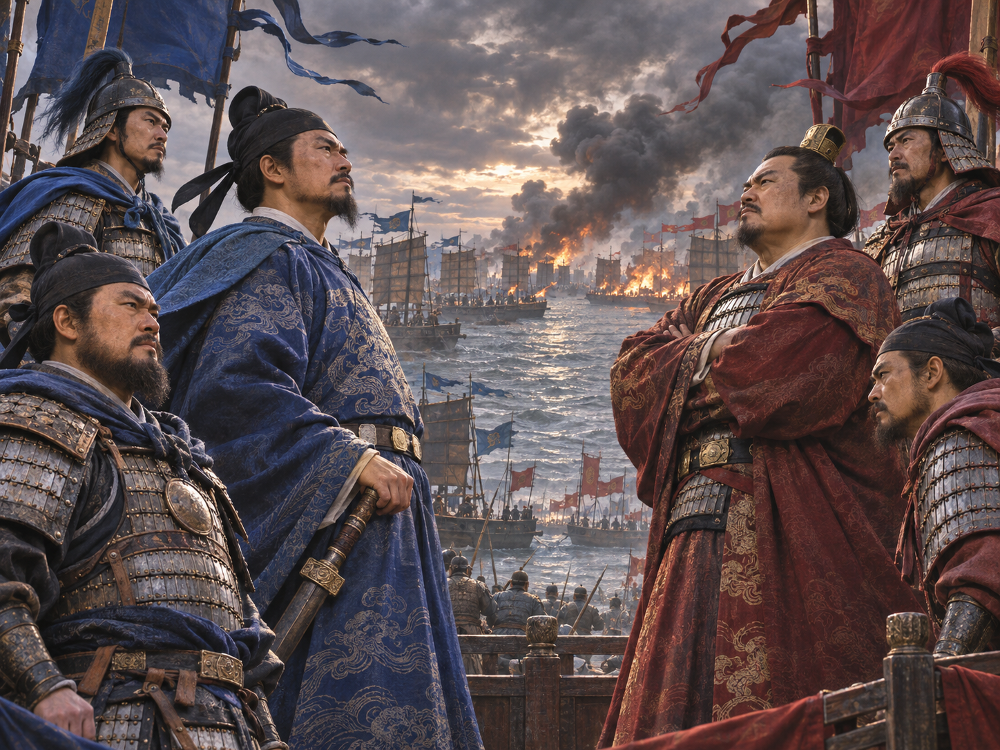

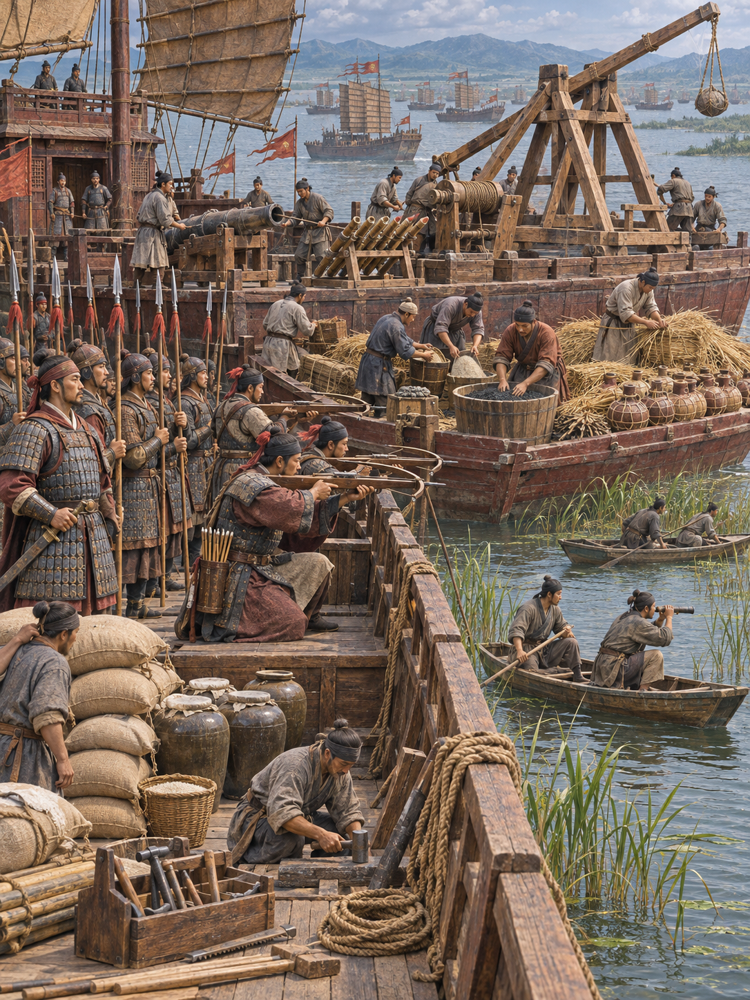

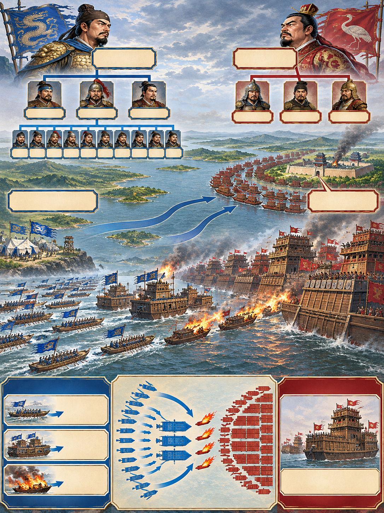

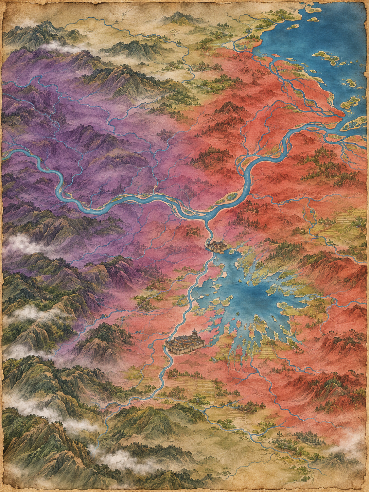

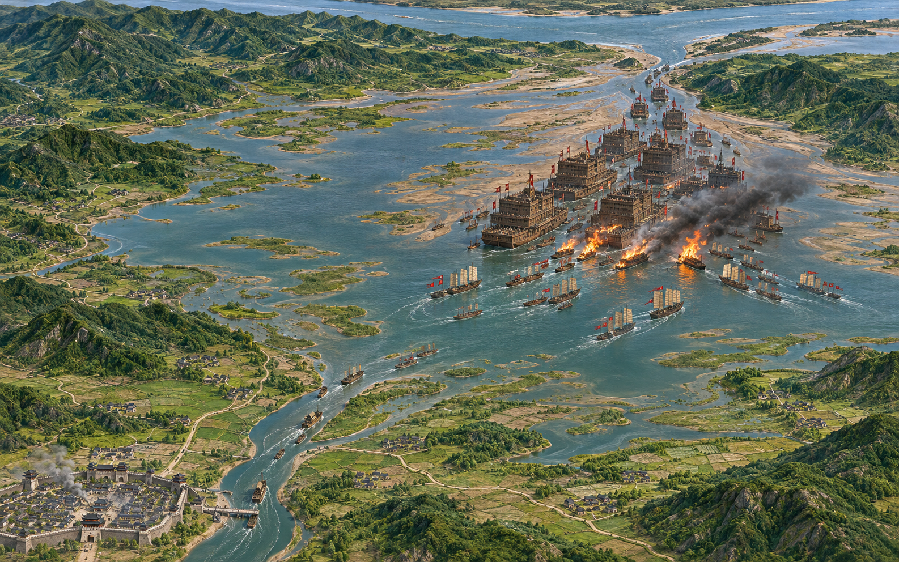

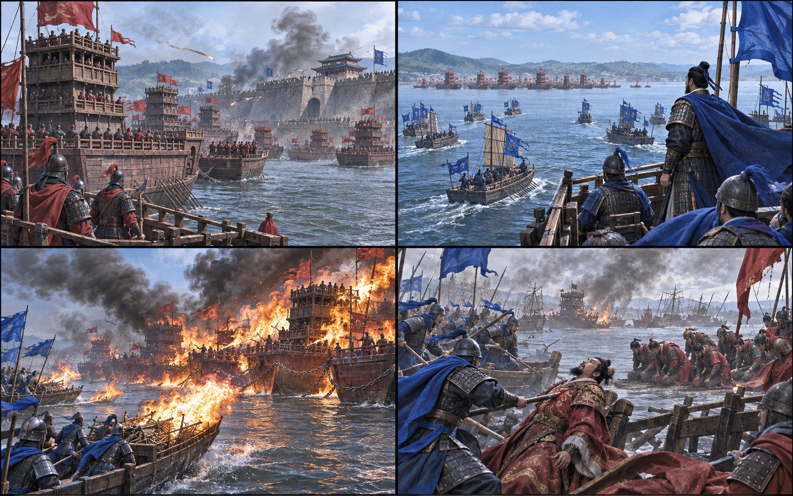

**뒤에서 반복될 지형을 먼저 잡아두기**

- **▰** **홍도(洪都, 오늘날 난창)**는 진우량군이 포위한 목표이자 주원장군이 구원해야 할 거점이었다. 성이 버티면서 호수 결전의 시간이 열렸다.
- 🌊 **파양호(鄱陽湖)**는 계절 수위가 낮아 대형 누선보다 흘수가 얕은 작은 함선이 기동하기 유리했다.
- ⛰️ **강랑산(康郎山) 수역**은 양군 주력이 처음 충돌한 구간으로, 연결된 진한 누선과 분할된 주원장 함대의 차이가 드러났다.
- 🌊 **호구(湖口)**는 파양호에서 장강으로 나가는 출구였다. 이곳을 막으면 진한 함대의 탈출과 보급을 함께 제한할 수 있었다.

#### 상세 전역 서사 — 홍도 방어가 번 시간에 화선과 호구 봉쇄를 결합하다

**진우량**은 대형 누선을 이끌고 **▰** **홍도(洪都)**를 포위했지만 성은 장기간 버텼다. **주원장**은 구원 함대를 이끌고 도착하면서 별동대를 🌊 **호구(湖口)**에 보내 퇴로를 제한했다. 진한의 누선은 크고 높았으나 낮은 계절 수위와 연결 대형 때문에 선회와 분리가 느렸다. 주원장군은 작은 함선을 여러 대로 나누고 화기·궁노·근접전 부대를 순차 결합했다. 첫 교전의 손실 뒤에는 소형선에 화약·마른 갈대와 허수아비를 싣고 충돌 장치를 마련한 화선을 준비했다. 바람이 진한 함대로 향하는 창에 화선을 보내 연결된 선박 사이로 불을 번지게 하고 곧바로 함대 공격을 이었다. 전투는 한 번의 화공으로 끝나지 않았고 봉쇄와 돌파전으로 이어졌다. **진우량**이 돌파 과정에서 전사하면서 진한군의 지휘와 저항이 무너졌다. 핵심은 **홍도 수비가 번 시간, 미리 편성한 화선, 낮은 수위, 바람, 연결 누선, 호구 봉쇄와 후속 공격**의 결합이었다.

#### 전투에서 사용된 속임수 — 허수아비를 세운 화선으로 접근 의도를 늦게 드러내다

화선에 허수아비를 세운 것은 멀리서 일반 전투선처럼 보이게 해 접근 목적을 늦게 알아차리게 하는 장치였다. 불을 붙이는 순간까지 충돌·점화 의도를 감추고, 연결된 누선이 회피하거나 분리할 시간을 줄였다.

#### 속임수 작동 구조

**주체와 의도.** **주원장군**은 화선을 진한 누선에 밀착시켜 연결 대형 전체로 불을 번지게 하려 했다.

**보인 신호와 믿은 이유.** 허수아비와 전투선 같은 외형은 접근선의 실제 승조·임무를 즉시 구별하기 어렵게 했다.

**유발된 행동과 결과.** 진한 누선은 연결과 큰 선체 때문에 늦게 분리했고, 바람을 탄 화선이 접촉한 뒤 불과 후속 공격이 동시에 압박했다.

**사료의 경계.** 세부 화선 수와 병력 수는 기록마다 차이가 크다. 유리한 바람과 화선 사용은 교차 확인되지만 모든 손실을 화선 하나로 돌리면 봉쇄·수위·지휘 붕괴를 놓친다.

#### 속임수 일곱 질문

1. **누가 누구를 속였는가?** 주원장군이 진한 수군에 접근선의 실제 임무를 늦게 드러냈다.
2. **어떤 사실이 거짓이었는가?** 허수아비는 실제 승조원처럼 보였지만 사람이 아니었다.
3. **어떤 사실은 진실이지만 오해를 유도했는가?** 작은 배가 접근한다는 사실은 참이었지만 목적은 승선전이 아니라 충돌·점화였다.
4. **상대는 왜 그것을 믿고 싶어 했는가?** 큰 누선은 작은 배를 화력과 높이로 제압할 수 있다는 기존 기대가 있었다.
5. **속임수가 없었어도 같은 오판이 발생했을까?** 가능성은 중간이다. 연결 누선의 낮은 기동성은 남지만 화선을 더 일찍 식별했다면 분리·차단 시간이 늘었을 것이다.
6. **속은 사람은 어떤 독립 확인을 생략했는가?** 접근선의 승조 상태·적재물·바람 방향을 동시에 확인하고 외곽 차단선을 두는 절차가 부족했다.
7. **신뢰·동의·안전을 해치지 않으면서 같은 원리를 어디서 연습할 수 있는가?** 보드게임에서 미끼 기물과 실제 목표를 분리하고 상대가 확인할 신호를 설계하는 훈련이 적합하다.

#### 시계편 兵者詭道也 — 이 전장에 해당하는 속이는 길

<table fit-page-width="true" header-row="true">
<tr>
<td>해당 구절·독음·뜻</td>
<td>전장의 장면</td>
</tr>
<tr>
<td>近而示之遠 근이시지원 — 가까이 있으면서 멀리 있는 듯 보인다</td>
<td>일반 전투선처럼 접근한 화선이 충돌 직전 점화 의도를 드러냈다.</td>
</tr>
<tr>
<td>利而誘之 리이유지 — 이익으로 유인한다</td>
<td>작은 접근선이 쉬운 표적처럼 보여 누선이 연결 대형을 유지하게 했다.</td>
</tr>

</table>

#### 法 한눈 비교 — 곡제·관도·주용

<table fit-page-width="true" header-row="true">
<tr>
<td>진영</td>
<td>곡제(편제)</td>
<td>관도(지휘)</td>
<td>주용(보급·지속)</td>
</tr>
<tr>
<td>**주원장군**</td>
<td>작은 함선을 대별하고 화선·화기·궁노·근접전을 결합했다.</td>
<td>**주원장**이 함대를 지휘하고 별동대가 호구를 막았다.</td>
<td>구원군 보급과 호수 주변 거점을 이용하며 봉쇄를 지속했다.</td>
</tr>
<tr>
<td>**진한군**</td>
<td>대형 누선을 연결해 화력과 높이를 키웠으나 분리 기동이 느렸다.</td>
<td>**진우량** 중심 지휘가 그의 전사 뒤 급격히 무너졌다.</td>
<td>홍도 장기 포위와 호구 봉쇄로 식량·퇴로 압박이 커졌다.</td>
</tr>

</table>

〈**진우량의 진한군 (패)**〉
<table fit-page-width="true" header-row="true">
<tr>
<td>요소</td>
<td>판단</td>
</tr>
<tr>
<td color="orange_bg">🤝 **道**</td>
<td>대형 함대의 위세는 컸지만 장기 포위 실패와 지휘관 개인 의존이 결속을 약화했다. (지기·사기)</td>
</tr>
<tr>
<td color="blue_bg">🌤️ **天**</td>
<td>낮은 수위·바람·적 화선의 결합 가능성을 낮게 보았다. (지피·타이밍·확률 관점)</td>
</tr>
<tr>
<td color="green_bg">🧭 **地**</td>
<td>대형 누선이 얕은 호수와 좁은 출구에서 기동할 불리함을 감수했다. (험이·광협·사생)</td>
</tr>
<tr>
<td color="purple_bg">🎖️ **將**</td>
<td>**진우량**은 큰 함대와 정면 압박을 과신해 홍도·호구·화선이라는 복수 위험을 통합하지 못했다. (지신인용엄)</td>
</tr>
<tr>
<td color="yellow_bg">⚙️ **法**</td>
<td>연결 누선은 화력을 집중했지만 화재 때 분리·지휘·보급 회복력이 약했다. (곡제·관도·주용)</td>
</tr>

</table>

🏳️ **패군 측 결과**
<table fit-page-width="true" header-row="true">
<tr>
<td>구분</td>
<td>판정</td>
</tr>
<tr>
<td color="red">⚔️ **전투 결과**</td>
<td>함대가 봉쇄 속에서 소모되고 지휘관 전사 뒤 항복했다. 六敗의 北, 곧 적과 지형을 헤아리지 못한 패배에 가깝다.</td>
</tr>
<tr>
<td color="orange">🔀 **패군 측 회피 분기점**</td>
<td>홍도 포위가 길어진 시점에 연결 누선을 분산하고 호구 퇴로를 먼저 확보했다면 화선의 연쇄 효과와 완전 봉쇄를 줄일 수 있었다.</td>
</tr>

</table>

〈**주원장의 구원군 (승)**〉
<table fit-page-width="true" header-row="true">
<tr>
<td>요소</td>
<td>판단</td>
</tr>
<tr>
<td color="orange_bg">🤝 **道**</td>
<td>홍도 구원과 경쟁 세력 격파라는 목적 아래 수비대·함대·봉쇄대를 연결했다. (지기·사기)</td>
</tr>
<tr>
<td color="blue_bg">🌤️ **天**</td>
<td>화선이 준비된 뒤에도 바람이 연결 누선으로 향하는 실행 창을 기다렸다. (지피·타이밍·확률 관점)</td>
</tr>
<tr>
<td color="green_bg">🧭 **地**</td>
<td>얕은 호수에서 작은 배의 흘수와 호구의 병목을 함께 이용했다. (험이·광협·사생)</td>
</tr>
<tr>
<td color="purple_bg">🎖️ **將**</td>
<td>**주원장**은 첫 교전 손실 뒤 수단을 바꾸고 화공·봉쇄·후속전을 결합했다. (지신인용엄)</td>
</tr>
<tr>
<td color="yellow_bg">⚙️ **法**</td>
<td>함대를 나누어 화선·화기·궁노·근접전·출구 봉쇄의 역할을 명확히 했다. (곡제·관도·주용)</td>
</tr>

</table>

🏆 **승군 측 결과**
<table fit-page-width="true" header-row="true">
<tr>
<td>구분</td>
<td>판정</td>
</tr>
<tr>
<td color="blue">⚔️ **전투 결과**</td>
<td>진한의 주력을 격파하고 장강 중류의 주도권을 얻었다. 五勝 중 識衆寡之用者勝(식중과지용자승, 대군과 소수를 각각 쓸 줄 아는 자가 이긴다)에 가깝다.</td>
</tr>

</table>

##### 法을 압축하지 않고 보기 — 곡제·관도·주용

**곡제 曲制(곡제): 부대를 어떻게 나누고 결합했는가**
<table fit-page-width="true" header-row="true">
<tr>
<td>진영</td>
<td>실제 운용</td>
</tr>
<tr>
<td>**주원장군**</td>
<td>작은 함선을 여러 대로 나누고 화선·화기·궁노·근접전·호구 봉쇄 임무를 결합했다.</td>
</tr>
<tr>
<td>**진한군**</td>
<td>높은 누선을 연결해 정면 화력을 키웠으나 얕은 수역에서 분리와 선회가 느렸다.</td>
</tr>

</table>

**관도 官道(관도): 누가 명령하고 어떻게 전달했는가**
<table fit-page-width="true" header-row="true">
<tr>
<td>진영</td>
<td>실제 운용</td>
</tr>
<tr>
<td>**주원장군**</td>
<td>**주원장**이 주력을 지휘하고 구원·화공·출구 봉쇄를 분담시켰다.</td>
</tr>
<tr>
<td>**진한군**</td>
<td>**진우량**에게 지휘가 집중되어 그의 전사 뒤 명령·항전의 중심이 사라졌다.</td>
</tr>

</table>

**주용 主用(주용): 군량·장비·전투 지속 능력을 어떻게 썼는가**
<table fit-page-width="true" header-row="true">
<tr>
<td>진영</td>
<td>실제 운용</td>
</tr>
<tr>
<td>**주원장군**</td>
<td>화약·갈대·소형선을 소모성 화선으로 전환하고 호구 봉쇄로 장기전의 지속 조건을 확보했다.</td>
</tr>
<tr>
<td>**진한군**</td>
<td>대형 누선은 강한 화력을 제공했지만 홍도 포위 장기화와 출구 차단 뒤 식량·이동·수리 부담이 커졌다.</td>
</tr>

</table>

**사료 출처:** [Cambridge, Bruce A. Elleman, *The Making of the Modern Chinese Navy*](https://www.cambridge.org/core/books/abs/making-of-the-modern-chinese-navy/battle-of-lake-poyang-1363/D867DB972D2B8C9E3F4DA2E24F8EB9CA) · [University of Washington, *Fir and Empire*](https://uw.manifoldapp.org/read/fir-and-empire/section/d1fdd798-02e0-439b-9282-73f1bfd0d269) · [U.S. Naval Institute, “From River Pirate to Ming Emperor”](https://www.usni.org/magazines/naval-history-magazine/2010/june/river-pirate-ming-emperor)

---
## 5. 핵심 통찰 + 실생활 적용 + 생활루틴

### 핵심 통찰

이 구절의 중심은 기다림이 아니라 **준비된 조건부 실행**이다. 因만 찾고 준비하지 않으면 기회가 지나가고, 장비만 갖추고 조건을 무시하면 수단을 쓰고 싶은 마음이 판단을 대신한다. 時만 보고 구체적 日을 고르지 않으면 행동이 미뤄지고, 날짜부터 박으면 현실이 일정표에 억지로 끌려간다. 네 요소는 순차적이면서 서로를 견제한다.

화공이라는 되돌리기 어려운 수단 앞에 이토록 많은 문턱을 둔 까닭은 강한 행동일수록 성공과 피해가 모두 커지기 때문이다. 현대 생활에서 이 원리를 가져올 때는 공격 기술이 아니라 **큰 결정을 안전하게 실행하는 구조**로 바꿔야 한다. 사람을 해치거나 몰아붙일 방법이 아니라, 조건·자원·시간·구체 일정이 맞지 않으면 결정을 보류할 권리를 만드는 것이다.

### 실생활 적용

3교대 현장에서 설비 정지, 에러 조치, 업무 절차 변경처럼 영향이 큰 행동을 생각해 보자. 문제가 보였다는 이유만으로 바로 바꾸면 다음 교대가 원인을 모르거나, 필요한 로그가 사라지거나, 복구 담당이 없는 시간대에 장애가 커질 수 있다. 먼저 `因`에는 재현된 증상·승인 근거·영향 범위를 적는다. `素具`에는 백업, 복구 절차, 담당자, 공지 문안, 확인할 지표를 둔다. `時`는 생산·안전·인력이 감당할 수 있는 작업 창이고, `日`은 앞뒤 교대가 인계받고 복구 담당이 실제 대기하는 날짜와 시각이다.

팀 안의 민감한 피드백도 같다. 화가 난 순간은 發火할 때가 아니다. 관찰 사실과 원하는 변화가 因으로 분명한지, 구체적 사례와 질문을 素具했는지, 상대가 듣고 답할 여유가 있는 時인지, 중단 없이 이야기할 日을 합의했는지 살핀다. 조건이 없는데 말을 세게 하면 문제보다 관계가 먼저 탄다. 반대로 모든 조건이 갖춰졌는데도 계속 미루면 준비는 회피가 된다. 有日이 그 회피를 막는다.

개인 일정에서는 “운동해야지”, “공부해야지” 같은 목표를 실행 문장으로 바꿀 수 있다. 몸 상태와 가능한 장소를 因으로 확인하고, 옷·교재·타이머를 전날 素具한다. 집중이 가능한 시간대를 時로 정하고, “야간 근무가 없는 날 저녁 7시, 식사 뒤 20분”처럼 日을 좁힌다. 단, 수면 부족이나 통증 같은 중지 조건도 함께 적어 의지가 안전을 밀어내지 않게 한다.

### 생활루틴

매일 잠들기 전 3분 동안 다음 날 가장 영향이 큰 행동 하나에 `因–具–時–日` 네 줄을 쓴다.

- `因`: 이 행동이 필요한 관찰 사실과 성립 조건은 무엇인가?
- `具`: 시작 전에 준비할 도구·정보·사람·복구책은 무엇인가?
- `時`: 어떤 상태가 되었을 때 실행 가능한가? 어떤 상태면 멈추는가?
- `日`: 내일 몇 시, 어디서, 첫 5분에 무엇을 할 것인가?

한 줄이라도 비면 일정을 억지로 확정하지 말고 그 빈칸을 채우는 일을 다음 행동으로 삼는다. 네 줄이 모두 찼다면 달력에 넣고 첫 행동까지 준비한다.

**한 줄 기억법:** 불부터 붙이면 재수가 없다—기댈 조건을 찾고, 평소에 갖추고, 때를 보고, 날을 정하라.
