<!-- sunzi-analysis-mode: full -->
> 시자, 천지조야. 일자, 월재기·벽·익·진야. 범차사수자, 풍기지일야. — 큰 힘을 쓸 때는 감으로 날짜를 박지 말고, 작동 조건을 관측해 실행 창을 좁혀라.

---
## 1. 원문 + 독음 + 직역 + 한자어 뜻풀이

時者, 天之燥也. 日者, 月在箕, 壁, 翼, 軫也. 凡此四宿者, 風起之日也. 시자, 천지조야. 일자, 월재기·벽·익·진야. 범차사수자, 풍기지일야.

	**직역**

	때란 하늘이 건조한 때이다. 날이란 달이 기수·벽수·익수·진수에 있는 날이다. 무릇 이 네 별자리는 바람이 일어나는 날이다.

	앞 문장이 `發火有時, 起火有日`(발화유시, 기화유일 — 불을 놓는 데에는 때가 있고, 불길을 일으키는 데에는 날이 있다)이라고 실행 시간을 두 층으로 나누자, 이 문장은 그 내용을 구체화한다. **時**는 불이 번질 수 있는 넓은 환경 조건, 곧 하늘이 마른 기간이고, **日**은 그 기간 안에서 바람을 예상해 고른 특정일이다. 箕·壁·翼·軫은 당시 월행과 바람을 연결해 판단한 네 별자리다. 이 천문 규칙을 현대 기상학으로 오인할 수는 없지만, 달력의 희망 날짜보다 관측 가능한 조건을 먼저 보라는 문장 구조는 분명하다.

	#### 時·燥(시·조) — 실행의 창은 의지가 아니라 환경이 연다

	**時**(때 시)는 日(해 일)과 寺(관청 시)가 결합해 일정한 때와 시기를 가리키고, **燥**(마를 조)는 火(불 화)와 喿(떠들 조)가 결합해 수분이 빠져 마른 상태를 나타낸다. 여기서 時는 시계의 한 점이 아니라 연료·영채·풀·군량이 충분히 말라 불이 붙고 번질 수 있는 기간이다. 장수가 결심했다고 환경이 마르지는 않는다. 강한 수단을 쓰려면 먼저 **외부 조건이 실제로 작동 가능성을 열었는지** 확인해야 한다.

	#### 日·月在(일·월재) — 넓은 때 안에서 실행일을 다시 좁힌다

	**日**(날 일)은 해의 모양을 본뜬 글자로 특정한 하루를, **月**(달 월)은 달의 모양에서 나온 글자로 달의 운행을 가리킨다. **在**(있을 재)는 어떤 위치에 머문다는 뜻이다. `月在`는 달이 어느 별자리 구역에 있는지를 관찰해 날을 판정한다는 말이다. 앞의 時가 건조한 계절·기간이라면 日은 그 안의 구체적 실행일이다. 조건이 대체로 좋다는 판단과 오늘 행동해도 된다는 판단을 분리함으로써, 준비가 곧 실행 명령으로 변하는 오류를 막는다.

	#### 箕·壁·翼·軫(기·벽·익·진) — 별의 이름으로 바람을 예측하다

	**箕**(키 기)는 곡식을 까부르는 키, **壁**(벽 벽)은 둘러막는 벽, **翼**(날개 익)은 새의 양 날개, **軫**(수레 뒤턱 진)은 수레 뒤의 가로목을 뜻하며 모두 이십팔수의 별자리 이름으로도 쓰인다. 고대 주석은 달이 이 네 수에 머무는 날을 바람이 일기 쉬운 날로 보았다. 이것은 당대의 천문·기상 관찰 체계이지 오늘날 그대로 채택할 예보법은 아니다. 중요한 것은 **예측 체계를 미리 정하고, 실행 직전 외부 변화를 다시 확인하려 한 태도**다.

	#### 四宿·風起(사수·풍기) — 예측은 공격 명령이 아니라 재확인 신호다

	**宿**(잘 숙·별자리 수)은 사람이 지붕 아래 머무는 모양에서 숙소와 머묾, 나아가 별이 머무는 구획을 뜻하게 되었다. **風**(바람 풍)은 공기의 움직임이고, **起**(일어날 기)는 움직임이 시작되는 장면이다. `風起之日`은 바람이 불 가능성을 실행 조건으로 삼지만, 바람은 방향과 세기가 바뀌면 아군에게도 재난이 된다. 그러므로 이 문장은 “그날이면 무조건 불을 놓으라”가 아니라, **그날을 후보로 삼고 현장의 바람을 다시 보라**는 제한으로 읽어야 한다.

	#### 글자들이 완성하는 한 장면

	장수는 먼저 하늘이 마른 時를 기다린다. 그 넓은 창이 열리면 달이 箕·壁·翼·軫에 있는 日을 살펴 바람이 일 가능성이 높은 날을 고른다. 그러나 별자리 이름이 불씨를 대신하지는 않는다. 현장의 습도와 풍향, 표적과 아군의 위치가 맞을 때만 실행할 수 있다. **時는 가능 범위를 열고, 日은 후보를 좁히며, 風은 마지막 순간까지 다시 확인하게 한다.**

---
## 2. 전통 주석 기반 분석

- **조조(曹操)** — “燥는 가뭄으로 마른 상태다. 불을 쓸 때는 먼저 때와 날을 골라라. 하늘이 마르지 않았다면 사람의 결심만으로 불길을 만들려 하지 마라.”
- **이전(李筌)** — “네 별자리는 바람이 일어나는 징후로 보아라. 다만 바람은 돌 수 있으니, 예측만 믿고 적과 아군의 위치를 놓치지 마라.”
- **두목(杜牧)** — “다섯 화공은 안에서 불을 일으켜 변화를 만드는 법이니, 건조함과 바람이 맞아야 한다. 날을 택했다는 이유로 조건이 성립했다고 거꾸로 판단하지 마라.”
- **매요신(梅堯臣)** — “마른 때에는 쉽게 타고, 네 수에 달이 머무는 날에는 바람이 일어난다. 함부로 시작하지 말고 하늘의 형편을 기다려라.”
- **장예(張預)** — “하늘이 가물고 마르면 불이 쉽게 붙는다. 실행을 우연에 맡기지 말고 時와 日을 살핀 뒤, 영채·초목·비축과 바람이 함께 맞는지를 보라.”
- **왕석(王晳)** — “時와 日은 같은 말이 아니다. 時는 넓은 건조 조건이고 日은 그 안의 특정한 날이니, 큰 조건과 좁은 시점을 차례로 판정하라.”
- **가림(賈林)** — “바람을 이용하되 바람에 끌려가지 마라. 불이 적에게 닿는 길뿐 아니라 되돌아와 아군을 해칠 길까지 먼저 계산하라.”
- **두우(杜佑)** — “箕·壁·翼·軫을 바람이 일어나는 네 수로 전한 것은 날짜를 점치는 장식이 아니다. 군이 공동 기준으로 실행일을 고르게 하되 실제 바람의 변화를 경계하라.”
- **진호(陳皞)** — “以時發之의 時는 하늘의 건조함이고, 달이 네 별자리에 머무는 날은 바람을 살필 후보일이다. 준비와 관측이 함께 맞지 않으면 멈추어라.”

#### 주석가들의 차이와 보완

조조·매요신·장예는 燥를 가뭄과 건조라는 물질 조건으로 분명히 잡는다. 왕석은 時와 日의 층위를 나누고, 이전·두우·진호는 네 별자리와 바람의 관계를 실행일 판정에 연결한다. 가림과 두목의 경계는 이 조건들이 공격을 자동 승인하지 않는다는 데 있다. **건조함은 연소 가능성을 높이고, 날짜 판정은 바람의 후보를 좁히지만, 풍향·표적·아군 위치와 후속 행동을 마지막까지 확인해야 비로소 작전 조건이 완성된다.**

#### 리링의 고증과 현대적 독법

리링(李零)의 해설 취지를 따라 문장 구조를 보면, 앞 구절의 `有時·有日`을 이 구절이 `燥·四宿`으로 각각 대응시킨다. 時와 日은 수사적 반복이 아니라 **넓은 기상 창과 좁은 실행일**의 구분이다. 판본에 따라 구두와 일부 글자 배열이 달라도, 사용자 승인 정본의 `月在箕, 壁, 翼, 軫`은 달의 위치를 네 수에 연결하는 구조가 명료하다.

네 별자리와 바람의 상관을 현대 과학으로 포장해서는 안 된다. 이는 고대의 관측·점후 체계이며, 오늘날에는 습도·연료 수분·풍속·풍향·예보와 현장 측정이 그 기능을 대신한다. 다만 “좋은 날”이라는 직관을 쓰지 않고 사전에 정한 징후로 실행을 제한하려 한 점은, 『손자』가 단순한 불 지르기 기술이 아니라 **강한 수단을 조건에 종속시키는 판단 체계**임을 보여 준다.

---
## 3. 교차 설명

### ① 손자병법 내 교차

앞 구절 `行火必有因, 煙火必素具, 發火有時, 起火有日`(행화필유인, 연화필소구, 발화유시, 기화유일 — 화공에는 조건과 사전 준비가 필요하며, 발화에는 때와 날이 있다)은 실행 전 네 문턱을 세웠다. 이 구절은 그중 時와 日을 건조함과 바람의 징후로 채운다. 다음 구절은 불이 안에서 났을 때 밖의 군이 어떻게 호응할지를 다룬다. 흐름은 **조건과 준비 → 기상 판정 → 발화 뒤 대응**이다.

「시계편」의 `天者, 陰陽, 寒暑, 時制也`(천자, 음양, 한서, 시제야 — 하늘은 음양·추위와 더위·때와 절기다)는 天을 신비한 운명이 아니라 작전에 영향을 주는 외부 시간 조건으로 놓는다. 여기의 `天之燥`(천지조 — 하늘이 마름)는 그 정의를 실제 판단으로 좁힌다. 좋은 계획도 습도와 바람을 명령할 수 없으므로, 장수의 능력은 하늘을 지배하는 데 있지 않고 **맞지 않는 때에 움직이지 않는 절제**에 있다.

「허실편」의 `因形而錯勝於衆, 衆不能知`(인형이조승어중, 중불능지 — 드러난 형세를 따라 승리를 배치하되 사람들은 그 이치를 알지 못한다)도 같은 관측 태도를 요구한다. 정해 둔 날짜에 현실을 끼워 맞추는 대신, 실제로 드러난 건조도와 풍향에 따라 실행 여부를 바꾼다. 계획은 현실을 복종시키는 문서가 아니라 현실의 변화를 읽기 위한 기준이어야 한다.

### ② 클라우제비츠 『전쟁론』

클라우제비츠의 마찰은 날씨, 정보 지연, 장비 결함, 인간의 피로처럼 계획을 현실에서 어긋나게 하는 힘이다. 이 구절은 마찰을 제거한다고 약속하지 않는다. 時와 日을 나누어 넓은 환경 조건과 당일의 변화를 거듭 확인함으로써, 되돌릴 수 없는 행동이 작은 오차에 무너질 가능성을 줄인다.

차이도 있다. 별자리 체계는 당대 지식의 한계를 품지만, 클라우제비츠의 확률적 판단은 불완전한 정보 속에서 결단하는 지휘관의 책임을 강조한다. 둘을 함께 읽으면 예보 정확도를 과신해서도, 불확실하다는 이유로 관측을 포기해서도 안 된다. **결정은 불확실성 속에서 내려지되, 불확실성을 줄일 수 있는 관측은 끝까지 해야 한다.**

### ③ 미야모토 무사시 『오륜서』

『오륜서』의 `拍子を知る`(효시오 시루 — 박자를 안다)는 상대와 상황의 리듬을 알고 맞는 순간에 움직이라는 뜻이다. 그러나 박자는 단순한 빠르기가 아니다. 넓은 時가 열렸는지, 좁은 日이 맞는지 구분하지 못하면 준비된 사람도 너무 일찍 움직이거나 기회를 지나친다.

무사시가 말하는 ‘산을 베고 바다를 건넌다’는 식의 전환도 고정 수법에 매이지 말라는 가르침이다. 별자리를 이름만 외워 자동 신호로 쓰는 것은 오히려 고정 수법에 붙잡히는 일이다. 오늘의 박자는 실제 습도·풍향·상대 반응을 다시 보고, 과거의 규칙이 현재 조건과 어긋나면 멈출 수 있을 때 살아난다.

### ④ 오자병법과 육도

『오자병법』 「요적」은 적이 이동 직후 질서가 서지 않았거나, 험한 길에 지쳤거나, 물과 풀이 불편하거나, 풀이 우거져 불로 칠 수 있을 때를 기회로 든다. 이는 天을 달력 한 칸이 아니라 적의 상태·지형·식생이 함께 만든 조건으로 읽게 한다. 건조함은 필요하지만 그것 하나로 충분하지 않다.

『육도』는 장비와 병종, 신호와 지휘를 미리 갖추어 때가 오면 협동하게 하는 제도를 중시한다. 이 관점에서 日은 개인의 직감으로 고른 날짜가 아니라 여러 부대가 같은 상황 인식을 공유하는 실행 기준이다. 예보, 정찰, 명령, 중지 신호가 연결되지 않으면 좋은 날도 조직의 능력이 되지 못한다.

### ⑤ 현대 심리학·군사학

현대 화재기상에서는 상대습도, 연료 수분, 기온, 풍속과 풍향을 함께 본다. 건조한 미세 연료는 빠르게 불이 붙고, 바람은 산소를 공급하며 불꽃과 열을 앞으로 기울여 확산을 빠르게 하지만, 돌풍과 풍향 변화는 예측 경로를 바꾼다. 따라서 `燥`와 `風`은 단일 신호가 아니라 함께 측정하고 계속 갱신해야 하는 위험 변수다.

카너먼의 내부 관점은 계획자가 자신의 시나리오와 일정에 몰입해 외부의 실제 분포를 무시하게 만든다. “이날 배포한다”는 약속을 먼저 잡으면 이후의 징후를 일정에 맞게 해석하기 쉽다. 이 구절의 순서는 반대다. 먼저 실행 가능한 時의 조건을 정의하고, 그 조건 안에서 日을 고르며, 당일에 조건이 깨지면 날짜보다 관측을 우선한다.

또한 대표성 휴리스틱은 과거에 잘 맞았던 징후 하나를 전체 상황의 대표로 착각하게 한다. 네 별자리라는 고대 규칙 역시 반복 검증 없이 절대화하면 같은 오류가 된다. 현대 적용에서는 기저율과 최신 측정, 복수의 독립 신호, 실패 시 되돌림 계획을 함께 두어야 한다. 예측 모델은 결정을 돕는 도구이지 책임을 대신하는 권위가 아니다.

---
## 4. 역사적 실증 사례

이 구절은 ‘불이 난 전투’를 모두 성공한 화공으로 묶지 않는다. 서양 사례인 와일더니스 전투는 마른 덤불과 바람·총포 불씨를 통제하지 못했을 때 불이 양군 모두를 해치는 제3의 적이 된 반례다. 동양 사례인 이릉·효정 전투는 육손이 긴 대치 끝에 촉군 영채의 피로·분산·가연성을 확인한 뒤 묶음풀 화공과 동시 공격을 결합한 사례다. 전자는 조건을 읽지 못한 대가를, 후자는 실행 창을 기다린 뒤 후속 타격까지 묶은 효과를 보여 준다.

### 서양 — 🇺🇸 미 연방군 vs 🏛️ 미 남부연합군 │ 와일더니스 전투(Battle of the Wilderness, 1864)

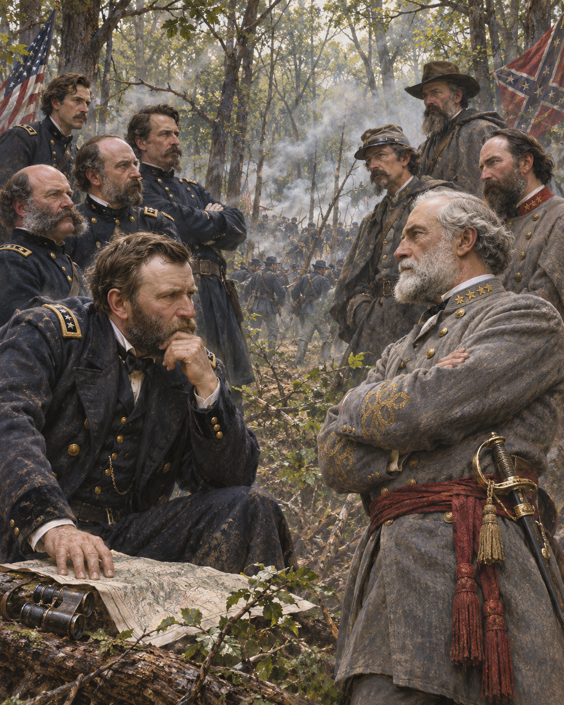

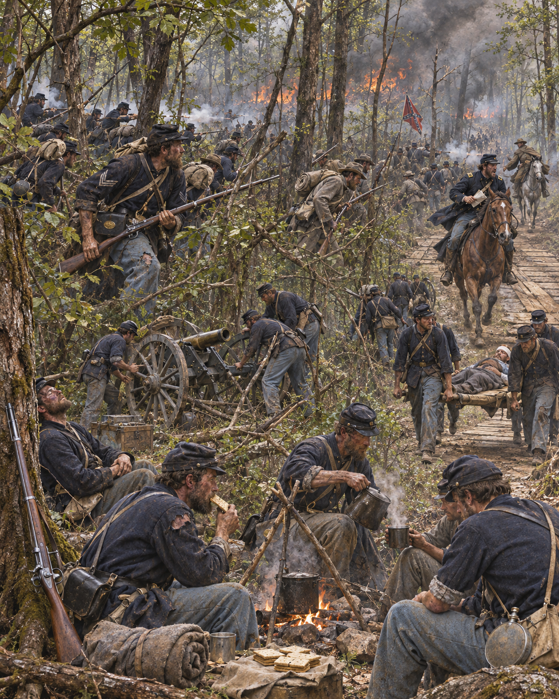

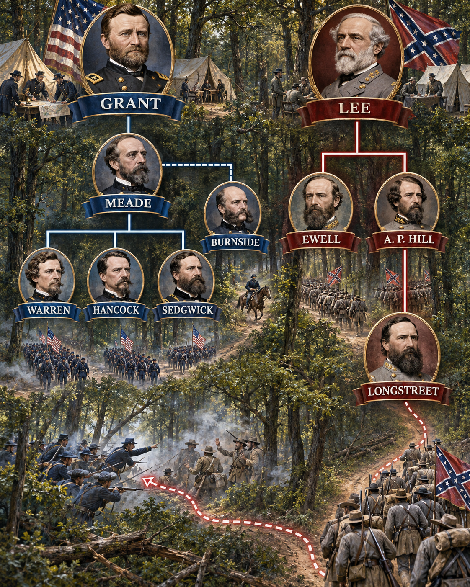

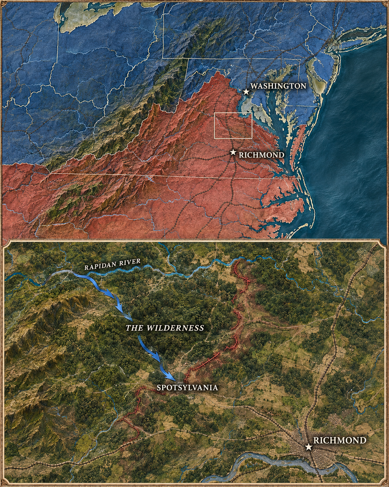

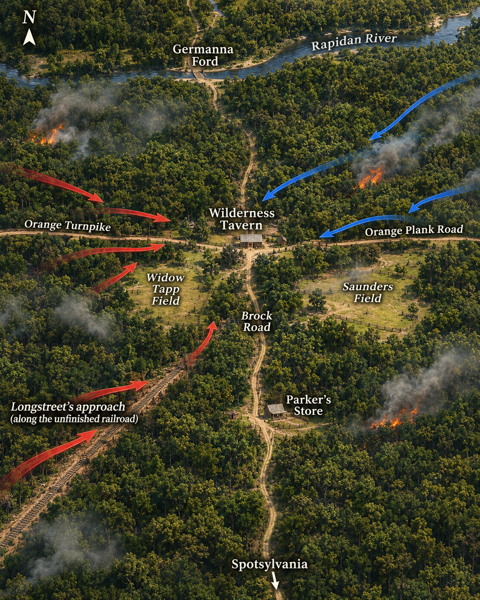

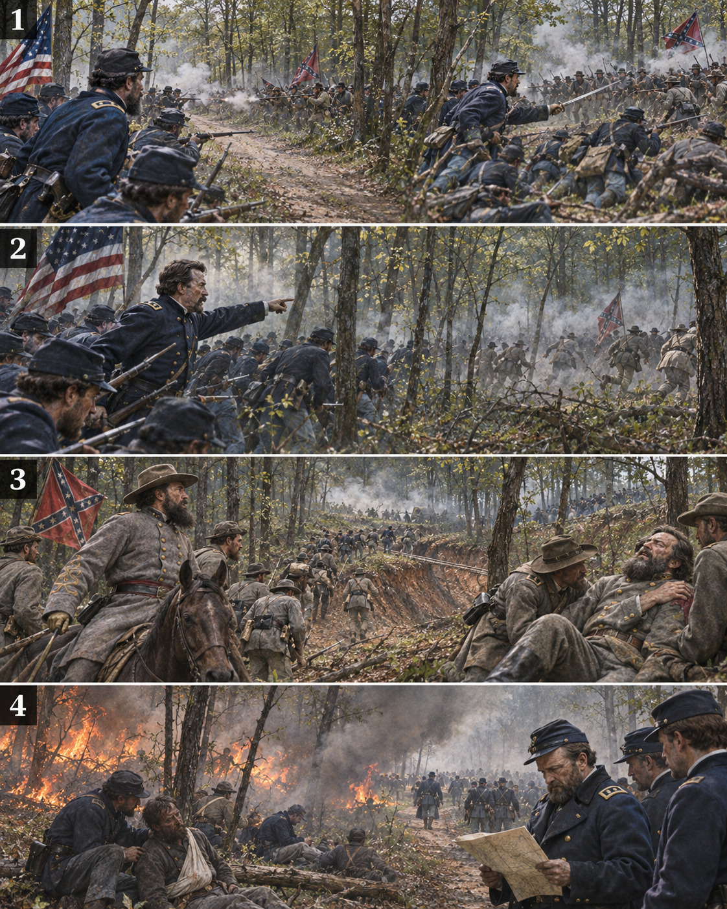

와일더니스의 불은 어느 지휘관이 계획한 화공이 아니었다. 총포 불꽃과 전투 중의 여러 불씨가 마른 낙엽·덤불에 옮겨붙었고, 짙은 연기와 불길은 시야·지휘·구호를 함께 무너뜨렸다. 따라서 이 사례는 `時者, 天之燥也`(시자, 천지조야 — 때란 하늘이 건조한 때다)를 공격 기회가 아니라 **아군에게도 되돌아오는 위험 조건**으로 읽게 한다.

**뒤에서 반복될 지형을 먼저 잡아두기**

- 🌊 **라피단강(Rapidan River)**은 연방군이 남쪽으로 건넌 출발선이다. 건넌 뒤 되돌아가기보다 리치먼드 방향으로 계속 움직이는 것이 그랜트의 전략 선택이었다.
- 🌲 **와일더니스(The Wilderness)**는 벌채 뒤 되자란 빽빽한 관목과 숲이 시야·대형·포병 운용을 막은 공간이다. 불이 나자 이 지형 자체가 통신과 구조를 끊었다.
- **▰** **오렌지 턴파이크(Orange Turnpike)**와 **▰** **오렌지 플랭크 로드(Orange Plank Road)**는 남군이 서쪽에서 진입한 두 축이다.
- **▰** **브록 로드(Brock Road)**는 핸콕군의 집결축이자 남쪽 스폿실베이니아로 이어지는 길이었다.
- 🌲 **손더스 들판(Saunders Field)**·🌲 **위도 탭 들판(Widow Tapp Field)**은 숲 사이 드문 개활지로, 양군이 포병과 대형을 잠시 회복할 수 있던 결절점이었다.

#### 상세 전역 서사 — 전장을 가린 숲이 불길과 함께 지휘망을 삼키다

1864년 5월 5일 **율리시스 S. 그랜트(Ulysses S. Grant)**와 **조지 G. 미드(George G. Meade)**의 군대가 라피단강을 건너자, **로버트 E. 리(Robert E. Lee)**는 병력 열세를 빽빽한 숲으로 상쇄하려 했다. 워런은 오렌지 턴파이크에서 이월과, 핸콕은 오렌지 플랭크 로드에서 A. P. 힐과 부딪쳤다. 숲은 부대 간격을 끊고 포병·정찰·전령의 시야를 빼앗았다. 6일 새벽 핸콕이 힐의 군단을 밀어냈지만, 롱스트리트가 도착해 미완성 철도 절개를 이용한 측면공격으로 전황을 되돌렸다. 이어 롱스트리트가 아군 오인사격으로 부상하면서 남군의 반격도 멈췄다. 전투 중 번진 산불은 연기 속에서 양군의 부상자와 구조대를 위협했고, 어느 쪽도 이를 통제된 무기로 바꾸지 못했다. 전술적으로 결판이 나지 않았지만 그랜트는 북쪽으로 후퇴하지 않고 7일 남쪽 스폿실베이니아로 이동했다.

#### 전투에서 사용된 속임수 — 숲에 가린 측면기동과 확인되지 않는 화공

롱스트리트의 측면공격은 숲과 미완성 철도 절개가 연방군 시야에서 접근을 감춘 기동이었다. 그러나 산불은 사료상 계획된 화공이 아니다. 정확한 발화원과 불에 희생된 인원도 확정하기 어렵다. **기동 은폐는 의도적 전술이었지만, 불은 양군의 통제를 벗어난 환경 위험**이었다.

#### 속임수 작동 구조

**주체와 의도.** **롱스트리트**는 숲과 철도 절개를 이용해 핸콕의 노출된 측면을 치려 했다.

**보인 신호와 믿은 이유.** 정면의 남군이 밀려나는 모습은 연방군에 돌파가 계속될 수 있다는 신호가 됐다. 빽빽한 숲은 별도 측면부대의 접근을 감췄다.

**유발된 행동과 결과.** 연방군은 정면 압박을 계속하다 측면에서 타격을 받았다. 다만 남군도 오인사격으로 롱스트리트를 잃어 성과를 확대하지 못했다.

**사료의 경계.** 숲을 이용한 측면기동과 산불을 하나의 기만 계획으로 합쳐서는 안 된다. 산불은 의도적 신호가 아니라 통제 실패가 만든 공통 위험이었다.

#### 속임수 일곱 질문

1. **누가 누구를 속였는가?** 롱스트리트의 측면부대가 숲에 가려진 접근로로 핸콕군의 경계를 우회했다.
2. **어떤 사실이 거짓이었는가?** 명시적 거짓 신호는 확인되지 않는다.
3. **어떤 사실은 진실이지만 오해를 유도했는가?** 힐 군단의 후퇴는 진짜였지만 남군 예비대의 도착과 측면기동을 보여 주지 않았다.
4. **상대는 왜 그것을 믿고 싶어 했는가?** 연방군은 새벽 공격의 성과가 지속될 것으로 기대할 이유가 있었다.
5. **속임수가 없었어도 같은 오판이 발생했을까?** 가능성은 높다. 숲 자체가 정찰과 연락을 방해했기 때문이다.
6. **속은 사람은 어떤 독립 확인을 생략했는가?** 측면의 철도 절개와 남군 증원 도착을 충분히 확인하지 못했다.
7. **신뢰·동의·안전을 해치지 않으면서 같은 원리를 어디서 연습할 수 있는가?** 지도 기반 모의훈련에서 시야가 끊긴 측면과 예비대 도착을 별도 정보로 확인하는 연습을 할 수 있다.

#### 시계편 兵者詭道也 — 이 전장에 해당하는 속이는 길
<table fit-page-width="true" header-row="true">
<tr><td>해당 구절·독음·뜻</td><td>전장의 장면</td></tr>
<tr><td>亂而取之 난이취지 — 어지러울 때 취한다</td><td>**롱스트리트**의 부대는 🌲 **와일더니스(The Wilderness)**와 미완성 철도 절개에 접근을 가리고, 정면 공격과 숲 때문에 대형이 흐트러진 핸콕군의 노출된 측면을 타격했다. 이는 산불을 이용한 화공이 아니라 지형이 가린 접근로를 쓴 측면기동이다.</td></tr>
</table>

#### 法 한눈 비교 — 곡제·관도·주용
<table fit-page-width="true" header-row="true">
<tr><td>진영</td><td>곡제(편제)</td><td>관도(지휘)</td><td>주용(보급·지속)</td></tr>
<tr><td>**미 연방군**</td><td>대군을 여러 군단으로 나눴으나 숲에서 상호 지원이 끊겼다.</td><td>그랜트의 전략지휘와 미드의 전술지휘, 번사이드의 별도 관계가 마찰을 만들었다.</td><td>강을 건넌 뒤 남진을 계속할 보급체계를 유지했다.</td></tr>
<tr><td>**남부연합군**</td><td>이월·힐·롱스트리트 군단을 두 도로와 측면축에 순차 투입했다.</td><td>리의 집중은 빨랐지만 롱스트리트 오인사격 뒤 공격 통제가 흔들렸다.</td><td>짧은 접근로와 익숙한 지형을 썼으나 병력·물자 열세가 누적됐다.</td></tr>
</table>

〈**리의 남부연합군 (전술적 저지·전략적 실패)**〉
<table fit-page-width="true" header-row="true">
<tr><td>요소</td><td>판단</td></tr>
<tr><td color="orange_bg">🤝 **道**</td><td>병력 열세에도 숲에서 연방군 진격을 저지했지만 지휘관 손실과 혼란이 반격의 결속을 약화했다. (지기·사기)</td></tr>
<tr><td color="blue_bg">🌤️ **天**</td><td>건조한 덤불·연기·불은 양군 모두에 위험했다. 이를 통제 가능한 기회로 착각하지 않았지만 진화·구조 체계도 충분하지 않았다. (기후·상황·확률 관점)</td></tr>
<tr><td color="green_bg">🧭 **地**</td><td>숲으로 연방군 수적 우위와 포병을 제한하고 철도 절개를 측면 접근로로 썼다. (험이·광협)</td></tr>
<tr><td color="purple_bg">🎖️ **將**</td><td>**리**는 전장을 잘 골랐으나 **롱스트리트** 부상 뒤 성과를 전략적 저지로 연결하지 못했다. (지신인용엄)</td></tr>
<tr><td color="yellow_bg">⚙️ **法**</td><td>군단 도착 시차와 좁은 도로를 활용했으나 오인사격·연락 단절·화재 구조 실패가 전투 지속을 제한했다. (곡제·관도·주용)</td></tr>
</table>

**직관·편향 한 줄:** 연방군이 다시 북쪽으로 물러날 것이라는 과거 전역의 기준점이 **리**의 판단에 작동했을 가능성이 있으며, 그랜트의 남진이 전략적 결과를 바꿨다.

🏳️ **패군 측 결과**
<table fit-page-width="true" header-row="true">
<tr><td>구분</td><td>판정</td></tr>
<tr><td color="red">⚔️ **전투 결과**</td><td>남군은 국지적으로 진격을 막았지만 연방군의 남진을 중단시키지 못했다. 六敗 중 하나로 단정하기보다 전술적 저지와 전략적 실패를 구분해야 한다.</td></tr>
<tr><td color="orange">🔀 **패군 측 회피 분기점**</td><td>롱스트리트의 측면공격 뒤 아군 식별·연락을 강화하고 산불 확산 구간에 예비대를 넣지 않았다면 지휘관 손실과 혼란을 줄일 수 있었다.</td></tr>
</table>

〈**그랜트·미드의 미 연방군 (전략적 승)**〉
<table fit-page-width="true" header-row="true">
<tr><td>요소</td><td>판단</td></tr>
<tr><td color="orange_bg">🤝 **道**</td><td>막대한 손실 뒤에도 북쪽 철수 대신 남진이라는 공동 목적을 유지했다. (지기·사기)</td></tr>
<tr><td color="blue_bg">🌤️ **天**</td><td>화재·연기·시야 상실을 이용 가능한 화공이 아니라 중지와 재배치가 필요한 위험으로 다뤘다. (기후·상황·확률 관점)</td></tr>
<tr><td color="green_bg">🧭 **地**</td><td>숲에서 전술 우위를 얻지 못했으나 브록 로드와 남쪽 도로를 확보해 전역의 축을 바꿨다. (원근·사생)</td></tr>
<tr><td color="purple_bg">🎖️ **將**</td><td>**그랜트**는 한 전투의 손익과 전체 전역의 방향을 분리했다. (지신인용엄)</td></tr>
<tr><td color="yellow_bg">⚙️ **法**</td><td>군단 간 혼선에도 대군의 보급과 이동을 유지해 다음 전장으로 전환했다. (곡제·관도·주용)</td></tr>
</table>

🏆 **승군 측 결과**
<table fit-page-width="true" header-row="true">
<tr><td>구분</td><td>판정</td></tr>
<tr><td color="blue">⚔️ **전투 결과**</td><td>전술적 결판은 없었지만 연방군은 작전 주도권을 유지했다. 五勝 중 `知可以戰與不可以戰者勝`(지가이전여불가이전자승, 싸울 때와 싸우지 않을 때를 아는 자가 이긴다)의 전역적 적용에 가깝다.</td></tr>
</table>

##### 法을 압축하지 않고 보기 — 곡제·관도·주용

**곡제 曲制(곡제): 부대를 어떻게 나누고 결합했는가**
<table fit-page-width="true" header-row="true">
<tr><td>진영</td><td>실제 운용</td></tr>
<tr><td>**미 연방군**</td><td>워런·핸콕·세지윅 군단과 번사이드 군단을 넓은 축에 투입했으나 숲에서 결합이 늦었다.</td></tr>
<tr><td>**남부연합군**</td><td>이월·힐이 먼저 고착하고 롱스트리트가 증원·측면공격을 맡았다.</td></tr>
</table>

**관도 官道(관도): 누가 명령하고 어떻게 전달했는가**
<table fit-page-width="true" header-row="true">
<tr><td>진영</td><td>실제 운용</td></tr>
<tr><td>**미 연방군**</td><td>**그랜트**가 전역을, **미드**가 포토맥군을 지휘했으며 좁은 숲길과 복수 지휘선이 명령 전달을 늦췄다.</td></tr>
<tr><td>**남부연합군**</td><td>**리**가 세 군단의 도착 시차를 조정했지만 오인사격으로 현장 지휘가 끊겼다.</td></tr>
</table>

**주용 主用(주용): 군량·장비·전투 지속 능력을 어떻게 썼는가**
<table fit-page-width="true" header-row="true">
<tr><td>진영</td><td>실제 운용</td></tr>
<tr><td>**미 연방군**</td><td>라피단강 도하 뒤 대규모 보급열을 남쪽으로 돌릴 수 있었지만 숲에서는 포병·구급차 운용이 제한됐다.</td></tr>
<tr><td>**남부연합군**</td><td>짧은 내선과 도로를 활용했으나 인력·장비 보충 여력이 작아 지휘관 손실을 감당하기 어려웠다.</td></tr>
</table>

### 동양 — 🏛️ 동오군 vs 🏛️ 촉한군 │ 이릉·효정 전투(夷陵·猇亭之戰, 222)

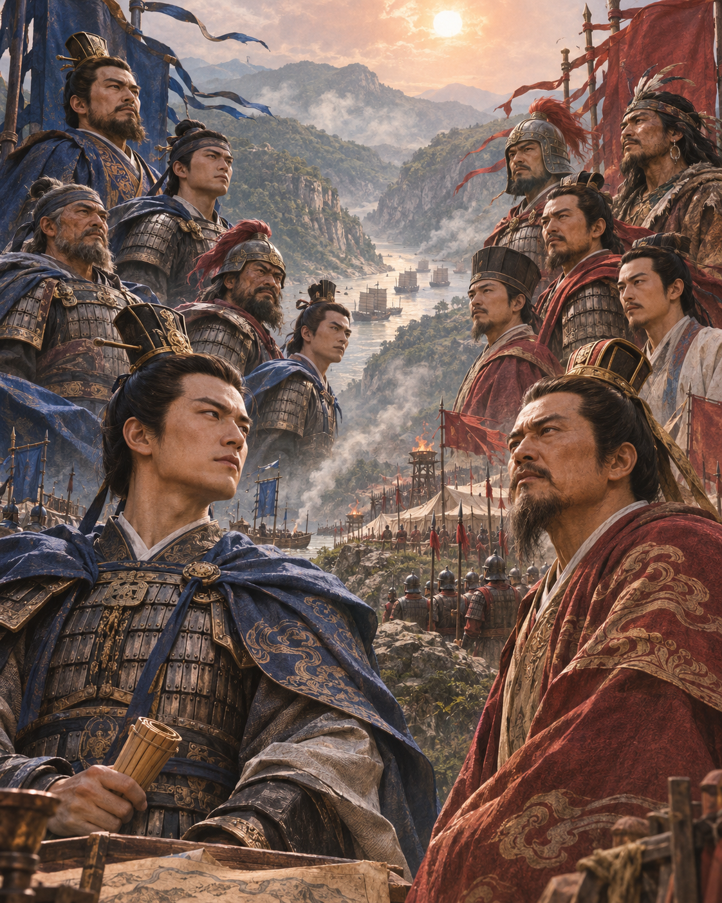

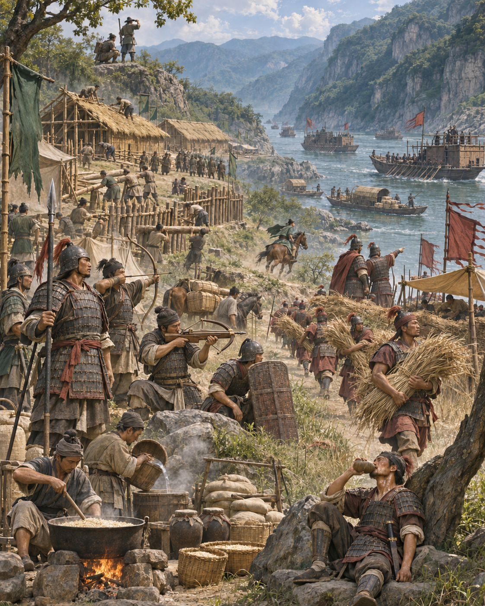

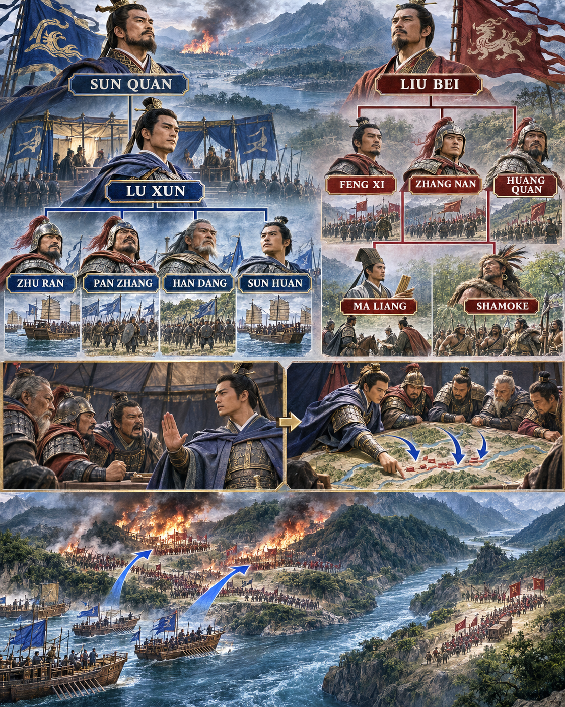

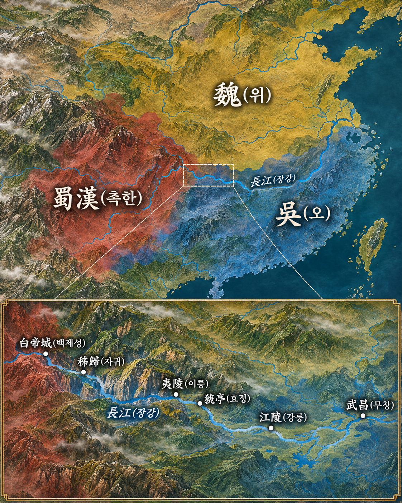

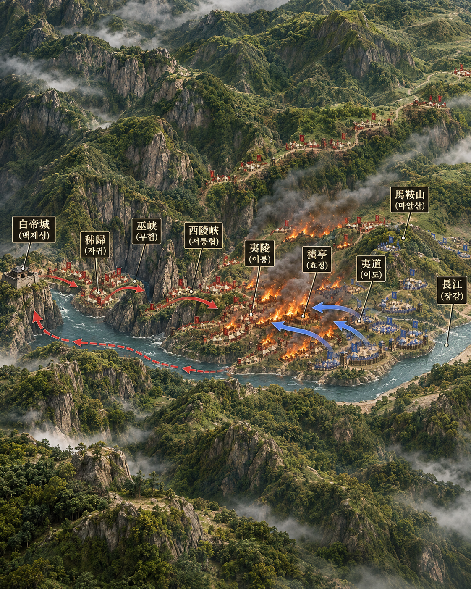

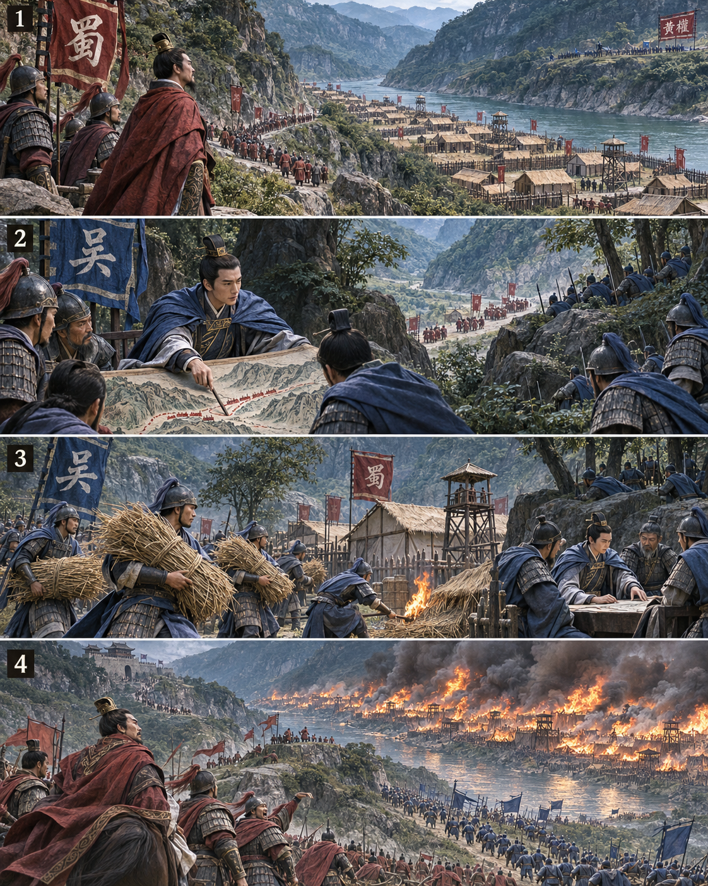

**뒤에서 반복될 지형을 먼저 잡아두기**

- 🌊 **장강(長江)**과 ⛰️ **삼협(三峽)**은 촉한군의 진격·보급축인 동시에 강북 황권군과 강남 주력을 갈라놓은 장벽이었다.
- **▰** **백제성(白帝城)**과 **▰** **자귀(秭歸)**는 촉한의 출발·퇴각 거점이었다.
- **▰** **이릉(夷陵)**·**▰** **효정(猇亭)**·**▰** **이도(夷道)**는 오군이 압축 방어한 결전 구간이었다.
- ⛰️ **마안산(馬鞍山)**은 패전 뒤 유비가 병력을 모아 마지막 저항을 시도한 고지였다.

#### 상세 전역 서사 — 유인을 거절하고 마른 영채가 연결된 때를 기다리다

221년부터 **유비(劉備)**가 장강 협곡을 따라 동진하자 **육손(陸遜)**은 초기 결전을 요구하는 장수들을 억제하고 방어선을 압축했다. **유비**는 소수 병력을 평지에 보이고 골짜기에 복병을 숨겼지만 **육손**은 미끼를 의심해 출격하지 않았다. 긴 대치가 이어지면서 촉한의 영채는 강과 산림을 따라 길게 늘어났고 병사와 지휘망의 피로가 커졌다. 육손은 한 영채를 시험 공격한 뒤 구조와 가연성을 확인하고, 병사들에게 묶음풀을 들려 불을 놓게 했다. 불이 영채 연결을 끊자 여러 장군이 동시에 공격해 40여 영채를 격파했다. 유비는 마안산에서 저항한 뒤 백제성으로 퇴각했다. 정사와 『자치통감』 계통은 화공·묶음풀·동시 공격을 전하지만, **육손이 특정 동남풍을 기다렸다는 기록은 확인되지 않는다.**

#### 전투에서 사용된 속임수 — 보인 미끼를 거절하고 기다림의 의도를 감추다

촉한군은 평지의 소수 병력으로 오군을 계곡 복병 앞에 끌어내려 했다. 육손은 병력 규모와 위치가 부자연스럽다고 보고 반응하지 않았다. 반대로 오군의 장기 방어는 소극성처럼 보였으나, 실제로는 촉군의 기세가 꺾이고 영채가 길게 고정되기를 기다린 시간이었다.

#### 속임수 작동 구조

**주체와 의도.** **유비**는 약한 전초로 오군을 끌어내려 했고, **육손**은 반응을 보류해 촉군의 배치가 스스로 약점을 만들게 했다.

**보인 신호와 믿은 이유.** 평지의 소수 병력은 쉬운 목표처럼 보였고, 오군의 장기 방어는 약세처럼 보일 수 있었다.

**유발된 행동과 결과.** 오군이 미끼에 걸리지 않자 촉군은 긴 영채선에 머물렀고, 오군은 시험 공격 뒤 화공과 동시 공격을 결합했다.

**사료의 경계.** 화공은 확인되지만 특정 풍향 대기와 700리 영채 전체가 한 번에 탔다는 후대 서술은 사실로 단정하지 않는다.

#### 속임수 일곱 질문

1. **누가 누구를 속였는가?** 유비가 육손을 평지 미끼와 골짜기 복병으로 끌어내려 했다.
2. **어떤 사실이 거짓이었는가?** 평지 부대가 고립된 쉬운 목표라는 인상이 거짓이었다.
3. **어떤 사실은 진실이지만 오해를 유도했는가?** 전초 병력이 실제로 적었지만 뒤에 복병이 있었다.
4. **상대는 왜 그것을 믿고 싶어 했는가?** 오군 장수들은 장기 방어 뒤 작은 승리로 주도권을 되찾고 싶어 했다.
5. **속임수가 없었어도 같은 오판이 발생했을까?** 가능성은 중간이다. 제장들의 조급함은 남았지만 특정 출격 요구는 약했을 것이다.
6. **속은 사람은 어떤 독립 확인을 생략했는가?** 육손은 주변 골짜기와 병력 비례를 확인해 공격을 보류했다.
7. **신뢰·동의·안전을 해치지 않으면서 같은 원리를 어디서 연습할 수 있는가?** 바둑·체스와 동의된 모의훈련에서 쉬워 보이는 목표 뒤의 예비를 확인할 수 있다.

#### 시계편 兵者詭道也 — 이 전장에 해당하는 속이는 길
<table fit-page-width="true" header-row="true">
<tr><td>해당 구절·독음·뜻</td><td>전장의 장면</td></tr>
<tr><td>利而誘之 이이유지 — 이익으로 유인한다</td><td>유비가 평지의 소수 병력을 쉬운 전과처럼 보이게 했다.</td></tr>
<tr><td>佚而勞之 일이노지 — 쉬는 적을 지치게 한다</td><td>오군은 방어선을 압축하고 촉군이 긴 영채선에서 피로해지도록 기다렸다.</td></tr>
</table>

#### 法 한눈 비교 — 곡제·관도·주용
<table fit-page-width="true" header-row="true">
<tr><td>진영</td><td>곡제(편제)</td><td>관도(지휘)</td><td>주용(보급·지속)</td></tr>
<tr><td>**동오군**</td><td>수륙 부대와 여러 장군을 방어 뒤 동시 공격으로 묶었다.</td><td>**육손**이 조급한 출격 요구를 억제하고 전환 시점을 통일했다.</td><td>짧은 방어축과 장강 수운으로 전투 지속 능력을 유지했다.</td></tr>
<tr><td>**촉한군**</td><td>강 남북과 긴 영채선으로 병력이 분리됐다.</td><td>**유비** 중심 지휘가 긴 영채와 분견대에 늦게 전달됐다.</td><td>협곡의 긴 보급축과 여름 주둔이 병력·물자를 소모했다.</td></tr>
</table>

〈**유비의 촉한군 (패)**〉
<table fit-page-width="true" header-row="true">
<tr><td>요소</td><td>판단</td></tr>
<tr><td color="orange_bg">🤝 **道**</td><td>초기 기세는 높았지만 장기 대치와 영채 고립으로 상호 지원과 사기가 약해졌다. (지기·사기)</td></tr>
<tr><td color="blue_bg">🌤️ **天**</td><td>오군이 끝내 나오리라는 기대를 고정하고 여름 주둔의 피로와 화재 위험을 낮게 보았다. 당일 풍향 판단은 사료상 불명이다. (지피·타이밍·확률 관점)</td></tr>
<tr><td color="green_bg">🧭 **地**</td><td>장강·산림·협곡을 따라 늘어진 영채는 불과 차단에 취약했고 강북군과 분리됐다. (원근·험이·광협·사생)</td></tr>
<tr><td color="purple_bg">🎖️ **將**</td><td>**유비**는 유인 실패 뒤에도 전선을 압축하거나 수륙 연결을 재편하지 못했다. (지신인용엄)</td></tr>
<tr><td color="yellow_bg">⚙️ **法**</td><td>영채 수는 많았지만 예비·연락·소방·퇴로가 하나의 체계로 묶이지 않았다. (곡제·관도·주용)</td></tr>
</table>

**직관·편향 한 줄:** **유비**가 오군의 장기 방어를 소극성으로 해석하고 자신의 전진 성과에 기준점을 둔 판단에는 확증편향과 매몰비용이 작동한 것으로 볼 수 있다.

🏳️ **패군 측 결과**
<table fit-page-width="true" header-row="true">
<tr><td>구분</td><td>판정</td></tr>
<tr><td color="red">⚔️ **전투 결과**</td><td>촉한군은 40여 영채가 무너지고 주요 지휘관을 잃었으며 유비는 백제성으로 철수했다. 六敗 중 `北`(배, 적을 헤아리지 못해 약점으로 강자를 맞음)에 가깝다.</td></tr>
<tr><td color="orange">🔀 **패군 측 회피 분기점**</td><td>유인 실패 뒤 영채를 수로 거점 중심으로 압축하고 강북·강남 연락과 소방 예비대를 재편했다면 연쇄 붕괴를 줄일 수 있었다.</td></tr>
</table>

〈**육손의 동오군 (승)**〉
<table fit-page-width="true" header-row="true">
<tr><td>요소</td><td>판단</td></tr>
<tr><td color="orange_bg">🤝 **道**</td><td>초기 불만이 있던 제장들을 총지휘 판단에 묶고 공격 전환 때 동시에 움직이게 했다. (지기·사기)</td></tr>
<tr><td color="blue_bg">🌤️ **天**</td><td>유인에는 반응하지 않고 촉군의 피로·영채 고정·가연성이 겹칠 때 공격했다. 풍향을 기다렸다는 정사 기록은 없으므로 성공을 필연으로 설명하지 않는다. (지피·타이밍·확률 관점)</td></tr>
<tr><td color="green_bg">🧭 **地**</td><td>방어선을 압축해 장강 수로와 협곡 병목을 활용하고 촉군의 긴 축을 여러 조각으로 끊었다. (원근·험이·광협·사생)</td></tr>
<tr><td color="purple_bg">🎖️ **將**</td><td>**육손**은 기다릴 때와 전군을 잇는 때를 구분하고 제장의 반대를 견뎠다. (지신인용엄)</td></tr>
<tr><td color="yellow_bg">⚙️ **法**</td><td>정찰 공격·화공조·수륙 차단·동시 본공을 단계별로 연결했다. (곡제·관도·주용)</td></tr>
</table>

🏆 **승군 측 결과**
<table fit-page-width="true" header-row="true">
<tr><td>구분</td><td>판정</td></tr>
<tr><td color="blue">⚔️ **전투 결과**</td><td>동오군은 서부 국경의 대규모 침공을 격퇴했다. 五勝 중 `知可以戰與不可以戰者勝`(지가이전여불가이전자승, 싸울 때와 싸우지 않을 때를 아는 자가 이긴다)에 해당한다.</td></tr>
</table>

##### 法을 압축하지 않고 보기 — 곡제·관도·주용

**곡제 曲制(곡제): 부대를 어떻게 나누고 결합했는가**
<table fit-page-width="true" header-row="true">
<tr><td>진영</td><td>실제 운용</td></tr>
<tr><td>**동오군**</td><td>**육손** 아래 주연·반장·한당·손환이 전면·측면·퇴로 차단을 나눠 맡았다.</td></tr>
<tr><td>**촉한군**</td><td>풍습·장남의 전방, 황권의 강북군, 마량의 오계 연락이 넓게 갈라졌다.</td></tr>
</table>

**관도 官道(관도): 누가 명령하고 어떻게 전달했는가**
<table fit-page-width="true" header-row="true">
<tr><td>진영</td><td>실제 운용</td></tr>
<tr><td>**동오군**</td><td>**육손**이 출격을 통제하다 공격 시점을 정해 여러 장군에게 동시 명령을 내렸다.</td></tr>
<tr><td>**촉한군**</td><td>**유비**의 본영과 긴 영채선·강북 분견대 사이의 보고와 지원이 지형 때문에 늦었다.</td></tr>
</table>

**주용 主用(주용): 군량·장비·전투 지속 능력을 어떻게 썼는가**
<table fit-page-width="true" header-row="true">
<tr><td>진영</td><td>실제 운용</td></tr>
<tr><td>**동오군**</td><td>장강 수운과 짧은 방어축으로 식량·예비 병력을 집중하고 병사마다 묶음풀을 들려 화공을 분산 실행했다.</td></tr>
<tr><td>**촉한군**</td><td>긴 보급로와 여름 산림 영채가 식수·식량·소방·연락 부담을 키웠다.</td></tr>
</table>

#### 참고자료

- [미국 국립공원청 — Battle of the Wilderness](https://www.nps.gov/civilwar/search-battles-detail.htm?battleCode=VA046)
- [미국 국립공원청 — Into the Flames: Grant at the Wilderness](https://www.nps.gov/articles/000/grant-at-the-wilderness.htm)
- [미 육군 군사사센터 — The Overland Campaign](https://history.army.mil/Publications/Publications-Catalog/Overland-Campaign/)
- [미국 의회도서관 — Map of the Battle of the Wilderness](https://www.loc.gov/item/2007627341/)
- [Rafe de Crespigny — Generals of the South](https://openresearch-repository.anu.edu.au/bitstream/1885/148674/4/Generals%20of%20the%20South.pdf)
- [香港電台 대학강의 자료 — 夷陵之戰](https://www.rthk.hk/oldassets/files/extra_file/20250415160911_295765930.pdf)

---
## 5. 핵심 통찰 + 실생활 적용 + 생활루틴

### 핵심 통찰

이 구절의 핵심은 ‘좋은 날을 맞혀라’가 아니라 **시간을 조건으로 정의하라**는 데 있다. 時는 달력의 기간이 아니라 일이 작동할 외부 환경이고, 日은 그 환경 안에서 고른 구체적 실행일이다. 두 층을 나누면 마감과 준비가 현실을 압도하지 못한다. 날짜를 지키기 위해 조건을 무시하는 대신, 조건을 지키기 위해 날짜를 바꿀 수 있다.

별자리와 바람의 연결은 당대 지식의 산물이다. 이를 그대로 믿는 것이 고전을 존중하는 태도는 아니다. 손자가 요구한 것은 관측 가능한 징후로 강한 행동을 제한하는 일이므로, 오늘날에는 더 나은 측정과 예보, 법과 안전 기준을 써야 한다. **형식은 바뀌어도 관측 → 후보일 선정 → 당일 재확인 → 중지 가능성의 순서는 남는다.**

### 실생활 적용

3교대 현장에서 설비 변경이나 복구 작업 날짜를 먼저 박아 두면, 피로·인력·부품·생산 상황을 그 날짜에 맞춰 낙관적으로 해석하기 쉽다. 먼저 時를 “앞뒤 교대 인계가 가능하고, 복구 담당자가 있으며, 필요한 부품과 백업이 확인되고, 작업 후 관찰 시간이 확보된 상태”로 정의한다. 그 창 안에서 日을 고르고, 당일에는 설비 지표와 작업자 컨디션을 다시 확인한다. 한 조건이 깨졌다면 연기는 실패가 아니라 통제다.

팀 안의 중요한 피드백도 같다. 말하고 싶은 충동이 생긴 날이 실행일은 아니다. 상대와 내가 잠을 제대로 잤는지, 긴급 조치가 끝났는지, 사실 기록과 원하는 변화가 정리됐는지가 時다. 그 조건이 열린 뒤 방해받지 않을 日을 합의한다. 대화 직전에 분위기가 바뀌거나 공개된 자리밖에 없다면, 약속을 지키기 위해 강행하지 말고 다시 잡는다.

개인 일정에서는 운동·공부·재정 결정을 “매주 화요일”처럼 날짜 하나로만 묶지 않는다. 수면, 통증, 필요한 자료, 방해 없는 시간이라는 실행 조건을 적고, 그 조건이 충족되는 후보일을 고른다. 다만 조건을 핑계로 계속 미루지 않도록 최소 행동도 둔다. 운동 조건이 깨지면 10분 회복 산책, 깊은 공부가 어렵다면 자료 정리 15분처럼 위험을 키우지 않는 대체 행동으로 흐름을 잇는다.

### 생활루틴

매일 잠들기 전 3분 동안 다음 날 가장 영향이 큰 행동 하나를 적는다.

- `時`: 실행이 가능한 상태를 관찰 가능한 조건 세 가지로 쓴다.
- `日`: 그 조건을 다시 확인할 날짜와 시각을 한 번 정한다.
- `風`: 당일 계획을 멈추거나 바꿀 변화 한 가지를 쓴다.
- `代`: 조건이 깨졌을 때 할 10분짜리 대체 행동을 정한다.

다음 날에는 정해 둔 시각에 네 줄만 다시 읽는다. 時가 열리고 風의 중지 신호가 없으면 시작한다. 조건이 깨졌다면 날짜에 끌려가지 말고 代를 실행한 뒤 새 日을 잡는다.

**한 줄 기억법:** 조건을 보지 않고 날짜부터 박으면 재수가 없다.
