<!-- sunzi-analysis-mode: light -->
> 범화공, 필인오화지변이응지. — 강한 수단을 썼다는 사실에 취하지 말고, 그 수단이 실제로 만든 변화를 보고 다음 행동을 바꿔라.

---
## 1. 원문 + 독음 + 직역 + 한자어 뜻풀이

凡火攻, 必因五火之變而應之. 범화공, 필인오화지변이응지.

	**직역**

	무릇 화공은 반드시 다섯 화공의 변화에 따라 그에 대응해야 한다.

	앞의 세 구절은 화공의 표적 다섯 가지, 불을 일으킬 조건과 도구, 건조함과 바람을 차례로 준비했다. 그러나 불을 붙였다고 작전이 끝나는 것은 아니다. 불은 적병을 흩뜨릴 수도 있고, 비축과 수송을 끊을 수도 있으며, 예상과 달리 별다른 동요를 만들지 못할 수도 있다. 이 구절은 준비된 수단을 실제 전과로 바꾸는 마지막 고리를 제시한다. **因**은 이미 일어난 변화를 원인과 발판으로 삼는 일이고, **應**은 그 변화에 맞춰 병력의 다음 행동을 조정하는 일이다.

	#### 凡火攻(범화공) — 모든 화공을 하나의 원리로 묶는다

	**凡**(무릇 범)은 여러 경우를 한데 묶어 일반 원칙을 세우는 말이고, **火**(불 화)는 불꽃의 모양을 본뜬 글자이며, **攻**(칠 공)은 工(장인 공)과 攴(칠 복)이 결합해 힘을 목적 있게 가하는 행동을 뜻한다. 앞에서 火人·火積·火輜·火庫·火隊로 표적은 갈라졌지만, 어느 경우든 불 자체가 승리하는 것이 아니다. 불은 적의 상태를 바꾸는 수단이고, 군대는 그 결과를 읽어야 한다.

	#### 必因(필인) — 다음 행동의 근거를 결과에서 찾는다

	**必**(반드시 필)은 빠뜨릴 수 없는 조건을, **因**(인할 인)은 둘러싸인 자리에서 기대고 따르는 모습을 담아 어떤 조건을 의지해 다음 일을 일으킨다는 뜻을 나타낸다. 여기서 因은 계획을 고집한다는 말이 아니다. 불이 실제로 만든 혼란·차단·노출·침묵을 새 근거로 삼으라는 말이다. 최초 계획은 발화까지 인도하지만, 발화 뒤의 행동은 관측된 변화가 결정한다.

	#### 五火之變(오화지변) — 같은 불도 서로 다른 전장을 만든다

	**五火**(오화)는 앞 구절의 火人·火積·火輜·火庫·火隊, 곧 병사·비축·수송·창고·대오 또는 통로를 겨냥한 다섯 화공이다. **變**(변할 변)은 실이 얽힌 형상과 손의 동작이 결합해 상태가 달라짐을 나타낸다. 주석가들이 말한 變은 불의 종류를 다시 세는 데 그치지 않는다. 표적과 준비 상태에 따라 적이 놀라 흩어지는지, 침착하게 수습하는지, 퇴로가 열리는지, 역습을 준비하는지가 달라지는 **전장의 상태 변화**다.

	#### 而應之(이응지) — 호응은 자동 돌격이 아니라 맞춤 반응이다

	**應**(응할 응)은 바깥의 요구에 맞게 대답하고 움직인다는 뜻이다. **之**(갈 지)는 여기서 앞서 일어난 변화 전체를 가리킨다. 따라서 應之는 “불이 보이면 공격한다”는 단일 명령이 아니다. 적이 놀라면 밖에서 빠르게 압박하고, 적이 고요하면 매복과 대비를 의심해 멈추며, 더 밀 수 있으면 따르고 위험하면 그치는 식으로 반응을 달리하는 것이다. 바로 다음 문장들이 이 짧은 원칙을 다섯 갈래의 판단으로 펼친다.

	#### 글자들이 완성하는 한 장면

	장수는 다섯 표적 가운데 하나에 불을 놓는다. 그러나 불꽃을 보고 승리를 선언하지 않는다. 먼저 五火가 만든 變을 살핀다. 적이 무너졌는지, 버텼는지, 길이 열렸는지, 아군이 들어가도 되는지를 확인한다. 그 관측을 因으로 삼아 진격·대기·중지 가운데 맞는 행동으로 應한다. **수단은 계획대로 시작하되, 후속 행동은 현실이 보여 준 변화에 따라 바뀐다.**

---
## 2. 전통 주석 기반 분석

- **조조(曹操)** — “應은 군대로 호응한다는 뜻이다. 불을 놓은 것으로 일을 마쳤다고 여기지 말고, 불이 만든 틈에 병력을 움직여라.”
- **이전(李筌)** — “불의 세를 타고 응하라. 세가 일어나지 않았는데 수법의 이름만 믿고 나아가지 말며, 불길과 적진의 움직임이 만든 방향을 따라라.”
- **두목(杜牧)** — “화공은 불만으로 적을 패망시키는 술법이 아니다. 불로 적을 놀라게 하고 어지럽힌 뒤 병력으로 치는 것이니, 혼란이 실제로 생겼을 때를 놓치지 마라.”
- **매요신(梅堯臣)** — “불로 변화가 생기면 병력으로 응하라. 불은 변화를 여는 앞손이고, 군대의 호응이 그 변화를 전과로 굳힌다.”
- **장예(張預)** — “五火는 사람·비축·수송·창고·대오를 태우는 다섯 방법이다. 어느 표적에서 어떤 변화가 났는지 분별하고 그 변화에 맞춰 병력을 써라.”
- **왕석(王晳)** — “應은 변화와 행동을 맞추는 일이다. 변화가 없으면 억지로 있는 듯 여기지 말고, 뒤 문장의 ‘병사가 고요하면 기다린다’는 제한까지 함께 보라.”
- **가림(賈林)** — “상례 하나에 붙잡히지 마라. 안의 내응만 기다리지 않고 밖에서 불을 쓸 수도 있듯, 형세가 편리하면 그때의 변화에 따라 행동하라.”
- **두우(杜佑)** — “화공은 간자가 안에서 불을 놓고 군대가 밖에서 호응하는 제도와 연결된다. 신호·시각·진입로를 미리 맞추지 않으면 변화가 생겨도 병력이 받아 쓰지 못한다.”
- **진호(陳皞)** — “때에 맞춰 불을 내고 변화에 맞춰 움직여라. 발화 조건과 후속 대응은 한 작전의 두 부분이므로, 앞의 준비와 뒤의 호응을 끊어 읽지 마라.”

#### 주석가들의 차이와 보완

매요신과 장예는 본문의 직접 주석대로 `因火爲變, 以兵應之`(인화위변, 이병응지 — 불로 변화를 만들고 병력으로 응한다)를 핵심 구조로 잡는다. 조조·이전·두목은 應을 실제 병력 운용으로 좁혀, 불만으로 적을 무너뜨린다는 환상을 걷어낸다. 왕석은 변화가 보이지 않을 때 기다리는 뒤 문장까지 연결하고, 가림은 정해진 한 방식에 매이지 않는 응변을, 두우는 내응과 외부 군대가 맞물릴 지휘·신호 체계를 강조한다.

이 견해들은 서로 경쟁하기보다 순서를 이룬다. 먼저 표적에 맞는 불을 준비하고, 실제 변화가 일어났는지 관측하며, 변화가 확인되면 병력으로 이용하고, 변화가 없거나 위험하면 멈춘다. **화공의 성패는 발화의 성공이 아니라 관측과 후속 행동의 결합으로 판정된다.**

#### 리링의 고증과 현대적 독법

리링(李零)의 해설 취지를 따라 편장 구조를 보면, 앞의 `火人·火積·火輜·火庫·火隊`는 공격 대상을 분류하고 이 구절의 `五火`는 그 목록을 다시 받아 동작 원리로 전환한다. 여기서 變은 다섯 화공과 별개의 신비한 ‘다섯 변화’를 새로 세는 말이라기보다, 다섯 화공이 실제 적진에 만들어 낸 서로 다른 변화를 가리킨다. 판본 차이가 확인되지 않는 자리를 억지 이문으로 만들 필요는 없다.

문장 무게는 `火攻`보다 `因…變而應之`에 있다. 수단을 쓴 뒤에도 현실이 최초 예상과 같다고 가정하지 않고, 결과를 새 정보로 받아 다음 행동을 바꾼다. 『손자』를 단순한 기책 모음으로 읽으면 불을 놓는 장면만 남지만, 문장 구조를 따르면 **타격 → 관측 → 조정**이라는 지휘 순환이 중심에 남는다.

---
## 3. 교차 설명

### ① 손자병법 내 교차

앞의 `凡火攻有五`(범화공유오 — 화공에는 다섯 가지가 있다)는 표적을 분류했고, `行火必有因, 煙火必素具`(행화필유인, 연화필소구 — 화공에는 조건이 있고 연화 도구는 미리 갖춰야 한다)는 실행 전 준비를 요구했다. 이 구절은 그 준비가 만든 결과를 읽는 단계다. 다음의 `火發於內, 則早應之於外`(화발어내, 즉조응지어외 — 안에서 불이 나면 밖에서 일찍 호응한다)부터는 應의 구체적 분기가 이어진다. 화공편의 흐름은 **표적 분류 → 조건과 준비 → 변화 관측 → 조건부 대응**이다.

「허실편」의 `因形而錯勝於衆, 衆不能知`(인형이조승어중, 중불능지 — 드러난 형세를 따라 승리를 배치하되 사람들은 그 이치를 알지 못한다)는 因의 태도를 넓혀 준다. 계획표에 적힌 형세가 아니라 실제 드러난 형세를 따른다. 불이 났다는 사건보다 적의 대오와 지휘가 어떻게 달라졌는지를 보아야 한다.

「군쟁편」의 `懸權而動`(현권이동 — 저울질한 뒤 움직인다)과 `後人發, 先人至`(후인발, 선인지 — 남보다 늦게 출발해 먼저 도착한다)도 성급한 자동 반응을 경계한다. 빠른 應은 무조건 즉시 돌격하는 것이 아니라, 변화가 뜻하는 이익과 위험을 빨리 판별해 알맞은 행동을 고르는 능력이다.

### ② 클라우제비츠 『전쟁론』

클라우제비츠에게 전투의 결과는 전략의 재료다. 타격이 있었다는 사실만으로 정치·전략 목적이 달성되는 것이 아니라, 적의 전투력과 의지가 얼마나 변했고 그 결과를 어떻게 이용할지가 중요하다. 이 구절도 불이라는 수단과 승리라는 목적 사이에 ‘변화의 관측’과 ‘병력의 호응’을 둔다.

차이도 있다. 『전쟁론』은 적의 중심과 전투력 파괴를 큰 틀에서 다루고, 이 문장은 화공 직후의 짧은 전술적 순환을 압축한다. 그러나 둘 다 수단의 물리적 효과와 전략적 효과를 구분한다. 창고가 탔어도 적 지휘가 유지되면 기대한 효과가 아닐 수 있고, 작은 불이라도 대오가 무너지면 결정적 틈이 될 수 있다.

### ③ 미야모토 무사시 『오륜서』

『오륜서』의 `火の巻`(히노마키 — 불의 권)은 싸움의 열기 속에서 상대의 무너지는 박자를 잡는 일을 중시한다. `拍子を知る`(효시오 시루 — 박자를 안다)는 미리 외운 박자를 강요하는 것이 아니라, 상대가 보이는 리듬의 변화를 읽고 내 동작을 맞추는 일이다.

무사시가 경계한 ‘같은 수를 되풀이함’도 이 구절과 통한다. 첫 타격이 통했다고 같은 행동을 자동 반복하면 상대의 적응을 놓친다. 五火의 變을 본다는 것은 내 수단의 위력만 바라보지 않고, 상대가 그 수단을 받아 낸 뒤 어떻게 달라졌는지를 보는 것이다.

### ④ 오자병법과 육도

『오자병법』 「요적」은 적이 이동 직후 미처 질서를 잡지 못했거나, 병력이 피로하고 진영이 불안정하거나, 풀이 우거져 불을 쓸 수 있을 때를 공격 기회로 든다. 여기서 중요한 것은 ‘불을 쓸 수 있음’과 ‘공격해 성과를 낼 수 있음’이 같은 조건이 아니라는 점이다. 적의 실제 동요가 후속 공격의 문턱이다.

『육도』는 신호·기치·북과 병종별 임무를 통해 여러 부대가 한 변화에 함께 반응하게 한다. 변화가 보여도 부대마다 다른 뜻으로 해석하면 應이 늦거나 충돌한다. 정찰 보고, 진격 신호, 중지 권한을 미리 정해 두어야 순간의 변화를 조직 전체의 행동으로 바꿀 수 있다.

### ⑤ 현대 심리학·군사학

현대 군사 지휘의 전투피해평가(BDA)는 공격이 예정대로 실행됐는지가 아니라 표적 기능이 실제로 얼마나 저하됐는지를 확인한다. 효과가 부족하면 재공격·수단 변경·중지를 결정하고, 예상 밖의 민간·아군 위험이 생기면 계획을 수정한다. 이는 화공을 현대 무기에 곧장 등치하려는 말이 아니라, **행동 뒤의 실제 효과가 다음 결정을 갱신해야 한다**는 동일한 지휘 문제를 보여 준다.

카너먼이 설명한 WYSIATI, 곧 ‘눈앞에 보이는 것이 전부’라는 성향은 불꽃처럼 눈에 띄는 사건을 과대평가하게 한다. 화면에 큰 경보가 떴거나 작업량이 많았다는 사실은 생생하지만, 핵심 기능이 복구됐는지와 위험이 줄었는지는 별도 자료로 확인해야 한다. 대표성 휴리스틱도 ‘강한 조치에는 큰 효과가 있을 것’이라는 닮음만으로 결과를 추정하게 만든다.

확증편향은 최초 계획을 지지하는 신호만 골라 보게 한다. 이를 줄이려면 실행 전에 성공·실패·중지 지표를 함께 정하고, 조치 뒤에는 “무엇이 바뀌었는가, 무엇은 그대로인가, 예상과 반대인 신호는 무엇인가”를 분리해 기록해야 한다. 因變而應은 임기응변을 미화하는 말이 아니라, **사전 기준과 사후 관측을 연결해 판단을 갱신하는 규율**이다.

---
## 4. 역사적 실증 사례

### 서양 — 🏛️ 잉글랜드 함대 vs 🏛️ 스페인 무적함대 │ 칼레 화선·그라블린 해전(Calais Fireships and Battle of Gravelines, 1588)

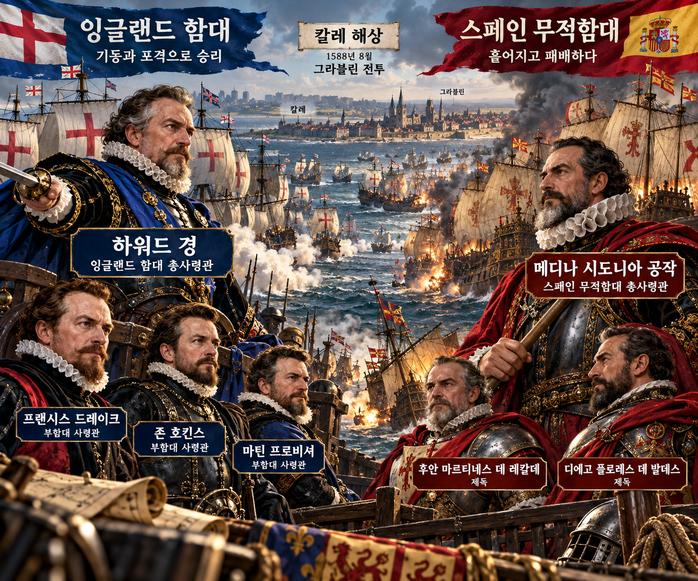

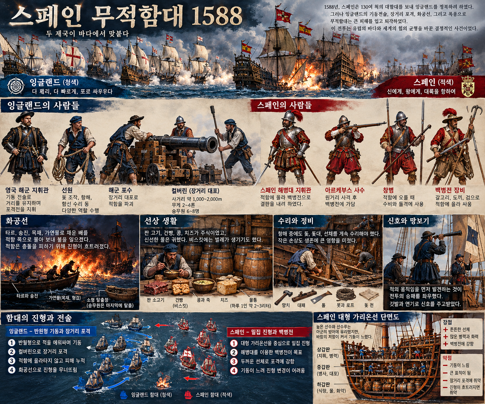

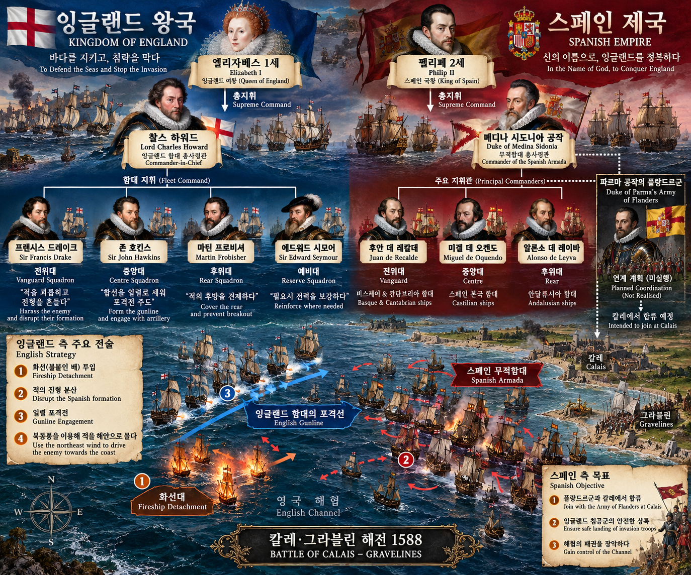

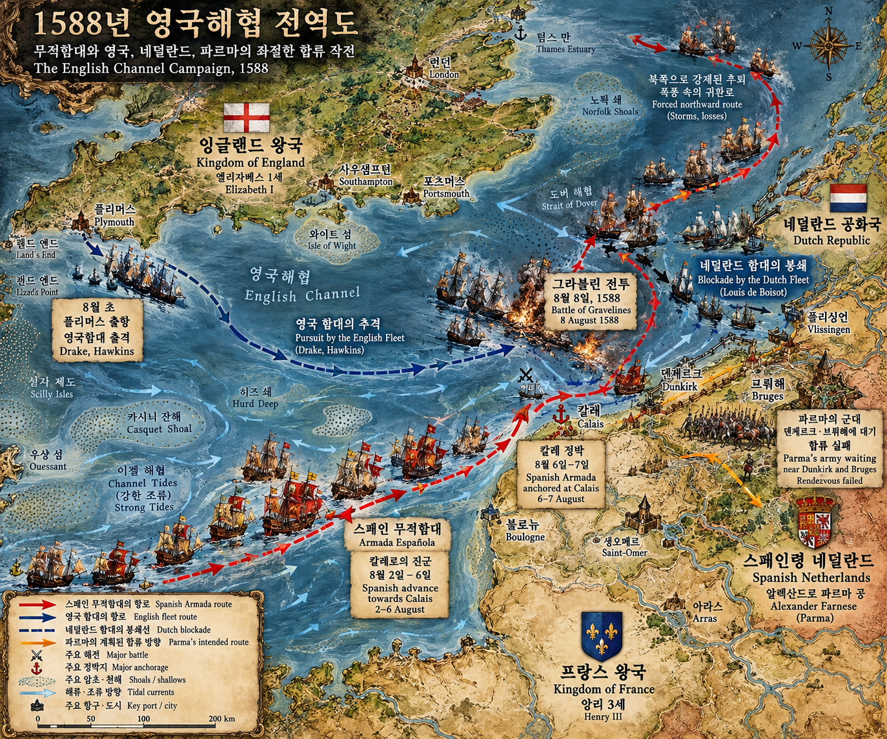

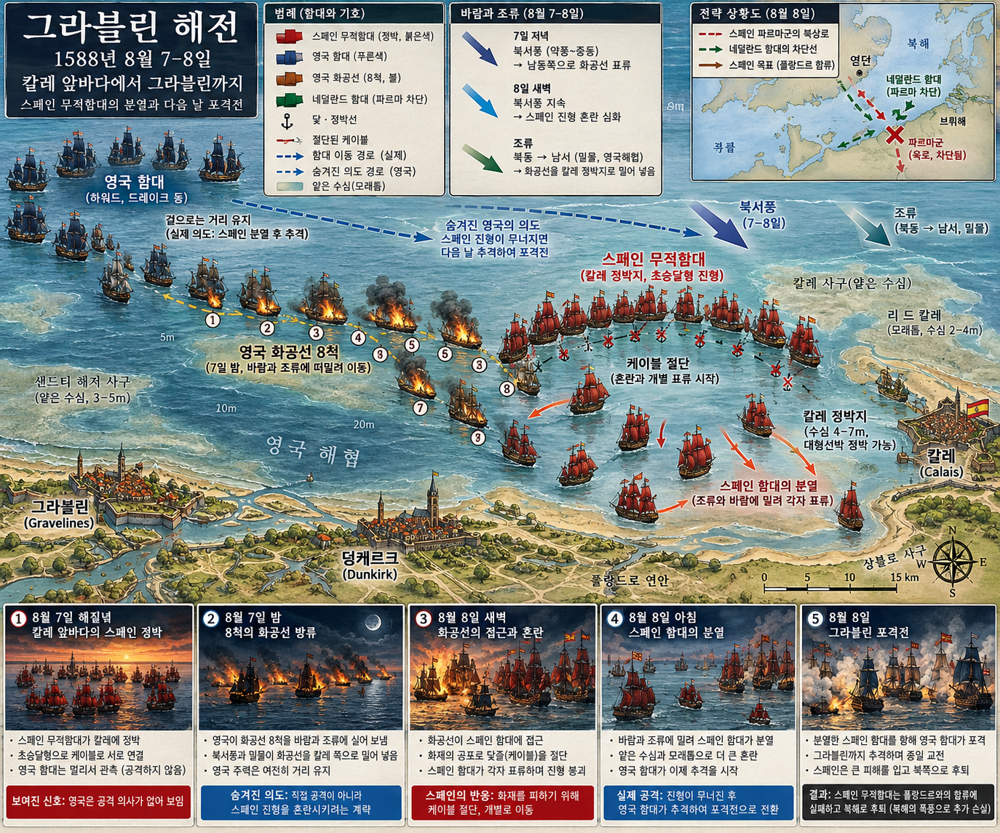

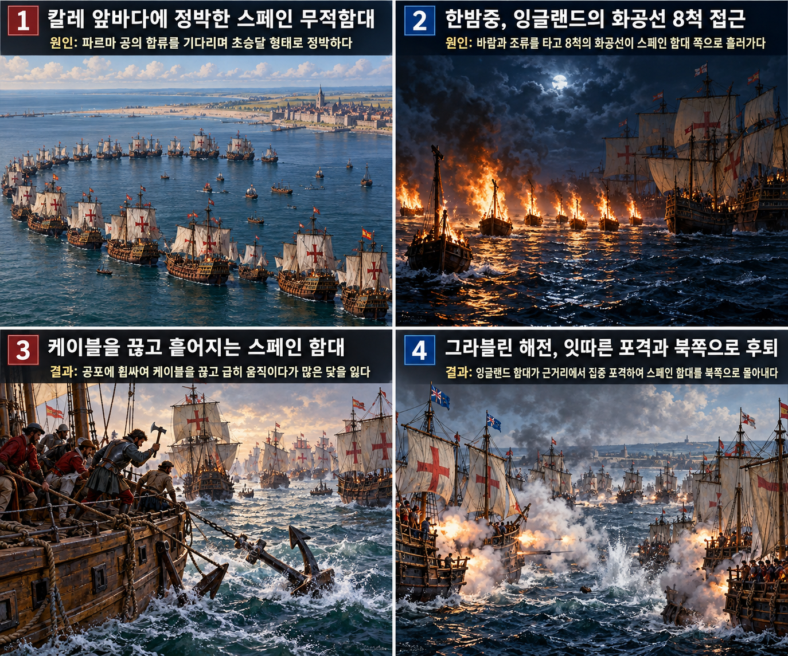

칼레 앞바다의 화선은 스페인 함선을 직접 태우지 못했다. 그러나 불이 다가온 뒤 스페인 함대가 닻줄을 끊고 흩어졌다는 변화는 분명했다. **찰스 하워드(Charles Howard)**의 잉글랜드 함대는 불길만 보고 즉시 난입하지 않고 밤의 혼란이 실제 대형 붕괴로 이어지는지를 확인한 뒤, 이튿날 **그라블린(Gravelines)** 앞에서 근거리 포격으로 뒤따랐다. 이 사례는 불이 만든 대형 붕괴라는 `變`을 확인한 뒤 포격으로 `應`한 과정을 보여 준다.

**뒤에서 반복될 지형을 먼저 잡아두기**

- 🌊 **영국해협(English Channel)**은 무적함대가 서쪽에서 동쪽으로 지나며 플랑드르군과 합류해야 했던 좁은 수로다. 잉글랜드 함대는 바람이 불어오는 쪽의 기동 우위를 노렸다.
- **▰** **칼레(Calais)** 정박지는 깊은 피항항이 아니었고, 함대가 밀집한 채 파르마의 육군을 기다린 곳이다. 화선은 이 밀집과 바람·조류를 이용했다.
- **▰** **됭케르크(Dunkirk)**와 **▰** **브뤼허(Bruges)**는 **파르마**의 플랑드르군이 모였으나 수송선 준비와 네덜란드 봉쇄 때문에 함대와 만나지 못한 축이다.
- 🌊 **그라블린 천해·모래톱(Gravelines shoals)**은 흩어진 스페인 함대의 기동 공간을 좁혔다. 잉글랜드군은 수로를 아는 이점을 포격 거리 조절에 썼다.
- 🌊 **북해(North Sea)**는 그라블린 뒤 스페인 함대가 밀려난 방향이다. 칼레 합류로 돌아갈 수 없게 되자 침공 계획은 사실상 끝났다.

#### 전투의 서사 — 불이 아니라 대형 붕괴를 공격 조건으로 삼다

스페인 무적함대는 해협을 통과하는 동안 초승달 대형을 유지해 잉글랜드 함대의 접근을 어렵게 했다. 칼레에 닻을 내렸지만 **알론소 페레스 데 구스만 메디나 시도니아(Alonso Pérez de Guzmán, Duke of Medina Sidonia)**가 기다린 **파르마(Alexander Farnese, Duke of Parma)**의 병력은 아직 승선 준비가 되지 않았다. **하워드**는 여덟 척을 화선으로 바꾸어 바람과 조류를 타고 정박 함대 쪽으로 보냈다. 스페인 측은 화선을 밀어내는 대비를 했고 실제로 화선에 직접 불탄 주력함은 없었다. 그러나 많은 함선이 닻줄을 끊어 피하면서 방어 대형과 닻을 잃었다. 잉글랜드 함대는 이 변화를 확인하고 그라블린에서 접근해 포격했다. 스페인 지휘부는 일부 대형을 회복했지만 칼레로 돌아가 파르마군과 합류하지 못했고 북쪽으로 밀려났다.

#### 전투에서 사용된 속임수 — 파괴력이 아니라 파괴될 것이라는 신호

여덟 화선의 실제 파괴력은 제한적이었지만, 1585년 안트베르펜에서 사용된 폭발선의 기억 때문에 더 위험한 ‘지옥의 배’로 받아들여질 여지가 있었다. 잉글랜드 측의 실제 목적은 모든 함선을 태우기보다 밀집 대형을 해체하는 데 있었다. 보인 신호는 불붙은 대형 선박과 장전된 포의 폭발음이었고, 스페인 지휘관들은 화염이 닿기 전에 닻을 버려 기동하는 쪽을 택했다. 이 선택은 선박을 즉시 보존했지만 함대의 결속과 다음 날의 정박 능력을 약화했다.

#### 속임수 작동 구조

**주체와 의도.** **하워드**와 잉글랜드 지휘부는 화선으로 스페인 함대를 전소시키기보다 초승달 대형을 흩뜨리고 플랑드르군과의 합류를 막으려 했다.

**보인 신호와 믿은 이유.** 밤바다에서 접근한 불붙은 배와 포의 폭발은 실제 크기 이상의 위협으로 보였다. 최근 안트베르펜 폭발선의 기억은 최악의 시나리오를 가용하게 만들었다.

**유발된 행동과 결과.** 스페인 함선 다수가 닻줄을 끊고 흩어졌고, 잉글랜드 함대는 이튿날 대형이 약해진 순간을 따라붙어 포격했다. 불이 아니라 불에 대한 반응이 공격 창을 만들었다.

**사료의 경계.** 스페인 함대 전체가 무질서한 공황에 빠졌다고 단정할 수는 없다. **메디나 시도니아**는 화선 가능성을 예상했고 일부 함선은 규율 있게 대응했다. 확인되는 핵심은 직접 소실보다 대형·닻·합류 기회의 상실이다.

#### 속임수 일곱 질문

1. **누가 누구를 속였는가?** 잉글랜드 지휘부가 스페인 함대에 화선의 파괴력이 실제보다 클 수 있다는 신호를 보냈다.
2. **어떤 사실이 거짓이었는가?** 화선이 모두 대형 폭발선이었다는 인상은 사실이 아니었다.
3. **어떤 사실은 진실이지만 오해를 유도했는가?** 불붙은 선박과 포의 폭발은 진짜였지만 주목적은 직접 소각보다 대형 해체였다.
4. **상대는 왜 그것을 믿고 싶어 했는가?** 밀집 목선 함대가 야간 화재를 맞으면 손실이 돌이킬 수 없고, 안트베르펜의 기억도 생생했다.
5. **속임수가 없었어도 같은 오판이 발생했을까?** 가능성은 낮다. 화선이 없었다면 닻줄을 한꺼번에 끊을 직접 계기가 약했다.
6. **속은 사람은 어떤 독립 확인을 생략했는가?** 어둠과 조류 때문에 화선의 적재물과 실제 폭발력을 확인할 시간이 거의 없었다.
7. **신뢰·동의·안전을 해치지 않으면서 같은 원리를 어디서 연습할 수 있는가?** 해전 보드게임과 동의된 위기대응 모의훈련에서 위협 신호와 실제 목표를 분리해 판단할 수 있다.

#### 시계편 兵者詭道也 — 이 전장에 해당하는 속이는 길

<table fit-page-width="true" header-row="true">
<tr><td>해당 구절·독음·뜻</td><td>전장의 장면</td></tr>
<tr><td>近而示之遠 근이시지원 — 가까우면서 멀리 있는 듯 보인다</td><td>직접 소각보다 대형 해체라는 가까운 목표가 폭발선의 대파괴라는 더 큰 위협 뒤에 가려졌다.</td></tr>
<tr><td>攻其無備 공기무비 — 대비하지 않은 곳을 친다</td><td>낮 동안 유지된 초승달 대형이 아니라 밤의 밀집 정박과 닻 의존을 공격했다.</td></tr>
</table>

#### 法 한눈 비교 — 곡제·관도·주용
<table fit-page-width="true" header-row="true">
<tr><td>진영</td><td>곡제(편제)</td><td>관도(지휘)</td><td>주용(보급·지속)</td></tr>
<tr><td>**잉글랜드 함대(승)**</td><td>함대 전열과 화선 분견대를 나눴다가 대형 붕괴 뒤 포격선으로 결합했다.</td><td>**하워드** 아래 **드레이크·호킨스·프로비셔·시모어**의 전대가 협동했다.</td><td>탄약 부족 속에서도 화선과 근거리 포격에 남은 자원을 집중했다.</td></tr>
<tr><td>**스페인 함대(패)**</td><td>초승달 대형은 항해 중 강했지만 정박 해제 뒤 재결합이 어려웠다.</td><td>**메디나 시도니아**의 통제와 각 함장의 선박 보존 판단이 충돌했다.</td><td>닻·케이블 손실과 파르마군 합류 실패가 지속 능력을 꺾었다.</td></tr>
</table>

〈**메디나 시도니아의 스페인 무적함대 (패)**〉
<table fit-page-width="true" header-row="true">
<tr><td>요소</td><td>판단</td></tr>
<tr><td color="orange_bg">🤝 **道**</td><td>각 함선은 살아남았지만 함대 전체가 합류 목적과 대형을 함께 지키지 못했다. (결속·사기)</td></tr>
<tr><td color="blue_bg">🌤️ **天**</td><td>바람·조류·어둠과 파르마군의 지연이 겹쳤다. 화선의 최악 가능성을 높게 본 반면 닻 상실의 누적 위험은 낮게 보았다. (지피·타이밍·확률 관점)</td></tr>
<tr><td color="green_bg">🧭 **地**</td><td>피항항이 아닌 칼레 정박지와 그라블린 천해가 대형 회복을 어렵게 했다. (원근·험이·광협)</td></tr>
<tr><td color="purple_bg">🎖️ **將**</td><td>**메디나 시도니아**는 화선을 예상했으나 함대가 닻을 버린 뒤 다시 모일 통제책을 마련하지 못했다. (지신인용엄)</td></tr>
<tr><td color="yellow_bg">⚙️ **法**</td><td>선박 보존에는 성공했지만 대형·닻·연락·상륙군 합류를 함께 보전하지 못했다. (곡제·관도·주용)</td></tr>
</table>

**직관·편향 한 줄:** 화선의 가시적 불길과 안트베르펜 기억이 가용성 휴리스틱을 자극해, 닻줄을 일제히 끊을 때 생길 장기 손실보다 즉시 화재 위험을 더 크게 평가한 것으로 볼 수 있다.

🏳️ **패군 측 결과**
<table fit-page-width="true" header-row="true">
<tr><td>구분</td><td>판정</td></tr>
<tr><td color="red">⚔️ **전투 결과**</td><td>스페인 함대는 상륙군과 합류하지 못하고 북쪽으로 밀려 침공을 중단했다. 六敗 중 `亂`(란, 지휘 질서의 혼란)에 가깝다.</td></tr>
<tr><td color="orange">🔀 **패군 측 회피 분기점**</td><td>화선 대응선과 재집결 지점을 미리 나누고 닻을 올릴 함선과 케이블을 끊을 함선을 구분했다면 전소 위험을 피하면서 대형의 완전 붕괴도 줄일 수 있었다.</td></tr>
</table>

〈**하워드의 잉글랜드 함대 (승)**〉
<table fit-page-width="true" header-row="true">
<tr><td>요소</td><td>판단</td></tr>
<tr><td color="orange_bg">🤝 **道**</td><td>전대별 지휘관이 화선 뒤의 포격이라는 같은 목적에 맞춰 움직였다. (결속·사기)</td></tr>
<tr><td color="blue_bg">🌤️ **天**</td><td>바람과 조류가 화선을 밀고 스페인 대형이 실제로 흩어지는 것을 본 뒤 전투 거리를 좁혔다. 불확실성을 없애지 않고 유리한 결과의 확률을 높였다. (지피·타이밍·확률 관점)</td></tr>
<tr><td color="green_bg">🧭 **地**</td><td>해협과 천해에 익숙한 기동으로 스페인 함대를 합류 축에서 북쪽으로 밀어냈다. (원근·험이·광협)</td></tr>
<tr><td color="purple_bg">🎖️ **將**</td><td>**하워드**는 화선의 직접 피해보다 대형 변화라는 관찰 결과를 후속 공격에 연결했다. (지신인용엄)</td></tr>
<tr><td color="yellow_bg">⚙️ **法**</td><td>화선·기동 전대·포격 전대를 순차 결합해 수단과 본공을 구분했다. (곡제·관도·주용)</td></tr>
</table>

🏆 **승군 측 결과**
<table fit-page-width="true" header-row="true">
<tr><td>구분</td><td>판정</td></tr>
<tr><td color="blue">⚔️ **전투 결과**</td><td>잉글랜드 함대는 무적함대의 합류와 상륙을 막았다. 五勝 중 `以虞待不虞者勝`(이우대불우자승, 대비한 채 대비 없는 적을 상대하는 자가 이긴다)에 해당한다.</td></tr>
</table>

##### 法을 압축하지 않고 보기 — 곡제·관도·주용

**곡제 曲制(곡제): 부대를 어떻게 나누고 결합했는가**
<table fit-page-width="true" header-row="true">
<tr><td>진영</td><td>실제 운용</td></tr>
<tr><td>**잉글랜드**</td><td>여덟 화선 분견대가 대형을 흔들고 여러 전대가 포격선으로 뒤따랐다.</td></tr>
<tr><td>**스페인**</td><td>대형함이 중심, 무장 상선이 날개를 이루었으나 닻 해제 뒤 전대 단위 재결합이 늦었다.</td></tr>
</table>

**관도 官道(관도): 누가 명령하고 어떻게 전달했는가**
<table fit-page-width="true" header-row="true">
<tr><td>진영</td><td>실제 운용</td></tr>
<tr><td>**잉글랜드**</td><td>**하워드**가 총지휘하고 **드레이크·호킨스·프로비셔·시모어**가 전대를 맡아 신호와 기동으로 협동했다.</td></tr>
<tr><td>**스페인**</td><td>**메디나 시도니아**의 화선 대비 명령은 있었지만 야간에 각 함장이 케이블 절단을 택하면서 통일 통제가 약해졌다.</td></tr>
</table>

**주용 主用(주용): 군량·장비·전투 지속 능력을 어떻게 썼는가**
<table fit-page-width="true" header-row="true">
<tr><td>진영</td><td>실제 운용</td></tr>
<tr><td>**잉글랜드**</td><td>낡은 함선을 화선으로 전용하고 함포를 가까운 거리에서 반복 사격했으나 탄약 부족 때문에 무제한 추격은 하지 못했다.</td></tr>
<tr><td>**스페인**</td><td>승선전용 병력과 보급은 있었지만 플랑드르군과 만나지 못했고 닻·케이블 손실이 귀환 항해까지 부담을 남겼다.</td></tr>
</table>

### 동양 — 🏛️ 동오군 vs 🏛️ 촉한군 │ 이릉·효정대전(夷陵·猇亭之戰, 222)

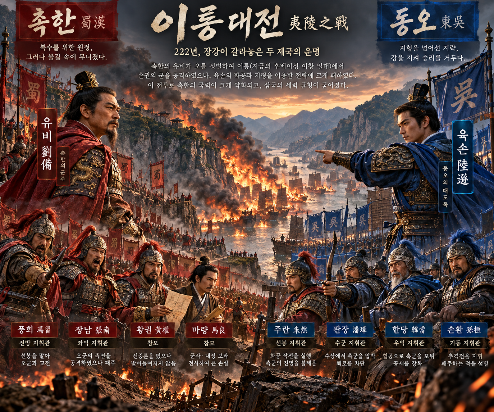

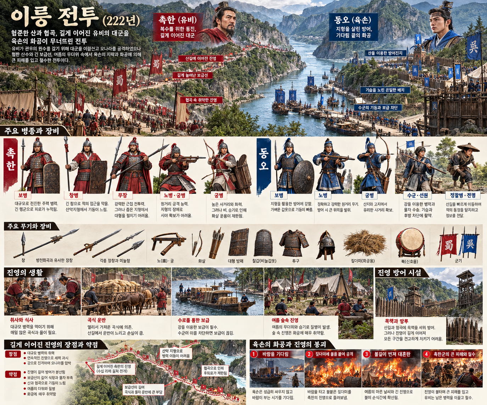

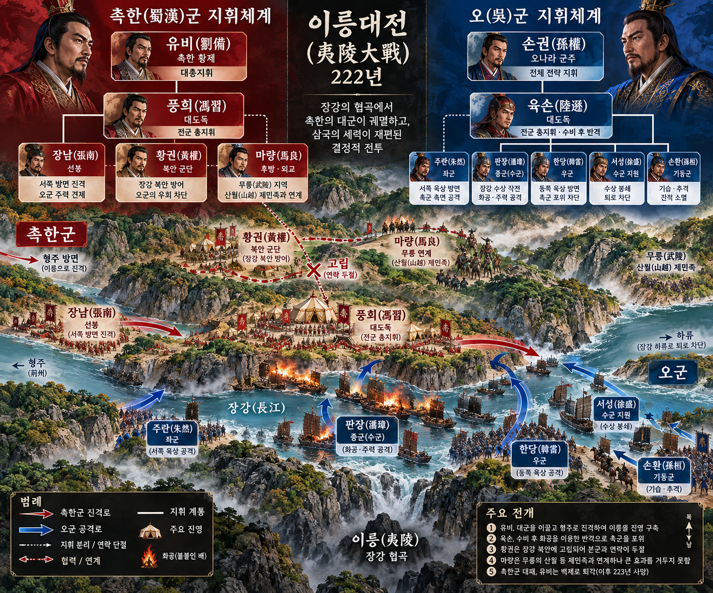

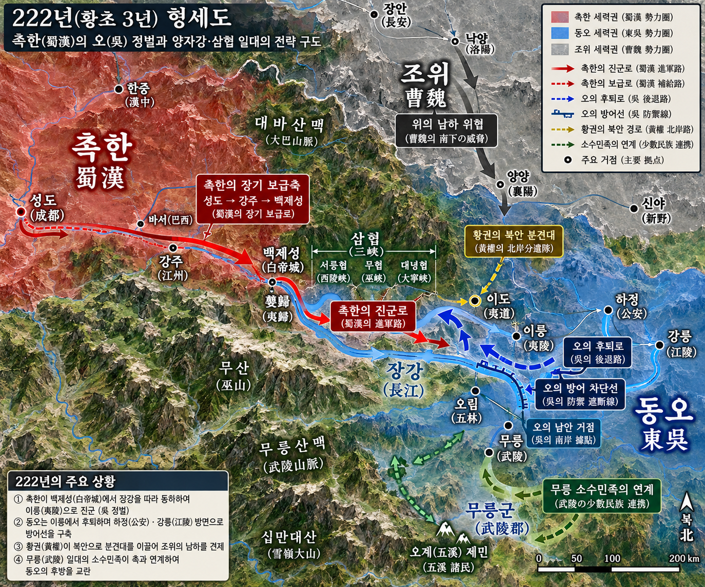

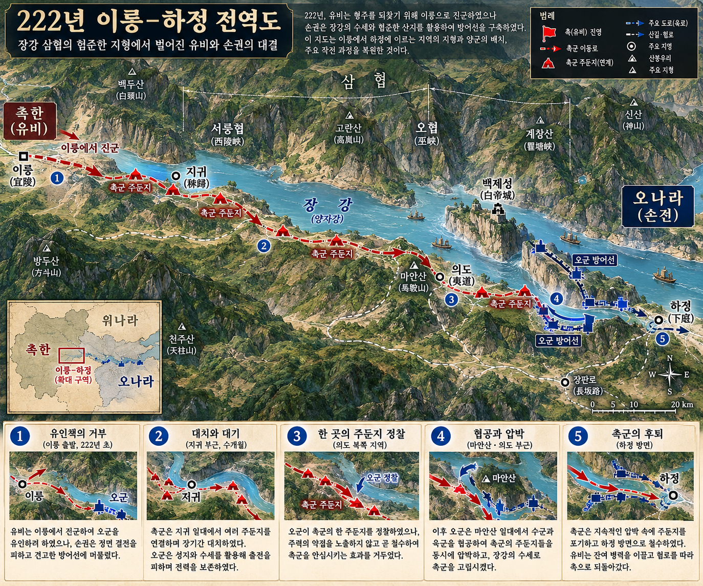

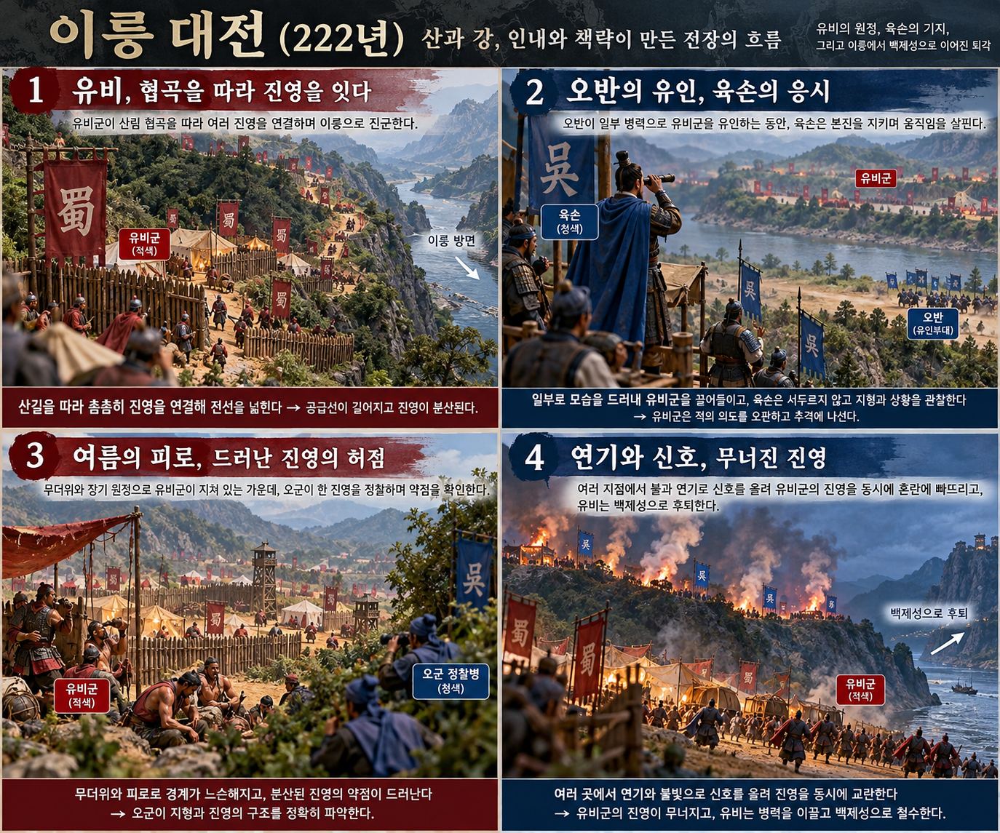

**육손(陸遜)**은 **유비(劉備)**가 평지의 소수 병력으로 유인했을 때 공격하지 않았다. 매복이 드러난 뒤에도 성급히 본공을 하지 않고 촉군의 장기 주둔과 피로를 기다렸다. 한 영채를 시험 공격해 수비와 가연성 조건을 확인한 뒤 병사들에게 띠 한 묶음씩을 들려 화공했고, 불이 연쇄 혼란을 만들자 여러 부대를 동시에 투입했다. 불이 만든 연쇄 붕괴를 확인한 뒤 여러 부대를 동시에 투입해 `因變而應`한 사례다.

**뒤에서 반복될 지형을 먼저 잡아두기**

- 🌊 **장강(長江)**은 촉한의 동진·보급 축이면서 남북 부대를 갈라놓은 장벽이다. 강북의 **황권**군은 퇴로가 끊긴 뒤 본대와 합류하지 못했다.
- ⛰️ **삼협(三峽)**은 **유비**의 진군로를 길고 좁게 만들었다. 영채가 길게 늘어서자 상호 지원과 명령 전달이 약해졌다.
- **▰** **자귀(秭歸)**는 촉한군이 전진하면서 확보한 서쪽 거점이고, 패전 뒤 퇴로의 중간축이었다.
- **▰** **이도(夷道)**·**▰** **효정(猇亭)**은 오군의 방어와 촉군의 전진이 맞물린 핵심 구간이다.
- ⛰️ **마안산(馬鞍山)**은 패전 뒤 **유비**가 병력을 모아 마지막 저항을 시도한 고지다.
- **▰** **백제성(白帝城)**은 **유비**가 야간 퇴각 끝에 들어간 서쪽 종착점이다.

#### 상세 전역 서사 — 유인에는 멈추고, 연쇄 붕괴에는 전군을 잇다

221년부터 촉한군이 장강 협곡을 따라 동진하자 동오의 여러 장수는 초기에 맞서 싸우자고 요구했다. **육손**은 촉군의 기세와 험준한 진군축을 보고 물러나 지키며 전선을 압축했다. **유비**는 **오반**에게 평지에 약한 병력처럼 보이는 진을 치게 하고 골짜기에 복병을 숨겼지만, **육손**은 진형이 수상하다며 공격을 금했다. 매복이 철수하자 오군은 함정을 확인했다. 장기 대치 속에서 촉군 영채는 산림과 장강을 따라 길게 늘어났고 병사들의 피로와 지휘 간격이 커졌다. **육손**은 한 영채를 공격해 즉시 성과를 내지 못했지만 수비 구조를 파악한 뒤 화공으로 전환했다. 불길이 각 영채의 연결을 끊자 **주연·반장·한당** 등이 동시에 공격했고, 촉군은 영채별로 고립됐다.

#### 전투에서 사용된 속임수 — 평지의 미끼를 거절하고 기다림을 약세로 보이다

먼저 속이려 한 쪽은 촉한군이었다. **유비**는 **오반**의 소수 부대를 평지에 보이고 골짜기에 복병을 숨겼다. **육손**은 보인 병력이 지나치게 작고 위치가 부자연스럽다는 점을 근거로 반응하지 않았다. 이후 오군의 장기 방어는 촉한 측에 소극성처럼 보였지만, 실제로는 촉군의 기세가 떨어지고 영채가 가연성 산림에 길게 고정되기를 기다리는 시간이었다. 사료가 허용하는 범위에서 이는 거짓말보다 **반응을 보류해 상대의 배치가 스스로 약점을 만들게 한 조건 설계**에 가깝다.

#### 속임수 작동 구조

**주체와 의도.** **유비**는 약한 전초를 보여 오군을 골짜기 복병 앞으로 끌어내려 했다. **육손**은 이 미끼에 반응하지 않고 촉군의 장기 주둔을 유도했다.

**보인 신호와 믿은 이유.** 평지의 소수 병력은 쉬운 목표처럼 보였지만, **육손**은 그 부자연스러움을 함정 신호로 읽었다. 반대로 오래 싸우지 않는 오군은 촉군에 약세로 보일 수 있었다.

**유발된 행동과 결과.** 복병이 성과 없이 철수했고 촉군은 긴 영채선에 머물렀다. 오군은 조건이 익은 뒤 화공과 동시 공격으로 연결부를 무너뜨렸다.

**사료의 경계.** 오군이 약한 척했다는 내면 의도를 모든 기록이 똑같이 증명하는 것은 아니다. 분명한 것은 **육손**이 유인을 간파해 공격하지 않았고, 시간이 지난 뒤 공격 조건이 바뀌었다고 판단했다는 사실이다.

#### 속임수 일곱 질문

1. **누가 누구를 속였는가?** **유비**가 **육손**을 평지 미끼와 골짜기 복병으로 끌어내려 했다.
2. **어떤 사실이 거짓이었는가?** 평지 부대가 고립된 쉬운 목표라는 인상이 거짓이었다.
3. **어떤 사실은 진실이지만 오해를 유도했는가?** **오반**의 병력이 실제로 적었지만 뒤에는 복병이 있었다.
4. **상대는 왜 그것을 믿고 싶어 했는가?** 오군 장수들은 긴 방어 뒤 눈앞의 작은 승리로 주도권을 되찾고 싶어 했다.
5. **속임수가 없었어도 같은 오판이 발생했을까?** 가능성은 중간이다. 장수들의 조급함은 남았겠지만 부자연스러운 미끼가 없었다면 특정 출격 요구는 약했을 것이다.
6. **속은 사람은 어떤 독립 확인을 생략했는가?** **육손**은 생략하지 않고 주변 골짜기와 병력 비례를 판단해 공격을 보류했다.
7. **신뢰·동의·안전을 해치지 않으면서 같은 원리를 어디서 연습할 수 있는가?** 바둑·체스와 동의된 모의훈련에서 쉬워 보이는 목표 뒤의 예비 전력을 확인하는 습관을 연습할 수 있다.

#### 시계편 兵者詭道也 — 이 전장에 해당하는 속이는 길
<table fit-page-width="true" header-row="true">
<tr><td>해당 구절·독음·뜻</td><td>전장의 장면</td></tr>
<tr><td>利而誘之 이이유지 — 이익으로 유인한다</td><td>**유비**가 평지의 소수 병력을 쉬운 전과처럼 보이게 했다.</td></tr>
<tr><td>佚而勞之 일이노지 — 쉬는 적을 지치게 한다</td><td>오군은 방어선을 압축하고 촉군이 긴 영채선에서 피로해지도록 기다렸다.</td></tr>
</table>

#### 法 한눈 비교 — 곡제·관도·주용
<table fit-page-width="true" header-row="true">
<tr><td>진영</td><td>곡제(편제)</td><td>관도(지휘)</td><td>주용(보급·지속)</td></tr>
<tr><td>**동오군(승)**</td><td>수륙 부대와 여러 장군을 방어 뒤 동시 공격으로 묶었다.</td><td>**육손**이 조급한 출격 요구를 억제하고 전환 시점을 통일했다.</td><td>짧아진 방어선과 장강 수로로 지속 능력을 유지했다.</td></tr>
<tr><td>**촉한군(패)**</td><td>강 남북과 긴 영채선으로 병력이 분리됐다.</td><td>**유비** 중심 지휘가 장거리 영채와 분견대에 늦게 전달됐다.</td><td>협곡의 긴 보급축과 여름 주둔이 병력·물자를 소모했다.</td></tr>
</table>

〈**유비의 촉한군 (패)**〉
<table fit-page-width="true" header-row="true">
<tr><td>요소</td><td>판단</td></tr>
<tr><td color="orange_bg">🤝 **道**</td><td>초기 기세는 높았지만 장기 대치와 영채 고립으로 상호 지원과 사기가 약해졌다. (결속·사기)</td></tr>
<tr><td color="blue_bg">🌤️ **天**</td><td>오군이 끝내 나오리라는 기대를 고정하고 장기 주둔의 피로와 화재 위험이 커질 확률을 낮게 보았다. (지피·타이밍·확률 관점)</td></tr>
<tr><td color="green_bg">🧭 **地**</td><td>장강·산림·협곡을 따라 늘어진 영채는 불과 차단에 취약했고 강북군과 분리됐다. (원근·험이·광협·사생)</td></tr>
<tr><td color="purple_bg">🎖️ **將**</td><td>**유비**는 유인 실패 뒤에도 전선을 압축하거나 수륙 연결을 재편하지 못했다. (지신인용엄)</td></tr>
<tr><td color="yellow_bg">⚙️ **法**</td><td>영채 수는 많았지만 각 영채의 예비·연락·소방·퇴로가 하나의 체계로 묶이지 않았다. (곡제·관도·주용)</td></tr>
</table>

**직관·편향 한 줄:** **유비**가 오군의 장기 방어를 소극성으로 해석하고 자신의 전진 성과에 기준점을 둔 판단에는 확증편향과 매몰비용이 작동한 것으로 볼 수 있으며, 이는 영채선 축소를 늦췄다.

🏳️ **패군 측 결과**
<table fit-page-width="true" header-row="true">
<tr><td>구분</td><td>판정</td></tr>
<tr><td color="red">⚔️ **전투 결과**</td><td>촉한군은 40여 영채가 무너지고 주요 지휘관을 잃었으며 **유비**는 백제성으로 철수했다. 六敗 중 `北`(배, 적을 헤아리지 못해 약점으로 강자를 맞음)에 가깝다.</td></tr>
<tr><td color="orange">🔀 **패군 측 회피 분기점**</td><td>유인 실패 뒤 영채를 좁은 수로 거점 중심으로 압축하고 강북·강남 부대의 연락과 소방 예비대를 재편했다면 연쇄 붕괴와 완패는 줄일 수 있었다.</td></tr>
</table>

〈**육손의 동오군 (승)**〉
<table fit-page-width="true" header-row="true">
<tr><td>요소</td><td>판단</td></tr>
<tr><td color="orange_bg">🤝 **道**</td><td>초기 불만이 있던 제장들을 총지휘 판단에 묶고 공격 전환 때 동시에 움직이게 했다. (결속·사기)</td></tr>
<tr><td color="blue_bg">🌤️ **天**</td><td>유인에는 반응하지 않고 촉군의 피로·영채 고정·가연성 조건이 겹칠 때 공격했다. 성공을 필연으로 보지 않고 한 영채를 시험해 확률을 높였다. (지피·타이밍·확률 관점)</td></tr>
<tr><td color="green_bg">🧭 **地**</td><td>방어선을 압축해 장강 수로와 협곡 병목을 활용하고 촉군의 긴 축을 여러 조각으로 끊었다. (원근·험이·광협·사생)</td></tr>
<tr><td color="purple_bg">🎖️ **將**</td><td>**육손**은 기다릴 때와 전군을 잇는 때를 구분하고 제장의 반대를 견뎠다. (지신인용엄)</td></tr>
<tr><td color="yellow_bg">⚙️ **法**</td><td>정찰 공격·화공조·수륙 차단·동시 본공을 단계별로 연결했다. (곡제·관도·주용)</td></tr>
</table>

🏆 **승군 측 결과**
<table fit-page-width="true" header-row="true">
<tr><td>구분</td><td>판정</td></tr>
<tr><td color="blue">⚔️ **전투 결과**</td><td>동오군은 서부 국경의 대규모 침공을 격퇴했다. 五勝 중 `知可以戰與不可以戰者勝`(지가이전여불가이전자승, 싸울 때와 싸우지 않을 때를 아는 자가 이긴다)에 해당한다.</td></tr>
</table>

##### 法을 압축하지 않고 보기 — 곡제·관도·주용

**곡제 曲制(곡제): 부대를 어떻게 나누고 결합했는가**
<table fit-page-width="true" header-row="true">
<tr><td>진영</td><td>실제 운용</td></tr>
<tr><td>**동오군**</td><td>**육손**의 총지휘 아래 **주연**은 퇴로 차단, **반장·한당** 등은 전면과 측면 공격을 맡았다.</td></tr>
<tr><td>**촉한군**</td><td>**풍습·장남**의 전방, **황권**의 강북군, **마량**의 무릉 연결이 넓게 갈라져 있었다.</td></tr>
</table>

**관도 官道(관도): 누가 명령하고 어떻게 전달했는가**
<table fit-page-width="true" header-row="true">
<tr><td>진영</td><td>실제 운용</td></tr>
<tr><td>**동오군**</td><td>**육손**이 출격을 통제하다가 공격 시점을 정해 여러 장군에게 동시 명령을 내렸다.</td></tr>
<tr><td>**촉한군**</td><td>**유비**의 본영과 긴 영채선·강북 분견대 사이에서 보고와 지원이 지형 때문에 늦었다.</td></tr>
</table>

**주용 主用(주용): 군량·장비·전투 지속 능력을 어떻게 썼는가**
<table fit-page-width="true" header-row="true">
<tr><td>진영</td><td>실제 운용</td></tr>
<tr><td>**동오군**</td><td>장강 수운과 짧은 방어축으로 식량·화공 재료·예비 병력을 집중했고 각 병사에게 띠 한 묶음을 들려 화공을 분산 실행했다.</td></tr>
<tr><td>**촉한군**</td><td>서쪽에서 이어진 긴 보급로와 여름 산림 영채가 식수·식량·소방·연락 부담을 키웠고 선박·장비도 패전 때 대량 상실했다.</td></tr>
</table>

#### 참고자료

- [영국 의회 Armada Tapestries — English Fireships Dislodge the Spanish Fleet Before Calais](https://armada.parliament.uk/english-fireships-dislodge-the-spanish-fleet-before-calais.html)
- [영국 국립문서보관소 — Spanish Armada 교육 사료집](https://cdn.nationalarchives.gov.uk/documents/education/spanish-armada.pdf)
- [National Museum of the Royal Navy — Armada Map 9](https://armadamaps.nmrn.org.uk/the-maps/map-9/)
- [중국사회과학망 — 三国战争中的夷陵](https://www.cssn.cn/lsx/lsx_zgs/202210/t20221024_5552501.shtml)
- [香港电台 역사강의 — 夷陵之戰](https://www.rthk.hk/oldassets/files/extra_file/20250415160911_295765930.pdf)

---
## 5. 핵심 통찰 + 실생활 적용 + 생활루틴

### 핵심 통찰

이 구절의 핵심은 강한 수단보다 **닫힌 고리의 지휘**다. 불을 놓는 것은 입력이고, 적진의 變은 피드백이며, 병력의 應은 조정된 출력이다. 입력만 있고 피드백이 없으면 작전은 자기만족이 된다. 반대로 변화만 구경하고 후속 행동을 준비하지 않으면 기회는 사라진다.

그래서 ‘대응력’은 즉흥성과 다르다. 즉흥은 기준 없이 그때그때 흔들리는 것이고, 응변은 무엇을 볼지와 어느 신호에 어떻게 움직일지를 미리 준비한 뒤 현실에 맞춰 분기하는 것이다. 화공편의 사전 준비와 이 구절의 변화 대응은 서로 반대가 아니라 한 쌍이다.

### 실생활 적용

3교대 현장에서 에러 조치를 했다고 곧 해결로 기록하면 재발 위험이 남는다. 버튼을 눌렀는지, 재부팅했는지보다 알람이 사라졌는지, 공정값이 정상 범위로 돌아왔는지, 후속 교대가 같은 상태를 확인했는지가 變이다. 조치 전에는 정상화 지표·악화 지표·상위 보고 기준을 한 줄씩 정하고, 조치 뒤에는 실제 값에 따라 감시·추가 조치·중단·인계를 고른다.

팀 갈등에서도 강한 말을 했다는 사실과 문제가 해결됐다는 사실을 분리해야 한다. 상대가 잠시 조용해졌더라도 업무 정보가 더 숨겨지고 협력이 줄었다면 원하는 변화가 아니다. 공개 추궁보다 사실·요청·기한을 짧게 말하고, 이후 행동 변화를 관찰한다. 변화가 없으면 같은 압박을 키우지 말고 조장 입회·업무 기록·역할 재조정처럼 수단을 바꾼다.

개인 루틴에서도 운동·공부·수면 계획을 ‘했다/안 했다’로만 세지 않는다. 운동 뒤 통증과 회복, 공부 뒤 회상률, 수면 조정 뒤 근무 중 졸림처럼 목적에 가까운 지표를 하나 둔다. 노력의 크기를 성과로 착각하지 않고, 작은 조치라도 원하는 변화가 나면 이어 가며 큰 조치라도 악화되면 멈춘다.

### 생활루틴

중요한 행동을 시작하기 전 2분 동안 메모에 네 줄을 쓴다.

- `火`: 지금 실행할 행동 한 가지
- `變`: 행동 뒤 확인할 변화 두 가지
- `應`: 좋아질 때 이어 갈 행동과 나빠질 때 멈출 행동
- `時`: 다시 확인할 정확한 시각

확인 시각이 오면 노력한 양을 변명하지 말고 지표만 본다. 기대한 변화가 있으면 다음 단계를 진행하고, 변화가 없으면 대기하거나 수단을 바꾸며, 악화 신호가 있으면 즉시 중지·보고한다.

**한 줄 기억법:** 조치만 하고 변화를 확인하지 않으면 재수가 없다.
