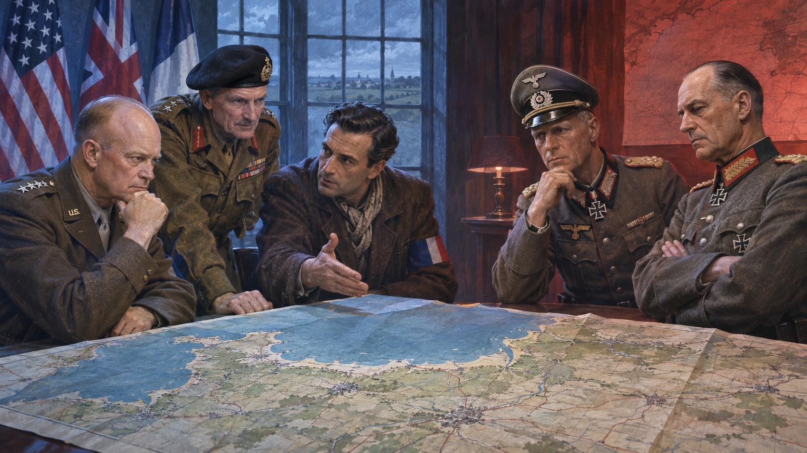
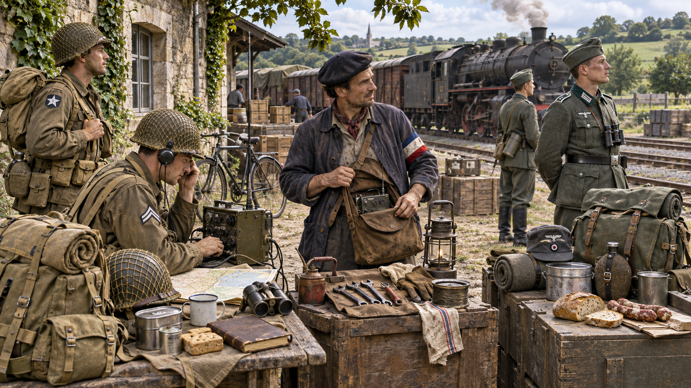
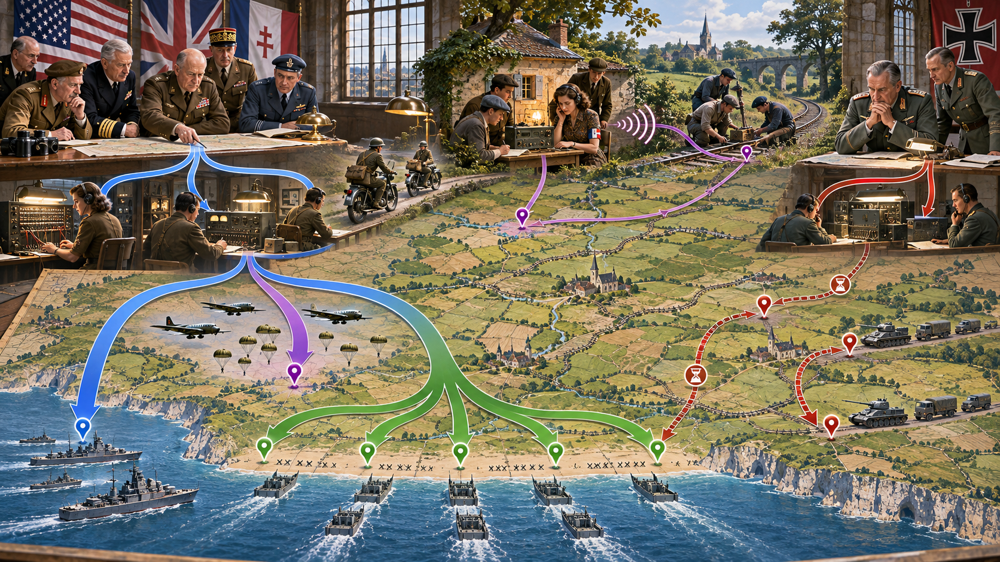
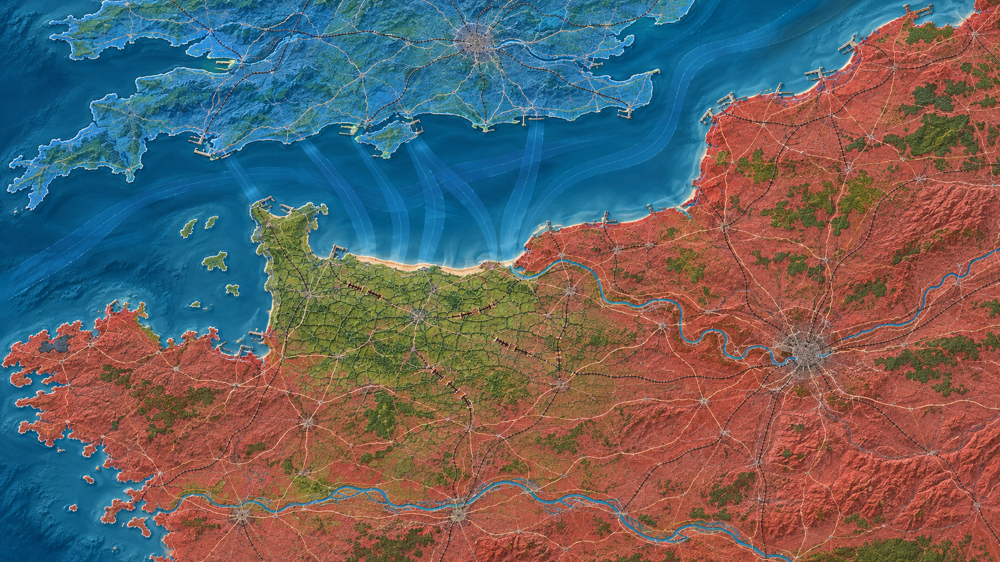
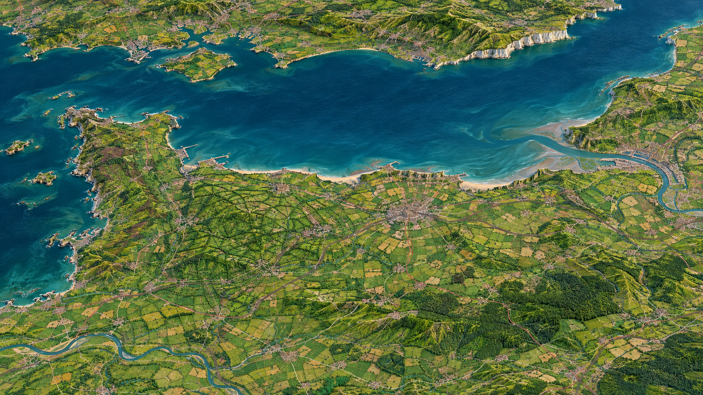
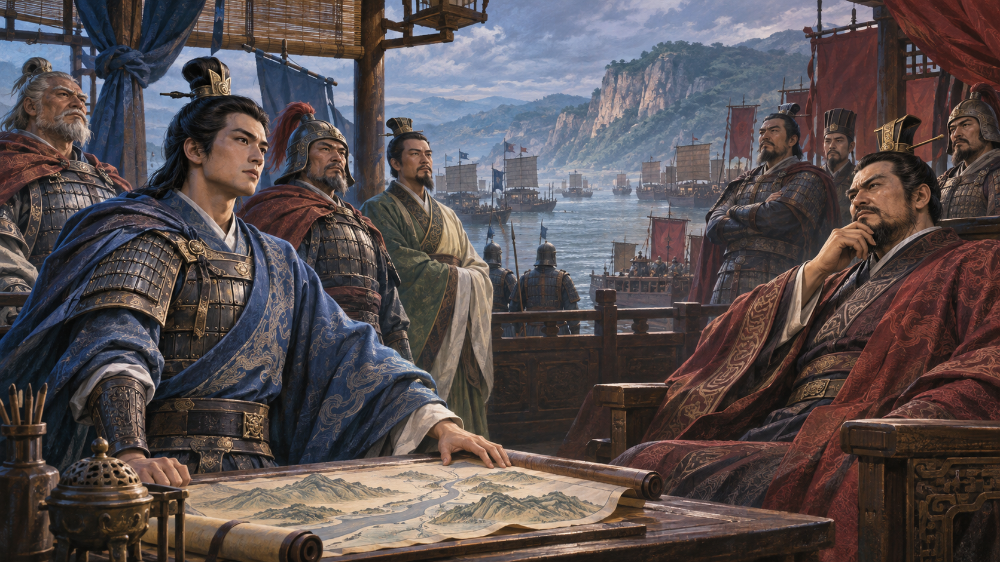
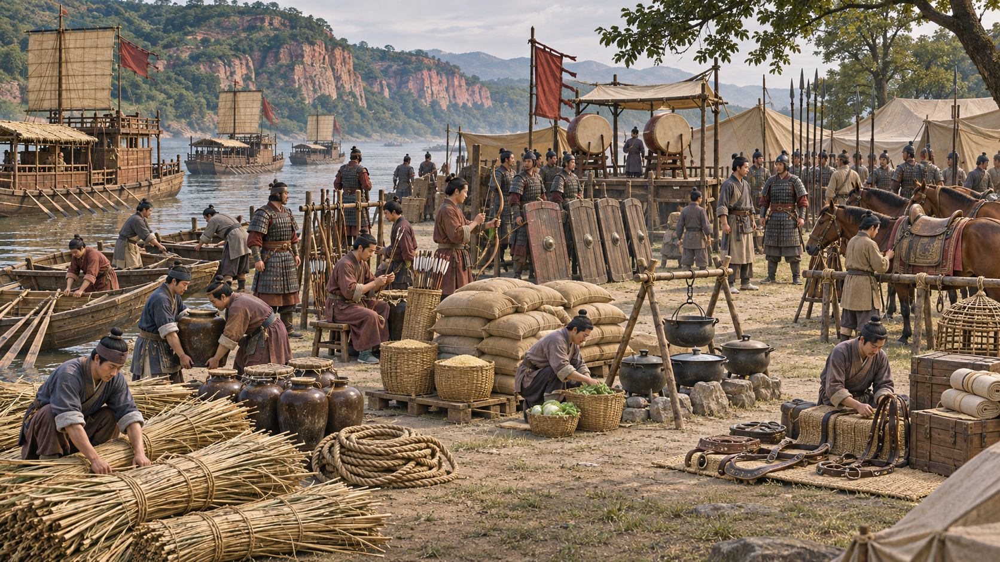
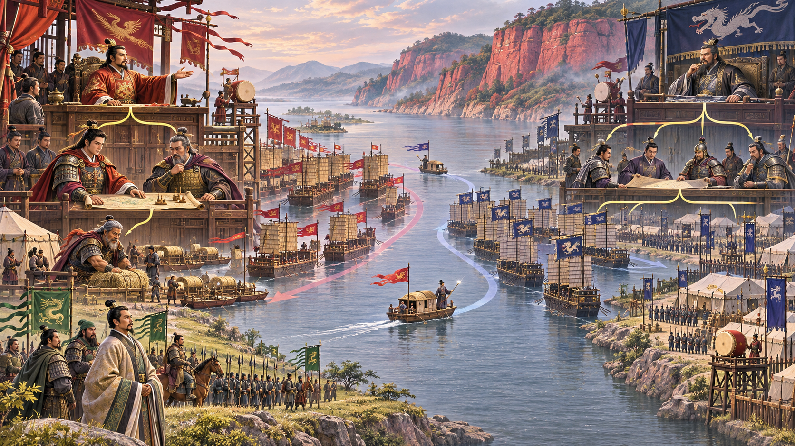
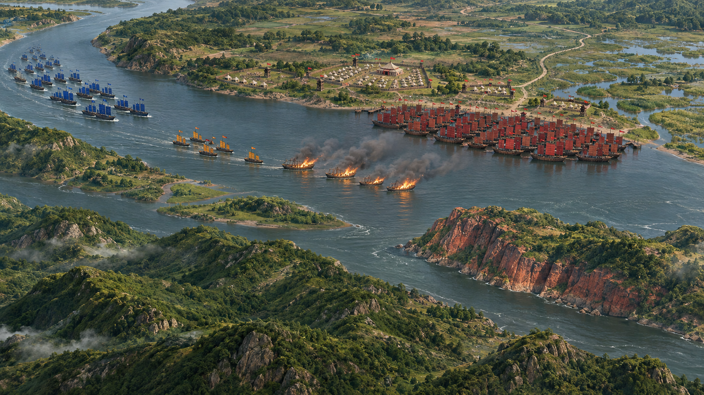
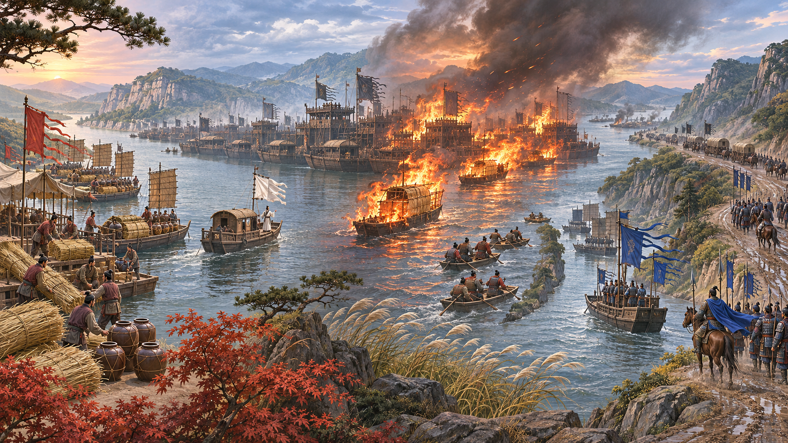

<!-- sunzi-analysis-mode: full -->
> 화발어내, 즉조응지어외. — 안에서 생긴 틈은 신호일 뿐이다. 밖의 준비가 제때 맞물려야 기회가 성과가 된다.

---
## 1. 원문 + 독음 + 직역 + 한자어 뜻풀이

火發於內, 則早應之於外. 화발어내, 즉조응지어외.

	**직역**

	불이 안에서 일어나면, 곧 밖에서 일찍 호응한다.

	앞 구절은 다섯 화공이 만든 변화에 맞춰 대응하라는 총칙을 세웠다. 이 문장은 그 첫 분기다. 적진 내부의 불은 그 자체로 승리가 아니라, 내부 공작과 외부 군대가 맞물려야 할 신호다. 너무 늦으면 적이 불을 끄고 대오를 수습하며, 너무 이르면 내응의 준비를 깨뜨릴 수 있다. 그래서 **早**는 무턱대고 서두르라는 말이 아니라, 확인된 신호에 지체 없이 응할 수 있도록 바깥 병력을 미리 준비하라는 말이다.

	#### 火發於內(화발어내) — 내부의 불이 적의 질서를 흔드는 순간

	**火**(불 화)는 불꽃이 타오르는 모양을 본뜬 글자이고, **發**(필 발)은 묶였던 힘이 풀려 밖으로 나가는 뜻을 품는다. **內**(안 내)는 경계 안쪽, 곧 적의 영채·창고·수송 체계 안을 가리킨다. `火發於內`는 단순한 화재가 아니라 적이 통제한다고 믿던 내부에서 불이 일어나 지휘·경계·대오가 동시에 흔들릴 수 있는 사건이다.

	#### 則(즉) — 관측된 조건과 행동을 잇는 문턱

	**則**(법칙 칙, 곧 즉)은 앞 조건이 성립했을 때 뒤 행동이 뒤따름을 표시한다. 여기에는 순서가 있다. 안의 불을 확인하기도 전에 공격하는 것이 아니라, 발화라는 조건이 나타났을 때 준비해 둔 외부 행동으로 넘어간다. 그렇다고 불만 보이면 언제나 돌격한다는 뜻도 아니다. 바로 다음 구절은 불이 나도 적병이 고요하면 기다리라고 제한한다. 則은 자동 명령이 아니라 첫 판단 문턱이다.

	#### 早應之於外(조응지어외) — 기회의 창이 닫히기 전에 밖에서 맞춘다

	**早**(이를 조)는 해가 풀 위로 올라오는 모습을 담아 때를 놓치지 않은 이른 시점을 뜻한다. **應**(응할 응)은 부름에 답하고 조건에 맞춰 움직이는 일이며, **之**(갈 지)는 안에서 일어난 불과 그로 인한 변화를 받는다. **外**(바깥 외)는 적진 밖에 대기하는 아군의 자리다. 밖의 군대는 내부의 불이 만든 혼란을 이용해 출구를 막고, 구원로를 끊고, 필요한 방향에서 압박한다. 핵심은 불의 크기가 아니라 안과 밖의 시간표가 맞는가에 있다.

	#### 글자들이 완성하는 한 장면

	적진 안에서 약속된 불이 오른다. 밖의 장수는 불꽃에 취해 전군을 내던지지 않는다. 신호가 맞는지, 적의 대오가 실제로 흔들리는지, 아군의 진입로가 열렸는지 확인한다. 조건이 맞으면 이미 배치해 둔 병력을 지체 없이 움직여 안의 혼란과 밖의 압박을 하나의 작전으로 만든다. **내부의 기회는 외부의 준비가 제때 응할 때만 전과가 된다.**

---
## 2. 전통 주석 기반 분석

- **조조(曹操)** — “안에서 불을 놓으면 **밖의 군대가 일찍 호응하라.** 내응이 만든 틈을 적이 수습하기 전에 병력으로 받아 써라.”
- **이전(李筌)** — “간자가 안에서 불을 내는 때와 군대가 밖에서 움직이는 때를 맞춰라. **안팎이 어긋나면 불은 고립되고 기회는 사라진다.**”
- **두목(杜牧)** — “불로 적을 놀라게 한 뒤 밖에서 공격해야 한다. 불만 믿지 말고, **적의 혼란이 아직 가라앉기 전에 군대가 이어 쳐라.**”
- **매요신(梅堯臣)** — “안의 불에 밖의 병력으로 응한다. **내부의 변화와 외부의 공격을 서로 떨어진 두 일이 아니라 한 작전으로 묶어라.**”
- **장예(張預)** — “적진 안에서 불이 나면 밖에서 급히 공격해 구원과 수습의 여유를 빼앗아라. 다만 **뒤 문장의 적병이 고요한 경우까지 살펴 성급함을 경계하라.**”
- **왕석(王晳)** — “早는 때를 잃지 말라는 뜻이다. 불꽃만 보고 서두르는 것이 아니라, **변화가 드러난 짧은 틈에 맞춰 움직여라.**”
- **가림(賈林)** — “안에서 변란이 일어나면 밖에서 그 편리를 타라. **이미 얻은 형세를 버려 둔 채 새 방법을 찾느라 지체하지 마라.**”
- **두우(杜佑)** — “내응에게 방화의 시각과 표적을 주고 외군에는 호응할 신호와 길을 정하라. **약속이 없으면 같은 불을 보고도 부대마다 다르게 움직인다.**”
- **진호(陳皞)** — “內와 外는 서로 기대어 성립한다. 안의 불이 밖의 공격을 부르고, **밖의 압박이 안의 혼란을 회복하기 어렵게 만든다.**”

#### 주석가들의 차이와 보완

조조·매요신·진호는 문장의 뼈대를 내화와 외병의 호응으로 잡는다. 이전과 두우는 그 호응이 우연히 생기지 않으며 간자·신호·시각·진입로를 미리 맞춰야 한다고 보완한다. 두목·가림은 혼란을 실제 전과로 바꾸는 공격을 강조하고, 왕석·장예는 `早`를 맹목적 속도로 오독하지 않도록 뒤의 `火發而其兵靜者, 待而勿攻`(화발이기병정자, 대이물공 — 불이 나도 적병이 고요하면 기다리고 공격하지 않는다)과 함께 읽는다.

따라서 주석의 공통 결론은 단순히 “불이 보이면 돌격하라”가 아니다. **안에서 발생한 신호를 확인하고, 적의 실제 변화를 판별하며, 미리 준비된 외부 병력을 기회의 시간 안에 움직이라**는 세 단계다. 빠름은 준비를 생략하는 성급함이 아니라 준비 덕분에 가능한 지체 없음이다.

#### 리링의 고증과 현대적 독법

리링(李零)의 해설 취지에 따라 문장 구조를 보면, 이 구절은 앞의 총칙 `必因五火之變而應之`(필인오화지변이응지 — 반드시 다섯 화공의 변화에 따라 대응한다)를 첫 상황문으로 풀어 쓴다. `火發於內`가 관측 조건이고 `早應之於外`가 조건부 행동이다. 판본 차이가 확인되지 않는 곳에서 별도의 이문을 만들 이유는 없다.

또한 內를 개인의 마음속 불 같은 비유로 곧장 옮기면 군사제도의 핵심이 사라진다. 고대 화공에서 내부 발화는 간자나 잠입 인력, 표적 정보, 외부 군대의 배치가 결합된 조직 행동이다. 현대 적용도 “내적 동기”보다 **현장 신호와 지원 체계의 결합**을 먼저 복원한 뒤 확장해야 한다.

---
## 3. 교차 설명

### ① 손자병법 내 교차

앞 구절 `凡火攻, 必因五火之變而應之`(범화공, 필인오화지변이응지 — 모든 화공은 다섯 화공의 변화에 따라 대응한다)는 총칙이고, 이 문장은 그 첫 분기다. 이어지는 `火發而其兵靜者, 待而勿攻`(화발이기병정자, 대이물공 — 불이 나도 적병이 고요하면 기다리고 공격하지 않는다)은 첫 분기에 제동을 건다. 따라서 `早`는 빠를수록 좋다는 절대 명령이 아니라, 혼란이 확인된 경우의 제한된 기회다.

「용간편」의 `因間而得者, 因間而知之`(인간이득자, 인간이지지 — 간첩으로 얻은 일은 간첩을 통해 알아낸다)는 안의 신호가 신뢰할 수 있는 정보망을 필요로 함을 보여 준다. 내응의 불이 약속된 것인지 우발 화재인지 구별하지 못하면 밖의 군대는 적의 유인에 걸릴 수 있다.

「군쟁편」의 `三軍可奪氣, 將軍可奪心`(삼군가탈기, 장군가탈심 — 삼군의 기세를 빼앗고 장수의 마음을 빼앗을 수 있다)은 호응의 목적을 설명한다. 안의 불이 만든 놀람이 가라앉기 전에 밖의 압박이 더해지면 적은 질서를 회복할 시간과 지휘관의 판단 여유를 함께 잃는다.

### ② 클라우제비츠 『전쟁론』

클라우제비츠가 말한 전쟁의 마찰은 계획된 동시 행동이 실제 현장에서 쉽게 어긋난다는 사실을 일깨운다. 내부 공작과 외부 공격을 같은 시각에 맞추려 해도 전달 지연, 오인, 날씨, 적의 대응이 틈을 만든다. 그러므로 장수는 단일 시각표만 갖는 것이 아니라 확인 신호, 지연 시 행동, 중지 조건을 준비해야 한다.

차이는 이 문장이 짧은 전술적 기회의 이용을 말하는 반면, 『전쟁론』은 전투·전역·정치 목적의 더 넓은 층위를 다룬다는 데 있다. 그래도 둘은 국지적 성공을 목적과 혼동하지 않는다. 안에서 불이 났다는 사건은 외부 군대가 이용할 수 있는 조건일 뿐이며, 그 조건이 작전 목적에 기여할 때만 의미가 있다.

### ③ 미야모토 무사시 『오륜서』

『오륜서』는 상대가 무너지는 `拍子`(효시 — 박자)를 알아차리고 그 틈을 놓치지 않는 일을 중시한다. 상대가 놀란 뒤 다시 자세를 잡기 전까지의 간격은 짧다. `早應`은 바로 그 간격에 내 동작을 맞추는 판단과 통한다.

하지만 박자를 탄다는 말은 조급하게 먼저 치라는 뜻이 아니다. 무사시가 상대의 상태를 읽고 박자를 바꾸라고 한 것처럼, 적이 고요하고 대오가 유지되면 같은 불도 함정일 수 있다. 빠른 호응과 기다림은 모순이 아니라 관측된 상태에 따른 서로 다른 박자다.

### ④ 오자병법과 육도

『오자병법』은 적이 진영을 막 세워 질서가 잡히지 않았거나 병력이 놀라고 흩어진 순간을 공격 기회로 본다. 핵심은 사건 자체가 아니라 적이 아직 질서를 회복하지 못했다는 상태다. 내부 화재가 그 상태를 만들었다면 밖의 공격은 회복 시간을 빼앗는다.

『육도』가 기치·북·명령 체계를 강조하는 까닭도 여러 부대의 행동을 한 시점에 결합하기 위해서다. 내부 신호를 본 선봉, 차단대, 예비대가 각자 돌격하면 호응이 아니라 분산이 된다. 누가 진입하고 누가 출구를 막으며 누가 예비로 남는지 미리 정해야 `內`와 `外`가 하나의 힘이 된다.

### ⑤ 현대 심리학·군사학

현대의 고신뢰 조직은 현장 이상 신호가 들어왔을 때 보고만 받는 데서 끝나지 않고, 미리 정한 대응 팀과 의사결정권을 연결한다. 탐지 시간과 대응 시간은 다르다. 센서가 빨라도 담당자가 불명확하거나 승인 경로가 길면 기회의 창은 닫힌다. 그래서 신호의 출처·확인 방법·초기 조치·중지 권한을 사전에 정한다.

카너먼이 설명한 행동편향은 불안한 상황에서 무엇이든 빨리 해야 한다는 충동을 키운다. 큰 경보를 보면 행동 자체가 통제감을 주기 때문에 조건 확인 없이 개입하기 쉽다. 반대로 정상성 편향은 내부의 작은 신호를 평소 잡음으로 치부해 호응을 늦춘다. 두 오류를 함께 줄이려면 “어떤 신호가 오면 무엇을 확인하고, 누가 어느 범위까지 움직이는가”를 사전에 문장으로 정해야 한다.

공유된 상황 인식도 중요하다. 한 사람만 내부 이상을 알아차리고 외부 지원자는 다른 상황을 상상하면 협업이 어긋난다. 짧은 복명복창으로 사건·위치·영향·요청을 확인하고, 지원자는 받은 내용을 되풀이해 같은 장면을 보고 있음을 검증해야 한다. **빠른 대응은 개인의 순발력이 아니라 신호와 역할을 공유한 조직의 산물이다.**

---
## 4. 역사적 실증 사례

이 구절은 불 자체보다 **안에서 생긴 교란과 밖의 주력이 맞물리는 시간표**를 묻는다. 서양 사례는 점령지 내부의 레지스탕스가 철도·통신을 끊는 동안 바다 건너 연합군이 상륙한 노르망디 전역이고, 동양 사례는 황개의 화선이 조조의 함대 안에 불을 옮긴 직후 주유의 수군이 뒤따라 압박한 적벽대전이다. 전자는 분산된 내부 교란이 외부 대작전의 시간을 벌어 준 사례이고, 후자는 한 전장 안에서 `火發於內(화발어내 — 불이 내부에서 일어남)`와 `應之於外(응지어외 — 밖에서 호응함)`이 연속 동작으로 결합된 사례다.

### 서양 — 연합국·프랑스 국내군 vs 🏛️ 나치 독일 │ 노르망디 상륙과 레지스탕스 교란(Operation Overlord, 1944)

#### 처음 읽는 사람을 위한 전역 안내

1944년 6월, **드와이트 아이젠하워(Dwight D. Eisenhower)**가 지휘한 연합군은 영국에서 🌊 **영국해협(English Channel)**을 건너 독일 점령하의 노르망디 해안에 상륙했다. 프랑스 레지스탕스는 외부 상륙군의 일부가 아니라 점령지 안에서 활동한 분산 조직이었다. 런던의 암호 방송과 연락망이 실행 시점을 알리면 철도·전화선·도로에서 교란을 일으켜 독일 증원군의 이동을 늦췄다. 바깥에서는 함대·항공·공수·상륙 부대가 같은 시간표에 맞춰 해안 교두보를 만들었다.

**뒤에서 반복될 지형을 먼저 잡아두기**

- 🌊 **영국해협(English Channel)**은 영국 집결지와 노르망디 해안을 잇는 외부 주력의 진입축이었다. 기상과 조석이 상륙 가능 시간을 제한했으므로 내부 교란의 날짜도 독립적으로 정할 수 없었다.
- **▰** **셰르부르(Cherbourg)**와 코탕탱 반도는 깊은 항구 확보와 서부 측면 보호를 위한 목표였다. 반도를 끊으면 독일군이 해안 방어대를 서로 지원하기 어려워졌다.
- **▰** **캉(Caen)** 평원은 동부 교두보와 기갑 기동의 관문이었다. 이곳에서 독일 기갑을 붙들어 두는 동안 서부의 미군이 보카주를 넘어 돌파할 시간을 벌었다.
- 🌊 **센강(Seine River)**과 🌊 **루아르강(Loire River)** 사이의 철도·교량망은 노르망디로 들어오는 증원로였다. 연합군 폭격과 내부 사보타주가 이 망을 동시에 끊어 전장을 고립시켰다.
- 🌲 **노르망디 보카주(Normandy bocage)**는 생울타리와 좁은 길이 이어진 지형이었다. 상륙 뒤 진격은 느렸지만, 같은 병목은 독일군의 증원과 지휘에도 마찰을 만들었다.

#### 상세 전역 서사 — 내부 교란을 상륙 시간표에 묶어 증원 속도를 늦추다

연합군은 상륙 당일의 해안 돌파만으로 독일군을 이길 수 없다고 보았다. **에르빈 롬멜(Erwin Rommel)**의 B집단군은 노르망디와 파드칼레에 병력을 두었고, 서부전구 총사령관 **게르트 폰 룬트슈테트(Gerd von Rundstedt)**의 예비대가 도로와 철도로 이동할 가능성이 있었다. 그래서 외부에서는 교량·철도 중심지를 공격하는 수송계획을 시행하고, 내부에서는 레지스탕스가 `Plan Vert`의 철도 교란과 `Plan Violet`의 통신 교란을 준비했다.

6월 초 런던 방송의 암호문이 대기와 실행을 알렸다. 모든 지역 조직이 같은 능력으로 움직인 것은 아니었고, 체포·통신 두절·폭약 부족도 있었다. 그럼에도 선로 절단과 전화선 파괴, 정보 제공은 독일군이 한 번에 온전한 철도망을 이용하는 것을 어렵게 했다. 미국 육군 공식 보고서는 D-Day 이전 공습으로 프랑스·벨기에 철도 운영 능력이 크게 줄었고, 센강 하류 교량 대부분이 끊겨 노르망디 전장이 제한된 통로에 의존하게 됐다고 기록한다.

밖에서는 6월 6일 공수부대가 해안 뒤 교량과 도로를 노리고, 7천 척이 넘는 함정이 상륙 부대를 실어 날랐다. 내부 교란이 상륙을 ‘대신’한 것은 아니다. 해군 수송, 제공권, 공병, 포병, 보급선이라는 압도적 외부 역량이 이미 준비돼 있었고, 레지스탕스의 역할은 적의 대응 속도와 정보 흐름을 흔들어 그 힘이 해안에 집중되는 시간을 줄이는 것이었다.

독일 지휘부는 파드칼레가 본공격일 수 있다는 기만과 지휘권 분산 속에서 예비대 투입을 늦췄다. 그러나 모든 지연을 레지스탕스 하나의 공으로 돌릴 수는 없다. 연합군 항공력, 파괴된 교량, 연료 부족, 주간 이동의 위험, 상급 지휘의 혼선이 함께 작동했다. 이 사례가 구절을 입증하는 지점은 **내부 사보타주가 보였기 때문에 외부군이 즉흥적으로 움직인 것**이 아니라, 상륙 시점과 내부 실행 신호를 미리 연결해 두었다는 데 있다.

#### 전투에서 사용된 속임수 — 파드칼레를 본공격처럼 보이게 한 포티튜드

연합군은 가짜 편제·무선 신호·이중간첩 보고로 파드칼레 위협을 유지했다. 실제 목표는 노르망디였지만, 독일군에게는 가장 짧은 해협과 대형 항구로 이어지는 파드칼레가 합리적인 상륙지로 보였다. 그 믿음은 노르망디 상륙 뒤에도 제15군 일부를 북쪽에 남기는 판단을 강화했다. 레지스탕스 교란은 이 전략 기만과 별개였지만, 두 작전은 독일군의 정보와 이동을 동시에 압박했다.

#### 속임수 작동 구조

**주체와 의도.** 연합군 최고사령부는 노르망디 상륙지와 시점을 숨기고 독일 예비대를 북쪽에 묶어 두려 했다.

**보인 신호와 믿은 이유.** 가상 부대와 무선 교신은 파드칼레의 지리적 개연성과 결합했다. 독일군이 이미 기대하던 장소였기 때문에 가짜 신호가 진짜 준비처럼 읽혔다.

**유발된 행동과 결과.** 독일군은 노르망디가 본공격인지 판단하는 동안 일부 전력을 즉시 옮기지 못했고, 파괴된 수송망은 뒤늦은 이동마저 느리게 만들었다.

**사료의 경계.** 상륙 성공을 포티튜드나 레지스탕스 하나로 환원할 수 없다. 해·공군력과 병참, 독일 지휘구조, 현장 전투가 함께 만든 결과다.

#### 속임수 일곱 질문

1. **누가 누구를 속였는가?** 연합군 정보기관과 이중간첩망이 독일 최고지휘부에 노르망디 외의 위협을 크게 보였다.
2. **어떤 사실이 거짓이었는가?** 파드칼레의 대규모 가상군과 임박한 본공격 신호가 거짓이었다.
3. **어떤 사실은 진실이지만 오해를 유도했는가?** 영국 남동부의 실제 집결과 폭격은 여러 상륙 가능지를 지지해 노르망디 하나로 판단하기 어렵게 했다.
4. **상대는 왜 그것을 믿고 싶어 했는가?** 파드칼레는 해협이 가장 좁고 독일로 가는 길이 짧아 기존 기대와 맞았다.
5. **속임수가 없었어도 같은 오판이 발생했을까?** 일부는 가능하지만, 상륙 뒤에도 북쪽 위협을 유지한 기간은 짧아졌을 가능성이 높다.
6. **속은 사람은 어떤 독립 확인을 생략했는가?** 상륙 규모·항공 엄호·해상 수송의 실제 집중을 기존 파드칼레 가설과 동등하게 갱신하지 못했다.
7. **신뢰·동의·안전을 해치지 않으면서 같은 원리를 어디서 연습할 수 있는가?** 보드게임이나 합의된 모의훈련에서 가상 축을 만들고 상대가 단일 시나리오에 고정되는지 점검할 수 있다.

#### 시계편 兵者詭道也 — 이 전장에 해당하는 속이는 길

<table fit-page-width="true" header-row="true">
<tr><td>해당 구절·독음·뜻</td><td>전장의 장면</td></tr>
<tr><td>近而示之遠 근이시지원 — 가까이 있으면서 멀리 있는 듯 보인다</td><td>노르망디에 실제 상륙 준비를 집중하면서 파드칼레의 가상군과 무선 신호를 더 큰 위협처럼 보였다.</td></tr>
<tr><td>攻其無備, 出其不意 공기무비, 출기불의 — 대비 없는 곳을 치고 뜻하지 않은 곳으로 나간다</td><td>독일군이 가장 강하게 기대한 파드칼레가 아니라 방어가 상대적으로 약한 노르망디에 대규모 상륙을 실행했다.</td></tr>
</table>

#### 法 한눈 비교 — 곡제·관도·주용

<table fit-page-width="true" header-row="true">
<tr><td>진영</td><td>곡제·관도·주용의 차이</td></tr>
<tr><td>**연합군·레지스탕스**</td><td>해·공·공수·상륙 부대와 내부 조직을 분리 운용하되 암호 방송과 연락장교로 시점을 결합했다. 영국의 대규모 집결과 해상 보급이 지속력을 보장했다.</td></tr>
<tr><td>**독일군**</td><td>서부전구·B집단군·각 군·기갑예비대의 권한이 갈렸고, 파괴된 철도·교량과 연료 부족이 현장 지휘의 선택지를 줄였다.</td></tr>
</table>

##### **롬멜·룬트슈테트 측(패군)**

<table fit-page-width="true" header-row="true">
<tr><td>요소</td><td>판단</td></tr>
<tr><td color="orange_bg">🤝 **道**</td><td>해안 방어의 필요에는 동의했지만 기갑예비대를 해안 가까이 둘지 중앙에 둘지 지휘부가 갈렸다. (지기·결속)</td></tr>
<tr><td color="blue_bg">🌤️ **天**</td><td>기상 악화를 상륙 불가로 읽은 판단과 파드칼레 기대가 노르망디의 시간창을 과소평가하게 했다. 여러 상륙 가능성의 확률을 새 증거로 갱신하지 못했다. (지피·타이밍·확률 관점)</td></tr>
<tr><td color="green_bg">🧭 **地**</td><td>해변·보카주·강 사이의 병목은 방어에 유리했지만 파괴된 철도와 교량 때문에 예비대가 그 지형에 제때 도달하지 못했다. (원근·험이·광협)</td></tr>
<tr><td color="purple_bg">🎖️ **將**</td><td>**롬멜**과 **룬트슈테트**의 전략적 견해 차이 위에 상급 승인 구조가 겹쳐 대응 속도가 늦어졌다. (지신인용엄)</td></tr>
<tr><td color="yellow_bg">⚙️ **法**</td><td>분산된 방어 편제와 훼손된 통신·수송망은 지역 부대의 저항을 전역 차원의 집중으로 연결하지 못했다. (곡제·관도·주용)</td></tr>
</table>

**직관·편향 한 줄:** 파드칼레라는 대표적 상륙지에 고정된 판단은 새 증거를 기존 가설에 맞춰 읽는 확증편향으로 작동했을 가능성이 있으며, 그 결과 노르망디 상륙 뒤에도 대응 확률을 늦게 갱신했다.

🏳️ **패군 측 결과**: 「지형편」의 `亂(란 — 지휘와 편제가 어지러움)`에 가까웠다. 해안 부대의 전투력보다 상급 지휘·예비대 권한·통신·수송이 하나의 대응으로 묶이지 않은 문제가 컸다.

🔀 **패군 측 회피 분기점**: 노르망디 상륙이 대규모 해·공군 지원을 동반한 사실을 확인한 즉시 파드칼레 가설의 우선순위를 낮추고 예비대 권한을 단일화했다면 상륙을 되돌리지는 못해도 교두보 확대를 더 어렵게 만들 수 있었다.

##### **아이젠하워와 연합군·레지스탕스 측(승군)**

<table fit-page-width="true" header-row="true">
<tr><td>요소</td><td>판단</td></tr>
<tr><td color="orange_bg">🤝 **道**</td><td>다국적군과 프랑스 국내조직의 목표를 해방과 교두보 확보라는 공통 작전으로 묶었다. 지역별 능력 차이를 인정하면서도 실행 신호를 공유했다. (지기·결속)</td></tr>
<tr><td color="blue_bg">🌤️ **天**</td><td>**아이젠하워**는 악천후 속 짧은 기상 호전을 이용했고, 내부 교란·공습·상륙의 시간을 겹쳐 독일 증원 지연의 확률을 높였다. 성공을 확정으로 보지 않아 실패 시 책임 문안도 준비했다. (지피·타이밍·확률 관점)</td></tr>
<tr><td color="green_bg">🧭 **地**</td><td>파드칼레보다 방어가 약한 노르망디를 택하고, 해안 뒤 도로·교량과 센·루아르 사이 수송망을 함께 겨냥했다. (원근·험이·광협)</td></tr>
<tr><td color="purple_bg">🎖️ **將**</td><td>통합 지휘 아래 해·공·육군의 전문 지휘권을 나누고, 현장 실패 가능성을 감수하면서도 작전 전체의 시간표를 유지했다. (지신인용엄)</td></tr>
<tr><td color="yellow_bg">⚙️ **法**</td><td>함정 7천 척 이상, 공수·상륙 편제, 인공항과 후속 보급, 저항조직 연락망을 서로 다른 임무로 준비했다. (곡제·관도·주용)</td></tr>
</table>

🏆 **승군 측 결과**: `以虞待不虞者勝(이우대불우자승 — 대비한 채 대비하지 못한 적을 상대하는 자가 이긴다)`에 해당한다. 내부 교란을 외부 상륙의 대체물이 아니라 증원 지연을 위한 보조축으로 정확히 배치했다.

##### 法을 압축하지 않고 보기 — 곡제·관도·주용

**곡제 曲制(곡제): 부대를 어떻게 나누고 결합했는가**
<table fit-page-width="true" header-row="true">
<tr><td>진영</td><td>실제 운용</td></tr>
<tr><td>**연합군·레지스탕스**</td><td>해군 수송·함포, 공군 차단, 공수부대, 5개 해변 상륙군, 철도·통신 사보타주 조직을 임무별로 나누고 날짜와 목표로 결합했다.</td></tr>
<tr><td>**독일군**</td><td>해안 고정사단, B집단군, 제7군, 파드칼레의 제15군과 기갑예비대가 분산돼 있었고 이동 권한도 여러 단계로 나뉘었다.</td></tr>
</table>

**관도 官道(관도): 누가 명령하고 어떻게 전달했는가**
<table fit-page-width="true" header-row="true">
<tr><td>진영</td><td>실제 운용</td></tr>
<tr><td>**연합군·레지스탕스**</td><td>**아이젠하워**의 통합사령부가 상륙일을 확정하고, BBC 암호 방송·SOE 연락·현지 조직망이 내부 실행 시점을 전달했다.</td></tr>
<tr><td>**독일군**</td><td>**룬트슈테트**·**롬멜**·OKW 사이의 권한 분할과 끊긴 전화·철도가 보고와 예비대 투입을 늦췄다.</td></tr>
</table>

**주용 主用(주용): 군량·장비·전투 지속 능력을 어떻게 썼는가**
<table fit-page-width="true" header-row="true">
<tr><td>진영</td><td>실제 운용</td></tr>
<tr><td>**연합군·레지스탕스**</td><td>영국 집결지의 함정·항공기·상륙정·보급품과 현지의 무전기·폭약·자전거·은신처를 규모가 다른 두 병참 체계로 운용했다.</td></tr>
<tr><td>**독일군**</td><td>철도와 교량 파괴, 연료 부족, 주간 이동 위험 때문에 증원 병력이 우회·지연됐고 현장 수리와 도로 수송 부담이 커졌다.</td></tr>
</table>

**출처:** [미 육군 군사사센터 — 유럽 원정군 최고사령관 보고서](https://history.army.mil/Portals/143/Images/Publications/Publication%20By%20Title%20Images/R%20Pdf/CMH_Pub_70-58.pdf) · [미 육군 군사사센터 — 제2차 세계대전 유럽 전역 개요](https://history.army.mil/Research/Reference-Topics/Army-Campaigns/Brief-Summaries/World-War-II/World-War-II-European-African-Middle-Eastern-Theater/) · [Chemins de mémoire — Plan Vert·Plan Violet](https://www.cheminsdememoire.gouv.fr/fr/juin-1944-les-combats-de-saint-marcel) · [National WWII Museum — D-Day 연구 안내](https://www.nationalww2museum.org/students-teachers/student-resources/research-starters/research-starters-d-day)

### 동양 — 🏛️ 손권·유비 연합군 vs 🏛️ 조조군 │ 적벽대전(赤壁之戰, 208)

#### 처음 읽는 사람을 위한 전역 안내

후한 말 **조조(曹操)**는 형주를 장악한 뒤 장강을 따라 남하했다. 손권은 **주유(周瑜)**와 **정보(程普)**에게 수군을 맡기고 유비 세력과 연합했다. **황개(黃蓋)**는 거짓 항복 편지를 보내 접근권을 얻고, 가연물을 실은 배에 불을 붙여 조조의 함대와 강변 영채 안으로 화재를 옮겼다. 기록의 핵심은 화선만이 아니라, 불이 번진 즉시 **주유**의 경무장 부대가 북을 울리며 뒤따라 공격했다는 점이다.

**뒤에서 반복될 지형을 먼저 잡아두기**

- 🌊 **장강(長江)**은 북방군에게 낯선 수전 공간이자 남방 연합군의 기동축이었다. 강폭·바람·선박 운용 경험이 병력 숫자의 우위를 약화시켰다.
- **▰** **강릉(江陵)**은 조조군이 형주 북부와 장강 중류를 잇는 후방 거점이었다. 패전 뒤에도 이곳을 둘러싼 후속전이 이어졌다.
- **▰** **하구(夏口)**는 유비·유기 세력과 손권군이 연결되는 장강 중류의 결절점이었다.
- ⛰️ **적벽·오림 일대(赤壁·烏林)**는 정확한 전투 위치에 논쟁이 있으나, 장강의 양안과 강변 영채·퇴로가 결합된 전장으로 이해해야 한다.
- 🌲 **화용도 일대(華容道)**는 후대 소설의 매복 서사와 역사 기록을 구분해야 한다. 정사에는 진창과 질병 속 퇴각의 고통이 보이지만, 관우가 조조를 놓아준 장면은 소설적 전승이다.

#### 상세 전역 서사 — 황개의 화선 뒤에 주유의 후속 공격을 즉시 붙이다

**조조**의 남정군은 형주를 얻은 뒤 곧바로 장강 수전에 들어갔다. 병력 규모는 사료와 후대 서술의 과장이 섞여 정확히 확정하기 어렵고, 북방 병사의 수전 미숙과 질병은 명확한 약점이었다. **주유**는 조조의 실제 전투 가능 병력이 공문에서 과장한 수보다 적고 장기 보급에도 부담이 있다고 판단했다.

**황개**는 적선이 밀집한 상태를 보고 화공을 건의했다. 그는 여러 척의 몽충·투함에 마른 갈대와 장작을 싣고 기름을 부어 덮었으며, 큰 배 뒤에 탈출용 작은 배를 매달았다. 이어 **조조**에게 항복 의사를 전했다. 조조가 완전히 속았는지는 논쟁이 있지만, 적어도 접근을 허용한 결과 화선이 유효 거리까지 들어갔다.

강한 동남풍 속에서 화선이 점화되어 조조의 선단으로 밀려갔다. 불은 함선에서 강변 영채로 번졌다. 바로 이때 **주유**의 경무장 부대가 북을 울리며 뒤따랐다. `火發於內(화발어내 — 불이 내부에서 일어남)`을 확인하고 `早應之於外(조응지어외 — 밖에서 일찍 호응함)`한 결합이다. 불이 적선을 태우는 동안 외부 공격이 지휘 회복·소화·퇴로 정리를 동시에 어렵게 만들었다.

패주한 조조군은 진창과 질병, 추격 속에서 북쪽으로 물러났다. 다만 소설의 연환계·제갈량의 동남풍·화용도 관우 장면을 역사 사실로 섞어서는 안 된다. 정사에 견고하게 남는 골격은 황개의 거짓 항복, 가연물을 실은 화선, 바람, 주유군의 즉각적인 후속 공격, 조조군의 퇴각이다.

#### 전투에서 사용된 속임수 — 황개의 거짓 항복과 접근권

속인 주체는 **황개**와 연합군 지휘부였고, 실제 의도는 항복이 아니라 화선을 적 선단 깊이 들이는 것이었다. 겉으로 보인 신호는 항복 편지와 항복선처럼 접근하는 소수 선박이었다. **조조**는 형주를 얻은 뒤 귀부가 이어질 수 있다는 기대 속에서 접근을 허용했다. 그 결과 화선은 먼 거리에서 요격되지 않고 바람을 타는 지점까지 들어갔고, 발화 뒤 **주유**군의 후속 공격이 혼란을 확대했다.

#### 속임수 작동 구조

**주체와 의도.** **황개**는 항복을 가장해 화공 수단을 조조의 밀집 선단 안으로 보내려 했다.

**보인 신호와 믿은 이유.** 항복 편지와 접근하는 선박은 형주 장악 뒤 귀순이 이어진다는 **조조**의 기대와 맞았다.

**유발된 행동과 결과.** 원거리 차단이 늦어져 화선이 유효 거리에 도달했고, 불이 선단과 강변 영채로 번진 뒤 연합군 주력이 즉시 압박했다.

**사료의 경계.** 조조가 철저히 기만당했다고 단정할 수는 없다. 전령에게 의심을 보였다는 전승도 있으므로, 핵심 실패는 의심이 없었다는 것이 아니라 의심하면서도 접근을 막지 못했다는 데 있다.

#### 속임수 일곱 질문

1. **누가 누구를 속였는가?** **황개**가 **조조**에게 거짓 항복 의사를 보였다.
2. **어떤 사실이 거짓이었는가?** 황개가 조조에게 귀순해 선박과 병력을 넘기겠다는 의사가 거짓이었다.
3. **어떤 사실은 진실이지만 오해를 유도했는가?** 소수 선박이 실제로 조조 함대를 향해 왔다는 사실은 귀순처럼 보였지만 내부에는 가연물이 실려 있었다.
4. **상대는 왜 그것을 믿고 싶어 했는가?** 형주 장악 뒤 남방 지휘관의 이탈이 이어질 수 있다는 기대와 대군의 위세가 항복을 개연성 있게 만들었다.
5. **속임수가 없었어도 같은 오판이 발생했을까?** 가능성은 낮다. 접근 명분이 없었다면 무인 화선을 더 먼 거리에서 차단할 시간이 늘어났을 것이다.
6. **속은 사람은 어떤 독립 확인을 생략했는가?** 접근선의 적재물과 탈출용 소형선, 바람 방향을 충분히 확인하기 전에 선단 가까이 들였다.
7. **신뢰·동의·안전을 해치지 않으면서 같은 원리를 어디서 연습할 수 있는가?** 체스·바둑·해전 보드게임에서 약한 수처럼 보이는 접근이 실제 목표를 가리는 상황을 합의된 규칙 안에서 연습할 수 있다.

#### 시계편 兵者詭道也 — 이 전장에 해당하는 속이는 길

<table fit-page-width="true" header-row="true">
<tr><td>해당 구절·독음·뜻</td><td>전장의 장면</td></tr>
<tr><td>利而誘之 이이유지 — 이익을 보여 유인한다</td><td>**황개**의 귀순은 **조조**에게 적장의 이탈과 함선 획득이라는 이익처럼 보였다.</td></tr>
<tr><td>近而示之遠 근이시지원 — 가까이 있으면서 멀리 있는 듯 보인다</td><td>화공 의도를 숨긴 선박은 위협이 아니라 귀순 행렬처럼 접근해 실제 타격 거리를 감췄다.</td></tr>
</table>

#### 法 한눈 비교 — 곡제·관도·주용

<table fit-page-width="true" header-row="true">
<tr><td>진영</td><td>곡제·관도·주용의 차이</td></tr>
<tr><td>**손권·유비 연합군**</td><td>황개의 화선, 주유·정보의 수군, 유비 측 병력을 역할별로 나누고 화선 발화 뒤 후속 공격으로 결합했다.</td></tr>
<tr><td>**조조군**</td><td>대규모 북방군과 새로 흡수한 형주 수군을 한 전장에 모았지만 수전 숙련·질병·선박 기동·강변 영채 방화 대응이 취약했다.</td></tr>
</table>

##### **조조 측(패군)**

<table fit-page-width="true" header-row="true">
<tr><td>요소</td><td>판단</td></tr>
<tr><td color="orange_bg">🤝 **道**</td><td>급속히 편입한 형주군과 북방군의 결속은 장강 수전에서 검증되지 않았고 질병과 피로가 사기를 깎았다. (지기·사기)</td></tr>
<tr><td color="blue_bg">🌤️ **天**</td><td>동남풍과 적의 거짓 항복이 결합할 확률을 충분히 낮추지 못했다. 의심이 있었다면 접근 거리·검사·분산 정박으로 위험을 줄여야 했다. (지피·타이밍·확률 관점)</td></tr>
<tr><td color="green_bg">🧭 **地**</td><td>장강의 수전 공간과 강변 영채, 진창의 퇴로는 북방군의 수적 우세를 그대로 쓰기 어려운 지형이었다. (험이·광협·사생)</td></tr>
<tr><td color="purple_bg">🎖️ **將**</td><td>**조조**는 대전략과 결단은 강했지만 남방 수전의 마찰과 피로를 과소평가해 과감함이 과신으로 기울었다. (지신인용엄·장유오위)</td></tr>
<tr><td color="yellow_bg">⚙️ **法**</td><td>밀집 선단과 강변 영채는 지휘와 숙영을 단순화했으나 화재가 번질 때 분산·차단·소화할 공간을 잃었다. (곡제·관도·주용)</td></tr>
</table>

**직관·편향 한 줄:** 형주를 빠르게 얻고 대군을 거느린 경험이 통제감을 과대평가하는 과신으로 작동했을 가능성이 있으며, 항복 접근을 의심하면서도 최악의 화공 시나리오를 행동 규칙으로 바꾸지 못했다.

🏳️ **패군 측 결과**: 「지형편」의 `北(배 — 적정을 헤아리지 못하고 약점으로 강점을 상대해 패함)`에 가깝다. 수적 우세를 수전 숙련과 화재 대응 능력으로 바꾸지 못했다.

🔀 **패군 측 회피 분기점**: 귀순선을 외곽에서 정지시키고 적재물을 검사하며 선단 사이에 방화 간격과 예인선을 준비했다면 화선의 첫 타격을 제한해 전면 붕괴까지는 피할 수 있었다.

##### **주유·황개 측(승군)**

<table fit-page-width="true" header-row="true">
<tr><td>요소</td><td>판단</td></tr>
<tr><td color="orange_bg">🤝 **道**</td><td>**주유**는 손권의 결전을 지지하고 **황개**의 제안을 실제 편제로 전환했다. 유비 세력과의 연합도 공동 위협 아래 유지됐다. (지기·결속)</td></tr>
<tr><td color="blue_bg">🌤️ **天**</td><td>질병·수전 미숙·바람·거짓 항복 접근이라는 여러 조건이 동시에 열릴 때 공격했다. 바람만 믿지 않고 화선 뒤 후속 부대를 준비해 성공 확률을 높였다. (지피·타이밍·확률 관점)</td></tr>
<tr><td color="green_bg">🧭 **地**</td><td>장강의 바람과 물길을 화선의 추진력으로 쓰고, 밀집 선단과 강변 영채를 연쇄 표적으로 만들었다. (험이·광협)</td></tr>
<tr><td color="purple_bg">🎖️ **將**</td><td>**주유**는 조조군의 실상을 계산했고 **황개**의 특수수단을 전체 공격의 첫 단계로 배치했다. (지신인용엄)</td></tr>
<tr><td color="yellow_bg">⚙️ **法**</td><td>가연물 선박·탈출 소형선·신호·후속 경무장 부대를 한 시간표로 묶어 발화가 고립되지 않게 했다. (곡제·관도·주용)</td></tr>
</table>

🏆 **승군 측 결과**: `識衆寡之用者勝(식중과지용자승 — 대군과 소수 병력을 각각 어떻게 쓸지 아는 자가 이긴다)`에 해당한다. 적은 수의 화선을 첫 타격에 쓰고 주력을 즉시 뒤따르게 해 국지 수단을 전역 결과로 확대했다.

##### 法을 압축하지 않고 보기 — 곡제·관도·주용

**곡제 曲制(곡제): 부대를 어떻게 나누고 결합했는가**
<table fit-page-width="true" header-row="true">
<tr><td>진영</td><td>실제 운용</td></tr>
<tr><td>**손권·유비 연합군**</td><td>**황개**의 화선대와 탈출 소형선, **주유**·**정보**의 후속 수군, 유비 측 육상 병력을 분리해 단계적으로 결합했다.</td></tr>
<tr><td>**조조군**</td><td>북방 보병·기병과 형주 수군, 선단·강변 영채를 밀집 운용해 평상시 통제는 쉬웠으나 화재 때 상호 간격을 확보하기 어려웠다.</td></tr>
</table>

**관도 官道(관도): 누가 명령하고 어떻게 전달했는가**
<table fit-page-width="true" header-row="true">
<tr><td>진영</td><td>실제 운용</td></tr>
<tr><td>**손권·유비 연합군**</td><td>손권이 결전을 승인하고 **주유**·**정보**가 전선을 지휘했으며, **황개**가 화선 접근을 실행했다. 발화는 후속 공격 신호가 됐다.</td></tr>
<tr><td>**조조군**</td><td>**조조**가 통합 지휘했지만 화재·연기·질병 속에서 선단과 강변 영채의 명령망이 동시에 흔들렸다.</td></tr>
</table>

**주용 主用(주용): 군량·장비·전투 지속 능력을 어떻게 썼는가**
<table fit-page-width="true" header-row="true">
<tr><td>진영</td><td>실제 운용</td></tr>
<tr><td>**손권·유비 연합군**</td><td>마른 갈대·장작·기름·덮개·탈출정을 미리 갖추고 남방 수군의 항해 숙련과 장강 보급권을 활용했다.</td></tr>
<tr><td>**조조군**</td><td>대군의 식량·말·숙영을 강변에 집중해 보급 부담이 컸고, 질병과 선박 손실이 장기 주둔 능력을 약화시켰다.</td></tr>
</table>

**출처:** [미 해군연구소 Naval History — The Flaming Ships of Red Cliffs](https://www.usni.org/magazines/naval-history-magazine/2023/february/flaming-ships-red-cliffs) · [Rafe de Crespigny — To the Red Cliffs: Sun Quan 200–208](https://paperzz.com/doc/7796556/to-the-red-cliffs--sun-quan-200-208) · 진수 『삼국지』 「주유전」 및 배송지 주석(위 연구서와 해군연구소 기사에 번역·사료 위치 제시)

---
## 5. 핵심 통찰 + 실생활 적용 + 생활루틴

### 핵심 통찰

이 구절의 중심은 “안에서 문제가 생기면 밖에서 빨리 돕는다”는 연결 원리다. 내부의 사람은 가장 먼저 변화를 보지만 자원과 권한이 부족할 수 있고, 외부의 사람은 자원과 시야가 있지만 신호를 늦게 받는다. 둘 사이의 시간차를 줄이는 것이 `早應`이다.

다만 빠름에는 두 안전장치가 필요하다. 신호가 진짜인지 확인해야 하고, 호응의 범위를 미리 정해야 한다. 확인 없는 속도는 행동편향이 되고, 권한 없는 지원은 현장을 더 혼란스럽게 한다. **좋은 호응은 빠르면서도 조건부이고, 적극적이면서도 역할이 분명하다.**

### 실생활 적용

3교대 현장에서 에러가 나면 현장 작업자 혼자 해결하려 들지 않는다. 에러 코드·설비 위치·현재 조치·필요 지원을 짧게 알리고, 상황실이나 조장은 이를 복명복창한 뒤 인력·정지 권한·후속 연락을 붙인다. 사용자가 기록한 “에러나 불합리를 발견하면 바로 상위 보고하고 자기 작업 내용을 선언한다”는 생활 원칙은 이 구절과 직접 맞닿는다. 안의 신호가 밖의 지원과 연결되지 않으면 작업자는 위지에 고립된다.

팀 갈등에서도 당사자가 모욕이나 위협의 신호를 냈을 때 혼자 기세 싸움을 계속하지 않는다. 정확한 표현·시각·참석자를 기록하고 관리자나 증인을 부른다. 외부의 호응은 편을 들어 함께 화내는 일이 아니라, 공개된 절차와 퇴로를 만들어 개인의 사지를 조직이 다룰 수 있는 교지로 바꾸는 일이다.

건강 문제도 같다. 몸 안의 통증·고열·호흡 곤란 같은 신호를 의지만으로 버티지 말고, 미리 정한 기준에 따라 휴식·교대 요청·의료 상담으로 연결한다. 다만 모든 작은 감각을 재난으로 키우지 않도록 지속 시간과 위험 신호를 구분한다. 내부 신호를 무시하는 것과 과잉 반응하는 것 사이에 확인 절차를 둔다.

### 생활루틴

**에러나 불합리를 발견했을 때 사건·위치·현재 조치·필요 지원을 한 문장으로 즉시 보고하고, 상대의 복명복창을 확인하지 않으면 재수가 없다.** 내부에서 먼저 본 사람이 혼자 붙들고 있으면 외부 지원은 늦고, 위급할 때 도와줄 사람과 퇴로가 사라진다.

1. 신호가 생기면 `무슨 일 / 어디 / 지금 무엇을 함 / 무엇이 필요함` 네 칸으로 말한다.
2. 받은 사람은 핵심을 한 번 되풀이하고 담당자와 다음 확인 시각을 정한다.
3. 현장자는 임의 조치를 늘리지 않고 승인된 범위 안에서 안전 상태를 유지한다.
4. 외부 지원자는 도착·조치·중지 여부를 다시 알려 연결 고리를 닫는다.

**한 줄 기억법:** 안의 신호를 밖의 지원과 즉시 잇지 않으면 재수가 없다.
