<!-- sunzi-analysis-mode: full -->
> 화가발어외, 무대어내, 이시발지. — 남의 내부 사정만 기다리지 말고, 내가 통제할 수 있는 조건과 때가 갖춰지면 움직여라.

---
## 1. 원문 + 독음 + 직역 + 한자어 뜻풀이

火可發於外, 無待於內, 以時發之. 화가발어외, 무대어내, 이시발지.

	**직역**

	불을 밖에서 낼 수 있으면 안에서의 발화를 기다리지 말고, 때에 맞추어 불을 내라.

	앞 구절은 적진 안에서 불이 났는데도 적군이 고요하면 공격을 보류하라고 했다. 이번에는 반대 장면이다. 내부 공작이나 우연한 혼란이 아직 생기지 않았더라도, 바깥에서 불을 붙일 수 있고 바람·건조도·표적·퇴로가 맞는다면 실행할 수 있다. **기다림의 기준은 ‘남이 먼저 움직였는가’가 아니라 ‘행동 조건이 실제로 성립했는가’**다. 손자는 조급함을 막는 동시에, 외부 조건이 익었는데도 내부 신호만 기다리다 기회를 놓치는 수동성도 막는다.

	#### 火可發於外(화가발어외) — 주도권이 적진 안에서 아군 손으로 넘어오는 순간

	**火**(불 화)는 불꽃의 모양을 본뜬 글자이고, **發**(필 발)은 활시위를 놓아 움직임이 시작되는 뜻에서 출발한다. **外**(바깥 외)는 적진 내부의 방화자나 내응자가 아니라, 아군이 닿을 수 있는 바깥쪽에서 발화 조건을 만든다는 공간의 경계다. 이 구절의 `可`는 단순히 기술적으로 불꽃을 낼 수 있다는 말이 아니다. 불이 표적에 닿고, 아군이 역풍과 반격을 피하며, 화공이 목적에 이바지할 수 있다는 **실행 가능성 전체**를 묻는다.

	밖에서 시작한다는 말은 남의 실수나 협조를 기다리지 않아도 된다는 뜻이다. 그러나 통제할 수 있다는 자신감이 불의 확산까지 통제할 수 있다는 과신으로 바뀌어서는 안 된다. 바깥에서 발화할 수 있을수록 장수는 자기 병력의 위치, 바람의 방향, 불길이 멎을 경계와 후속 행동을 더 엄격히 계산해야 한다.

	#### 無待於內(무대어내) — 내부 신호가 없다는 이유로 기회를 미루지 않는다

	**待**(기다릴 대)는 彳(조금 걸을 척)을 의미부로 삼은 형성자로, 움직임을 완전히 버리기보다 어떤 조건을 기다리는 동작을 나타낸다. 여기에 **無**(없을 무)가 붙으면 기다림 자체를 폐기하라는 말이 아니라, `內`의 신호를 필수 전제로 삼지 말라는 뜻이 된다. 내부의 불, 내응, 적의 동요가 유리할 수는 있지만 모든 화공에 반드시 필요한 것은 아니다.

	이 구절에서 `無待`는 성급함의 허가장이 아니다. 기다리지 않아도 되는 것은 오직 `內`이며, 바람·건조도·거리·표적·아군 안전 같은 다른 조건은 여전히 남아 있다. 손자는 한 조건을 불필요하다고 선언하면서 다른 조건까지 지워 버리지 않는다. **의존 대상을 줄이는 것과 검증 절차를 없애는 것은 전혀 다른 일**이다.

	#### 以時(이시) — 시계를 보는 것이 아니라 조건이 겹치는 창을 잡는다

	**時**(때 시)는 日(날 일)을 의미부로 하고 寺(절 사)를 음부로 삼는 형성자다. 여기서 때는 단순한 날짜나 명령 시각이 아니다. 바로 앞에서 말한 `天之燥`(천지조, 하늘이 건조함), 바람이 일어나는 날, 적의 배치, 아군의 준비가 함께 맞는 행동의 창이다. 같은 외부 발화 능력이 있어도 습하고 바람이 거꾸로 불거나 아군이 불길 아래에 있으면 그때는 `時`가 아니다.

	때는 우연히 오는 것만이 아니라 준비한 사람이 알아보는 조건의 결합이다. 평소 연소 도구와 연락·퇴로를 갖추지 않으면 창이 열려도 잡을 수 없다. 반대로 준비가 되어 있어도 창이 닫혔다면 미루어야 한다. `以時`는 달력에 복종하라는 말이 아니라 **환경의 변화를 행동 문턱으로 번역하라**는 명령이다.

	#### 發之(발지) — 조건을 확인한 뒤에는 결정을 실제 행동으로 바꾼다

	마지막 **發**은 첫머리의 가능성 `可發`을 실제 실행으로 바꾼다. 판단이 끝났는데도 내부 지원이 생길 때까지, 누군가 먼저 책임질 때까지, 확실성이 더 높아질 때까지 미루면 `時`가 지나간다. 불확실성을 모두 제거할 수 없으므로, 필요한 조건이 갖춰졌다면 남은 위험을 감수하고 행동해야 한다.

	다만 `發之`의 대상은 문맥상 화공이지 무제한의 정면 공격이 아니다. 화공이 낸 변화에는 다음 구절들이 요구하는 별도 대응이 필요하다. 실행은 판단의 끝이 아니라 새로운 관찰의 시작이다. 불을 낸 뒤에도 적의 반응과 바람의 변화를 보며 후속 공격·보류·중지를 다시 갈라야 한다.

	#### 글자들이 완성하는 한 장면

	장수는 적진 `內`에서 누군가 먼저 불을 내기만 기다리지 않는다. 아군이 `外`에서 `火`를 `發`할 수 있는지 계산하고, 가능하다는 `可`가 성립하면 내부 신호에 대한 `待`를 거둔다. 그러나 곧장 달려들지 않고 바람·건조도·표적·아군 안전이 만나는 `時`를 잡는다. 그때 판단을 명령으로 바꾸어 `發之`한다. **남의 움직임에는 덜 의존하되, 객관적 조건에는 더 엄격하게 의존하는 주도적 실행**이 한 문장 안에서 완성된다.

---
## 2. 전통 주석 기반 분석

- **조조(曹操)** — “밖에서 불을 놓을 수 있으면 안의 내응만 기다릴 까닭이 없다. **바람과 때가 맞을 때 스스로 불을 내라.**”
- **이전(李筌)** — “안에서 불이 나야만 화공이 된다고 좁게 보지 마라. **밖에서 붙일 길이 열리면 그 형세를 따라 결행하라.**”
- **두목(杜牧)** — “내부의 방화자를 기다리다 때를 놓치면 준비가 도리어 헛일이 된다. **발화할 장소와 시기를 갖췄다면 지체하지 마라.**”
- **매요신(梅堯臣)** — “안과 밖은 불을 일으키는 길이 다를 뿐이다. **밖에서 실행할 수 있을 때에는 안의 불을 필수 조건으로 삼지 마라.**”
- **장예(張預)** — “밖에서 놓는 불도 바람과 건조함을 얻어야 한다. **내응 없이 할 수 있다는 말로 때의 검증까지 버리지 마라.**”
- **왕석(王晳)** — “`無待於內`는 내부의 호응이 없어도 된다는 뜻이지 아무 때나 하라는 뜻이 아니다. **반드시 `以時`를 붙여 읽어라.**”
- **가림(賈林)** — “남의 움직임에 기대어 머뭇거리면 주도권을 잃는다. **아군이 만들 수 있는 조건을 갖추고 열린 기회를 먼저 써라.**”
- **두우(杜佑)** — “연소 도구를 평소에 마련하고 밖에서 닿을 길을 살펴 두어야 한다. **준비가 갖춰진 뒤에야 기다리지 않는 결단이 가능하다.**”
- **진호(陳皞)** — “밖에서 불을 낸다는 말만 취해 무모하게 실행하지 마라. **가능성·시기·후속 호응을 한 줄의 명령으로 묶어 보아라.**”

#### 리링의 고증과 현대적 독법

리링(李零)의 해설 취지에 따라 문장 구조를 보면 `可—無待—以時—發`이 차례로 놓인다. 먼저 외부 발화의 가능성을 확인하고, 그 가능성이 성립할 때 내부 발화를 필수 조건에서 제외하며, 그래도 다시 `時`의 제약을 걸고, 마지막에 실행한다. 판본 차이가 확인되지 않는 곳에서 이문을 꾸미기보다, **허용·의존 제거·시기 제한·실행이라는 네 단계**를 읽는 편이 문장의 군사적 기능을 더 정확히 살린다.

현대적으로 이 문장을 “기다리지 말고 선제적으로 행동하라”는 자기계발 구호로 줄이면 두 개의 제약이 사라진다. 하나는 `可`, 곧 실제 실행 능력이고 다른 하나는 `時`, 곧 환경과 목적이 맞는 때다. 리링이 경계하듯 『손자』의 기만과 주도권은 실력·제도·기술에서 떨어진 만능 처세술이 아니다. **남의 내부 변화에는 기대지 않되, 자기 조건과 외부 변수에는 더 엄격히 매이는 문장**으로 읽어야 한다.

---
## 3. 교차 설명

### ① 손자병법 내 교차

앞의 `行火必有因, 煙火必素具, 發火有時, 起火有日`(행화필유인, 연화필소구, 발화유시, 기화유일 — 불을 쓰려면 근거가 있어야 하고 연소 도구를 평소에 갖추며, 불을 낼 때와 날이 있다)은 이번 구절의 전제다. `無待於內`만 떼어 읽으면 즉흥적 행동처럼 보이지만, 이미 도구와 시기를 준비한 뒤의 결단이다. 기다리지 않는 힘은 성격의 대담함이 아니라 **평소 준비로 내부 내응을 선택 조건으로 낮춘 결과**다.

바로 앞 구절 `火發而其兵靜者, 待而勿攻`(화발이기병정자, 대이물공 — 불이 났는데 적군이 조용하면 기다리며 공격하지 마라)과 나란히 읽으면 손자가 기다림과 실행을 어떻게 가르는지 보인다. 적의 반응이 공격 성패를 좌우하는 장면에서는 기다리고, 외부 발화가 가능하며 때가 맞는 장면에서는 내부 신호를 기다리지 않는다. 행동의 빠르기 자체에는 선악이 없고, **결정에 필요한 변수가 누구 손에 있는가**가 핵심이다.

「허실편」의 `因形而錯勝於衆, 衆不能知`(인형이조승어중, 중불능지 — 드러난 형세에 따라 승리의 방식을 놓으므로 사람들이 알지 못한다)는 고정된 수법이 아니라 조건에 따른 변화를 말한다. 내부 내응이 있으면 안팎이 호응하고, 없더라도 외부 발화 조건이 갖춰지면 다른 길을 쓴다. 그러나 현재 형세에 맞춰 바꾼다는 말은 목적까지 흔들라는 뜻이 아니다. 화공은 공격을 돕는 수단이며, 수단이 목적과 아군 보전을 해치면 실행하지 않아야 한다.

### ② 클라우제비츠 『전쟁론』

클라우제비츠는 전쟁을 정치적 목적에 종속된 폭력 행위로 보고, 수단이 목적의 가치보다 커져서는 안 된다고 본다. 이번 구절의 외부 발화도 기술적으로 가능하다는 사실만으로 정당화되지 않는다. 그 불이 어떤 군사 목표를 이루고, 예상 비용과 확산 위험이 그 목표에 비례하는지 먼저 따져야 한다. `可`를 기술 가능성만이 아니라 **목적에 맞는 실행 가능성**으로 넓게 읽을 이유가 여기에 있다.

그의 ‘마찰’ 개념은 내부 협조를 기다리는 계획이 왜 쉽게 늦어지는지도 설명한다. 연락 지연, 내응자의 실패, 적의 경계 강화처럼 통제 밖의 변수가 쌓이면 예정된 호응은 오지 않을 수 있다. 손자의 `無待於內`는 마찰을 무시하는 낙관이 아니라, 작전의 성공을 통제하기 어려운 단일 신호에 묶지 않는 설계다. 외부 발화라는 대안이 준비돼 있어야 기다림을 끝낼 수 있다.

다만 클라우제비츠가 말하는 결단을 무조건적 공세성으로 바꾸면 안 된다. 불확실성 속의 결단은 목적·정보·병력·위험을 비교한 뒤 내리는 판단이다. 손자의 `以時`도 같은 제한을 건다. 완전한 확실성을 기다리지는 않되, 결정적 조건이 아직 모이지 않았다면 행동하지 않는다. 두 관점은 **불확실성을 제거하려 하지 않고, 통제 가능한 준비와 감수할 위험의 경계를 정한다**는 점에서 만난다.

### ③ 미야모토 무사시 『오륜서』

『오륜서』의 `拍子を知る`(효시오시루 — 박자를 안다)는 상대와 장소의 리듬을 읽고 맞는 순간에 힘을 싣는다는 뜻이다. 내부 발화만 기다리는 사람은 자기 행동의 박자를 타인의 신호에 맡긴다. 외부에서 시작할 수 있고 때가 맞으면 스스로 박자를 만든다는 점에서 이번 구절은 무사시의 주도권 감각과 닿는다. 다만 주도권은 무조건 먼저 치는 속도가 아니라, **자신이 정한 때에 목적 있는 행동을 시작할 수 있는 상태**다.

무사시의 `観見二つの目付`(간켄후타쓰노메쓰케 — 관찰하는 눈과 꿰뚫어 보는 눈의 두 시선)는 `可`와 `時`를 구분하는 데 도움이 된다. 눈앞의 외부 발화 경로만 보는 것은 見에 가깝고, 바람·적의 배치·아군 퇴로·후속 효과까지 보는 것은 観에 가깝다. 불을 붙일 수 있다는 한 장면이 전체 승리 조건을 대신하지 못한다.

개인 검술과 집단 병법의 차이도 크다. 검술가는 순간 판단을 몸 하나로 곧바로 실행하지만 군대의 외부 화공에는 도구, 전달, 차단, 예비, 후퇴가 연결된다. 따라서 개인의 감각을 그대로 군대의 `時`로 삼을 수 없다. 여러 사람이 같은 조건을 알아보고 같은 방향으로 움직이도록 평소 기준과 명령 체계를 갖춰야 한다.

### ④ 오자병법과 육도

『오자병법』은 군대를 움직이기 전에 병사의 훈련과 명령의 일치를 중시한다. 밖에서 불을 놓을 능력이 있다는 말은 방화 수단 하나를 가졌다는 뜻이 아니라, 발화조·엄호조·후속 부대가 서로의 임무를 알고 명령에 따라 움직일 수 있다는 뜻이다. 내부 내응을 기다리지 않을수록 아군 내부의 질서는 더 단단해야 한다. 남의 혼란을 기대하지 않는 대신 **자기 편제의 완결성**으로 빈자리를 메워야 한다.

오자는 국내의 교화와 군정에서 전투력을 쌓는 데 비중을 두고, 이번 손자 구절은 특정 화공 장면의 의존 조건을 바꾸는 짧은 명령이다. 둘을 합치면 주도성의 토대가 보인다. 현장 지휘관에게 결단을 요구하기 전에 평소 도구·권한·보고·중지 기준을 갖춰야 한다. 제도 없이 “알아서 움직이라”고 하면 `無待`가 아니라 지휘의 방기가 된다.

『육도』는 기회에 맞춰 정병과 기병을 쓰되 주력·별동·복병의 역할을 나누는 조직적 운용을 강조한다. 외부 발화가 성공해도 적의 퇴로를 통제하고 아군을 불길에서 떼어 놓을 부대가 없다면 효과는 흩어진다. 그래서 `發之` 뒤에는 누가 관찰하고 누가 호응하며 누가 중지 명령을 내릴지가 따라야 한다.

손자·오자·육도의 공통점은 주도권을 개인의 담력으로만 설명하지 않는 데 있다. 준비된 제도, 적절한 편제, 시기의 판단이 합쳐져야 행동이 된다. 차이는 손자가 여기서 내부 내응이라는 특정 의존을 제거하는 데 집중하고, 오자와 육도는 그 결정을 가능하게 하는 군정과 편제의 바닥을 더 넓게 보여 준다는 점이다.

### ⑤ 현대 심리학·군사학

현대 임무형 지휘는 상급자의 의도와 원하는 최종 상태를 공유한 뒤, 현장 지휘자가 변화한 상황에서 규율 있는 주도성을 발휘하도록 한다. 미 육군의 임무형 지휘 설명도 행동의 이익이 전체 작전의 비동기화 위험보다 큰지, 그리고 그 행동이 지휘관 의도에 기여하는지를 주도적 실행의 판단축으로 둔다. 이번 구절도 내부 신호가 없다는 이유로 멈춰 있지 말라고 하지만 `可`와 `時`라는 경계를 남긴다. **자율성은 지시 부재가 아니라 목적과 위험 경계 안의 판단**이다. [미 육군 NCO Journal — Mission Command](https://www.armyupress.army.mil/Journals/NCO-Journal/Archives/2020/May/Mission-Command/)

이 연결에는 한계도 있다. 고대 화공의 `時`는 건조도와 바람처럼 비교적 구체적인 자연 조건을 포함하지만, 현대 임무형 지휘는 통신 단절·분산 작전·하급자의 권한 같은 조직 원리를 다룬다. 둘을 같은 이론이라고 부를 수는 없다. 다만 **상대나 상급부의 다음 신호에만 의존하지 않고, 미리 공유한 의도와 조건으로 현장에서 행동한다**는 구조적 유사성은 분명하다.

카너먼의 관점에서 내부 신호를 끝없이 기다리는 행동은 손실회피와 모호성 회피가 결합한 모습일 수 있다. 누군가 먼저 움직이면 책임을 나눌 수 있지만, 스스로 시작하면 실패가 자기 결정으로 남는다. 그래서 객관적 조건이 갖춰졌는데도 “확실한 신호가 하나만 더 오면”이라고 미루기 쉽다. 반대로 주도성을 중시하는 사람은 행동의 생생한 성공 장면만 떠올려 위험을 과소평가할 수 있다. 두 편향은 방향이 반대지만 모두 `可`와 `時`를 자기 기분으로 바꾼다.

사용자의 「생각에대한 생각」 메모가 경고한 한 가지 시나리오 집중을 피하려면 실행 전 세 갈래를 적을 수 있다. ‘내부 지원 없이도 정상 실행’, ‘예상보다 확산되어 아군에 위해’, ‘효과가 없어 자원만 소모’의 확률과 관찰 신호를 함께 놓는다. 숫자를 억지로 정밀하게 만들 필요는 없지만, 성공 장면 하나가 전체 가능성을 차지하지 못하게 해야 한다. 그 뒤 `외부에서 통제 가능한 조건`, `중단 신호`, `다음 확인 시각`을 정하면 기다림과 돌진 사이에 검증 가능한 결단이 생긴다.

---
## 4. 역사적 실증 사례

### 서양 — 🇬🇧 영국 해군 vs 🇫🇷 프랑스 해군 │ 바스크 로드 해전(Battle of the Basque Roads, 1809)

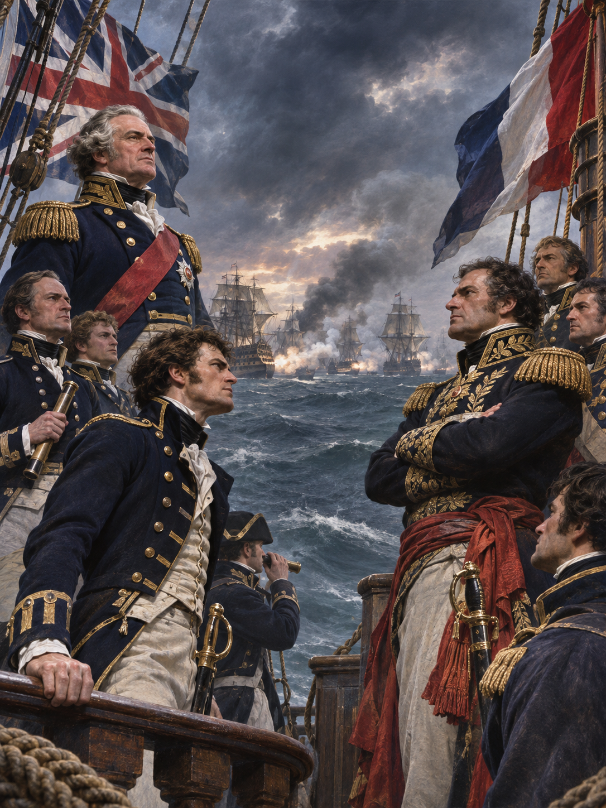

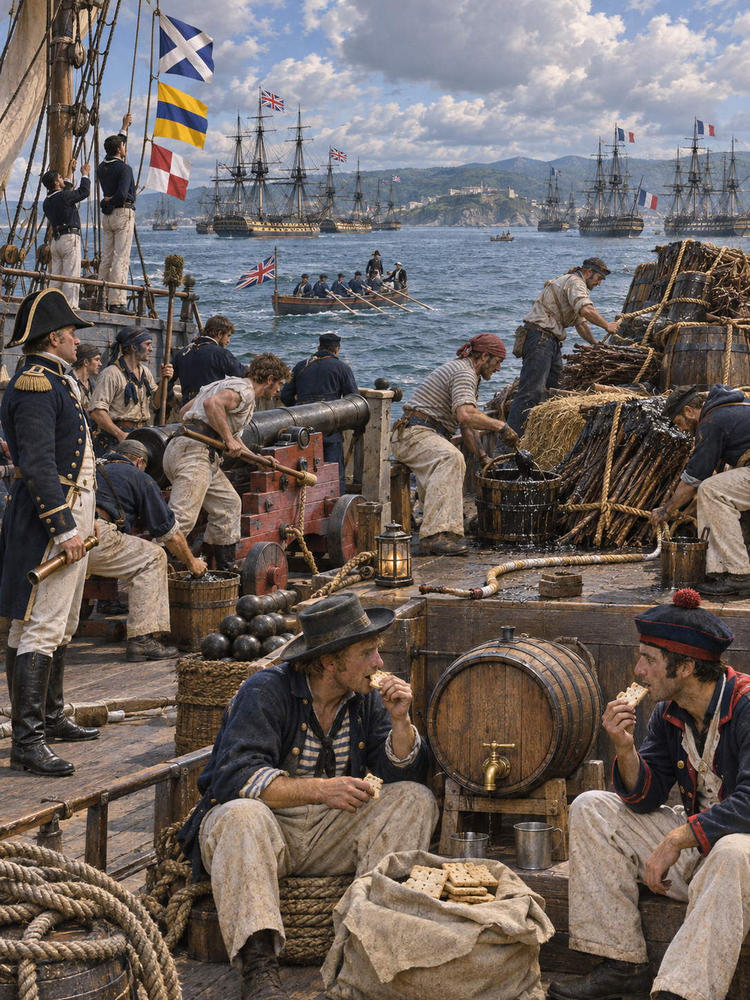

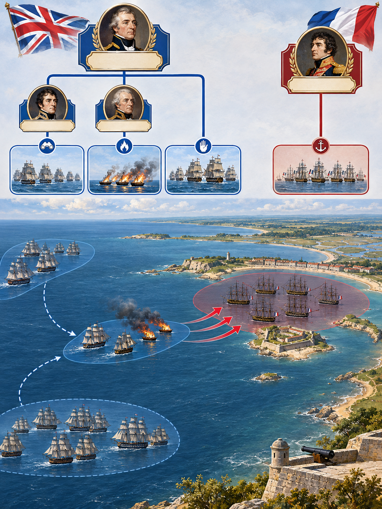

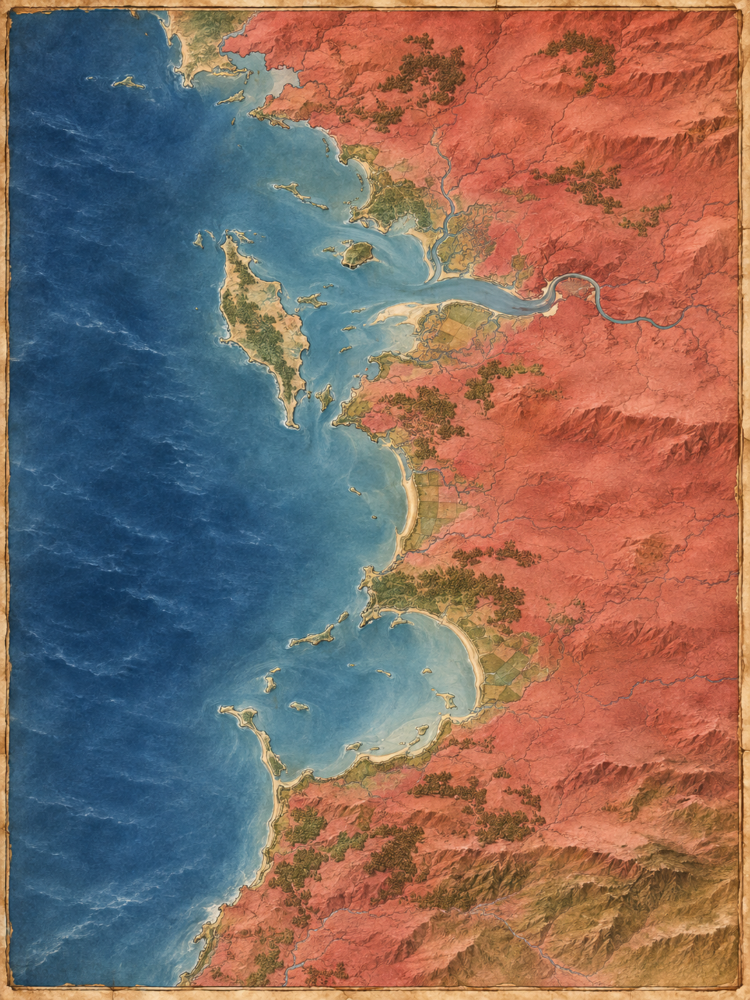

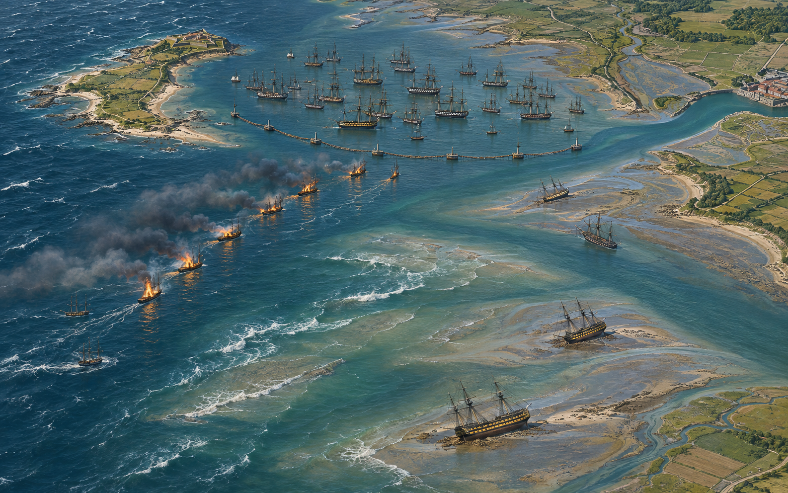

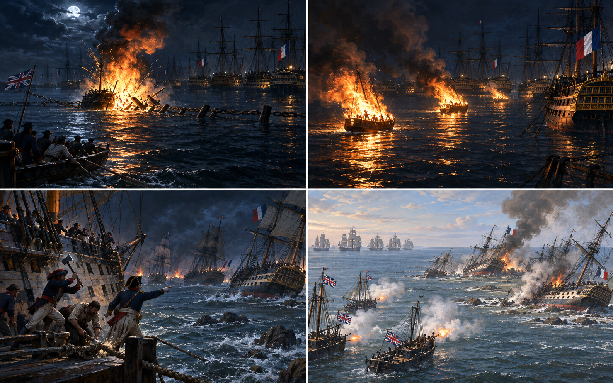

**뒤에서 반복될 지형을 먼저 잡아두기**

- 🌊 **바스크 로드(Basque Roads)**는 로슈포르 앞의 넓은 정박지다. 프랑스 함대는 일드엑스 안쪽에 머물렀고 영국 주력은 바깥 바다에서 봉쇄했다.
- **▰** **일드엑스(Île d’Aix)**는 프랑스 함대의 북서쪽 방패였다. 섬과 사주 사이의 좁은 수로 때문에 대형 함선은 자유롭게 흩어지기 어려웠다.
- 🌊 **보야르 사주(Boyart Shoal)**와 🌊 **팔 사주(Palles Shoal)**는 밀물에는 통로처럼 보이지만 썰물에는 함선을 붙잡았다. 닻줄을 끊고 달아난 프랑스 함선 다수가 이곳에 얹혔다.
- 🌊 **샤랑트강(Charente River)** 수로는 로슈포르로 이어지는 후퇴·구난 통로였다. 좁은 물길은 영국 대형함의 추격에도 위험을 주었다.
- **▰** **영국 외해 봉쇄선**은 코크런의 공격대를 지원할 수 있었지만 갬비어가 주력을 깊숙이 들이지 않으면서 전과 확대의 병목이 됐다.

#### 상세 전역 서사 — 코크런이 밀물·서풍·야음을 묶어 화선을 보내고, 갬비어의 정지가 완승을 막다

프랑스 로슈포르 함대는 일드엑스 남쪽에 닻을 내리고 통나무 방책과 소형 함정으로 접근로를 막았다. **토머스 코크런(Thomas Cochrane)**은 적 내부의 방화자나 반란을 기다리지 않았다. 그는 폭약선과 화선을 준비하고, 밀물이 프랑스 정박지 안쪽으로 흐르며 서풍이 같은 방향으로 부는 1809년 4월 11일 밤을 골랐다.

폭약선은 방책 일부를 깨고 경계선을 흔들었으며, 뒤따른 화선들은 승무원이 마지막 순간까지 조종한 뒤 불을 붙여 버렸다. 실제로 프랑스 함선을 직접 태운 수보다 더 큰 효과는 닻을 끊게 만든 데 있었다. **자카리 알레망(Zacharie Allemand)**의 함대는 불붙은 배를 피하려고 야간에 흩어졌고, 썰물이 시작되자 전열함 다수가 보야르·팔 사주에 좌초했다.

다음 날 프랑스 함선들은 포격 가능한 고정 표적이 됐다. 코크런은 신호를 올려 영국 주력의 진입을 요구했지만 **제임스 갬비어(James Gambier)**는 얕은 수로와 해안 포대의 위험을 크게 보아 머뭇거렸다. 일부 영국 함선만 들어가 네 척을 파괴했고, 나머지 프랑스 함선 다수는 다시 떠올라 로슈포르로 빠졌다. 외부에서 불을 낼 수 있을 때를 정확히 잡은 사례인 동시에, **발화 뒤 후속 공격의 때를 놓치면 만들어 낸 혼란도 완전한 승리로 이어지지 않는다**는 반례다.

#### 전투에서 사용된 속임수 — 화선의 직접 파괴력보다 더 크게 보인 폭발 위협

코크런은 화선 앞에 폭약선을 투입해 굉음과 파편으로 방책과 프랑스 승조원의 판단을 동시에 흔들었다. 실제 화선 모두가 전열함에 충돌할 능력은 없었지만, 어둠 속에서는 어느 배가 폭약선이고 어느 배가 단순 화선인지 구별하기 어려웠다. 프랑스 함대가 닻을 끊고 흩어진 행동은 합리적인 즉시 회피였으나, 썰물과 사주가 그 회피를 좌초로 바꾸었다.

#### 속임수 작동 구조

**주체와 의도.** 코크런의 공격대는 내부 내응 없이 외부에서 방책을 깨고, 화선의 충돌보다 적 대형의 자발적 해체를 노렸다.

**보인 신호와 믿은 이유.** 폭약선의 폭발과 뒤따른 다수의 불빛은 모든 접근선이 대형 폭발물일 수 있다는 신호를 만들었다. 야음·연기·밀물 때문에 프랑스군은 위험을 개별 확인할 시간이 없었다.

**유발된 행동과 결과.** 프랑스 함선은 충돌을 피하려 닻줄을 끊었고, 바람과 조류를 받아 사주 쪽으로 밀렸다. 화재 자체보다 좌초와 전열 붕괴가 다음 날의 공격 기회를 만들었다.

**사료의 경계.** 프랑스군의 공포를 단순한 비겁함으로 볼 수 없다. 폭약선은 실제 위험이었고 즉시 회피는 타당했다. 실패는 회피 뒤 재집결 지점과 썰물·사주 위험을 통제하지 못한 데 있었다.

#### 속임수 일곱 질문

1. **누가 누구를 속였는가?** 코크런의 영국 공격대가 알레망의 프랑스 함대에 실제보다 광범위한 폭발 위협을 보였다.
2. **어떤 사실이 거짓이었는가?** 모든 불붙은 배가 대형 폭약선이라는 인상은 사실이 아니었다.
3. **어떤 사실은 진실이지만 오해를 유도했는가?** 선두 폭약선의 대폭발은 실제였고, 그 생생한 사건이 뒤따른 화선 전부의 위험을 과대평가하게 했다.
4. **상대는 왜 그것을 믿고 싶어 했는가?** 믿고 싶었다기보다 야간 정박지에서 최악의 충돌을 피해야 했다. 확인 시간이 짧아 보수적인 회피가 합리적으로 보였다.
5. **속임수가 없었어도 같은 오판이 발생했을까?** 가능성은 낮다. 폭발과 다수 화선이 없었다면 프랑스군이 동시에 닻을 버릴 이유가 약했다.
6. **속은 사람은 어떤 독립 확인을 생략했는가?** 개별 접근선의 규모와 진로를 확인할 초계선을 충분히 앞에 두지 못했고, 닻 절단 뒤 안전한 집결 수로도 준비하지 못했다.
7. **신뢰·동의·안전을 해치지 않으면서 같은 원리를 어디서 연습할 수 있는가?** 해전 시뮬레이션에서 위협의 실제 파괴력과 대형 교란 효과를 분리해 평가할 수 있다.

#### 시계편 兵者詭道也 — 이 전장에 해당하는 속이는 길

<table fit-page-width="true" header-row="true">
<tr><td>해당 구절·독음·뜻</td><td>전장의 장면</td></tr>
<tr><td>近而示之遠 근이시지원 — 가까우면서 멀리 있는 듯 보인다</td><td>소수 폭약선의 실제 위험이 뒤따른 화선 전부에 투사되어 훨씬 큰 파괴력이 다가오는 듯 보였다.</td></tr>
<tr><td>亂而取之 난이취지 — 어지럽혀 취한다</td><td>야간에 닻을 끊게 해 전열을 무너뜨린 뒤 썰물에 좌초한 함선을 다음 날 공격했다.</td></tr>
</table>

#### 法 한눈 비교 — 곡제·관도·주용

<table fit-page-width="true" header-row="true">
<tr><td>진영</td><td>곡제(편제)</td><td>관도(지휘)</td><td>주용(보급·지속)</td></tr>
<tr><td>**영국 해군**</td><td>폭약선·화선·호위정·후속 전열함을 시간차로 나눴다.</td><td>**코크런**이 공격대를 통제했지만 **갬비어**의 주력 지원은 늦었다.</td><td>외해 봉쇄 기반은 강했으나 얕은 수역 진입 위험 때문에 전과 확대가 제한됐다.</td></tr>
<tr><td>**프랑스 해군**</td><td>전열함을 방책 안에 밀집 정박시켰고 야간 분산 뒤 재집결 계획이 약했다.</td><td>**알레망**은 닻 절단을 허용했지만 각 함선의 피항로를 통합하지 못했다.</td><td>로슈포르와 가까웠으나 사주에 좌초한 동안 함선·포·승조원을 동시에 구하기 어려웠다.</td></tr>
</table>

#### 자카리 알레망 (패)

<table fit-page-width="true" header-row="true">
<tr><td>요소</td><td>판단</td></tr>
<tr><td color="orange_bg">🤝 **道**</td><td>승조원은 함선을 구하려 움직였지만 동시 닻 절단 뒤 함대 단위 결속이 끊어졌다. (지기·사기)</td></tr>
<tr><td color="blue_bg">🌤️ **天**</td><td>화선 충돌 위험은 읽었으나 밀물 뒤 썰물과 바람이 사주 좌초로 이어질 확률을 함께 계산하지 못했다. (지피·타이밍·확률 관점)</td></tr>
<tr><td color="green_bg">🧭 **地**</td><td>좁은 수로·사주·얕은 정박지가 대형 전열함의 분산 회피를 가로막았다. (험이·광협·사생)</td></tr>
<tr><td color="purple_bg">🎖️ **將**</td><td>즉시 화재 회피에는 성공했지만 닻을 버린 뒤의 집결·예인·방어 순서를 준비하지 못했다. (지신인용엄)</td></tr>
<tr><td color="yellow_bg">⚙️ **法**</td><td>방책은 정면 진입을 막았으나 폭약선에 깨졌고 함선별 탈출이 편제 전체를 해체했다. (곡제·관도·주용)</td></tr>
</table>

**직관·편향 한 줄:** **알레망**과 함장들이 선두 폭발의 생생함을 뒤따른 화선 전부에 일반화한 판단에는 가용성 휴리스틱이 작동했을 가능성이 있으며, 사주·썰물이라는 두 번째 위험을 상대적으로 작게 보게 했다.

🏳️ **패군 측 결과**: 야간 회피로 직접 소각은 줄였으나 다수 함선이 좌초하고 네 척이 파괴되어 `亂(란)`—지휘와 진형이 일정하지 않은 패배—에 가까운 결과를 맞았다.

🔀 **패군 측 회피 분기점**: 화선 접근 전에 방책 바깥 초계정과 예인정을 늘리고, 닻을 끊을 함선별 안전 수로와 재집결점을 정했다면 완승을 거두지는 못해도 집단 좌초는 줄일 수 있었다.

#### 토머스 코크런·제임스 갬비어 (승)

<table fit-page-width="true" header-row="true">
<tr><td>요소</td><td>판단</td></tr>
<tr><td color="orange_bg">🤝 **道**</td><td>공격대는 위험한 화선 임무를 수행했으나 코크런과 갬비어의 위험 판단 차이가 후속 행동을 갈랐다. (지기·사기)</td></tr>
<tr><td color="blue_bg">🌤️ **天**</td><td>코크런은 밀물·서풍·야음을 같은 창으로 묶었지만 다음 날 좌초한 적을 공격할 창은 주력 지연으로 축소됐다. (지피·타이밍·확률 관점)</td></tr>
<tr><td color="green_bg">🧭 **地**</td><td>바람과 조류를 외부 발화의 운반 수단으로 썼고 사주를 적의 덫으로 바꿨다. (원근·험이·광협)</td></tr>
<tr><td color="purple_bg">🎖️ **將**</td><td>**코크런**은 준비와 결단이 강했으나 **갬비어**는 주력 보존을 중시해 결정타를 늦췄다. (지신인용엄)</td></tr>
<tr><td color="yellow_bg">⚙️ **法**</td><td>화선 공격대는 임무가 명확했지만 공격대와 본대의 지휘 의도가 끝까지 일치하지 않았다. (곡제·관도·주용)</td></tr>
</table>

🏆 **승군 측 결과**: `知可以戰與不可以戰者勝(지가이전여불가이전자승 — 싸울 수 있는 때와 없는 때를 아는 자가 이긴다)`의 전반부처럼 외부 발화의 창을 잡아 프랑스 함대를 무너뜨렸지만, 후속 공격의 ‘싸울 수 있는 때’를 놓쳐 제한 승리에 머물렀다.

##### 法을 압축하지 않고 보기 — 곡제·관도·주용

**곡제 曲制(곡제): 부대를 어떻게 나누고 결합했는가**
<table fit-page-width="true" header-row="true">
<tr><td>진영</td><td>실제 운용</td></tr>
<tr><td>**영국군**</td><td>폭약선이 방책을 깨고 화선이 진형을 흩뜨리며 호위정과 전열함이 후속 타격을 맡도록 나눴다.</td></tr>
<tr><td>**프랑스군**</td><td>방책 뒤 밀집 정박 편제는 정면 방어에는 유리했으나 동시 분산과 재집결에는 취약했다.</td></tr>
</table>

**관도 官道(관도): 누가 명령하고 어떻게 전달했는가**
<table fit-page-width="true" header-row="true">
<tr><td>진영</td><td>실제 운용</td></tr>
<tr><td>**영국군**</td><td>**코크런**은 근접 공격을 지휘했으나 신호를 받은 **갬비어**가 본대를 즉시 투입하지 않아 지휘가 끊겼다.</td></tr>
<tr><td>**프랑스군**</td><td>**알레망**의 함대는 야간에 각 함장이 닻을 끊으며 중앙 통제가 약해졌다.</td></tr>
</table>

**주용 主用(주용): 군량·장비·전투 지속 능력을 어떻게 썼는가**
<table fit-page-width="true" header-row="true">
<tr><td>진영</td><td>실제 운용</td></tr>
<tr><td>**영국군**</td><td>구형 함선·가연물·폭약을 일회용 공격 수단으로 전환하고 외해 봉쇄선이 지속 작전을 받쳤다.</td></tr>
<tr><td>**프랑스군**</td><td>함선은 항구 가까이에 있었으나 닻과 삭구를 잃고 좌초해 예인·수리·포격 대응을 동시에 감당해야 했다.</td></tr>
</table>

**출처:** [미 해군 역사유산사령부 — 1809년 4월 11~12일 공격도와 설명](https://www.history.navy.mil/content/history/nhhc/our-collections/photography/numerical-list-of-images/nhhc-series/nh-series/NH-67000/NH-67933.html) · [프랑스 국방역사국 — L’Affaire des Brûlots](https://www.servicehistorique.sga.defense.gouv.fr/ressources/laffaire-des-brulots-le-peril-anglais-quelques-encablures-des-cotes) · [Wikimedia Commons — Battle of Basque Roads 11 April.svg](https://commons.wikimedia.org/wiki/File:Battle_of_Basque_Roads_11_April.svg)

### 동양 — 🏛️ 오국(吳國)군 vs 🏛️ 한국(漢國)군 │ 파양호 전투(鄱陽湖之戰, 1363)

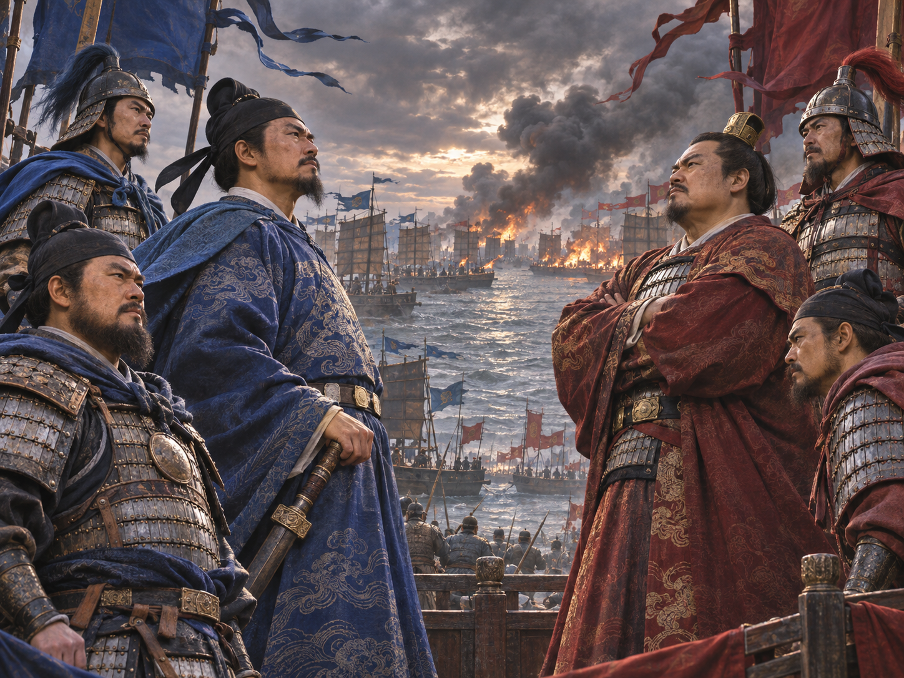

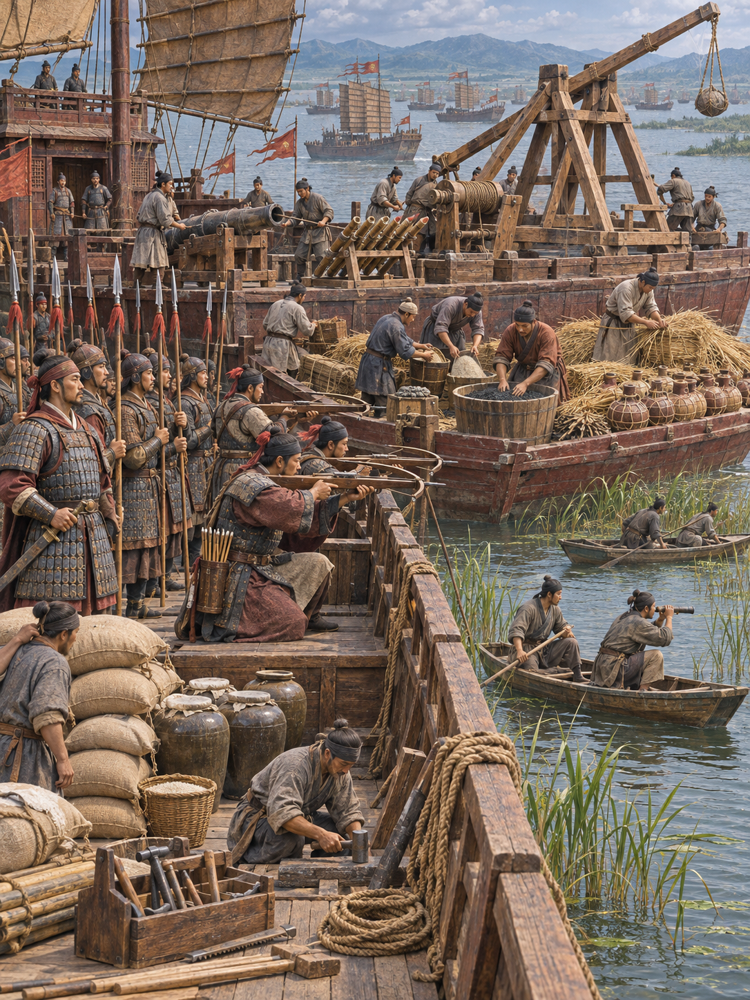

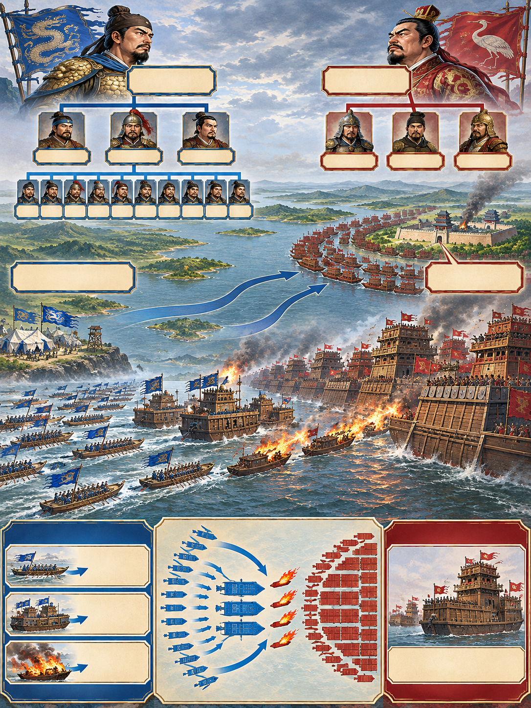

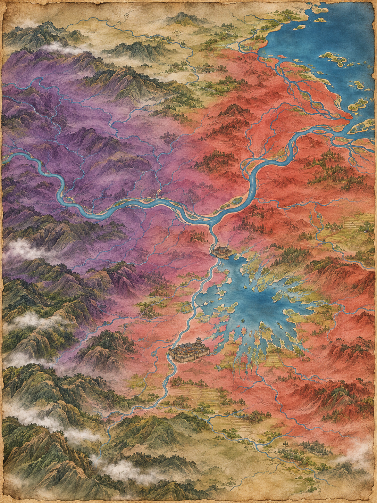

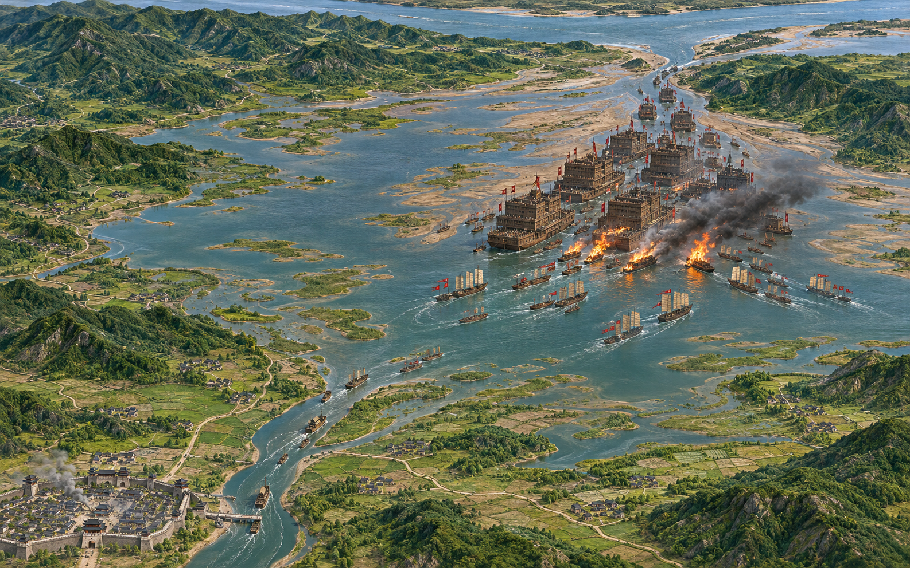

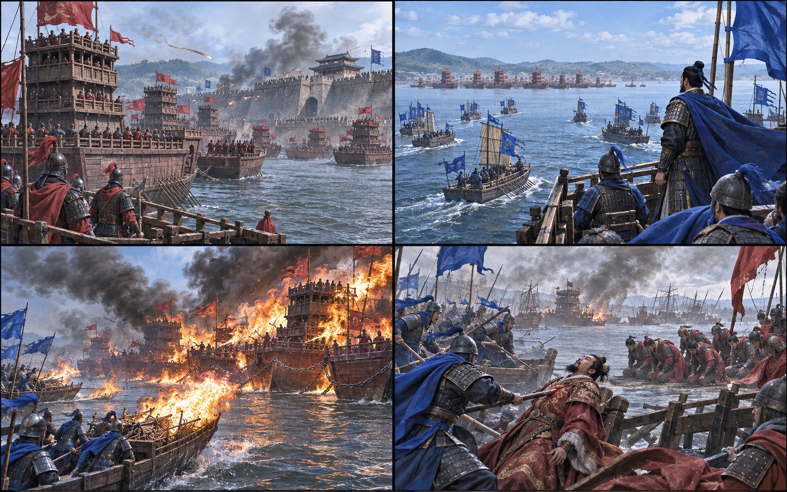

**뒤에서 반복될 지형을 먼저 잡아두기**

- **▰** **남창(南昌)**은 진우량군이 포위한 오군 거점이었다. 성이 버틴 덕분에 주원장은 구원 함대를 조직할 시간을 얻었다.
- 🌊 **감강(贛江)**은 남창에서 파양호로 이어지는 수로다. 구원군과 보급선이 호수 전장으로 들어오는 축이었다.
- 🌊 **파양호(鄱陽湖)**는 계절 수위가 내려가면 사주와 얕은 수역이 넓어졌다. 소형선은 움직일 수 있었지만 진우량의 대형 누선은 기동이 제한됐다.
- **▰** **강주(江州)**와 🌊 **장강(長江)** 상류는 진우량 세력의 후방과 연결됐다.
- 🌊 **호구(湖口)**는 파양호가 장강으로 빠져나가는 병목이다. 주원장이 출구를 막자 진우량군의 철수·보급 선택이 좁아졌다.

#### 상세 전역 서사 — 주원장이 얕아지는 호수와 바람을 기다려 외부 화공을 걸고, 호구 봉쇄로 살아남은 적의 퇴로까지 닫다

진우량은 대형 누선을 앞세워 남창을 포위했지만 성은 쉽게 무너지지 않았다. **주원장(朱元璋)**은 남창 내부의 방화나 내응을 전제로 삼지 않고 구원 함대를 여러 대로 나누어 파양호로 들어갔다. **진우량(陳友諒)**의 함선은 높고 컸지만 서로 밀집했고, 여름이 지나며 얕아지는 호수에서는 회전과 분산이 어려웠다.

첫날 정면전에서 주원장군은 대형 누선의 높이와 화력에 고전했다. 다음 날 그는 준비한 화선을 전면에 내고 바람이 진우량 진영으로 부는 순간을 기다렸다. 작은 배에 풀과 화약을 싣고 허수아비를 세운 뒤 접근시켜 불을 붙였고, 뒤의 소형 전선이 그 혼란을 이용했다. 기록과 현대 연구는 이 공격으로 스무 척 이상이 불타거나 손상됐다고 전한다.

화공 한 번이 전쟁을 끝낸 것은 아니다. 주원장은 호구를 막아 진우량 함대의 장강 복귀와 보급을 압박했고, 전투는 한 달 넘게 이어졌다. 10월 초 진우량군이 돌파를 시도했을 때 다시 화공과 근접전이 벌어졌고 진우량이 화살에 맞아 죽었다. 남은 세력은 항복했다. **밖에서 불을 낼 수 있는 능력을 갖추고 바람의 짧은 창에 실행한 뒤, 봉쇄와 추격으로 효과를 지속시킨 사례**다.

#### 전투에서 사용된 속임수 — 허수아비를 태운 화선과 작은 배의 의도 은폐

주원장군의 화선에는 풀·화약과 함께 사람처럼 보이는 허수아비가 실렸다고 전한다. 멀리서 보면 승선한 공격선처럼 보였고, 가까워졌을 때는 이미 바람과 추진력이 큰 누선 진형으로 배를 밀어 넣었다. 실제 의도는 승선 공격이 아니라 무인 또는 최소 인원의 외부 발화였다.

#### 속임수 작동 구조

**주체와 의도.** 주원장군은 작은 배의 낮은 전투 가치를 화선의 접근성과 바꾸어 대형 누선의 밀집을 약점으로 만들었다.

**보인 신호와 믿은 이유.** 허수아비와 접근 대형은 일반 공격선처럼 보였다. 높은 누선의 승조원은 아래쪽 작은 배가 가까워져도 정면 화력으로 제압할 수 있다고 판단하기 쉬웠다.

**유발된 행동과 결과.** 진우량군은 대형을 크게 풀지 않은 채 접근을 받았고, 바람을 탄 불이 인접 함선으로 번져 전열을 갈랐다. 주원장군은 그 틈에 소형선과 투사 무기를 집중했다.

**사료의 경계.** 병력 수와 함선 수는 후대 기록의 과장 가능성이 크다. 화공·유리한 바람·대형 누선의 기동 제약은 여러 연구에서 공통되지만 개별 화선의 세부 장치는 기록별 차이를 남겨 둬야 한다.

#### 속임수 일곱 질문

1. **누가 누구를 속였는가?** 주원장군이 진우량의 한군 함대에 화선을 일반 공격선처럼 보였다.
2. **어떤 사실이 거짓이었는가?** 배 위 허수아비가 실제 승조원처럼 보인 신호였다.
3. **어떤 사실은 진실이지만 오해를 유도했는가?** 작은 배가 실제로 정면 접근한다는 사실은 맞았지만 목적은 승선전이 아니라 충돌·연소였다.
4. **상대는 왜 그것을 믿고 싶어 했는가?** 대형 누선은 작은 선박보다 높고 강했으므로 통상적인 근접 공격을 격퇴할 수 있다는 기대가 합리적이었다.
5. **속임수가 없었어도 같은 오판이 발생했을까?** 가능성은 중간이다. 밀집 대형은 원래 화재에 취약했지만 허수아비와 바람을 이용한 접근이 경계 시간을 더 줄였다.
6. **속은 사람은 어떤 독립 확인을 생략했는가?** 접근선의 적재물과 승조원 움직임을 작은 정찰선으로 확인하고 대형 사이 방화 간격을 벌리는 조치를 충분히 하지 못했다.
7. **신뢰·동의·안전을 해치지 않으면서 같은 원리를 어디서 연습할 수 있는가?** 바둑·체스·해전 게임에서 값싼 미끼의 겉모습과 실제 기능을 구분하는 훈련으로 연습할 수 있다.

#### 시계편 兵者詭道也 — 이 전장에 해당하는 속이는 길

<table fit-page-width="true" header-row="true">
<tr><td>해당 구절·독음·뜻</td><td>전장의 장면</td></tr>
<tr><td>近而示之遠 근이시지원 — 가까우면서 멀리 있는 듯 보인다</td><td>이미 화공 거리 안으로 들어온 작은 배가 평범한 공격선처럼 보여 위험의 즉시성을 숨겼다.</td></tr>
<tr><td>利而誘之 리이유지 — 이익을 보여 유인한다</td><td>대형 누선이 쉽게 제압할 수 있는 작은 배라는 겉모습이 진형을 유지하게 했다.</td></tr>
</table>

#### 法 한눈 비교 — 곡제·관도·주용

<table fit-page-width="true" header-row="true">
<tr><td>진영</td><td>곡제(편제)</td><td>관도(지휘)</td><td>주용(보급·지속)</td></tr>
<tr><td>**오군**</td><td>소형선·중앙 대선·화선·투사 부대를 여러 대로 나눠 결합했다.</td><td>**주원장**이 전날 손실 뒤 편제를 바꾸고 화공·봉쇄·추격을 연속 명령했다.</td><td>남창 구원과 호구 봉쇄를 연결해 호수 안에서 장기전을 버텼다.</td></tr>
<tr><td>**한군**</td><td>대형 누선 중심의 밀집 편제가 높은 화력 대신 얕은 물·화재에 취약했다.</td><td>**진우량**에게 지휘가 집중되어 사망 뒤 통합 저항이 급속히 약해졌다.</td><td>남창 함락 실패와 호구 봉쇄로 장강 후방과의 보급·철수로가 막혔다.</td></tr>
</table>

#### 진우량 (패)

<table fit-page-width="true" header-row="true">
<tr><td>요소</td><td>판단</td></tr>
<tr><td color="orange_bg">🤝 **道**</td><td>대형 함대는 남창을 즉시 함락하지 못한 채 장기전에 묶였고 지휘관 사망 뒤 결속이 급격히 약해졌다. (지기·사기)</td></tr>
<tr><td color="blue_bg">🌤️ **天**</td><td>첫날의 우세를 계속될 기준으로 삼아 바람이 바뀐 날의 화선 위험을 충분히 갱신하지 못했다. (지피·타이밍·확률 관점)</td></tr>
<tr><td color="green_bg">🧭 **地**</td><td>대형 누선은 낮아지는 수위와 사주에서 소형선보다 회전·분산이 느렸고 호구 봉쇄 뒤 퇴로도 좁아졌다. (원근·험이·광협·사생)</td></tr>
<tr><td color="purple_bg">🎖️ **將**</td><td>압도적 규모로 남창과 구원군을 함께 누르려 했으나 장기 봉쇄 속 대안 철수 시점을 놓쳤다. (지신인용엄)</td></tr>
<tr><td color="yellow_bg">⚙️ **法**</td><td>높은 누선의 화력은 강했지만 함선 간격·화재 격리·얕은 수역 대응이 부족했다. (곡제·관도·주용)</td></tr>
</table>

**직관·편향 한 줄:** **진우량**이 첫날 대형 누선의 우세를 이후 전투에도 연장한 판단에는 기준점 효과가 작동했을 가능성이 있으며, 바람·수위·호구 봉쇄가 바꾼 위험을 늦게 반영하게 했다.

🏳️ **패군 측 결과**: 화공과 장기 봉쇄로 함대가 소모되고 돌파전에서 지휘관까지 잃어 `北(배)`—적정과 지형을 헤아리지 못한 패주—에 가까운 붕괴를 맞았다.

🔀 **패군 측 회피 분기점**: 남창이 단기에 무너지지 않았을 때 대형 누선을 깊은 수역으로 물리고 호구 보급선을 먼저 확보했다면 승리를 보장할 수는 없어도 얕은 호수의 화공과 장기 봉쇄에 동시에 갇히는 일은 피할 수 있었다.

#### 주원장 (승)

<table fit-page-width="true" header-row="true">
<tr><td>요소</td><td>판단</td></tr>
<tr><td color="orange_bg">🤝 **道**</td><td>첫날 손실 뒤에도 편제를 바꾸고 남창 구원·화공·호구 봉쇄라는 공동 목표를 유지했다. (지기·사기)</td></tr>
<tr><td color="blue_bg">🌤️ **天**</td><td>유리한 바람을 만들어 냈다고 과장하지 않고, 준비한 화선을 바람이 적진으로 향하는 짧은 시간창에 투입했다. (지피·타이밍·확률 관점)</td></tr>
<tr><td color="green_bg">🧭 **地**</td><td>소형선으로 얕은 수역을 쓰고 호구 병목을 막아 대형 누선의 크기를 불리함으로 바꿨다. (험이·광협·사생)</td></tr>
<tr><td color="purple_bg">🎖️ **將**</td><td>정면전의 손실을 고집하지 않고 화공과 봉쇄로 수단을 바꾸며 여러 대의 임무를 다시 묶었다. (지신인용엄)</td></tr>
<tr><td color="yellow_bg">⚙️ **法**</td><td>화선만 보내고 끝내지 않고 소형선의 후속 타격, 장기 봉쇄, 최종 돌파 저지를 연결했다. (곡제·관도·주용)</td></tr>
</table>

🏆 **승군 측 결과**: `以虞待不虞者勝(이우대불우자승 — 대비한 채 대비 없는 적을 상대하는 자가 이긴다)`처럼 외부 화공을 준비하고 바람이 맞는 순간 실행한 뒤 호구 봉쇄로 적의 다음 선택까지 제한했다.

##### 法을 압축하지 않고 보기 — 곡제·관도·주용

**곡제 曲制(곡제): 부대를 어떻게 나누고 결합했는가**
<table fit-page-width="true" header-row="true">
<tr><td>진영</td><td>실제 운용</td></tr>
<tr><td>**오군**</td><td>열한 개 안팎의 전대로 소형선·대선·화선·투사 부대를 나누고 정면·측면·봉쇄 임무를 결합했다.</td></tr>
<tr><td>**한군**</td><td>대형 누선을 밀집 운용해 정면 화력은 높였지만 화재 격리와 얕은 수역 기동을 희생했다.</td></tr>
</table>

**관도 官道(관도): 누가 명령하고 어떻게 전달했는가**
<table fit-page-width="true" header-row="true">
<tr><td>진영</td><td>실제 운용</td></tr>
<tr><td>**오군**</td><td>**주원장**이 전체 목표를 정하고 **서달**·**상우춘** 등 예하 지휘관이 전대와 상륙·추격 임무를 나눠 맡았다.</td></tr>
<tr><td>**한군**</td><td>**진우량** 중심의 지휘는 강했으나 장기전과 그의 전사 뒤 후계 지휘가 전장 전체를 묶지 못했다.</td></tr>
</table>

**주용 主用(주용): 군량·장비·전투 지속 능력을 어떻게 썼는가**
<table fit-page-width="true" header-row="true">
<tr><td>진영</td><td>실제 운용</td></tr>
<tr><td>**오군**</td><td>소형선·화약·풀·투사 무기와 수로 보급을 결합하고 호구를 통제해 장기 봉쇄를 유지했다.</td></tr>
<tr><td>**한군**</td><td>대형 누선의 인원·식량·수리 부담이 컸고 남창 지연과 호구 차단으로 장강 보급선이 약해졌다.</td></tr>
</table>

**출처:** [Cambridge/Anthem Press — Bruce A. Elleman, Battle of Lake Poyang (1363)](https://www.cambridge.org/core/books/abs/making-of-the-modern-chinese-navy/battle-of-lake-poyang-1363/D867DB972D2B8C9E3F4DA2E24F8EB9CA) · [미 해군연구소 Naval History — From River Pirate to Ming Emperor](https://www.usni.org/magazines/naval-history-magazine/2010/june/river-pirate-ming-emperor) · [University of Washington — Fir and Empire, Naval Timber](https://uw.manifoldapp.org/read/fir-and-empire/section/d1fdd798-02e0-439b-9282-73f1bfd0d269)

---
## 5. 핵심 통찰 + 실생활 적용 + 생활루틴

### 핵심 통찰

이 구절의 핵심은 ‘남을 기다리지 마라’보다 더 정교하다. **남의 내부 변화는 필수 조건에서 빼되, 객관적인 실행 조건과 적절한 때는 결코 빼지 말라**는 명령이다. 의존성을 낮춘다고 검증까지 줄이면 독단이 되고, 검증을 늘린다고 타인의 신호만 기다리면 무기력이 된다. 주도성은 이 둘 사이에서 자기 손으로 확인할 수 있는 조건을 늘리는 일이다.

앞 구절의 `待而勿攻`과 함께 읽으면 기다림과 실행의 기준도 선명해진다. 결과를 판단하는 데 적의 반응이 필요하면 기다린다. 그러나 아군이 독립적으로 실행할 수 있고 환경 조건이 맞는다면 내부 반응을 선행 조건으로 삼지 않는다. **무엇을 기다려야 하고 무엇은 기다리지 않아도 되는지를 구별하는 능력**이 빠른 행동보다 먼저다.

라이트 모드에는 전투 사례가 없으므로 생활 적용의 근거를 가상 패군에게서 끌어오지 않는다. 원문 자체의 논리는 충분하다. 내부 승인·상대의 협조·완벽한 확신을 모두 기다리면 때를 놓치고, 반대로 가능성과 시기를 확인하지 않은 채 실행하면 자기 불이 자기 편으로 번진다. 따라서 행동 전에 의존 조건을 나누고, 내가 통제할 수 있는 것으로 바꿀 수 있는 항목을 찾는 것이 불패지지의 준비다.

### 실생활 적용

3교대 현장에서 에러를 발견했을 때 다른 사람이 먼저 확인하거나 상위자가 세부 지시를 줄 때까지 기다리는 것은 `待於內`에 해당할 수 있다. 사용자의 재수없음 시리즈에 적힌 대로 에러·불합리를 발견하면 상위 보고와 자기 작업 내용의 복명복창을 먼저 해 연결을 만든다. 동시에 안전 범위 안에서 즉시 할 수 있는 로그 보존, 현재값 기록, 영향 구간 분리, 대체 담당 확보를 시작한다. 단, 설비 조작 권한이나 안전 절차를 건너뛰라는 뜻은 아니다. **승인을 기다릴 항목과 현장에서 먼저 할 항목을 구분**해야 한다.

최씨가 피로한 상태에서 모니터링·메신저 응답·비엠시트 기록을 놓친 관찰에는 사람 비난보다 구조적 대응이 필요하다. 내부 담당자가 스스로 회복해 역할을 다할 때까지 기다리면 감시 공백이 길어진다. 사용자는 응답 여부와 피로 상태를 확인하고 조장에게 공유한 뒤, 모니터링·인폼·시트 작성의 대체 담당을 명시할 수 있다. 이때 최씨의 성격이나 의도를 단정하지 않고, 관찰된 응답과 기록 누락만 근거로 삼는다. 외부에서 역할을 재편하되 휴식과 인계 절차라는 `時`와 `可`를 지키는 방식이다.

전씨가 복잡한 에러에서 말이 줄고 신경질적으로 반응하는 경향이 있다는 기록에서도 같은 구분이 필요하다. 상대가 먼저 차분해지고 완전한 설명을 내놓을 때까지 기다리기보다, 사용자가 “현재 사실 / 내가 맡을 조치 / 전씨가 확인할 항목 / 5분 뒤 재합류”를 짧게 선언할 수 있다. 다만 감정이 격해진 순간에는 더 큰 조작을 밀어붙이지 않고 안전 정지와 조장 공유를 우선한다. **상대의 내부 상태를 바꾸려 하지 말고, 바깥에서 명령과 정보의 구조를 바꾸는 것**이 이 구절에 가깝다.

개인 생활에서도 다른 사람의 답장, 완벽한 의욕, 이상적인 컨디션을 시작 조건으로 두면 계획이 쉽게 멈춘다. 운동이라면 운동복·시간·최소 세트를, 공부라면 자료·시작 시각·25분 범위를 스스로 준비한다. 반대로 수면 부족이나 통증처럼 행동 시기를 바꾸어야 하는 조건은 무시하지 않는다. ‘남을 기다리지 않음’과 ‘몸의 신호를 무시함’을 혼동하지 않는 것이 중요하다.

오늘 적용할 방법은 1분짜리 의존 조건 분류다. 해야 할 일 앞에 `타인의 필수 승인`, `타인의 편의상 협조`, `내가 즉시 준비할 것`, `실행을 멈출 위험 신호` 네 칸을 적는다. 편의상 협조는 없어도 갈 수 있게 바꾸고, 필수 승인은 공식 경로로 요청하며, 내 준비와 위험 신호가 갖춰지면 정한 시각에 행동한다. 이렇게 해야 `無待於內`가 무단 행동이 아니라 준비된 자율성이 된다.

### 생활루틴

**남의 신호만 기다리며 내가 준비할 일을 미루면 재수가 없다.**

**이유:** 상대의 답장·내부 승인·완벽한 의욕을 필수 조건으로 착각하면 내가 통제할 수 있는 기록·보고·도구·대체 경로까지 늦어진다. 그러면 짧게 열린 조치 시간이 닫히고, 다음 교대에는 정보 공백과 책임 혼선이 남아 작은 에러가 재발·누락·갈등으로 커질 수 있다. 오늘부터 중요한 일마다 `필수 승인 / 없어도 되는 협조 / 내가 지금 준비할 것 / 실행 시각`을 한 줄씩 적는다. 이는 `無待於內`로 불필요한 의존을 걷고 `以時發之`로 조건이 맞는 때에 움직이는 훈련이다.

**한 줄 기억법:** 남의 움직임은 기다리지 말고, 내가 지켜야 할 조건과 때는 끝까지 기다려라.
