<!-- sunzi-analysis-mode: light -->
> 화발상풍, 무공하풍. — 힘이 환경을 타고 커질 때, 그 힘이 되돌아오는 자리에 서지 않는다.

---
## 1. 원문 + 독음 + 직역 + 한자어 뜻풀이

火發上風, 無攻下風. 화발상풍, 무공하풍.

	**직역**

	불이 바람이 불어오는 위쪽에서 일어나면, 바람이 불어가는 아래쪽을 향하여 공격하지 않는다.

	불은 적진을 어지럽히는 힘이지만 바람을 만나면 장수의 명령보다 빠르게 번진다. 그래서 이 구절은 “불이 붙었으니 곧 돌격하라”가 아니라, **불이 어느 쪽에서 시작되었고 바람이 어느 쪽으로 보내는지 먼저 읽으라**고 명령한다. 적이 있는 곳과 불길이 가는 곳이 겹치더라도 아군이 그 아래쪽으로 들어가면 연기·열기·비화 속에서 스스로 시야와 대오와 퇴로를 잃는다. 공격의 성과보다 공격축의 안전을 먼저 판별하는 짧은 문장이다.

	#### 火發(화발) — 불이 붙었다는 사실보다 불이 움직이기 시작했다는 신호

	**火**(불 화)는 이 편에서 사람·군수품·수송·창고·대오를 흔드는 화공의 수단이고, **發**(필 발)은 숨어 있던 힘이 밖으로 터져 나와 작용을 시작하는 순간이다. 이 구절의 火發은 단순한 점화 성공 보고가 아니다. 불꽃·연기·열이 바람과 지형을 타고 새로운 전장 조건을 만드는 시작점이다. 따라서 장수는 불이 붙었다는 사실에 흥분하기보다, 붙은 뒤 힘이 어느 방향으로 번지는지를 다시 보아야 한다.

	#### 上風(상풍) — 바람이 출발해 오는 쪽, 아직 불길이 덮치지 않은 자리

	**上**(위 상)은 여기서 높낮이의 위쪽만이 아니라 바람의 상류, 곧 바람이 불어오는 쪽을 가리킨다. **風**(바람 풍)은 화공의 위력을 키우면서 동시에 방향을 정하는 외부 변수다. `火發上風`은 불이 바람의 출발 쪽에서 일어나 그 힘이 아래쪽으로 밀려가는 형세를 그린다. 불을 놓은 사람도 바람을 만들거나 고정할 수 없으므로, 상풍을 잡았다는 사실은 영구한 우세가 아니라 계속 관측해야 하는 잠정적 우세다.

	#### 下風(하풍) — 적을 향한 길이 아군의 위험지대로 바뀌는 순간

	**下**(아래 하)는 바람이 흘러가는 쪽이다. 불길·연기·불티가 모이는 하풍은 겉으로는 적이 혼란한 공격 기회처럼 보인다. 그러나 아군이 그 방향으로 함께 들어가면 적과 불 사이가 아니라 불의 진행선 안에 서게 된다. 이 문장에서 下風은 단순한 방위가 아니라 **아군이 공격할수록 자기 수단에 노출되는 위험 구역**이다.

	#### 無攻(무공) — 공격 의지를 버리는 것이 아니라 공격축 하나를 금지한다

	**攻**(칠 공)은 병력을 목표 쪽으로 밀어 넣어 적을 직접 압박하는 행동이다. 그 앞의 **無**(없을 무)는 모든 후속 행동을 포기하라는 뜻이 아니다. 하풍으로 정면 진입하는 선택을 지워 다른 방향·다른 시점·다른 수단을 찾게 하는 금지다. 불의 효과를 기다리거나, 바람이 바뀌는지 관측하거나, 안전한 측면을 택하는 것은 모두 이 금지 안에 들어 있는 적극적 지휘다.

	#### 글자들이 완성하는 한 장면

	상풍에서 `火`가 `發`하자 바람은 불길과 연기를 하풍으로 밀어 낸다. 적진이 흔들리는 모습만 보면 그 길이 가장 빠른 공격로처럼 보인다. 그러나 손자는 바로 그 방향에 `無攻`이라는 선을 긋는다. **내가 만든 힘이 어디로 흘러가는지 읽고, 그 힘이 적과 함께 나를 덮치는 축에는 들어가지 않는 것**, 이것이 네 글자씩 맞선 두 절이 완성하는 장면이다.

---
## 2. 전통 주석 기반 분석

- **조조(曹操)** — “불이 바람 위쪽에서 일어나 아래쪽으로 번지면, **그 불길을 마주 보며 하풍으로 군사를 들이밀지 마라.**”
- **이전(李筌)** — “바람을 등져 불을 쓰되 병사는 불이 향하는 길을 피해야 한다. **적을 태우는 형세가 아군을 태우는 형세로 바뀌지 않게 하라.**”
- **두목(杜牧)** — “상풍에서 불을 놓았다고 곧장 뒤따르지 마라. **연기와 불꽃이 모이는 하풍은 공격로가 아니라 먼저 비워 둘 위험지대다.**”
- **매요신(梅堯臣)** — “불의 이로움만 보고 진격하지 말고 바람의 향배를 보아라. **바람이 보내는 곳으로 공격하면 스스로 화세를 받는다.**”
- **장예(張預)** — “상풍을 얻으면 불의 위세는 커지지만 그 위세는 사람이 온전히 제어하지 못한다. **바람이 바뀔 가능성까지 살피며 군의 자리를 정하라.**”
- **왕석(王晳)** — “上風과 下風을 높고 낮은 땅으로만 읽지 마라. **바람이 오는 쪽과 가는 쪽을 가려 아군이 연기 뒤에 갇히지 않게 하라.**”
- **가림(賈林)** — “적이 하풍에서 어지럽더라도 성급히 탐내지 마라. **적의 혼란을 취하려다 아군의 눈과 대오를 먼저 잃지 마라.**”
- **두우(杜佑)** — “불은 공격을 돕는 수단이지 병사를 대신하지 않는다. **풍향이 아군의 진입을 해치면 그 공격축을 버려라.**”
- **진호(陳皞)** — “無攻은 겁내어 아무것도 하지 말라는 말이 아니다. **하풍 정면을 금하고 관측·우회·대기의 다른 수를 남겨 두어라.**”

#### 리링의 고증과 현대적 독법

이 문장의 정확한 독음은 `화발상풍, 무공하풍`이다. `上風`과 `下風`은 서로 짝을 이루어 바람의 상류와 하류를 가리킨다. 앞 구절들이 발화의 안팎과 공격의 때를 나누었다면, 이번 구절은 그 후속 행동에 **공간적 금지선**을 더한다.

리링(李零)의 문장 구조를 따라 읽으면 핵심은 불의 위력 자체가 아니라 매개 조건인 바람이다. 화공을 현대의 무차별적 파괴에 대한 비유로만 넓히면 원문의 구체성이 사라진다. 먼저 고대 전장에서 연기·열·불티가 아군의 시야, 대오, 호흡, 퇴로를 함께 해칠 수 있다는 군사 문맥을 복원한 뒤, “내가 만든 효과의 진행 방향에 내가 들어가지 않는다”는 일반 원리로 확장해야 한다.

---
## 3. 교차 설명

### ① 손자병법 내 교차

「시계편」의 `天者, 陰陽寒暑時制也`(천자, 음양한서시제야 — 하늘이란 밝고 어두움, 춥고 더움, 때의 변화다)는 전쟁의 외부 조건을 계산의 일부로 둔다. 이번 구절의 風은 바로 그런 天의 구체적 변수다. 화공을 시작한 뒤에도 바람은 아군의 소유물이 아니며, 방향과 세기가 바뀌면 공격의 이익과 위험도 함께 바뀐다.

「허실편」의 `因形而錯勝於衆`(인형이조승어중 — 드러난 형세에 따라 승리를 사람들 앞에 놓는다)과 `兵無常勢, 水無常形`(병무상세, 수무상형 — 군대에는 일정한 세가 없고 물에는 일정한 형상이 없다)은 고정된 성공 공식을 경계한다. 상풍에서 점화했다는 첫 성공을 끝까지 유효한 조건으로 착각하면 안 된다. 불의 형세가 바람을 따라 바뀌면 아군의 자리와 공격축도 함께 바뀌어야 한다.

「군쟁편」의 `高陵勿向, 背丘勿逆`(고릉물향, 배구물역 — 높은 구릉의 적을 향해 오르지 말고 언덕을 등진 적을 거슬러 치지 마라)은 적의 강점과 지형의 힘을 동시에 받는 축을 피하라고 한다. `無攻下風`도 같은 문법이다. 적을 공격하면서 불과 연기의 진행 방향까지 거스르는 이중 부담을 자초하지 말라는 것이다.

### ② 클라우제비츠 『전쟁론』

클라우제비츠가 말한 마찰은 작은 우연과 물리적 장애가 계획과 실제 행동 사이를 벌리는 힘이다. 화공에서 바람은 단순한 배경이 아니라 효과의 크기·방향·지속을 바꾸는 마찰의 매개다. 계획상 “불로 적을 혼란시키고 보병이 돌입한다”는 한 줄은 실제 전장에서는 연기 때문에 표적과 아군을 구분하지 못하고, 열기 때문에 통로가 닫히며, 풍향 변화 때문에 퇴로가 위협받는 여러 문제로 갈라진다.

다만 클라우제비츠의 마찰을 손자의 風과 같은 말로 만들 수는 없다. 마찰은 전쟁 전반의 불확실성과 수행 저하를 포괄하고, 이 구절은 화공 뒤의 특정한 공격 방향을 금한다. 둘을 함께 읽을 때 얻는 결론은 추상적인 “변수에 대비하라”가 아니라, **계획의 효과가 아군에게 되돌아오는 경로를 미리 표시하고 그 경로를 진입 금지선으로 삼으라**는 구체적 통제다.

### ③ 미야모토 무사시 『오륜서』

『오륜서』 화지권은 `場の徳を用ゆる`(바노 토쿠오 모치유루 — 장소가 주는 이로움을 쓴다)는 관점에서 해와 지형, 주변 장애가 상대에게 불리하도록 자리를 잡으라고 가르친다. 이는 공격 기술보다 먼저 자신과 상대가 어떤 환경의 힘을 받는지 정하라는 점에서 上風·下風의 구분과 만난다.

그러나 개인 결투의 자리 선정과 군대의 화공은 규모와 책임이 다르다. 화공의 하풍에는 공격자 개인의 시야 문제만이 아니라 여러 부대의 통신·대오·부상자 후송·민간 피해와 화재 확산이 얽힌다. 무사시의 자리를 선점하는 감각은 참고할 수 있지만, 손자의 無攻처럼 조직 전체에 적용되는 명시적 금지와 중단 기준이 더 필요하다.

### ④ 오자병법과 육도

『오자병법』의 `審地形, 察敵變`(심지형, 찰적변 — 지형을 자세히 살피고 적의 변화를 관찰한다)이라는 운용 원리는 환경과 적의 반응을 분리하지 않는다. 불이 적을 흔드는지, 바람이 불과 연기를 어디로 보내는지, 그 결과 아군의 진입로가 살아 있는지를 함께 보아야 한다. 적이 어지럽다는 한 가지 신호만으로 공격하면 나머지 조건을 잃는다.

『육도』가 천시와 지리를 얻은 뒤 병력을 움직이도록 요구하는 관점도 이 구절을 보완한다. 다만 上風을 얻었다는 사실만으로 천시 전체를 얻었다고 과장해서는 안 된다. 풍향은 국지 지형과 시간에 따라 달라질 수 있고, 불의 실제 진행은 바람과 정확히 같지 않을 수도 있다. 그래서 천시를 ‘소유’한다고 생각하기보다 계속 측정하고 행동을 갱신해야 한다.

### ⑤ 현대 심리학·군사학

미 육군의 작전환경 교범은 풍향과 풍속이 연막·시계·화생방 작전 등에 결정적이며, 바람은 불어오는 방향으로 표기된다고 설명한다. 미 육군 화력 교범도 목표 지역에서 연기나 먼지의 이동을 관측해 풍향을 판별하고, 기동축과의 관계를 따지도록 한다. 이는 上風·下風을 고정된 방위가 아니라 **효과가 이동하는 방향과 아군의 이동 방향 사이의 관계**로 읽게 한다. [미 육군 TC 7-102](https://www.moore.army.mil/mssp/security%20topics/Potential%20Adversaries/content/pdf/tc7-102.pdf) · [미 육군 ATP 3-09.30](https://rdl.train.army.mil/catalog-ws/view/100.ATSC/1BDA62DC-4D53-4F75-A019-7D6B4C6039B0-1376923699842/atp3_09x30.pdf)

미 국립표준기술연구소(NIST)의 풍압 화재 연구도 풍향을 전술에 반영하고 바람을 등진 쪽에서 접근하는 것이 소방관의 안전과 진압 효과에 중요하다고 보고한다. 산불 기상 지침은 넓은 지역과 긴 시간에 하나의 풍향·풍속이 계속 유지된다고 가정하는 것이 비현실적이며, 변화에 따라 탈출로와 안전지대를 바꿔야 한다고 경고한다. 고대 화공과 현대 소방은 목적이 반대이지만, **바람이 불과 연기의 방향을 바꾸므로 진입로·퇴로·안전구역을 지속적으로 갱신해야 한다**는 물리적 판단은 같다. [NIST 풍압 화재 연구](https://www.nist.gov/el/fire-research-division-73300/firegov-fire-service/wind-driven-fires) · [미 산불조정그룹 화재기상 지침](https://www.nwcg.gov/publications/pms425/2-fire-weather-forecast-variables)

카너먼의 관점에서는 불이 붙고 적이 흔들리는 장면이 너무 선명해 공격의 이득만 크게 보일 수 있다. 가용성은 눈앞의 성공 신호에 무게를 싣고, 한 가지 시나리오 집중은 “적이 무너진다” 이외의 전개—풍향 변화, 연기 속 오인, 퇴로 차단, 불의 역류—를 판단 밖으로 밀어낸다. 교정하려면 공격 전에 `불·연기가 갈 방향 / 아군 진입축 / 안전한 퇴로 / 풍향이 바뀔 때의 중단 조건`을 따로 적고, 불리한 대안 시나리오의 확률도 함께 검토해야 한다.

---
## 4. 역사적 실증 사례

### 서양 — 🏛️ 잉글랜드 왕국·네덜란드 봉쇄함대 vs 🏛️ 스페인 왕국 │ 칼레 화선과 그라블린 해전(Spanish Armada, 1588)

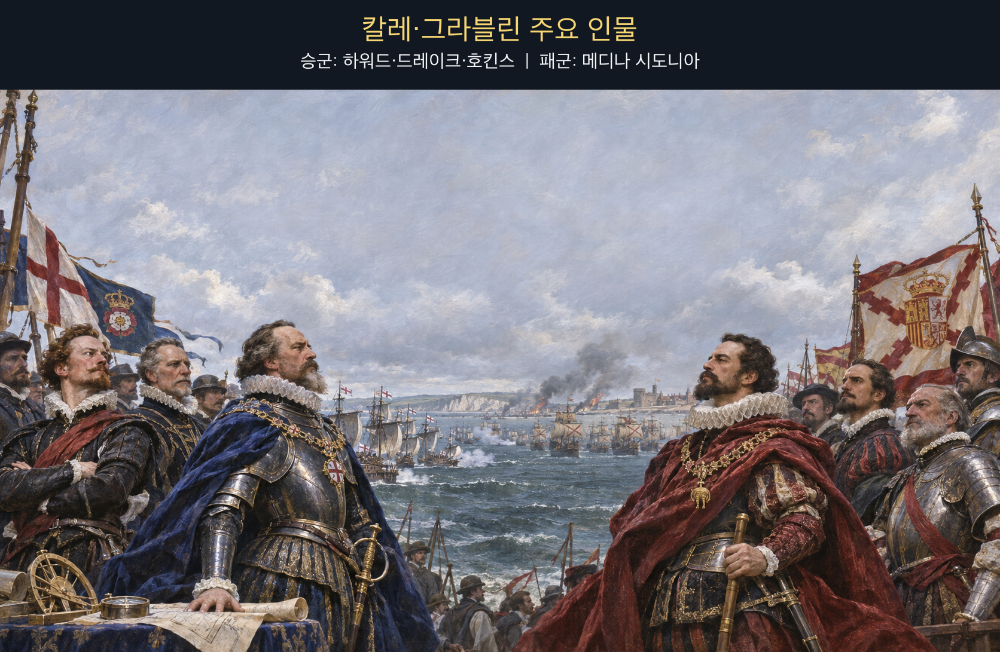

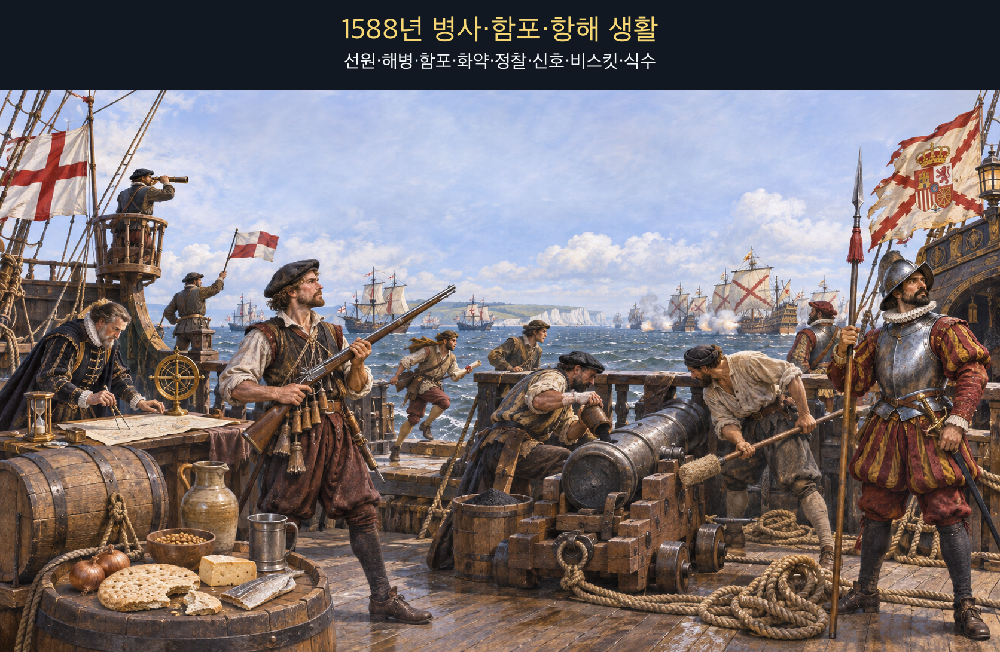

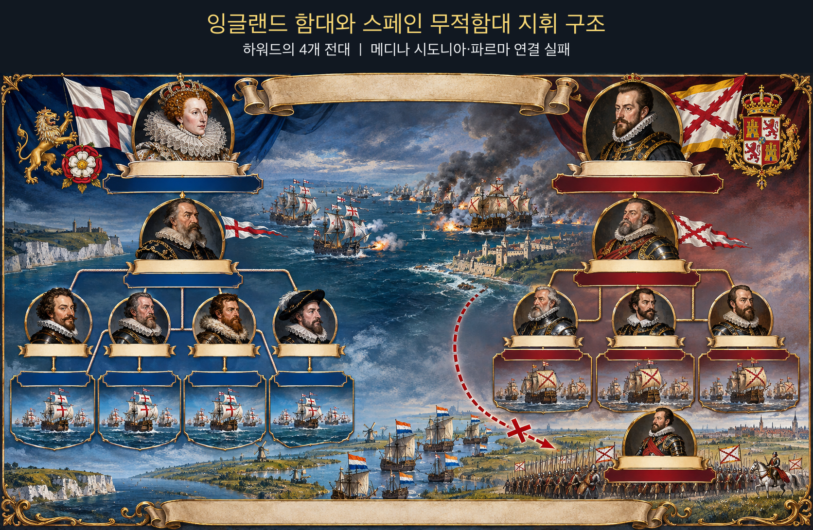

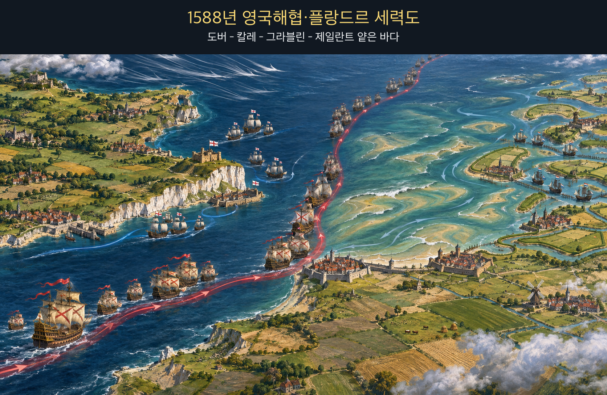

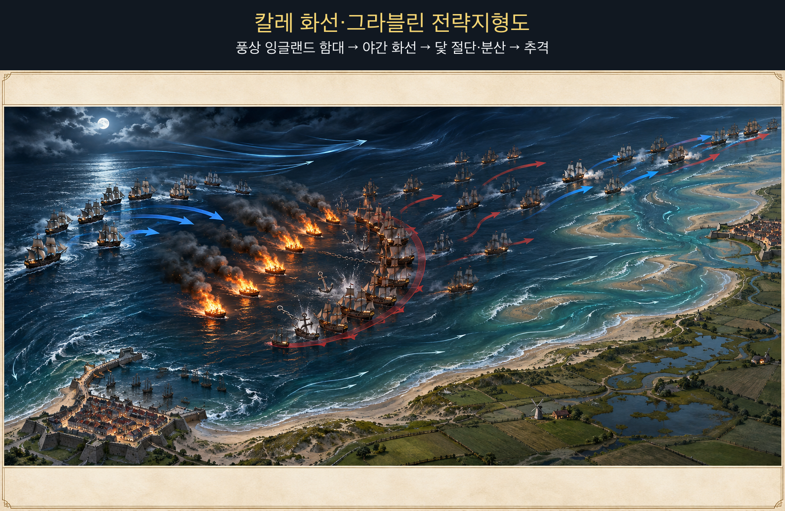

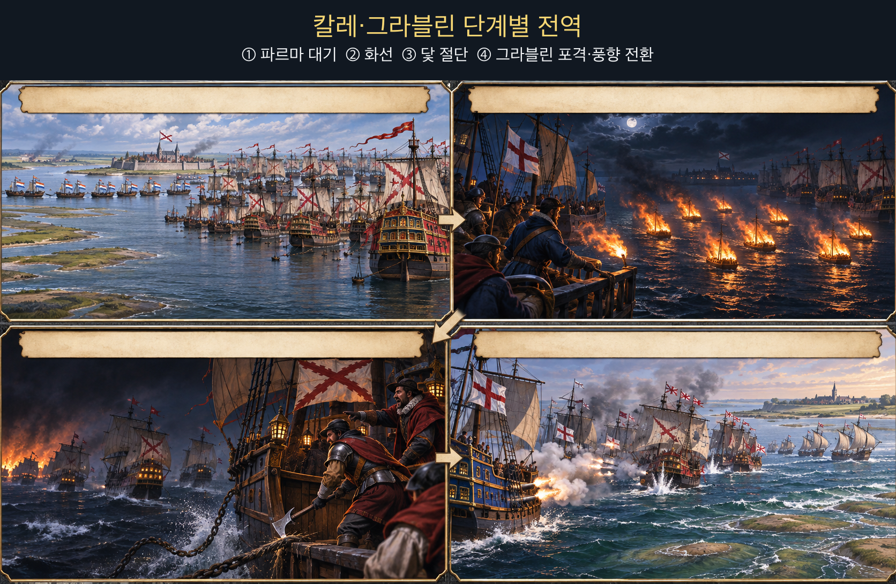

**뒤에서 반복될 지형을 먼저 잡아두기**

- 🌊 **영국해협(English Channel)**은 무적함대가 서쪽에서 칼레로 올라온 좁은 접근축이다. 잉글랜드 함대는 풍상 위치를 유지하며 뒤를 따랐다.
- **▰** **칼레(Calais)** 정박지는 파르마군을 기다리는 곳이었지만 방파된 항구가 아니어서 화선과 조류에 노출됐다.
- 🌊 **플랑드르 수로(Flemish waterways)**는 파르마군의 승선로였으나 네덜란드 함대가 봉쇄해 무적함대와 육군의 결합을 막았다.
- **▰** **그라블린(Gravelines)** 앞바다는 흩어진 선단이 다음 날 근거리 포격을 받은 결전 공간이었다.
- 🌊 **제일란트 얕은 바다(Zeeland shoals)**는 8월 9일 스페인 함대를 좌초 직전까지 몰았으나 갑작스러운 풍향 전환이 퇴로를 열었다.

#### 상세 전역 서사 — 파르마를 기다리는 고정 정박이 야간 화선의 창을 열다

**메디나 시도니아 공작(Alonso Pérez de Guzmán, Duke of Medina Sidonia)**의 무적함대는 파르마 공작의 플랑드르군과 합류하려고 칼레 앞에 닻을 내렸다. 그러나 네덜란드 함대가 연안 수로를 막아 파르마군은 제때 나오지 못했고, 스페인 함대는 목적을 이루지 못한 채 노출된 정박지에 머물렀다. **하워드 경(Lord Howard of Effingham)**은 정면 포격의 낮은 효과를 확인한 뒤 전략을 바꾸었다.

8월 7일 밤 잉글랜드군은 화선 여덟 척을 풍상에서 흘려보냈다. 불타는 배가 밀려오자 스페인 함장들은 충돌과 폭발을 피하려 닻줄을 끊었다. 실제 화선이 대규모로 적함을 태운 것이 아니라, 어둠·바람·조류 속에서 대형을 해체한 것이 결정적 효과였다. 다음 날 **드레이크(Francis Drake)**·**호킨스(John Hawkins)** 등이 흩어진 함대를 그라블린 앞에서 근거리 포격했다.

8월 9일 강풍은 스페인 함대를 제일란트의 얕은 바다로 밀어 좌초 위험을 키웠다. 그런데 바람이 갑자기 유리하게 바뀌어 선단은 해안에서 벗어났다. 같은 바람이 밤에는 화선과 분산을 돕고, 뒤에는 패군을 전멸에서 구했다. 이 전역은 `無攻下風`이 불을 따라 적진 정면으로 들어가라는 명령이 아니라, **화선이 만든 위험축은 비워 두고 그 축이 깨뜨린 진형을 다른 방향에서 치라는 금지선**임을 보여 준다.

#### 전투에서 사용된 속임수 — 화선의 실제 파괴력보다 크게 보인 위협

화선은 불붙은 무인 선박이라는 공개된 위협이었지만, 스페인군은 그것이 단순 화선인지 화약을 가득 실은 폭발선인지 어둠 속에서 확인하기 어려웠다. 정박 대형 안에서 한 척이 불붙으면 연쇄 피해가 날 수 있었으므로 닻을 버린 회피는 비합리적 공황만은 아니었다. 잉글랜드군의 의도는 배 여덟 척으로 함대를 소각하는 것보다 결속된 진형을 풀어 다음 날 포격의 표적으로 만드는 데 있었다.

#### 속임수 작동 구조

**주체와 의도.** 잉글랜드 지휘부는 화선을 보내 스페인의 정박 대형과 지휘 연결을 해체하려 했다.

**보인 신호와 믿은 이유.** 불붙은 배와 야간 조류는 폭발·연쇄 화재 가능성을 크게 보였고, 칼레 정박지는 회피 공간이 좁았다.

**유발된 행동과 결과.** 스페인 함선들은 닻줄을 끊어 흩어졌고, 다음 날 그라블린에서 상호지원이 약한 상태로 포격을 받았다.

**사료의 경계.** 화선이 직접 태운 함선 수보다 진형 해체 효과가 컸다. 이후 폭풍 피해까지 모두 잉글랜드의 계획으로 돌려서는 안 된다.

#### 속임수 일곱 질문

1. **누가 누구를 속였는가?** 잉글랜드 지휘부가 스페인 정박 함대의 위협 판단을 흔들었다.
2. **어떤 사실이 거짓이었는가?** 화선 자체는 실제였으나 폭발선일 수 있다는 공포는 확인되지 않았다.
3. **어떤 사실은 진실이지만 오해를 유도했는가?** 불붙은 배는 진짜 위험이었지만 직접 소각보다 진형 해체가 목적이었다.
4. **상대는 왜 그것을 믿고 싶어 했는가?** 믿고 싶었다기보다 닻을 유지할 때의 연쇄 화재 위험이 너무 컸다.
5. **속임수가 없었어도 같은 오판이 발생했을까?** 가능성은 낮다. 화선이 없었다면 야간에 닻을 버릴 직접 계기가 약했다.
6. **속은 사람은 어떤 독립 확인을 생략했는가?** 어둠과 조류 때문에 화선의 적재물·간격·회피 가능성을 충분히 확인하기 어려웠다.
7. **신뢰·동의·안전을 해치지 않으면서 같은 원리를 어디서 연습할 수 있는가?** 해상 시뮬레이션과 보드게임에서 위협의 실제 피해와 진형 교란 효과를 분리해 평가할 수 있다.

#### 시계편 兵者詭道也 — 이 전장에 해당하는 속이는 길

<table fit-page-width="true" header-row="true">
<tr><td>해당 구절·독음·뜻</td><td>전장의 장면</td></tr>
<tr><td>近而示之遠 근이시지원 — 가까우면서 멀리 있는 듯 보인다</td><td>화선의 작은 직접 타격 수단이 야간에는 대규모 폭발·연쇄 화재 가능성으로 보였다.</td></tr>
</table>

#### 法 한눈 비교 — 곡제·관도·주용

<table fit-page-width="true" header-row="true">
<tr><td>진영</td><td>곡제(편제)</td><td>관도(지휘)</td><td>주용(보급·지속)</td></tr>
<tr><td>**잉글랜드군**</td><td>네 전대와 동부 증원대를 화선·추격·포격에 연결했다.</td><td>**하워드**가 전략을 바꾸고 전대장들이 근거리 교전을 수행했다.</td><td>탄약 부족이 추격 한계를 만들었으나 짧은 해협 작전과 자국 항구가 버팀목이었다.</td></tr>
<tr><td>**스페인군**</td><td>초승달 대형은 항해 중 강했지만 닻을 잃은 뒤 재결집이 어려웠다.</td><td>**메디나 시도니아**의 함대와 파르마군은 봉쇄 때문에 연결되지 못했다.</td><td>화약·탄약 부족, 손상, 장거리 귀환이 지속 능력을 깎았다.</td></tr>
</table>

#### 메디나 시도니아 (패)

<table fit-page-width="true" header-row="true">
<tr><td>요소</td><td>판단</td></tr>
<tr><td color="orange_bg">🤝 **道**</td><td>함대는 규율을 유지했으나 파르마군과 결합하지 못해 침공 목적이 흔들렸다. (지기·사기)</td></tr>
<tr><td color="blue_bg">🌤️ **天**</td><td>야간 바람·조류·화선 위협에 즉시 반응했지만 닻을 버린 뒤 아침 진형 회복까지 설계하지 못했다. (지피·타이밍·확률 관점)</td></tr>
<tr><td color="green_bg">🧭 **地**</td><td>열린 칼레 정박지와 플랑드르 얕은 바다는 대형 유지와 파르마 합류에 불리했다. (원근·험이·사생)</td></tr>
<tr><td color="purple_bg">🎖️ **將**</td><td>질서 있는 북해 철수를 이끌었지만 합류 불능과 기상 변화에 맞춰 작전 목적을 일찍 바꾸지 못했다. (지신인용엄)</td></tr>
<tr><td color="yellow_bg">⚙️ **法**</td><td>함대·상륙군·연안 수송이 하나의 통제 가능한 체계로 결합되지 않았다. (곡제·관도·주용)</td></tr>
</table>

**직관·편향 한 줄:** **메디나 시도니아**가 파르마군과의 합류를 계속 중심 시나리오로 둔 판단에는 계획 오류가 작동했을 가능성이 있으며, 봉쇄와 정박 위험이 커진 뒤에도 대안 목표 전환을 늦췄다.

🏳️ **패군 측 결과**: 침공군과 합류하지 못하고 그라블린에서 손상된 뒤 북해로 밀려 돌아가 `北(배)`—적정·지형·지속 능력을 충분히 헤아리지 못한 퇴각—에 가까운 결과를 맞았다.

🔀 **패군 측 회피 분기점**: 파르마군의 수로 봉쇄가 풀리지 않는다는 보고를 받았을 때 노출된 칼레 정박을 중단하고 재정비 가능한 해역으로 이동했다면 침공 성공을 보장할 수는 없어도 닻 상실과 전열 분산은 줄일 수 있었다.

#### 하워드 (승)

<table fit-page-width="true" header-row="true">
<tr><td>요소</td><td>판단</td></tr>
<tr><td color="orange_bg">🤝 **道**</td><td>전대장들이 장거리 포격의 한계를 공유하고 화선 이후 근거리 추격으로 전환했다. (지기·사기)</td></tr>
<tr><td color="blue_bg">🌤️ **天**</td><td>풍상 위치와 야간 조류를 이용하되 다음 날의 바람까지 통제한다고 가정하지 않았다. (지피·타이밍·확률 관점)</td></tr>
<tr><td color="green_bg">🧭 **地**</td><td>칼레 정박지의 노출과 그라블린·제일란트의 얕은 바다를 압박 공간으로 활용했다. (원근·광협·사생)</td></tr>
<tr><td color="purple_bg">🎖️ **將**</td><td>효과 낮은 포격을 반복하지 않고 화선으로 진형을 흔든 뒤 가까이 붙는 전략 변화를 승인했다. (지신인용엄)</td></tr>
<tr><td color="yellow_bg">⚙️ **法**</td><td>화선·전대·네덜란드 봉쇄·동부 증원을 서로 다른 임무로 결합했다. (곡제·관도·주용)</td></tr>
</table>

🏆 **승군 측 결과**: `以虞待不虞者勝(이우대불우자승 — 대비한 채 대비 없는 적을 상대하는 자가 이긴다)`처럼 정박한 적의 변화를 유도하고 다음 날 가까운 거리에서 타격했다.

##### 法을 압축하지 않고 보기 — 곡제·관도·주용

**곡제 曲制(곡제): 부대를 어떻게 나누고 결합했는가**
<table fit-page-width="true" header-row="true">
<tr><td>진영</td><td>실제 운용</td></tr>
<tr><td>**잉글랜드군**</td><td>전대를 분리 운용하면서 화선·추격·포격을 시간차로 결합했다.</td></tr>
<tr><td>**스페인군**</td><td>초승달 대형과 수송 보호 편제는 닻 절단 뒤 개별 함선으로 흩어졌다.</td></tr>
</table>

**관도 官道(관도): 누가 명령하고 어떻게 전달했는가**
<table fit-page-width="true" header-row="true">
<tr><td>진영</td><td>실제 운용</td></tr>
<tr><td>**잉글랜드군**</td><td>**하워드** 아래 전대장들이 기동 재량을 갖고 흩어진 적을 압박했다.</td></tr>
<tr><td>**스페인군**</td><td>**메디나 시도니아**의 신호 체계는 야간 분산과 닻 상실 뒤 재결집에 시간이 걸렸다.</td></tr>
</table>

**주용 主用(주용): 군량·장비·전투 지속 능력을 어떻게 썼는가**
<table fit-page-width="true" header-row="true">
<tr><td>진영</td><td>실제 운용</td></tr>
<tr><td>**잉글랜드군**</td><td>자국 연안에서 보급했지만 화약·탄약 부족 때문에 북해 추격을 끝까지 계속하지 못했다.</td></tr>
<tr><td>**스페인군**</td><td>탄약 부족과 손상, 닻 상실이 북해·대서양 우회 귀환의 위험을 키웠다.</td></tr>
</table>

**출처:** [Royal Museums Greenwich — Spanish Armada charts and campaign chronology](https://www.rmg.co.uk/collections/research-guides/research-guide-p3-charts-spanish-armada-robert-adams-museum) · [Encyclopaedia Britannica — Spanish Armada](https://www.britannica.com/topic/Armada-Spanish-naval-fleet)

### 동양 — ⚔️ 손권·유비 연합군 vs 🏛️ 조조군 │ 적벽대전(赤壁之戰, 208)

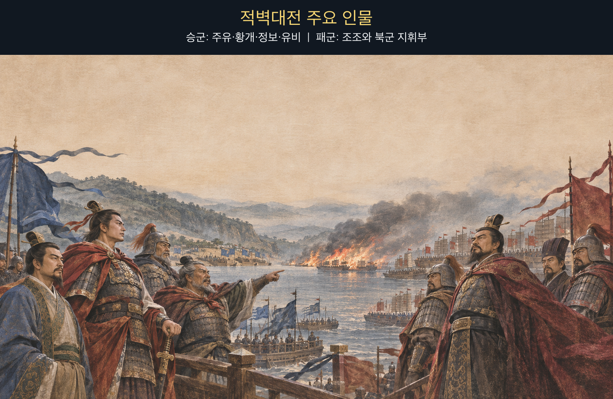

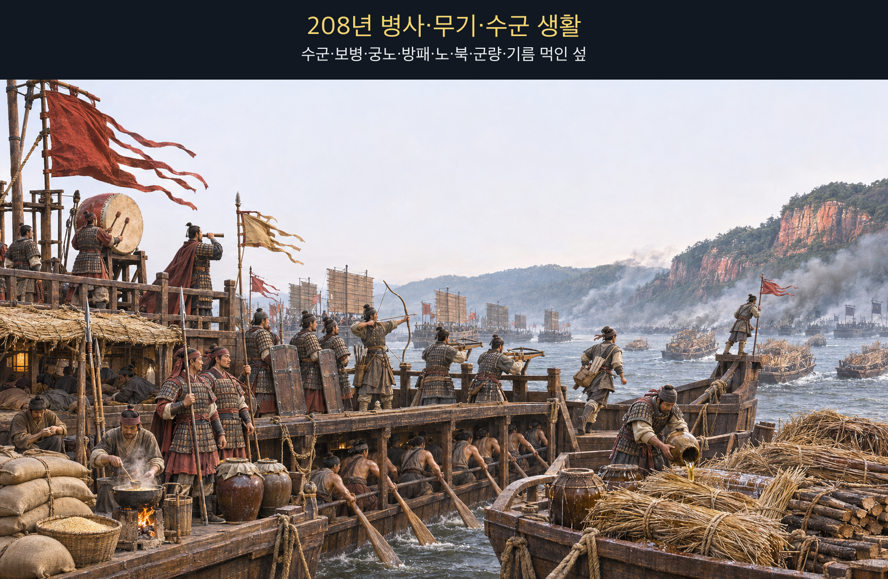

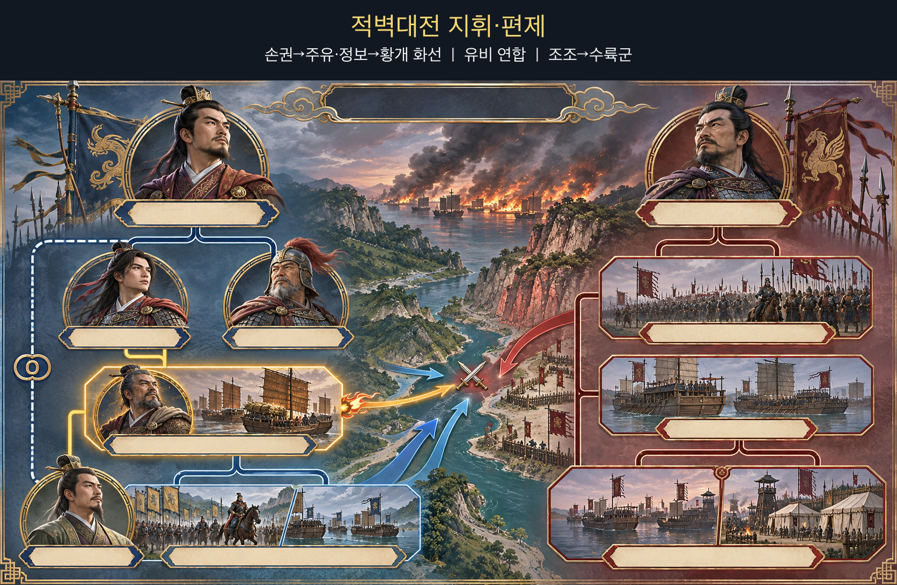

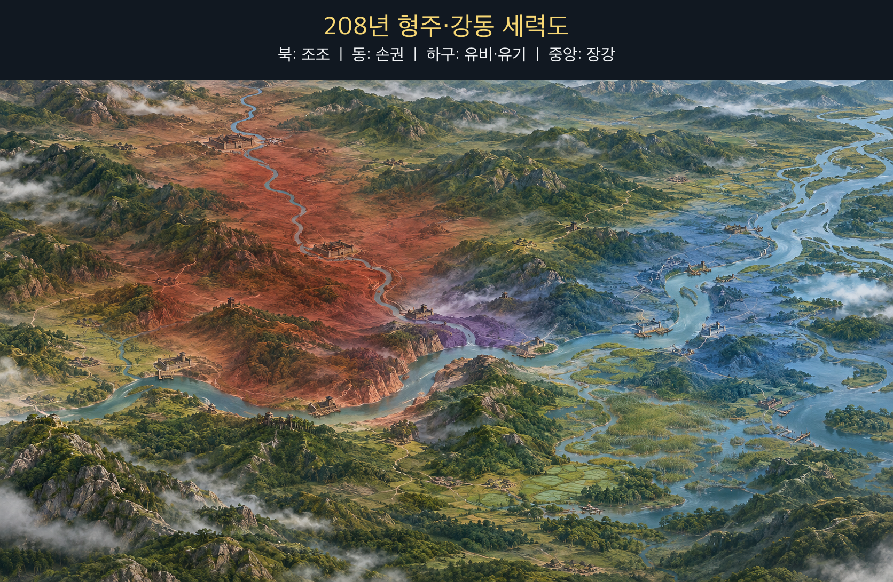

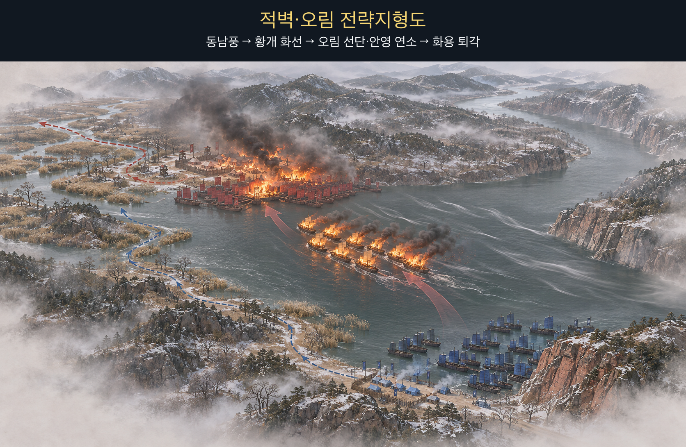

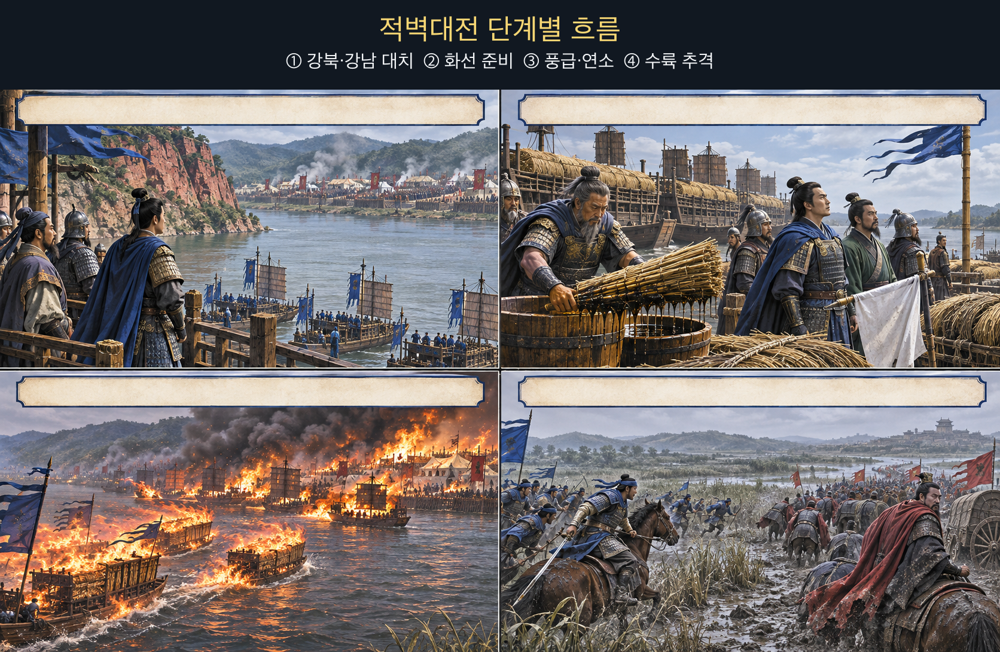

**뒤에서 반복될 지형을 먼저 잡아두기**

- 🌊 **장강(長江)**은 조조의 북방군이 익숙하지 않은 수전 공간이자 연합군이 화선과 추격을 연결한 주축이다.
- **▰** **적벽(赤壁)** 남안은 주유군이 조조군과 마주한 지점이다.
- **▰** **오림(烏林)** 북안은 조조 선단과 육상 영채가 붙어 있어 화재가 배에서 언덕의 군영으로 번질 수 있었다.
- 🌲 **화용도(華容道)**와 주변 늪지는 조조군이 강릉 쪽으로 퇴각한 진흙길로, 화재 뒤의 혼란과 추격 피해를 키웠다.
- **▰** **강릉(江陵)**은 조조가 남은 병력을 수습하고 수비대를 남긴 후방 거점이었다.

#### 상세 전역 서사 — 황개가 풍상에서 화선을 보내고 후속군은 불길의 뒤가 아닌 안전한 수륙축으로 움직이다

조조군은 첫 교전과 질병으로 물러나 장강 북안 오림에 정박했고, **주유(周瑜)**·**정보(程普)**의 군은 남안에 섰다. **황개(黃蓋)**는 적선이 밀집해 서로 이어진 상태를 보고 마른 갈대와 땔나무에 기름을 부은 배를 준비했다. 그는 거짓 항복 서신을 보내 접근의 의심을 낮추었다.

『삼국지』 주유전 주석이 인용한 기록은 `時東南風急`(시동남풍급 — 그때 동남풍이 세찼다)이라 전한다. 황개의 앞선 배들은 강 가운데 돛을 올리고 북서쪽 오림으로 달려가 적선 약 이 리 앞에서 동시에 불을 붙였다. `火烈風猛, 船往如箭`(화렬풍맹, 선왕여전 — 불은 사납고 바람은 거세어 배가 화살처럼 나아갔다)고 할 만큼 불과 바람이 결합했고, 불은 북군의 배와 강가 영채로 번졌다.

연합군의 경장 병력이 불길을 따라 수륙으로 진격하자 이미 질병과 수전 미숙에 시달리던 조조군은 무너졌다. 조조는 남은 배를 스스로 태우고 화용의 진흙길을 거쳐 강릉으로 물러났다. 다만 제갈량이 제단에서 바람을 빌렸다는 이야기는 후대 『삼국연의』의 서사이며 정사에서 확인되지 않는다. 역사적으로 확인되는 것은 **황개가 실제 동남풍이 강한 순간에 화선·기만·후속 공격을 결합했다는 점**이다.

#### 전투에서 사용된 속임수 — 항복선으로 보인 화선

황개는 항복 의사를 미리 알리고, 불붙일 배 뒤에 도주용 작은 배를 매달았다. 조조군은 접근하는 선단을 투항선으로 보고 갑판에 나와 바라보았다고 전한다. 실제 의도는 항복이 아니라 바람을 받아 적 선단에 충돌할 화공이었고, 신호를 믿은 순간 경계와 차단 거리가 사라졌다.

#### 속임수 작동 구조

**주체와 의도.** 황개와 주유는 거짓 항복으로 화선을 적 선단 가까이 들여보내려 했다.

**보인 신호와 믿은 이유.** 항복 서신·깃발·선두 함선은 열세 진영의 이탈처럼 보였고 조조군은 실제로 형주 수군의 항복을 이미 경험했다.

**유발된 행동과 결과.** 조조군은 접근선을 조기에 공격하지 않았고, 강한 동남풍 아래 화선이 짧은 거리를 돌파해 밀집 선단과 영채에 불을 옮겼다.

**사료의 경계.** 동남풍과 화공은 기록되지만 ‘제갈량의 차풍’은 정사 사실이 아니다. 전염병·수전 미숙·첫 교전 패배도 함께 작용했다.

#### 속임수 일곱 질문

1. **누가 누구를 속였는가?** 황개와 주유가 조조군을 거짓 항복 신호로 속였다.
2. **어떤 사실이 거짓이었는가?** 황개가 조조에게 투항한다는 의사였다.
3. **어떤 사실은 진실이지만 오해를 유도했는가?** 열세 연합군 내부에서 이탈이 생길 수 있다는 가능성 자체는 그럴듯했다.
4. **상대는 왜 그것을 믿고 싶어 했는가?** 조조군은 형주 세력의 연속 항복을 이미 경험해 같은 패턴을 기대할 근거가 있었다.
5. **속임수가 없었어도 같은 오판이 발생했을까?** 가능성은 낮다. 항복 서신이 없었다면 접근선은 더 일찍 차단됐을 것이다.
6. **속은 사람은 어떤 독립 확인을 생략했는가?** 접근선의 정지·검색과 풍상 화공 위험의 재평가를 생략했다.
7. **신뢰·동의·안전을 해치지 않으면서 같은 원리를 어디서 연습할 수 있는가?** 체스·바둑·해전 게임에서 미끼와 실제 주공을 구분하는 훈련으로 연습할 수 있다.

#### 시계편 兵者詭道也 — 이 전장에 해당하는 속이는 길

<table fit-page-width="true" header-row="true">
<tr><td>해당 구절·독음·뜻</td><td>전장의 장면</td></tr>
<tr><td>近而示之遠 근이시지원 — 가까우면서 멀리 있는 듯 보인다</td><td>공격용 화선이 항복선으로 보여 경계 거리 안까지 들어갔다.</td></tr>
<tr><td>利而誘之 리이유지 — 이익을 보여 유인한다</td><td>황개의 투항이라는 이익이 조조군으로 하여금 접근선을 받아들이게 했다.</td></tr>
</table>

#### 法 한눈 비교 — 곡제·관도·주용

<table fit-page-width="true" header-row="true">
<tr><td>진영</td><td>곡제(편제)</td><td>관도(지휘)</td><td>주용(보급·지속)</td></tr>
<tr><td>**손·유 연합군**</td><td>화선·도주선·경장 수륙 추격대를 연결했다.</td><td>**주유**가 **황개**의 건의를 승인하고 후속군을 붙였다.</td><td>현지 수군·선박·강풍의 짧은 창을 집중 사용했다.</td></tr>
<tr><td>**조조군**</td><td>북방군·형주 수군·육상 영채가 밀집해 연쇄 화재에 취약했다.</td><td>**조조**의 대군은 질병과 화재 뒤 명령 전달이 무너졌다.</td><td>질병·말 먹이·장거리 원정의 부담이 전투 지속력을 낮췄다.</td></tr>
</table>

#### 조조 (패)

<table fit-page-width="true" header-row="true">
<tr><td>요소</td><td>판단</td></tr>
<tr><td color="orange_bg">🤝 **道**</td><td>새로 얻은 형주 병력과 북방 주력이 질병·낯선 수전 속에서 하나로 결속되지 못했다. (지기·사기)</td></tr>
<tr><td color="blue_bg">🌤️ **天**</td><td>거짓 항복선과 동남풍이 겹칠 가능성을 낮게 보고, 풍향이 바뀐 순간 경계를 갱신하지 못했다. (지피·타이밍·확률 관점)</td></tr>
<tr><td color="green_bg">🧭 **地**</td><td>북안 오림의 밀집 선단과 영채는 불이 배에서 육지로 번지는 연속 표적이 됐다. (험이·광협·사생)</td></tr>
<tr><td color="purple_bg">🎖️ **將**</td><td>형주를 빠르게 얻은 성공을 강동 수전에도 연장하고 항복 신호를 독립 확인하지 않았다. (지신인용엄)</td></tr>
<tr><td color="yellow_bg">⚙️ **法**</td><td>대군·항복 수군·선박·영채의 결합이 화재 격리와 신속한 이탈을 어렵게 했다. (곡제·관도·주용)</td></tr>
</table>

**직관·편향 한 줄:** **조조**가 앞선 연속 항복 경험을 황개의 신호에도 적용한 판단에는 대표성 휴리스틱이 작동했을 가능성이 있으며, 풍향과 접근선의 위험을 재검증하지 못하게 했다.

🏳️ **패군 측 결과**: 선단과 영채가 불타고 질병·진흙길·추격 피해가 겹쳐 `北(배)`의 패주로 남정이 중단됐다.

🔀 **패군 측 회피 분기점**: 항복선을 원거리에서 정지시켜 소형선으로 확인하고 선단 사이에 방화 간격과 견인 가능한 예비를 뒀다면 전쟁 승리를 보장할 수는 없어도 화재의 연쇄 확산과 전군 붕괴는 줄일 수 있었다.

#### 주유·황개 (승)

<table fit-page-width="true" header-row="true">
<tr><td>요소</td><td>판단</td></tr>
<tr><td color="orange_bg">🤝 **道**</td><td>손권의 항전 결심 아래 주유·정보·황개와 유비군이 같은 목표로 움직였다. (지기·사기)</td></tr>
<tr><td color="blue_bg">🌤️ **天**</td><td>동남풍을 만들어 냈다고 과장하지 않고, 실제로 강해진 짧은 시간창에 준비한 화선을 투입했다. (지피·타이밍·확률 관점)</td></tr>
<tr><td color="green_bg">🧭 **地**</td><td>남안에서 북안 오림으로 부는 바람과 장강의 수로를 접근·연소·추격에 연결했다. (험이·광협·사생)</td></tr>
<tr><td color="purple_bg">🎖️ **將**</td><td>**황개**의 건의를 **주유**가 받아들여 기만·화공·후속 타격을 한 시간표로 만들었다. (지신인용엄)</td></tr>
<tr><td color="yellow_bg">⚙️ **法**</td><td>화선 뒤에 도주선을 매고 경장 수륙군을 대기시켜 불만 보내고 끝내지 않았다. (곡제·관도·주용)</td></tr>
</table>

🏆 **승군 측 결과**: `知可以戰與不可以戰者勝(지가이전여불가이전자승 — 싸울 수 있는 때와 없는 때를 아는 자가 이긴다)`처럼 준비를 끝낸 뒤 풍향이 맞는 순간에만 불과 병력을 함께 보냈다.

##### 法을 압축하지 않고 보기 — 곡제·관도·주용

**곡제 曲制(곡제): 부대를 어떻게 나누고 결합했는가**
<table fit-page-width="true" header-row="true">
<tr><td>진영</td><td>실제 운용</td></tr>
<tr><td>**연합군**</td><td>황개의 화선·도주선, 주유의 수군, 유비의 수륙 추격대를 단계별로 결합했다.</td></tr>
<tr><td>**조조군**</td><td>북방 보병·형주 수군·밀집 선박·육상 영채가 화재 격리 없이 붙어 있었다.</td></tr>
</table>

**관도 官道(관도): 누가 명령하고 어떻게 전달했는가**
<table fit-page-width="true" header-row="true">
<tr><td>진영</td><td>실제 운용</td></tr>
<tr><td>**연합군**</td><td>**주유**가 화공을 승인하고 **황개**가 선두 화선을 지휘했으며 후속군은 신호에 맞춰 진격했다.</td></tr>
<tr><td>**조조군**</td><td>항복 신호를 받아들이는 중앙 판단이 접근 차단보다 앞섰고 화재 뒤 수륙 지휘가 함께 흔들렸다.</td></tr>
</table>

**주용 主用(주용): 군량·장비·전투 지속 능력을 어떻게 썼는가**
<table fit-page-width="true" header-row="true">
<tr><td>진영</td><td>실제 운용</td></tr>
<tr><td>**연합군**</td><td>마른 섶·기름·가벼운 선박과 현지 수군 경험을 짧은 결정적 공격에 집중했다.</td></tr>
<tr><td>**조조군**</td><td>질병과 장거리 원정 부담 속에서 선단·영채·말·군량을 한꺼번에 지키기 어려웠다.</td></tr>
</table>

**출처:** [중화민국 국방부 육군학술쌍월간 — 적벽전역 연구](https://www.mnd.gov.tw/File/30767) · [『삼국지』 오서 주유전](https://zh.wikisource.org/wiki/%E4%B8%89%E5%9C%8B%E5%BF%97/%E5%8D%B754)

---
## 5. 핵심 통찰 + 실생활 적용 + 생활루틴

### 핵심 통찰

이 구절의 핵심은 유리한 힘을 얻는 것과 그 힘의 진행선에 서는 것을 구분하는 데 있다. 불이 적을 향해 번지는 것은 유리하지만, 그 방향으로 아군까지 밀어 넣으면 유리함이 곧 위험으로 바뀐다. 강한 수단일수록 “얼마나 세게 작동하는가”와 함께 “작동한 뒤 무엇을 함께 덮치는가”를 물어야 한다.

`無攻`은 소극적인 포기가 아니라 경계선이다. 사용할 수단, 들어가도 되는 방향, 멈춰야 할 조건을 미리 나누면 현장의 흥분이 판단을 덮지 못한다. 불확실성을 없애려 하기보다, 바람이 바뀌어도 아군이 함께 무너지지 않을 자리를 남겨 두는 것이 불패지지에 가깝다.

### 실생활 적용

3교대 현장에서 강한 조치가 효과를 내기 시작했다고 곧바로 같은 방향으로 사람과 작업을 더 밀어 넣으면, 처음 조치가 만든 열·압력·알람·정보 혼선에 후속 작업까지 갇힐 수 있다. 먼저 조치의 영향이 어디로 퍼지는지, 다른 설비·다른 작업자·다음 교대에 어떤 부담을 넘기는지 확인한다. 효과가 번지는 축과 사람이 들어가는 축이 겹치면 정면 추가 조치보다 상태 확인, 접근 통제, 우회 절차, 상위 보고를 먼저 둔다.

전씨가 단순 조치에서 목소리를 높이고 같은 지시를 반복하는 것으로 관찰된 상황에서는 그 흥분의 방향으로 곧장 맞서거나 설명을 더 쏟아붓지 않는다. 먼저 조치 대상과 위험을 짧게 복명하고, 담당·완료 조건·다음 보고 시각을 고정한다. 상대의 긴장이 팀 전체로 번지는 하풍에 서지 않고, 사실과 절차가 있는 상풍 쪽으로 대화를 옮기는 것이다. 이는 전씨의 내면을 단정하는 해석이 아니라 반복 관찰된 행동에 대한 대응 규칙이다.

개인 생활에서도 분노를 풀기 위해 메시지·게시물·구매·관계 단절 같은 강한 행동을 시작하면 그 영향은 상대에게만 가지 않는다. 기록, 평판, 비용, 수면, 다음 근무의 집중력으로 되돌아올 수 있다. 행동이 만든 여파가 흘러갈 방향에 내가 다시 서게 되는지 확인하고, 그렇다면 보내지 않기·임시 저장·산책과 유산소 운동·다음 날 재검토처럼 공격축을 바꾼다.

### 생활루틴

**강한 조치의 여파가 돌아올 방향을 적지 않고 밀어붙이면 재수가 없다.** 효과가 크다는 이유로 후속 행동을 같은 축에 더하면, 처음에는 상대나 문제를 향하던 힘이 작업자·동료·수면·평판으로 번질 수 있다. 작은 방향 확인의 누락이 시야와 퇴로를 함께 막고, 그제야 멈추려 해도 이미 비용이 커진다. 이는 상풍에서 일어난 불을 보고 하풍으로 공격하지 말라는 원리와 같다.

1. 강한 조치 전 `효과가 퍼질 방향`을 한 줄로 적는다.
2. 그 선 위에 사람·설비·다음 일정·내 퇴로가 있는지 확인한다.
3. 하나라도 겹치면 정면 추가 행동을 멈추고 우회·대기·보고 중 하나를 고른다.
4. 환경이 바뀌면 처음 판단을 고집하지 말고 방향을 다시 잰다.

**한 줄 기억법:** 힘을 쓰기 전에, 그 힘이 되돌아올 길부터 비운다.
