> 주풍구, 야풍지. 범군필지유오화지변, 이삭수지. — 조건은 계속 변하니, 기억에 맡기지 말고 정한 시각과 신호로 다시 확인한다.

---
## 1. 원문 + 독음 + 직역 + 한자어 뜻풀이

晝風久, 夜風止. 凡軍必知有五火之變, 以數守之. 주풍구, 야풍지. 범군필지유오화지변, 이삭수지.

	**직역**

	낮바람이 오래 불면 밤바람은 그친다. 무릇 군대는 반드시 다섯 화공의 변화가 있음을 알고, 수(數)로써 그것을 지켜야 한다.

	앞 구절 `火發上風, 無攻下風`(화발상풍, 무공하풍 — 불이 바람이 불어오는 쪽에서 일어나면 바람이 불어가는 쪽을 공격하지 말라)이 한순간의 풍향을 읽는 법이었다면, 이번 구절은 **그 조건이 시간 속에서 바뀐다는 사실**을 더한다. 지금 바람이 오래 분다는 관찰은 밤까지 같은 바람이 계속된다는 보증이 아니다. 화공을 아는 군대는 불을 붙이는 기술만 외우지 않고, 다섯 표적에서 일어날 변화와 바람의 주기를 함께 살피며 행동할 때를 기다린다.

	#### 晝風久(주풍구) — 오래 지속된 현재가 미래의 보증은 아니다

	`晝`(낮 주)는 해가 떠 있는 시간이고, `風`(바람 풍)은 불길의 방향과 속도를 바꾸는 외부 조건이다. `久`(오랠 구)는 바람이 잠깐 스친 것이 아니라 낮 동안 이어졌음을 말한다. 그러나 이 구절에서 오래 지속되었다는 사실은 지속을 더 믿게 하는 증거가 아니라, 오히려 **시간대가 바뀌면 조건도 전환될 수 있음을 경계하게 하는 관측값**이다.

	오늘의 기상학으로 보면 맑은 날 지표는 낮 동안 가열되어 대기 하층의 혼합과 돌풍이 강해지고, 밤에는 지표 냉각으로 안정층이 생겨 지표풍이 약해지는 경우가 많다. 다만 지형·전선·저층제트에 따라 밤바람이 강해질 수도 있으므로 `晝風久, 夜風止`를 모든 날씨에 통하는 법칙으로 읽어서는 안 된다. 손자의 요점은 예언이 아니라, 시간에 따라 바뀌는 조건을 관찰하고 작전 가정을 갱신하라는 데 있다.

	#### 夜風止(야풍지) — 멎음은 실패가 아니라 창의 종료 신호다

	`夜`(밤 야)는 낮의 조건이 그대로 연장되지 않는 다음 국면이고, `止`(그칠 지)는 지표에서 불길을 밀던 바람이 잦아드는 장면이다. 바람을 이용해 불을 번지게 하려 했다면 그침은 단순한 날씨 변화가 아니다. 공격의 효과가 급격히 떨어지고, 이미 붙은 불의 움직임도 달라지며, 준비한 병력의 역할을 다시 정해야 하는 **작전 창의 종료 신호**다.

	따라서 지휘관은 불을 붙인 시점만 기록해서는 안 된다. 바람의 방향·세기·지속 시간, 적진의 동요, 아군의 진입 가능성을 계속 확인하고, 조건이 사라지면 미리 정한 중단 판단으로 넘어가야 한다. 성공하던 방법을 관성으로 계속 쓰는 순간, 낮의 유리함은 밤의 노출과 낭비로 바뀐다.

	#### 五火之變(오화지변) — 다섯 이름이 아니라 다섯 변화의 경로

	`五火`(오화)는 화인(火人, 병영의 인원), 화적(火積, 쌓아 둔 군수품), 화치(火輜, 수송 수단), 화고(火庫, 창고), 화대(火隊, 대오·통로)를 겨냥한 다섯 화공이다. 중요한 글자는 `變`(변할 변)이다. 같은 불이라도 사람에게 붙으면 공포와 대오 붕괴가, 군수품에 붙으면 보급 고갈이, 수송·창고·통로에 붙으면 이동과 지휘의 단절이 서로 다른 순서로 일어난다.

	그러므로 `知有`(지유)는 다섯 표적의 명칭을 안다는 뜻에 머물지 않는다. 불이 어디서 시작되었고, 무엇으로 옮겨 붙으며, 적이 진압·철수·집결 가운데 무엇을 택하는지, 바람이 바뀌면 어느 효과가 끝나는지를 미리 알아차리는 것이다. 화공은 한 번의 타격이 아니라 **표적·날씨·적의 반응이 함께 만드는 상태 변화**다.

	#### 數守之(삭수지) — 변화는 기억이 아니라 반복 관측으로 지킨다

	`數`는 여기서 흔히 `삭`으로 읽어 ‘여러 차례, 자주’라는 뜻으로 풀이한다. 전통 주석에는 천도와 기수(氣數), 즉 일정한 때와 수리를 헤아린다는 결도 있으나, 어느 쪽이든 핵심은 우연한 감각에 맡기지 않고 **관측 가능한 변화의 질서에 맞추어 대비한다**는 데 있다. `守`(지킬 수)는 멈춰 서 있는 소극성이 아니라, 조건이 맞을 때까지 경계를 유지하고 준비한 대응을 놓치지 않는 지속 행동이다.

	현대적으로 옮기면 관측 주기와 전환 기준을 미리 정하는 일이다. “계속 보고 있겠다”가 아니라 몇 시에 무엇을 재확인하고, 어떤 값이 나오면 공격·대기·중단으로 바꿀지를 정해야 한다. 그래야 피로와 긴장 속에서도 낮의 오래된 인상이 밤의 새 사실을 덮지 못한다.

	#### 글자들이 완성하는 한 장면

	낮 동안 바람이 한 방향으로 오래 불고, 지휘관은 그 흐름에 맞춰 화공을 준비한다. 그러나 해가 지면 지표가 식고 바람이 잦아들 수 있다. 불이 다섯 표적 가운데 어디를 건드렸는지에 따라 적진의 반응도 달라진다. 이때 필요한 것은 “낮에도 그랬다”는 기억이 아니라, 정해 둔 시각마다 바람·불길·적의 움직임을 다시 확인하는 경계다.

	`晝`에서 `夜`로, `久`에서 `止`로 조건은 바뀐다. `五火`는 서로 다른 `變`을 만들고, 군대는 그 변화를 `數`로 거듭 살피며 `守`한다. 이 문장은 화공의 마지막 기상 팁이 아니라, **유리한 조건에도 수명이 있으니 반복 관측과 전환 기준으로 작전의 시간을 관리하라**는 명령이다.

---
## 2. 전통 주석 기반 분석

- **조조(曹操)** — “낮에 바람이 오래 불면 밤에는 그칠 수 있음을 알아라. **다섯 화공의 변화를 미리 헤아리고 때를 놓치지 않도록 지켜라.**”
- **이전(李筌)** — “바람은 낮과 밤의 기운을 따라 성쇠하니 한때의 세기를 영구한 형세로 여기지 마라. **천시가 바뀌기 전에 쓸 때와 멈출 때를 가려라.**”
- **두목(杜牧)** — “낮바람이 오래되었다면 밤의 그침을 대비하라. **불이 사람·비축·수송·창고·대오에 만든 서로 다른 변화를 살핀 뒤 병력을 응하게 하라.**”
- **매요신(梅堯臣)** — “불은 바람을 얻어 성하고 바람을 잃어 쇠한다. **변화에는 일정한 징후가 있으니 거듭 살피며 대비를 풀지 마라.**”
- **장예(張預)** — “낮바람이 오래 분 뒤에는 밤바람이 그칠 수 있으니, 지금의 편리만 믿고 늦게 움직이지 마라. **화공의 변화를 먼저 알고 공격과 대기의 경계를 세워라.**”
- **왕석(王晳)** — “`數`를 단지 숫자 하나로 좁히지 말고 때와 기수의 질서를 헤아리는 일로 보아라. **우연한 바람에 승리를 맡기지 말고 반복되는 징후를 지켜라.**”
- **가림(賈林)** — “불이 일어났다는 사실만 보지 말고 적이 흩어지는지, 창고와 길이 끊기는지 보아라. **변화가 없으면 억지로 공격하지 말고 다음 조건을 기다려라.**”
- **두우(杜佑)** — “바람의 시작·지속·그침과 다섯 화공의 반응을 기록하라. **보고와 대응을 일정한 차례로 묶어 군대가 같은 신호에 움직이게 하라.**”
- **진호(陳皞)** — “유리한 바람도 끝이 있고 불의 효과도 한결같지 않다. **장수는 성한 때에 취하고 쇠한 뒤에는 탐하여 머물지 마라.**”

#### 리링의 고증과 현대적 독법

리링의 해설 취지를 따라 문장 구조를 보면 첫 문장은 `晝—夜`, `久—止`를 맞세워 시간 변화의 경계를 만든다. 둘째 문장은 개별 기상 현상에서 군대의 일반 의무로 올라가 `知`와 `守`를 연결한다. 정확히 알아야 오래 지킬 수 있고, 지키고 관측해야 변화가 실제 행동으로 이어진다.

`數`는 문맥상 `삭`으로 읽어 ‘자주, 여러 차례’라는 뜻을 중심에 둘 수 있으며, 고주석이 말한 때와 기수를 헤아리는 의미도 함께 검토할 수 있다. 판본 차이가 확인되지 않는 자리에서 새로운 이문을 만들 필요는 없다. 더 중요한 것은 이 문장을 “낮바람은 반드시 밤에 멎는다”는 자연 법칙이나 점술로 절대화하지 않고, 화공이라는 위험한 수단을 **시간대별 관측과 조건부 대응 아래 두는 문장**으로 읽는 것이다.

---
## 3. 교차 설명

### ① 손자병법 내 교차

바로 앞의 `火發上風, 無攻下風`(화발상풍, 무공하풍 — 불이 바람이 불어오는 쪽에서 일어나면 바람이 불어가는 쪽을 공격하지 말라)은 공간의 방향을 읽는다. 이번 구절은 거기에 시간축을 더한다. 상풍·하풍을 한 번 판정했다고 끝나는 것이 아니라, 낮에서 밤으로 넘어갈 때 바람이 약해지거나 방향이 달라지는지를 다시 보아야 한다. **地의 방향과 天의 변화가 함께 맞아야** 안전한 기동이 된다.

「허실편」의 `因形而錯勝於衆, 衆不能知`(인형이착승어중, 중불능지 — 드러난 형세에 따라 승리를 조치하므로 사람들이 알지 못한다)는 고정된 처방보다 변화에 따른 조응을 중시한다. 다만 허실편이 적의 형세에 맞춘 무형의 운용을 말한다면, 화공편은 바람과 불처럼 아군도 완전히 통제할 수 없는 자연조건을 포함한다. 적응은 즉흥이 아니라, `數守之`처럼 반복 관측과 준비된 분기에서 나온다.

「시계편」의 `天者, 陰陽寒暑時制也`(천자, 음양한서시제야 — 천이란 음양·추위·더위와 때의 절도다)는 이 구절의 상위 틀이다. 낮과 밤의 전환은 서로 다른 가능성이 교대하는 `陰陽`의 한 사례지만, 모든 결과가 반반이라는 뜻은 아니다. 지형·계절·기압계·습도 같은 조건을 함께 관측해 가능한 결과의 범위를 갱신하라는 뜻이다.

### ② 클라우제비츠 『전쟁론』

클라우제비츠의 ‘마찰’은 계획을 현실에서 어긋나게 만드는 수많은 작은 불확실성을 가리킨다. 바람은 지도 위의 화살표처럼 일정하지 않고, 관측 오차·지형·시간 변화가 겹치면 화공의 효과와 아군의 안전이 동시에 달라진다. `數守之`는 마찰을 없애겠다는 약속이 아니라, **마찰이 계획을 낡게 만드는 속도보다 더 자주 현실을 다시 확인하는 절차**다.

그러나 둘을 같은 이론으로 합치면 차이가 사라진다. 클라우제비츠는 전쟁 전체의 불확실성과 지휘 판단을 분석하고, 손자의 이 문장은 화공 운용에서 시간에 따라 변하는 구체적 자연조건과 표적별 반응을 짧게 묶는다. 현대 적용에서도 “모든 것이 불확실하다”는 일반론보다, 어떤 변수에 얼마마다 새 자료를 받고 어느 문턱에서 행동을 바꿀지를 정하는 데 초점을 두어야 한다.

### ③ 미야모토 무사시 『오륜서』

『오륜서』의 `拍子`(효시, 박자)는 단순한 속도가 아니라 상대·장소·무기의 리듬을 알아 맞추고, 유리한 박자를 잡는 판단이다. 낮바람이 오래 불다가 밤에 잦아드는 전환은 화공의 박자가 끝나는 장면이다. 불을 쓸 수 있다는 사실보다 **언제 그 수단의 박자가 살아 있고 언제 죽는지** 알아야 한다.

무사시는 개인 검술의 몸과 시선, 순간 전환을 강하게 다루지만 군대의 화공은 여러 관측자와 부대가 같은 시점 판단을 공유해야 한다. 개인의 감각이 아무리 예민해도 보고 주기와 중단 신호가 없으면 부대는 서로 다른 ‘현재’를 보고 움직인다. `數守之`는 개인의 감각을 조직의 반복 가능한 경계로 바꾸는 지점에서 『오륜서』의 박자론을 넘어선다.

### ④ 오자병법과 육도

『오자병법』의 `審敵虛實而趨其危`(심적허실이추기위 — 적의 허실을 살펴 그 위태로운 곳으로 나아간다)는 행동 전에 적의 실제 상태를 심사하게 한다. 화공에서는 불이 붙었다는 신호만으로 적이 허해졌다고 단정할 수 없다. 사람·비축·수송·창고·대오 가운데 무엇이 실제로 흔들렸는지를 확인해야 하며, 바람이 멎어 효과가 끝났다면 공격의 전제도 다시 심사해야 한다.

『육도』가 장수에게 천시와 지리를 살피고 정찰·신호·명령 체계를 갖추게 하는 관점은 `知有五火之變, 以數守之`와 맞닿는다. 다만 고대의 기수와 징후를 오늘날의 정밀 예보와 같다고 볼 수는 없다. 현대에는 기상 관측, 센서, 체크리스트, 교대 보고처럼 검증 가능한 수단으로 바꾸되, 어떤 기술도 조건 변화와 자료 누락을 완전히 없애지 못한다는 한계를 남겨야 한다.

### ⑤ 현대 심리학·군사학

미국 국립기상청의 [대기 경계층 해설](https://www.weather.gov/media/publications/front/14feb-front.pdf)은 맑은 날 낮의 지표 가열이 대기 하층의 혼합과 돌풍을 키우고, 밤의 지표 냉각은 안정층을 만들어 지표풍을 약하게 할 수 있다고 설명한다. 이는 `晝風久, 夜風止`가 포착한 경험적 경향과 닮았다. 그러나 밤에도 저층제트·산악풍·전선 같은 예외가 있으므로 고전 문장을 예보 공식으로 쓰면 안 된다. **고전의 통찰은 ‘밤이면 반드시 멎는다’가 아니라 시간대가 바뀌면 관측을 새로 하라는 규율**에 있다.

미 육군의 [작전 평가 해설](https://www.armyupress.army.mil/Journals/Military-Review/English-Edition-Archives/March-April-2023/Modern-Fight/)은 임무의 최종상태를 향한 진행을 계속 모니터링하고, 변한 조건이 계획과 목표를 어긋나게 하면 평가와 권고를 갱신해야 한다고 설명한다. 다섯 화공의 `變`을 안다는 것도 타격 결과를 한 번 확인하는 데 그치지 않는다. 바람·불길·적 반응·아군 진입 조건을 연결해 “아직 목표로 가고 있는가”를 반복해서 묻는 일이다.

[전망기억 연구 검토](https://www.frontiersin.org/journals/psychology/articles/10.3389/fpsyg.2022.958458/full)는 미래의 특정 시각이나 신호에 해야 할 일을 기억하려면 외부 단서의 탐지와 전략적 모니터링이 필요하지만, 계속 감시할수록 주 업무의 주의 자원을 소모하는 비용도 생긴다고 설명한다. 그래서 모든 것을 계속 머릿속에 붙드는 대신, **명확한 시간 단서·상태 단서·체크리스트로 필요한 순간에만 재확인**하는 편이 낫다.

사용자의 「생각에대한 생각」 메모가 경고하듯 한 가지 생생한 시나리오에만 주목하면 그 가능성을 과대평가하기 쉽다. 낮바람이 오래 불었다는 한 시나리오만 연장하지 말고, 밤에 약화됨·방향 전환·지형성 강풍·적의 진압 성공 같은 대안 시나리오를 함께 적어야 한다. 이는 가능한 결과가 반드시 같은 확률이라는 뜻이 아니라, 빠진 시나리오 때문에 전체 판단이 왜곡되지 않도록 분모와 대안을 복원하는 방법이다.

---
## 4. 역사적 실증 사례

### 서양 — 🏛️ 잉글랜드 왕국·네덜란드 봉쇄함대 vs 🏛️ 스페인 왕국 │ 칼레 화선과 그라블린 해전(Spanish Armada, 1588)

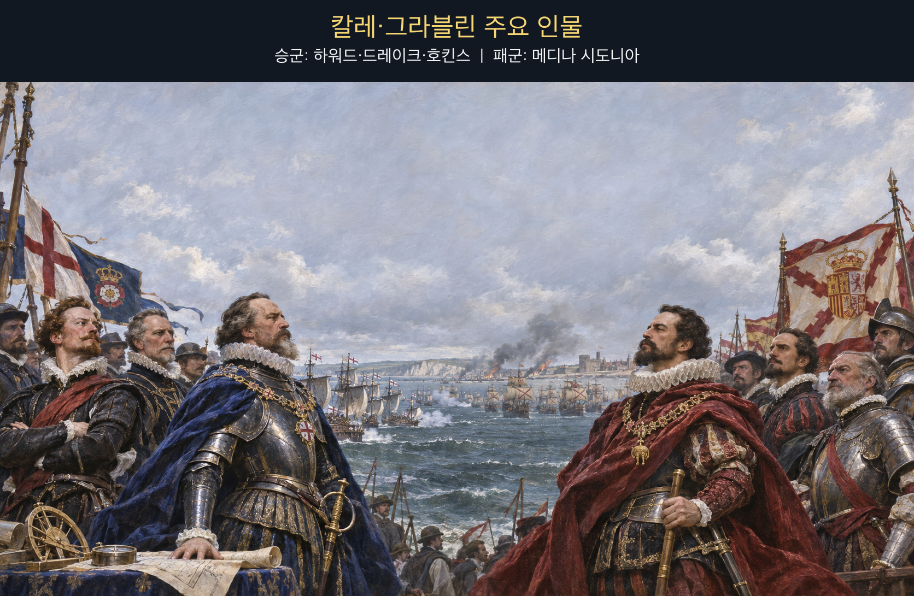

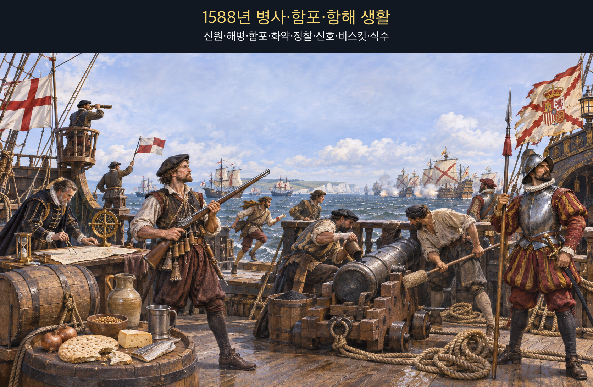

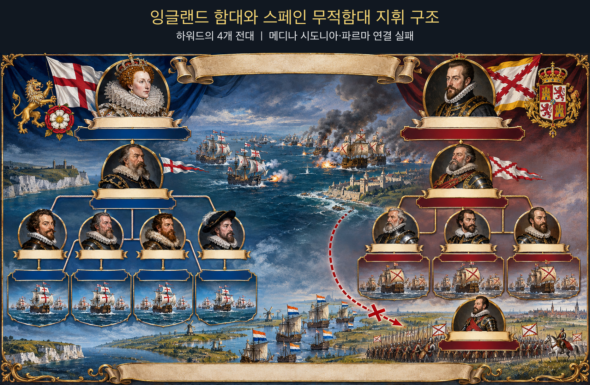

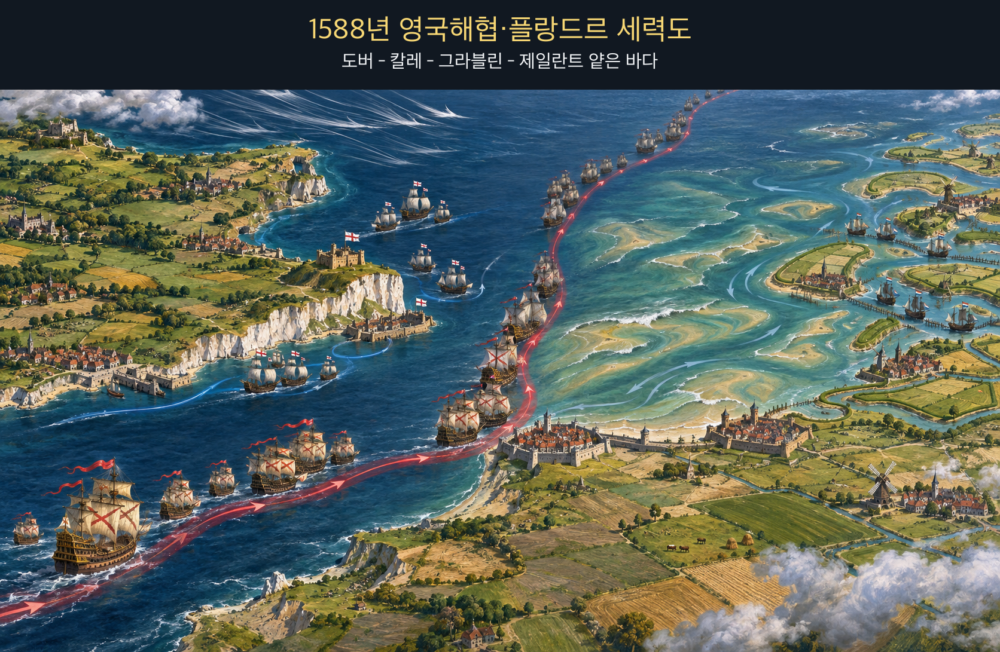

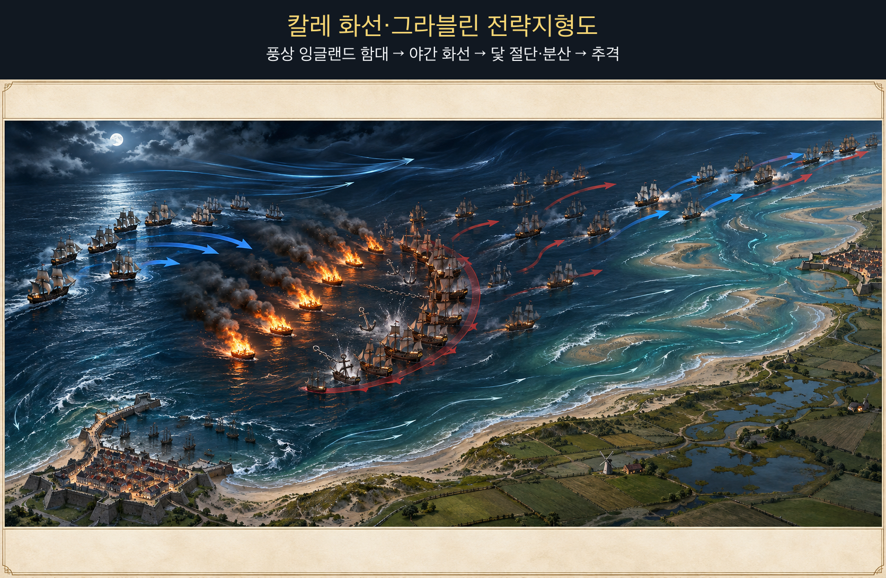

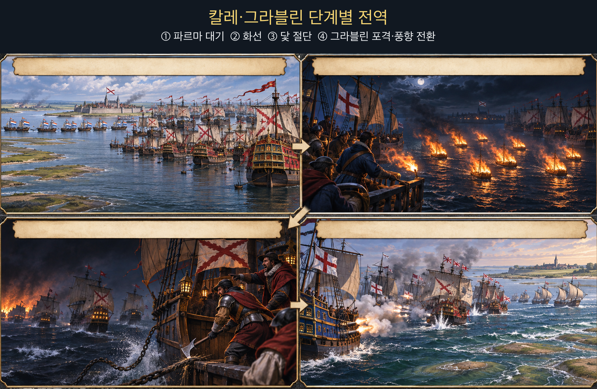

**뒤에서 반복될 지형을 먼저 잡아두기**

- 🌊 **영국해협(English Channel)**은 무적함대가 서쪽에서 칼레로 올라온 좁은 접근축이다. 잉글랜드 함대는 풍상 위치를 유지하며 뒤를 따랐다.
- **▰** **칼레(Calais)** 정박지는 파르마군을 기다리는 곳이었지만 방파된 항구가 아니어서 화선과 조류에 노출됐다.
- 🌊 **플랑드르 수로(Flemish waterways)**는 파르마군의 승선로였으나 네덜란드 함대가 봉쇄해 무적함대와 육군의 결합을 막았다.
- **▰** **그라블린(Gravelines)** 앞바다는 흩어진 선단이 다음 날 근거리 포격을 받은 결전 공간이었다.
- 🌊 **제일란트 얕은 바다(Zeeland shoals)**는 8월 9일 스페인 함대를 좌초 직전까지 몰았으나 갑작스러운 풍향 전환이 퇴로를 열었다.

#### 상세 전역 서사 — 파르마를 기다리는 고정 정박이 야간 화선의 창을 열다

**메디나 시도니아 공작(Alonso Pérez de Guzmán, Duke of Medina Sidonia)**의 무적함대는 파르마 공작의 플랑드르군과 합류하려고 칼레 앞에 닻을 내렸다. 그러나 네덜란드 함대가 연안 수로를 막아 파르마군은 제때 나오지 못했고, 스페인 함대는 목적을 이루지 못한 채 노출된 정박지에 머물렀다. **하워드 경(Lord Howard of Effingham)**은 정면 포격의 낮은 효과를 확인한 뒤 전략을 바꾸었다.

8월 7일 밤 잉글랜드군은 화선 여덟 척을 풍상에서 흘려보냈다. 불타는 배가 밀려오자 스페인 함장들은 충돌과 폭발을 피하려 닻줄을 끊었다. 실제 화선이 대규모로 적함을 태운 것이 아니라, 어둠·바람·조류 속에서 대형을 해체한 것이 결정적 효과였다. 다음 날 **드레이크(Francis Drake)**·**호킨스(John Hawkins)** 등이 흩어진 함대를 그라블린 앞에서 근거리 포격했다.

8월 9일 강풍은 스페인 함대를 제일란트의 얕은 바다로 밀어 좌초 위험을 키웠다. 그런데 바람이 갑자기 유리하게 바뀌어 선단은 해안에서 벗어났다. 같은 바람이 밤에는 화선과 분산을 돕고, 뒤에는 패군을 전멸에서 구했다. 이 전역은 `數守之`가 한 번의 성공 공식을 외우는 일이 아니라 **시간대마다 풍향·조류·진형·보급을 다시 읽는 일**임을 보여 준다.

#### 전투에서 사용된 속임수 — 화선의 실제 파괴력보다 크게 보인 위협

화선은 불붙은 무인 선박이라는 공개된 위협이었지만, 스페인군은 그것이 단순 화선인지 화약을 가득 실은 폭발선인지 어둠 속에서 확인하기 어려웠다. 정박 대형 안에서 한 척이 불붙으면 연쇄 피해가 날 수 있었으므로 닻을 버린 회피는 비합리적 공황만은 아니었다. 잉글랜드군의 의도는 배 여덟 척으로 함대를 소각하는 것보다 결속된 진형을 풀어 다음 날 포격의 표적으로 만드는 데 있었다.

#### 속임수 작동 구조

**주체와 의도.** 잉글랜드 지휘부는 화선을 보내 스페인의 정박 대형과 지휘 연결을 해체하려 했다.

**보인 신호와 믿은 이유.** 불붙은 배와 야간 조류는 폭발·연쇄 화재 가능성을 크게 보였고, 칼레 정박지는 회피 공간이 좁았다.

**유발된 행동과 결과.** 스페인 함선들은 닻줄을 끊어 흩어졌고, 다음 날 그라블린에서 상호지원이 약한 상태로 포격을 받았다.

**사료의 경계.** 화선이 직접 태운 함선 수보다 진형 해체 효과가 컸다. 이후 폭풍 피해까지 모두 잉글랜드의 계획으로 돌려서는 안 된다.

#### 속임수 일곱 질문

1. **누가 누구를 속였는가?** 잉글랜드 지휘부가 스페인 정박 함대의 위협 판단을 흔들었다.
2. **어떤 사실이 거짓이었는가?** 화선 자체는 실제였으나 폭발선일 수 있다는 공포는 확인되지 않았다.
3. **어떤 사실은 진실이지만 오해를 유도했는가?** 불붙은 배는 진짜 위험이었지만 직접 소각보다 진형 해체가 목적이었다.
4. **상대는 왜 그것을 믿고 싶어 했는가?** 믿고 싶었다기보다 닻을 유지할 때의 연쇄 화재 위험이 너무 컸다.
5. **속임수가 없었어도 같은 오판이 발생했을까?** 가능성은 낮다. 화선이 없었다면 야간에 닻을 버릴 직접 계기가 약했다.
6. **속은 사람은 어떤 독립 확인을 생략했는가?** 어둠과 조류 때문에 화선의 적재물·간격·회피 가능성을 충분히 확인하기 어려웠다.
7. **신뢰·동의·안전을 해치지 않으면서 같은 원리를 어디서 연습할 수 있는가?** 해상 시뮬레이션과 보드게임에서 위협의 실제 피해와 진형 교란 효과를 분리해 평가할 수 있다.

#### 시계편 兵者詭道也 — 이 전장에 해당하는 속이는 길

<table fit-page-width="true" header-row="true">
<tr><td>해당 구절·독음·뜻</td><td>전장의 장면</td></tr>
<tr><td>近而示之遠 근이시지원 — 가까우면서 멀리 있는 듯 보인다</td><td>화선의 작은 직접 타격 수단이 야간에는 대규모 폭발·연쇄 화재 가능성으로 보였다.</td></tr>
</table>

#### 法 한눈 비교 — 곡제·관도·주용

<table fit-page-width="true" header-row="true">
<tr><td>진영</td><td>곡제(편제)</td><td>관도(지휘)</td><td>주용(보급·지속)</td></tr>
<tr><td>**잉글랜드군**</td><td>네 전대와 동부 증원대를 화선·추격·포격에 연결했다.</td><td>**하워드**가 전략을 바꾸고 전대장들이 근거리 교전을 수행했다.</td><td>탄약 부족이 추격 한계를 만들었으나 짧은 해협 작전과 자국 항구가 버팀목이었다.</td></tr>
<tr><td>**스페인군**</td><td>초승달 대형은 항해 중 강했지만 닻을 잃은 뒤 재결집이 어려웠다.</td><td>**메디나 시도니아**의 함대와 파르마군은 봉쇄 때문에 연결되지 못했다.</td><td>화약·탄약 부족, 손상, 장거리 귀환이 지속 능력을 깎았다.</td></tr>
</table>

#### **메디나 시도니아 (패)**

<table fit-page-width="true" header-row="true">
<tr><td>요소</td><td>판단</td></tr>
<tr><td color="orange_bg">🤝 **道**</td><td>함대는 규율을 유지했으나 파르마군과 결합하지 못해 침공 목적이 흔들렸다. (지기·사기)</td></tr>
<tr><td color="blue_bg">🌤️ **天**</td><td>야간 바람·조류·화선 위협에 즉시 반응했지만 닻을 버린 뒤 아침 진형 회복까지 설계하지 못했다. (지피·타이밍·확률 관점)</td></tr>
<tr><td color="green_bg">🧭 **地**</td><td>열린 칼레 정박지와 플랑드르 얕은 바다는 대형 유지와 파르마 합류에 불리했다. (원근·험이·사생)</td></tr>
<tr><td color="purple_bg">🎖️ **將**</td><td>질서 있는 북해 철수를 이끌었지만 합류 불능과 기상 변화에 맞춰 작전 목적을 일찍 바꾸지 못했다. (지신인용엄)</td></tr>
<tr><td color="yellow_bg">⚙️ **法**</td><td>함대·상륙군·연안 수송이 하나의 통제 가능한 체계로 결합되지 않았다. (곡제·관도·주용)</td></tr>
</table>

**직관·편향 한 줄:** **메디나 시도니아**가 파르마군과의 합류를 계속 중심 시나리오로 둔 판단에는 계획 오류가 작동했을 가능성이 있으며, 봉쇄와 정박 위험이 커진 뒤에도 대안 목표 전환을 늦췄다.

🏳️ **패군 측 결과**: 침공군과 합류하지 못하고 그라블린에서 손상된 뒤 북해로 밀려 돌아가 `北(배)`—적정·지형·지속 능력을 충분히 헤아리지 못한 퇴각—에 가까운 결과를 맞았다.

🔀 **패군 측 회피 분기점**: 파르마군의 수로 봉쇄가 풀리지 않는다는 보고를 받았을 때 노출된 칼레 정박을 중단하고 재정비 가능한 해역으로 이동했다면 침공 성공을 보장할 수는 없어도 닻 상실과 전열 분산은 줄일 수 있었다.

#### **하워드 (승)**

<table fit-page-width="true" header-row="true">
<tr><td>요소</td><td>판단</td></tr>
<tr><td color="orange_bg">🤝 **道**</td><td>전대장들이 장거리 포격의 한계를 공유하고 화선 이후 근거리 추격으로 전환했다. (지기·사기)</td></tr>
<tr><td color="blue_bg">🌤️ **天**</td><td>풍상 위치와 야간 조류를 이용하되 다음 날의 바람까지 통제한다고 가정하지 않았다. (지피·타이밍·확률 관점)</td></tr>
<tr><td color="green_bg">🧭 **地**</td><td>칼레 정박지의 노출과 그라블린·제일란트의 얕은 바다를 압박 공간으로 활용했다. (원근·광협·사생)</td></tr>
<tr><td color="purple_bg">🎖️ **將**</td><td>효과 낮은 포격을 반복하지 않고 화선으로 진형을 흔든 뒤 가까이 붙는 전략 변화를 승인했다. (지신인용엄)</td></tr>
<tr><td color="yellow_bg">⚙️ **法**</td><td>화선·전대·네덜란드 봉쇄·동부 증원을 서로 다른 임무로 결합했다. (곡제·관도·주용)</td></tr>
</table>

🏆 **승군 측 결과**: `以虞待不虞者勝(이우대불우자승 — 대비한 채 대비 없는 적을 상대하는 자가 이긴다)`처럼 정박한 적의 변화를 유도하고 다음 날 가까운 거리에서 타격했다.

##### 法을 압축하지 않고 보기 — 곡제·관도·주용

**곡제 曲制(곡제): 부대를 어떻게 나누고 결합했는가**
<table fit-page-width="true" header-row="true">
<tr><td>진영</td><td>실제 운용</td></tr>
<tr><td>**잉글랜드군**</td><td>전대를 분리 운용하면서 화선·추격·포격을 시간차로 결합했다.</td></tr>
<tr><td>**스페인군**</td><td>초승달 대형과 수송 보호 편제는 닻 절단 뒤 개별 함선으로 흩어졌다.</td></tr>
</table>

**관도 官道(관도): 누가 명령하고 어떻게 전달했는가**
<table fit-page-width="true" header-row="true">
<tr><td>진영</td><td>실제 운용</td></tr>
<tr><td>**잉글랜드군**</td><td>**하워드** 아래 전대장들이 기동 재량을 갖고 흩어진 적을 압박했다.</td></tr>
<tr><td>**스페인군**</td><td>**메디나 시도니아**의 신호 체계는 야간 분산과 닻 상실 뒤 재결집에 시간이 걸렸다.</td></tr>
</table>

**주용 主用(주용): 군량·장비·전투 지속 능력을 어떻게 썼는가**
<table fit-page-width="true" header-row="true">
<tr><td>진영</td><td>실제 운용</td></tr>
<tr><td>**잉글랜드군**</td><td>자국 연안에서 보급했지만 화약·탄약 부족 때문에 북해 추격을 끝까지 계속하지 못했다.</td></tr>
<tr><td>**스페인군**</td><td>탄약 부족과 손상, 닻 상실이 북해·대서양 우회 귀환의 위험을 키웠다.</td></tr>
</table>

**출처:** [Royal Museums Greenwich — Spanish Armada charts and campaign chronology](https://www.rmg.co.uk/collections/research-guides/research-guide-p3-charts-spanish-armada-robert-adams-museum) · [Encyclopaedia Britannica — Spanish Armada](https://www.britannica.com/topic/Armada-Spanish-naval-fleet)

### 동양 — ⚔️ 손권·유비 연합군 vs 🏛️ 조조군 │ 적벽대전(赤壁之戰, 208)

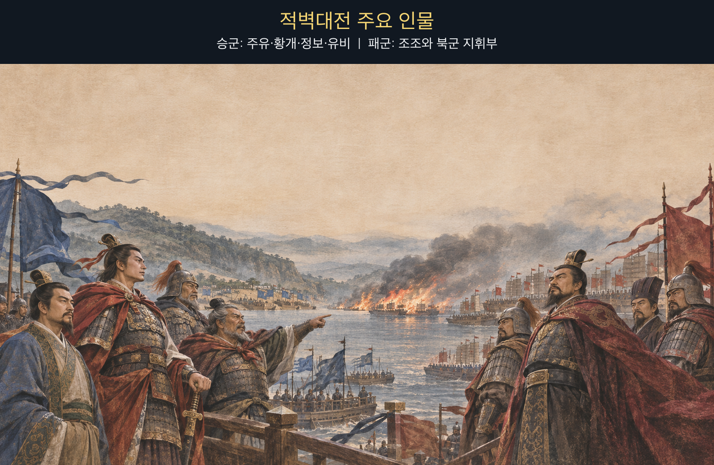

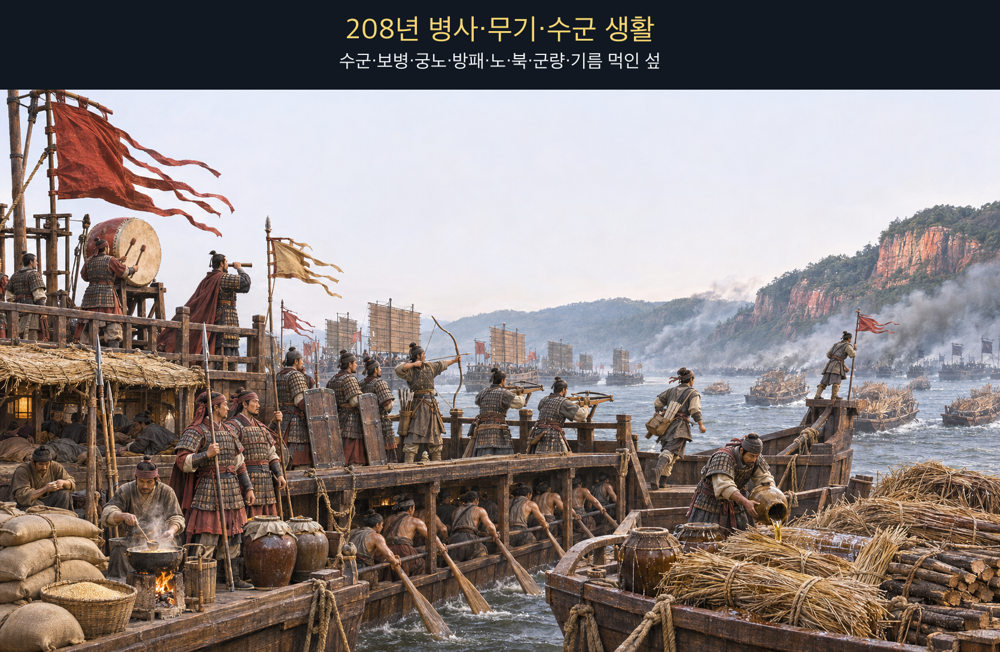

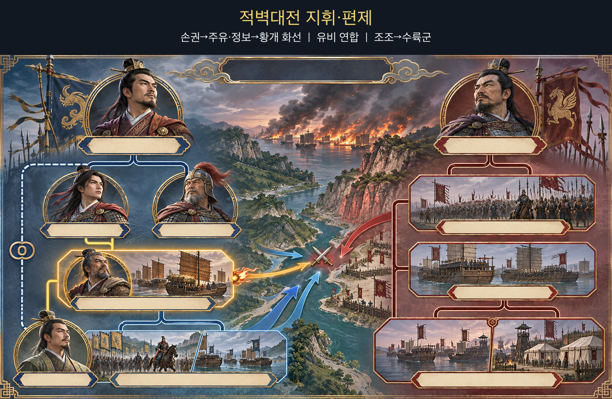

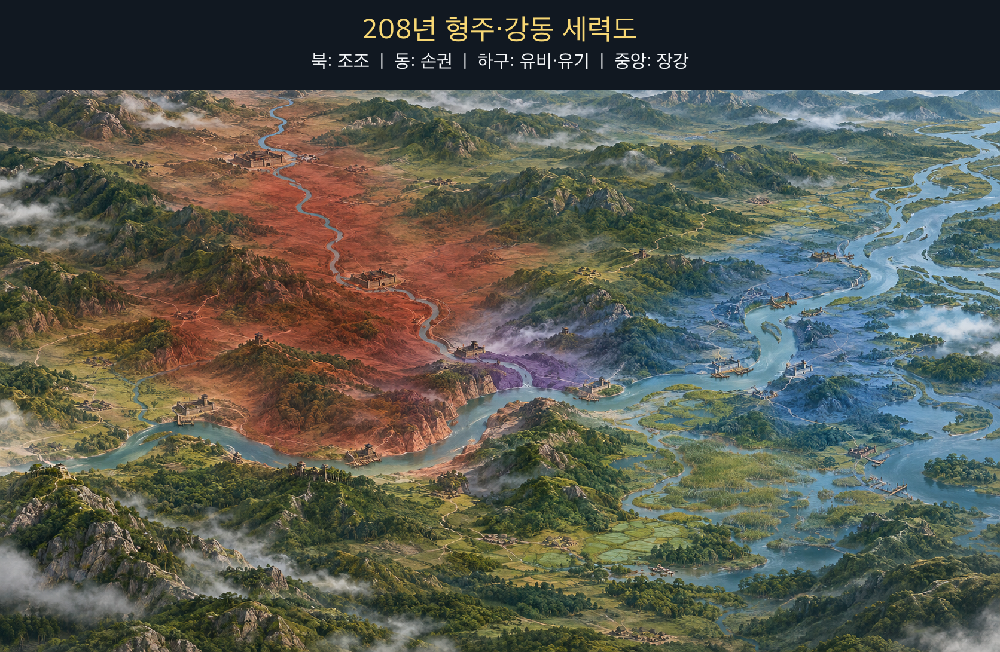

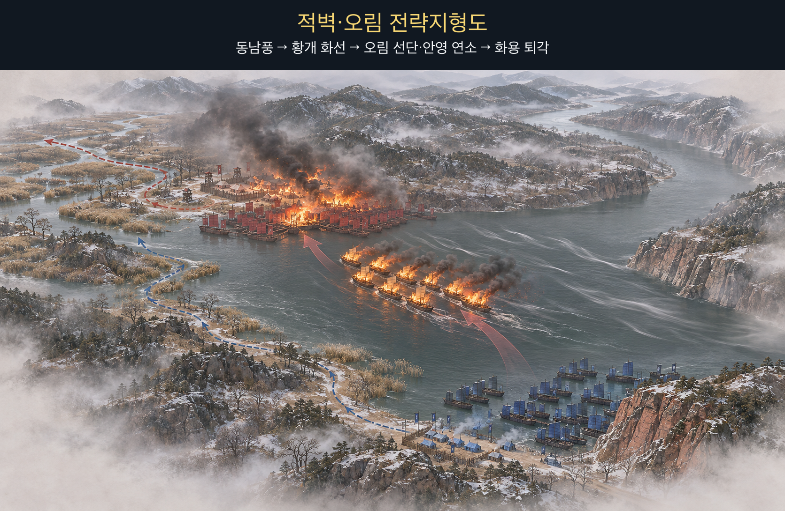

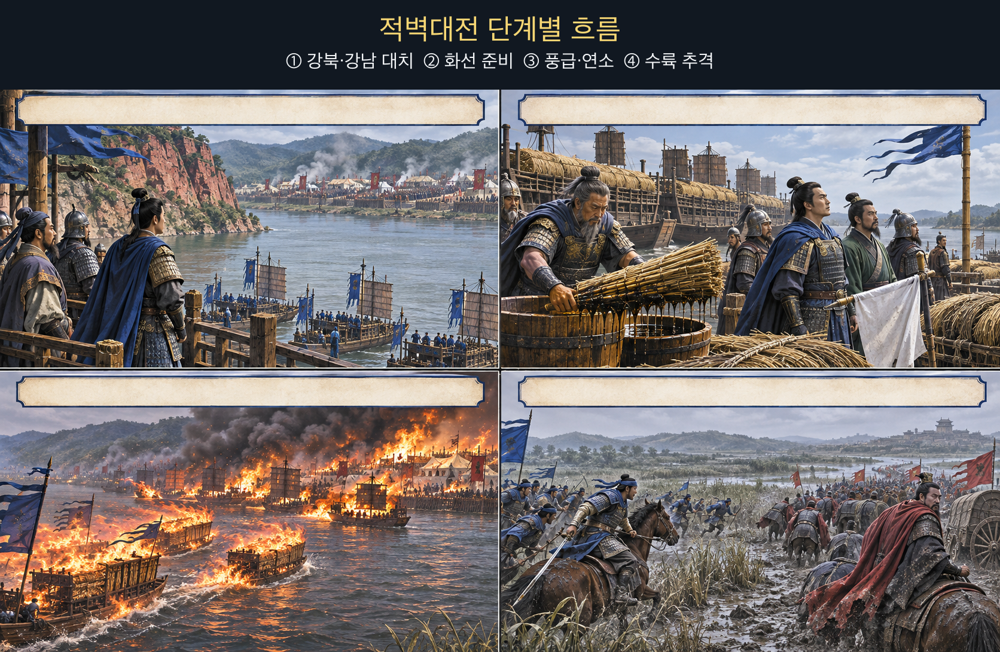

**뒤에서 반복될 지형을 먼저 잡아두기**

- 🌊 **장강(長江)**은 조조의 북방군이 익숙하지 않은 수전 공간이자 연합군이 화선과 추격을 연결한 주축이다.
- **▰** **적벽(赤壁)** 남안은 주유군이 조조군과 마주한 지점이다.
- **▰** **오림(烏林)** 북안은 조조 선단과 육상 영채가 붙어 있어 화재가 배에서 언덕의 군영으로 번질 수 있었다.
- 🌲 **화용도(華容道)**와 주변 늪지는 조조군이 강릉 쪽으로 퇴각한 진흙길로, 화재 뒤의 혼란과 추격 피해를 키웠다.
- **▰** **강릉(江陵)**은 조조가 남은 병력을 수습하고 수비대를 남긴 후방 거점이었다.

#### 상세 전역 서사 — 황개가 동남풍의 짧은 창에 화선과 후속 공격을 묶다

조조군은 첫 교전과 질병으로 물러나 장강 북안 오림에 정박했고, **주유(周瑜)**·**정보(程普)**의 군은 남안에 섰다. **황개(黃蓋)**는 적선이 밀집해 서로 이어진 상태를 보고 마른 갈대와 땔나무에 기름을 부은 배를 준비했다. 그는 거짓 항복 서신을 보내 접근의 의심을 낮추었다.

『삼국지』 주유전 주석이 인용한 기록은 `時東南風急`(시동남풍급 — 그때 동남풍이 세찼다)이라 전한다. 황개의 앞선 배들은 강 가운데 돛을 올리고 북서쪽 오림으로 달려가 적선 약 이 리 앞에서 동시에 불을 붙였다. `火烈風猛, 船往如箭`(화렬풍맹, 선왕여전 — 불은 사납고 바람은 거세어 배가 화살처럼 나아갔다)고 할 만큼 불과 바람이 결합했고, 불은 북군의 배와 강가 영채로 번졌다.

연합군의 경장 병력이 불길을 따라 수륙으로 진격하자 이미 질병과 수전 미숙에 시달리던 조조군은 무너졌다. 조조는 남은 배를 스스로 태우고 화용의 진흙길을 거쳐 강릉으로 물러났다. 다만 제갈량이 제단에서 바람을 빌렸다는 이야기는 후대 『삼국연의』의 서사이며 정사에서 확인되지 않는다. 역사적으로 확인되는 것은 **황개가 실제 동남풍이 강한 순간에 화선·기만·후속 공격을 결합했다는 점**이다.

#### 전투에서 사용된 속임수 — 항복선으로 보인 화선

황개는 항복 의사를 미리 알리고, 불붙일 배 뒤에 도주용 작은 배를 매달았다. 조조군은 접근하는 선단을 투항선으로 보고 갑판에 나와 바라보았다고 전한다. 실제 의도는 항복이 아니라 바람을 받아 적 선단에 충돌할 화공이었고, 신호를 믿은 순간 경계와 차단 거리가 사라졌다.

#### 속임수 작동 구조

**주체와 의도.** 황개와 주유는 거짓 항복으로 화선을 적 선단 가까이 들여보내려 했다.

**보인 신호와 믿은 이유.** 항복 서신·깃발·선두 함선은 열세 진영의 이탈처럼 보였고 조조군은 실제로 형주 수군의 항복을 이미 경험했다.

**유발된 행동과 결과.** 조조군은 접근선을 조기에 공격하지 않았고, 강한 동남풍 아래 화선이 짧은 거리를 돌파해 밀집 선단과 영채에 불을 옮겼다.

**사료의 경계.** 동남풍과 화공은 기록되지만 ‘제갈량의 차풍’은 정사 사실이 아니다. 전염병·수전 미숙·첫 교전 패배도 함께 작용했다.

#### 속임수 일곱 질문

1. **누가 누구를 속였는가?** 황개와 주유가 조조군을 거짓 항복 신호로 속였다.
2. **어떤 사실이 거짓이었는가?** 황개가 조조에게 투항한다는 의사였다.
3. **어떤 사실은 진실이지만 오해를 유도했는가?** 열세 연합군 내부에서 이탈이 생길 수 있다는 가능성 자체는 그럴듯했다.
4. **상대는 왜 그것을 믿고 싶어 했는가?** 조조군은 형주 세력의 연속 항복을 이미 경험해 같은 패턴을 기대할 근거가 있었다.
5. **속임수가 없었어도 같은 오판이 발생했을까?** 가능성은 낮다. 항복 서신이 없었다면 접근선은 더 일찍 차단됐을 것이다.
6. **속은 사람은 어떤 독립 확인을 생략했는가?** 접근선의 정지·검색과 풍상 화공 위험의 재평가를 생략했다.
7. **신뢰·동의·안전을 해치지 않으면서 같은 원리를 어디서 연습할 수 있는가?** 체스·바둑·해전 게임에서 미끼와 실제 주공을 구분하는 훈련으로 연습할 수 있다.

#### 시계편 兵者詭道也 — 이 전장에 해당하는 속이는 길

<table fit-page-width="true" header-row="true">
<tr><td>해당 구절·독음·뜻</td><td>전장의 장면</td></tr>
<tr><td>近而示之遠 근이시지원 — 가까우면서 멀리 있는 듯 보인다</td><td>공격용 화선이 항복선으로 보여 경계 거리 안까지 들어갔다.</td></tr>
<tr><td>利而誘之 리이유지 — 이익을 보여 유인한다</td><td>황개의 투항이라는 이익이 조조군으로 하여금 접근선을 받아들이게 했다.</td></tr>
</table>

#### 法 한눈 비교 — 곡제·관도·주용

<table fit-page-width="true" header-row="true">
<tr><td>진영</td><td>곡제(편제)</td><td>관도(지휘)</td><td>주용(보급·지속)</td></tr>
<tr><td>**손·유 연합군**</td><td>화선·도주선·경장 수륙 추격대를 연결했다.</td><td>**주유**가 **황개**의 건의를 승인하고 후속군을 붙였다.</td><td>현지 수군·선박·강풍의 짧은 창을 집중 사용했다.</td></tr>
<tr><td>**조조군**</td><td>북방군·형주 수군·육상 영채가 밀집해 연쇄 화재에 취약했다.</td><td>**조조**의 대군은 질병과 화재 뒤 명령 전달이 무너졌다.</td><td>질병·말 먹이·장거리 원정의 부담이 전투 지속력을 낮췄다.</td></tr>
</table>

#### **조조 (패)**

<table fit-page-width="true" header-row="true">
<tr><td>요소</td><td>판단</td></tr>
<tr><td color="orange_bg">🤝 **道**</td><td>새로 얻은 형주 병력과 북방 주력이 질병·낯선 수전 속에서 하나로 결속되지 못했다. (지기·사기)</td></tr>
<tr><td color="blue_bg">🌤️ **天**</td><td>거짓 항복선과 동남풍이 겹칠 가능성을 낮게 보고, 풍향이 바뀐 순간 경계를 갱신하지 못했다. (지피·타이밍·확률 관점)</td></tr>
<tr><td color="green_bg">🧭 **地**</td><td>북안 오림의 밀집 선단과 영채는 불이 배에서 육지로 번지는 연속 표적이 됐다. (험이·광협·사생)</td></tr>
<tr><td color="purple_bg">🎖️ **將**</td><td>형주를 빠르게 얻은 성공을 강동 수전에도 연장하고 항복 신호를 독립 확인하지 않았다. (지신인용엄)</td></tr>
<tr><td color="yellow_bg">⚙️ **法**</td><td>대군·항복 수군·선박·영채의 결합이 화재 격리와 신속한 이탈을 어렵게 했다. (곡제·관도·주용)</td></tr>
</table>

**직관·편향 한 줄:** **조조**가 앞선 연속 항복 경험을 황개의 신호에도 적용한 판단에는 대표성 휴리스틱이 작동했을 가능성이 있으며, 풍향과 접근선의 위험을 재검증하지 못하게 했다.

🏳️ **패군 측 결과**: 선단과 영채가 불타고 질병·진흙길·추격 피해가 겹쳐 `北(배)`의 패주로 남정이 중단됐다.

🔀 **패군 측 회피 분기점**: 항복선을 원거리에서 정지시켜 소형선으로 확인하고 선단 사이에 방화 간격과 견인 가능한 예비를 뒀다면 전쟁 승리를 보장할 수는 없어도 화재의 연쇄 확산과 전군 붕괴는 줄일 수 있었다.

#### **주유·황개 (승)**

<table fit-page-width="true" header-row="true">
<tr><td>요소</td><td>판단</td></tr>
<tr><td color="orange_bg">🤝 **道**</td><td>손권의 항전 결심 아래 주유·정보·황개와 유비군이 같은 목표로 움직였다. (지기·사기)</td></tr>
<tr><td color="blue_bg">🌤️ **天**</td><td>동남풍을 만들어 냈다고 과장하지 않고, 실제로 강해진 짧은 시간창에 준비한 화선을 투입했다. (지피·타이밍·확률 관점)</td></tr>
<tr><td color="green_bg">🧭 **地**</td><td>남안에서 북안 오림으로 부는 바람과 장강의 수로를 접근·연소·추격에 연결했다. (험이·광협·사생)</td></tr>
<tr><td color="purple_bg">🎖️ **將**</td><td>**황개**의 건의를 **주유**가 받아들여 기만·화공·후속 타격을 한 시간표로 만들었다. (지신인용엄)</td></tr>
<tr><td color="yellow_bg">⚙️ **法**</td><td>화선 뒤에 도주선을 매고 경장 수륙군을 대기시켜 불만 보내고 끝내지 않았다. (곡제·관도·주용)</td></tr>
</table>

🏆 **승군 측 결과**: `知可以戰與不可以戰者勝(지가이전여불가이전자승 — 싸울 수 있는 때와 없는 때를 아는 자가 이긴다)`처럼 준비를 끝낸 뒤 풍향이 맞는 순간에만 불과 병력을 함께 보냈다.

##### 法을 압축하지 않고 보기 — 곡제·관도·주용

**곡제 曲制(곡제): 부대를 어떻게 나누고 결합했는가**
<table fit-page-width="true" header-row="true">
<tr><td>진영</td><td>실제 운용</td></tr>
<tr><td>**연합군**</td><td>황개의 화선·도주선, 주유의 수군, 유비의 수륙 추격대를 단계별로 결합했다.</td></tr>
<tr><td>**조조군**</td><td>북방 보병·형주 수군·밀집 선박·육상 영채가 화재 격리 없이 붙어 있었다.</td></tr>
</table>

**관도 官道(관도): 누가 명령하고 어떻게 전달했는가**
<table fit-page-width="true" header-row="true">
<tr><td>진영</td><td>실제 운용</td></tr>
<tr><td>**연합군**</td><td>**주유**가 화공을 승인하고 **황개**가 선두 화선을 지휘했으며 후속군은 신호에 맞춰 진격했다.</td></tr>
<tr><td>**조조군**</td><td>항복 신호를 받아들이는 중앙 판단이 접근 차단보다 앞섰고 화재 뒤 수륙 지휘가 함께 흔들렸다.</td></tr>
</table>

**주용 主用(주용): 군량·장비·전투 지속 능력을 어떻게 썼는가**
<table fit-page-width="true" header-row="true">
<tr><td>진영</td><td>실제 운용</td></tr>
<tr><td>**연합군**</td><td>마른 섶·기름·가벼운 선박과 현지 수군 경험을 짧은 결정적 공격에 집중했다.</td></tr>
<tr><td>**조조군**</td><td>질병과 장거리 원정 부담 속에서 선단·영채·말·군량을 한꺼번에 지키기 어려웠다.</td></tr>
</table>

**출처:** [중화민국 국방부 육군학술쌍월간 — 적벽전역 연구](https://www.mnd.gov.tw/File/30767) · [『삼국지』 오서 주유전](https://zh.wikisource.org/wiki/%E4%B8%89%E5%9C%8B%E5%BF%97/%E5%8D%B754)

---
## 5. 핵심 통찰 + 실생활 적용 + 생활루틴

### 핵심 통찰

이 구절의 핵심은 **현재의 유리한 조건을 자산처럼 소유했다고 착각하지 말라**는 데 있다. 낮바람이 오래 불어도 밤에는 멎을 수 있고, 같은 불도 어느 표적에 닿았는지에 따라 다른 변화를 만든다. 좋은 지휘는 첫 판단을 강하게 고집하는 능력이 아니라, 그 판단의 유효기간과 재확인 시점을 미리 정하는 능력이다.

`數守之`는 조급한 반복 확인도 아니다. 모든 순간을 감시하면 주의가 고갈되고 정작 중요한 신호를 놓친다. 무엇이 바뀌면 계획이 무효가 되는지 먼저 정하고, 그 변수에 맞는 주기와 담당자를 두어 확인한다. **관측값·확인 시각·전환 기준** 세 가지가 있어야 기다림이 수동적인 방치가 아니라 준비된 경계가 된다.

### 실생활 적용

3교대 현장에서는 교대 초기에 정상으로 보였던 설비나 작업 조건을 근무 끝까지 그대로라고 가정하지 않는다. 온도·압력·알람·작업자 위치처럼 사고 전개를 바꾸는 값은 정해진 시각과 사건 발생 뒤에 다시 확인한다. “아까 봤다”와 “지금 확인했다”를 구분해 기록하고, 기준을 벗어나면 기존 조치의 체면을 지키지 말고 중단·상위 보고·인계로 전환한다.

전씨가 단순 조치에서는 말을 이어 가다가 복잡한 조치에서 당황하고 소통이 줄어드는 것으로 관찰된 기록은, 사람의 상태 또한 고정값이 아님을 보여 준다. 이를 성격 진단으로 단정하지 말고, 복잡도·피로·신체 상태가 바뀔 때 보고 방식도 달라질 수 있는 **조건부 패턴**으로 다룬다. 다음 복잡한 조치에서는 시작 전에 역할과 재확인 시각을 정하고, 말이 줄거나 작업이 끊기면 비난보다 현재 수치·다음 행동·지원 필요 여부를 짧게 복명복창한다.

서비스 배포나 파일 작업에서는 성공한 첫 단계가 끝까지 이어질 것이라 믿지 않는다. 배포 전에는 확인 시각, 성공 지표, 중단 기준, 롤백 담당자를 적고, 실행 중에는 정한 시점마다 새 상태를 읽는다. 특히 오래 정상으로 보였다는 이유로 감시를 끄면 마지막 변화가 가장 늦게 발견된다. 반대로 위험을 생생하게 떠올린다는 이유만으로 모든 가능성을 같은 크기로 취급하지 말고, 관측 빈도와 실제 발생률을 함께 본다.

### 생활루틴

**정한 때에 조건을 다시 확인하지 않으면 재수가 없다.**

**이유:** 낮에 오래 유지된 정상 상태를 밤까지 그대로라고 믿으면, 변화가 생긴 뒤에도 낡은 판단으로 행동하게 된다. 작은 재확인 누락이 잘못된 작업 지속과 늦은 보고로 이어지고, 교대 뒤에는 책임과 복구 비용까지 커진다. 오늘은 작업을 시작할 때 `다음 확인 시각 1개 / 바뀌면 멈출 값 1개 / 보고할 사람 1명`을 적는다. 이는 `晝風久, 夜風止`의 변화와 `以數守之`의 반복 경계를 일상에서 실행하는 최소 단위다.
