> 고위병지사, 재어순상적지의, 병적일향, 천리살장, 시위교능성사자야. — 적이 바라는 방향을 거스르지 않는 듯 세밀히 따라가되, 결정할 때는 힘을 한 방향에 합쳐 천 리 밖의 지휘 중심까지 끊어라.

---

## 1. 원문 + 독음 + 직역 + 한자어 뜻풀이

故爲兵之事, 在於順祥敵之意, 幷敵一向, 千里殺將, 是謂巧能成事者也. 고위병지사, 재어순상적지의, 병적일향, 천리살장, 시위교능성사자야.

**직역**

그러므로 군대를 부리는 일은 적의 뜻을 따라 세밀히 살피는 데 있고, 적을 향해 한 방향으로 병력을 합쳐 천 리 밖의 장수를 죽이는 데 있으니, 이를 일러 교묘하게 일을 이루는 자라고 한다.

앞 구절은 아군을 害(해)에 빠뜨려 승패를 만들어 낼 결의를 끌어냈다. 그러나 결의만으로는 아직 적장이 쓰러지지 않는다. 이 구절은 안에서 모은 힘을 밖의 어느 한 점에 쓸 것인지를 설명한다. 처음에는 적의 意(의)를 따르는 듯 움직여 경계를 늦추고, 마지막에는 흩어졌던 병력을 一向(일향)에 합쳐 멀리 떨어진 지휘 중심을 단번에 친다. **따라감은 복종이 아니라 관찰과 위장이고, 한 방향은 맹목적 돌진이 아니라 오래 준비한 집중이다.**

#### 爲兵之事(위병지사) — 군대를 움직이는 ‘일’은 싸움보다 먼저 시작된다

**爲**(할 위)는 손으로 코끼리를 다루는 옛 자형에서 무엇을 만들고 행한다는 뜻으로 넓어졌다. **兵**(병사 병)은 무기를 두 손으로 드는 모습을 본뜬 글자이고, **事**(일 사)는 깃발이나 사냥 도구를 손에 쥐고 맡은 일을 수행하는 모습에서 직무와 사건을 뜻하게 됐다. 세 글자가 붙은 爲兵之事는 전투 당일의 공격만 가리키지 않는다. 적의 의도를 읽고, 의심하지 않게 움직이며, 결정적 표적에 병력을 모으는 전 과정을 장수가 맡아 완성해야 할 하나의 직무로 묶는다.

#### 順祥敵之意(순상적지의) — 적의 바람을 거스르지 않는 듯 따라가며 자세히 보다

**順**(순할 순)은 川(내 천)과 頁(머리 혈)이 결합해 물의 흐름을 따라 얼굴을 돌리는 모습을 품는다. 여기서는 적의 의도에 진짜 복종한다는 뜻이 아니라, 먼저 정면으로 거슬러 경계시키지 않고 그 흐름을 따라가는 듯 보인다는 뜻이다. Notion 정본의 **祥**(상서 상)은 示(보일 시)와 羊(양 양)이 결합한 형성자로 본뜻은 길한 징조지만, 이 자리에서는 통행본의 詳(자세할 상)과 통하는 표기로 보아 ‘자세히 헤아리다’의 뜻으로 읽는다. **敵之意**(적지의)는 적이 겉으로 내린 명령만이 아니라 무엇을 지키고 어디로 가고 싶어 하는지까지 포함한다. 따라서 順祥은 적의 기대를 그대로 승인하는 일이 아니라, 그 기대를 건드리지 않은 채 충분히 드러나게 만드는 동작이다.

#### 幷敵一向(병적일향) — 흩어진 힘을 적의 한 방향에 겹쳐 놓다

**幷**(아우를 병)은 두 사람이 나란히 붙어 서는 모습을 그려 합치고 나란히 한다는 뜻을 낳았다. **一**(한 일)은 수를 세는 첫 획이면서 흩어짐이 없는 하나를 나타내고, **向**(향할 향)은 창이 난 집을 본뜬 글자에서 마주 보는 방향이라는 뜻으로 발전했다. 幷敵一向의 문장 경계에는 여러 해석이 가능하지만, 이 문맥에서는 적의 한 표적·한 방향을 향해 아군의 힘을 합친다는 뜻이 자연스럽다. 앞의 順祥이 적에게 여러 가능성이 남아 있다고 믿게 만드는 시간이라면, 一向은 그 가능성을 아군 쪽에서 끝내고 실제 타격점을 하나로 좁히는 순간이다.

#### 千里殺將(천리살장) — 거리가 길어도 지휘 중심을 표적으로 삼다

**千里**(천리)는 정확히 천 리를 재었다기보다 본국에서 아주 먼 곳까지 깊숙이 들어간 원정 거리를 나타낸다. **殺**(죽일 살)은 생명을 끊고 세력을 줄인다는 뜻이며, **將**(장수 장)은 將의 옛 형태가 손으로 고기를 받들어 처리하는 모습과 관련되어 ‘거느리다’에서 ‘거느리는 사람’으로 뜻이 옮아갔다. 千里殺將은 긴 원정을 감수하면서도 아무 곳이나 소모적으로 치는 것이 아니라, 적군의 명령·결속·판단이 모이는 장수를 표적으로 삼으라는 말이다. 여기서 ‘죽인다’는 고대 전쟁의 직접적 표현이며, 현대의 조직 문제에 옮길 때는 사람을 해치는 뜻이 아니라 **문제를 계속 재생산하는 의사결정의 중심을 끊는 것**으로 제한해 읽어야 한다.

#### 巧能成事者(교능성사자) — 교묘함은 결과로 증명된다

**巧**(공교할 교)는 工(장인 공)과 丂(소리 고)가 결합한 형성자로, 재료를 정확히 다루는 솜씨를 가리킨다. **能**(능할 능)은 감당할 수 있는 힘, **成**(이룰 성)은 戈(창 과)를 든 채 성취를 지킨다는 자형 해석과 함께 일이 완결된 상태를 뜻한다. 손자는 적의 뜻을 읽었다거나 먼 거리를 행군했다는 과정만으로 巧라 부르지 않는다. 적을 안심시킨 시간과 한 방향에 집중한 힘이 실제로 적의 지휘 중심을 무너뜨려 事를 成했을 때에만 그 장수를 巧能成事者라 부른다.

#### 글자들이 완성하는 한 장면

장수는 먼저 爲兵之事라는 긴 직무를 맡는다. 곧장 적과 부딪치지 않고 順으로 그 흐름을 거스르지 않는 듯 따라가고, 祥으로 적의 意를 자세히 드러나게 만든다. 적이 예상한 장면을 믿고 경계를 한 방향에 고정하면, 아군은 幷으로 흩어진 힘을 겹치고 一向으로 실제 목표를 하나만 남긴다. 그렇게 千里의 거리를 견딘 기동이 마침내 적의 將에 닿아 지휘 중심을 끊는다. **따르는 듯한 관찰에서 한 점의 집중으로 전환해 실제 일을 끝내는 것**, 그것이 이 문장이 그리는 巧能成事다.

---

## 2. 전통 주석 기반 분석

- **조조(曹操)** — "적이 하려는 바를 먼저 좇는 듯 보여 의심을 풀어라. 그런 뒤 **병력을 한곳에 합쳐 멀리 있는 적장까지 취하라.**"
- **이전(李筌)** — "順은 굽혀 섬김이 아니라 적의 마음을 타고 들어가는 일이다. **그 뜻을 얻은 뒤에야 그 장수를 얻을 수 있다.**"
- **두목(杜牧)** — "적이 향하려는 곳을 따라 주는 듯하다가, 허점이 드러나면 군을 한 길로 합쳐라. **천 리의 먼 기동도 표적이 하나면 헛되지 않는다.**"
- **매요신(梅堯臣)** — "처음부터 내 뜻을 드러내 적의 뜻과 다투지 마라. **적이 의심하지 않을 때 힘을 합쳐 일을 끝내라.**"
- **장예(張預)** — "앞에서는 병사를 害에 빠뜨려 마음을 하나로 만들었고, 여기서는 그 하나 된 힘을 적장에게 돌린다. **안의 결속을 밖의 결정타로 이어라.**"
- **왕석(王晳)** — "順祥은 적의 뜻을 상세히 살피고 그 흐름을 타라는 말이지, 적의 명령을 따르라는 말이 아니다. **따름과 복종을 혼동하지 마라.**"
- **가림(賈林)** — "적의 뜻이 드러나기 전에 성급히 한 방향을 고르면 도리어 내가 헤아려진다. **먼저 뜻을 얻고, 나중에 방향을 하나로 정하라.**"
- **두우(杜佑)** — "千里라 한 것은 군이 깊이 들어간 뒤에도 명령과 힘을 흩뜨리지 말라는 뜻이다. **먼 길일수록 장수의 표적을 잊지 마라.**"
- **진호(陳皞)** — "교묘하다는 이름은 속이는 모양에 있지 않고 成事에 있다. 적을 따르는 흉내만 내고 끝내지 못하면 재주가 아니다. **성과 없는 기교를 병법이라 부르지 마라.**"

아홉 주석은 세 단계로 모인다. 조조·이전·두목·매요신은 順祥을 적에게 복종하는 말이 아니라 적의 의심을 풀고 의도를 드러내게 하는 준비로 본다. 왕석·가림은 순서를 더 엄격히 가른다. 먼저 적의 뜻을 확인하기 전에 一向부터 정하면 오히려 아군의 의도가 노출되므로, 관찰과 집중의 순서를 뒤집지 말라는 것이다. 장예·두우·진호는 이 문장을 앞 구절과 결과에 연결한다. 害 속에서 하나가 된 아군의 힘을 먼 거리에서도 흩뜨리지 않고 적장에게 닿게 하며, 실제로 成事한 뒤에만 巧라는 평가를 받을 수 있다.

#### 리링의 고증과 현대적 독법

Notion 정본은 `順祥敵之意`로 적지만, 널리 전하는 십일가주 계통과 현대 판본에는 `順詳敵之意`가 보인다. 두 글자는 이 문장에서 모두 `상`으로 읽히며, 詳을 따르면 ‘적의 뜻을 자세히 살핀다’는 문법이 분명해진다. 祥을 그대로 보존해 읽을 때도 이를 ‘길조’로 억지 해석하기보다 詳과 통하는 고문자·전사 과정의 표기로 보는 편이 앞뒤 동사인 順·幷·殺·成과 잘 맞는다.

리링(李零)의 문헌학적 관점에서 중요한 것은 이문 하나를 기발한 철학으로 부풀리는 일이 아니라 문장 구조다. 앞의 35구절이 아군의 마음을 害 안에서 하나로 모았다면, 36구절은 `順祥敵之意 → 幷敵一向 → 千里殺將 → 成事`라는 작전의 순서를 제시한다. 적의 의도를 따라 드러나게 하고, 병력을 한 방향에 집중하고, 지휘 중심을 타격해 실제 일을 완성한다. 그러므로 이 문장은 ‘상대 비위를 맞추면 성공한다’는 처세술이 아니라, 깊이 들어간 원정군이 정보·집중·목표를 하나의 작전으로 묶는 고대 군사 지휘의 문장이다.

---

## 3. 교차 설명

### ① 손자병법 내 교차

바로 앞 35구절 `投之亡地然後存, 陷之死地然後生, 夫衆陷於害, 然後能爲勝敗`(투지망지연후존, 함지사지연후생, 부중함어해, 연후능위승패 — 멸망의 땅에 던진 뒤에야 보존되고 죽음의 땅에 빠뜨린 뒤에야 살아나며, 무리가 해로움에 빠진 뒤에야 승패를 이룬다)는 아군 내부의 조건을 만들었다. 36구절은 그 결속을 외부의 표적에 쓰는 방법이다. **35구절이 힘을 하나로 만드는 압력이라면, 36구절은 그 힘을 한 방향에 보내 일을 끝내는 조준이다.**

「허실편」의 `因形而錯勝於衆, 衆不能知`(인형이착승어중, 중불능지 — 드러난 형세를 따라 승리를 대중 앞에 두어도 사람들은 그 이치를 알지 못한다)와 `形兵之極, 至於無形`(형병지극, 지어무형 — 군대의 형세를 드러내는 극치는 무형에 이른다)도 順祥의 양면을 설명한다. 적에게는 기대한 형세를 보여 그 意가 계속 흐르게 하되, 실제로 幷할 방향은 감춘다. 또 9구절의 `先奪其所愛, 則聽矣`(선탈기소애, 즉청의 — 먼저 적이 아끼는 것을 빼앗으면 적이 이쪽 뜻을 듣는다)는 적의 반응을 강제로 끌어내는 방법이고, 이 구절의 順祥은 반대로 적의 자발적인 의도를 한동안 따라가며 충분히 드러나게 하는 방법이다.

### ② 클라우제비츠 『전쟁론』

클라우제비츠는 전쟁의 목표가 언제나 적 병력 전체를 물리적으로 없애는 데 있지 않고, 적의 힘이 모이는 ‘무게중심’을 식별해 타격하는 데 있다고 설명한다. 어떤 전쟁에서는 주력군이, 다른 전쟁에서는 수도·동맹·지도자의 의지가 그 중심이 된다. `千里殺將`은 이 가운데 적군의 명령과 결속이 모이는 將을 먼 거리에서도 놓치지 않는 경우에 해당한다. 둘 다 주변 목표를 넓게 건드리는 것보다 **적의 저항이 조직되는 중심에 힘을 집중하라**고 요구한다.

그러나 차이도 있다. 클라우제비츠의 무게중심은 정치적 목적과 전쟁 전체의 성격을 분석해 찾아야 하는 개념이라 언제나 한 명의 장수를 뜻하지 않는다. 반면 이 구절은 고대 원정군의 장면에서 지휘관을 직접 표적으로 든다. 따라서 현대에 `殺將`을 적용할 때 사람 하나를 희생양으로 삼는 식으로 좁히지 말고, 명령·자원·동맹을 실제로 결합하는 중심이 무엇인지 먼저 확인해야 한다.

### ③ 미야모토 무사시 『오륜서』

『오륜서』 화지권의 `枕を押さゆる`(마쿠라오 오사유루 — 베개를 누른다)는 상대가 머리를 들고 어떤 기술을 시작한 뒤에 대응하는 것이 아니라, 그 의도가 막 일어나는 머리에서부터 눌러 실행을 끊는다는 가르침이다. 이는 적의 意를 먼저 읽는다는 점에서 順祥敵之意와 만난다. 상대의 동작이 완성된 다음 쫓아가는 것이 아니라, 그가 무엇을 하려는지 드러나는 첫머리를 붙잡는다.

다만 무사시는 상대의 기술이 일어나지 못하게 선수를 잡는 데 무게를 두고, 이 구절은 적의 뜻을 잠시 따라가는 듯 보여 더 깊이 드러나게 한 다음 一向으로 전환한다. 하나는 발단에서 즉시 눌러 끊는 법이고, 다른 하나는 발단을 관찰하며 키운 뒤 결정적 중심을 치는 법이다. 어느 쪽을 택할지는 적의 의도를 이미 확실히 아는지, 더 드러나게 둘 여유가 있는지에 달려 있다.

### ④ 오자병법과 병가 사상

『오자병법』 「논장」은 `夫總文武者, 軍之將也; 兼剛柔者, 兵之事也`(부총문무자, 군지장야; 겸강유자, 병지사야 — 문과 무를 아우르는 자가 군의 장수이고, 강함과 부드러움을 겸하는 것이 군대의 일이다)라고 말한다. 이 구절의 順은 부드러움이고, 幷敵一向과 千里殺將은 강함이다. 적의 뜻을 좇는 듯한 유연함만 있으면 결정을 못 내리고, 한 방향으로 치는 강함만 있으면 적의 意를 읽지 못한 채 정면 충돌한다. **부드럽게 의도를 얻고 강하게 일을 끝내는 결합**이 두 병서의 공통점이다.

『육도』의 문무·용도 계열도 장수가 적의 허실과 동정을 살핀 뒤 병력을 한곳에 집중해야 한다고 거듭 말한다. 다만 『육도』가 군주·장수·병력의 제도와 권한 배분을 더 넓게 펼친다면, 이 문장은 順祥·幷·殺·成이라는 네 동작으로 원정 작전의 핵심만 압축한다.

### ⑤ 현대 심리학·군사학

현대 의사결정 연구에서 ‘진단성(diagnosticity)’은 관찰된 신호가 여러 가설 가운데 어느 하나를 실제로 더 잘 가려 주는지를 뜻한다. 적의 첫 움직임 하나를 보고 결론을 확정하면 확증편향에 빠지기 쉽다. 順祥敵之意는 상대가 예상한 흐름을 잠시 이어 가게 하여 추가 행동과 자원 배치를 보게 하고, 그 신호들이 같은 의도를 가리키는지 확인하는 절차로 읽을 수 있다. 이는 적의 마음을 신비롭게 꿰뚫는 능력이 아니라 **행동으로 드러난 증거를 더 모으는 일**이다.

군사학의 임무형 지휘(mission command)와 주력의 집중 원칙도 幷敵一向의 현대적 대응축이 된다. 상급자는 목적과 결정적 효과를 분명히 하되, 현장 부대가 변화에 맞춰 방법을 조정할 재량을 남긴다. 여기서 一向은 모든 부대가 같은 길로 몰려가라는 뜻이 아니라, 서로 다른 기동이 하나의 결정적 효과를 향하도록 만드는 것이다. 카너먼의 언어로 말하면, 처음 떠오른 이야기의 일관성만 믿는 ‘보이는 것이 전부’의 오류를 피하면서도, 증거가 충분해진 뒤에는 선택지를 끝없이 늘리지 않고 결정을 내려야 한다.

---

## 4. 역사적 실증 사례

### 서양 — 🏛️ 대영제국군 vs 🏛️ 프랑스 왕국·누벨프랑스군 │ 퀘벡 공방·아브라함 평원 전투(Battle of the Plains of Abraham, 1759)

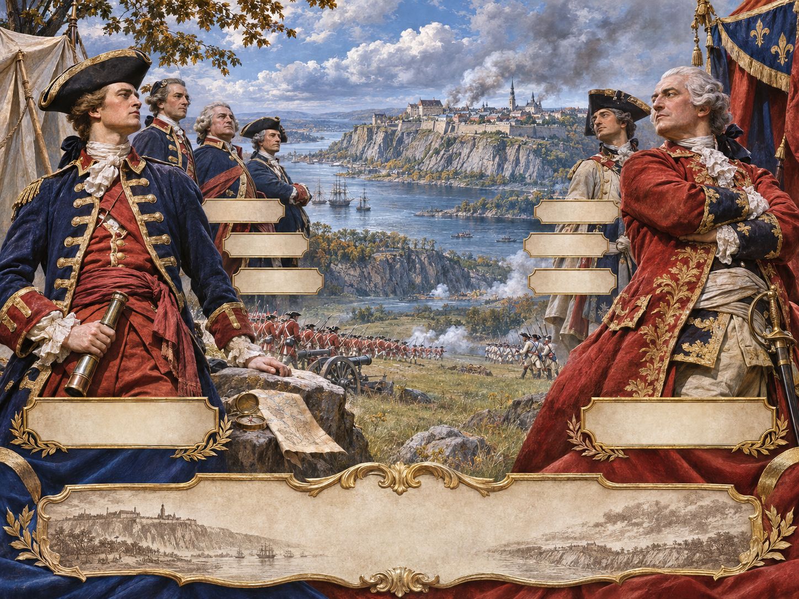
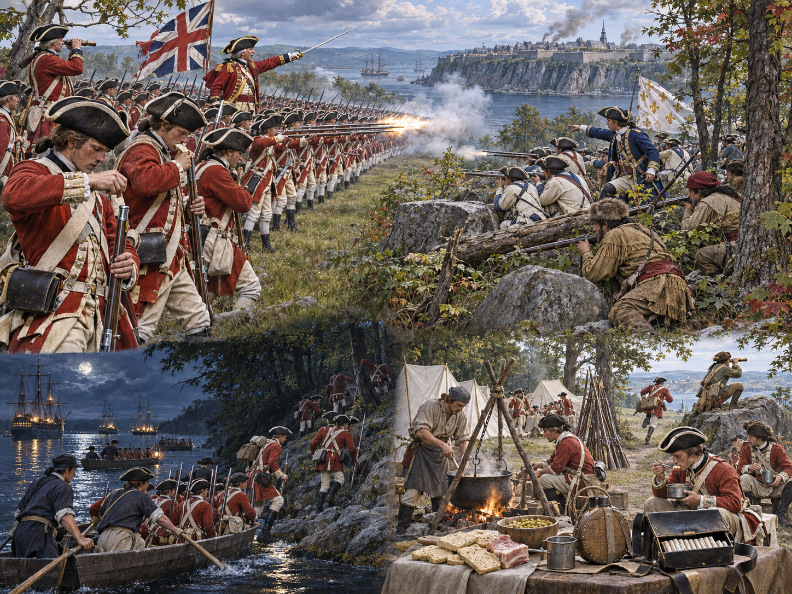
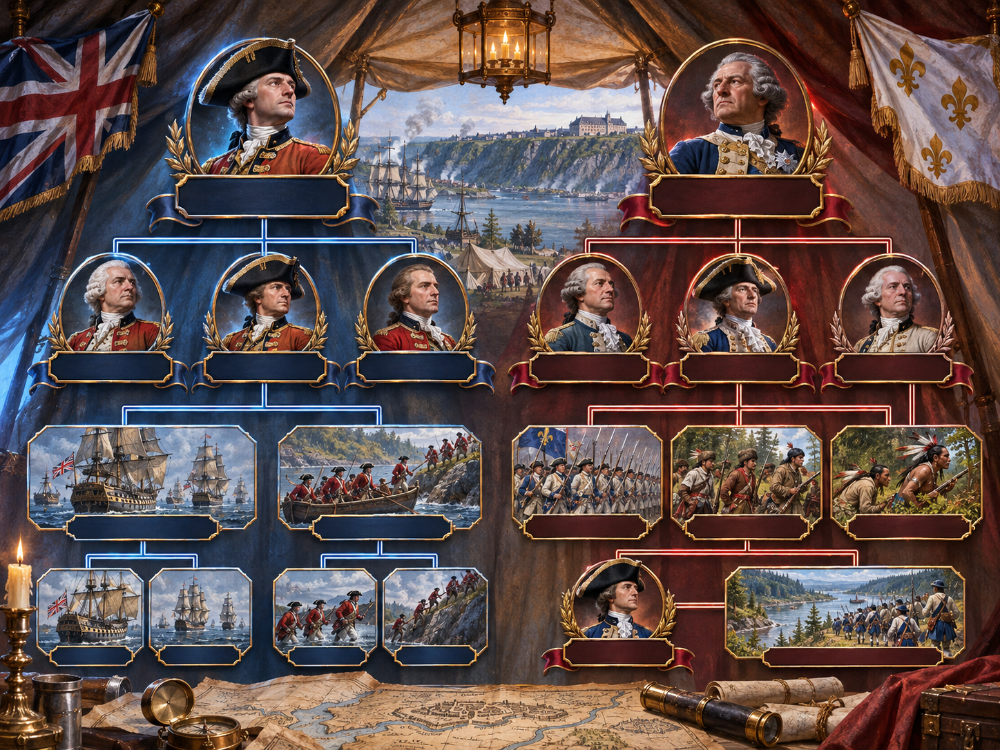
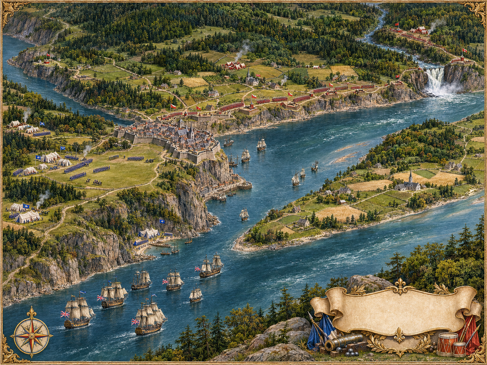
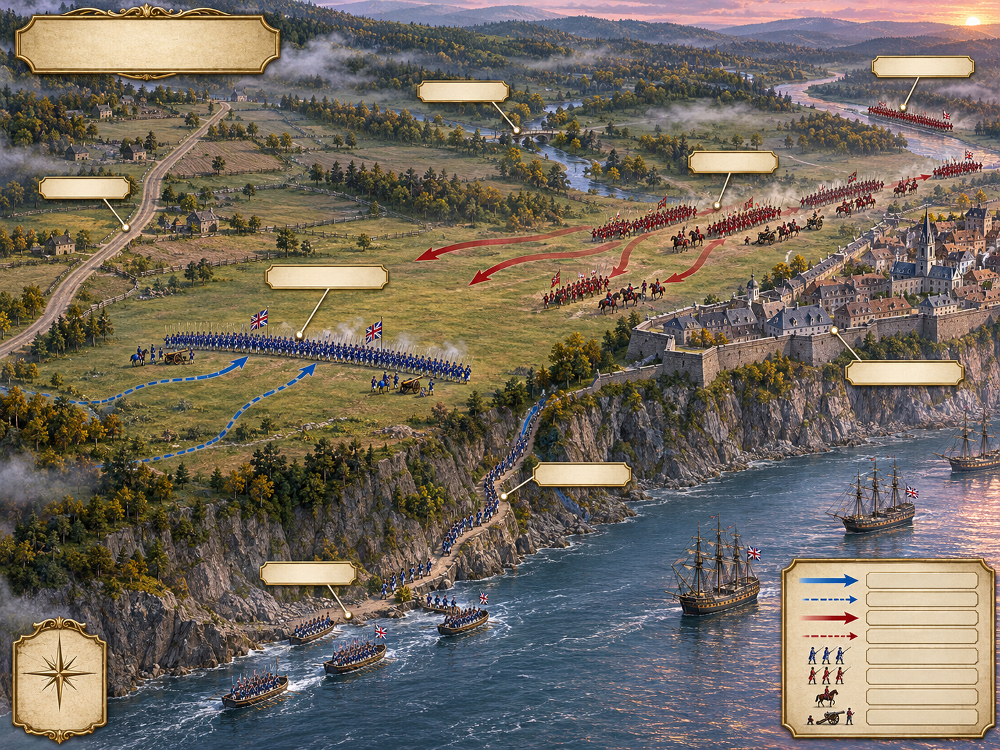
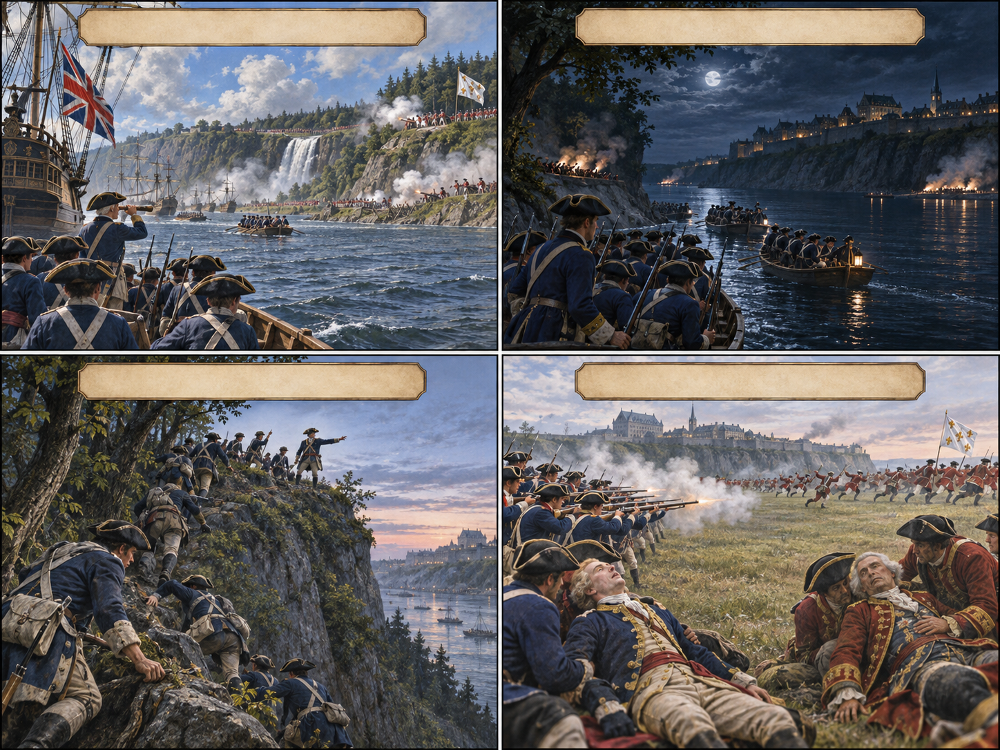

**뒤에서 반복될 지형을 먼저 잡아두기**

- 🌊 **세인트로렌스강(St. Lawrence River)**은 함대의 공격로이면서 높은 북안 절벽 때문에 상륙지를 제한한 장벽이었다.
- **▰** **보포르(Beauport)**는 몽칼름 주력의 방어선이었다. 울프는 이곳을 계속 위협해 프랑스군의 시선을 동쪽에 묶었다.
- 🌊 **앙스오풀롱(Anse-au-Foulon)**은 **▰** **퀘벡(Québec)** 서쪽의 작은 만과 가파른 오솔길이었다. 길을 열면 함대의 병력을 고원에 올릴 수 있었다.
- ⛰️ **아브라함 평원(Plains of Abraham)**은 절벽 위 개활지였다. 영국군이 먼저 전열을 완성하자 프랑스군은 기다릴지 즉시 공격할지 선택해야 했다.

#### 상세 전역 서사 — 보포르에 묶인 시선을 유지한 채 앙스오풀롱 한 길로 집중하다

**제임스 울프(James Wolfe)**는 1759년 6월 약 8,500명의 군과 함대로 퀘벡에 도착했지만, **루이조제프 드 몽칼름(Louis-Joseph de Montcalm)**은 도시 동쪽 연안을 요새화했다. 7월 몽모랑시 공격이 실패한 뒤 영국군은 함선과 보트를 상하류에 반복해 보여 프랑스군이 실제 상륙점을 확정하지 못하게 했다. 9월 12일 밤 상륙대는 앙스오풀롱으로 내려가 경계대를 제압하고 절벽을 올라, 아침까지 약 4,500명의 전열을 고원에 만들었다.

**몽칼름**은 상류의 **부건빌**을 기다리거나 성벽에 기대 지연할 수 있었지만 영국군이 굳히기 전에 공격했다. 영국 보병은 근거리 일제사격으로 급히 모인 프랑스 전열을 무너뜨렸다. **울프**와 **몽칼름**은 모두 치명상을 입었고 퀘벡은 9월 18일 항복했다. 여러 가능성을 보인 順祥敵之意가 결정적 순간 앙스오풀롱과 평원 한 축의 幷敵一向으로 바뀌고, 지휘 중심의 죽음이라는 千里殺將에 닿은 사례다.

#### 전투에서 사용된 속임수 — 여러 상륙 가능성을 보인 뒤 한 절벽길로 집중

#### 속임수 작동 구조

**주체와 의도.** 영국군은 프랑스군이 넓은 강안을 계속 지키게 하면서 실제 상륙점은 앙스오풀롱으로 좁혔다.

**보인 신호와 믿은 이유.** 상하류의 보트 이동은 여러 상륙 가능성을 남겼고, 초병에게는 프랑스 보급선이 밤에 내려올 수 있다는 기대가 있었다.

**유발된 행동과 결과.** 프랑스군은 보포르와 상류 분견대에 나뉜 채 첫 상륙을 막지 못했고 영국군은 고원에 전열을 완성했다.

**사료의 경계.** 야간 암구호의 세부는 회고마다 다르다. 앙스오풀롱 경계가 얇았고 영국군이 아침까지 고원에 집결한 사실을 중심으로 판단한다.

#### 속임수 일곱 질문

1. **누가 누구를 속였는가?** 울프의 함대·상륙대가 프랑스 강안 경계에 실제 축을 늦게 드러냈다.
2. **어떤 사실이 거짓이었는가?** 모든 상하류 움직임이 실제 대규모 상륙 준비라는 인상이다.
3. **어떤 사실은 진실이지만 오해를 유도했는가?** 여러 지점을 탐색했지만 최종 선택은 한 길에 집중됐다.
4. **상대는 왜 그것을 믿고 싶어 했는가?** 보포르가 가장 현실적인 대규모 상륙지라는 지형 판단과 앞선 공격 경험이 있었다.
5. **속임수가 없었어도 같은 오판이 발생했을까?** 가능성은 낮다. 앙스오풀롱이 조기 확정됐다면 경계가 집중될 수 있었다.
6. **속은 사람은 어떤 독립 확인을 생략했는가?** 보트 규모·방향과 절벽 위 경계를 하나의 보고망으로 합치지 못했다.
7. **신뢰·동의·안전을 해치지 않으면서 같은 원리를 어디서 연습할 수 있는가?** 공개 규칙의 보드게임·모의훈련에서 여러 진입축과 결정적 목표를 구분해 연습할 수 있다.

#### 시계편 兵者詭道也 — 이 전장에 해당하는 속이는 길

<table fit-page-width="true" header-row="true">
<tr>
<td>해당 구절·독음·뜻</td>
<td>전장의 장면</td>
</tr>
<tr>
<td>近而示之遠, 遠而示之近 근이시지원, 원이시지근 — 가까우면서 멀리 있는 듯 보임</td>
<td>보트의 상하류 이동은 실제 거리와 방향을 확정하기 어렵게 했다.</td>
</tr>
<tr>
<td>攻其無備, 出其不意 공기무비, 출기불의 — 대비 없는 곳을 치고 뜻하지 않은 데서 나옴</td>
<td>보포르가 아니라 얇게 지켜진 앙스오풀롱 절벽길로 올랐다.</td>
</tr>
</table>

#### 法 한눈 비교 — 곡제·관도·주용

<table fit-page-width="true" header-row="true">
<tr>
<td>진영</td>
<td>곡제(편제)</td>
<td>관도(지휘)</td>
<td>주용(보급·지속)</td>
</tr>
<tr>
<td>
**영국군**
</td>
<td>함대·상륙대·경보병·전열보병을 시차 결합했다.</td>
<td>울프와 여단장·해군이 야간 이동을 맞췄다.</td>
<td>함대가 병력·탄약 수송을 유지했다.</td>
</tr>
<tr>
<td>
**프랑스군**
</td>
<td>보포르 주력·도시 수비·상류 분견대가 갈렸다.</td>
<td>몽칼름·보드뢰유·부건빌의 합류가 늦었다.</td>
<td>장기 봉쇄 속에 넓은 강안을 지켜야 했다.</td>
</tr>
</table>

#### **루이조제프 드 몽칼름(패)**

<table fit-page-width="true" header-row="true">
<tr>
<td>요소</td>
<td>판단</td>
</tr>
<tr>
<td color="orange_bg">🤝 **道**</td>
<td>서로 다른 전투 방식의 정규군·민병을 급히 한 전열로 묶었다. (지기·사기)</td>
</tr>
<tr>
<td color="blue_bg">🌤️ **天**</td>
<td>영국군의 축성 위험에 집중해 부건빌 합류와 지연전 가능성을 낮게 두었다. (지피·타이밍·확률 관점)</td>
</tr>
<tr>
<td color="green_bg">🧭 **地**</td>
<td>강한 보포르 방어선을 떠나 적이 먼저 고른 개활지로 들어갔다. (원근·험이·광협)</td>
</tr>
<tr>
<td color="purple_bg">🎖️ **將**</td>
<td>결단은 빨랐으나 부대가 정렬될 시간을 주지 않았다. (지신인용엄·장유오위)</td>
</tr>
<tr>
<td color="yellow_bg">⚙️ **法**</td>
<td>분산된 전력을 결전 전에 재결합하지 못했다. (곡제·관도·주용)</td>
</tr>
</table>

**직관·편향 한 줄:** **몽칼름**의 즉시 공격에는 가용성·행동편향이 작동했을 가능성이 있으며 증원을 기다릴 선택지를 밀어냈다.

🏳️ **패군 측 결과**: 급한 집결과 공격으로 전열이 풀려 六敗의 亂(란)에 가까운 패배를 입었다.

🔀 **패군 측 회피 분기점**: 성벽과 고지를 이용해 부건빌을 기다렸다면 승리를 장담할 수 없어도 준비되지 않은 단시간 붕괴는 피할 가능성이 있었다.

#### **제임스 울프(승)**

<table fit-page-width="true" header-row="true">
<tr>
<td>요소</td>
<td>판단</td>
</tr>
<tr>
<td color="orange_bg">🤝 **道**</td>
<td>실패 뒤 여단장 의견을 받아 함대·상륙대를 한 목표로 묶었다. (지기·사기)</td>
</tr>
<tr>
<td color="blue_bg">🌤️ **天**</td>
<td>경계 분산을 이용하되 야간 항해·조수·발견 위험을 감수했다. (지피·타이밍·확률 관점)</td>
</tr>
<tr>
<td color="green_bg">🧭 **地**</td>
<td>절벽을 통과한 뒤 개활지에서 전열보병의 강점을 살렸다. (험이·광협·사생)</td>
</tr>
<tr>
<td color="purple_bg">🎖️ **將**</td>
<td>여러 가능성을 보인 뒤 결전에는 한 축으로 지휘를 집중했다. (지신인용엄)</td>
</tr>
<tr>
<td color="yellow_bg">⚙️ **法**</td>
<td>해군 수송·선두 경보병·후속 전열을 순차 결합했다. (곡제·관도·주용)</td>
</tr>
</table>

🏆 **승군 측 결과**: 싸울 장소와 때를 바꿔 以虞待不虞者勝(이우대불우자승, 대비한 자가 대비하지 못한 적을 이김)에 해당했다.

##### 法을 압축하지 않고 보기 — 곡제·관도·주용

**곡제 曲制(곡제): 부대를 어떻게 나누고 결합했는가**
<table fit-page-width="true" header-row="true">
<tr>
<td>진영</td>
<td>실제 운용</td>
</tr>
<tr>
<td>
**영국군**
</td>
<td>함대·보트·경보병·전열보병을 상륙 시간표로 결합했다.</td>
</tr>
<tr>
<td>
**프랑스군**
</td>
<td>보포르·도시·상류가 넓은 강안을 나눠 맡았다.</td>
</tr>
</table>
**관도 官道(관도): 누가 명령하고 어떻게 전달했는가**
<table fit-page-width="true" header-row="true">
<tr>
<td>진영</td>
<td>실제 운용</td>
</tr>
<tr>
<td>
**영국군**
</td>
<td>울프 아래 여단장과 해군이 상륙·전개를 나눴다.</td>
</tr>
<tr>
<td>
**프랑스군**
</td>
<td>초병 경보에서 분견대 합류까지 시간차가 생겼다.</td>
</tr>
</table>
**주용 主用(주용): 군량·장비·전투 지속 능력을 어떻게 썼는가**
<table fit-page-width="true" header-row="true">
<tr>
<td>진영</td>
<td>실제 운용</td>
</tr>
<tr>
<td>
**영국군**
</td>
<td>함대가 병력·탄약·상륙정을 제공해 축을 바꾸게 했다.</td>
</tr>
<tr>
<td>
**프랑스군**
</td>
<td>봉쇄 속에 도시·강안·상류를 동시에 유지했다.</td>
</tr>
</table>

**사료와 연구:** [캐나다 공원청](https://www.pc.gc.ca/apps/dfhd/page_nhs_eng.aspx?id=13017) · [퀘벡시](https://www.ville.quebec.qc.ca/en/apropos/portrait/histoire/1756-1867.aspx) · [미 의회도서관 작전도](https://www.loc.gov/item/2005630163/) · [미시간대 클레먼츠 도서관](https://clements.umich.edu/exhibit/1759-britains-year-of-victories/case-10/)

### 동양 — 🏛️ 제(齊) vs 🏛️ 위(魏) │ 마릉전투(馬陵之戰, 기원전 342년)

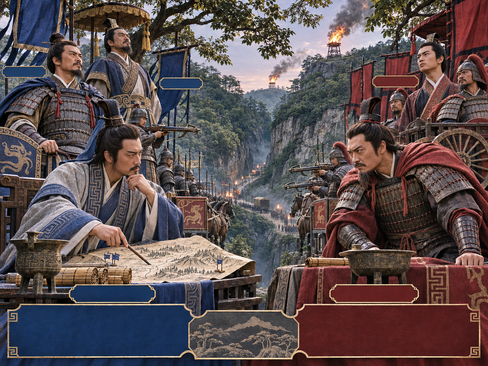
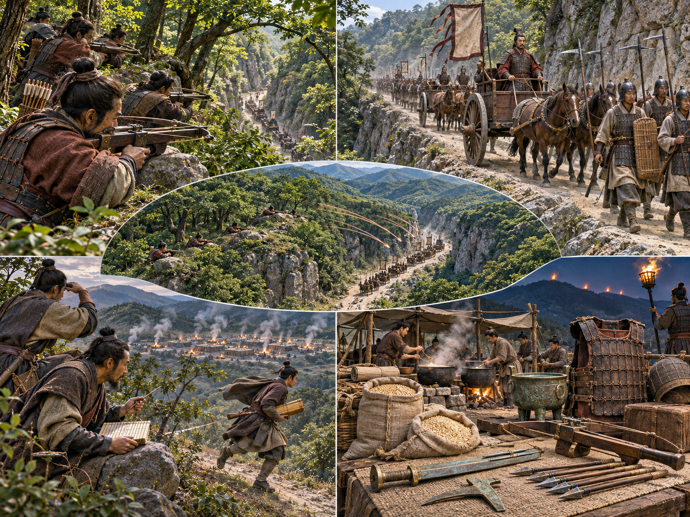
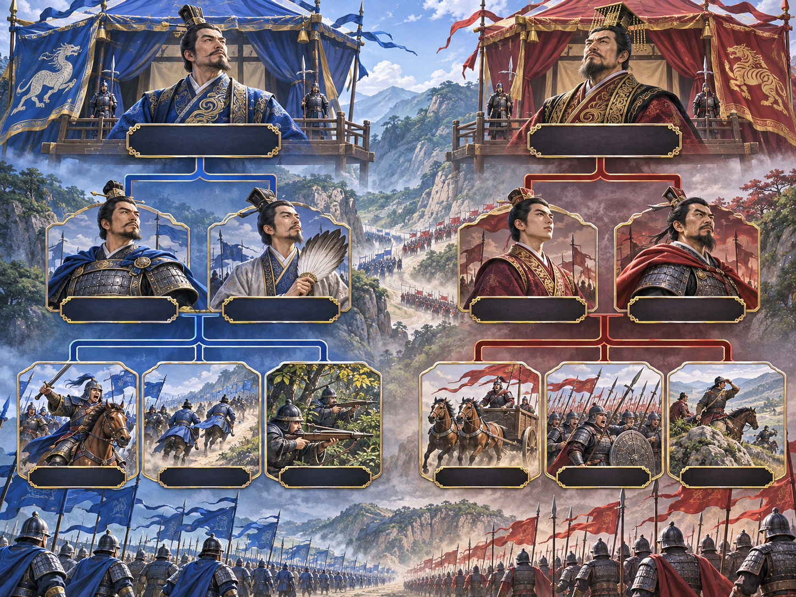
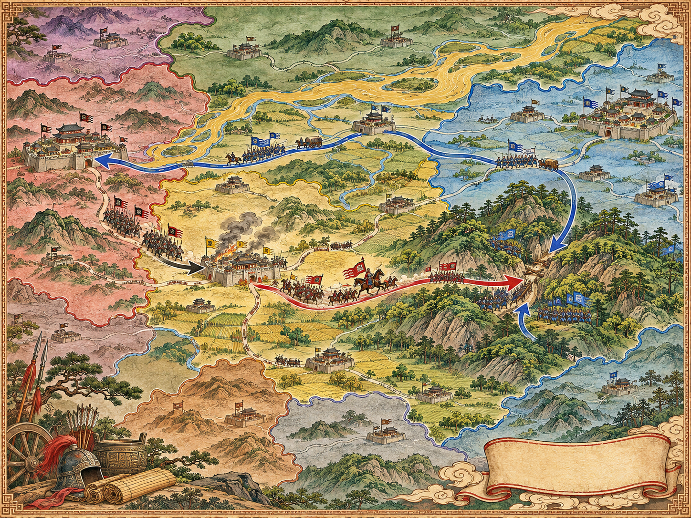
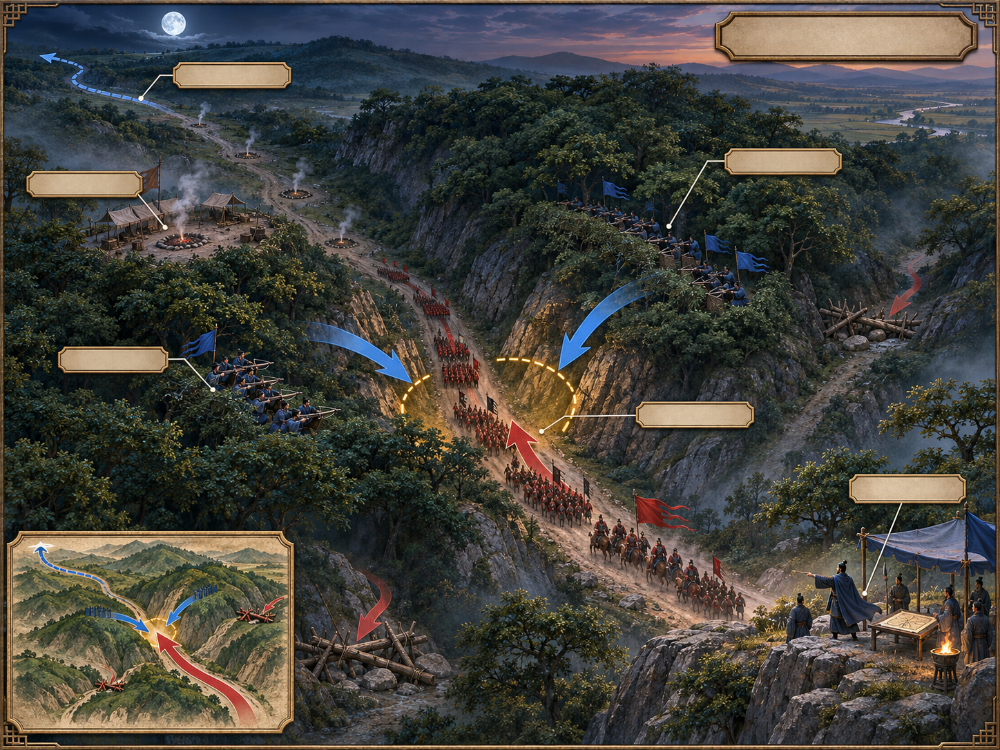
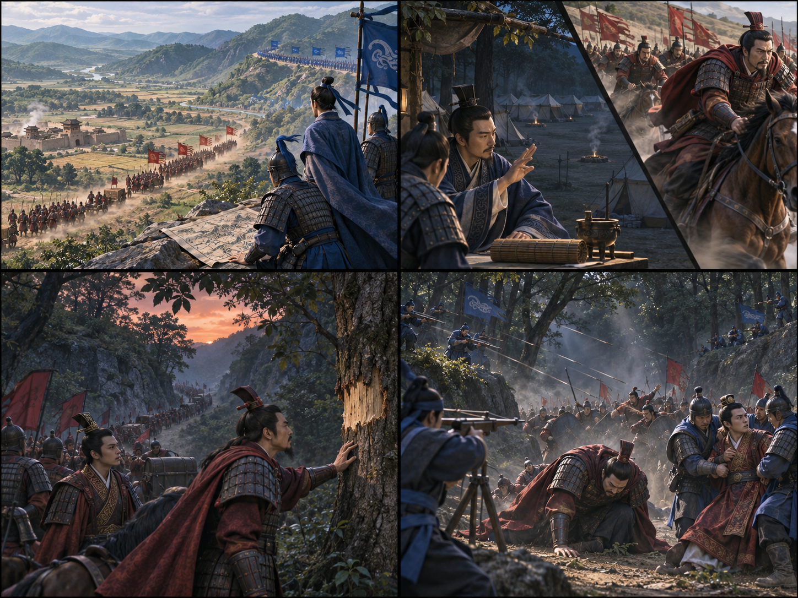

**뒤에서 반복될 지형을 먼저 잡아두기**

- **▰** **대량(大梁)**은 위의 수도였다. 제군이 이곳을 위협하자 위군은 한 전선을 떠나 동쪽으로 돌아왔다.
- 🌊 **황하(黃河)** 일대의 도로와 도하점은 제·위·한의 이동축을 제한했다.
- 🌲 **마릉(馬陵) 협로**는 숲과 굴곡이 매복에 유리한 곳으로 전해진다. 정확한 고대 전투지 비정에는 이견이 있다.
- **감조계의 취사 흔적**은 길 위의 병력 상태를 읽는 표지였다. 아궁이 감소는 실제 붕괴가 아니라 추격 속도를 높이는 신호였다.

#### 상세 전역 서사 — 방연이 믿은 탈영 신호를 마릉 한 길의 매복으로 닫다

위가 한을 공격하자 제는 **전기**를 장수로, **손빈**을 군사로 보내 한을 직접 구하기보다 위 수도 대량을 위협했다. 위는 **방연**에게 본국으로 돌아오게 했다. 『사기』는 제군이 위 땅에서 아궁이를 10만→5만→3만으로 줄였고, 방연이 대규모 탈영으로 판단해 정예병으로 추격했다고 전한다.

**손빈**은 도착 시각을 계산해 마릉 협로 양쪽에 쇠뇌수 1만을 매복시켰다. 위군 선두가 어둠 속에서 불을 밝히자 일제사격이 시작됐고, 후속과 분리된 지휘부가 무너졌다. 『사기』는 **방연**의 자결과 위 태자 신의 포획을 전한다. 숫자·유언은 문학적 정형 가능성을 고려하되 신호→추격→분리→매복의 골격은 분명하다.

#### 전투에서 사용된 속임수 — 줄어드는 아궁이로 추격 의도를 가속하다

#### 속임수 작동 구조

**주체와 의도.** 손빈은 제군이 탈영으로 무너지는 듯 보여 방연의 정예 추격대를 주력에서 떼려 했다.

**보인 신호와 믿은 이유.** 줄어든 아궁이는 관찰 가능한 흔적이었고 ‘제 병사는 겁이 많다’는 방연의 기존 평가와 맞았다.

**유발된 행동과 결과.** 방연은 정예병으로 속도를 높여 마릉에 먼저 들어갔고 후속과 분리된 지휘부가 매복의 표적이 됐다.

**사료의 경계.** 아궁이·병력 숫자와 유언은 『사기』의 서사층을 고려해 정밀 통계가 아니라 작전 인과로 읽는다.

#### 속임수 일곱 질문

1. **누가 누구를 속였는가?** 손빈이 방연의 정찰과 선입견을 이용했다.
2. **어떤 사실이 거짓이었는가?** 아궁이 감소가 대규모 탈영을 뜻한다는 결론이다.
3. **어떤 사실은 진실이지만 오해를 유도했는가?** 취사 흔적 감소는 관찰됐지만 원인은 조작이었다.
4. **상대는 왜 그것을 믿고 싶어 했는가?** 제군을 빨리 따라잡을 수 있다는 기존 기대와 경쟁심이 있었다.
5. **속임수가 없었어도 같은 오판이 발생했을까?** 가능성은 중간 이하이다. 감조계가 단독 추격의 확신을 키웠다.
6. **속은 사람은 어떤 독립 확인을 생략했는가?** 실제 이탈자·행군폭·후방 흔적을 교차 확인하지 않았다.
7. **신뢰·동의·안전을 해치지 않으면서 같은 원리를 어디서 연습할 수 있는가?** 보드게임에서 신호와 실제 승리 조건을 따로 기록해 복기한다.

#### 시계편 兵者詭道也 — 이 전장에 해당하는 속이는 길
<table fit-page-width="true" header-row="true">
<tr>
<td>해당 구절·독음·뜻</td>
<td>전장의 장면</td>
</tr>
<tr>
<td>能而示之不能 능이시지불능 — 능하면서 능하지 못한 듯 보임</td>
<td>통제 후퇴와 아궁이 감소로 제군이 무너지는 듯 보였다.</td>
</tr>
<tr>
<td>利而誘之 이이유지 — 이익으로 유인함</td>
<td>약해진 제군을 정예병으로 따라잡을 수 있다는 이익을 보였다.</td>
</tr>
</table>

#### 法 한눈 비교 — 곡제·관도·주용
<table fit-page-width="true" header-row="true">
<tr>
<td>진영</td>
<td>곡제(편제)</td>
<td>관도(지휘)</td>
<td>주용(보급·지속)</td>
</tr>
<tr>
<td>
**제군**
</td>
<td>후퇴 유도대·주력·쇠뇌 매복대를 결합했다.</td>
<td>전기가 지휘하고 손빈이 시간과 매복을 설계했다.</td>
<td>취사 흔적까지 정보 신호로 통제했다.</td>
</tr>
<tr>
<td>
**위군**
</td>
<td>정예 추격대가 보병 주력보다 앞서 분리됐다.</td>
<td>방연의 속도 판단이 독립 검증을 앞질렀다.</td>
<td>귀환·추격으로 피로와 보급 간격이 커졌다.</td>
</tr>
</table>

#### **방연(龐涓, 패)**
<table fit-page-width="true" header-row="true">
<tr>
<td>요소</td>
<td>판단</td>
</tr>
<tr>
<td color="orange_bg">🤝 **道**</td>
<td>정예 선두와 후속 보병을 한 속도로 묶지 못했다. (지기·사기)</td>
</tr>
<tr>
<td color="blue_bg">🌤️ **天**</td>
<td>아궁이 감소를 탈영으로 단정해 조작 가능성을 낮게 두었다. (지피·타이밍·확률 관점)</td>
</tr>
<tr>
<td color="green_bg">🧭 **地**</td>
<td>좁은 숲길에 선두가 먼저 들어가 지원을 잃었다. (험이·광협·사생)</td>
</tr>
<tr>
<td color="purple_bg">🎖️ **將**</td>
<td>속도와 포획 욕구가 확인을 대신해 忿速可侮(분속가모, 조급하면 모욕당할 수 있음)에 가까웠다. (지신인용엄·장유오위)</td>
</tr>
<tr>
<td color="yellow_bg">⚙️ **法**</td>
<td>정예 추격대·주력·보급을 분리했다. (곡제·관도·주용)</td>
</tr>
</table>

**직관·편향 한 줄:** **방연**의 추격에는 확증편향과 분모 무시가 작동했을 가능성이 있으며 다른 원인과 독립 정찰을 생략하게 했다.

🏳️ **패군 측 결과**: 적정을 헤아리지 못하고 분리된 정예로 매복에 들어간 北(배)에 가까운 패배였다.

🔀 **패군 측 회피 분기점**: 아궁이 외에 포로·행군폭·후속 흔적을 교차 확인하고 주력과 간격을 유지했다면 지휘부 전멸은 피할 가능성이 있었다.

#### **손빈(孫臏, 승)**
<table fit-page-width="true" header-row="true">
<tr>
<td>요소</td>
<td>판단</td>
</tr>
<tr>
<td color="orange_bg">🤝 **道**</td>
<td>전기의 지휘·자신의 계책·쇠뇌수 신호를 한 목표로 묶었다. (지기·사기)</td>
</tr>
<tr>
<td color="blue_bg">🌤️ **天**</td>
<td>방연의 평가를 아궁이로 시험하고 추격 속도가 계산과 맞을 때 매복을 확정했다. (지피·타이밍·확률 관점)</td>
</tr>
<tr>
<td color="green_bg">🧭 **地**</td>
<td>좁은 숲길에서 위군 종심을 측면 사격 표적으로 바꿨다. (험이·광협·사생)</td>
</tr>
<tr>
<td color="purple_bg">🎖️ **將**</td>
<td>대량 위협과 지휘관 유인을 전략·전술로 연결했다. (지신인용엄)</td>
</tr>
<tr>
<td color="yellow_bg">⚙️ **法**</td>
<td>감조계·후퇴 속도·쇠뇌수·야간 신호를 결합했다. (곡제·관도·주용)</td>
</tr>
</table>

🏆 **승군 측 결과**: 병력의 쓰임을 나눠 識衆寡之用者勝(식중과지용자승, 많고 적은 병력의 쓰임을 아는 자가 이김)에 해당했다.

##### 法을 압축하지 않고 보기 — 곡제·관도·주용
**곡제 曲制(곡제): 부대를 어떻게 나누고 결합했는가**
<table fit-page-width="true" header-row="true">
<tr>
<td>진영</td>
<td>실제 운용</td>
</tr>
<tr>
<td>
**제군**
</td>
<td>대량 위협군·후퇴대·쇠뇌 매복대를 나눴다.</td>
</tr>
<tr>
<td>
**위군**
</td>
<td>정예 추격대가 보병 주력과 분리됐다.</td>
</tr>
</table>
**관도 官道(관도): 누가 명령하고 어떻게 전달했는가**
<table fit-page-width="true" header-row="true">
<tr>
<td>진영</td>
<td>실제 운용</td>
</tr>
<tr>
<td>
**제군**
</td>
<td>전기가 통솔하고 손빈이 행군·발사 신호를 설계했다.</td>
</tr>
<tr>
<td>
**위군**
</td>
<td>방연의 추격 명령과 후속 보고 간격이 벌어졌다.</td>
</tr>
</table>
**주용 主用(주용): 군량·장비·전투 지속 능력을 어떻게 썼는가**
<table fit-page-width="true" header-row="true">
<tr>
<td>진영</td>
<td>실제 운용</td>
</tr>
<tr>
<td>
**제군**
</td>
<td>취사 흔적을 정보전으로 바꾸고 쇠뇌수를 먼저 배치했다.</td>
</tr>
<tr>
<td>
**위군**
</td>
<td>귀환 뒤 추격해 선두와 후속의 피로·군량 간격이 커졌다.</td>
</tr>
</table>

**사료와 연구:** [『사기』 「손자오기열전」](https://ctext.org/shiji/sun-zi-wu-qi-lie-zhuan/zh) · [UC eScholarship 연구자료](https://escholarship.org/content/qt2bm4160b/qt2bm4160b_noSplash_4c1dae4e8ce2ca70f23768585228e0a1.pdf). 고대 전투지와 숫자는 전승·비정 논쟁을 밝혀 작전 관계 중심으로 사용했다.

---

## 5. 핵심 통찰 + 실생활 적용 + 생활루틴

### 핵심 통찰

이 구절에는 서로 반대처럼 보이는 두 움직임이 붙어 있다. 먼저 順祥으로 적의 뜻을 거스르지 않는 듯 따라가고, 뒤에는 幷敵一向으로 아군의 힘과 방향을 하나로 좁힌다. 앞의 움직임만 남으면 상대에게 끌려다니고, 뒤의 움직임만 먼저 꺼내면 내 의도가 드러난다. **상대의 흐름을 충분히 읽는 시간과, 읽은 뒤에는 한 점에 힘을 쓰는 결단이 함께 있어야 成事가 된다.**

마지막의 巧能成事者는 평가 기준도 분명히 한다. 많이 관찰하고 영리한 말을 하는 것, 멀리 움직이고 바쁘게 일하는 것만으로는 巧가 아니다. 실제로 문제의 중심을 찾아 한 방향의 행동으로 끝냈을 때만 솜씨가 증명된다. 이 원리를 지키지 않으면 관찰은 눈치 보기로, 집중은 고집으로, 기교는 성과 없는 분주함으로 무너진다.

### 실생활 적용

인물사건관찰시리즈의 D조 조장 전씨 기록에는 단순한 문제에서는 말을 많이 하지만 복잡한 에러가 생기면 당황해 말을 줄이고, 원칙이 상황마다 흔들리는 장면이 적혀 있다. 이때 전씨의 말투나 성격과 정면으로 다투는 것은 敵之意를 읽기 전에 一向부터 정하는 셈이다. 먼저 반복되는 행동에서 실제 의도를 구분해야 한다. 책임을 회피하려는지, 손실이 두려워 확인을 늘리는지, 몸 상태 때문에 처리 능력이 떨어지는지에 따라 같은 고함도 대응 표적이 달라진다.

사용자 자신의 대응도 마찬가지다. 전씨가 흥분할 때마다 모든 과거 문제를 한꺼번에 꺼내면 힘이 여러 방향으로 흩어진다. 먼저 현재 에러에서 상대가 지키려는 것이 무엇인지 질문과 행동으로 확인하고, 사실관계를 기록한 뒤, 이번에 끝낼 한 가지—예컨대 조치 순서, 역할 분담, 인계 문구—만 정해 공개적으로 합의하는 편이 낫다. 사람을 ‘적장’으로 삼아 꺾는 것이 아니라, 혼선을 계속 만들어 내는 **의사결정 중심 하나**를 千里殺將의 표적으로 바꾸는 것이다.

### 생활루틴

갈등이나 에러가 생기면 상대의 첫 말에 곧장 반격하지 말고, 그 사람이 무엇을 지키려는지 확인하는 질문을 한 번 한 뒤 사실을 기록한다. 그런 다음 이번 대화에서 끝낼 문제를 하나만 정하고, 담당자·기한·완료 조건을 한 문장으로 합의한다.

> 상대가 무엇을 지키려는지 확인하지 않은 채 여러 문제를 한꺼번에 공격하면 재수가 없습니다. 먼저 의도를 행동으로 확인하고, 이번에 끝낼 한 가지를 정해 담당자·기한·완료 조건을 한 방향으로 모으십시오.

첫 반응만 보고 의도를 단정하면 확증편향이 생겨 엉뚱한 표적에 힘을 쓰게 된다. 반대로 계속 상대 사정만 듣고 결정을 미루면 順만 있고 幷·成이 없는 상태가 된다. **확인 질문 1회 → 사실 기록 → 한 문제 선택 → 담당자·기한·완료 조건 확정**의 네 단계는 順祥에서 一向과 成事로 넘어가는 생활 속 최소 구조다.

### 참고자료

- [中國哲學書電子化計劃 — 孫子兵法·九地](https://ctext.org/art-of-war/nine-situations/zh)
- [Wikisource — 孫子兵法·九地第十一](https://zh.wikisource.org/zh-hant/%E5%AD%AB%E5%AD%90)
- [Clausewitz — On War, Book VIII (Project Gutenberg)](https://www.gutenberg.org/files/1946/1946-h/1946-h.htm)
- [Wikisource — 五輪書](https://ja.wikisource.org/wiki/%E4%BA%94%E8%BC%AA%E6%9B%B8)
- [中國哲學書電子化計劃 — 吳子](https://ctext.org/wuzi/zh)
- [U.S. Army — Mission Command](https://www.army.mil/standto/archive/2018/05/14/)
