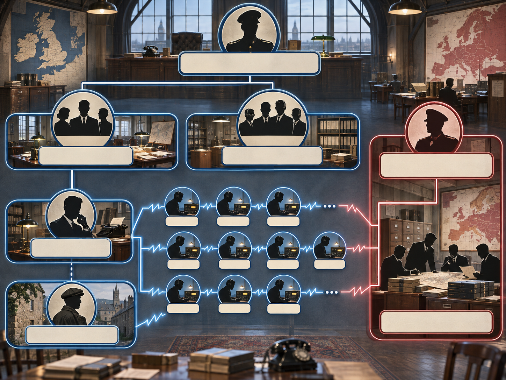
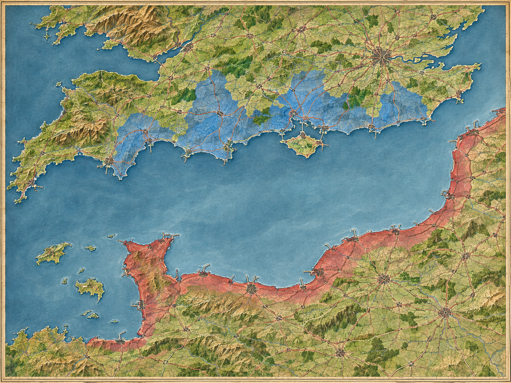
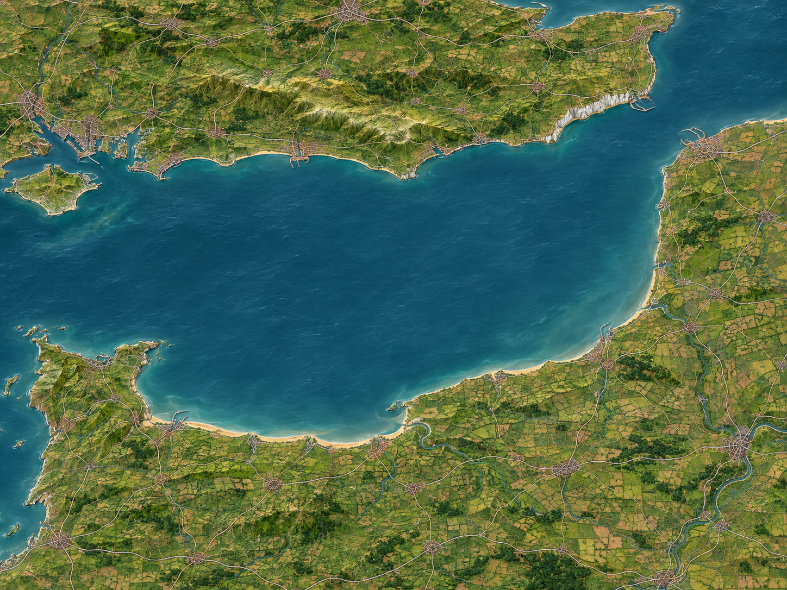
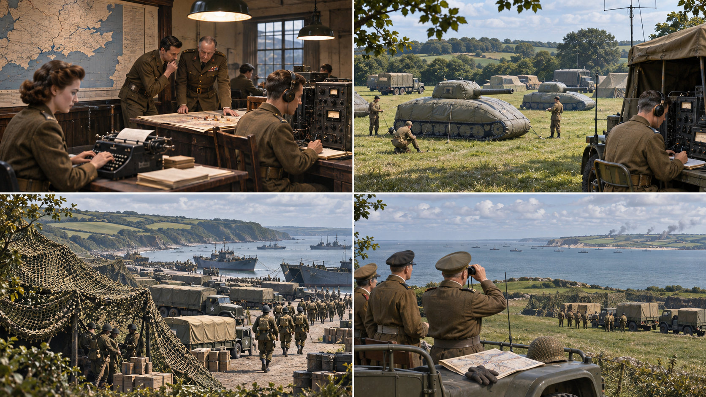
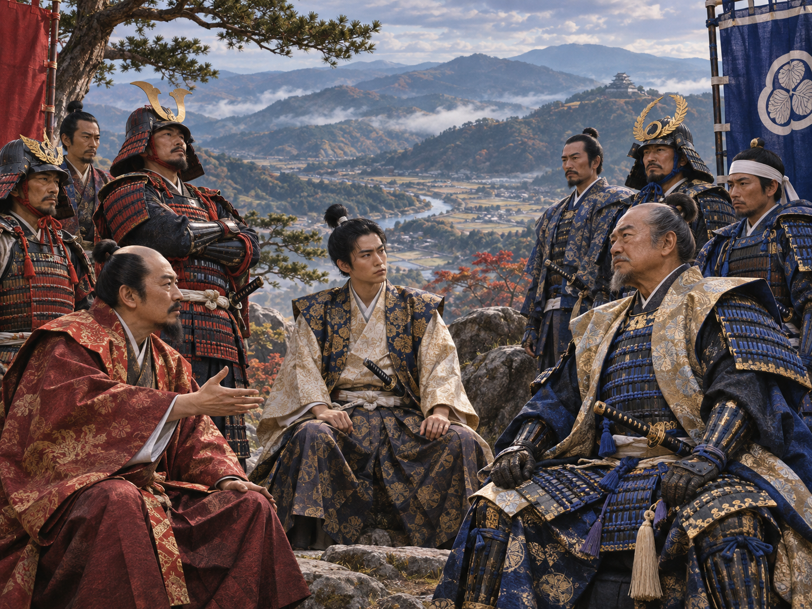
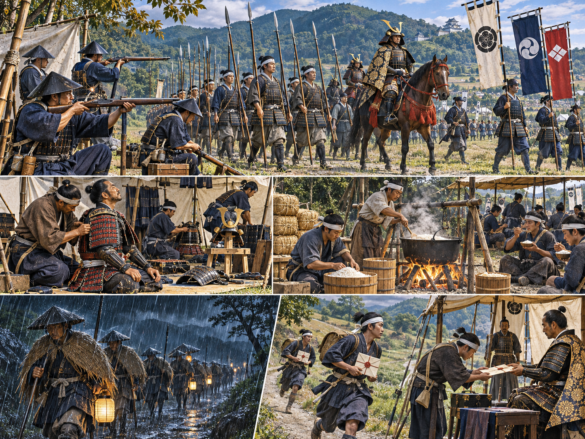
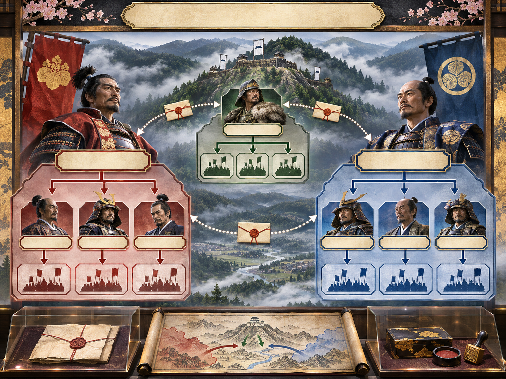
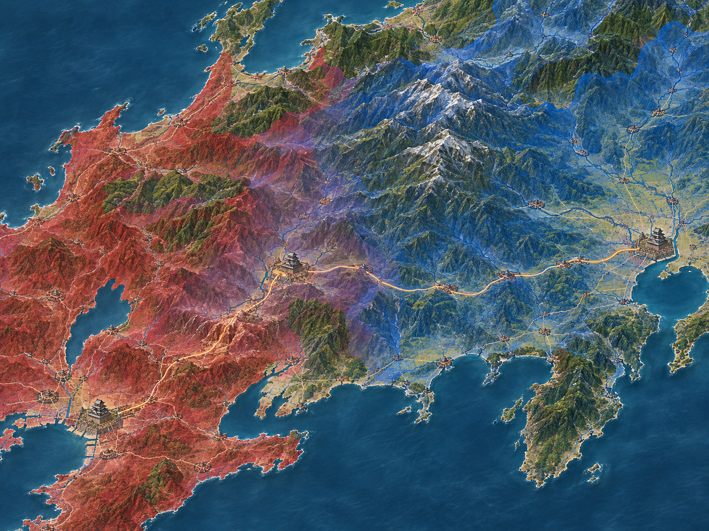
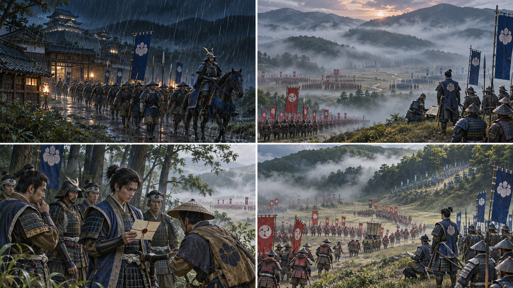

<!-- sunzi-analysis-mode: light -->
<!-- sunzi-original: 故三軍之事, 莫親於間, 賞莫厚於間, 事莫密於間, -->
> 고삼군지사, 막친어간, 상막후어간, 사막밀어간 — 사람에게 중요한 일을 맡기면서 관계·보상·비밀을 소홀히 하면 재수가 없다.

---
## 1. 원문 + 독음 + 직역 + 한자어 뜻풀이

故三軍之事, 莫親於間, 賞莫厚於間, 事莫密於間, 고삼군지사, 막친어간, 상막후어간, 사막밀어간,

**직역**  
그러므로 삼군의 일 가운데 간첩보다 더 가까이할 이는 없고, 포상은 간첩보다 더 후하게 할 데가 없으며, 일은 간첩에 관한 것보다 더 비밀스럽게 할 것이 없다.

	앞 구절은 사간이 적에게 보낼 거짓 형상을 만들고 생간이 돌아와 결과를 보고한다고 설명했다. 이번 구절은 그 위험한 정보 고리가 실제로 끊어지지 않으려면 지휘자가 무엇을 해야 하는지 말한다. **사람은 가까이하고, 대가는 후하게 치르며, 임무는 가장 좁게 감춘다.** 세 요구는 서로 모순처럼 보이지만 한 사람을 정보원으로 계속 쓰려면 함께 성립해야 한다.

	`親`만 있고 `厚`가 없으면 친밀함은 무급 충성을 요구하는 말이 된다. `厚`만 있고 `親`이 없으면 돈을 더 주는 경쟁자가 나타날 때 관계가 흔들릴 수 있다. 둘이 있어도 `密`이 없으면 정보원의 신원과 보고가 노출되어 사람도 정보망도 잃는다. 손자는 충성심을 낭만화하지 않고 **관계·보상·보호를 하나의 운용 책임**으로 묶는다.

	#### 三軍之事(삼군지사) — 전군의 움직임이 한 사람의 보고에 기대는 자리

	`三軍`은 상·중·하 또는 좌·중·우로 나뉜 전군을 가리키는 관용적 표현이고, `事`는 그 군대를 움직이는 작전과 판단의 일이다. 앞에서 말한 오간의 보고는 작은 소문이 아니라 전군의 진퇴·공격·방어를 바꿀 수 있다. 그래서 정보원을 다루는 일은 정보 부서만의 곁가지가 아니라 삼군 전체의 결정 구조 안에 놓인다.

	이 구절에서 `事`는 처음과 끝에 두 번 작동한다. 첫 `三軍之事`는 큰 범위의 군무이고, 마지막 `事莫密於間`의 `事`는 간첩 운용이라는 가장 좁은 비밀 업무다. **가장 넓은 군대의 움직임이 가장 좁게 감춰진 관계에 의존한다**는 긴장이 이 반복에 들어 있다.

	#### 親(친할 친) — 지휘관과 정보원 사이의 거리를 줄여 왜곡을 줄이다

	`親`은 가까이하다, 친히 접하다, 믿고 친밀하게 대한다는 뜻이다. 여기서는 사적인 호감이나 무조건적인 신뢰가 아니다. 중간 전달자가 보고를 다듬거나 불리한 사실을 빼기 전에, 책임 있는 지휘자가 정보원과 가까운 보고선을 유지한다는 뜻이다.

	가까움은 정보원의 동기·두려움·접근 범위와 보고 습관을 오래 관찰하게 한다. 동시에 정보원이 불리한 소식도 말할 수 있게 한다. 그러나 친밀함이 검증을 대신하면 안 된다. 가까운 사람의 말일수록 출처·시점·직접 관찰과 추정을 분리해 확인해야 `親`이 편애로 변하지 않는다.

	#### 賞·厚(상·후) — 위험과 가치에 맞는 대가를 약속이 아니라 지급으로 증명하다

	`賞`은 공에 따라 주는 포상이고, `厚`는 얇지 않고 두텁다는 뜻이다. 간첩의 보상이 후해야 한다는 말은 정보를 돈으로 사기만 하면 된다는 뜻이 아니다. 신분 노출, 생계 단절, 가족의 위험, 장기간의 불확실성처럼 정보원이 떠안는 비용과 그 정보가 전군의 손실을 줄이는 가치를 지휘자가 가볍게 계산하지 말라는 명령이다.

	대가는 현금에만 한정되지 않는다. 약속을 지키는 태도, 안전을 위한 보호, 정확한 공로 인정도 포함된다. 다만 보상이 클수록 정보를 꾸며 계속 받을 유인도 커질 수 있다. 그래서 `厚`는 `親`을 통한 동기 이해, 독립 검증, 명확한 지급 조건과 함께 놓여야 한다.

	#### 密(빽빽할 밀) — 정보를 감추는 데서 사람을 보호하는 데까지

	`密`은 틈이 없을 만큼 촘촘하고 은밀하다는 뜻이다. 간첩의 일에서는 작전 내용뿐 아니라 신원, 접촉 시각, 전달 경로, 보상 기록, 보고가 닿는 사람까지 노출면을 줄여야 한다. 하나가 새면 나머지가 연쇄적으로 드러날 수 있기 때문이다.

	그러나 비밀은 무조건 많이 만들수록 좋은 것이 아니다. 지나친 구획은 서로 다른 보고를 대조하지 못하게 하고, 잘못된 정보가 책임 없이 위로 올라가게 한다. 이 구절의 `密`은 필요한 사람에게도 숨기는 폐쇄가 아니라, **알아야 할 사람에게만 정확히 연결하고 나머지 노출은 막는 통제된 비밀**이다.

	#### 莫…於…(막…어…) — 세 번의 최상급이 만든 우선순위

	`莫 A 於 B`는 B보다 더 A한 것은 없다는 비교 최상급이다. 손자는 `親·厚·密`을 좋은 태도의 목록으로 제시하지 않고 각각 “간첩보다 더한 대상은 없다”고 세 번 못 박는다. 정보원 관리가 남으면 하는 부수 업무가 아니라 최우선 책임이라는 문장 구조다.

	세 문장은 동등하지만 순서에도 뜻이 있다. 먼저 사람과 가까운 관계를 만들고, 그 관계가 착취가 되지 않도록 대가를 후하게 하며, 마지막으로 사람과 임무를 노출에서 지킨다. 어느 하나만 극대화하면 실패한다. 세 최상급은 서로를 제한하고 완성한다.

	#### 글자들이 완성하는 한 장면

	`三軍之事`라는 넓은 전장이 펼쳐져 있지만, 지휘관의 판단은 적지의 한 사람이 가져온 보고에 달려 있다. 지휘관은 그 사람을 `親`하여 말할 수 있는 거리를 만들고, 위험과 공에 맞게 `賞`을 `厚`하게 지급하며, 신원과 접촉과 보고선을 `密`하게 감춘다.

	이 장면에서 친밀함은 보상을 대신하지 않고, 보상은 보호를 대신하지 않으며, 비밀은 책임을 지우지 않는다. **가까이 듣고, 정당하게 갚고, 필요한 만큼만 공유하는 세 동작이 함께 있을 때** 간첩의 보고는 삼군을 움직일 수 있는 정보가 된다.

---
## 2. 전통 주석 기반 분석

- **조조(曹操)** — “간첩은 군의 깊은 사정을 맡으니 지휘자가 가까이 접하라. **공을 아끼지 말고 그 이름과 일을 가장 엄밀히 감추어라.**”
- **이전(李筌)** — “정보원의 마음을 얻지 못한 채 부리려 하지 마라. **친애와 후한 대우로 결속하되 접촉의 흔적은 드러내지 마라.**”
- **두목(杜牧)** — “간첩은 적정의 진실과 거짓을 가르는 눈이니 다른 사람에게 맡겨 멀리하지 마라. **보고는 친히 듣고 상은 반드시 약속대로 주어라.**”
- **매요신(梅堯臣)** — “위험한 곳에서 돌아온 사람을 박하게 대하면 뒤의 보고가 끊긴다. **목숨을 건 위험에 맞춰 후하게 갚아라.**”
- **장예(張預)** — “군의 승패가 간첩에게서 먼저 정해질 수 있음을 잊지 마라. **가까움으로 진정을 얻고 비밀로 사람을 보전하라.**”
- **왕석(王晳)** — “친하다는 까닭으로 검증을 버리지 말고, 의심한다는 까닭으로 관계를 멀리하지 마라. **가까이 쓰되 보고의 사실과 추정을 나누어라.**”
- **가림(賈林)** — “상벌이 박하면 간첩이 원망하고, 일이 새면 적이 먼저 대비한다. **대가는 두텁게 하고 아는 사람은 적게 하라.**”
- **두우(杜佑)** — “간첩의 공은 겉으로 드러내기 어렵다고 빼앗지 마라. **공개할 수 없는 공일수록 지휘자가 책임지고 보상하라.**”
- **진호(陳皞)** — “말만 친하고 실제 보호와 보상이 없으면 사람을 얻지 못한다. **약속·지급·보호가 서로 어긋나지 않게 하라.**”

#### 리링의 고증과 현대적 독법

이 문장은 `莫親於間 / 賞莫厚於間 / 事莫密於間`이라는 세 개의 평행구로 짜였다. 같은 `間`을 끝에 반복하면서 앞의 술어만 `親·厚·密`로 바꾼다. 그러므로 어느 한 글자를 떼어 “간첩에게 돈을 많이 주라” 또는 “무조건 비밀로 하라”로 축소하면 문장 구조가 세운 균형을 잃는다.

리링의 해설 취지를 따라 고대 군사제도의 맥락을 복원하면, 기술 감시가 없던 시대의 선지는 사람의 접근과 귀환 보고에 크게 의존했다. 하지만 이를 현대 조직의 모든 내부 관계에 그대로 옮겨 상사를 정보원 운영자처럼 행동하게 해서는 안 된다. 현대 적용은 합법적 제보 보호, 정당한 보상, 최소 권한 공유와 검증 책임으로 제한해야 한다.

이 구절에서 `親`은 사적 유착이 아니라 정보 손실을 줄이는 가까운 지휘 관계, `厚`는 위험과 공에 비례한 대가, `密`은 사람과 임무의 노출을 줄이는 구획으로 읽는 편이 문맥에 맞다. 비밀을 핑계로 감독과 기록을 없애는 것은 손자의 뜻을 잇는 것이 아니라 책임을 숨기는 일이다.

---
## 3. 교차 설명

### ① 손자병법 내 교차

앞 구절의 `死間者…生間者, 反報也`(사간자…생간자, 반보야 — 사간은 거짓 일을 적의 정보망에 전하게 하고 생간은 돌아와 보고한다)는 왜 이번 구절의 세 조건이 필요한지 보여 준다. 위험한 임무를 맡은 사람이 사실대로 돌아와 보고하려면 지휘자와 말할 수 있는 관계가 있어야 하고, 위험에 상응하는 대가와 신원 보호를 믿을 수 있어야 한다.

뒤 구절 `非聖智不能用間, 非仁義不能使間, 非微妙不能得間之實`(비성지불능용간, 비인의불능사간, 비미묘불능득간지실 — 성스러운 지혜가 아니면 간첩을 쓰지 못하고, 인의가 아니면 부리지 못하며, 미묘함이 아니면 그 실정을 얻지 못한다)은 이번 구절의 윤리와 능력 조건을 해설한다. `厚`는 돈의 크기만이 아니라 약속을 지키는 仁義와 연결되고, `密`은 작은 노출과 거짓을 가려내는 微妙와 연결된다.

또 시계편의 `賞罰孰明`(상벌숙명 — 어느 쪽의 상벌이 더 밝은가)과도 만난다. 비밀 임무라고 공을 불명확하게 처리하면 보상은 지휘자의 변덕이 된다. 공개 범위는 좁히더라도 기준·승인·지급 기록은 명확해야 한다. **비밀성과 불투명성은 같은 말이 아니다.**

### ② 클라우제비츠 『전쟁론』

클라우제비츠는 전쟁에서 들어오는 정보의 상당 부분이 모순되거나 거짓이고 불확실하다고 경고했다. 손자의 `親`은 그 불확실성을 없애는 마법이 아니라, 출처의 접근 범위와 동기를 더 잘 이해해 보고의 무게를 조정하는 방법이다. 가까운 관계가 있어도 단일 출처의 말은 다른 관찰과 대조해야 한다.

클라우제비츠의 `마찰`은 좋은 계획이 전달 지연·두려움·오해·피로를 거치며 어긋나는 현상을 가리킨다. `厚`와 `密`은 이 마찰의 일부를 줄인다. 약속된 지원과 보호가 실제로 제공되면 보고자는 불리한 사실을 숨길 이유가 줄고, 노출 경로가 통제되면 정보가 적에게 새기 전에 지휘 판단에 도착할 가능성이 높아진다.

차이도 분명하다. 손자는 인적 정보망의 운용 규칙을 적극적으로 제시하지만, 클라우제비츠는 정보가 정확하다고 믿게 만드는 심리적 압력 자체를 경계하게 한다. 둘을 함께 읽으면 **정보원을 잘 대우하는 것과 그 정보에 종속되는 것을 구분**할 수 있다. 친밀함은 검증 가능한 접근을 늘려야지 반대 증거를 밀어내서는 안 된다.

### ③ 미야모토 무사시 『오륜서』

『오륜서』의 `観見二つの目付`(관견 두 눈매 — 넓게 꿰뚫는 관과 가까이 보는 견)는 `親`과 검증의 균형을 떠올리게 한다. 정보원과 가까이 접하는 `見`만 있으면 한 사람의 설명에 빨려 들어갈 수 있고, 전체 정세를 보는 `観`만 있으면 현장의 미세한 변화와 두려움을 놓친다. 두 눈을 함께 써야 보고가 놓인 자리를 안다.

무사시가 리듬을 읽고 상대의 박자를 흐트러뜨리라고 한 대목은 비밀 접촉의 시간 관리와도 닮았다. 반복되는 접촉 시간과 전달 습관이 드러나면 적은 정보망의 리듬을 역추적할 수 있다. 그래서 `密`은 내용 암호화만이 아니라 행동 패턴이 만드는 신호까지 줄이는 일이다.

다만 개인 검술의 사제 관계나 대결 감각을 현대 직장의 인간관계에 그대로 적용할 수는 없다. 실생활에서는 사람을 비밀 자산처럼 다루는 대신, 민감한 제보를 맡은 관리자에게 **비밀 유지 범위·보고 경로·후속 조치·보복 금지**를 명확히 하는 절차로 옮겨야 한다.

### ④ 오자병법·육도삼략

『오자병법』의 `進有重賞, 退有重刑`(진유중상, 퇴유중형 — 나아가면 큰 상이 있고 물러나면 큰 벌이 있다)은 상벌이 행동을 만든다는 점을 선명하게 보인다. 그러나 간첩의 보고는 전열의 진퇴와 다르다. 좋은 소식에만 상을 주면 정보원은 지휘자가 듣고 싶은 이야기를 만들 수 있으므로, **결과가 불리해도 정확하고 시기 적절한 보고 자체를 보상**해야 한다.

『육도』가 인재를 얻을 때 겉으로 드러난 명성보다 실제 능력과 충성을 살피라고 한 취지도 `親`과 맞닿는다. 가까이한다는 말은 술자리의 친분이 아니라, 여러 임무와 보고를 거치며 약속 이행·접근 가능성·정확성의 기록을 쌓는 것이다. 한 번의 극적인 정보보다 시간에 따른 신뢰도 변화가 중요하다.

동시에 고대 병서의 상벌을 현대 조직에 그대로 옮기면 권력 남용이 생길 수 있다. 오늘의 `厚賞`은 비밀 현금이나 특혜가 아니라 법과 규정 안의 보상·보호·휴식·심리적 안전이어야 한다. `密事` 역시 위법을 숨기는 장막이 아니라 개인정보와 민감 정보의 최소 공개 원칙이어야 한다.

### ⑤ 현대 심리학·군사학

미 육군 HUMINT 교범은 물질적·정서적 보상이 협조와 진실한 보고를 강화할 수 있다고 설명하면서도, 약속한 보상을 이행하지 않으면 출처와의 신뢰와 협조가 무너지고, 큰 보상은 정보를 꾸며낼 유인도 만들 수 있다고 경고한다. 이는 `賞莫厚於間`을 단순한 고액 지급이 아니라 **이행 가능한 약속·동기 평가·보고 검증**의 결합으로 읽게 한다.

2024년 세 실험 연구는 유형·무형의 보상이 구성원에게 “말해도 안전하고 가치 있게 여겨진다”는 신호를 주어 심리적 안전과 조직 동일시를 거쳐 발언을 촉진할 수 있다고 보고했다. 다만 직장 발언과 전시 간첩 활동은 위험·법·권력관계가 다르다. 구조적으로 가져올 수 있는 부분은 정확한 문제 제기에 보복하지 않고, 인정과 후속 조치로 말할 이유를 유지하는 데 한정된다.

2024년 신뢰·심리적 안전성 증거 검토도 안전한 환경에서 질문·실수 인정·다른 관점 제시가 쉬워진다고 정리한다. `莫親於間`의 현대적 핵심은 사람을 사적으로 포섭하는 것이 아니라 **나쁜 소식도 처벌 두려움 없이 말할 수 있는 신뢰**다. 이 신뢰는 친분보다 예측 가능한 절차, 공정한 반응, 관리자 행동의 일관성에서 생긴다.

반면 비밀에는 비용이 있다. 정보를 지나치게 구획하면 교차 검증과 감독이 약해지고, 소수의 해석이 과신될 수 있다. 따라서 `事莫密於間`은 필요 최소한의 접근권한, 신원 보호, 안전한 기록과 함께 독립 검증자·감독선까지 설계해야 한다. 비밀의 양이 아니라 **노출을 줄이면서 오류를 발견할 수 있는 구조**가 성패를 가른다.

사용자의 「생각에대한 생각」 메모는 생생한 한 사례가 확률 판단을 지배하고, 한 시나리오에만 집중하면 그 가능성을 과대평가할 수 있다고 경고한다. 가까운 정보원이 전한 극적인 보고는 특히 가용성이 높다. 그래서 보고를 받을 때 `확인됨 / 추정 / 미확인`, 대안 시나리오, 각 시나리오를 바꿀 증거를 나누어 적어야 `親`이 확증편향으로 변하는 것을 막을 수 있다.

---
## 4. 역사적 실증 사례

### 서양 — 🇬🇧 연합군 정보·기만 조직 vs 🏛️ 독일 국방군 │ 포티튜드 작전(Operation Fortitude, 1944)

**뒤에서 반복될 지형을 먼저 잡아두기**

- 🇬🇧 **▰** **런던(London)**은 이중간첩 통제와 기만계획을 묶은 중심이었다. 여기서 만든 보고선이 실제 상륙부대와 분리되어야 비밀이 유지됐다.
- **▰** **도버(Dover)**와 🌊 **파드칼레 해협(Strait of Dover)**은 영국과 프랑스 사이가 가장 좁아 독일군이 주공을 기대하기 쉬운 축이었다. 가짜 무선과 장비는 이 기존 기대를 강화했다.
- **▰** **포츠머스(Portsmouth)** 서쪽 항만과 🌊 **영국해협(English Channel)**은 실제 상륙부대의 집결·항해 공간이었다. 이 움직임이 칼레 신호에 가려져야 했다.
- **▰** **파드칼레(Pas-de-Calais)**는 독일군 예비대가 묶인 가짜 결전지였고, **▰** **노르망디(Normandy)**는 실제 상륙과 교두보 확장이 벌어진 곳이었다.

#### 상세 전역 서사 — 가르보의 신뢰를 지키면서 칼레의 가짜 주공을 오래 살리다

연합군의 문제는 상륙일 하루만 속이는 것이 아니라, 상륙 뒤에도 독일 예비대가 🌊 **영국해협(English Channel)**을 건너온 실제 증원을 즉시 막지 못하게 하는 것이었다. 영국의 이중간첩 통제조직은 **후안 푸홀 가르시아(Juan Pujol García, GARBO)**와 담당관 **토마스 해리스(Tomás Harris)**가 만든 가공의 27명 정보망을 독일 측에 실제 조직처럼 보이게 했다. 보고는 무작정 거짓말을 쌓지 않고, 독일이 이미 예상하던 **▰** **파드칼레(Pas-de-Calais)** 주공설에 시간표·부대 흔적·무선 교신을 보탰다.

6월 6일 **▰** **노르망디(Normandy)** 상륙이 시작된 뒤에도 **가르보**는 그것이 더 큰 칼레 공격을 위한 양동이라는 메시지를 보냈다. 영국 국립문서보관소는 그 결과 독일군이 7~8월에도 칼레 일대에 기갑 2개 사단과 보병 19개 사단을 유지했다고 설명한다. 정보원의 신뢰는 가까운 담당관 관계, 독일 측이 실제로 지급한 비용과 훈장, 정교한 구획 보안이 함께 만들었다. 이 사례는 `親·厚·密`이 감정적 친분·돈·침묵의 세 조각이 아니라 **보고선의 지속성을 만드는 하나의 체계**임을 보여준다.

#### 전투에서 사용된 속임수 — 진실의 지연과 가짜 조직을 한 신뢰계정에 쌓다

가르보망은 일부 실제 사건을 늦게 보고해 신뢰를 지키고, 결정적 의도와 위치는 거짓으로 돌렸다. 독일 측이 본 것은 반복적으로 정확해 보이는 작은 보고와 칼레를 가리키는 큰 결론이었다. 연합군은 이 신뢰를 실제 상륙 뒤에도 유지해 독일군의 이동 결심을 늦췄다. 다만 기만의 성공을 가르보 한 사람에게만 돌리면 안 된다. 무선통제·가짜 장비·공중정찰 대응·해상 움직임이 같은 이야기를 지지했기 때문이다.

#### 속임수 작동 구조

**주체와 의도.** 연합군 기만조직은 노르망디 주공을 감추고 독일 예비대를 칼레에 묶으려 했다.

**보인 신호와 믿은 이유.** 가공의 부대·무선·27명 정보망은 독일군의 기존 칼레 예상과 맞아떨어졌다.

**유발된 행동과 결과.** 독일군은 노르망디가 양동일 가능성을 남겨두고 칼레 병력을 즉시 전환하지 않았다.

**사료의 경계.** 개별 독일 지휘관의 판단에는 히틀러의 통제, 연합군 제공권, 수송 제약도 함께 작용했으므로 기만만으로 전 결과를 설명하지 않는다.

#### 속임수 일곱 질문

1. **누가 누구를 속였는가?** 연합군 기만조직과 통제된 이중간첩들이 독일 정보·지휘체계를 속였다.
2. **어떤 사실이 거짓이었는가?** 칼레가 후속 주공이고 가르보가 27명 현지 정보원을 운영한다는 설정이었다.
3. **어떤 사실은 진실이지만 오해를 유도했는가?** 연합군이 영국에 대군을 모았다는 사실은 참이었지만 집결 방향과 후속 목적은 오해를 유도했다.
4. **상대는 왜 그것을 믿고 싶어 했는가?** 최단 해협과 항만이라는 지리적 개연성이 기존 계획과 맞았다.
5. **속임수가 없었어도 같은 오판이 발생했을까?** 가능성은 있었지만 상륙 뒤까지 예비대를 묶을 확률은 낮아졌을 것이다.
6. **속은 사람은 어떤 독립 확인을 생략했는가?** 서로 다른 신호가 하나의 통제된 이야기에서 나올 가능성을 충분히 분리하지 못했다.
7. **신뢰·동의·안전을 해치지 않으면서 같은 원리를 어디서 연습할 수 있는가?** 보드게임과 합법적 보안 모의훈련에서 복수 신호를 교차검증하는 연습을 할 수 있다.

#### 시계편 兵者詭道也 — 이 전장에 해당하는 속이는 길

<table fit-page-width="true" header-row="true">
<tr><td>해당 구절·독음·뜻</td><td>전장의 장면</td></tr>
<tr><td>近而示之遠(근이시지원) 가까이 있으면서 멀리 있는 듯 보인다</td><td>실제 노르망디 준비를 감추고 칼레를 향한 후속 주공이 남은 듯 보였다.</td></tr>
<tr><td>實而備之(실이비지) 충실한 적은 대비한다</td><td>독일군은 칼레 위협을 실재하는 것으로 보고 예비대를 유지했다.</td></tr>
</table>

#### 法 한눈 비교 — 곡제·관도·주용

<table fit-page-width="true" header-row="true">
<tr><td>진영</td><td>곡제(편제)</td><td>관도(지휘)</td><td>주용(보급·지속)</td></tr>
<tr><td>**연합군**</td><td>정보원·무선·가짜 장비를 분업했다.</td><td>이중간첩 메시지를 중앙에서 승인했다.</td><td>실제 상륙 보급과 기만 자원을 분리했다.</td></tr>
<tr><td>**독일군**</td><td>칼레와 노르망디 사이 예비대를 분산했다.</td><td>상급부 승인 지연이 현장 전환을 늦췄다.</td><td>연합군 제공권과 수송 손실로 재배치가 어려웠다.</td></tr>
</table>

#### **독일 서부전선 지휘부(패)**

<table fit-page-width="true" header-row="true">
<tr><td>요소</td><td>판단</td></tr>
<tr><td color="orange_bg">🤝 **道**</td><td>상하의 칼레 가정은 강했으나 반대 증거를 올리는 통로가 좁았다. (지기·사기)</td></tr>
<tr><td color="blue_bg">🌤️ **天**</td><td>노르망디 상륙 뒤에도 제2상륙 가능성을 과대평가했다. 여러 시나리오의 분모를 충분히 갱신하지 못했다. (지피·확률 관점)</td></tr>
<tr><td color="green_bg">🧭 **地**</td><td>🌊 **파드칼레 해협(Strait of Dover)**의 짧은 거리를 주공의 필연으로 읽었다. (원근·광협)</td></tr>
<tr><td color="purple_bg">🎖️ **將**</td><td>현장 판단과 최고지휘권의 승인 구조가 충돌해 신속한 수정이 어려웠다. (지신인용엄)</td></tr>
<tr><td color="yellow_bg">⚙️ **法**</td><td>예비대 배치·명령·수송이 한 가정에 묶였다. (곡제·관도·주용)</td></tr>
</table>

**직관·편향 한 줄:** 칼레가 가장 가까운 상륙축이라는 대표성에 고정되어 노르망디라는 관찰 증거 뒤에도 가설을 충분히 수정하지 못한 것으로 볼 수 있다.

🏳️ **패군 측 결과**: 노르망디 교두보가 안정될 때까지 상당한 예비대가 칼레에 묶였다. 六敗(육패) 가운데 지휘와 배치가 흔들린 `亂(란)`의 성격이 강하다.

🔀 **패군 측 회피 분기점**: 6월 6일 이후 칼레 후속상륙 가설에 기한을 두고, 현장 정찰·수송 징후·상륙지 보급량을 독립적으로 재평가했다면 완패는 아니어도 예비대 전환 지연을 줄일 수 있었다.

#### **연합군 기만·상륙 지휘부(승)**

<table fit-page-width="true" header-row="true">
<tr><td>요소</td><td>판단</td></tr>
<tr><td color="orange_bg">🤝 **道**</td><td>**가르보**와 **해리스**의 지속적 협업은 나쁜 소식과 위험도 보고하게 했다. (지기·사기)</td></tr>
<tr><td color="blue_bg">🌤️ **天**</td><td>독일이 칼레를 기대할 확률은 높였지만 성공을 필연으로 보지 않고 여러 신호를 중첩했다. (지피·확률 관점)</td></tr>
<tr><td color="green_bg">🧭 **地**</td><td>가까운 칼레와 실제 노르망디의 공간 차이를 기만의 뼈대로 썼다. (원근·광협)</td></tr>
<tr><td color="purple_bg">🎖️ **將**</td><td>정보원 관계·메시지 승인·작전 보안을 함께 관리했다. (지신인용엄)</td></tr>
<tr><td color="yellow_bg">⚙️ **法**</td><td>가짜 무선·장비·이중간첩과 실제 상륙부대의 역할을 분리했다. (곡제·관도·주용)</td></tr>
</table>

🏆 **승군 측 결과**: `以虞待不虞者勝(이우대불우자승, 대비한 채 대비 없는 적을 상대하는 자가 이긴다)`의 조건을 만들며 상륙 뒤의 결정적 시간을 벌었다.

##### 法을 압축하지 않고 보기 — 곡제·관도·주용

**곡제 曲制(곡제): 부대를 어떻게 나누고 결합했는가**
<table fit-page-width="true" header-row="true">
<tr>
<td>진영</td>
<td>실제 운용</td>
</tr>
<tr>
<td>
**연합군**
</td>
<td>기만 기획·이중간첩·무선·모형부대·실제 상륙군을 서로 다른 임무로 묶었다.</td>
</tr>
<tr>
<td>
**독일군**
</td>
<td>칼레 방어와 노르망디 대응 사이에 예비대를 분산했다.</td>
</tr>
</table>

**관도 官道(관도): 누가 명령하고 어떻게 전달했는가**
<table fit-page-width="true" header-row="true">
<tr>
<td>진영</td>
<td>실제 운용</td>
</tr>
<tr>
<td>
**연합군**
</td>
<td>이중간첩 보고는 중앙 승인 아래 독일 수신망으로 전달됐다.</td>
</tr>
<tr>
<td>
**독일군**
</td>
<td>정보평가와 예비대 이동권한이 분리되어 수정 속도가 늦었다.</td>
</tr>
</table>

**주용 主用(주용): 군량·장비·전투 지속 능력을 어떻게 썼는가**
<table fit-page-width="true" header-row="true">
<tr>
<td>진영</td>
<td>실제 운용</td>
</tr>
<tr>
<td>
**연합군**
</td>
<td>실제 함선·차량·병력은 노르망디에 집중하면서 모형과 무선으로 칼레 위협을 지속했다.</td>
</tr>
<tr>
<td>
**독일군**
</td>
<td>폭격과 수송망 손상 속에 칼레 예비대를 유지해 노르망디 증원이 지연됐다.</td>
</tr>
</table>

**출처:** [영국 국립문서보관소 Double Agent Operations](https://www.nationalarchives.gov.uk/double-agent-operations/) · [영국 국립문서보관소 Operation Overlord and D-Day](https://www.portals.livewp.nationalarchives.gov.uk/explore-the-collection/explore-by-time-period/second-world-war/operation-overlord-and-d-day/)

### 동양 — ⚔️ 도쿠가와 동군 vs ⚔️ 이시다 서군 │ 세키가하라 전투(関ヶ原の戦い, 1600)

**뒤에서 반복될 지형을 먼저 잡아두기**

- **▰** **오가키성(大垣城)**은 서군이 밤에 떠난 출발점이고, **나카센도(中山道)**는 동서 이동을 묶는 통로였다.
- ⛰️ **사사오산(笹尾山)**은 **이시다 미쓰나리**의 중심 진지가 놓인 북서 고지였다.
- ⛰️ **마쓰오산(松尾山)**은 **고바야카와 히데아키**의 대군이 서군 우익을 내려다본 곳으로, 배신 여부가 지형상 즉시 측면 타격으로 바뀌는 자리였다.
- ⛰️ **난구산(南宮山)**의 모리계 부대는 서군의 큰 예비대였지만 비밀 합의와 진로 봉쇄로 움직이지 않았다.

#### 상세 전역 서사 — 비밀 서신과 전후 영지 약속이 서군의 측면을 안에서 열다

전투 전 몇 달 동안 **도쿠가와 이에야스(徳川家康)**와 **이시다 미쓰나리(石田三成)**는 무력뿐 아니라 서신과 보상 약속으로 다이묘의 선택을 다퉜다. **고바야카와 히데아키(小早川秀秋)**는 명목상 서군에 있었지만 동군과 비밀 연락을 이어갔고, 전투 며칠 전 이에야스에게 전향 의사를 알리며 큰 영지 보상을 기대했다. **깃카와 히로이에(吉川広家)**도 동군과 협상해 ⛰️ **난구산(南宮山)**의 모리계 부대가 전투에 참여하지 못하게 했다.

서군은 비가 내린 밤 **▰** **오가키성(大垣城)**에서 세키가하라로 이동해 고지를 점했지만, 병력표에 적힌 숫자와 실제로 명령을 따를 병력은 달랐다. 정오 무렵 ⛰️ **마쓰오산(松尾山)**의 고바야카와군이 오타니 진영을 측면 공격하자 다른 전향 세력도 움직였고 서군의 전선은 안에서 무너졌다. 후대의 유명한 ‘이에야스가 마쓰오산에 총을 쏘아 결단을 재촉했다’는 이야기는 늦은 군기물에 의존하므로 확정 사실로 쓰지 않는다. 검증 가능한 핵심은 **비밀 연락·조건부 보상·전향 시점이 병력의 명목과 실제를 갈라놓았다**는 데 있다.

#### 전투에서 사용된 속임수 — 서군 깃발 아래 숨은 중립과 전향

동군과 내통한 장수들은 전투 전까지 서군 편제 안에 남아 있었다. 서군이 본 신호는 같은 깃발과 배치였지만 실제 의도는 중립 또는 전향이었다. 그 결과 미쓰나리는 ⛰️ **마쓰오산(松尾山)**과 ⛰️ **난구산(南宮山)**의 병력을 가용 전력으로 계산했고, 결정적 순간에 측면과 예비대가 동시에 사라졌다.

#### 속임수 작동 구조

**주체와 의도.** 이에야스는 서군 장수에게 전후 영지와 지위의 대가를 제시해 싸우지 않거나 전향하게 만들었다.

**보인 신호와 믿은 이유.** 내통 세력은 서군 배치에 남았고, 연합군이라는 외형은 전투 직전까지 유지됐다.

**유발된 행동과 결과.** 미쓰나리는 불확실한 부대를 전력으로 계산했고, 측면 공격과 불참이 겹치며 전선이 붕괴했다.

**사료의 경계.** 개별 서신은 남아 있으나 결단의 정확한 시각과 총격 재촉 이야기는 후대 서술이 섞였으므로 구분한다.

#### 속임수 일곱 질문

1. **누가 누구를 속였는가?** 이에야스와 내통 장수들이 미쓰나리의 연합지휘를 속였다.
2. **어떤 사실이 거짓이었는가?** 서군 배치에 있다는 사실이 실제 충성까지 보장한다는 전제였다.
3. **어떤 사실은 진실이지만 오해를 유도했는가?** 고바야카와군이 마쓰오산에 실제 주둔한 사실은 참이었지만 공격 방향은 숨겨졌다.
4. **상대는 왜 그것을 믿고 싶어 했는가?** 서군은 명목 병력과 연합 규모를 유지해야 동군과 대등하다고 볼 수 있었다.
5. **속임수가 없었어도 같은 오판이 발생했을까?** 연합의 이해충돌 때문에 가능성은 있었지만 동시 불참과 전향의 충격은 작아졌을 것이다.
6. **속은 사람은 어떤 독립 확인을 생략했는가?** 명령 이행 조건과 인질·연락망·전투 전 확약을 충분히 통제하지 못했다.
7. **신뢰·동의·안전을 해치지 않으면서 같은 원리를 어디서 연습할 수 있는가?** 협상 시뮬레이션에서 공개 약속과 실제 인센티브가 일치하는지 점검할 수 있다.

#### 시계편 兵者詭道也 — 이 전장에 해당하는 속이는 길

<table fit-page-width="true" header-row="true">
<tr>
<td>해당 구절·독음·뜻</td>
<td>전장의 장면</td>
</tr>
<tr>
<td>親而離之(친이리지) 친한 세력은 갈라놓는다</td>
<td>서군 내부 장수에게 개별 조건을 제시해 연합을 분해했다.</td>
</tr>
<tr>
<td>能而示之不能(능이시지불능) 할 수 있으면서 못하는 듯 보인다</td>
<td>마쓰오산 병력은 전투 개입 의도를 숨긴 채 대기했다.</td>
</tr>
</table>

#### 法 한눈 비교 — 곡제·관도·주용

<table fit-page-width="true" header-row="true">
<tr>
<td>진영</td>
<td>곡제(편제)</td>
<td>관도(지휘)</td>
<td>주용(보급·지속)</td>
</tr>
<tr>
<td>
**동군**
</td>
<td>내통·정면군을 결합했다.</td>
<td>개별 서신으로 다이묘를 이에야스에게 묶었다.</td>
<td>승리 뒤 영지를 보상 자원으로 약속했다.</td>
</tr>
<tr>
<td>
**서군**
</td>
<td>대군이었으나 충성도가 달랐다.</td>
<td>연합 장수에 대한 명령 강제가 약했다.</td>
<td>전투 전날 이동과 비로 피로가 누적됐다.</td>
</tr>
</table>

#### **이시다 미쓰나리(石田三成, 패)**

<table fit-page-width="true" header-row="true">
<tr>
<td>요소</td>
<td>판단</td>
</tr>
<tr>
<td color="orange_bg">🤝 **道**</td>
<td>연합의 명분은 있었지만 다이묘별 이해를 하나로 묶지 못했다. (지기·사기)</td>
</tr>
<tr>
<td color="blue_bg">🌤️ **天**</td>
<td>고바야카와·깃카와의 선택이라는 외부 변수를 명목 충성으로 과소평가했다. (지피·확률 관점)</td>
</tr>
<tr>
<td color="green_bg">🧭 **地**</td>
<td>고지를 점했지만 마쓰오산의 측면 위험을 통제하지 못했다. (험이·사생)</td>
</tr>
<tr>
<td color="purple_bg">🎖️ **將**</td>
<td>연합 장수에게 신뢰와 엄격한 이행 장치를 함께 만들지 못했다. (지신인용엄)</td>
</tr>
<tr>
<td color="yellow_bg">⚙️ **法**</td>
<td>명목 편제와 실제 지휘 가능 병력이 달랐다. (곡제·관도·주용)</td>
</tr>
</table>

**직관·편향 한 줄:** 서군 깃발 아래 배치된 병력을 실제 가용병력으로 계산한 판단에는 희망하는 연합 규모에 맞는 증거만 무겁게 보는 확증편향이 작동한 것으로 볼 수 있다.

🏳️ **패군 측 결과**: 측면 전향과 예비대 불참이 겹쳐 서군은 빠르게 붕괴했다. 六敗(육패) 중 `弛(이)`와 `亂(란)`이 결합한 사례다.

🔀 **패군 측 회피 분기점**: 내통 의심 부대를 측면 핵심고지에 두지 않고, 즉시 명령에 응할 확실한 부대로 예비대를 구성했다면 승리를 보장할 수는 없어도 급격한 연쇄 붕괴는 줄일 수 있었다.

#### **도쿠가와 이에야스(徳川家康, 승)**

<table fit-page-width="true" header-row="true">
<tr>
<td>요소</td>
<td>판단</td>
</tr>
<tr>
<td color="orange_bg">🤝 **道**</td>
<td>동군 직속 세력과 조건부 동맹을 구분해 관리했다. (지기·사기)</td>
</tr>
<tr>
<td color="blue_bg">🌤️ **天**</td>
<td>전향을 확신하지 않고 정면군을 유지한 채 선택 가능성을 높였다. (지피·확률 관점)</td>
</tr>
<tr>
<td color="green_bg">🧭 **地**</td>
<td>마쓰오산의 측면효과와 나카센도 축을 전역 결심에 연결했다. (원근·험이)</td>
</tr>
<tr>
<td color="purple_bg">🎖️ **將**</td>
<td>서신·보상·비밀을 실제 전장 배치와 결합했다. (지신인용엄)</td>
</tr>
<tr>
<td color="yellow_bg">⚙️ **法**</td>
<td>정면전력과 상대 내부의 비전투·전향 세력을 동시에 운용했다. (곡제·관도·주용)</td>
</tr>
</table>

🏆 **승군 측 결과**: `識衆寡之用者勝(식중과지용자승, 대군과 소수 병력을 각각 쓸 줄 아는 자가 이긴다)`처럼 명목 병력보다 실제로 움직일 병력을 계산했다.

##### 法을 압축하지 않고 보기 — 곡제·관도·주용

**곡제 曲制(곡제): 부대를 어떻게 나누고 결합했는가**
<table fit-page-width="true" header-row="true">
<tr>
<td>진영</td>
<td>실제 운용</td>
</tr>
<tr>
<td>
**동군**
</td>
<td>정면 공격군과 서군 내부의 전향·불참 세력을 결합했다.</td>
</tr>
<tr>
<td>
**서군**
</td>
<td>고지별 대군을 배치했지만 실제 협동 여부가 검증되지 않았다.</td>
</tr>
</table>

**관도 官道(관도): 누가 명령하고 어떻게 전달했는가**
<table fit-page-width="true" header-row="true">
<tr>
<td>진영</td>
<td>실제 운용</td>
</tr>
<tr>
<td>
**동군**
</td>
<td>이에야스의 서신과 측근 중개가 개별 다이묘의 선택을 연결했다.</td>
</tr>
<tr>
<td>
**서군**
</td>
<td>미쓰나리는 연합 다이묘에게 직속 가신과 같은 강제력을 행사하지 못했다.</td>
</tr>
</table>

**주용 主用(주용): 군량·장비·전투 지속 능력을 어떻게 썼는가**
<table fit-page-width="true" header-row="true">
<tr>
<td>진영</td>
<td>실제 운용</td>
</tr>
<tr>
<td>
**동군**
</td>
<td>전후 영지 배분을 현재의 협력·중립을 사는 전략 자원으로 썼다.</td>
</tr>
<tr>
<td>
**서군**
</td>
<td>야간 이동 뒤 곧바로 진을 쳤고, 장기전에 앞서 연합 결속이 먼저 소진됐다.</td>
</tr>
</table>

**출처:** [미국 국립공원관리청 세키가하라 전투](https://home.nps.gov/articles/000/battle-of-sekigahara.htm) · [기후 세키가하라 전장기념관 협력 캠페인 해설](https://www.nps.gov/gett/learn/historyculture/sekigahara-campaign.htm) · [세키가하라 역사민속학습관 고문서](https://rekimin-sekigahara.jp/main/exhibition/palaeography/post_52.html)

---
## 5. 핵심 통찰 + 실생활 적용 + 생활루틴

### 핵심 통찰

이 구절의 예리함은 정보의 품질을 보고서 양식보다 **관계를 운영하는 방식**에서 찾는 데 있다. 중요한 사실을 가진 사람이 가까이 와서 불리한 말까지 할 수 있는가, 조직이 그 위험과 공에 실제로 답하는가, 신원과 내용이 필요한 범위 밖으로 새지 않는가가 정보의 생존 조건이다.

`親·厚·密`은 덧셈이 아니라 곱셈에 가깝다. 관계가 좋아도 약속한 보상과 보호가 없으면 착취가 되고, 보상이 커도 신뢰가 없으면 거래가 끝나는 순간 정보가 끊긴다. 관계와 대가가 충분해도 비밀이 새면 사람을 잃는다. 반대로 비밀만 강조하면 보고자는 고립되고 검증은 막힌다.

따라서 현대의 책임자는 세 질문을 함께 물어야 한다. **이 사람이 불리한 사실도 내게 말할 수 있는가? 위험과 기여에 합당한 지원을 실제로 제공했는가? 신원과 민감 내용을 보호하면서도 오류를 잡을 검증선은 남겼는가?** 어느 하나라도 답이 없으면 정보망은 겉보기보다 약하다.

### 실생활 적용

3교대 현장에서 에러를 처음 본 작업자나 신입은 작은 이상을 가장 먼저 알 수 있지만, 말하면 괜히 일을 키웠다고 혼나거나 자기 실수로 몰릴까 봐 침묵할 수 있다. 이때 `親`은 사적으로 편을 드는 것이 아니라 “확인한 사실, 추정, 아직 모르는 것”을 차분히 말하게 하고, 보고 중간에 비난하지 않는 가까운 보고선이다.

`厚`는 돈을 쥐여 주는 일이 아니다. 에러를 일찍 알린 사람에게 추가 업무와 책임만 얹지 않고, 보고 덕분에 막은 손실을 인정하며, 휴식·인력 지원·후속 조치 결과를 되돌려 주는 것이다. 정확한 보고가 늘 손해로 돌아오면 사람들은 좋은 소식만 말하거나 침묵한다.

`密`은 사람의 이름을 필요 이상 퍼뜨리지 않는 것이다. 원인 분석에 필요한 행동·시각·설비 상태는 공유하되 “누가 말했다”는 정보는 최소화한다. 다만 안전 문제를 비밀이라는 이유로 관리자와 관련 부서에 알리지 않는 것도 잘못이다. 보호할 것은 제보자의 불필요한 노출이고, 공유할 것은 재발을 막는 데 필요한 사실이다.

인물사건관찰시리즈에서 확인되는 전씨의 반복 패턴을 이 구절에 연결하면, 복잡한 조치에서 당황과 피로가 겹칠 때 말이 줄고 신경질적 반응이 나타난 기록이 있다. 이를 성격 전체로 단정하지 말고, 교대 전 수면·몸 상태·현재 역할·확인한 사실을 먼저 묻는 짧은 보고선을 만드는 편이 낫다. 몸 상태처럼 민감한 내용은 조치 인력 배치에 필요한 범위에서만 공유하고, 대신 에러 시각·행동·결과는 공개된 작업 기록으로 남긴다.

신입 최씨 기록에서는 피로와 퇴사 의사가 길게 이어진 뒤 모니터링과 기록 업무가 방치된 장면이 보인다. 무조건 질책하면 더 숨길 수 있고, 아무 책임도 묻지 않으면 동료에게 부담이 전가된다. 오늘 할 수 있는 대응은 근무 시작 때 담당 업무와 확인 시각을 짧게 합의하고, 수행 여부를 사람 평판이 아니라 기록으로 확인하며, 불이행이 반복되면 조장에게 공식적으로 인계하는 것이다.

여기서 카너먼의 경고도 유용하다. 한 번 크게 실패한 장면이 생생하다고 그 사람이 언제나 실패한다고 일반화하지 말고, 최근 교대별 수행 횟수와 누락 횟수라는 분모를 함께 본다. 반대로 한 번 잘했다고 위험이 사라졌다고도 보지 않는다. **가까이 듣되 사례 하나에 붙잡히지 않고, 약속한 지원은 제공하되 결과는 기록으로 검증하는 것**이 이 구절의 생활형 적용이다.

### 생활루틴

**추천 문구**

사람에게 중요한 일을 맡기면서 관계·보상·비밀을 소홀히 하면 재수가 없다.

**이유**

오늘 근무 시작 뒤 10분 안에 민감한 보고를 맡길 한 사람과 `무엇을 확인할지 / 언제 보고할지 / 누구에게만 공유할지 / 보고 뒤 어떤 지원을 줄지` 네 줄을 합의한다. 이 네 가지를 빼먹으면 보고자는 말을 미루거나 좋은 소식만 고르고, 책임자는 한 사례를 전체 사실로 오해하며, 이름과 추정이 불필요하게 퍼져 다음 보고까지 끊길 수 있다. 가까이 듣는 `親`, 위험과 공에 응답하는 `厚`, 필요한 범위만 공유하는 `密`을 작은 절차로 묶어 두는 것이 불패지지를 만든다.
