<!-- sunzi-analysis-mode: light -->
<!-- sunzi-original: 非聖智不能用間, 非仁義不能使間, 非微妙不能得間之實. -->
> 비성지불능용간, 비인의불능사간, 비미묘불능득간지실 — 사람의 말은 분별하고, 맡긴 사람은 의롭게 대하며, 사실은 교차 확인하지 않으면 재수가 없다.

---
## 1. 원문 + 독음 + 직역 + 한자어 뜻풀이

非聖智不能用間, 非仁義不能使間, 非微妙不能得間之實. 비성지불능용간, 비인의불능사간, 비미묘불능득간지실.

**직역**  
성스럽고 밝은 지혜가 아니면 간첩을 운용할 수 없고, 어질고 의롭지 않으면 간첩을 부릴 수 없으며, 미세하고 오묘하지 않으면 간첩이 전한 실정을 얻을 수 없다.

	앞 구절은 정보원을 가까이하고 후하게 보상하며 그 일을 비밀스럽게 하라고 했다. 이번 구절은 그 세 가지를 실행할 **지휘자의 자격**을 묻는다. 정보원을 배치하는 판단에는 `聖智`, 사람에게 위험한 임무를 맡기고 약속을 지키는 관계에는 `仁義`, 돌아온 보고에서 사실을 가려내는 분석에는 `微妙`가 필요하다. 어느 하나라도 빠지면 사람은 있어도 정보는 작동하지 않는다.

	세 문장은 모두 `非…不能…`으로 시작한다. 이는 덕목을 칭찬하는 부드러운 권고가 아니라 “이 조건이 없으면 할 수 없다”는 세 개의 금지선이다. 영리하기만 하고 의롭지 않으면 사람을 소모품으로 만들고, 선하기만 하고 분별이 없으면 조작된 보고에 끌려가며, 정교하기만 하고 큰 지혜가 없으면 작은 사실을 전략으로 연결하지 못한다.

	#### 聖智(성지) — 사람과 정세를 함께 꿰뚫어 쓸 때와 멈출 때를 정하다

	`聖`은 귀가 밝아 여러 말을 통달한다는 뜻의 층위를 지니고, `智`는 알고 분별하는 능력이다. 여기서는 신성한 초능력이 아니라, 사람의 동기·접근 범위·위험과 전체 전황을 함께 헤아리는 높은 판단을 가리킨다. 누구를 쓸지뿐 아니라 어떤 정보 요구를 맡기고, 언제 보고를 의심하며, 언제 작전을 멈출지를 결정하는 지혜다.

	`聖智`가 `用間` 앞에 놓인 까닭은 정보원이 많다고 선지가 생기지 않기 때문이다. 지휘자가 이미 믿고 싶은 결론을 정해 놓으면 서로 다른 보고도 그 결론을 꾸미는 재료가 된다. 이 구절에서 지혜는 많이 아는 상태보다 **자기 판단이 틀릴 가능성을 열어 두고 보고의 한계를 아는 능력**에 가깝다.

	#### 用間(용간) — 사람을 소유하지 않고 정보망의 자리에 맞게 운용하다

	`用`은 쓰다, 채택하다, 기능하게 하다는 뜻이고 `間`은 틈과 사이에서 정보를 얻는 사람을 가리킨다. `用間`은 한 사람을 내 뜻대로 조종한다는 말이 아니라 향간·내간·반간·사간·생간을 서로 다른 접근과 위험에 맞춰 배치하는 체계적 운용이다.

	정보원의 한 문장을 곧 사실로 받아들이는 것은 `用`이 아니다. 그가 직접 본 것, 다른 사람에게 들은 것, 추정한 것, 의도적으로 보여 준 것을 나누고 다른 출처와 대조해야 한다. 사람의 접근 능력을 정확히 쓰되 보고에 끌려가지 않는 것이 이 결합어의 긴장이다.

	#### 仁義(인의) — 위험은 남에게 맡기고 약속은 자신이 지키는 관계

	`仁`은 사람을 사람답게 대하고 해침을 가볍게 여기지 않는 마음이며, `義`는 관계와 역할에 맞는 마땅함을 지키는 기준이다. 간첩 운용에서 이는 친절한 성품만을 뜻하지 않는다. 위험을 숨기지 않고, 약속한 보상과 보호를 이행하며, 임무가 끝난 뒤에도 사람을 버리지 않는 책임이다.

	앞 구절의 `親·厚·密`이 실제 행동이라면 `仁義`는 그 행동이 거래와 착취로 무너지지 않게 하는 바탕이다. 후한 보상도 거짓 약속이면 의가 아니고, 비밀 유지도 지휘자의 잘못을 숨기는 데 쓰이면 인이 아니다. **사람을 수단으로 쓰는 상황일수록 지휘자의 의무는 더 무거워진다.**

	#### 使間(사간) — 명령할 권한보다 감당할 책임이 먼저 서다

	`使`는 시키다, 부리다, 보내다는 뜻이다. `用間`이 정보망 전체의 설계와 활용에 가깝다면 `使間`은 실제 사람에게 임무를 맡기고 움직이게 하는 관계를 드러낸다. 그래서 손자는 `使` 앞에 `仁義`를 둔다. 명령할 수 있다는 사실만으로 명령이 정당해지는 것은 아니다.

	위험한 일을 맡기는 사람은 성공의 공뿐 아니라 실패와 노출의 비용도 자신의 결정으로 받아들여야 한다. 현대 조직에서는 이를 위법한 공작술로 옮길 것이 아니라, 민감한 제보·현장 보고를 맡길 때 목적, 공개 범위, 보호 조치, 후속 책임을 분명히 하는 원칙으로 제한해야 한다.

	#### 微妙(미묘) — 작은 모순에서 사실과 연출의 경계를 가려내다

	`微`는 작아서 잘 드러나지 않는 것, `妙`는 단순한 규칙으로 다 설명하기 어려운 정교함이다. 여기서 미묘함은 잔꾀가 아니라 보고 속의 작은 불일치, 출처가 알 수 있었던 범위, 적이 일부러 보인 형상, 정보원이 보상 때문에 과장할 가능성을 세심하게 구분하는 분석 능력이다.

	미세한 신호 하나를 과대평가하는 것도 `微妙`가 아니다. 작은 단서를 보되 기저율과 대안 설명을 함께 놓아야 한다. 한 정보가 참일 가능성뿐 아니라, 거짓이라면 왜 이런 모습으로 나타났는지, 아직 어떤 증거가 없으며 무엇이 판단을 뒤집을지를 묻는 데 미묘함이 있다.

	#### 得間之實(득간지실) — 보고를 받는 데서 멈추지 않고 실정을 얻다

	`得`은 손에 넣다, `實`은 꾸며진 형상과 대비되는 실제 사정이다. 손자는 `得間之言` 곧 간첩의 말을 얻는다고 하지 않고 `得間之實`이라 했다. 사람이 돌아와 말한 순간은 정보 수집의 끝이 아니라 검증의 시작이다.

	보고의 세부가 많거나 말투가 확신에 차 있다고 실정이 되는 것은 아니다. 시각·장소·직접 관찰 여부·다른 출처의 일치·반대 증거·정보 공백을 나누어야 말에서 사실로 건너갈 수 있다. **신뢰하는 사람의 말도 검증하고, 의심스러운 사람의 말에서도 확인된 사실은 취하는 태도**가 `實`에 이르는 길이다.

	#### 글자들이 완성하는 한 장면

	지휘자 앞에 적지에서 돌아온 정보원이 보고를 올린다. 지휘자는 `聖智`로 그 사람의 접근 범위와 전황을 함께 보며 정보망을 `用`하고, `仁義`로 약속과 보호를 지켜 그 사람에게 임무를 `使`한다. 그리고 `微妙`하게 보고의 작은 모순과 대안 설명을 대조하여 마침내 말이 아니라 `實`을 얻는다.

	세 능력은 순서대로 문을 연다. **지혜가 사람과 임무를 맞추고, 인의가 관계를 지속시키며, 미묘함이 보고를 실정으로 바꾼다.** 이 가운데 하나라도 없으면 간첩을 두었다는 외형만 남고 선지는 사라진다.

---
## 2. 전통 주석 기반 분석

- **조조(曹操)** — “적정을 알려면 먼저 사람과 거짓을 분별하라. **밝은 지혜로 쓰고 세밀한 검증으로 실정을 취하라.**”
- **이전(李筌)** — “간첩은 이익과 두려움 사이에서 움직이니 그 마음을 모른 채 부리지 마라. **인의로 결속하고 약속을 어기지 마라.**”
- **두목(杜牧)** — “후한 이익만 내걸면 사람의 진정을 얻는다고 여기지 마라. **사람을 의롭게 대해야 위험한 임무도 맡길 수 있다.**”
- **매요신(梅堯臣)** — “지혜가 없으면 거짓 보고를 쓰고, 인이 없으면 사람이 떠나며, 미묘함이 없으면 진실을 놓친다. **세 조건을 한데 갖추어라.**”
- **장예(張預)** — “정보원이 가져온 말과 적의 실제 사정을 같은 것으로 보지 마라. **미세한 차이를 살펴 情實을 얻어라.**”
- **왕석(王晳)** — “사람을 얻는 것과 정보를 믿는 것을 분리하라. **후하게 대하되 보고는 반드시 대조하라.**”
- **가림(賈林)** — “간첩의 길은 사람 사이의 틈에 있으니 거칠게 재단하지 마라. **작은 변화와 누설의 조짐까지 살펴라.**”
- **두우(杜佑)** — “간첩을 부리고도 위험과 공을 외면하면 의가 아니다. **명령한 자가 보상과 보호의 책임을 져라.**”
- **진호(陳皞)** — “총명함을 잔꾀로, 인의를 무른 인정으로 착각하지 마라. **사람을 보전하면서 사실을 엄정하게 가려라.**”

#### 리링의 고증과 현대적 독법

전승본에는 `非聖智 / 非仁義`가 보이지만 출토 죽간 계통에서는 `非聖 / 非仁`처럼 짧은 형태가 확인된다. 이문을 어느 한쪽의 우열로 과장할 필요는 없다. 전승 과정에서 `智·義`가 뜻을 풀어 주는 방향으로 붙었을 가능성을 열어 두되, 세 평행구가 각각 운용 능력·사람을 부리는 윤리·실정을 가리는 정밀함을 요구한다는 구조는 흔들리지 않는다.

리링의 해설 취지를 따르면 이 문장을 현대의 처세술이나 사람 조종법으로 곧장 줄여서는 안 된다. 고대 국가가 위험한 인적 정보망에 의존하던 제도적 맥락, 앞 구절의 친밀·후상·비밀, 뒤 구절의 누설 위험을 함께 읽어야 한다. `仁義`는 장식적 도덕이 아니라 사람이 위험을 감수하고도 보고선을 유지하게 하는 운용 조건이다.

`微妙` 역시 신비한 직감이 아니다. 보고자의 접근 범위, 적이 보여 준 형상, 상충하는 정보, 누락된 증거를 세밀하게 가르는 능력이다. 현대에서는 구조화된 분석과 출처 보호, 합법적 감독이 그 기능을 나누어 맡아야 하며, 비밀을 이유로 책임을 없애서는 안 된다.

---
## 3. 교차 설명

### ① 손자병법 내 교차

바로 앞의 `故三軍之事, 莫親於間, 賞莫厚於間, 事莫密於間`(고삼군지사, 막친어간, 상막후어간, 사막밀어간 — 삼군의 일에서 간첩을 가장 가까이하고 후하게 상주며 그 일을 가장 비밀스럽게 하라)은 이번 구절의 실천 조건이다. `親·厚·密`을 실행하려면 누구를 가까이할지 판단하는 `聖智`, 보상과 보호를 지키는 `仁義`, 비밀 속에서도 거짓을 가리는 `微妙`가 필요하다.

앞쪽의 `先知者…必取於人, 知敵之情者也`(선지자…필취어인, 지적지정자야 — 선지는 반드시 사람에게서 취해 적의 실정을 아는 것이다)는 사람을 통로로 삼되 사람의 말 자체를 진실로 숭배하지 말라는 배경이 된다. 사람에게서 취한다는 원칙과 `得間之實`의 검증은 함께 가야 한다.

뒤의 `微哉微哉, 無所不用間也`(미재미재, 무소불용간야 — 미묘하고도 미묘하구나, 간첩을 쓰지 않는 곳이 없다)는 `微妙`를 다시 울린다. 용간이 널리 쓰일수록 권한도 넓어지는 것이 아니라, 누설·오판·착취의 위험 때문에 더 좁고 세심한 통제가 필요하다. **정보의 범위가 넓어질수록 분별과 윤리의 문턱도 높아진다.**

### ② 클라우제비츠 『전쟁론』

클라우제비츠는 전쟁에서 들어오는 정보가 서로 모순되고 거짓되며 불확실하다고 보았다. 이는 `非微妙不能得間之實`과 정확히 만난다. 보고가 존재한다는 사실과 그 보고가 실정을 담았다는 판단 사이에는 출처의 접근성, 동기, 적의 기만, 전달 과정의 왜곡을 가르는 분석이 필요하다.

그의 `마찰`은 계획이 현실의 피로·두려움·오해·지연을 거치며 어긋나는 현상이다. 손자의 `仁義`는 이 마찰 일부를 줄인다. 위험을 떠넘기고 약속을 어기는 지휘자는 보고자가 불리한 사실을 감추거나 다른 편으로 돌아설 유인을 스스로 만든다. 신뢰는 도덕적 장식이 아니라 정보 흐름의 마찰을 낮추는 조건이다.

차이도 있다. 클라우제비츠는 지휘관의 결단과 전쟁의 정치 목적을 중심에 놓고, 손자는 인적 정보망을 더 구체적으로 운용한다. 둘을 같다고 만들기보다, 손자가 말한 사람·윤리·분별의 조건을 클라우제비츠의 불확실성 경고로 제한해야 한다. **좋은 정보망도 전쟁의 안개를 없애지 못하며, 다만 잘못된 확신을 줄일 뿐이다.**

### ③ 미야모토 무사시 『오륜서』

『오륜서』의 `観見二つの目付`(관견 후타쓰노 메쓰케 — 꿰뚫어 보는 눈과 눈앞을 보는 눈)는 `聖智`와 `微妙`의 두 층을 떠올리게 한다. `見`은 정보원이 직접 본 세부를 놓치지 않는 눈이고, `観`은 그 세부가 전체 형세에서 어떤 의미인지 보는 눈이다. 하나만 쓰면 작은 사실에 매몰되거나 현장의 변화를 놓친다.

무사시는 상대의 리듬을 알고 자기 리듬을 드러내지 않는 것을 중시한다. 정보 운용에서도 반복되는 접촉, 같은 보고 시간, 늘 같은 질문은 적에게 패턴을 노출하고 정보원에게 지휘자가 듣고 싶은 답을 학습시킨다. `微妙`는 내용만 읽는 것이 아니라 **보고가 만들어지는 리듬과 유인**을 살피는 일이다.

그러나 개인 검술의 감각을 조직 정보에 그대로 옮기면 직관 과신이 생긴다. 현대의 분별은 숙련자의 감각만으로 끝나지 않고 출처 기록, 반대 증거, 동료 검토를 남겨야 한다. 무사시의 두 눈은 손자의 세 조건을 대신하지 않고, 세부와 전체를 오가는 주의법으로만 보완한다.

### ④ 오자병법·육도삼략

『오자병법』은 장수가 병사를 대할 때 은혜와 위엄, 문과 무를 함께 써야 한다고 말한다. 이는 `仁義`가 무른 인정이 아니라 명확한 책임과 규율을 포함한다는 점을 보여 준다. 정보원을 보호한다고 거짓 보고를 눈감아 주거나, 검증한다고 사람을 모욕해서는 안 된다.

『육도』의 인재론은 겉으로 드러난 말과 실제 능력을 여러 상황에서 시험해 구분하라고 가르친다. 이는 `得間之實`과 닮았지만, 충성 시험을 남발해 사람을 함정에 빠뜨리는 방식으로 옮겨서는 안 된다. 오늘의 검증은 독립 출처, 시간 순서, 관찰과 추정의 분리처럼 투명하고 합법적인 절차여야 한다.

두 병서와 손자의 차이는 이번 문장이 정보 운용의 윤리를 능력과 나란히 둔다는 데 있다. 상벌과 시험만 강조하면 사람은 지휘자가 원하는 답을 연기할 수 있다. **인의가 말할 안전을 만들고, 미묘함이 그 말의 사실성을 검증할 때** 상벌과 선발도 제 기능을 한다.

### ⑤ 현대 심리학·군사학

현대 합동정보 교리는 분석 판단의 신뢰도를 핵심 가정의 수, 출처의 신뢰성과 다양성, 논증의 강도로 나누어 평가한다. 단일 출처의 미확인 정보와 많은 가정에 기대면 낮은 신뢰도라고 밝혀야 한다. 이는 `得間之實`을 “정보원이 확신 있게 말했다”가 아니라 **출처·대조·추론의 강도를 함께 표시하는 판단**으로 바꿔 준다.

CIA의 경쟁가설분석은 직관적으로 마음에 드는 설명을 먼저 고르고 지지 증거를 모으는 습관을 줄이기 위해 합리적인 대안들을 동시에 비교하라고 권한다. `微妙`의 현대적 대응은 신비한 통찰보다 이런 절차에 가깝다. 보고 하나를 받으면 최소 두 개의 대안 설명과 각 설명을 반박하는 증거를 먼저 적어 본다.

미 육군의 정보 분석 실무도 출처가 직접 보았는지, 꾸밀 동기나 편향이 있는지, 다른 증거와 일치하는지, 알려진 사실과 추론이 무엇인지 구분하도록 요구한다. 이는 사람을 불신하라는 말이 아니다. `仁義`로 사람을 보호하면서도 `微妙`로 보고를 검증하면, 관계를 지키기 위해 오류를 숨기거나 검증을 핑계로 사람을 소모하는 두 극단을 피할 수 있다.

사용자의 「생각에대한 생각」 메모는 생생한 희귀 사건을 과대평가하고, 한 시나리오에 집중하면 그 확률을 부풀리며, 분모를 무시하기 쉽다고 기록한다. 정보원의 극적인 보고는 바로 이런 가용성을 자극한다. 보고를 받을 때 `직접 관찰 / 전언 / 추정`, 전체 관측 횟수라는 분모, 다른 가능한 시나리오와 확률 범위를 적어야 한다.

한계도 분명하다. 현대의 정보 교리는 법·감독·인권 기준 안에서 적용되어야 하며, 고대 간첩 운용을 직장 동료 조종법으로 옮길 수 없다. 일상에서 취할 수 있는 것은 민감한 보고자를 보호하고 약속을 지키며, 사실과 추론을 분리하고 독립 확인을 남기는 절차다.

---
## 4. 역사적 실증 사례

### 서양 — 🇺🇸 미국 태평양함대 vs 🏛️ 일본 제국 해군 │ 미드웨이 해전(Battle of Midway, 1942)

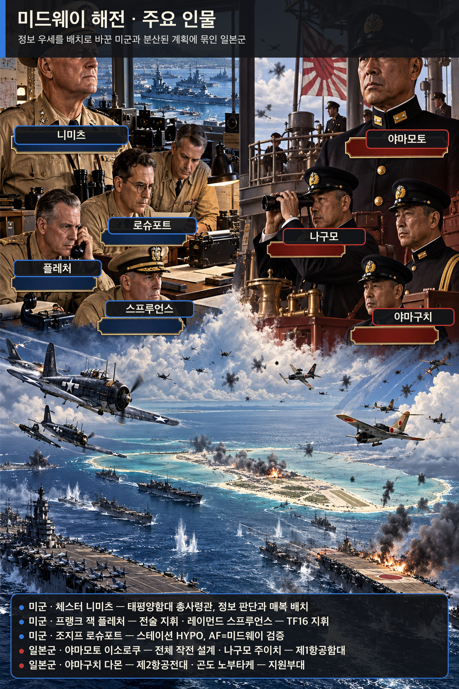

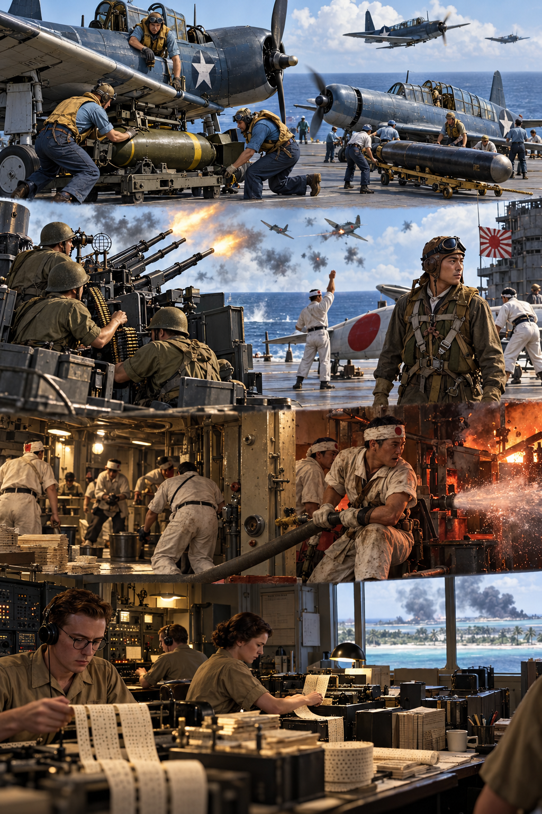

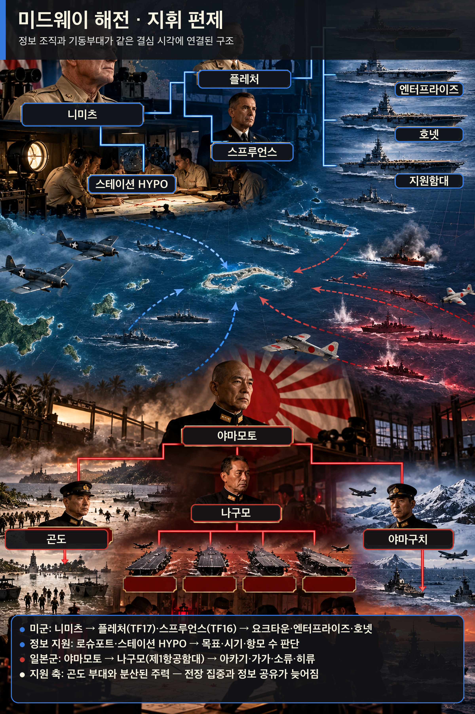

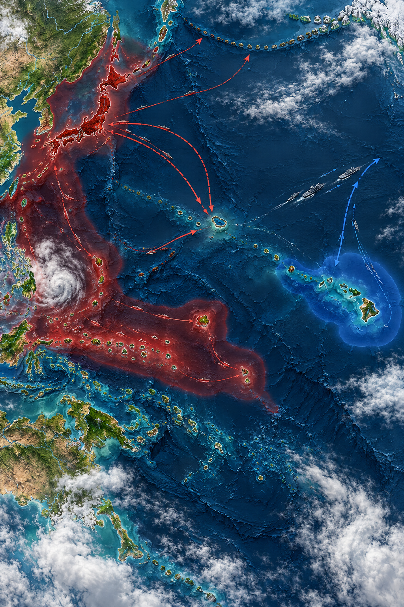

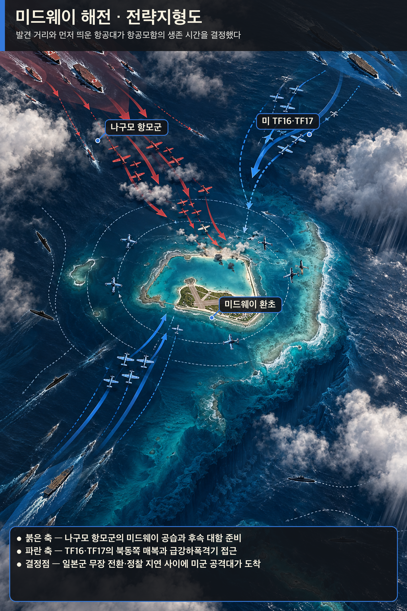

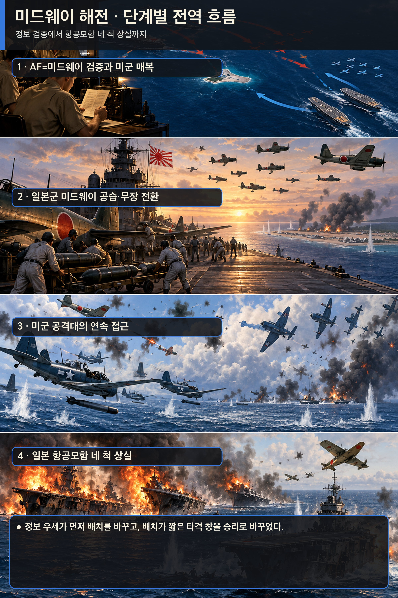

**뒤에서 반복될 지형을 먼저 잡아두기**

- 🌊 **태평양(Pacific Ocean)**: 🏛️ 일본 본토와 🇺🇸 하와이 사이의 거대한 거리 자체가 정찰·무선·연료를 전투력으로 바꾸었다. 함대를 먼저 발견한 쪽이 항공모함의 짧은 타격 창을 얻었다.
- **▰** **진주만(Pearl Harbor)**: 니미츠의 사령부와 스테이션 HYPO가 있던 출발점이다. 암호해독 결과가 함대 배치 명령으로 이어진 곳이다.
- **▰** **미드웨이 환초(Midway Atoll)**: 활주로·정찰기·잠수함을 갖춘 전초기지이자 일본군이 `AF`라 부른 목표였다. 물 부족 위장 전문은 이 목표를 확인하는 검증 실험이 되었다.
- **미드웨이 북동 해역**: **플레처**와 **스프루언스**의 항공모함 세 척이 대기한 매복 공간이다. 일본 정찰선 바깥에서 먼저 타격할 위치를 잡았다.
- **미드웨이 북서 해역**: **나구모**의 제1항공함대가 접근한 축이다. 섬 공격대와 대함 타격대 사이에서 무장을 바꾸는 동안 갑판 운용이 꼬였다.

#### 상세 전역 서사 — 암호해독에 쓴 비용이 매복 위치와 하루의 승부로 바뀌다

1942년 봄, **야마모토 이소로쿠(Isoroku Yamamoto)**는 미드웨이를 공격해 미국 항공모함을 끌어내고 격멸하려 했다. 그러나 🇺🇸 미 해군은 수개월 동안 통신감청소와 암호해독 인력을 유지했고, 진주만의 **조지프 로슈포트(Joseph Rochefort)** 팀은 일본 해군 암호 JN-25의 일부와 통신 패턴을 이어 맞추었다. `AF`가 어느 곳인지 논쟁이 남자 미드웨이에서 담수 부족을 평문으로 흘렸고, 일본 통신이 `AF`의 물 부족을 보고하면서 가설을 확인했다.

**체스터 니미츠(Chester W. Nimitz)**는 완전한 해독을 기다리지 않았다. 목표·대략의 날짜·항공모함 수라는 결정에 필요한 정보를 받아, 수리 중이던 요크타운까지 투입하고 세 항공모함을 미드웨이 북동쪽에 배치했다. 반대로 일본군은 미국 항공모함이 진주만에 있으리라는 가정과 복잡하게 분산된 작전계획에 묶였다.

6월 4일 새벽 일본군은 미드웨이를 공습했지만, 섬의 활주로와 항공전력은 완전히 제거되지 않았다. **나구모 주이치(Chuichi Nagumo)**는 대함 무장을 유지할지 섬 공격용으로 바꿀지 판단해야 했고, 정찰 보고는 늦고 불완전했다. 미국 뇌격기들의 희생적 공격은 직접 명중을 내지 못했지만 일본 전투기를 저공으로 끌어내고 진형을 흐트러뜨렸다. 이어 급강하폭격기가 도착해 아카기·가가·소류를 짧은 시간에 치명적으로 타격했다. 히류의 반격으로 요크타운도 결국 잃었으나 일본은 항공모함 네 척과 숙련 항공요원을 상실했다.

#### 전투에서 사용된 속임수 — `AF` 담수 부족 전문과 일본의 알류샨 양동

미군의 담수 전문은 무작위 거짓말이 아니라 하나의 식별 가설을 시험한 통제된 신호였다. 일본군이 그 신호를 자기 암호망에서 `AF`와 연결해 재전송하자, 미군은 목표를 확인했다. 일본의 알류샨 작전도 미국 전력을 북쪽으로 흩뜨릴 양동이었지만, 통신정보 분석은 그것이 주공이 아님을 구분했다.

#### 속임수 작동 구조

**주체와 의도.** 미군 정보팀은 `AF=미드웨이`라는 가설을 검증하고 일본 주공을 특정하려 했다.

**보인 신호와 믿은 이유.** 미드웨이가 담수 부족을 평문으로 보냈고, 일본 측은 자신들이 감청한 현지 사정을 내부 보고에 반영했다.

**유발된 행동과 결과.** 일본 암호망의 반응이 목표를 확인해 주자 니미츠는 항공모함을 매복 위치에 먼저 보냈다.

**사료의 경계.** 승리는 암호해독 하나의 자동 결과가 아니다. 정찰, 함재기 조종사의 희생, 일본 정찰 지연, 우연한 조우와 전술 판단이 함께 작용했다.

#### 속임수 일곱 질문

1. **누가 누구를 속였는가?** 미군 정보팀은 일본 통신망이 담수 전문에 반응하도록 유도했고, 일본군은 알류샨 양동으로 미국의 시선을 나누려 했다.
2. **어떤 사실이 거짓이었는가?** 계획적으로 만든 핵심 신호는 미드웨이의 긴급 담수 부족이었다.
3. **어떤 사실은 진실이지만 오해를 유도했는가?** 일본의 알류샨 공격은 실제 작전이었지만 주공처럼 보이게 배치되었다.
4. **상대는 왜 그것을 믿고 싶어 했는가?** 일본군은 미 태평양함대가 기습에 늦게 반응하리라는 작전 전제를 유지했다.
5. **속임수가 없었어도 같은 오판이 발생했을까?** 목표 추정은 가능했지만 확신과 배치 시점은 약해졌을 가능성이 높다.
6. **속은 사람은 어떤 독립 확인을 생략했는가?** 일본군은 장거리 정찰과 잠수함 경계선을 제때 완성하지 못해 미국 항공모함의 출항을 확인하지 못했다.
7. **신뢰·동의·안전을 해치지 않으면서 같은 원리를 어디서 연습할 수 있는가?** 보안 모의훈련에서 식별 가능한 시험 신호를 넣고, 한 출처가 아니라 독립 로그로 가설을 확인할 수 있다.

#### 시계편 兵者詭道也 — 이 전장에 해당하는 속이는 길

<table fit-page-width="true" header-row="true">
<tr><td>해당 구절·독음·뜻</td><td>전장의 장면</td></tr>
<tr><td>近而示之遠 근이시원 — 가까우면서 멀리 있는 듯 보임</td><td>미 항공모함은 미드웨이 북동 해역에 이미 접근했지만 일본군은 진주만에 남았으리라 판단했다.</td></tr>
<tr><td>攻其無備, 出其不意 공기무비, 출기불의 — 대비 없는 곳을 치고 뜻하지 않은 때에 나옴</td><td>미 급강하폭격기는 일본 전투기가 저공에 몰리고 항공모함 갑판 운용이 혼란한 순간을 타격했다.</td></tr>
</table>

#### 法 한눈 비교 — 곡제·관도·주용

<table fit-page-width="true" header-row="true">
<tr><td>진영</td><td>곡제(편제)</td><td>관도(지휘)</td><td>주용(보급·지속)</td></tr>
<tr><td>**미군**</td><td>미드웨이 육상항공대와 TF16·TF17을 분산 배치하되 목표를 하나로 묶었다.</td><td>니미츠의 의도 아래 플레처가 전술지휘하고 스프루언스가 기동부대를 운용했다.</td><td>진주만 수리·암호·정찰 기반을 활용해 요크타운까지 급히 복귀시켰다.</td></tr>
<tr><td>**일본군**</td><td>주력·침공·알류샨·잠수함 전력을 넓게 분산했다.</td><td>야마모토의 복잡한 계획과 나구모 현장 판단 사이 정보 지연이 컸다.</td><td>항공모함의 무장 전환과 연료·정찰 운용이 짧은 결전 창에 집중되었다.</td></tr>
</table>

#### 〈**나구모 주이치** — 패군〉

<table fit-page-width="true" header-row="true">
<tr><td>요소</td><td>판단</td></tr>
<tr><td color="orange_bg">🤝 **道**</td><td>숙련된 승조원은 강했지만 임무 변경과 정보 지연 속에서 공동 상황인식이 흔들렸다. (지기·사기)</td></tr>
<tr><td color="blue_bg">🌤️ **天**</td><td>미 항공모함 위치를 확인하지 못한 채 기존 가정을 유지했다. 불완전한 정찰 보고가 올 때 여러 가능성을 동시에 보존하지 못했다. (지피·타이밍·확률 관점)</td></tr>
<tr><td color="green_bg">🧭 **地**</td><td>광대한 해역에서 탐색 부채와 정찰 시간이 곧 생사 통로였다. 미국 매복 위치를 늦게 발견했다. (원근·광협·사생)</td></tr>
<tr><td color="purple_bg">🎖️ **將**</td><td>절차를 지켰으나 급변한 정보에 대응하는 결단이 늦었고, 섬과 함대라는 두 목표 사이에서 전환 비용을 키웠다. (지신인용엄·장유오위)</td></tr>
<tr><td color="yellow_bg">⚙️ **法**</td><td>정찰기 출발 지연, 무장 전환, 전투기 엄호가 얽혀 항공모함의 시간표가 무너졌다. (곡제·관도·주용)</td></tr>
</table>

**직관·편향 한 줄:** 미 항공모함이 아직 나타나지 않았다는 제한된 관측을 부재의 증거로 취급한 명령에는 기존 계획을 지지하는 신호를 더 무겁게 보는 **확증편향**이 작동한 것으로 볼 수 있고, 그 결과 대비 전환이 늦었다.

🏳️ **패군 측 결과**: 일본군은 지형편의 `北`(배, 적정을 헤아리지 못하고 강적과 맞서 패함)에 가까운 정보 실패를 겪고 항공모함 네 척을 잃었다.

🔀 **패군 측 회피 분기점**: 미국 항공모함의 위치를 확인할 때까지 예비 대함 타격대의 즉응성을 보존하고 정찰선을 앞당겼다면 승리를 보장할 수는 없어도 네 척이 한꺼번에 노출되는 완패 가능성은 낮출 수 있었다.

#### 〈**체스터 니미츠** — 승군〉

<table fit-page-width="true" header-row="true">
<tr><td>요소</td><td>판단</td></tr>
<tr><td color="orange_bg">🤝 **道**</td><td>워싱턴과 HYPO의 견해 차이 속에서도 현지 정보팀을 신뢰하고 함대가 쓸 수 있는 결론으로 바꾸었다. (지기·사기)</td></tr>
<tr><td color="blue_bg">🌤️ **天**</td><td>해독을 전지로 과장하지 않고 목표·날짜·규모의 범위를 사용해 유리한 확률을 높였다. 우연과 조종사 희생이 남았음을 감수했다. (지피·타이밍·확률 관점)</td></tr>
<tr><td color="green_bg">🧭 **地**</td><td>미드웨이의 정찰 반경과 북동 해역의 은폐 거리를 매복 지형으로 사용했다. (원근·광협·사생)</td></tr>
<tr><td color="purple_bg">🎖️ **將**</td><td>부하의 전문성을 믿고 제한된 정보로 기한 안에 결단했으며 현장 지휘관에게 재량을 주었다. (지신인용엄)</td></tr>
<tr><td color="yellow_bg">⚙️ **法**</td><td>암호해독·정찰·수리·항모 편제를 하나의 결정 체계로 결합했다. (곡제·관도·주용)</td></tr>
</table>

##### 法을 압축하지 않고 보기 — 곡제·관도·주용

**곡제 曲制(곡제): 부대를 어떻게 나누고 결합했는가**
<table fit-page-width="true" header-row="true">
<tr><td>진영</td><td>곡제 曲制(곡제)</td></tr>
<tr><td>**미군**</td><td>TF16·TF17과 미드웨이 육상항공대를 별도 축으로 두고 같은 일본 항모군을 압박했다.</td></tr>
<tr><td>**일본군**</td><td>항모 주력, 전함 본대, 침공대, 알류샨대를 분산해 상호지원 시간이 길어졌다.</td></tr>
</table>

**관도 官道(관도): 누가 명령하고 어떻게 전달했는가**
<table fit-page-width="true" header-row="true">
<tr><td>진영</td><td>관도 官道(관도)</td></tr>
<tr><td>**미군**</td><td>정보팀→레이턴→니미츠→플레처·스프루언스로 판단과 명령이 연결되었다.</td></tr>
<tr><td>**일본군**</td><td>분산 함대와 무선침묵 때문에 야마모토가 나구모의 전술 상황을 즉시 교정하기 어려웠다.</td></tr>
</table>

**주용 主用(주용): 군량·장비·전투 지속 능력을 어떻게 썼는가**
<table fit-page-width="true" header-row="true">
<tr><td>진영</td><td>주용 主用(주용)</td></tr>
<tr><td>**미군**</td><td>진주만 수리창이 요크타운을 급히 복구했고 섬·잠수함·초계기까지 정찰망에 넣었다.</td></tr>
<tr><td>**일본군**</td><td>장거리 작전의 연료와 함재기 무장 전환이 지속 능력과 즉응성을 제한했다.</td></tr>
</table>

🏆 **승군 측 결과**: 미군은 `以虞待不虞者勝`(이우대불우자승, 대비하여 대비하지 않은 적을 상대하는 자가 이김)을 구현했다. 정보 조직에 든 지속 비용이 하루의 배치 우위로 전환되었다.

**서양 실증 사례 출처:** [미 해군 역사유산사령부 — Battle of Midway](https://www.history.navy.mil/browse-by-topic/wars-conflicts-and-operations/world-war-ii/1942/midway.html) · [미 해군 — The Role of COMINT in the Battle of Midway](https://www.history.navy.mil/content/history/nhhc/research/library/online-reading-room/title-list-alphabetically/r/the-role-of-comint-in-the-battle-of-midway.html) · [NSA 국립암호박물관 — Battle of Midway](https://www.nsa.gov/History/National-Cryptologic-Museum/Exhibits-Artifacts/Exhibit-View/Article/2719156/world-war-2-battle-of-midway/)

### 동양 — 🏛️ 조조군 vs 🏛️ 원소군 │ 관도대전(官渡之戰, 200)

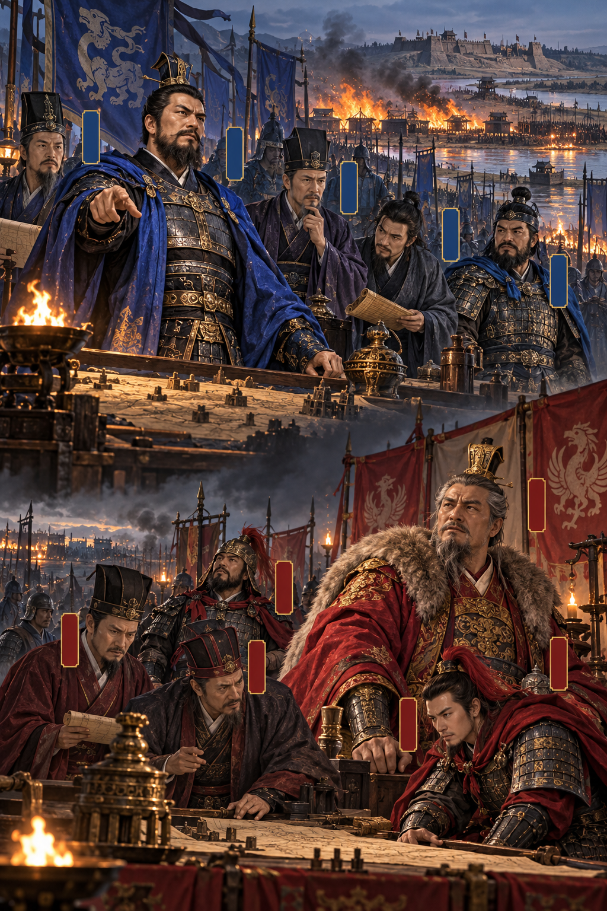

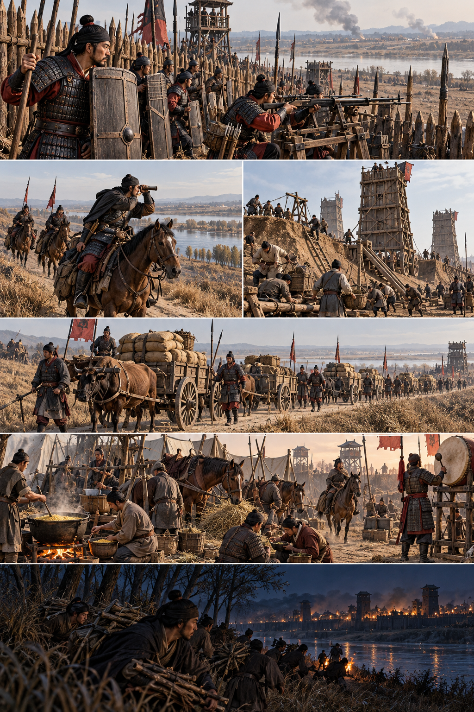

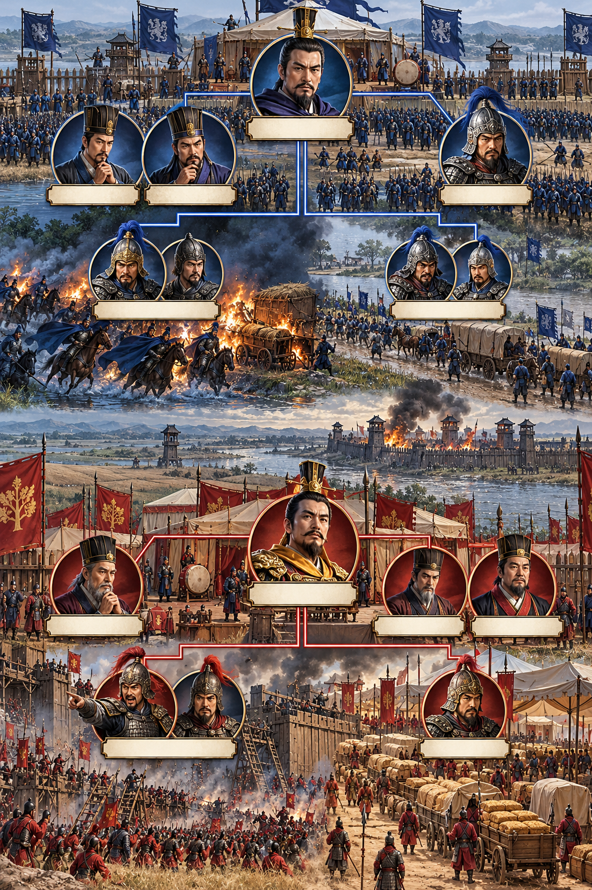

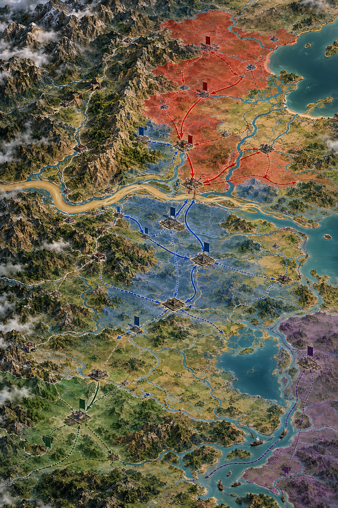

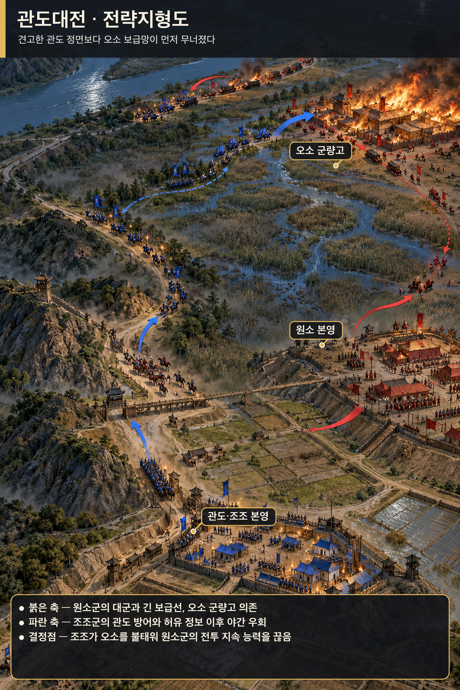

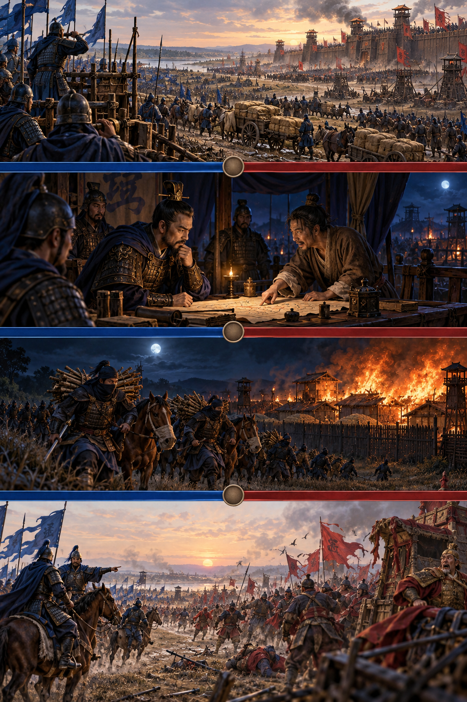

**뒤에서 반복될 지형을 먼저 잡아두기**

- 🌊 **황하(黃河)**: 하북의 **원소**가 남하할 때 건너야 하는 보급 장벽이었다. 백마·연진의 나루와 관도 전선이 연결된다.
- **▰** **관도(官渡)**: **조조**가 토루와 방책으로 버틴 주진지다. 병력 열세를 좁은 정면과 견고한 진영으로 줄였다.
- **▰** **오소(烏巢)**: **순우경**이 지킨 원소군의 군량 집적지다. 관도 본영과 떨어진 거리가 정보가 행동으로 바뀌는 시간 창을 만들었다.
- **▰** **허창(許昌)**: 헌제를 둔 조조의 정치·군수 중심지다. 관도 방어선이 무너지면 직접 위협받을 후방이었다.
- **오소로 가는 소로**: **조조**의 5천 정예가 원소군 표지를 가장하고 밤에 통과한 우회축이다.

#### 상세 전역 서사 — 허유의 정보가 오소 기습으로 전환되기까지

관도의 교착은 병력이 적고 군량이 빠듯한 **조조(曹操)**에게 시간이 불리한 싸움이었다. **원소(袁紹)**는 우세한 병력으로 토산과 누차를 운용했지만 견고한 관도 진영을 단숨에 무너뜨리지 못했다. **순유**의 건의로 서황·사환이 운송대를 먼저 습격해 보급의 취약성을 드러냈다.

결정적 정보는 **원소** 진영을 이탈한 **허유**에게서 왔다. 허유는 오소에 대량의 군량이 있고 수비가 허술하다고 알렸다. 조조의 장수 일부는 투항자의 말을 의심했지만 **순유**와 **가후**가 공격을 권했다. 조조는 조홍에게 관도 본영을 맡기고 보·기병 5천을 이끌어 밤길로 오소를 쳤다.

기습대는 원소군 증원부대로 가장하고 사람은 재갈을 물고 말의 입을 묶어 소리를 줄였다는 기록이 전한다. 오소의 군량이 불타자 원소 지휘부는 구원과 조조 본영 공격 사이에서 병력을 나누었다. **장합**과 **고람**의 관도 공격은 성과를 내지 못했고, 책임 추궁을 두려워한 두 장수가 투항하면서 원소군은 붕괴했다. 정보는 그 자체로 승리가 아니었다. 출처의 이해관계를 의심하되 시간 안에 검증하고, 정예병·위장·우회·본영 방어를 붙여 실행한 순간에 승리로 바뀌었다.

#### 전투에서 사용된 속임수 — 원소군 증원대로 가장한 오소 야습

조조의 5천 기습대는 불쏘시개를 휴대하고 밤길로 이동하면서 길에서 만난 원소군에게 “장기가 보낸 증원”이라 속였다고 전한다. 이 위장은 소수 병력이 적진 깊은 군량고에 접근할 시간을 벌었다. 그러나 허유의 투항 동기와 세부 대화는 후대 서술에서 각색되었을 가능성을 구분해야 한다.

#### 속임수 작동 구조

**주체와 의도.** 조조는 관도 정면이 아니라 오소 군량을 태워 원소군의 지속 능력과 사기를 동시에 끊으려 했다.

**보인 신호와 믿은 이유.** 야간 행군대는 원소군 표지를 쓰고 증원부대라고 답했다. 원소군도 오소 방어를 강화할 병력이 올 수 있는 상황이었다.

**유발된 행동과 결과.** 검문과 경보가 늦어졌고 조조군은 군량고 가까이 접근해 불을 놓았다. 원소의 분산 대응은 본영과 오소 어느 쪽도 구하지 못했다.

**사료의 경계.** 『삼국지』와 『자치통감』 계열은 기습의 큰 골격을 지지하지만, 병력 수·대화·잔혹행위의 세부는 기록별 차이와 후대 편집을 감안해야 한다.

#### 속임수 일곱 질문

1. **누가 누구를 속였는가?** 조조의 오소 기습대가 길목의 원소군과 오소 수비대를 속였다.
2. **어떤 사실이 거짓이었는가?** 기습대가 원소군의 증원부대라는 신분이었다.
3. **어떤 사실은 진실이지만 오해를 유도했는가?** 실제로 오소 방어가 위급해져 증원이 필요했으므로 이동 자체는 그럴듯했다.
4. **상대는 왜 그것을 믿고 싶어 했는가?** 대군을 거느린 원소 측은 후방 도로와 표지가 자기 통제 아래 있다고 기대했다.
5. **속임수가 없었어도 같은 오판이 발생했을까?** 야간 경계와 지휘 분산 때문에 침투 가능성은 있었지만 오소 가까이까지 무경보 접근하기는 어려웠을 것이다.
6. **속은 사람은 어떤 독립 확인을 생략했는가?** 이동 명령의 출처와 지휘관 신원을 본영에 재확인하지 못했다.
7. **신뢰·동의·안전을 해치지 않으면서 같은 원리를 어디서 연습할 수 있는가?** 보드게임과 보안 모의훈련에서 가짜 이동과 신원 재확인 절차를 함께 시험할 수 있다.

#### 시계편 兵者詭道也 — 이 전장에 해당하는 속이는 길

<table fit-page-width="true" header-row="true">
<tr><td>해당 구절·독음·뜻</td><td>전장의 장면</td></tr>
<tr><td>遠而示之近 원이시지근 — 멀면서 가까운 듯 보임</td><td>조조군은 적진 깊숙한 오소로 향하면서 원소군 내부의 정상 증원 이동처럼 보였다.</td></tr>
<tr><td>攻其無備, 出其不意 공기무비, 출기불의 — 대비 없는 곳을 치고 뜻하지 않은 때에 나옴</td><td>관도 정면이 아니라 떨어진 군량고를 밤에 공격했다.</td></tr>
</table>

#### 法 한눈 비교 — 곡제·관도·주용

<table fit-page-width="true" header-row="true">
<tr><td>진영</td><td>곡제(편제)</td><td>관도(지휘)</td><td>주용(보급·지속)</td></tr>
<tr><td>**조조군**</td><td>본영 방어와 5천 기습대를 분리하고 임무를 명확히 했다.</td><td>순유·가후의 판단을 받은 조조가 직접 기습대를 지휘했다.</td><td>열세한 군량 때문에 적 보급 파괴를 결전 목표로 삼았다.</td></tr>
<tr><td>**원소군**</td><td>대군과 공성장비는 강했지만 오소 후방 수비가 취약했다.</td><td>구원과 본영 공격 사이 명령이 갈리고 장합·고람에게 책임이 전가되었다.</td><td>대량 군량을 오소 한곳에 집중해 단일 실패점이 되었다.</td></tr>
</table>

#### 〈**원소** — 패군〉

<table fit-page-width="true" header-row="true">
<tr><td>요소</td><td>판단</td></tr>
<tr><td color="orange_bg">🤝 **道**</td><td>저수의 경고와 허유의 건의를 받아들이지 못하고 패전 책임이 예하 장수에게 돌아가 내부 신뢰가 무너졌다. (지기·사기)</td></tr>
<tr><td color="blue_bg">🌤️ **天**</td><td>조조군 군량이 먼저 고갈되리라는 시나리오에 집중했고, 오소 상실이라는 낮게 본 위험이 실제화될 때 대응을 나눴다. (지피·타이밍·확률 관점)</td></tr>
<tr><td color="green_bg">🧭 **地**</td><td>황하를 건넌 대군의 긴 보급선과 관도에서 떨어진 오소 사이 거리를 보호하지 못했다. (원근·험이·광협·사생)</td></tr>
<tr><td color="purple_bg">🎖️ **將**</td><td>많은 계책 가운데 일관된 우선순위를 세우지 못하고 실패 책임을 조정하지 못했다. (지신인용엄·장유오위)</td></tr>
<tr><td color="yellow_bg">⚙️ **法**</td><td>군량을 집중했으나 경계·보고·증원 절차를 그 가치에 맞게 강화하지 않았다. (곡제·관도·주용)</td></tr>
</table>

**직관·편향 한 줄:** 조조군이 먼저 소진될 것이라는 초기 전망을 붙든 채 오소 기습 가능성과 허유 이탈 신호를 낮게 본 명령에는 **확증편향과 과신**이 작동한 것으로 볼 수 있고, 구원과 본영 공격을 나눈 대응이 패배를 키웠다.

🏳️ **패군 측 결과**: 원소군은 지형편의 `亂`(란, 명령과 편제가 어지러움)과 `崩`(붕, 예하 장수가 불복·독자 행동하고 장수가 통제하지 못함)의 연쇄로 무너졌다.

🔀 **패군 측 회피 분기점**: 군량고를 분산하고 저수의 호위 강화 건의를 받아들였거나, 오소 피습 뒤 구원과 본영 공격 중 한 목표에 전력을 집중했다면 적어도 전군 붕괴는 피할 가능성이 있었다.

#### 〈**조조** — 승군〉

<table fit-page-width="true" header-row="true">
<tr><td>요소</td><td>판단</td></tr>
<tr><td color="orange_bg">🤝 **道**</td><td>교착과 군량 부족을 숨기지 않고 참모의 상반된 판단을 들은 뒤 역할을 나눴다. (지기·사기)</td></tr>
<tr><td color="blue_bg">🌤️ **天**</td><td>허유의 정보가 거짓일 가능성을 남겨 두되 순유·가후의 판단과 기존 보급 습격 경험으로 행동 가치가 더 크다고 보았다. (지피·타이밍·확률 관점)</td></tr>
<tr><td color="green_bg">🧭 **地**</td><td>관도 방책으로 정면을 묶고 오소 소로를 이용해 적의 후방 깊숙이 기동했다. (원근·험이·광협·사생)</td></tr>
<tr><td color="purple_bg">🎖️ **將**</td><td>정보의 시간가치를 알아 직접 위험을 감수하면서도 조홍에게 본영을 맡겼다. (지신인용엄)</td></tr>
<tr><td color="yellow_bg">⚙️ **法**</td><td>5천 정예·위장·불쏘시개·본영 방어를 하나의 짧은 작전으로 결합했다. (곡제·관도·주용)</td></tr>
</table>

##### 法을 압축하지 않고 보기 — 곡제·관도·주용

**곡제 曲制(곡제): 부대를 어떻게 나누고 결합했는가**
<table fit-page-width="true" header-row="true">
<tr><td>진영</td><td>곡제 曲制(곡제)</td></tr>
<tr><td>**조조군**</td><td>본영 수비대와 보·기병 5천의 기습대를 나누고, 서황의 선행 운송대 습격과 연결했다.</td></tr>
<tr><td>**원소군**</td><td>대군·공성대·오소 수비대를 두었으나 후방과 정면의 상호지원 설계가 약했다.</td></tr>
</table>

**관도 官道(관도): 누가 명령하고 어떻게 전달했는가**
<table fit-page-width="true" header-row="true">
<tr><td>진영</td><td>관도 官道(관도)</td></tr>
<tr><td>**조조군**</td><td>조조가 기습을 직접 지휘하고 조홍·순유가 관도 본영을 지키는 명령선을 세웠다.</td></tr>
<tr><td>**원소군**</td><td>순우경의 오소 수비와 장합·고람의 관도 공격이 하나의 우선순위로 통합되지 못했다.</td></tr>
</table>

**주용 主用(주용): 군량·장비·전투 지속 능력을 어떻게 썼는가**
<table fit-page-width="true" header-row="true">
<tr><td>진영</td><td>주용 主用(주용)</td></tr>
<tr><td>**조조군**</td><td>군량 열세를 인정하고 적 군량을 태워 지속 능력의 비교 자체를 뒤집었다.</td></tr>
<tr><td>**원소군**</td><td>하북에서 황하를 건넌 군량을 오소에 대량 집적해 화재 한 번에 손실이 집중되었다.</td></tr>
</table>

🏆 **승군 측 결과**: 조조군은 `識衆寡之用者勝`(식중과지용자승, 대군과 소수 병력의 쓰임을 아는 자가 이김)을 구현했다. 허유의 정보에 보상·신뢰·검증·기동을 붙여 하루의 승부로 바꾸었다.

**동양 실증 사례 출처:** [『삼국지』 위서 무제기·순유전 계열 — Chinese Text Project](https://ctext.org/sanguozhi) · [『자치통감』 권63 — Chinese Text Project](https://ctext.org/wiki.pl?if=gb&chapter=427095) · [관도대전 개요와 원전 대조](https://zh.wikipedia.org/wiki/%E5%AE%98%E6%B8%A1%E4%B9%8B%E6%88%98)

---

## 5. 핵심 통찰 + 실생활 적용 + 생활루틴

### 핵심 통찰

이 구절은 정보의 실패를 정보원 한 사람의 배신이나 무능으로만 돌리지 않는다. 누구를 어디에 쓸지 잘못 판단한 `聖智`의 실패, 위험은 맡기면서 보호와 약속을 지키지 않은 `仁義`의 실패, 보고를 사실로 성급히 확정한 `微妙`의 실패가 모두 지휘자에게 돌아온다.

세 조건은 서로 견제한다. 지혜만 강조하면 사람을 효율의 도구로 만들 수 있고, 인의만 강조하면 검증을 불신으로 오해할 수 있다. 미묘함만 강조하면 작은 단서를 과도하게 해석하는 음모론이 된다. **사람은 의롭게 대하고, 보고는 냉정하게 검증하며, 판단의 한계는 솔직하게 표시하는 것**이 셋의 균형이다.

`得間之實`은 확실성을 얻는다는 약속도 아니다. 확인된 사실, 가능성이 높은 해석, 아직 모르는 부분을 나누어 작전이 감당할 수 있는 수준의 판단을 만드는 일이다. 좋은 지휘자는 모르는 것을 숨기지 않고, 무엇을 더 확인하면 판단이 바뀔지까지 말한다.

### 실생활 적용

3교대 현장에서 에러 보고를 받으면 먼저 보고자의 태도보다 정보의 층을 나눈다. `직접 본 화면·수치 / 다른 사람에게 들은 내용 / 원인에 대한 추정 / 아직 확인하지 못한 항목` 네 칸으로 적는다. 이것이 `微妙`의 최소 동작이다. 말이 빠르거나 자신감이 강하다는 이유로 사실성이 올라가지는 않는다.

동시에 보고자를 공개적으로 몰아세우지 않는다. 틀린 추정은 바로잡되 조기에 알린 행동 자체는 인정하고, 이름과 개인 사정은 원인 분석에 필요한 범위 밖으로 퍼뜨리지 않는다. 이것이 `仁義`다. 보호를 약속했으면 실제 공유 범위와 후속 조치로 증명해야 다음에도 나쁜 소식이 올라온다.

인물사건관찰시리즈의 전씨 기록에는 복잡한 조치에서 당황과 피로가 겹치면 말이 줄고 신경질적 반응이 나타나는 장면이 있다. 이를 고정된 성격으로 단정하지 말고, 근무 시작 때 몸 상태·역할·확인한 설비·보고 시각을 짧게 합의한다. 조치 중에는 “무엇을 직접 봤는지”부터 묻고 원인 추정은 나중에 분리한다. 민감한 건강 정보는 인력 배치에 필요한 최소 범위만 공유한다.

신입 최씨 기록에는 피로와 퇴사 의사가 이어지는 동안 모니터링과 기록 업무가 누락된 장면이 있다. 한 번의 생생한 실패만으로 늘 그럴 것이라 단정하지 말고, 최근 교대별 담당 횟수와 누락 횟수를 함께 확인한다. 다만 불확실성을 핑계로 책임을 흐리지도 않는다. 담당 업무, 확인 시각, 인계 기준을 기록하고 반복 누락은 공식 보고선으로 넘긴다.

이 과정에서 사용자의 메모가 경고한 분모 무시를 피한다. “또 실수했다” 대신 최근 10회 중 몇 회였는지, 어떤 조건에서 늘었는지, 반대 사례는 무엇인지 묻는다. 한 사람의 말이든 자신의 직감이든 똑같이 검증한다. **사람에 대한 존중과 정보에 대한 검증을 반대말로 만들지 않는 것**이 이 구절의 생활형 핵심이다.

### 생활루틴

**추천 문구**

사람의 말은 분별하고, 맡긴 사람은 의롭게 대하며, 사실은 교차 확인하지 않으면 재수가 없다.

**이유**

오늘 첫 중요한 보고를 받은 뒤 5분 안에 `직접 관찰 / 전언 / 추정 / 미확인` 네 줄로 나누고, 독립 확인 하나와 판단을 뒤집을 증거 하나를 적는다. 이 절차가 없으면 생생한 말이 사실처럼 굳고, 한 시나리오가 다른 가능성을 밀어내며, 잘못된 지시가 다음 교대까지 이어질 수 있다. 보고자는 공개적으로 탓하지 않고 필요한 보호와 후속 답변을 약속대로 제공한다. 이것이 `聖智·仁義·微妙`를 하루의 불패지지로 바꾸는 가장 작은 행동이다.
