<!-- sunzi-analysis-mode: light -->
<!-- sunzi-original: 微哉微哉, 無所不用間也. 間事未發, 而先聞者, 間與所告者皆死. -->
> 미재미재, 무소불용간야. 간사미발, 이선문자, 간여소고자개사 — 중요한 일을 알 사람과 말할 때를 정하지 않으면 재수가 없다.

---
## 1. 원문 + 독음 + 직역 + 한자어 뜻풀이

微哉微哉, 無所不用間也. 間事未發, 而先聞者, 間與所告者皆死. 미재미재, 무소불용간야. 간사미발, 이선문자, 간여소고자개사.

**직역**  
미묘하구나, 미묘하구나. 간첩을 쓰지 않는 곳이 없다. 간첩의 일이 아직 실행되기 전에 먼저 들은 자가 있으면, 간첩과 그에게 알려 준 자를 모두 죽인다.

	앞 문장은 용간의 범위를 극한까지 넓히고, 뒤 문장은 정보의 유통 범위를 극한까지 좁힌다. 적의 실정을 알아야 할 곳에는 어디든 사람이 필요하지만, 작전이 시작되기 전에 그 사실이 새면 정보망 전체가 거꾸로 적의 정보가 된다. **널리 수집하되 좁게 공유하라**는 긴장이 이 짧은 문장 안에 걸려 있다.

	마지막의 `皆死`는 전국시대 군사법의 가혹한 누설 처벌을 그대로 드러낸다. 이를 오늘의 조직에 적용한다며 사람을 해치거나 불법적 보복을 정당화할 수는 없다. 현대에 남길 것은 처벌의 잔혹함이 아니라, 조기 누설이 정보원·작전·조직의 안전을 한꺼번에 무너뜨리므로 **권한 분리, 최소 공개, 기록, 합법적 조사 절차**가 필요하다는 구조다.

	#### 微哉微哉(미재미재) — 보이는 사실 사이의 보이지 않는 틈을 두 번 살피다

	`微`는 작고 희미하여 쉽게 드러나지 않는다는 뜻이다. `哉`는 감탄을 실어 그 미세함의 정도를 강조한다. 같은 말을 두 번 반복한 것은 단순한 감탄의 장식이 아니다. 사람의 말과 행동에서 적정을 읽는 일도 미세하고, 그렇게 얻은 정보가 새지 않도록 다루는 일도 미세하다는 이중의 어려움을 울린다.

	이 구절에서 미묘함은 신비한 직감이나 잔꾀가 아니다. 누가 무엇을 직접 알 수 있었는지, 어느 시점에 알았는지, 말이 어디를 거쳐 왔는지, 뜻밖의 누설인지 의도적 탐색인지 구분하는 세밀함이다. 작은 단서를 크게 믿는 것이 아니라, 작은 단서의 출처와 한계를 함께 적는 태도가 `微`다.

	#### 無所不用間(무소불용간) — 정보가 필요 없는 자리는 없되 모두에게 다 알릴 이유도 없다

	`無所不…`은 “…하지 않는 곳이 없다”는 전면 부정의 형식이다. `用間`은 사람 사이의 틈에서 적정을 얻는 정보원을 운용한다는 뜻이다. 군량·외교·성문·지휘부·행군로처럼 결정이 필요한 모든 곳에 정보가 스며들어야 함을 말한다.

	그러나 이 말은 모든 사람을 의심하고 감시하라는 허가장이 아니다. 앞 구절의 `聖智·仁義·微妙`가 없는 무차별 감시는 보고를 늘리는 대신 거짓말과 침묵을 늘린다. 여기서 `어디든`은 **정보 요구의 폭**이지, 권한 없는 수집과 사생활 침해의 폭이 아니다.

	#### 間事未發(간사미발) — 사람이 움직이기 전부터 이미 시간이 흐른다

	`間事`는 정보원을 통해 수행할 일, `未發`은 아직 드러나거나 실행되지 않은 상태다. 작전의 시작은 현장 요원이 출발하는 순간만이 아니다. 대상 선정, 질문 작성, 접근 방식, 보고 시각을 정하는 준비 과정부터 흔적과 말이 생긴다.

	그래서 누설을 막는 일은 마지막에 “비밀” 도장을 찍는 행위가 아니다. 준비 단계에서 누가 알아야 하는지 정하고, 각자에게 필요한 만큼만 알리며, 전달 경로와 변경 이력을 남겨야 한다. **미발의 시간은 아무 일도 없는 시간이 아니라, 가장 조용히 정보가 새기 쉬운 시간**이다.

	#### 先聞(선문) — 너무 일찍 아는 사람이 생겼다는 경보

	`先`은 앞서다, `聞`은 듣다이다. 문제는 단순히 누군가가 알았다는 데 있지 않고, 실행 전에 권한 없는 사람이 먼저 들었다는 시간의 역전이다. 알아야 할 사람보다 알 필요 없는 사람이 먼저 알았다면 전달선이 이미 뒤집힌 것이다.

	이때 성급히 범인을 단정하면 두 번째 오류가 생긴다. 우연히 들은 사람, 정당한 업무상 접근자, 실제 발설자, 의도적으로 캐낸 사람을 구분해야 한다. 접근 기록과 시각, 직접 들은 말과 추정을 분리하지 않으면 누설을 막으려다 무고한 사람을 몰아세우고 정작 취약한 절차는 남긴다.

	#### 所告者(소고자) — 말한 사람보다 전달 구조를 먼저 드러내다

	`所告者`는 그 사실을 알려 준 자다. 손자는 누설을 추상적인 사고로 처리하지 않고 전달 행위와 사람 사이의 관계를 추적한다. 정보는 저절로 새지 않는다. 누가, 누구에게, 어떤 필요를 근거로, 무엇을, 언제 알렸는지라는 연결선이 있다.

	현대 조직에서는 이 연결선을 처벌을 위한 밀고망으로 만들지 말아야 한다. 대신 승인된 채널, 접근 권한, 인계 기록, 사고 보고와 공정한 조사 절차로 바꿔야 한다. 책임은 개인 한 명에게만 몰지 않고 과도한 권한, 모호한 분류, 공용 메신저, 반복되는 구두 인계처럼 누설을 가능하게 한 시스템까지 묻는다.

	#### 皆死(개사) — 한 번의 누설이 두 생명과 전체 작전을 삼키던 고대의 경고

	`皆`는 모두, `死`는 죽음이다. 고대 군사법에서 비밀 누설의 결과가 정보원과 발설자 모두의 죽음으로 이어질 수 있음을 가장 가혹한 말로 제시한다. 정보원이 노출되면 적에게 붙잡히고, 작전이 실패하면 병사와 국가가 위험해진다는 연쇄가 배경에 있다.

	오늘 이 문장을 문자 그대로 실행하는 것은 불법이며 윤리적으로도 용납될 수 없다. 현대적 번역은 “사람을 없애라”가 아니라 **누설이 사람과 임무를 파괴하기 전에 권한을 최소화하고, 사고가 나면 즉시 보호·격리·보고·복구 절차를 가동하라**이다. 비밀 보호는 폭력의 면허가 아니라 더 엄격한 책임의 의무다.

	#### 글자들이 완성하는 한 장면

	지휘부는 `微哉微哉`라며 작은 흔적과 전달선을 두 번 살핀다. 전장 곳곳에는 `無所不用間`이라 할 만큼 정보 요구가 있지만, 한 임무는 아직 `未發`이다. 그런데 권한 밖의 사람이 `先聞`했다는 사실이 드러난다. 그 순간 지휘부는 간첩 한 사람만 의심하는 것이 아니라 `所告者`와 전달 구조 전체를 추적해야 한다.

	고대의 결론은 `皆死`였지만, 오늘의 결론은 달라야 한다. **사람을 보호하고 증거를 보전하며 접근을 제한하고, 합법적 절차로 원인을 밝혀 같은 누설이 반복되지 않게 하는 것**이 이 장면을 불패지지로 돌리는 길이다.

---
## 2. 전통 주석 기반 분석

- **조조(曹操)** — “간첩의 일이 드러나기 전에 먼저 들은 자가 생기면 모의가 새고 만다. **누설의 길을 즉시 끊고 군사 기밀을 엄하게 지켜라.**”
- **이전(李筌)** — “용간의 쓰임은 온갖 일에 미치지만 그 자취는 드러나지 않아야 한다. **널리 쓰되 그 길은 깊이 감추어라.**”
- **두목(杜牧)** — “일이 시작되기도 전에 말이 돌면 적이 먼저 대비하고 사람은 위험에 빠진다. **발설한 자와 전달된 경로를 함께 살펴라.**”
- **매요신(梅堯臣)** — “미묘하다는 말은 간첩을 쓰는 곳이 많으면서도 그 형적이 보이지 않는다는 뜻이다. **일은 넓게 통하되 비밀은 새지 않게 하라.**”
- **장예(張預)** — “먼저 들은 자가 있다는 것은 은밀한 계책이 이미 밖으로 나갔다는 증거다. **시각과 경로를 따져 근원을 찾아라.**”
- **왕석(王晳)** — “간첩과 발설자를 함께 경계한 것은 한쪽만 남기면 누설의 인과가 끊기지 않기 때문이다. **사람과 전달선을 함께 다스려라.**”
- **가림(賈林)** — “말이 새면 간첩의 몸뿐 아니라 군대의 움직임도 함께 드러난다. **알아야 할 자에게만 필요한 만큼 알게 하라.**”
- **두우(杜佑)** — “군사 기밀은 법과 명분을 세워 다루어야 한다. **사사로운 의심으로 벌하지 말고 확인된 누설을 정해진 절차로 다스려라.**”
- **진호(陳皞)** — “간첩을 두루 쓰는 능력과 그 일을 감추는 능력은 한 몸이다. **수집의 넓이만 자랑하지 말고 보안의 깊이를 함께 갖추어라.**”

#### 리링의 고증과 현대적 독법

리링의 해설 취지를 따르면 `微哉微哉`는 신비주의의 감탄사가 아니라 용간이 사람의 관계와 작은 징후를 다루는 정밀한 기술임을 강조하는 말로 읽어야 한다. `無所不用間`도 간첩이 만능이라는 뜻이 아니라, 군사 행동의 거의 모든 판단이 사람에게서 얻은 정보와 무관할 수 없다는 편장상의 결론이다.

문장의 구조는 확대와 수축을 잇는다. 첫 절은 정보 수집의 적용 범위를 넓히고, 둘째 절은 특정 공작의 지식 범위를 좁힌다. 이 대비를 놓치면 전반부만 떼어 무차별 감시를 정당화하거나, 후반부만 떼어 잔혹한 처벌을 용간의 본질로 오독하게 된다.

`皆死`는 고대 군사형벌의 문맥에서 읽어야 한다. 현대의 법치 조직은 이 처벌을 계승할 수 없으며, 비밀성 역시 감독과 책임을 면제하지 않는다. 남길 수 있는 것은 누설이 정보원·작전·병력에 연쇄 피해를 준다는 위험 인식과, 권한 분리·출처 보호·사후 검증이라는 제도적 교훈이다.

---
## 3. 교차 설명

### ① 손자병법 내 교차

바로 앞의 `非聖智不能用間, 非仁義不能使間, 非微妙不能得間之實`(비성지불능용간, 비인의불능사간, 비미묘불능득간지실 — 성지 없이는 간첩을 쓰지 못하고, 인의 없이는 부리지 못하며, 미묘함 없이는 실정을 얻지 못한다)은 이번 구절의 자격 조건이다. 세밀함 없이 비밀만 강조하면 공포가 되고, 인의 없이 누설만 처벌하면 정보원은 불리한 사실을 숨긴다.

앞의 `故三軍之事, 莫親於間, 賞莫厚於間, 事莫密於間`(고삼군지사, 막친어간, 상막후어간, 사막밀어간 — 삼군의 일에는 간첩보다 가까운 이가 없고, 상은 더 후한 것이 없으며, 일은 더 비밀한 것이 없다)은 친밀·보상·비밀을 한 묶음으로 둔다. 비밀은 사람을 버리는 명분이 아니라, 가까이하고 후하게 대하는 관계를 안전하게 지키는 장치다.

뒤의 `凡軍之所欲擊, 城之所欲攻, 人之所欲殺, 必先知其守將`(범군지소욕격, 성지소욕공, 인지소욕살, 필선지기수장 — 군대를 치고 성을 공격하며 사람을 제거하려면 먼저 그 수장을 알아야 한다)은 `無所不用間`의 구체적 방향을 보여 준다. 모든 것을 무차별로 모으는 것이 아니라, 다음 결정을 바꿀 지휘관·측근·문지기·사인의 정보를 요구한다. **폭넓은 정보망은 명확한 정보 요구와 좁은 공개 범위로 통제되어야 한다.**

### ② 클라우제비츠 『전쟁론』

클라우제비츠의 전쟁의 안개와 마찰은 정보를 많이 모아도 불확실성이 사라지지 않는다는 경고다. 손자의 `無所不用間`과 만나면 더 많은 출처를 확보하되, 각 보고가 불완전하고 서로 모순될 수 있음을 전제로 해야 한다. 수집의 넓이가 확신의 크기로 곧장 바뀌어서는 안 된다.

`間事未發, 而先聞者`는 마찰이 전투 현장보다 먼저 계획 단계에서 시작됨을 보여 준다. 조직 내부의 전달 지연, 불명확한 책임, 과도한 회람, 습관적인 잡담은 적의 기만이 없어도 계획을 손상시킨다. 비밀 보호는 전쟁의 안개를 없애지는 못하지만 아군이 스스로 안개를 짙게 만드는 일을 줄인다.

차이도 분명하다. 클라우제비츠는 불확실성 속 지휘관의 결단과 정치 목적을 중심에 두고, 이 구절은 인적 정보와 누설 통제를 더 날카롭게 다룬다. 둘을 결합할 때는 비밀을 절대화하지 말아야 한다. 정치 목적과 법적 감독에서 분리된 비밀 작전은 수단이 목적을 삼키고, 잘못된 판단을 내부에서 교정할 통로마저 막을 수 있다.

### ③ 미야모토 무사시 『오륜서』

『오륜서』의 `観見二つの目付`(관견 후타쓰노 메쓰케 — 꿰뚫어 보는 눈과 눈앞을 보는 눈)는 이 구절의 두 방향과 맞닿는다. `見`은 누가 언제 무엇을 들었는지 구체적 전달선을 보고, `観`은 그 한 번의 누설이 정보원·작전·조직 신뢰에 어떤 연쇄를 만드는지 본다.

무사시는 리듬과 박자를 빼앗는 일을 중시한다. 정보 보안에서도 매번 같은 시각에 같은 사람이 같은 방식으로 보고하면 내용이 암호화되어 있어도 패턴이 의도를 드러낼 수 있다. `間事未發`의 위험은 말의 내용뿐 아니라 접촉 빈도, 이동, 반복되는 절차 같은 관찰 가능한 형상에도 있다.

다만 개인 검술의 감각을 조직 보안에 그대로 옮기면 숙련자의 직감이 곧 증거가 되는 오류가 생긴다. 현대 조직은 접근 기록, 승인된 채널, 역할 분리, 재현 가능한 조사 절차를 남겨야 한다. 무사시의 두 눈은 주의의 방향을 주지만, 적법한 증거와 공정한 절차를 대신하지 않는다.

### ④ 오자병법·육도삼략

『오자병법』은 법령이 명확하고 상벌이 믿을 만해야 군이 움직인다고 본다. 이는 `皆死`의 공포만 떼어 쓰지 말라는 제한이 된다. 무엇이 기밀인지, 누가 접근할 수 있는지, 사고가 나면 어떻게 보고하는지가 먼저 분명해야 하며, 모호한 규칙을 사후에 꺼내 사람을 벌해서는 안 된다.

『육도』는 눈과 귀를 넓혀 여러 사람의 말을 듣되 군주의 판단이 특정 측근에게 가로막히지 않게 하는 것을 중시한다. 이는 `無所不用間`의 수집 폭과 통한다. 그러나 출처가 많다는 사실만으로 정보가 독립적이라고 볼 수 없다. 같은 소문을 여러 사람이 옮겼다면 출처는 여러 개가 아니라 하나다.

두 병서와의 교차는 넓은 청취와 엄격한 통제가 충돌하지 않음을 보여 준다. 의견과 이상 징후는 넓게 받을 수 있지만, 민감한 세부와 대응 계획은 필요 기준에 따라 제한해야 한다. **말할 입구는 넓게, 작전 정보의 출구는 좁게, 책임 절차는 명확하게** 만드는 것이 고대 상벌론을 현대적으로 제한한 형태다.

### ⑤ 현대 심리학·군사학

미국 정보공동체의 최신 `ICD 203` 분석 기준은 출처의 접근성·검증·동기·편향을 설명하고, 정보와 분석가의 가정·판단을 구분하며, 대안 분석과 불확실성 표시를 요구한다. 이는 `微哉微哉`를 직감이 아니라 검증 가능한 분석 절차로 바꾼다. 비밀 출처라는 이유로 근거의 질을 묻지 않는 것이 아니라, 출처를 보호하면서도 판단의 강도와 한계를 소비자에게 알려야 한다. ([ODNI ICD 203](https://www.dni.gov/files/documents/ICD/ICD-203.pdf))

미 육군의 OPSEC 교리는 중요한 정보와 아군 행동에서 드러나는 관찰 가능한 지표를 식별하고, 위협·취약성·위험을 분석한 뒤 대책을 적용하는 표준화된 과정이다. 이는 `間事未發`을 “입을 다물라”는 훈계보다 넓게 읽게 한다. 말뿐 아니라 일정, 반복 행동, 접근 절차, 공개 자료의 조합도 작전 의도를 드러낼 수 있다. 동시에 OPSEC를 중요하지 않은 정보까지 숨기는 구실로 쓰지 말라고 경고한다. ([미 육군 Operational Law Handbook](https://tjaglcs.army.mil/Periodicals/Deskbooks-Handbooks/Operational-Law-Handbook?topic=Chapter+10%3A+INFORMATION+OPERATIONS))

`ICD 206`은 특정 판단이 출처에 의존할 때 원출처에 가까운 참조와 출처 인용을 남기도록 한다. 모든 출처를 공개하라는 뜻은 아니며, 누가 어떤 판단 근거에 접근할 수 있는지를 통제하면서도 책임 가능한 기록을 유지하라는 뜻이다. 비밀과 검증 가능성은 반대가 아니다. ([ODNI ICD 206](https://www.dni.gov/files/documents/ICD/ICD-206.pdf))

사용자의 「생각에대한 생각」 메모는 생생한 희귀 사건을 과대평가하고, 한 시나리오에 집중하면 다른 가능성을 밀어내며, 분모를 무시하기 쉽다고 기록한다. 누설 의심이 생기면 가장 눈에 띄는 사람을 범인으로 확정하기 쉽다. 이를 막으려면 `누가 알 수 있었는가 / 실제 접근 기록은 무엇인가 / 우발 노출·권한 오류·의도적 발설이라는 대안이 각각 어느 정도 가능한가 / 무엇이 판단을 뒤집는가`를 적는다.

반대로 “지금까지 한 번도 안 샜다”는 경험도 안전의 증거가 아니다. 관측되지 않은 누설, 발견되지 않은 접근, 낮지만 누적되는 위험을 분모에 넣어야 한다. 다만 모든 대화를 위협으로 취급하면 협업과 사고 보고가 얼어붙는다. 위험의 크기, 정보의 민감도, 실제 접근 가능성을 나누어 최소한의 대책을 선택해야 한다.

---
## 4. 역사적 실증 사례

### 서양 — 🏛️ 독일 제국 제8군 vs 🏛️ 러시아 제국 제2군 │ 타넨베르크 전투(Battle of Tannenberg, 1914)

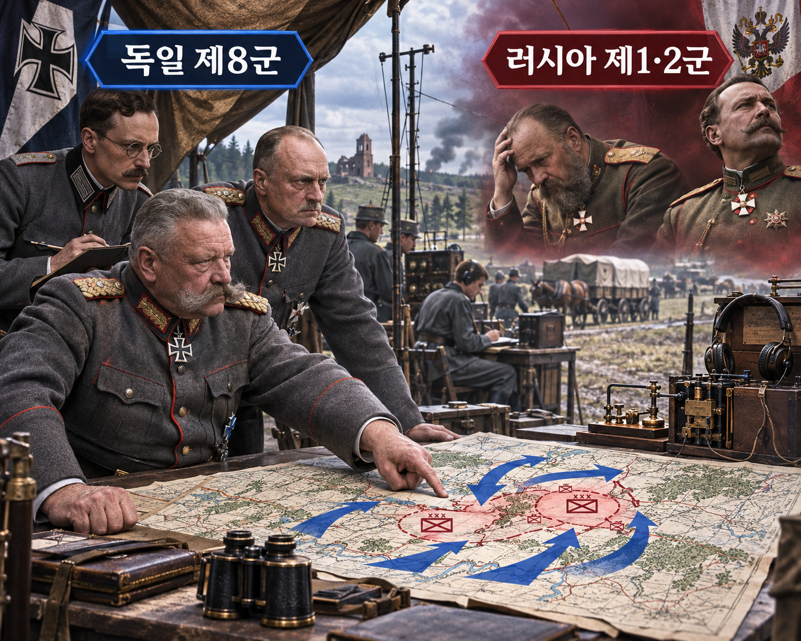

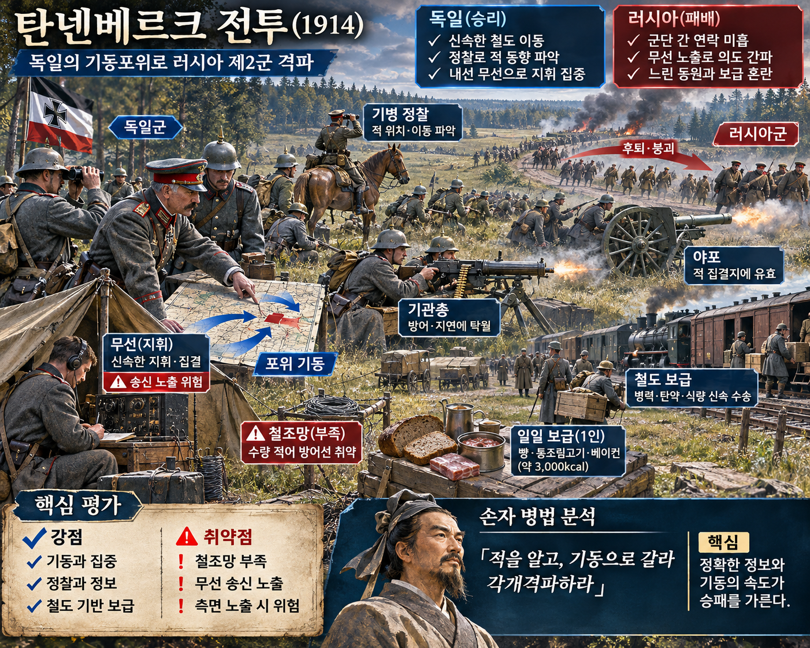

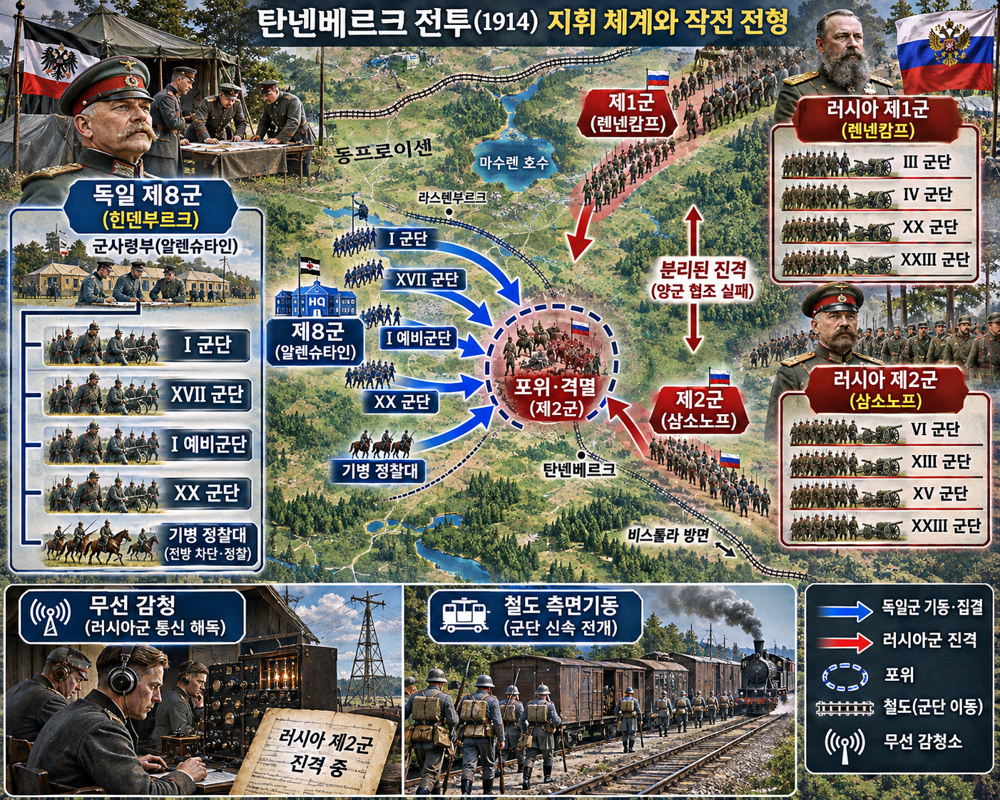

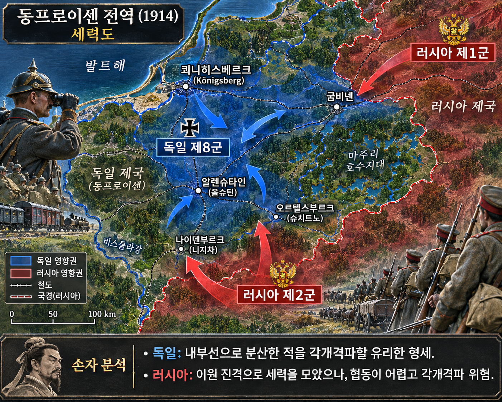

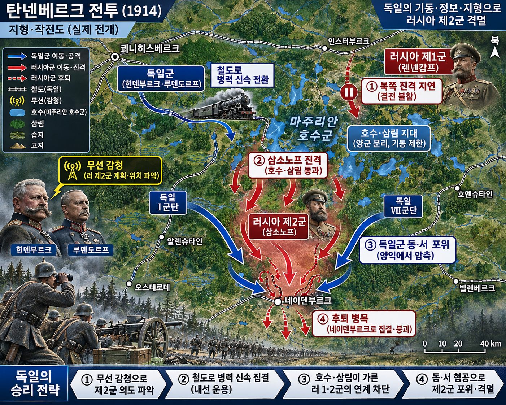

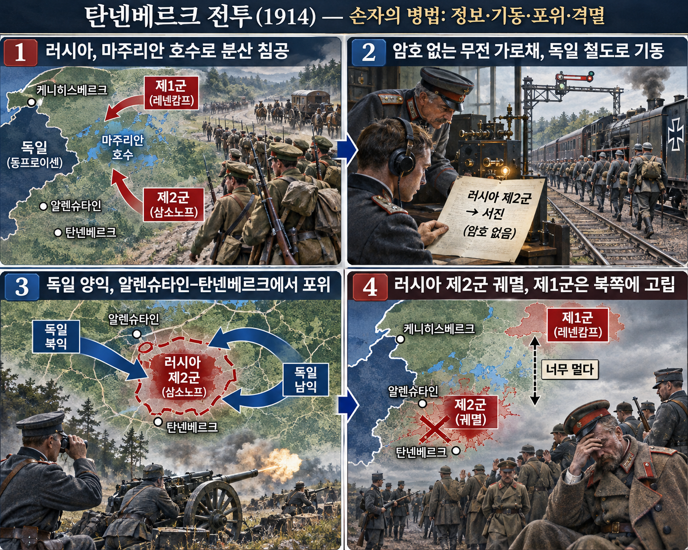

**뒤에서 반복될 지형을 먼저 잡아두기**

- 🌊 **마주리안 호수군(Masurian Lakes)**은 러시아 제1군과 제2군 사이의 횡적 연락을 가로막았다. 두 군이 호수의 북쪽과 서남쪽으로 갈라진 채 전진하면 서로를 하루 안에 돕기 어려웠다.
- **▰** **쾨니히스베르크(Königsberg)**와 동프로이센 철도망은 독일 제8군이 병력을 내선으로 옮기는 기반이었다. 러시아군의 이동 계획을 먼저 안 독일군은 이 철도로 국지적 우세를 만들었다.
- **▰** **알렌슈타인(Allenstein, 오늘날 Olsztyn)** 남쪽의 숲·호수·도로망은 러시아 제2군의 군단들이 서로 다른 속도로 전진하게 만들었다. 이 틈으로 독일군 양익이 들어갔다.
- **▰** **오르텔스부르크(Ortelsburg, 오늘날 Szczytno)**와 **▰** **나이덴부르크(Neidenburg, 오늘날 Nidzica)**는 제2군의 후방 도로와 철도 방향이었다. 포위가 닫히자 퇴로와 보고선이 함께 끊겼다.
- 🌲 **동프로이센 남부의 숲과 습지**는 전령·전화선을 지연시키고 무선 의존을 높였다. 보안되지 않은 보고는 지형이 만든 통신 문제를 적의 정보 우세로 바꾸었다.

#### 상세 전역 서사 — 암호 없는 명령이 독일의 철도 기동을 결심으로 바꾸다

1914년 8월 러시아군은 프랑스를 돕기 위해 동프로이센에 빠르게 진입했지만, **렌넨캄프**의 제1군과 **삼소노프**의 제2군은 🌊 **마주리안 호수군(Masurian Lakes)**을 사이에 두고 떨어져 있었다. 이동 중인 군단들은 전화선을 충분히 깔 수 없었고 암호표 배포도 불완전했다. 시간 압박 속에서 러시아군은 작전 명령과 위치 보고를 평문 무선으로 보냈다.

쾨니히스베르크와 토른의 독일 수신소는 이 전파를 들었다. 8월 24~25일의 감청은 **삼소노프**의 군단 배치와 **렌넨캄프**의 전진이 당장 제2군을 돕지 못한다는 판단을 뒷받침했다. **호프만**의 정보 판단만으로 승리가 자동으로 생긴 것은 아니다. 항공 정찰, 현지 철도, 독일 군단의 행군, 러시아군의 보급·협동 실패가 함께 맞물렸다.

**힌덴부르크**와 **루덴도르프**는 제1군을 막는 북쪽에 제한된 경계만 남기고 주력을 남쪽으로 집중하는 위험한 결정을 내렸다. 적의 계획을 미리 듣지 못했다면 감행하기 어려운 선택이었다. 독일 I군단은 서쪽에서, XVII군단과 I예비군단은 동쪽에서 러시아 제2군의 측면과 후방을 닫았다.

러시아 군단은 서로의 위치와 상급부 명령을 늦게 알았고, **삼소노프**의 지휘부는 전황을 한 장의 그림으로 묶지 못했다. 8월 26~30일 독일의 포위가 알렌슈타인 남쪽에서 닫히자 제2군은 퇴로와 보급을 잃었다. 전투 결과는 감청 하나의 마법이 아니라, **누설된 의도와 위치를 적이 철도·정찰·지휘 집중으로 즉시 행동화한 결과**였다.

#### 전투에서 사용된 정보 우세 — 평문 무선이 작전계획을 적의 결심표로 바꾸다

**주체와 의도.** 러시아군은 멀어진 군단을 신속히 통제하려 무선을 사용했다. 독일군은 수신소가 들은 메시지를 러시아 두 군의 위치·행군 방향·협동 가능성을 판단하는 정보로 바꾸었다.

**보인 신호와 믿은 이유.** 이 사례는 독일이 거짓 신호를 보낸 기만이 아니라 러시아가 스스로 노출한 실제 명령을 이용한 감청이다. 독일 지휘부는 단일 전문만 믿지 않고 항공 정찰과 포로·문서·현지 보고를 함께 보았다.

**유발된 행동과 결과.** 러시아 제1군의 즉각적 개입 가능성이 낮다는 판단은 독일군이 남쪽에 주력을 집중하도록 만들었다. 감청은 병력을 직접 움직이지 않았지만, 철도 이동과 양익 포위의 위험을 감수할 근거가 되었다.

**사료의 경계.** 후대 회고록은 감청의 비중을 축소하거나 과장했다. 현대 연구는 무선 감청이 중요했으나 항공 정찰, 철도망, 러시아군 통신·보급 실패와 분리해 단독 원인으로 볼 수 없다고 경계한다.

#### 法 한눈 비교 — 곡제·관도·주용

<table fit-page-width="true" header-row="true">
<tr><td>진영</td><td>곡제(편제)</td><td>관도(지휘)</td><td>주용(보급·지속)</td></tr>
<tr><td>**독일 제8군**</td><td>군단을 철도로 재배치해 제2군에 국지 집중했다.</td><td>감청·정찰을 제8군 지휘부가 한 작전 그림으로 묶었다.</td><td>동프로이센 내선 철도가 병력·탄약 이동을 지탱했다.</td></tr>
<tr><td>**러시아 제1·2군**</td><td>두 군이 호수군을 사이에 두고 분리 진격했다.</td><td>평문 무선과 늦은 연락으로 의도는 노출되고 협동은 지연됐다.</td><td>철도 종점에서 멀어질수록 식량·탄약·전령망이 약해졌다.</td></tr>
</table>

#### **알렉산드르 삼소노프(Alexander Samsonov, 패)**

<table fit-page-width="true" header-row="true">
<tr><td>요소</td><td>판단</td></tr>
<tr><td color="orange_bg">🤝 **道**</td><td>군단별 전진과 지휘 마찰을 하나의 공동 목적과 보고 규칙으로 묶지 못했다. (지기·사기)</td></tr>
<tr><td color="blue_bg">🌤️ **天**</td><td>제1군의 지원과 독일군의 후퇴를 낙관했으나 적은 감청·정찰로 그의 배치를 더 정확히 읽었다. 가능한 독일 집중 시나리오의 확률을 낮게 두었다. (지피·타이밍·확률 관점)</td></tr>
<tr><td color="green_bg">🧭 **地**</td><td>호수·숲·장거리 도로가 횡적 연락과 보급을 제한하는 원지·험지를 충분히 상쇄하지 못했다. (원근·험이·광협)</td></tr>
<tr><td color="purple_bg">🎖️ **將**</td><td>전진 압력 속에서 군단 간 간격과 통신 보안을 동시에 통제하지 못했다. (지신인용엄)</td></tr>
<tr><td color="yellow_bg">⚙️ **法**</td><td>암호표·무선 규율·전화선·전령의 대체 체계가 부족해 지휘 정보가 적에게 먼저 도착했다. (곡제·관도·주용)</td></tr>
</table>

**직관·편향 한 줄:** **삼소노프**가 독일군이 계속 물러날 것이라는 초기 그림을 유지한 명령에서는 확증편향과 계획 오류가 작동했을 가능성이 있으며, 평문 무선이 그 오판을 적에게 투명하게 만들었다.

🏳️ **패군 측 결과**: 러시아 제2군은 포위·해체되어 「지형편」의 北(배, 적정을 헤아리지 못하고 불리한 병력 운용으로 패함)에 가까운 패배를 입었다.

🔀 **패군 측 회피 분기점**: 진격 전에 제1군과 공동 연락 시각·암호·무선 침묵 조건을 정하고, 평문 발신이 불가피하면 위치·의도·시간을 분리했더라면 독일군의 확신을 낮추고 적어도 전군 포위는 피할 가능성이 있었다.

#### **파울 폰 힌덴부르크(Paul von Hindenburg, 승)**

<table fit-page-width="true" header-row="true">
<tr><td>요소</td><td>판단</td></tr>
<tr><td color="orange_bg">🤝 **道**</td><td>지휘부 교체 직후에도 군단·철도·정보 부서를 제2군 격파라는 한 목표로 묶었다. (지기·사기)</td></tr>
<tr><td color="blue_bg">🌤️ **天**</td><td>감청을 확정 예언으로 보지 않고 정찰과 대조해 제1군 개입 위험을 관리했다. 불확실성을 없애기보다 남쪽 집중의 성공 확률을 높였다. (지피·타이밍·확률 관점)</td></tr>
<tr><td color="green_bg">🧭 **地**</td><td>호수군과 숲이 러시아 두 군을 가르는 지형을 이용하고 철도 내선을 아군의 짧은 거리로 바꾸었다. (원근·험이·광협)</td></tr>
<tr><td color="purple_bg">🎖️ **將**</td><td>감청에 근거한 위험한 집중을 승인하되 군단별 임무와 시간표를 유지했다. (지신인용엄)</td></tr>
<tr><td color="yellow_bg">⚙️ **法**</td><td>수신소·항공 정찰·철도 운송·군단 기동을 하나의 작전 순환으로 결합했다. (곡제·관도·주용)</td></tr>
</table>

🏆 **승군 측 결과**: 독일 제8군은 대비한 채 분리된 적을 집중 공격해 「모공편」의 以虞待不虞者勝(이우대불우자승, 대비한 자가 대비하지 못한 적을 이김)에 해당했다.

##### 法을 압축하지 않고 보기 — 곡제·관도·주용

**곡제 曲制(곡제): 부대를 어떻게 나누고 결합했는가**

<table fit-page-width="true" header-row="true">
<tr><td>진영</td><td>실제 운용</td></tr>
<tr><td>**독일 제8군**</td><td>I군단·XVII군단·I예비군단·XX군단을 서·동·중앙 축으로 나누고 철도로 다시 결합해 제2군 포위에 집중했다.</td></tr>
<tr><td>**러시아 제1·2군**</td><td>두 야전군과 제2군 예하 군단이 넓은 전선에서 서로 다른 속도로 전진해 국지 지원이 늦었다.</td></tr>
</table>

**관도 官道(관도): 누가 명령하고 어떻게 전달했는가**

<table fit-page-width="true" header-row="true">
<tr><td>진영</td><td>실제 운용</td></tr>
<tr><td>**독일 제8군**</td><td>수신소의 전문이 오토바이 전령으로 사령부에 전달됐고, 정보·작전 판단이 군단 명령과 철도 시간표로 이어졌다.</td></tr>
<tr><td>**러시아 제1·2군**</td><td>무선·전령·부족한 전화선이 혼재했고 암호표 부족과 시간 압박 때문에 평문 명령이 반복됐다.</td></tr>
</table>

**주용 主用(주용): 군량·장비·전투 지속 능력을 어떻게 썼는가**

<table fit-page-width="true" header-row="true">
<tr><td>진영</td><td>실제 운용</td></tr>
<tr><td>**독일 제8군**</td><td>자국 철도망으로 병력·포병·탄약을 짧게 이동시키고 현지 통신소와 정찰 자산을 이용했다.</td></tr>
<tr><td>**러시아 제1·2군**</td><td>철도 종점에서 멀어진 군단은 도로·마차 보급과 제한된 전선에 의존했고, 식량·탄약·연락의 지연이 포위 속에서 증폭됐다.</td></tr>
</table>

**사료와 연구:** [독일 역사박물관 LeMO](https://www.dhm.de/lemo/kapitel/erster-weltkrieg/kriegsverlauf/tannenberg-1914) · [미 NSA 공개자료, The Beginnings of Radio Intercept](https://media.defense.gov/2021/Jun/30/2002752756/-1/-1/0/BEGINNINGS%20RADIO%20INTERCEPT.PDF) · [미 NSA 공개자료, War Secrets in the Ether](https://www.nsa.gov/portals/75/documents/news-features/declassified-documents/friedman-documents/reports-research/FOLDER_264/41761019080017.pdf)

### 동양 — 🏛️ 진(秦) vs 🏛️ 조(趙) │ 장평대전(長平之戰, 기원전 260년)

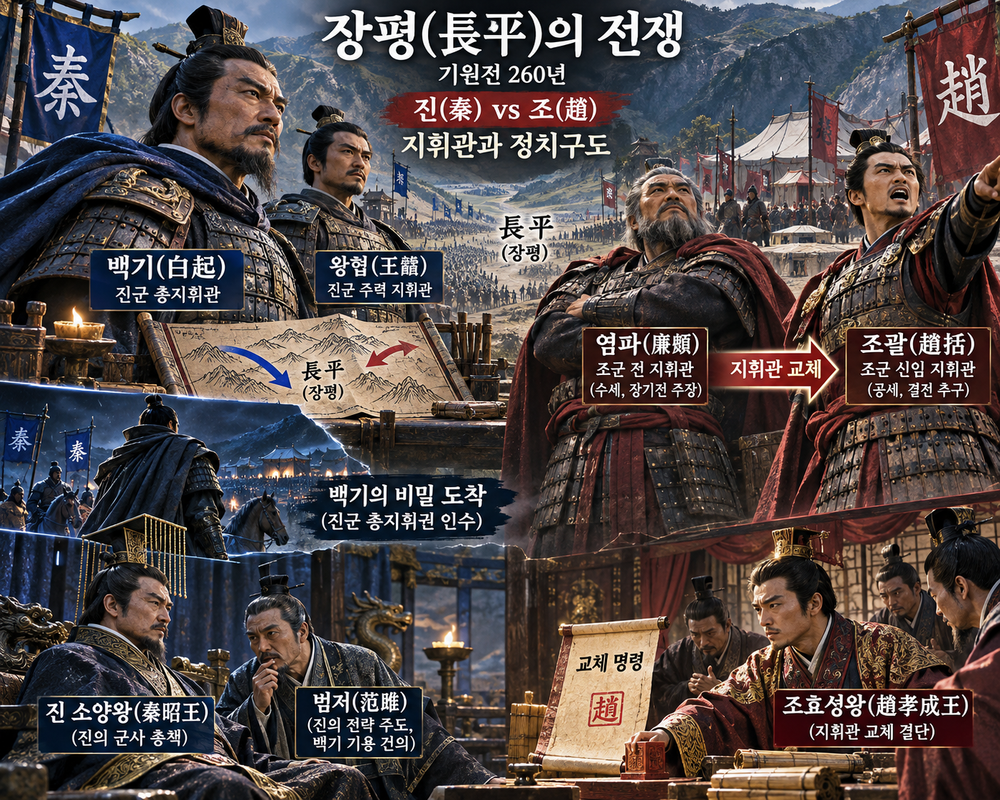

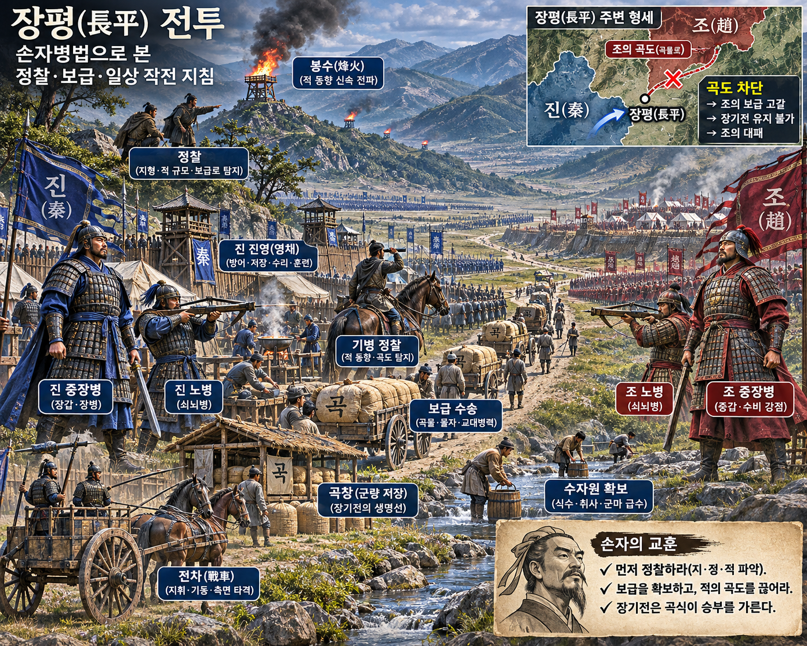

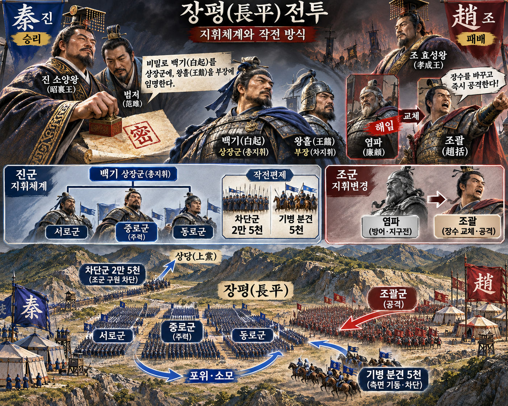

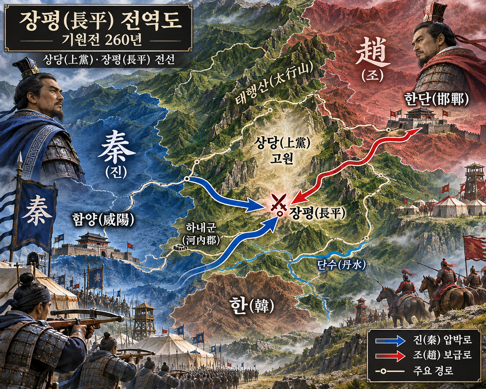

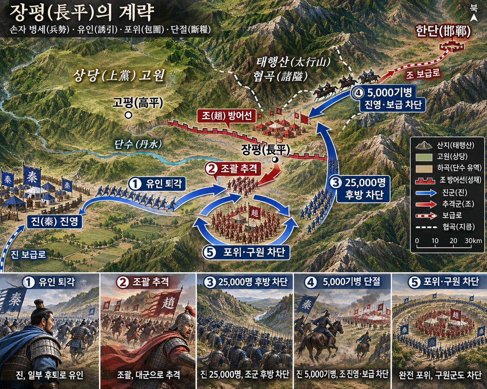

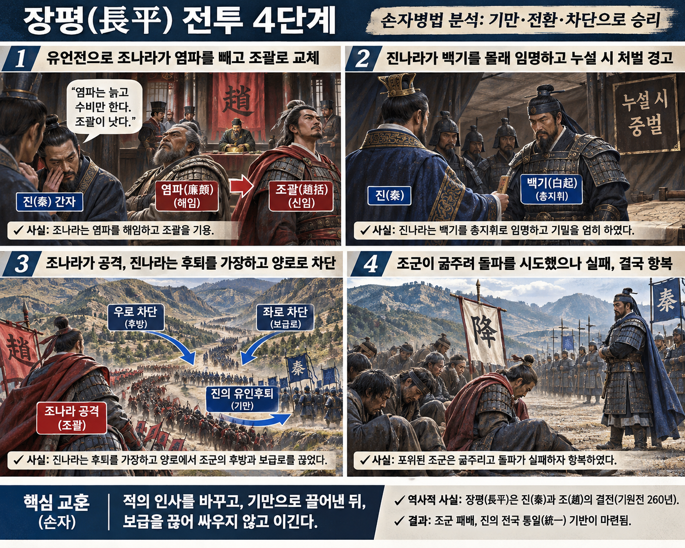

**뒤에서 반복될 지형을 먼저 잡아두기**

- ⛰️ **상당고원(上黨高原)**은 진·한·조가 만나는 고지대였다. 서쪽 진에서 동쪽 조로 넘어가는 길목을 누가 잡느냐가 보급과 증원의 방향을 결정했다.
- 🌊 **단수(丹水)** 계곡과 양쪽 산지는 대군을 길게 늘어뜨렸다. 방어 진지는 강과 고지를 이용했지만 추격군은 측면 차단에 취약했다.
- **▰** **한단(邯鄲)**은 조의 수도이자 장평 전선으로 인력·군량을 보내는 후방이었다. 이 보급로가 끊기면 장기전의 지속력이 사라졌다.
- **▰** **하내(河內)**는 진이 추가 동원을 모아 장평의 구원로를 막는 후방 기반이었다. 포위 뒤 진 소양왕이 이곳에서 직접 동원을 독려했다.
- ⛰️ **태행산(太行山) 협곡**은 구원군과 군량이 통과할 수 있는 길을 제한했다. 진의 별동대가 길목을 차단하자 포위된 조군은 전투보다 굶주림에 먼저 압박받았다.

#### 상세 전역 서사 — 지휘관 교체를 숨긴 진이 조괄의 공격 시점을 기다리다

장평의 교착에서 **염파**는 진군과 정면 결전을 피하고 진지를 굳혔다. 진의 승상 **범저**는 조에 사람을 보내 재물을 풀고 “진이 두려워하는 것은 조사의 아들 **조괄**뿐”이라는 말을 퍼뜨렸다. 조 효성왕은 오래 끄는 **염파**에게 불만을 품고 있었고, 이 신호는 기존 기대와 결합해 지휘관 교체를 촉진했다.

『사기』는 진이 **조괄**의 부임을 듣자 **백기**를 몰래 상장군으로 삼고, 그 사실을 누설하는 자는 참형에 처한다고 군중에 명했다고 기록한다. 이 대목은 `間事未發, 而先聞者`의 고대적 집행을 그대로 보여 준다. 다만 오늘의 독해는 참형을 정당화하는 것이 아니라, **결정적 지휘 변경을 적이 알지 못하게 한 정보 격리의 효과와 그 폭력적 비용을 분리해 보는 것**이어야 한다.

**조괄**은 도착 뒤 기존 장교와 명령 체계를 바꾸고 공격으로 전환했다. **백기**는 진군 일부를 물러나게 해 추격을 유도했다. 조군이 본진과 보급선에서 멀어지자 진군 2만5천이 후방을 끊고, 기병 5천이 조군과 진영 사이를 갈랐다.

조군은 포위망 안에서 진지를 만들고 구원을 기다렸지만 군량이 끊겼다. 진 소양왕은 하내에서 추가 인력을 동원해 조의 증원과 보급을 막았다. 장기 포위 뒤 **조괄**이 돌파를 시도하다 전사했고 조군은 항복했다. 항복병 대량 살해 숫자와 방식은 『사기』의 기록에 기대며 고고학·현대 연구에서 세부 논쟁이 있으므로 확정된 정밀 통계처럼 쓰지 않는다.

#### 전투에서 사용된 속임수 — 가짜 두려움과 비밀 지휘관 교체

#### 속임수 작동 구조

**주체와 의도.** 진은 조가 방어형 지휘관 **염파**를 공격형 **조괄**로 바꾸게 하고, 그 뒤 실제 상대가 될 **백기**의 부임은 숨기려 했다.

**보인 신호와 믿은 이유.** 진은 “조괄만 두렵다”는 소문을 보였다. 조왕은 장기 교착과 비용 때문에 염파의 방어를 무능으로 보고 싶어 했고, 조괄의 명성과 부친 조사에 대한 기억이 소문의 설득력을 높였다.

**유발된 행동과 결과.** 조는 염파를 해임하고 조괄에게 공격을 맡겼다. 진은 백기의 부임을 격리한 채 조괄의 공격을 유인 후퇴와 양로 차단으로 받아 포위했다.

**사료의 경계.** 핵심 서사는 전한대 『사기』에 의존한다. 소문 공작·비밀 임명·처벌 명령은 문헌상 명확하지만 세부 병력 숫자와 후대의 극적인 일화는 사료층을 구분해야 한다.

#### 속임수 일곱 질문

1. **누가 누구를 속였는가?** 진의 범저와 정보망이 조왕의 지휘관 선택을 흔들었고, 진 지휘부는 백기의 부임을 조군에 숨겼다.
2. **어떤 사실이 거짓이었는가?** 진이 조괄만 두려워한다는 소문은 조가 원하는 교체를 유도하기 위한 신호였다.
3. **어떤 사실은 진실이지만 오해를 유도했는가?** 염파가 결전을 피하고 장기 방어를 택한 것은 사실이지만, 그것이 곧 무능이나 패배를 뜻하지는 않았다.
4. **상대는 왜 그것을 믿고 싶어 했는가?** 조왕은 길어진 전쟁과 비용을 끝낼 결전을 원했고, 조괄의 명문과 병법 지식이 빠른 해결책처럼 보였다.
5. **속임수가 없었어도 같은 오판이 발생했을까?** 가능성은 중간 정도다. 조 내부의 교체 압력은 이미 있었지만 진의 소문이 선택의 확신과 시점을 앞당겼다.
6. **속은 사람은 어떤 독립 확인을 생략했는가?** 조정은 진이 실제로 두려워한 작전 조건, 조괄의 대군 지휘 경험, 염파 방어의 시간 효과를 독립적으로 검증하지 않았다.
7. **신뢰·동의·안전을 해치지 않으면서 같은 원리를 어디서 연습할 수 있는가?** 보드게임과 모의훈련에서 공개 정보와 비공개 역할을 분리하고, 상대가 보인 신호와 실제 승리 조건을 따로 적는 훈련으로 연습할 수 있다.

#### 시계편 兵者詭道也 — 이 전장에 해당하는 속이는 길

<table fit-page-width="true" header-row="true">
<tr><td>해당 구절·독음·뜻</td><td>전장의 장면</td></tr>
<tr><td>能而示之不能 능이시지불능 — 능하면서도 능하지 못한 듯 보임</td><td>진은 백기라는 가장 위험한 지휘관을 숨기고 기존 지휘 모습이 계속되는 듯 보였다.</td></tr>
<tr><td>利而誘之 이이유지 — 이익으로 유인함</td><td>조괄이 결전하면 진이 두려워한다는 소문은 지휘관 교체와 공격이 이익인 듯 보이게 했다.</td></tr>
<tr><td>佚而勞之 일이노지 — 쉬면서 적을 수고롭게 함</td><td>진은 유인 후퇴 뒤 조군을 본진에서 끌어내고 보급을 끊어 포위 속에서 소모시켰다.</td></tr>
</table>

#### 法 한눈 비교 — 곡제·관도·주용

<table fit-page-width="true" header-row="true">
<tr><td>진영</td><td>곡제(편제)</td><td>관도(지휘)</td><td>주용(보급·지속)</td></tr>
<tr><td>**진군**</td><td>정면 유인대·후방 차단대·기병 별동대를 결합했다.</td><td>백기 임명을 좁게 격리하고 왕흘을 부장으로 유지했다.</td><td>하내 동원으로 포위망과 구원로 차단을 지속했다.</td></tr>
<tr><td>**조군**</td><td>대군이 공격축으로 길게 나가 본진과 분리됐다.</td><td>지휘관·장교·명령 체계가 한꺼번에 바뀌었다.</td><td>후방과 군량로가 끊겨 포위 장기전에 취약했다.</td></tr>
</table>

#### **조괄(趙括, 패)**

<table fit-page-width="true" header-row="true">
<tr><td>요소</td><td>판단</td></tr>
<tr><td color="orange_bg">🤝 **道**</td><td>부임 직후 기존 장교와 명령을 바꾸어 장기 방어에 적응한 조직의 연속성을 약화했다. (지기·사기)</td></tr>
<tr><td color="blue_bg">🌤️ **天**</td><td>상대 지휘관이 왕흘이라고 보는 동안 실제로는 백기가 결정을 통제했다. 지휘관 교체라는 대안 시나리오를 분모에 넣지 못했다. (지피·타이밍·확률 관점)</td></tr>
<tr><td color="green_bg">🧭 **地**</td><td>단수 계곡에서 공격대를 본진·군량로와 멀리 내보내 협곡의 차단 가능성을 키웠다. (원근·험이·사생)</td></tr>
<tr><td color="purple_bg">🎖️ **將**</td><td>병법 지식과 결전 의지가 실제 대군 지휘 경험과 독립 정찰을 대신했다. (지신인용엄·장유오위)</td></tr>
<tr><td color="yellow_bg">⚙️ **法**</td><td>지휘 교체 뒤 편제·보고·보급을 안정시키기 전에 공격해 군과 진영의 연결이 끊겼다. (곡제·관도·주용)</td></tr>
</table>

**직관·편향 한 줄:** **조괄**이 진의 유인 후퇴를 자신이 기대한 결전 기회로 해석한 공격에서는 과신과 확증편향이 작동했을 가능성이 있으며, 백기의 비밀 부임을 확인하지 못한 채 보급로까지 걸었다.

🏳️ **패군 측 결과**: 조군은 지휘관이 적정을 헤아리지 못하고 대군을 포위에 넣은 北(배)에 가까운 패배를 입었다.

🔀 **패군 측 회피 분기점**: 조괄이 부임 뒤 즉시 전면 공격하지 않고 염파의 진지·장교·정찰망을 유지한 채 진 지휘부 변화와 퇴각로를 독립 확인했더라면, 승리를 장담할 수 없어도 군량로가 끊긴 전면 포위는 피할 가능성이 있었다.

#### **백기(白起, 승)**

<table fit-page-width="true" header-row="true">
<tr><td>요소</td><td>판단</td></tr>
<tr><td color="orange_bg">🤝 **道**</td><td>왕흘을 부장으로 두고 기존 진군과 별동대를 하나의 포위 계획에 묶었다. (지기·사기)</td></tr>
<tr><td color="blue_bg">🌤️ **天**</td><td>조괄의 지휘관 교체와 공격 전환이 열린 시점을 이용하되, 그 행동을 유인 후퇴로 확인한 뒤 차단대를 투입했다. (지피·타이밍·확률 관점)</td></tr>
<tr><td color="green_bg">🧭 **地**</td><td>단수 계곡·상당고원의 제한된 길을 이용해 조군의 앞뒤를 가르고 구원로를 막았다. (험이·광협·사생)</td></tr>
<tr><td color="purple_bg">🎖️ **將**</td><td>자신의 부임을 숨긴 채 정면 승부보다 상대의 지휘 습관과 보급선을 먼저 겨냥했다. (지신인용엄)</td></tr>
<tr><td color="yellow_bg">⚙️ **法**</td><td>주력·2만5천 차단대·5천 기병을 시차 결합하고 국가 동원으로 포위 지속력을 보강했다. (곡제·관도·주용)</td></tr>
</table>

🏆 **승군 측 결과**: 진군은 적의 지휘관 교체를 먼저 알고 대비한 채 공격을 유도해 以虞待不虞者勝(이우대불우자승, 대비한 자가 대비하지 못한 적을 이김)에 해당했다. 항복 뒤의 대량 살해는 군사적 승리와 분리해 비판해야 하며 이 구절의 현대적 적용으로 계승할 수 없다.

##### 法을 압축하지 않고 보기 — 곡제·관도·주용

**곡제 曲制(곡제): 부대를 어떻게 나누고 결합했는가**

<table fit-page-width="true" header-row="true">
<tr><td>진영</td><td>실제 운용</td></tr>
<tr><td>**진군**</td><td>정면 유인대와 주력, 2만5천 후방 차단대, 5천 기병 별동대를 서로 다른 임무로 나눠 포위 시점에 결합했다.</td></tr>
<tr><td>**조군**</td><td>공격대가 후퇴하는 진군을 따라 나가면서 본진·방어선·군량 호위와 분리됐다.</td></tr>
</table>

**관도 官道(관도): 누가 명령하고 어떻게 전달했는가**

<table fit-page-width="true" header-row="true">
<tr><td>진영</td><td>실제 운용</td></tr>
<tr><td>**진군**</td><td>진왕이 백기를 비밀 상장군으로 임명하고 왕흘을 부장으로 두었으며, 임명 정보의 범위를 군율로 제한했다.</td></tr>
<tr><td>**조군**</td><td>조왕이 염파를 조괄로 바꾸었고 조괄은 기존 장교와 명령을 교체해 전선의 경험과 중앙 결정 사이의 마찰을 키웠다.</td></tr>
</table>

**주용 主用(주용): 군량·장비·전투 지속 능력을 어떻게 썼는가**

<table fit-page-width="true" header-row="true">
<tr><td>진영</td><td>실제 운용</td></tr>
<tr><td>**진군**</td><td>진지는 조군을 포위한 뒤 하내의 추가 동원으로 구원·군량로를 막아 장기 지속력을 국가 차원에서 보강했다.</td></tr>
<tr><td>**조군**</td><td>대군의 식량 수요가 큰 상태에서 본진과 후방로를 잃어 굶주림과 탈진이 전투력보다 먼저 한계에 닿았다.</td></tr>
</table>

**사료와 연구:** [『사기』 백기왕전열전 원문·역주](https://www.shiwens.cn/bookv_23650.html) · [『사기』 해당 대목 현대어역](https://esdiscovery.jp/knowledge/classic/china2/shiki057.html) · [장평대전 개관과 사료 쟁점](https://en.wikipedia.org/wiki/Battle_of_Changping)

---
## 5. 핵심 통찰 + 실생활 적용 + 생활루틴

### 핵심 통찰

이 구절의 핵심은 “간첩을 많이 써라”나 “비밀을 누설하면 잔혹하게 벌하라” 중 하나가 아니다. **정보 요구는 조직 전체에 넓게 놓되, 특정 민감 정보의 공개는 역할과 시점에 맞춰 좁혀야 한다**는 이중 설계다. 수집만 넓히면 감시가 되고, 비밀만 좁히면 폐쇄와 오류 은폐가 된다.

`先聞`은 정보가 틀렸다는 문제가 아니라 순서가 틀렸다는 문제다. 결정권자와 실행자가 준비하기 전에 권한 밖의 사람이 알면, 그 정보가 참일수록 피해가 커질 수 있다. 따라서 정보 품질뿐 아니라 전달 시각·대상·목적을 함께 관리해야 한다.

`皆死`를 현대에 살릴 수 있는 유일한 방식은 그 폭력을 거부하면서 경고의 무게를 제도로 옮기는 것이다. 사람을 희생시키는 비밀이 아니라 사람을 보호하는 비밀, 책임을 숨기는 비밀이 아니라 접근과 판단을 기록하는 비밀이어야 한다. 사고가 나면 범인 색출보다 먼저 노출 범위를 줄이고 영향을 받은 사람을 보호하며, 증거와 업무 연속성을 보전해야 한다.

### 실생활 적용

3교대 현장에서 에러가 발생하면 보고 입구는 넓게 연다. 누구든 이상 징후를 바로 말할 수 있어야 한다. 그러나 원인 추정, 개인 이름, 미확정 조치, 오피스에 올릴 결론을 단체 대화방과 현장 잡담에 한꺼번에 풀어놓지 않는다. `확인 사실 / 현재 가설 / 담당자 / 다음 확인 시각 / 공유 대상`을 나누면 `無所不用間`의 넓은 감지와 `間事未發`의 좁은 공개를 함께 지킬 수 있다.

전씨가 복잡한 조치에서 당황해 말을 줄이거나 신경질적으로 반응했다는 관찰은 성격 판정으로 퍼뜨릴 정보가 아니다. 그 기록에서 실무적으로 필요한 것은 피로한 교대에서 역할과 보고 시점을 미리 정하고, 조치 중에는 직접 확인한 화면과 추정을 나누자는 점이다. 개인의 건강·성격 평가는 당사자 보호와 업무상 필요 범위를 넘어 공유하지 않는다.

신입 최씨의 모니터링·기록 누락도 공개적인 뒷말로 돌리면 조치 전에 소문만 앞선다. 특정 교대의 담당, 실제 누락 시각, 확인된 영향, 재발 방지 조치를 기록해 정식 보고선으로 올린다. 퇴사 의사나 피로 호소는 필요한 관리자에게만 전달하고, 확인되지 않은 동기나 인격 평가는 붙이지 않는다.

누설이 의심될 때는 “누가 그럴 법한가”보다 “누가 언제 접근할 수 있었는가”를 먼저 본다. 공용 화면, 자동 알림, 열린 문서, 구두 인계, 잘못 지정된 수신자가 원인일 수 있다. 사용자 메모가 경고한 한 시나리오 집중을 피하려면 최소 세 가설을 적고 접근 기록으로 좁혀야 한다. 생생한 인상만으로 동료를 몰아붙이면 무고한 사람을 해치고 실제 취약점은 남는다.

일상에서도 같은 원리가 적용된다. 중요한 계획, 금융 정보, 건강 정보, 다른 사람의 사정은 말하기 전에 `이 사람이 지금 알아야 하는가 / 어느 세부까지 필요한가 / 전달 기록이 필요한가 / 잘못 보내면 어떻게 회수할 것인가`를 확인한다. 상대를 조종하거나 불법적으로 감시하는 기술이 아니라, **자기 정보와 타인의 신뢰를 지키는 절제**로만 적용한다.

### 생활루틴

**추천 문구**

중요한 일을 알 사람과 말할 때를 정하지 않으면 재수가 없다.

**이유**

오늘 첫 민감한 보고나 계획을 보내기 전 1분 동안 `내용 / 꼭 알아야 할 사람 / 공개 시점 / 전달 채널` 네 줄을 적고 수신자를 다시 확인한다. 이 작은 확인이 없으면 미확정 정보가 잡담과 전달을 거치며 사실처럼 굳고, 관계없는 사람에게 먼저 도달해 당사자의 신뢰와 조치의 순서를 무너뜨릴 수 있다. 보고 입구는 막지 않되 세부의 출구를 좁히는 것이 `無所不用間`과 `間事未發`을 함께 지키는 불패지지다.
