<!-- sunzi-analysis-mode: full -->
<!-- sunzi-original: 凡軍之所欲擊, 城之所欲攻, 人之所欲殺, 必先知其守將, -->
> 범군지소욕격, 성지소욕공, 인지소욕살, 필선지기수장 — 행동부터 정하고 책임자와 지휘선을 확인하지 않으면 재수가 없다.

---
## 1. 원문 + 독음 + 직역 + 한자어 뜻풀이

凡軍之所欲擊, 城之所欲攻, 人之所欲殺, 必先知其守將, 범군지소욕격, 성지소욕공, 인지소욕살, 필선지기수장.

**직역**  
무릇 치고자 하는 군대, 공격하고자 하는 성, 제거하고자 하는 사람이 있다면, 반드시 먼저 그 수비하는 장수를 알아야 한다.

문장은 공격 욕망을 세 번 밀어 올린 뒤, 마지막에 순서를 뒤집는다. 군대를 치고 싶고, 성을 공격하고 싶고, 특정 인물을 제거하고 싶더라도 첫 동작은 타격이 아니다. **그 목표를 실제로 지키고 움직이는 지휘관을 먼저 아는 것**이다. 목표는 지도 위의 점이지만, 방어는 사람·명령·관계가 이어진 체계이기 때문이다.

`殺`은 고대 전쟁의 물리적 살해를 가리킨다. 오늘의 직장과 일상에 이 말을 옮길 때 사람을 해치거나 불법적으로 사생활을 캐는 뜻으로 사용할 수 없다. 현대적으로 남길 원리는 문제를 없애려 할 때 사람을 표적으로 삼지 말고, 적법한 범위에서 **책임자·권한·보고선·대체자·결정 절차**를 먼저 파악하라는 것이다.

#### 凡軍(범군) — 눈앞의 병력보다 그 병력을 하나로 묶는 체계를 보다

`凡`은 무릇, 일반적으로라는 뜻이고 `軍`은 조직된 군대를 가리킨다. 이 구절의 `軍`은 병사들의 단순한 합계가 아니다. 명령을 내리는 사람, 명령을 전달하는 측근, 성문을 열고 닫는 사람, 숙소와 일정을 아는 사람이 결합한 조직이다.

그래서 군대를 친다는 말은 보이는 병력만 세는 것으로 끝나지 않는다. 누가 결정을 내리고, 명령이 어떤 경로로 내려가며, 지휘관이 사라지거나 판단을 바꾸면 누가 이어받는지를 알아야 한다. 다음 구절이 `左右·謁者·門者·舍人`으로 범위를 넓히는 이유도 여기에 있다.

#### 擊(칠 격) — 부딪히기 전에 어디를 건드리면 전체가 흔들리는지 묻다

`擊`은 손이나 무기로 치고 부딪치는 동작이다. 이 문장에서는 야전의 군대를 직접 타격하는 행위를 가리킨다. 그러나 손자는 `欲擊`이라 하여 욕망의 단계에서 멈춘다. 치고 싶다는 의지가 생겼다고 곧바로 쳐도 된다는 뜻이 아니다.

타격은 돌이킬 수 없는 비용을 만든다. 적의 지휘 구조를 모르면 주력을 잘못 짚고, 허위 표적을 치며, 방어가 가장 단단한 곳에 힘을 낭비할 수 있다. `擊` 앞에 필요한 것은 용기가 아니라 **행동을 바꿀 수 있는 구체적인 정보 요구**다.

#### 城(성 성) — 벽이 아니라 사람과 절차가 유지하는 방어망

`城`은 성벽으로 둘러친 방어 거점이다. 성은 눈에 보이는 벽 때문에 강해 보이지만, 실제 방어력은 수비장, 문지기, 교대, 군량, 통신, 증원 약속이 함께 만든다. 벽의 높이만 재고 수비 체계를 모르면 성의 실정을 아는 것이 아니다.

앞의 군대가 움직이는 조직이라면 성은 고정된 거점이다. 그런데 손자는 둘 모두를 사람의 지휘로 연결한다. **움직이는 군대든 고정된 시설이든 최종적으로는 누가 보고받고 결심하며 명령하는가가 방어의 핵심**이라는 뜻이다.

#### 攻(칠 공) — 목표를 얻는 일과 벽을 두드리는 일을 구분하다

`攻`은 공격하다, 공략하다라는 뜻이다. 모공편의 `其下攻城`(기하공성 — 가장 낮은 방책은 성을 공격하는 것이다)과 함께 읽으면, 성을 두드리는 행위 자체가 목적이 되어서는 안 된다. 얻으려는 효과와 투입할 비용을 먼저 계산해야 한다.

수비장을 아는 것은 암살술을 찾는 일이 아니라, 협상·고립·기만·우회·항복 권고 가운데 어떤 수단이 실제로 통할지를 판단하는 기초다. 정보를 얻고도 무조건 정면 공격한다면 `先知`는 장식에 불과하다.

#### 人(사람 인)·殺(죽일 살) — 사람을 목표로 삼는 고대 전쟁의 가혹함을 제한해 읽다

`人`은 여기서 작전에 결정적 영향을 주는 특정 인물이고, `殺`은 그를 죽이려는 군사 행동이다. 문장은 고대 전쟁의 가혹한 현실을 숨기지 않는다. 동시에 바로 실행하라고 하지 않고, 그 인물의 보호 체계와 지휘 관계를 먼저 알라고 제동을 건다.

현대 생활에선 이 부분을 경쟁자 제거, 괴롭힘, 신상 털기 같은 방식으로 번역해서는 안 된다. 사람과 문제를 분리하고, 문제가 어느 권한과 절차에서 반복되는지 확인해야 한다. **사람을 쓰러뜨리는 대신 위험한 결정 구조를 고치는 것**이 합법적이고 윤리적인 전환이다.

#### 先知(선지) — 하고 싶은 행동보다 먼저 필요한 질문을 세우다

`先`은 앞서다, `知`는 분별하여 알다는 뜻이다. `先知`는 신비한 예언이 아니라 행동 이전에 사람에게서 얻고 검증한 정보다. 이번 구절에서는 무엇을 알고 싶은지가 뚜렷하다. 목표를 지키는 지휘관과 그 주변의 실제 작동 관계다.

이 순서가 중요하다. 먼저 공격안을 정해 놓고 그 결론을 지지하는 정보만 모으면 정보는 판단을 고치는 장치가 아니라 욕망의 변호사가 된다. 선지는 **행동을 취소하거나 바꿀 수 있을 때** 얻어야 선지다.

#### 守將(수장) — 성과 군대를 지키는 한 사람, 그리고 그 뒤의 지휘선

`守`는 지키다, `將`은 장수를 뜻한다. `守將`은 방어를 맡은 지휘관이다. 그의 이름만 아는 것으로는 충분하지 않다. 능력, 성향, 권한, 상관과의 관계, 부하의 신뢰, 교대와 대리 지휘, 어떤 정보를 받아 결심하는지까지 알아야 한다.

그렇다고 인물을 성격표 하나로 고정해선 안 된다. 같은 장수도 군량, 증원, 정치적 명령, 피로, 부하의 상태에 따라 다르게 행동한다. 사람을 안다는 것은 낙인을 붙이는 일이 아니라 **그가 놓인 제도와 상황 속에서 가능한 선택들을 그리는 일**이다.

#### 글자들이 완성하는 한 장면

지휘관의 눈앞에는 치고 싶은 `軍`, 공략하고 싶은 `城`, 제거하고 싶은 `人`이 놓여 있다. 욕망은 `擊·攻·殺`로 곧장 달려가려 하지만 손자는 `必先知`로 발을 멈춘다. 정찰과 정보망은 성벽의 높이만 재지 않고 그곳을 지키는 `守將`, 명령을 잇는 측근과 문지기, 대체 지휘선까지 확인한다.

그제야 목표가 다시 보인다. 공격해야 할 곳, 우회할 곳, 협상할 곳, 아예 건드리지 말아야 할 곳이 갈린다. **먼저 안다는 것은 공격을 더 정교하게 만드는 일인 동시에, 불필요한 공격을 취소할 수 있게 만드는 일**이다.

---
## 2. 전통 주석 기반 분석

- **조조(曹操)** — “군대와 성을 치려면 그 수비장을 먼저 살펴라. **지휘하는 사람을 알지 못한 채 병력을 움직이지 마라.**”
- **이전(李筌)** — “형체가 큰 군성과 작은 문 하나도 결국 사람의 판단으로 열리고 닫힌다. **사람의 쓰임과 빈틈을 먼저 알아라.**”
- **두목(杜牧)** — “수비장의 이름만 듣고 안다고 여기지 마라. **재능·성정·좌우의 관계와 명령이 통하는 길까지 살펴라.**”
- **매요신(梅堯臣)** — “치고자 하는 뜻이 생길수록 먼저 멈추어 물어라. **공격의 욕망보다 선지의 순서를 앞세워라.**”
- **장예(張預)** — “장수를 알면 그 군대의 굳고 느슨함과 성의 대비를 헤아릴 수 있다. **지휘관을 통해 방어 전체를 읽어라.**”
- **왕석(王晳)** — “군·성·사람을 나누어 말했지만 아는 근본은 같다. **각 목표의 실제 책임자와 보호선을 밝혀라.**”
- **가림(賈林)** — “적이 지키는 바를 모르고 치면 힘을 허공에 쓴다. **누가 무엇을 아끼고 어떤 명령을 내리는지 찾아라.**”
- **두우(杜佑)** — “간첩에게 막연히 많이 알아오라 하지 마라. **수장과 측근의 성명처럼 확인할 물음을 분명히 내려라.**”
- **진호(陳皞)** — “먼저 안다는 말은 공격 뒤의 보고가 아니다. **결심을 바꿀 수 있을 때 사실을 얻고 대조하라.**”

#### 리링의 고증과 현대적 독법

리링의 해설 취지를 따르면 이 구절은 독립된 암살 지침이 아니라 용간편의 정보 요구가 구체화되는 지점이다. 앞 구절은 간첩의 비밀성을 말하고, 이번 구절은 무엇을 알아야 하는지 정하며, 다음 구절은 `左右·謁者·門者·舍人`으로 수비장 주변의 인적 지휘망을 펼친다. 문장 경계를 다음 구절과 이어 읽어야 `守將` 한 사람의 성격 탐색으로 축소되지 않는다.

`軍·城·人`은 공격 대상의 규모를 큰 것에서 작은 것으로 좁히고, `擊·攻·殺`은 각각 대상에 맞는 행위를 배치한다. 그러나 세 갈래가 모두 `必先知`로 모인다. 핵심은 폭력의 세기를 높이는 것이 아니라 **행동 이전에 목표 체계의 사람과 관계를 파악하는 공통 절차**다.

판본 차이를 확인하지 못한 대목에서 이문을 꾸밀 필요는 없다. 더 중요한 문헌적 단서는 `知其守將` 뒤에 문장이 끝나지 않고 다음의 여러 직책이 이어진다는 점이다. 수장은 고립된 영웅이 아니라 측근·접견자·문지기·사인의 연결망 속에서 작동한다.

---
## 3. 교차 설명

### ① 손자병법 내 교차

용간편 첫머리의 `先知者, 不可取於鬼神, 不可象於事, 不可驗於度, 必取於人, 知敵之情者也`(선지자, 불가취어귀신, 불가상어사, 불가험어도, 필취어인, 지적지정자야 — 선지는 귀신이나 유추나 계산만으로 얻지 못하고 반드시 사람에게서 취해 적의 실정을 아는 것이다)는 이번 구절의 방법론이다. 수비장을 안다는 것은 이름을 검색하는 일이 아니라, 접근 가능한 사람에게서 얻은 보고를 다른 증거와 대조해 실제 지휘 관계를 파악하는 일이다.

모공편의 `知彼知己, 百戰不殆`(지피지기, 백전불태 — 적과 나를 알면 백 번 싸워도 위태롭지 않다)는 넓은 원칙이고, 이번 구절은 그 원칙을 정보 요구로 좁힌다. “적을 알라”는 막연한 명령 대신 수비장, 측근, 접견자, 문지기, 사인의 성명과 기능을 묻는다. **좋은 정보 활동은 많은 자료가 아니라 결정을 바꿀 질문에서 시작한다.**

모공편의 `其下攻城`(기하공성 — 가장 낮은 방책은 성을 공격하는 것이다)도 함께 읽어야 한다. 수비장을 먼저 아는 목적은 정면 공격을 자동 승인하는 데 있지 않다. 지휘 불화, 협상 가능성, 보급 취약, 우회로를 알아 성을 보전한 채 굴복시키거나 공격 자체를 피할 수 있어야 한다.

### ② 클라우제비츠 『전쟁론』

클라우제비츠의 무게중심은 적의 힘이 모이고 서로 의존하는 중심을 찾는 개념이다. `守將`은 어떤 경우 그 중심일 수 있지만 언제나 그런 것은 아니다. 지휘관 개인보다 동맹, 수도, 야전군, 여론이나 보급 체계가 더 중요할 수 있으므로, 사람 한 명을 알았다고 적 전체를 안다고 단정해서는 안 된다.

전쟁의 안개와 마찰도 이 구절을 제한한다. 수비장의 성향과 조직도를 자세히 모아도 피로, 통신 두절, 부하의 자율 행동, 우연한 증원으로 실제 반응은 달라질 수 있다. 선지는 불확실성을 없애는 마법이 아니라, 어떤 변수를 모르고 있는지 드러내고 여러 대응안을 준비하게 한다.

손자는 인적 정보 요구를 극도로 구체화하고, 클라우제비츠는 정보가 언제나 불완전한 가운데 정치 목적에 맞춰 결단해야 함을 강조한다. 둘을 함께 읽으면 **사람과 지휘선을 세밀하게 조사하되, 그 정보가 공격의 정치적 가치와 비용을 대신 판단하게 해서는 안 된다.**

### ③ 미야모토 무사시 『오륜서』

『오륜서』의 `観見二つの目付`(관견 후타쓰노 메쓰케 — 꿰뚫어 보는 눈과 눈앞을 보는 눈)는 수비장을 아는 두 층과 맞닿는다. `見`은 이름, 직책, 교대 시각, 문지기와 측근 같은 보이는 사실을 확인하고, `観`은 그 사실들이 어떤 지휘 리듬과 의사결정 구조를 만드는지 본다.

무사시는 상대의 박자를 알고 그 박자를 무너뜨리는 일을 중시한다. 수비장의 반복되는 회의·보고·교대는 방어의 박자를 보여 줄 수 있다. 그러나 현대 조직에서 이를 불법 감시나 개인 미행으로 옮길 수는 없다. 공개 자료, 정당한 업무 기록, 승인된 보고선처럼 적법하게 접근 가능한 정보만 써야 한다.

개인 대결의 감각을 집단 조직에 그대로 적용하는 데도 한계가 있다. 한 사람의 습관을 읽는 것과 다층 지휘체계의 대체 능력을 분석하는 것은 다르다. 무사시의 관견은 주의의 방법을 주지만, 조직도·권한표·대체자·상충 명령을 검증하는 제도적 분석을 대신하지 않는다.

### ④ 오자병법·육도삼략

『오자병법』은 장수가 병사의 능력과 상태를 살펴 알맞게 쓰고, 명령과 상벌을 분명히 해야 군이 한 몸처럼 움직인다고 본다. 이를 적에게 돌려 보면 수비장의 이름뿐 아니라 그가 병력을 실제로 통제하는지, 명령이 믿음을 얻는지, 법령이 일관되는지를 살펴야 한다. 직책과 실권이 다르면 명목상의 수장만 조사해서는 안 된다.

『육도』는 장수와 보좌 인재를 고르고, 눈과 귀가 한 사람에게 가려지지 않도록 여러 통로에서 사정을 듣는 문제를 중시한다. 이는 다음 구절의 좌우·알자·문자·사인 조사와 연결된다. 다만 여러 보고가 같은 소문의 복사본이라면 독립 출처가 아니다. 수를 늘리는 것보다 출처의 접근 범위와 상호 의존성을 구분해야 한다.

두 병서와의 교차는 수비장을 영웅 한 명으로 고립시키지 않게 한다. **장수의 능력, 부하의 신뢰, 보좌진, 명령 전달, 보급과 상벌이 결합한 지휘체계**를 보아야 한다. 현대 조직에서는 사람을 공격하는 대신 역할과 절차의 취약성을 찾아 고치는 방향으로만 적용해야 한다.

### ⑤ 현대 심리학·군사학

미 육군의 2025년 `ATP 2-01.3` 계열 교리는 작전환경을 분석할 때 위협의 구성·배치·능력·취약점·의도와 가능한 행동방책을 함께 발전시키고, 지휘관이 우선정보요구를 제시해야 한다고 설명한다. 이번 구절의 `必先知其守將`은 바로 그런 우선정보요구다. “적에 관해 모두 알아오라”가 아니라 다음 결정을 바꿀 사람·권한·반응을 특정한다. ([미 육군 교리 참조 목록](https://www.ikn.army.mil/apps/IKNHostedWebsites/Home/LoadPublishedPage?PageUID=30c204aa-de54-471a-8252-2df7d9f5a5cc))

미 해병대의 현행 `MCDP 2 Intelligence`는 지휘관과 정보참모가 가까이 협력하되 객관성을 잃지 말고, 정보참모가 적 지휘관의 가능한 의도·행동·반응을 검토하는 악마의 변호인 역할을 해야 한다고 본다. 이는 공격 욕망이 먼저 결론을 고정하지 못하게 한다. 수비장을 연구하는 목적은 지휘관이 듣고 싶은 약점만 찾는 것이 아니라, 아군 계획을 깨뜨릴 적의 가장 위험한 대응도 제시하는 데 있다. ([미 해병대 MCDP 2](https://www.marines.mil/News/Publications/MCPEL/Electronic-Library-Display/Article/899838/mcdp-2/))

미 국가정보장실의 `ICD 203` 분석 기준은 출처의 질과 신뢰성을 설명하고, 정보와 분석가의 가정·판단을 구분하며, 불확실성과 대안 분석을 명시하도록 요구한다. 수비장에 관한 생생한 일화 하나가 들어왔더라도 직접 관찰인지 전언인지, 평시 행동이 전시에도 반복될지, 다른 설명이 있는지를 분리해야 한다. ([ODNI 분석 객관성·ICD 203](https://www.dni.gov/index.php/how-we-work/objectivity))

사용자의 「생각에대한 생각」 메모는 한 가지 시나리오에 집중하면 그 확률을 과대평가하고, 생생한 희귀 사건은 분모를 가린다고 경고한다. “수비장은 겁이 많다” 같은 인상적인 보고가 있으면 그 한 장면의 조건, 전체 관측 횟수, 반대 사례, 대체 지휘관이 개입할 가능성을 함께 적어야 한다. 인물 한 명에 대한 대표성 판단이 조직 전체의 행동 예측으로 번지는 순간 오류가 커진다.

한계도 분명하다. 고대 용간의 표적화 논리를 직장 동료의 사생활 조사나 압박에 옮길 수 없다. 현대 생활에서는 공개된 역할표, 업무 인계, 관리자 지시, 공식 기록을 통해 **누가 결정하고 누가 대리하며 어떤 정보가 판단을 바꾸는지** 확인하는 절차로 제한해야 한다.

---
## 4. 역사적 실증 사례

### 서양 — 🇺🇸 미 육군항공대·미 해군 정보부 vs 🏛️ 일본 제국 해군 연합함대 │ 벤전스 작전(Operation Vengeance, 1943)

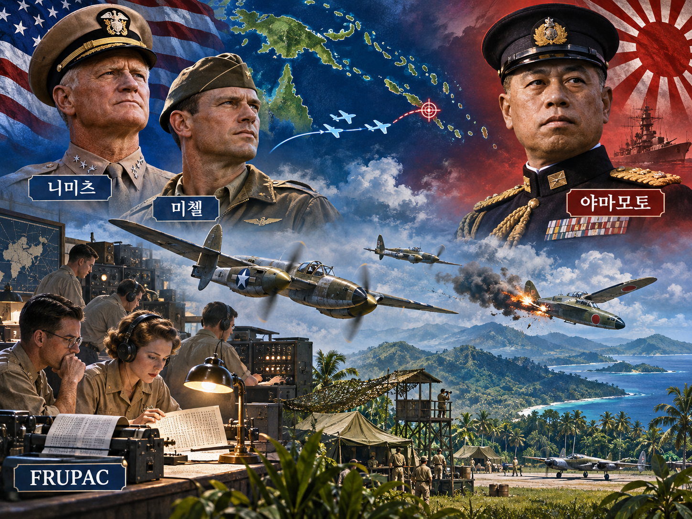

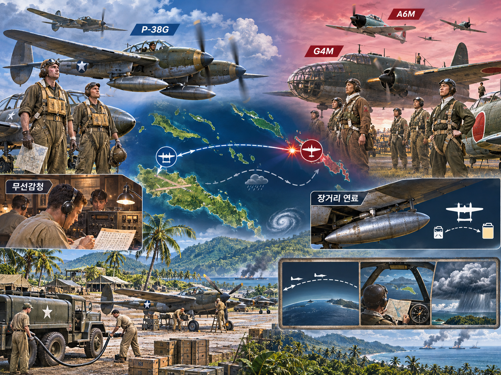

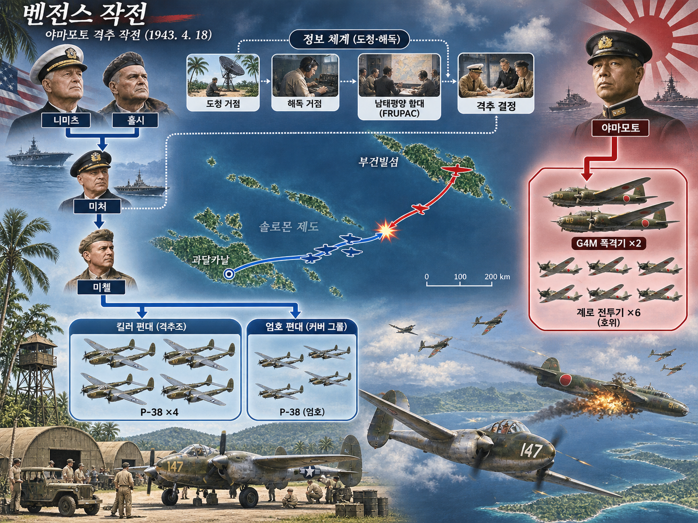

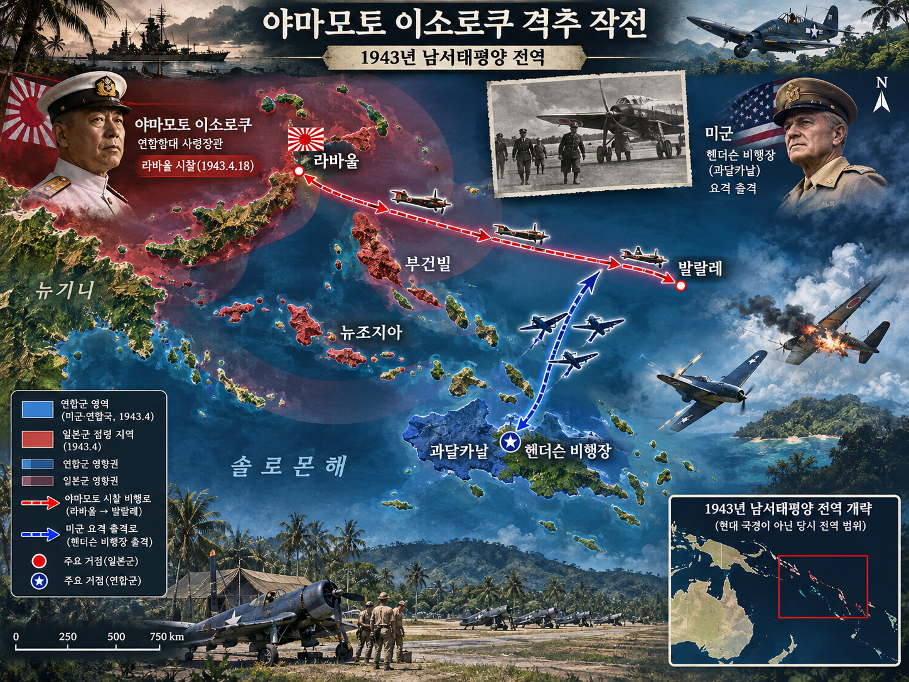

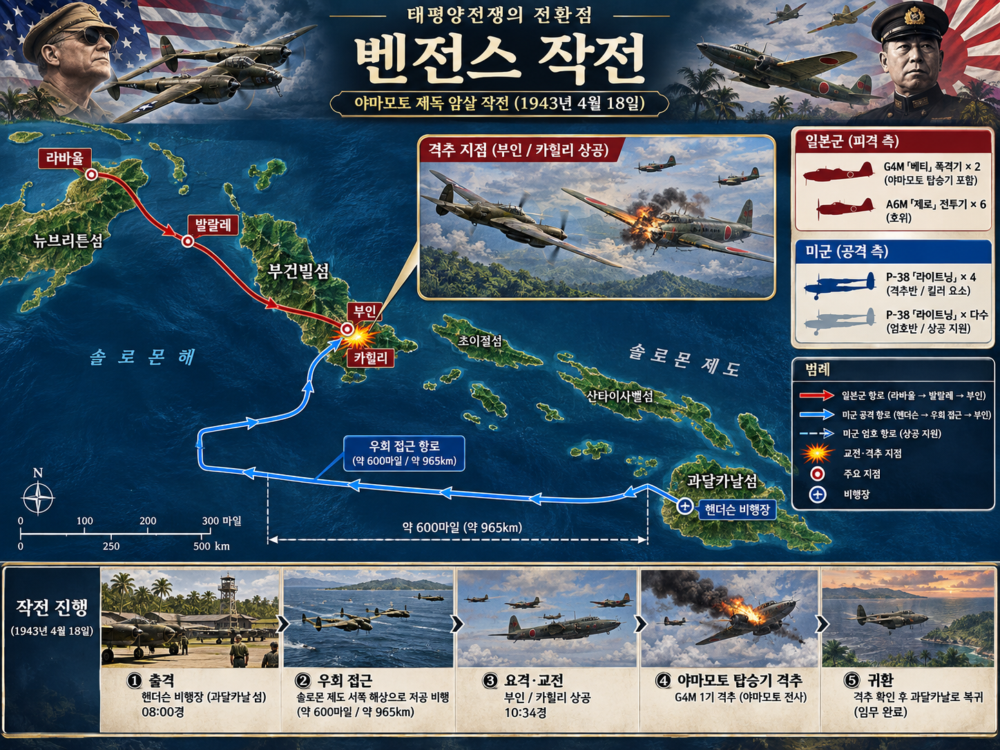

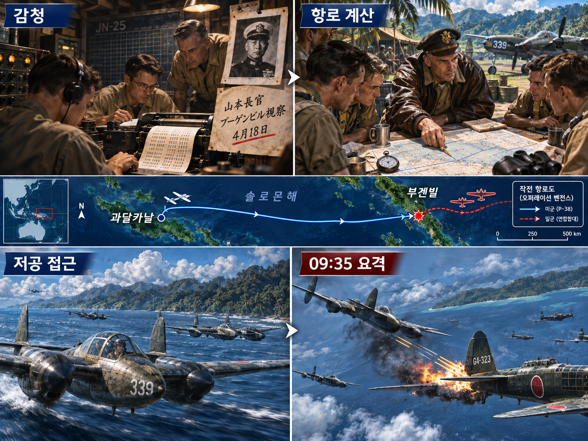

**뒤에서 반복될 지형을 먼저 잡아두기**

- **▰** **헨더슨 비행장(Henderson Field)**은 P-38 편대가 출격한 과달카날의 기지다. 목표 비행보다 훨씬 긴 우회 항로를 날 수 있도록 연료·항법·귀환 시간을 함께 계산해야 했다.
- 🌊 **솔로몬해(Solomon Sea)**는 미군 편대가 일본 감시망을 피하려 저공으로 돌아간 접근 공간이다. 직선 최단로를 버리는 대신, 정확한 시각에 요격점에 도착하는 것이 임무의 성패를 갈랐다.
- **▰** **라바울(Rabaul)**은 **야마모토 이소로쿠(Isoroku Yamamoto)**가 출발한 일본군 거점이다. 해독된 전문은 출발 시각과 방문 일정을 특정해 이동하는 지휘관을 예측 가능한 표적으로 바꿨다.
- **▰** **발랄레(Ballale)**는 시찰 일정의 목적지였다. 미군은 목적지 자체를 공격하지 않고 그 사이의 항로를 계산해 요격했다.
- 🌲 **부건빌 남부 정글(Bougainville jungle)**과 **▰** **카힐리(Kahili)** 일대가 실제 요격 공간이다. 산호해·해안선·정글이 섞인 좁은 시간창에서 두 G4M과 호위 A6M을 구분해야 했다.

#### 상세 전역 서사 — 해독한 일정표를 600마일 저공 항로와 1분 단위 요격으로 바꾸다

1943년 4월 14일 미군 감청소들은 일본 해군 암호 JN-25D로 전송된 전문을 포착했고, FRUPAC과 워싱턴의 해독진은 **야마모토**의 4월 18일 시찰 일정·출발 시각·항로를 복원했다. 문제는 정보를 얻었다는 사실이 아니라, 그 정보를 일본군에게 들키지 않고 실제 타격으로 바꾸는 일이었다. **체스터 니미츠(Chester W. Nimitz)**의 지휘선은 표적의 군사적 가치와 암호 해독 노출 위험을 함께 따졌고, 작전에는 해안감시원이 우연히 일정을 알아냈다는 위장 설명이 붙었다.

**존 W. 미첼(John W. Mitchell)**은 P-38G의 항속거리·증조·해풍·저공 비행을 계산해 일본 점령 섬의 시야를 피하는 우회로를 설계했다. 16대의 P-38은 **▰** **헨더슨 비행장(Henderson Field)**에서 출격해 🌊 **솔로몬해(Solomon Sea)** 위를 낮게 날았다. 네 대는 폭격기를 잡는 요격조, 나머지는 호위 전투기를 막는 상공 엄호조로 나뉘었다.

4월 18일 09시 35분, 미 편대는 **야마모토**가 탄 G4M과 동행기, 여섯 대의 A6M을 예상 지점에서 만났다. 요격조는 폭격기로 곧장 파고들었고 두 G4M은 각각 🌲 **부건빌 남부 정글(Bougainville jungle)**과 해안에 추락했다. 작전의 핵심은 ‘유명 장수를 죽였다’가 아니라 **그 장수의 신원·일정·호위·항로를 먼저 알고, 제한된 항속거리 안에서 실제 만날 수 있는 지점으로 바꾼 것**이었다.

#### 전투에서 사용된 속임수 — 암호 해독의 출처를 해안감시원 첩보로 가리다

미군이 일본군에게 보이고 싶지 않았던 것은 요격 편대가 아니라 JN-25 해독 능력이었다. 실제 의도는 해독 전문을 이용해 **야마모토**를 표적화하는 것이었고, 외부에는 해안감시원의 우연한 관측이라는 설명을 준비했다. 이 출처 은폐는 일본이 암호체계를 즉시 바꾸는 것을 늦추려는 방호 기만이었다. 다만 일본 측이 당시 그 설명을 실제로 믿고 특정 행동을 했다는 직접 사료는 제한적이므로, 요격 성공과 출처 위장의 효과를 같은 수준의 사실로 단정하지 않는다.

#### 속임수 작동 구조

**주체와 의도.** 미 태평양함대 정보부는 야마모토의 일정은 사용하되 암호 해독 능력은 보존하려 했다.

**보인 신호와 믿은 이유.** 조종사들에게도 표적을 ‘VIP’로 제한해 알리고, 정보 출처는 해안감시원으로 설명했다. 실제로 솔로몬 제도에는 연합군 해안감시망이 있었으므로 개연성이 있었다.

**유발된 행동과 결과.** 작전 보안이 유지된 채 P-38 편대가 정확한 요격점으로 날아갔다. 그러나 일본 암호 운용 변화에 미친 장기 효과는 별도 자료로 평가해야 한다.

**사료의 경계.** 미 해군 역사유산사령부는 해독·엄폐 설명·요격 시각을 확인하지만, 일부 조종사의 격추 공적과 최후 장면에는 상충 진술이 있어 특정 개인의 단독 공적으로 단정하지 않는다.

#### 속임수 일곱 질문

1. **누가 누구를 속였는가?** 미군 정보 지휘부는 일본군이 해독 능력을 알아차리지 못하게 했고, 아군 내부에도 필요정보만 공개했다.
2. **어떤 사실이 거짓이었는가?** 표적 일정의 출처가 해안감시원이라는 설명은 암호 해독을 숨기기 위한 위장이었다.
3. **어떤 사실은 진실이지만 오해를 유도했는가?** 솔로몬 제도에 해안감시원이 존재한 것은 사실이어서 위장 설명의 개연성을 높였다.
4. **상대는 왜 그것을 믿고 싶어 했는가?** 정찰·현지 제보는 전장에서 흔한 정보원이라, 고급 암호가 깨졌다는 더 위험한 가설보다 받아들이기 쉬웠다.
5. **속임수가 없었어도 같은 오판이 발생했을까?** 요격 자체는 가능했지만 해독 노출 위험이 커져 이후 정보 우위가 빨리 사라질 가능성이 있었다.
6. **속은 사람은 어떤 독립 확인을 생략했는가?** 일본군은 일정 전문이 노출됐을 가능성을 전제로 항로·시각·호위를 충분히 바꾸지 않았다.
7. **신뢰·동의·안전을 해치지 않으면서 같은 원리를 어디서 연습할 수 있는가?** 합법적 보안 모의훈련에서 정보의 필요공개 범위와 대체 설명이 방어 자산을 보호하는지 점검할 수 있다.

#### 시계편 兵者詭道也 — 이 전장에 해당하는 속이는 길

<table fit-page-width="true" header-row="true">
<tr><td>해당 구절·독음·뜻</td><td>전장의 장면</td></tr>
<tr><td>遠而示之近 원이시지근 — 멀리 있으면서 가까운 듯 보인다</td><td>P-38 편대는 직선으로 다가가지 않고 바다 쪽으로 크게 우회해 일본 감시망에 접근축을 노출하지 않았다.</td></tr>
<tr><td>攻其無備, 出其不意 공기무비, 출기불의 — 대비하지 않은 곳을 치고 뜻하지 않은 때에 나온다</td><td>해독한 일정과 엄격한 시간 계산으로 이동 중인 지휘관이 방어를 바꾸기 전 요격했다.</td></tr>
</table>

#### 法 한눈 비교 — 곡제·관도·주용

<table fit-page-width="true" header-row="true">
<tr><td>진영</td><td>곡제(편제)</td><td>관도(지휘)</td><td>주용(보급·지속)</td></tr>
<tr><td>**미군**</td><td>16대의 P-38을 요격조와 엄호조로 나눴다.</td><td>감청·해독·정책 판단·비행 지휘를 구획했다.</td><td>증조와 장거리 항법으로 왕복 항속 한계를 관리했다.</td></tr>
<tr><td>**일본군**</td><td>두 G4M과 여섯 A6M으로 시찰 편대를 구성했다.</td><td>연합함대 일정이 암호 전문으로 전달됐다.</td><td>정시 운항을 유지했지만 항로·시간 변경 여지가 작았다.</td></tr>
</table>

#### 야마모토·일본 시찰 편대(패군)

<table fit-page-width="true" header-row="true">
<tr><td>요소</td><td>판단</td></tr>
<tr><td color="orange_bg">🤝 **道**</td><td>연합함대 총사령관의 전선 시찰은 사기 진작 목적이었지만, 개인 일정이 조직 전체의 고가치 표적으로 집중됐다. (지기·사기)</td></tr>
<tr><td color="blue_bg">🌤️ **天**</td><td>정시 운항과 암호 보안을 당연시해 전문 노출·장거리 요격이라는 낮아 보이는 시나리오를 충분히 반영하지 못했다. (지피·확률 관점)</td></tr>
<tr><td color="green_bg">🧭 **地**</td><td>섬과 바다가 미군의 항속을 막는 장벽이라고 보았으나, 같은 공간은 저공 우회 접근로가 됐다. (원근·험이)</td></tr>
<tr><td color="purple_bg">🎖️ **將**</td><td>정시성과 현장 방문을 중시했지만, 지휘관 개인의 예측 가능성을 줄이는 보안 엄격성이 부족했다. (지신인용엄)</td></tr>
<tr><td color="yellow_bg">⚙️ **法**</td><td>호위 편대는 있었으나 일정·항로·대체 지휘선의 노출 위험을 분산하지 못했다. (곡제·관도·주용)</td></tr>
</table>

**직관·편향 한 줄:** 정시 운항 관행과 기존 암호 보안이 계속 유효할 것이라는 판단에는 정상성 편향과 과신이 작동한 것으로 볼 수 있고, 그 결과 정확한 시간표가 적의 장거리 요격으로 전환될 가능성을 과소평가했다.

🏳️ **패군 측 결과** — **야마모토**와 참모장 **우가키 마토메(Matome Ugaki)**가 탄 두 G4M이 모두 격추됐고, 야마모토는 전사했다. `北(배, 적정을 헤아리지 못해 불리한 조건에서 패함)`에 가깝다. 🔀 **패군 측 회피 분기점**은 고위 지휘관 일정을 저급·고급 채널로 분리하고, 출발 직전 항로·시각을 무작위화하며 대체 지휘 절차를 준비하는 것이었다.

#### 미 태평양함대 정보부·P-38 편대(승군)

<table fit-page-width="true" header-row="true">
<tr><td>요소</td><td>판단</td></tr>
<tr><td color="orange_bg">🤝 **道**</td><td>해독진·정책 결정자·비행대가 서로 다른 비밀 범위에서도 같은 요격 목표에 맞춰 움직였다. (지기·사기)</td></tr>
<tr><td color="blue_bg">🌤️ **天**</td><td>전문을 확실한 사실과 추정으로 나누고, 정시 도착 확률을 항로·속도·바람 계산으로 높였다. (지피·타이밍·확률 관점)</td></tr>
<tr><td color="green_bg">🧭 **地**</td><td>🌊 **솔로몬해(Solomon Sea)**의 넓은 우회 공간을 은폐로 쓰고 **▰** **카힐리(Kahili)** 부근의 좁은 요격창으로 집중했다. (원근·광협)</td></tr>
<tr><td color="purple_bg">🎖️ **將**</td><td>**미첼**은 항속·편대 분업·도착 시각을 하나의 실행표로 묶었다. (지신인용엄)</td></tr>
<tr><td color="yellow_bg">⚙️ **法**</td><td>요격조·엄호조·예비기, 감청과 비행 지휘를 분리하면서 연료 한계를 임무 설계의 중심에 뒀다. (곡제·관도·주용)</td></tr>
</table>

🏆 **승군 측 결과** — `以虞待不虞者勝(이우대불우자승, 대비한 채 대비 없는 적을 상대하는 자가 이긴다)`에 해당한다.

##### 法을 압축하지 않고 보기 — 곡제·관도·주용

**곡제 曲制(곡제): 부대를 어떻게 나누고 결합했는가**
<table fit-page-width="true" header-row="true">
<tr>
<td>진영</td>
<td>실제 운용</td>
</tr>
<tr>
<td>
**미군**
</td>
<td>P-38 16대를 폭격기 요격조와 전투기 엄호조로 나눠 임무를 결합했다.</td>
</tr>
<tr>
<td>
**일본군**
</td>
<td>두 수송 폭격기와 여섯 호위기를 묶었지만 기습 시 분산 대응 여지가 작았다.</td>
</tr>
</table>

**관도 官道(관도): 누가 명령하고 어떻게 전달했는가**
<table fit-page-width="true" header-row="true">
<tr>
<td>진영</td>
<td>실제 운용</td>
</tr>
<tr>
<td>
**미군**
</td>
<td>감청소→FRUPAC→태평양함대 지휘부→항공 지휘선으로 필요정보만 전달했다.</td>
</tr>
<tr>
<td>
**일본군**
</td>
<td>시찰 일정이 암호 전문으로 여러 수신처에 전달돼 공격자가 시간표를 복원할 단서를 남겼다.</td>
</tr>
</table>

**주용 主用(주용): 군량·장비·전투 지속 능력을 어떻게 썼는가**
<table fit-page-width="true" header-row="true">
<tr>
<td>진영</td>
<td>실제 운용</td>
</tr>
<tr>
<td>
**미군**
</td>
<td>장거리 증조·저공 항법·연료 계산으로 600마일 우회와 귀환을 가능하게 했다.</td>
</tr>
<tr>
<td>
**일본군**
</td>
<td>G4M의 장거리 성능과 A6M 호위를 사용했으나 지휘관 일정의 보안 비용을 충분히 치르지 않았다.</td>
</tr>
</table>

#### 참고자료

- [미 해군 역사유산사령부 — Operation Vengeance](https://www.history.navy.mil/about-us/leadership/director/directors-corner/h-grams/h-gram-018/h-018-2.html)
- [미 해군 국립박물관 — 일본군 I 작전과 야마모토 요격](https://www.history.navy.mil/content/history/museums/nmusn/explore/photography/wwii/wwii-pacific/south-southwestern-pacific/papau-new-guinea-42-43/japanese-i-operation.html)
- [미 해군 역사유산사령부 H-Gram 018](https://www.history.navy.mil/about-us/leadership/director/directors-corner/h-grams/h-gram-018.html)

### 동양 — 🏛️ 제나라 vs 🏛️ 위나라 │ 마릉 전투(馬陵之戰, 기원전 341년경)

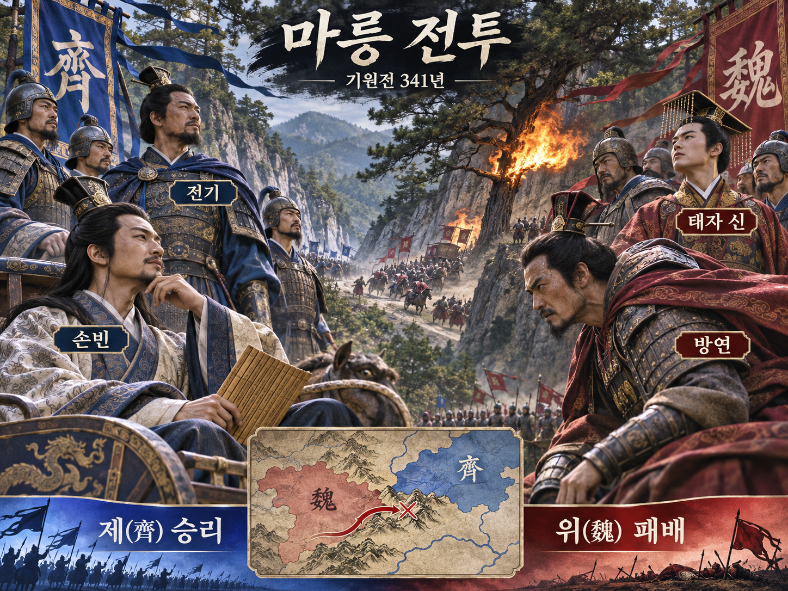

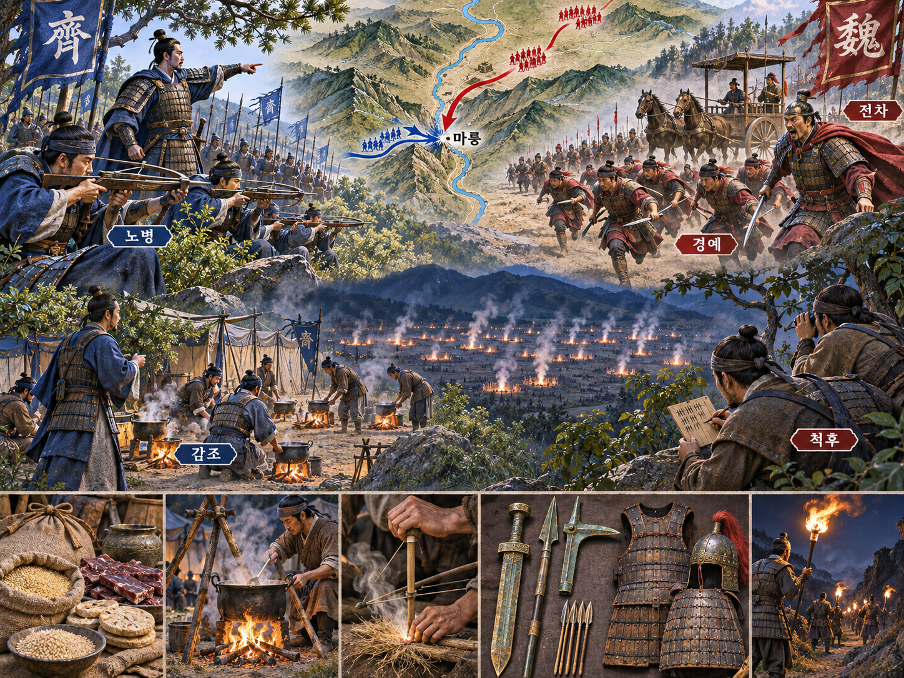

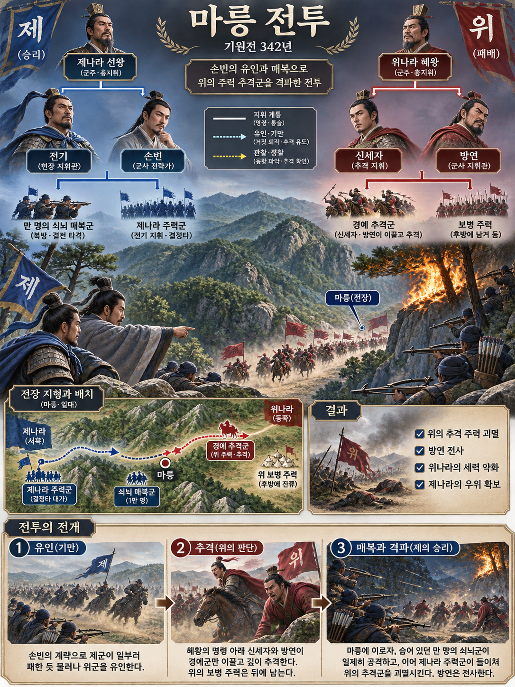

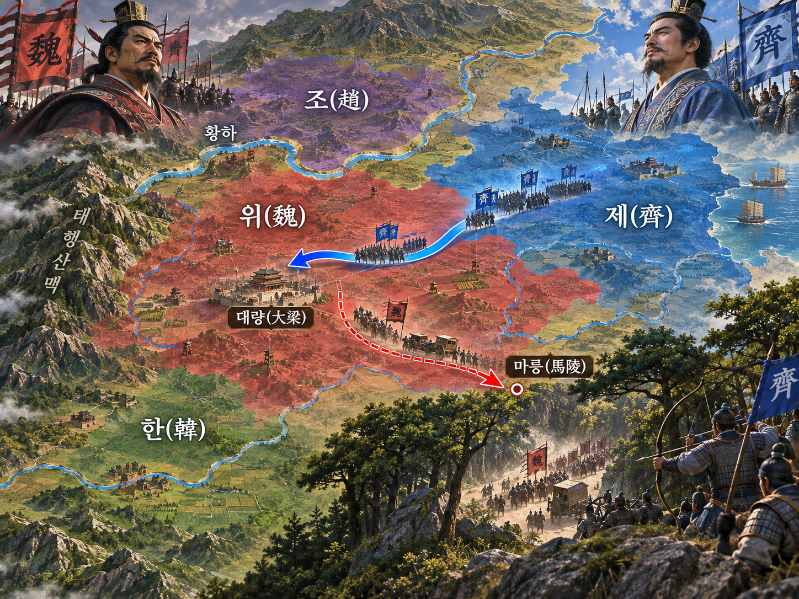

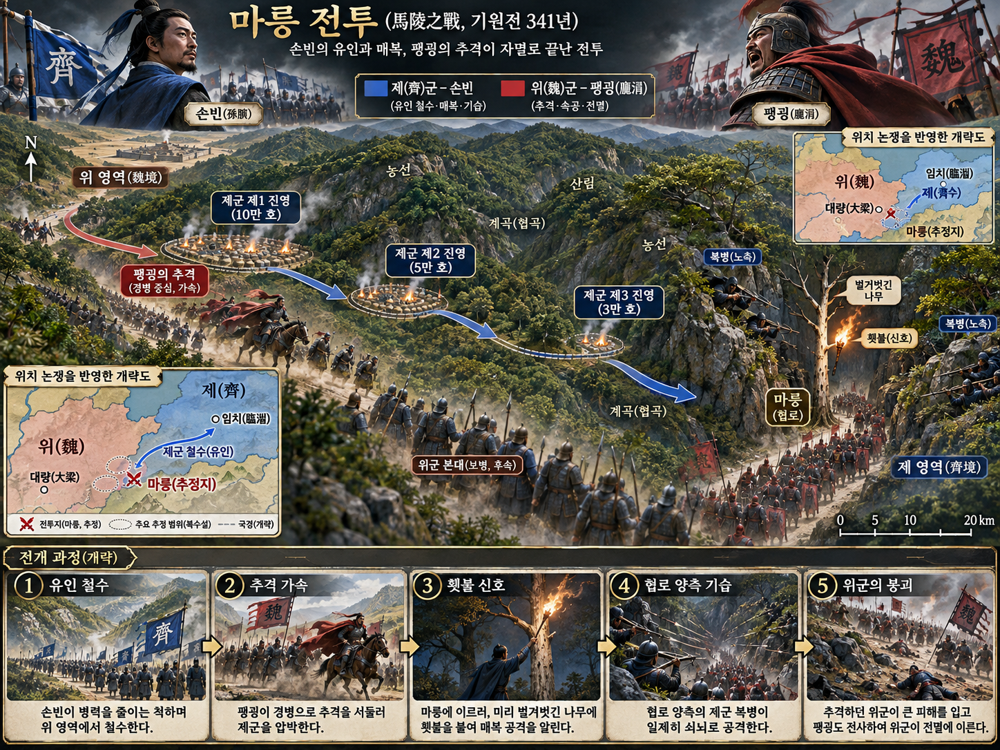

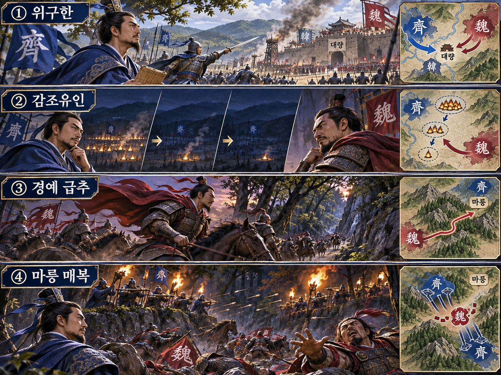

**뒤에서 반복될 지형을 먼저 잡아두기**

- **▰** **대량(大梁)**은 위나라 수도이자 제군이 한나라를 구원하기 위해 압박한 목표다. 전기는 한나라 전선의 위군을 직접 맞지 않고 대량을 위협해 방연을 되돌렸다.
- **▰** **한나라 전선**은 위군 주력이 빠져 있던 출발 공간이다. 방연이 돌아설 때 제군은 이미 위나라 땅 안으로 들어와 있었다.
- **제군의 감조 진영 세 곳**은 첫날 10만, 다음날 5만, 그다음 날 3만의 부뚜막 흔적을 남긴 구간이다. 정확한 각 야영지 위치는 사료상 불명이나, 방연의 추격 판단을 바꾼 연속 신호였다.
- ⛰️ **마릉도(馬陵道)**는 길이 좁고 양쪽에 장애와 험지가 많아 매복하기 좋은 곳으로 기록된다. 정확한 현대 비정은 논쟁이 있으므로 도판은 작전 관계를 보여 주는 개략도다.
- 🌲 **마릉 수림과 협로**는 제나라 노병 1만이 양쪽에 숨은 결정 공간이다. 해질 무렵 불빛을 신호로 일제 사격하도록 시간·지형·표적 행동을 묶었다.

#### 상세 전역 서사 — 방연이 믿던 ‘제군은 겁이 많다’를 부뚜막 숫자로 확신하게 하다

위나라와 조나라가 한나라를 공격하자 제나라는 **전기(田忌)**를 장수로, **손빈(孫臏)**을 군사로 보내 구원했다. 손빈은 한나라 전선으로 곧장 가는 대신 **▰** **대량(大梁)**을 향해 위나라의 빈 곳을 찔렀다. **방연(龐涓)**은 한나라 전선을 떠나 귀환했고, 제군은 이미 위나라 영내에서 서쪽으로 움직인 뒤였다.

손빈은 삼진의 병사가 용맹하고 제나라 군을 겁쟁이로 가볍게 본다는 적의 기대를 작전 재료로 삼았다. 제군은 첫날 10만, 다음날 5만, 사흘째 3만 명분의 부뚜막만 남겼다. **방연**은 사흘 동안 탈영자가 절반을 넘었다고 판단해 🪖 보병 주력을 뒤에 두고 경예만 이끌어 배의 속도로 추격했다. 감조는 단순한 숫자 조작이 아니라 **방연이 이미 믿고 있던 상대상과 빠른 추격 성향을 확인한 뒤 보낸 맞춤 신호**였다.

손빈은 방연의 이동 속도를 계산해 해질 무렵 ⛰️ **마릉도(馬陵道)**에 이를 것으로 보았다. 『사기』는 그 길이 좁고 곁에 장애와 험지가 많아 매복하기 좋았다고 전한다. 손빈은 길가 큰 나무의 껍질을 벗겨 “방연이 이 나무 아래서 죽는다”라고 쓰고, 노병 1만을 양쪽에 숨겨 불빛이 보이면 일제히 쏘게 했다.

**방연**은 밤에 나무 아래 이르러 불을 밝혀 글을 읽었다. 불빛이 신호가 되자 제군의 노가 한꺼번에 발사됐고 위군은 지휘와 대열을 잃었다. 『사기』는 방연이 스스로 목숨을 끊고 제군이 위군을 격파해 태자 신을 사로잡았다고 기록한다. 후대에는 세부 장면의 서사화 가능성이 지적되므로, 감조와 매복의 작동 원리는 설명하되 모든 숫자와 대사를 동시대 전투일지처럼 확정하지 않는다.

#### 전투에서 사용된 속임수 — 감조로 병력 감소가 아니라 방연의 추격 욕망을 보여 주다

속인 주체는 **손빈**, 속은 상대는 **방연**이었다. 실제 제군 전력은 급감하지 않았지만 야영 흔적은 탈영이 누적되는 것처럼 보였다. 방연은 삼진군이 용맹하고 제군이 겁이 많다는 기존 기대 때문에 그 신호를 믿었고, 🪖 보병 주력을 떼어 놓은 채 경예로 추격했다. 그 결과 빠른 부대일수록 먼저 협로의 매복점에 들어가는 역전이 일어났다.

#### 속임수 작동 구조

**주체와 의도.** 손빈은 방연의 경시와 추격 속도를 이용해 위군의 선두를 주력에서 떼어내려 했다.

**보인 신호와 믿은 이유.** 부뚜막 수가 10만→5만→3만으로 줄었다. 방연은 이를 제군 탈영의 직접 흔적으로 읽었고, 기존의 ‘제군은 겁이 많다’는 믿음과 맞아떨어졌다.

**유발된 행동과 결과.** 방연은 보병을 뒤에 남기고 경예로 배일겸행했다. 선두가 해질 무렵 좁은 마릉도에 들어오자 제군은 불빛을 신호로 매복 사격했다.

**사료의 경계.** 『사기』가 감조·추격·매복을 전하지만 마릉의 정확한 위치, 부뚜막 숫자의 물리적 가능성, 방연 최후의 세부 대사는 후대 논쟁이 있다.

#### 속임수 일곱 질문

1. **누가 누구를 속였는가?** 손빈이 방연과 위군 추격대를 속였다.
2. **어떤 사실이 거짓이었는가?** 제군 병력이 사흘 만에 10만에서 3만으로 무너졌다는 결론이 거짓이었다.
3. **어떤 사실은 진실이지만 오해를 유도했는가?** 실제 야영지의 부뚜막 수가 줄어든 흔적은 진실이었지만 그것이 탈영자 수를 뜻하지는 않았다.
4. **상대는 왜 그것을 믿고 싶어 했는가?** 방연은 제군을 겁이 많다고 평소부터 낮게 봤고, 빠른 추격으로 손빈을 잡을 수 있다는 기대가 있었다.
5. **속임수가 없었어도 같은 오판이 발생했을까?** 가능성은 중간이다. 경시는 있었지만 감조라는 수량 신호가 없었다면 보병을 버리고 배속 추격할 확신은 약했을 것이다.
6. **속은 사람은 어떤 독립 확인을 생략했는가?** 포로 심문·후방 정찰·행군 흔적·제군 주력의 실제 규모를 교차 확인하지 않았다.
7. **신뢰·동의·안전을 해치지 않으면서 같은 원리를 어디서 연습할 수 있는가?** 바둑·체스에서 일부 돌이나 말을 버리는 듯 보인 뒤 상대의 과도한 추격을 유도하고, 사후에 독립 확인 누락을 복기할 수 있다.

#### 시계편 兵者詭道也 — 이 전장에 해당하는 속이는 길

<table fit-page-width="true" header-row="true">
<tr>
<td>해당 구절·독음·뜻</td>
<td>전장의 장면</td>
</tr>
<tr>
<td>弱而示之弱 약이시지약 — 약한 듯한 형세를 더 약하게 보인다</td>
<td>제군은 실제 퇴각과 줄어드는 부뚜막을 결합해 방연의 경시를 확신으로 바꿨다.</td>
</tr>
<tr>
<td>利而誘之 이이유지 — 이익으로 꾄다</td>
<td>도망치는 제군을 빨리 잡을 수 있다는 이익이 방연으로 하여금 경예만 이끌고 깊이 추격하게 했다.</td>
</tr>
</table>

#### 法 한눈 비교 — 곡제·관도·주용

<table fit-page-width="true" header-row="true">
<tr>
<td>진영</td>
<td>곡제(편제)</td>
<td>관도(지휘)</td>
<td>주용(보급·지속)</td>
</tr>
<tr>
<td>
**제나라**
</td>
<td>주력 퇴각과 노병 1만 매복을 결합했다.</td>
<td>전기가 지휘하고 손빈이 시간·신호·지형을 설계했다.</td>
<td>후퇴 야영의 부뚜막을 정보 신호로 전환했다.</td>
</tr>
<tr>
<td>
**위나라**
</td>
<td>경예가 보병 주력에서 분리됐다.</td>
<td>방연의 속도 판단이 추격대를 앞세웠다.</td>
<td>배속 추격으로 보급·증원 결합이 약해졌다.</td>
</tr>
</table>

#### 방연·위군(패군)

<table fit-page-width="true" header-row="true">
<tr>
<td>요소</td>
<td>판단</td>
</tr>
<tr>
<td color="orange_bg">🤝 **道**</td>
<td>경예를 앞세운 추격은 공격 의지는 높였지만 보병 주력과의 결속을 끊었다. (지기·사기)</td>
</tr>
<tr>
<td color="blue_bg">🌤️ **天**</td>
<td>부뚜막 감소를 탈영의 확실한 표본으로 보고 매복·허위 흔적이라는 대안 확률을 낮게 잡았다. (지피·확률 관점)</td>
</tr>
<tr>
<td color="green_bg">🧭 **地**</td>
<td>⛰️ **마릉도(馬陵道)**의 협소함과 양옆 험지를 추격 속도보다 늦게 보았다. (험이·광협·사생)</td>
</tr>
<tr>
<td color="purple_bg">🎖️ **將**</td>
<td>신속함은 있었지만 적을 가벼이 여기는 조급함과 독립 확인 부족이 지혜·엄격함을 압도했다. (지신인용엄·분속가모)</td>
</tr>
<tr>
<td color="yellow_bg">⚙️ **法**</td>
<td>경예와 보병을 분리한 뒤 정찰·보급·증원 경로를 함께 유지하지 못했다. (곡제·관도·주용)</td>
</tr>
</table>

**직관·편향 한 줄:** 방연이 ‘제군은 겁이 많다’는 기존 인상과 부뚜막 감소를 곧바로 연결한 판단에는 확증편향과 대표성 휴리스틱이 작동한 것으로 볼 수 있고, 그 결과 감조가 의도적으로 설계됐을 가능성을 배제했다.

🏳️ **패군 측 결과** — 경예가 매복에 걸려 지휘를 잃고 위군 전체가 패했으며 태자 신이 포로가 됐다. `北(배, 적정을 헤아리지 못하고 불리한 조건으로 강한 조건을 맞음)`에 해당한다. 🔀 **패군 측 회피 분기점**은 부뚜막 수를 탈영자 수로 확정하지 않고 보병과 정찰대를 유지한 채 협로 입구에서 행군 흔적·포로 진술·고지 점거를 교차 확인하는 것이었다.

#### 손빈·전기·제군(승군)

<table fit-page-width="true" header-row="true">
<tr>
<td>요소</td>
<td>판단</td>
</tr>
<tr>
<td color="orange_bg">🤝 **道**</td>
<td>전기의 공식 지휘와 손빈의 계책, 노병의 매복 신호를 한 목표로 묶었다. (지기·사기)</td>
</tr>
<tr>
<td color="blue_bg">🌤️ **天**</td>
<td>방연의 경시를 활용하되 도착 시각을 행군 속도와 해질 무렵의 불빛 조건에 연결해 성공 확률을 높였다. (지피·타이밍·확률 관점)</td>
</tr>
<tr>
<td color="green_bg">🧭 **地**</td>
<td>좁은 길과 양옆 험지를 이용해 적 경예의 속도를 전개 불능으로 바꿨다. (험이·광협·사생)</td>
</tr>
<tr>
<td color="purple_bg">🎖️ **將**</td>
<td>적의 선입견·행군 속도·협로·점화 행동을 하나의 매복 조건으로 계산했다. (지신인용엄)</td>
</tr>
<tr>
<td color="yellow_bg">⚙️ **法**</td>
<td>주력의 퇴각, 감조 흔적, 노병 1만의 양측 매복, 불빛 신호를 단계별로 결합했다. (곡제·관도·주용)</td>
</tr>
</table>

🏆 **승군 측 결과** — `識衆寡之用者勝(식중과지용자승, 많고 적은 병력을 쓸 줄 아는 자가 이긴다)`와 `以虞待不虞者勝(이우대불우자승, 대비한 채 대비 없는 적을 상대하는 자가 이긴다)`에 해당한다.

##### 法을 압축하지 않고 보기 — 곡제·관도·주용

**곡제 曲制(곡제): 부대를 어떻게 나누고 결합했는가**
<table fit-page-width="true" header-row="true">
<tr>
<td>진영</td>
<td>실제 운용</td>
</tr>
<tr>
<td>
**제나라**
</td>
<td>퇴각하는 주력과 마릉도 양옆의 노병 1만을 분리해 추격대가 들어오는 시점에 결합했다.</td>
</tr>
<tr>
<td>
**위나라**
</td>
<td>방연이 경예만 이끌고 배속 추격해 보병 주력과의 상호지원이 끊겼다.</td>
</tr>
</table>

**관도 官道(관도): 누가 명령하고 어떻게 전달했는가**
<table fit-page-width="true" header-row="true">
<tr>
<td>진영</td>
<td>실제 운용</td>
</tr>
<tr>
<td>
**제나라**
</td>
<td>전기가 총지휘하고 손빈이 감조·도착 시각·불빛 신호를 설계해 노병에게 명확한 발사 조건을 줬다.</td>
</tr>
<tr>
<td>
**위나라**
</td>
<td>방연의 추격 판단이 선두를 가속했지만 후속 보병·정찰 보고와 갱신되는 지휘선은 늦어졌다.</td>
</tr>
</table>

**주용 主用(주용): 군량·장비·전투 지속 능력을 어떻게 썼는가**
<table fit-page-width="true" header-row="true">
<tr>
<td>진영</td>
<td>실제 운용</td>
</tr>
<tr>
<td>
**제나라**
</td>
<td>야영 부뚜막을 줄여 보급 흔적을 기만 신호로 쓰고, 노와 화살을 협로 양쪽에 집중했다. 세부 비용은 사료상 불명이다.</td>
</tr>
<tr>
<td>
**위나라**
</td>
<td>경예의 속도를 위해 보병과 보급을 뒤에 두면서 매복 후 전투를 지속할 여력이 줄었다. 세부 수량은 사료상 불명이다.</td>
</tr>
</table>

#### 참고자료

- [『사기』 「손자오기열전」 — 감조·추격·마릉 매복 원문](https://www.shidianguji.com/zh/mid-page/7601263103322128410)
- [중국철학서전자화계획 — 손빈 자료](https://ctext.org/datawiki.pl?if=gb&res=783329)
- [고문도 — 『사기』 손자오기열전 절선](https://www.gushiwen.cn/shiwenv_d697b06d807a.aspx)

---
## 5. 핵심 통찰 + 실생활 적용 + 생활루틴

### 핵심 통찰

이번 구절의 날카로움은 “적장을 알아라”보다 `欲`과 `先知`의 순서에 있다. 치고 싶은 마음이 먼저 생겼더라도 행동은 멈추고, 그 마음을 반박할 수 있는 정보를 먼저 구한다. 정보는 공격을 돕는 하인이 아니라 **공격의 필요성 자체를 재심사하는 문지기**다.

군·성·사람은 크기가 다르지만 모두 사람의 결심과 전달망으로 움직인다. 그래서 문제를 해결할 때 눈앞의 고장, 규정, 갈등 상대만 보지 말고 책임자·실권자·보고자·대체자·승인 조건을 확인해야 한다. 표면의 대상을 세게 두드리는 것보다 지휘선의 실제 작동을 아는 편이 비용을 줄인다.

동시에 인물 중심 분석에는 함정이 있다. 한 사람의 성격으로 모든 결과를 설명하면 제도, 피로, 정보 부족, 상충 명령, 대리 지휘를 놓친다. `守將`을 안다는 것은 사람에게 낙인을 붙이는 일이 아니라, **그 사람이 어떤 정보와 권한 속에서 어떤 선택을 할 수 있는지**를 확률적으로 그리는 일이다.

### 실생활 적용

3교대 현장에서 에러가 발생했을 때 장비부터 만지기 전에 60초 동안 지휘선을 확인한다. 현재 조치 책임자, 설비 소유 부서, 오피스 보고자, 작업 승인자, 다음 교대 인계자를 한 줄씩 적는다. 누가 정지·재가동을 결정할 권한이 있는지 모른 채 여러 사람이 동시에 움직이면 같은 설비에 상충 조치가 들어가고, 나중에는 사실관계와 책임까지 뒤섞인다.

전씨가 복잡한 조치에서 피로와 당황이 겹칠 때 말이 줄고 신경질적 반응이 나타났다는 관찰은 고정된 성격 진단이 아니다. 그 장면에서는 “누가 조치 지휘를 맡고, 누가 화면을 보고, 누가 오피스에 보고하며, 전씨가 빠지면 누가 대리하는가”를 먼저 선언하는 편이 낫다. 사람의 기분을 추측하기보다 권한과 역할을 가시화하면 불필요한 말싸움과 중복 조치가 줄어든다.

B조 조장 이씨와의 충돌 기록에서도 업무 질문, 조장 지시, 인신공격이 한 대화에 섞이자 갈등이 커졌다. 다음에는 상대를 이기려 들기 전에 양쪽 조장을 같은 자리에 부르고, “업무 사실 / 누가 내린 지시 / 금지할 언행 / 후속 확인자”를 분리한다. 이것은 상대의 약점을 캐는 일이 아니라, 개인 대 개인의 사지를 공식 지휘선과 증인이 있는 교지로 바꾸는 일이다.

신입 최씨의 모니터링·BM 시트 누락도 “의지가 없다”는 인물평 하나로 끝내면 대책이 없다. 담당 횟수와 누락 횟수, 수면과 교대 조건, 대체 담당자, 확인 시각을 기록하고, 퇴사 예정자에게 맡길 수 있는 업무 범위를 관리자가 명시하게 해야 한다. 사람의 성향을 알더라도 **책임 구조와 독립 확인이 없으면 선지가 아니라 뒷말**이 된다.

카너먼 메모의 분모 무시를 피하기 위해 인물 판단에는 최근 관측 범위를 붙인다. “항상 그렇다” 대신 “최근 열 번 중 몇 번, 어떤 조건에서, 반대 사례는 무엇인가”를 묻는다. 가능한 시나리오도 `정상 수행 / 피로로 지연 / 지시 오해 / 대리자 개입`처럼 나누고 합이 100%가 되도록 대략의 범위를 잡는다. 숫자가 정확해서가 아니라 한 가지 이야기만 전부라고 믿지 않기 위해서다.

### 생활루틴

**추천 문구**

행동부터 정하고 책임자와 지휘선을 확인하지 않으면 재수가 없다.

**이유**

오늘 첫 에러나 갈등이 생기면 60초 안에 `목표 / 현재 책임자 / 승인자 / 대리자 / 독립 확인자` 다섯 줄을 적고, 조치 전 한 사람에게 복명복창한다. 이 확인 없이 손부터 움직이면 상충 명령과 중복 작업이 즉시 생기고, 작은 오류가 설비 위험·보고 누락·교대 갈등으로 번질 수 있다. 공격 욕망보다 `先知其守將`을 앞세우는 이 짧은 절차가 불필요한 충돌을 줄이는 생활의 불패지지다.
