<!-- sunzi-analysis-mode: full -->
<!-- sunzi-original: 左右, 謁者, 門者, 舍人之姓名, 令吾間必索知之. -->
> 좌우, 알자, 문자, 사인지성명, 영오간필색지지 — 이름과 역할과 확인 근거를 함께 적지 않으면 재수가 없다.

---
## 1. 원문 + 독음 + 직역 + 한자어 뜻풀이

左右, 謁者, 門者, 舍人之姓名, 令吾間必索知之. 좌우, 알자, 문자, 사인지성명, 영오간필색지지.

**직역**  
좌우의 측근, 알현을 맡은 자, 문을 지키는 자, 사인의 성과 이름을 우리 간첩에게 반드시 찾아 알아내도록 명령하라.

앞 구절이 공격하려는 군대·성·인물과 그 수비장을 먼저 알라고 했다면, 이번 구절은 그 명령을 현장에서 답할 수 있는 조사 목록으로 바꾼다. 지휘관의 공식 직함 하나로는 실제 방어망이 보이지 않는다. 그의 곁에서 말을 듣는 사람, 접견을 이어 주는 사람, 문턱에서 출입을 거르는 사람, 숙소와 일상을 보좌하는 사람의 **구체적인 이름**까지 내려가야 명령과 정보가 실제로 흐르는 길이 드러난다.

그러나 이름을 모은다는 말을 현대의 신상 털기나 불법 감시로 옮겨서는 안 된다. 고대 전쟁의 인적 정찰을 오늘의 생활에 적용할 때 남길 수 있는 것은 **역할을 실명 수준으로 명확히 하고, 누가 어떤 정보를 직접 보았으며, 누가 누구에게 전달하는지 확인하라**는 절차다. 개인정보는 정당한 업무 목적과 권한 안에서 최소한으로 다루고, 사람을 압박하는 표적 목록이 아니라 책임과 확인 경로를 분명히 하는 명부로 제한해야 한다.

#### 左右(좌우) — 장수의 양옆에서 결심이 만들어지는 가까운 거리

`左`와 `右`는 본래 왼쪽과 오른쪽이지만, 여기서는 지휘관 가까이에서 보좌하는 측근들을 함께 가리킨다. 이들은 공식 명령이 내려오기 전에 논의를 듣고, 어떤 보고가 장수에게 올라갈지 고르며, 결심 뒤에는 그 뜻을 부하에게 풀어 전한다. 높은 직책이 없어도 정보와 접근의 가까움 때문에 실제 영향력이 생길 수 있다.

앞 구절의 `守將`이 지휘의 중심이라면 `左右`는 그 중심을 둘러싼 첫 번째 고리다. 장수 개인의 성향만 조사하고 좌우의 의견·경쟁·접근권을 모르면 결심이 어디서 비롯됐는지 잘못 읽기 쉽다. **권한표의 선보다 사람 사이의 실제 접근 거리가 더 빠르게 움직이는 순간**을 포착하는 말이다.

#### 謁者(알자) — 누구의 말이 장수 앞까지 도달할지 가르는 접견의 관문

`謁`은 윗사람을 뵙거나 아뢰는 일을 뜻하고, `謁者`는 접견과 전달을 맡은 사람이다. 단순한 안내원이 아니라, 누가 언제 들어가 무엇을 아뢸 수 있는지를 조정하는 자리다. 보고 내용이 같아도 알자가 접견을 늦추거나 순서를 바꾸면 지휘관이 보는 상황의 시점과 우선순위가 달라진다.

`左右`가 지휘관 가까이에서 판단을 돕는 사람들이라면 `謁者`는 바깥의 요구와 보고를 안으로 들이는 통로다. 이 이름을 알아야 특정 정보가 장수에게 직접 닿은 것인지, 중간에서 요약·누락·지연된 것인지 구분할 수 있다. 현대 조직으로 옮기면 개인 비서를 캐라는 뜻이 아니라 **보고 접수자·회의 소집자·승인 요청의 전달 경로를 확인하라**는 원리다.

#### 門者(문자) — 성문과 방문 앞에서 접근을 실제로 허용하는 사람

`門`은 안과 밖을 나누는 문이고, `門者`는 그 문을 지키는 사람이다. 문은 벽의 일부지만 동시에 사람·명령·물자의 통과를 허용하거나 막는 작동점이다. 따라서 문자의 근무, 교대, 상급자와의 관계는 지도에 그어진 성벽보다 더 구체적인 출입의 현실을 보여 준다.

알자가 접견의 사회적 문턱을 다룬다면 문자는 물리적 문턱을 맡는다. 공식 허가가 있어도 문에서 확인되지 않으면 들어갈 수 없고, 반대로 문지기가 관행상 허용하는 예외가 있으면 규정만 읽어서는 실제 흐름을 알 수 없다. 다만 오늘의 보안 업무에서는 출입자를 속이거나 우회할 방법을 찾는 데 쓰지 말고, **승인권자와 현장 통제자의 권한이 일치하는지 점검하는 안전 절차**로만 적용해야 한다.

#### 舍人(사인) — 지휘관의 거처와 일상 가까이에서 작은 변화를 먼저 보는 사람

`舍`는 머물거나 숙박하는 공간을 뜻하고, `舍人`은 궁정·관서·지휘관의 가까이에서 숙직과 시종, 문서 전달 같은 일을 맡은 사람을 가리킬 수 있다. 시대와 제도에 따라 구체적 직무는 달라지지만, 이 문장에서는 공식 회의 바깥의 일상에 접근하는 보좌 인력이라는 기능이 중요하다.

큰 결심은 회의실에서 발표되지만 그 전조는 일정 변경, 밤중의 전령, 숙소의 경계 강화, 급한 문서 왕래처럼 작은 변화로 먼저 드러날 수 있다. 사인은 그런 변화를 볼 가능성이 있는 자리다. 그렇다고 주변인의 사생활을 캐도 된다는 뜻은 아니다. 현대적으로는 **당직자·인수인계자·문서 담당자처럼 과정의 실제 변화를 정당하게 기록하는 역할**을 빠뜨리지 말라는 경고다.

#### 姓名(성명) — 직책의 빈칸을 실제 책임을 지는 사람으로 채우다

`姓`은 성, `名`은 이름이다. `姓名`을 요구한다는 것은 “문지기”, “측근”, “담당자” 같은 익명적 범주에서 멈추지 말고, 지금 그 역할을 실제로 맡은 사람이 누구인지 식별하라는 뜻이다. 조직도는 자리를 보여 주지만, 행동은 특정 시점에 그 자리를 맡은 사람이 한다.

이름은 사람을 공격하기 위한 표적이 아니라 보고의 출처와 책임을 확인하는 열쇠여야 한다. 같은 보고가 여러 사람에게서 나온 것처럼 보여도 원래 한 사람이 퍼뜨린 말일 수 있고, 같은 직책도 교대자에 따라 접근 범위가 다를 수 있다. **이름을 붙이는 순간 정보의 시점·직접성·책임·중복 여부를 검증할 수 있다.**

#### 索知(색지) — 저절로 들리기를 기다리지 않고 질문을 설계해 찾아 알다

`索`은 찾고 구하며 실마리를 더듬는 동작이고, `知`는 확인하여 아는 것이다. `必索知之`는 우연히 소문이 들어오기를 기다리라는 말이 아니다. 지휘관이 필요한 대상을 구체적으로 정하고, 간첩이 그 답을 적극적으로 찾아 확인하도록 하라는 명령이다.

여기에는 지휘관의 책임도 들어 있다. “적을 잘 알아오라”는 모호한 지시로는 무엇을 확인했고 무엇을 놓쳤는지 평가할 수 없다. `左右·謁者·門者·舍人之姓名`처럼 **질문을 관찰 가능한 항목으로 나누어야 수집의 종료 조건과 누락이 보인다.** 다만 수집된 이름과 관계도는 한 출처의 단정이 아니라 시점과 근거를 붙여 대조해야 한다.

#### 글자들이 완성하는 한 장면

수비장 한 사람을 안다고 여겼던 지휘관이 시선을 넓힌다. 그의 `左右`에는 결심을 돕는 측근이 있고, `謁者`는 어떤 보고가 안으로 들어갈지 가르며, `門者`는 실제 출입을 통제하고, `舍人`은 거처와 문서의 작은 변화를 먼저 본다. 추상적인 직책들이 `姓名`을 얻자 누가 어느 시점에 무엇을 직접 보았는지 대조할 수 있는 사람의 망으로 바뀐다.

마지막의 `令吾間必索知之`는 그 망을 우연히 발견하기를 기다리지 않는다. 지휘관은 필요한 질문을 분명히 내리고, 간첩은 답을 찾아오며, 분석자는 같은 소문의 복제인지 독립 관찰인지 가린다. **큰 조직의 실정은 중심 인물 한 명의 성격표가 아니라, 접근·전달·출입·일상을 맡은 구체적인 사람들의 연결에서 드러난다.**

---
## 2. 전통 주석 기반 분석

- **조조(曹操)** — “수장을 안 뒤에도 그 곁의 사람을 빠뜨리지 마라. **좌우와 문객의 성명을 낱낱이 찾아 지휘의 안팎을 밝혀라.**”
- **이전(李筌)** — “깊은 사정은 높은 자리에만 있지 않다. **문을 열고 말을 전하는 가까운 사람에게서 실제 움직임을 살펴라.**”
- **두목(杜牧)** — “좌우·알자·문자·사인은 장수에게 이르는 길을 나누어 맡는다. **직책뿐 아니라 그 이름과 관계까지 분명히 알아라.**”
- **매요신(梅堯臣)** — “알고 싶은 바를 막연히 맡기지 마라. **누구의 성명을 찾을지 정해 간첩의 탐색을 집중시켜라.**”
- **장예(張預)** — “적장의 속뜻은 가까이 모시는 자와 출입을 맡은 자에게 흔적을 남긴다. **사람의 연결을 따라 명령의 실정을 알아라.**”
- **왕석(王晳)** — “성명은 확인의 시작이지 끝이 아니다. **그 사람이 맡은 일과 보고가 닿는 곳을 함께 대조하라.**”
- **가림(賈林)** — “겉으로 보이는 장수만 바라보면 문턱의 변화를 놓친다. **안팎을 잇는 작은 직분을 가볍게 여기지 마라.**”
- **두우(杜佑)** — “간첩에게 반드시 찾아 알라고 명한 뜻을 새겨라. **질문을 구체화하고 확인되지 않은 소문을 성명으로 꾸미지 마라.**”
- **진호(陳皞)** — “한 이름을 얻고 적의 사정을 다 안다고 여기지 마라. **시점과 직무와 서로 다른 증거를 붙여 실상을 가려라.**”

#### 리링의 고증과 현대적 독법

리링의 해설 취지를 따라 문장 구조를 보면, 이번 구절은 앞 구절의 `守將` 뒤에 이어지는 목적어 목록이다. 수비장 한 명을 알고 끝나는 것이 아니라 `左右·謁者·門者·舍人`으로 접근망을 펼치고, 그 모두를 `之姓名`이 묶으며, 마지막의 `令吾間必索知之`가 수집 명령을 완성한다. 따라서 이 문장을 잡다한 하급자의 명단으로 축소하면 앞뒤의 문법과 정보 구조를 놓친다.

`謁者·門者·舍人`은 시대마다 관직과 기능이 달라질 수 있으므로 현대 비서·경비원·숙소 직원과 일대일로 고정 번역하기 어렵다. 공통 기능은 지휘관에게 이르는 접견, 물리적 출입, 가까운 시종과 문서 전달을 맡는다는 데 있다. 판본 차이가 확인되지 않는 곳에서 이문을 꾸미기보다, **중심 인물의 공식 권한과 그 주변의 실제 접근 구조를 함께 조사하라는 문장 배열**을 읽는 편이 안전하다.

이 목록은 『손자』를 음모술로 읽으라는 허가가 아니다. 고대의 간첩 운용은 전쟁 제도 안의 위험한 실무였고, 현대 생활에는 개인정보 보호·노동 관계·법적 절차라는 다른 조건이 있다. 오늘 남길 수 있는 것은 불법적 사람 사냥이 아니라, 공식 조직도만 보지 말고 정당한 범위에서 실제 보고·승인·출입·인수인계 경로를 확인하라는 분석 원리다.

---
## 3. 교차 설명

### ① 손자병법 내 교차

앞 구절 `凡軍之所欲擊, 城之所欲攻, 人之所欲殺, 必先知其守將`(범군지소욕격, 성지소욕공, 인지소욕살, 필선지기수장 — 치고자 하는 군대·성·인물이 있으면 먼저 그 수비장을 알아야 한다)은 정보 요구의 중심을 세웠다. 이번 구절은 그 중심을 둘러싼 사람들을 세분한다. `守將`만 알면 지휘관 개인의 공식 정보에 머물지만, 좌우·알자·문자·사인의 성명까지 알면 **누가 결심에 영향을 주고, 누가 보고를 거르며, 누가 출입과 일상의 변화를 직접 보는지**를 추적할 수 있다.

용간편 첫머리의 `必取於人, 知敵之情者也`(필취어인, 지적지정자야 — 반드시 사람에게서 취해 적의 실정을 알아야 한다)는 사람을 정보의 매개로 삼는다. 그러나 이번 구절은 “사람에게 물어라”에서 한 걸음 더 나가 어떤 위치의 사람을 찾을지 정한다. 모든 사람이 같은 것을 보지 않으므로 접근 범위가 다른 사람들의 보고를 결합해야 한다.

모공편의 `知彼知己, 百戰不殆`(지피지기, 백전불태 — 적과 나를 알면 백 번 싸워도 위태롭지 않다)는 앎의 넓은 원칙이지만, 이번 구절은 그 앎을 검증 가능한 이름과 역할로 내린다. 다만 성명을 많이 모았다고 지피가 완성되는 것은 아니다. 이름·직무·관찰 시점·보고 경로를 붙이고, 같은 원출처에서 퍼진 말인지 구분해야 한다.

### ② 클라우제비츠 『전쟁론』

클라우제비츠가 말한 전쟁의 안개는 정보의 단순한 부족만이 아니라 모순·지연·오해에서 생긴다. 좌우와 알자와 문자가 서로 다른 보고를 내놓는다면 이름을 많이 아는 것 자체가 안개를 걷어 주지 않는다. 오히려 각자가 무엇을 직접 보았고 무엇을 전해 들었는지 분리해야 불완전한 정보 속에서 판단할 수 있다.

그의 마찰 개념은 공식 절차와 실제 작동의 간격을 설명한다. 조직도에는 장수에게 보고가 곧장 올라간다고 적혀 있어도 접견 일정, 문지기의 확인, 문서 전달의 지연, 피로와 습관 때문에 명령은 다른 속도로 움직인다. 이번 구절의 주변 인물들은 바로 그 마찰이 발생하는 접점들이다.

차이도 있다. 『손자』의 문장은 구체적인 인적 수집 명령을 내리지만, 클라우제비츠는 어떤 정보도 전쟁의 불확실성을 완전히 제거할 수 없다고 경고한다. 두 관점을 함께 적용하면 **실제 정보 경로를 사람 단위로 확인하되, 완성된 관계도 하나가 미래 행동을 확정한다고 믿지 않고 변동과 대안을 남겨 두어야 한다.**

### ③ 미야모토 무사시 『오륜서』

『오륜서』의 `観見二つの目付`(관견 후타쓰노 메쓰케 — 꿰뚫어 보는 눈과 눈앞을 보는 눈)는 이번 구절의 두 층과 연결된다. `見`의 눈은 좌우·알자·문자·사인의 이름과 현재 직무, 교대와 전달 기록을 확인한다. `観`의 눈은 그 사실들이 누구의 말은 빠르게 올리고 누구의 보고는 늦추는지, 어떤 실제 리듬을 만드는지 본다.

무사시는 상대의 겉동작 하나에 시선을 빼앗기지 말고 전체 박자를 보라고 한다. 마찬가지로 생생한 측근 한 명의 말에 집중하면 전체 지휘망을 놓칠 수 있다. 한 사람이 장수 가까이에 있다는 이유만으로 모든 결심을 좌우한다고 단정하지 말고, 다른 접점과 실제 결과를 대조해야 한다.

개인 병법과 조직 정보의 차이는 분명하다. 검객은 자신의 관찰을 곧바로 움직임으로 바꿀 수 있지만, 큰 조직에서는 접근 권한·개인정보 보호·보고 책임이 따로 있다. 현대 적용은 사람을 몰래 시험하는 기술이 아니라, 승인된 업무 범위에서 **눈앞의 기록과 전체 흐름을 함께 확인하는 이중 점검**이어야 한다.

### ④ 오자병법·육도삼략

『오자병법』의 조직관은 군대를 장수 한 사람의 기질로만 설명하지 않는다. 병사의 재능에 맞는 배치, 분명한 명령, 일관된 상벌이 결합되어야 실제 통제가 생긴다. 이번 구절을 이 관점에서 보면 좌우·알자·문자·사인은 부수적 인물이 아니라 지휘가 병력에 닿도록 만드는 각기 다른 기능이다.

『육도』는 장수가 여러 눈과 귀를 두되, 아첨과 한쪽 말에 가려지지 않도록 보좌 인재와 정보 경로를 다루는 문제를 중시한다. 이는 좌우와 알자에게 접근한다고 곧 진실을 얻는 것이 아님을 일깨운다. 접근성이 높은 사람은 많이 볼 수 있지만, 동시에 자신의 이해관계에 맞게 무엇을 보여 줄지 고를 수 있다.

두 병서와 함께 읽으면 `姓名`은 명부를 채우는 행정이 아니라 출처 평가의 시작이 된다. **누가 어떤 직무 때문에 그 사실에 접근했는가, 누구에게 보고했는가, 다른 경로가 독립적으로 확인했는가**를 물어야 한다. 현대 조직에서는 사람을 포섭하거나 압박하는 방식이 아니라 공식 담당자·업무 기록·인수인계·감사 절차로 이 질문을 바꾸어야 한다.

### ⑤ 현대 심리학·군사학

미 해병대의 현행 `MCDP 2 Intelligence`는 정보 요구를 적과 환경에 관한 질문으로 정의하고, 임무 성공에 결정적인 질문을 우선정보요구로 좁히도록 한다. 이번 구절도 “적에 대해 모두 알아오라”가 아니라 좌우·접견·출입·시종의 성명을 특정한다. 수집 자원이 한정되어 있으므로 **결정을 바꿀 질문을 사람과 기능 단위로 나누는 것**이 중요하다. ([미 해병대 MCDP 2](https://www.marines.mil/News/Publications/MCPEL/Electronic-Library-Display/Article/899838/mcdp-2/))

미 육군의 2025년 `ATP 2-01.3` 교리 목록은 작전환경 준비를 최신 정보 교리의 한 축으로 둔다. 작전환경은 개별 행위자뿐 아니라 그들의 관계와 상호작용으로 구성된다. 이번 구절의 목록은 지휘관 중심의 단일 점을 접견·출입·보좌 관계의 망으로 바꾸며, 공식 직책과 실제 영향력이 어긋날 수 있음을 살피게 한다. ([미 육군 교리 참조 목록](https://www.ikn.army.mil/apps/IKNHostedWebsites/Home/LoadPublishedPage?PageUID=30c204aa-de54-471a-8252-2df7d9f5a5cc))

미 국가정보장실의 `ICD 203` 분석 기준은 출처의 질과 신뢰성을 설명하고, 정보와 분석가의 가정·판단을 구분하며, 대안 가설과 불확실성을 제시하도록 요구한다. 성명을 확인했다는 사실과 그 사람이 실제로 영향력을 행사한다는 판단은 다르다. “장수의 좌우에 있다”는 관찰에서 “그가 결정을 지배한다”는 결론으로 뛰어가기 전에 반대 정보와 다른 지휘 경로를 검토해야 한다. ([ODNI ICD 203](https://www.dni.gov/files/documents/ICD/ICD-203.pdf))

사용자의 「생각에대한 생각」 메모가 경고하는 가용성과 분모 무시는 인물망 분석에서도 나타난다. 최근에 큰 실수를 한 사람, 말이 많아 눈에 띄는 사람, 한 번 강한 보고를 한 사람이 실제 영향력보다 더 중요하게 기억될 수 있다. 이름별로 `직접 관찰 횟수 / 전체 근무 횟수 / 반대 사례 / 관찰하지 못한 구간`을 함께 적으면 생생한 한 장면이 전체 성향으로 번지는 오류를 줄일 수 있다.

현대 적용의 윤리적 경계도 분명하다. 직장 동료의 사생활·건강·가족관계를 몰래 조사하거나 개인을 압박할 명단을 만드는 것은 이 구절의 정당한 적용이 아니다. 업무상 필요한 담당자·승인자·당직자·인수인계자와 그 공식 기록만 최소한으로 확인하고, 접근 권한과 보존 기간을 지켜야 한다.

---
## 4. 역사적 실증 사례

### 서양 — ⚔️ 제1차 십자군 vs 🏛️ 안티오키아 수비군 │ 안티오키아 공방전(Siege of Antioch, 1097–1098)

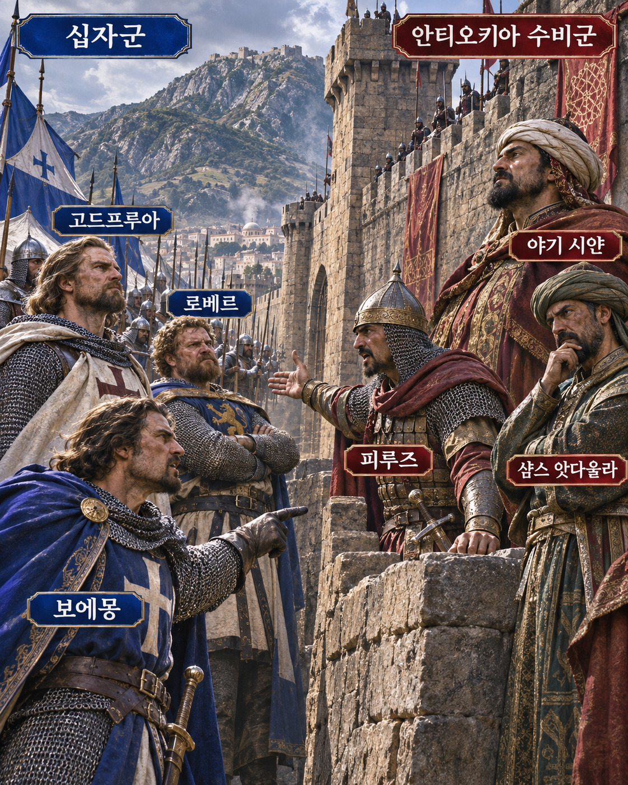

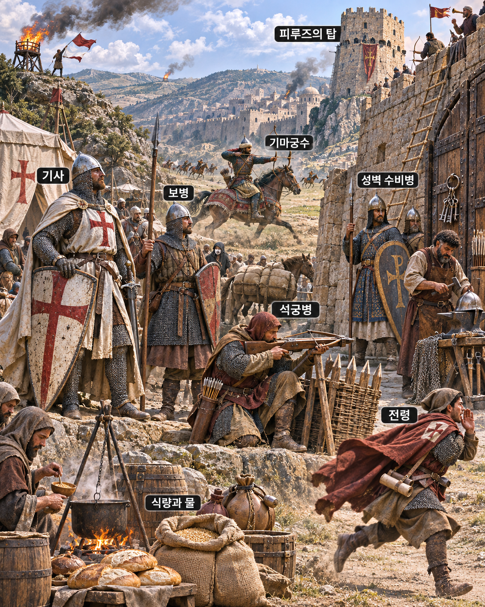

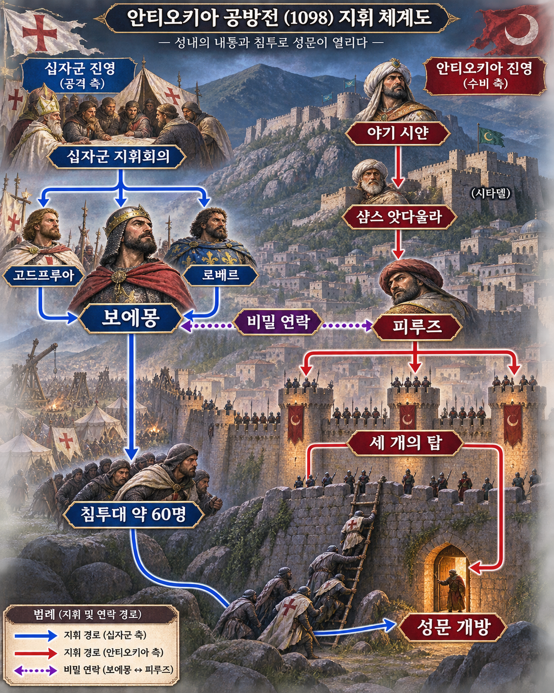

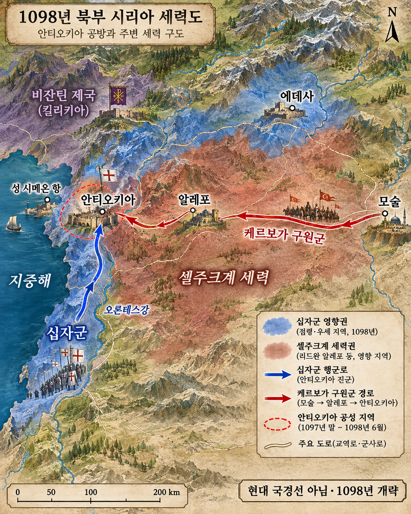

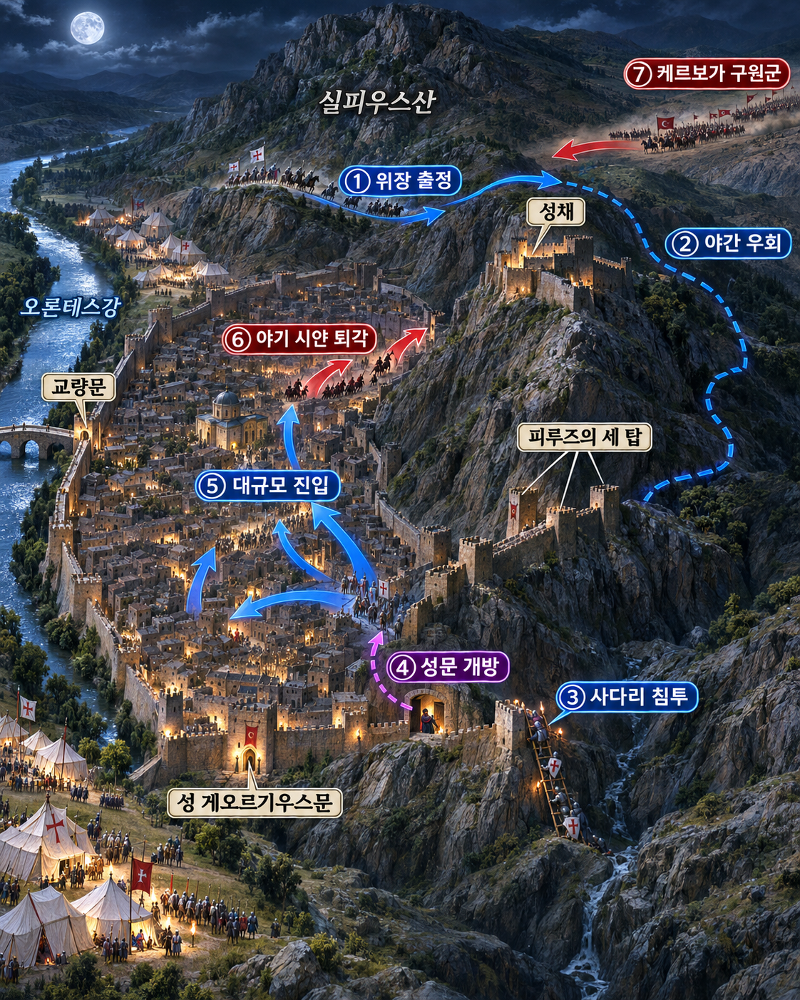

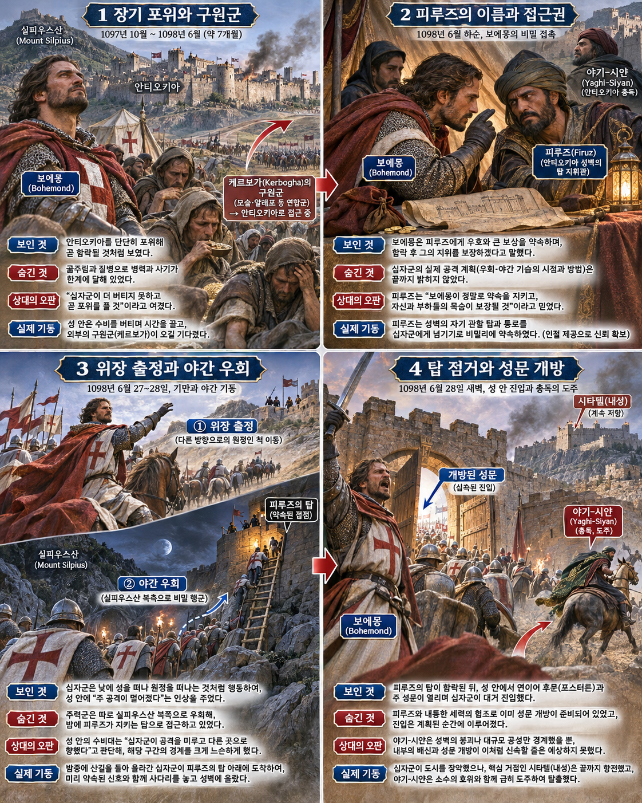

**뒤에서 반복될 지형을 먼저 잡아두기**

- 🌊 **오론테스강(Orontes River)**은 성 서쪽을 감싸며 십자군 진영과 성문 접근을 나눴다.
- ⛰️ **실피우스산(Mount Silpius)**은 성 남동벽과 성채를 떠받친 급경사였다. **보에몽**은 이 산을 돌아 피루즈 담당 구간에 접근했다.
- **▰** **안티오키아(Antioch)**의 남동 성벽에는 **피루즈**가 맡은 세 탑과 작은 출입구가 있었다.
- **▰** **성채(Citadel)**는 가장 높은 동쪽 방어점으로, 시가지가 함락된 뒤에도 저항을 이어 갔다.
- **▰** **성 시메온 항(St Symeon)**은 해상 보급의 연결점이었고, 동쪽에서는 **케르보가**의 구원군이 다가왔다.

#### 상세 전역 서사 — 성벽보다 먼저 문지기의 이름과 담당 구간을 얻다

1097년 10월 시작된 포위는 이듬해 봄까지 이어졌지만 십자군은 긴 성벽을 완전히 봉쇄하지 못했다. 식량과 사기가 줄어드는 동안 모술의 **케르보가**가 대규모 구원군을 모으자, 성을 빨리 열지 못하면 포위군이 협공을 받을 처지였다. 이때 **보에몽**은 성 남동부의 세 탑을 맡은 **피루즈**와 비밀 연락을 맺었다. 연대기마다 그의 출신·동기·이름 표기가 피루즈·피루스·루즈바 등으로 다르지만, 그가 **담당 구간과 출입 권한을 가진 특정 수비자**였다는 핵심은 여러 전승이 공유한다.

#### 이름·역할·접근권을 하나의 작전 정보로 묶다

**보에몽**은 “성 안에 협력자가 있다”는 막연한 소문에서 멈추지 않았다. **피루즈**가 어느 탑들을 지휘하며 언제 사다리와 작은 문을 통제할 수 있는지 확인했고, 약속 이행을 보증하는 인질까지 받았다고 《게스타 프랑코룸》 계열 기록은 전한다. 이는 `姓名`을 알아내는 일이 표적 명부 작성이 아니라 **권한·근무 위치·행동 가능 시각을 검증하는 출발점**임을 보여 준다.

#### 위장 출정 뒤 실피우스산을 돌아 세 탑으로

6월 2일 저녁 십자군은 다른 곳을 치러 떠나는 듯 진영을 움직였다가 어둠 속에서 방향을 바꾸었다. 침투대는 ⛰️ **실피우스산(Mount Silpius)**을 돌아 **피루즈**의 탑 아래에 이르렀다. 약 60명이 사다리를 타고 탑을 점거한 뒤 작은 문과 큰 성문을 열었고, 대기하던 병력이 시가지로 들어갔다. **야기 시얀**은 성채까지 함락됐다고 오인해 달아났고, 그의 아들 **샴스 앗다울라**는 성채에서 저항했다.

#### 전투에서 사용된 속임수 — 위장 출정과 담당 수비자의 제한된 문 열기

속인 주체는 **보에몽**과 침투대였고, 숨긴 실제 목표는 **피루즈**의 담당 탑이었다. 겉으로는 포위군 일부가 다른 원정을 떠나는 신호를 보였고, 성 수비대는 그 구간의 경계가 곧 공격받으리라고 예상하기 어려웠다. 그 믿음은 남동벽 감시를 정상 수준에 머물게 했고, 침투대는 탑과 출입구를 장악해 대군을 들였다.

#### 속임수 작동 구조

**주체와 의도.** **보에몽**은 구원군 도착 전에 성을 열기 위해, 성벽 전체가 아니라 이름과 담당 구간이 확인된 한 수비자의 접근권을 이용했다.

**보인 신호와 믿은 이유.** 십자군 일부는 원정에 나서는 모습을 보였고, 수비대는 수개월간 이어진 통상적 포위의 리듬에 기대었다.

**유발된 행동과 결과.** 경계의 중심이 피루즈의 탑에 집중되지 않은 사이 침투대가 올라가 성문을 열었고, 시가지는 급속히 함락됐다.

**사료의 경계.** 피루즈의 출신·동기와 탑의 정확한 위치는 기록마다 다르므로 뇌물이나 원한 하나로 단정할 수 없다. 확실한 것은 특정 수비 책임자와 비밀 합의가 돌파구가 됐다는 점이다.

#### 속임수 일곱 질문

1. **누가 누구를 속였는가?** **보에몽**의 침투대가 **야기 시얀**의 성 수비 체계를 속였다.
2. **어떤 사실이 거짓이었는가?** 다른 원정을 떠나는 듯 보인 이동은 실제 최종 목표를 감췄다.
3. **어떤 사실은 진실이지만 오해를 유도했는가?** 부대가 실제로 진영을 떠났지만 곧 산을 돌아 성벽으로 향했다.
4. **상대는 왜 그것을 믿고 싶어 했는가?** 장기 포위의 반복과 구원군 접근은 수비대가 시간을 자기편으로 보게 했다.
5. **속임수가 없었어도 같은 오판이 발생했을까?** 가능성은 낮다. 공개된 정면 공격이었다면 급경사 성벽과 탑이 침투를 훨씬 어렵게 했을 것이다.
6. **속은 사람은 어떤 독립 확인을 생략했는가?** 피루즈 담당 구간의 야간 교대·탑 사이 연락·외부 기동의 귀환 방향을 교차 확인하지 못했다.
7. **신뢰·동의·안전을 해치지 않으면서 같은 원리를 어디서 연습할 수 있는가?** 보안 모의훈련에서 담당자·권한·교대 기록을 확인하되 실제 계정과 사람을 공격하지 않는 방식으로 연습할 수 있다.

#### 시계편 兵者詭道也 — 이 전장에 해당하는 속이는 길

<table fit-page-width="true" header-row="true">
<tr>
<td>해당 구절·독음·뜻</td>
<td>전장의 장면</td>
</tr>
<tr>
<td>近而示之遠 근이시지원 — 가까이 가면서 멀리 가는 듯 보임</td>
<td>원정하는 듯 떠난 뒤 야간에 성 남동벽으로 되돌아왔다.</td>
</tr>
<tr>
<td>攻其無備 공기무비 — 대비하지 못한 곳을 공격함</td>
<td>피루즈의 담당 탑과 작은 출입구를 제한된 시각에 열었다.</td>
</tr>
</table>

#### 法 한눈 비교 — 곡제·관도·주용

<table fit-page-width="true" header-row="true">
<tr>
<td>진영</td>
<td>곡제(편제)</td>
<td>관도(지휘)</td>
<td>주용(보급·지속)</td>
</tr>
<tr>
<td>
**십자군(승)**
</td>
<td>60명 안팎 침투대와 대기 본대를 분리했다.</td>
<td>
**보에몽**이 비밀을 제한 공유했다.</td>
<td>기근 속에서 짧은 결행에 힘을 집중했다.</td>
</tr>
<tr>
<td>
**수비군(패)**
</td>
<td>성벽·시가지·성채 지휘가 분리됐다.</td>
<td>
**피루즈** 담당 구간을 상호 감시하지 못했다.</td>
<td>구원군을 기다렸으나 내부 접근 통제가 깨졌다.</td>
</tr>
</table>

#### 패군과 승군의 五事

<table fit-page-width="true" header-row="true">
<tr>
<td>요소</td>
<td>판단</td>
</tr>
<tr>
<td color="orange_bg">🤝 **道**</td>
<td>탑 지휘관과 성주 사이의 결속이 무너졌다. (지기·사기)</td>
</tr>
<tr>
<td color="blue_bg">🌤️ **天**</td>
<td>구원군 접근을 믿고 내부 배반 위험을 낮게 보았다. (지피·확률 관점)</td>
</tr>
<tr>
<td color="green_bg">🧭 **地**</td>
<td>급경사 성벽을 믿었지만 담당 탑 하나가 통로가 됐다. (험이·사생)</td>
</tr>
<tr>
<td color="purple_bg">🎖️ **將**</td>
<td>
**야기 시얀**은 시가지 혼란을 성채 함락으로 오인했다. (지신인용엄)</td>
</tr>
<tr>
<td color="yellow_bg">⚙️ **法**</td>
<td>교대·탑·성문 사이 상호 확인이 없었다. (곡제·관도·주용)</td>
</tr>
</table>

**직관·편향 한 줄:** **야기 시얀**이 구원군 도착과 장기 방어 경험을 기준점으로 삼아 내부 통제 붕괴 가능성을 과소평가한 데에는 확증편향이 작동한 것으로 볼 수 있다.

🏳️ **패군 측 결과** 수비군은 시가지를 잃고 성채로 축소됐으며 **야기 시얀**은 도주 중 죽었다. 六敗 중 지휘·연락 체계가 흔들린 `亂`에 가깝다. 🔀 **패군 측 회피 분기점** 탑 지휘관 교대와 야간 출입권을 이중 확인하고 구원군 도착 전 내부 충성도를 재점검했다면 적어도 기습 함락은 피할 수 있었다.

<table fit-page-width="true" header-row="true">
<tr>
<td>요소</td>
<td>판단</td>
</tr>
<tr>
<td color="orange_bg">🤝 **道**</td>
<td>결행 목표를 핵심 지휘관과 침투대에 묶었다. (지기·사기)</td>
</tr>
<tr>
<td color="blue_bg">🌤️ **天**</td>
<td>구원군 도착 전이라는 좁은 시간창을 이용했다. (지피·타이밍·확률 관점)</td>
</tr>
<tr>
<td color="green_bg">🧭 **地**</td>
<td>산악 우회로와 담당 탑을 결합했다. (험이·광협)</td>
</tr>
<tr>
<td color="purple_bg">🎖️ **將**</td>
<td>
**보에몽**은 사람·권한·지형을 하나의 계획으로 묶었다. (지신인용엄)</td>
</tr>
<tr>
<td color="yellow_bg">⚙️ **法**</td>
<td>침투대·개문대·본대를 시간차로 연결했다. (곡제·관도·주용)</td>
</tr>
</table>

🏆 **승군 측 결과** 십자군은 안티오키아 시가지를 점령했다. 五勝 중 `以虞待不虞者勝`(이우대불우자승, 대비한 채 대비 없는 적을 상대하는 자가 이김)에 해당한다.

#### 法을 압축하지 않고 보기 — 곡제·관도·주용

**곡제 曲制(곡제): 부대를 어떻게 나누고 결합했는가**
<table fit-page-width="true" header-row="true">
<tr>
<td>진영</td>
<td>실제 운용</td>
</tr>
<tr>
<td>
**십자군**
</td>
<td>선도 침투대, 성문 개방대, 대기 본대를 차례로 투입했다.</td>
</tr>
<tr>
<td>
**수비군**
</td>
<td>탑·성문·성채 수비가 나뉘었으나 배반 상황의 상호 지원 규정이 작동하지 않았다.</td>
</tr>
</table>
**관도 官道(관도): 누가 명령하고 어떻게 전달했는가**
<table fit-page-width="true" header-row="true">
<tr>
<td>진영</td>
<td>실제 운용</td>
</tr>
<tr>
<td>
**십자군**
</td>
<td>
**보에몽**과 소수 지휘관이 목적·시각·진입점을 공유했다.</td>
</tr>
<tr>
<td>
**수비군**
</td>
<td>
**야기 시얀**과 탑 지휘관 사이 충성·보고 검증이 끊겼다.</td>
</tr>
</table>
**주용 主用(주용): 군량·장비·전투 지속 능력을 어떻게 썼는가**
<table fit-page-width="true" header-row="true">
<tr>
<td>진영</td>
<td>실제 운용</td>
</tr>
<tr>
<td>
**십자군**
</td>
<td>사다리·로프와 경장 병력을 짧은 야간 작전에 집중했다.</td>
</tr>
<tr>
<td>
**수비군**
</td>
<td>긴 포위를 견딜 성벽과 구원군은 있었지만 내부 통제 자원을 잃었다.</td>
</tr>
</table>

### 동양 — 🏛️ 한군 vs 🏛️ 조군 │ 정형 전투(井陘之戰, 기원전 204년)

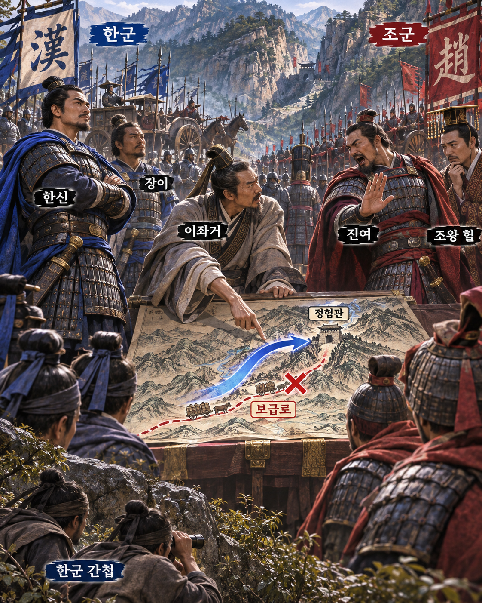

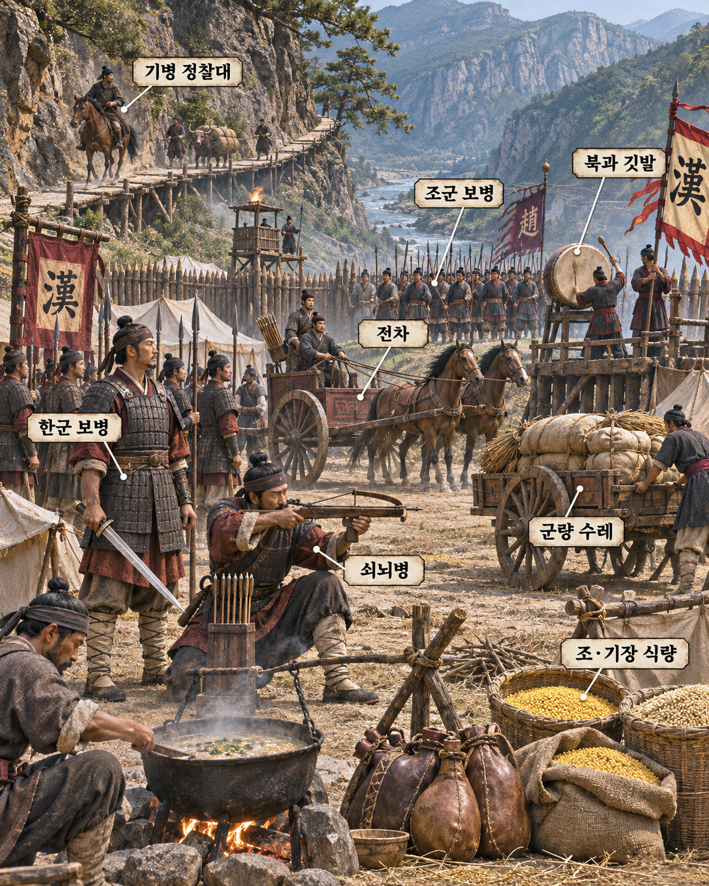

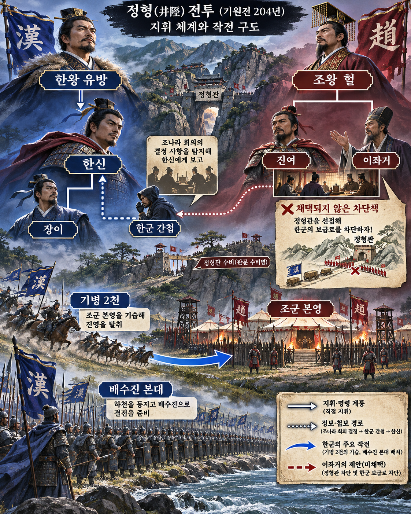

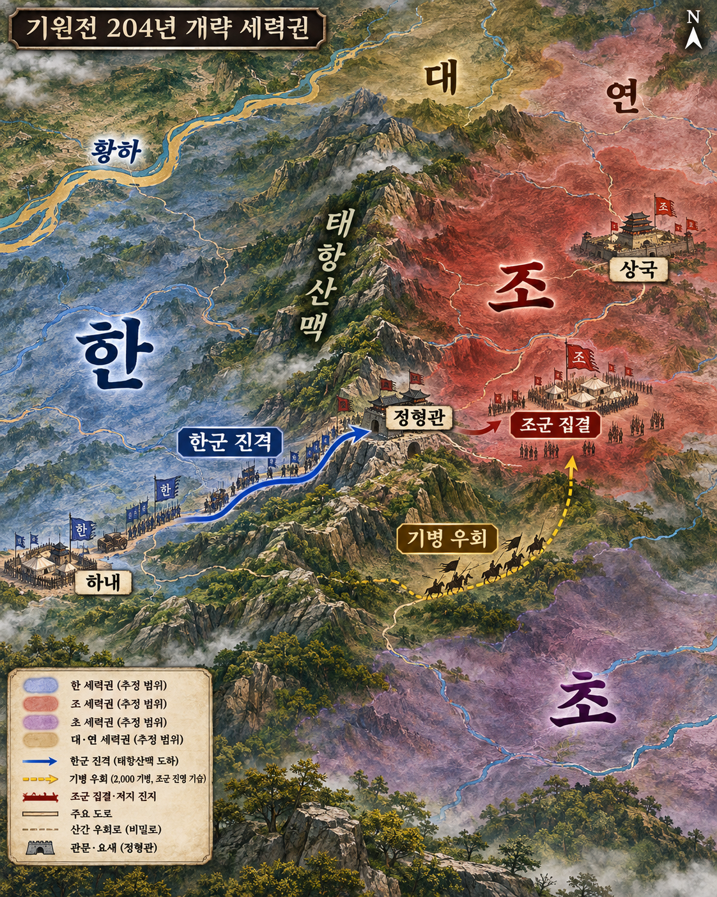

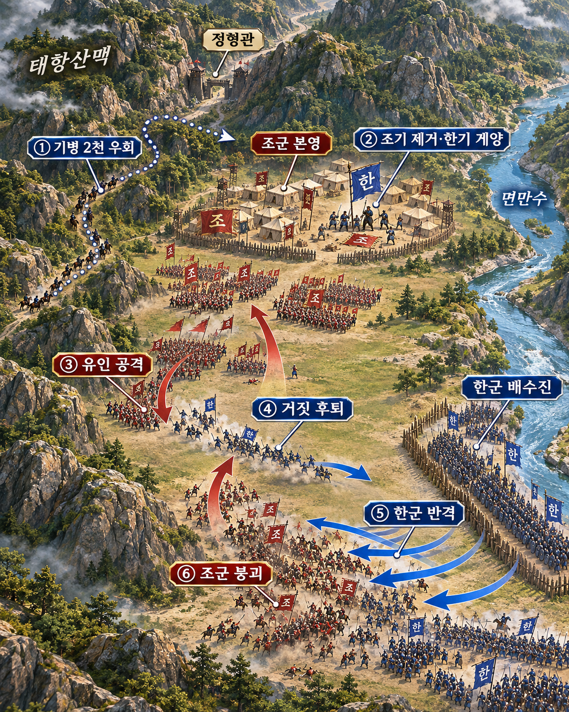

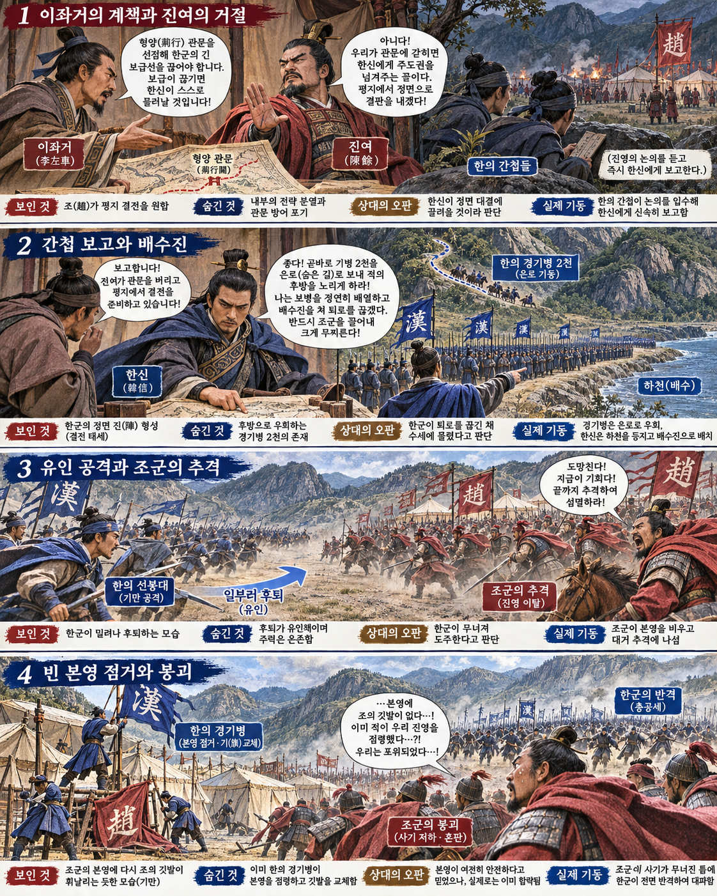

**뒤에서 반복될 지형을 먼저 잡아두기**

- ⛰️ **태항산맥(太行山脈)**은 한군의 진격과 보급을 좁은 길에 묶었다.
- ⛰️ **정형관(井陘關)**은 이좌거가 막고 후방 군량로를 끊자고 한 병목이었다.
- 🌊 **면만수(綿蔓水)**는 한군 배수진의 뒤를 막았고, 동시에 물러서지 못하는 결속 조건이 됐다.
- **▰** **조군 본영**은 주력이 유인에 따라 나가자 비었고, 한군 🐎 기병 2천이 점령했다.
- **▰** **상국(襄國)**은 조의 정치 중심으로, 진여가 야전에서 패하자 방어의 중심도 함께 흔들렸다.

#### 상세 전역 서사 — 거절된 참모의 계책을 간첩이 확인하다

**이좌거**는 **진여**에게 정형관을 굳게 지키고 별동대로 한군의 긴 군량로를 끊자고 건의했다. 좁은 산길을 통과한 한군은 앞뒤가 막히면 싸우지 않고도 지칠 수 있었다. 그러나 **진여**는 정면 승부를 피하면 제후의 비웃음을 산다고 보아 계책을 채택하지 않았다. 《사기》는 **한신**이 간첩을 보내 이 계책이 쓰이지 않았음을 알아낸 뒤에야 크게 기뻐하며 정형관으로 들어갔다고 기록한다.

#### 사람 이름에서 실제 의사결정으로 내려가다

**한신**이 알아낸 것은 “조군이 어리석다”는 평판이 아니었다. 참모 **이좌거**가 어떤 계책을 냈고, 총지휘관 **진여**가 그것을 거절했으며, 따라서 관문과 군량로가 실제로 어떻게 운용될지를 확인한 것이다. 이는 좌우와 알자와 문자의 성명을 알아내라는 구절이 **사람의 이름→역할→제안→채택 여부→실제 배치**로 이어져야 함을 보여 준다.

#### 배수진과 빈 본영을 노린 기병 2천

**한신**은 🐎 경기병 2천을 산길로 우회시켜 조군 본영을 엿보게 했다. 본대 일부는 🌊 **면만수(綿蔓水)**를 등지고 진을 쳤고, 선봉은 조군을 공격한 뒤 깃발과 북을 버리는 듯 물러났다. **진여**의 주력이 본영을 비우고 추격하자 숨은 기병은 조기를 뽑고 한기를 세웠다. 돌아온 조군은 자기 본영이 넘어간 장면을 보고 지휘와 사기가 동시에 무너졌고, 배수진의 한군이 반격했다.

#### 전투에서 사용된 속임수 — 약한 퇴각을 보이고 빈 본영을 빼앗다

속인 주체는 **한신**이었고, 실제 의도는 조군 주력을 본영 밖으로 끌어낸 뒤 후방 표지와 지휘 중심을 바꾸는 것이었다. 한군 선봉은 깃발과 북을 버리며 무너지는 신호를 보였고, **진여**는 정면 결전으로 승부할 수 있다는 기존 판단 때문에 이를 믿었다. 추격으로 본영이 비자 🐎 기병이 깃발을 바꿨고, 돌아온 조군은 지휘 중심을 잃었다.

#### 속임수 작동 구조

**주체와 의도.** **한신**은 간첩 보고로 군량로 차단 위험이 없음을 확인한 뒤, 조군을 본영에서 떼어낼 계획을 세웠다.

**보인 신호와 믿은 이유.** 선봉은 패주하듯 물러나고 군기와 북까지 버렸다. **진여**는 수적 우세와 정면 승부 원칙 때문에 붕괴 신호로 해석했다.

**유발된 행동과 결과.** 조군 주력이 본영을 비우고 추격했고, 한군 🐎 기병이 본영의 깃발을 바꿔 퇴로·지휘·사기를 동시에 끊었다.

**사료의 경계.** 정확한 병력 수와 세부 위치에는 후대 과장이 섞일 수 있다. 그러나 이좌거의 계책, 간첩의 확인, 기병의 본영 점거라는 인과는 《사기》 서사에서 분명하다.

#### 속임수 일곱 질문

1. **누가 누구를 속였는가?** **한신**이 **진여**와 조군 주력을 속였다.
2. **어떤 사실이 거짓이었는가?** 선봉의 후퇴가 전군 붕괴라는 신호는 거짓이었다.
3. **어떤 사실은 진실이지만 오해를 유도했는가?** 한군은 실제로 강을 등졌고 실제로 깃발과 북을 버렸지만, 이는 전군의 무질서가 아니었다.
4. **상대는 왜 그것을 믿고 싶어 했는가?** **진여**는 대군으로 정면에서 이겨야 명분과 위신을 지킨다고 판단했다.
5. **속임수가 없었어도 같은 오판이 발생했을까?** 가능성은 중간이다. 과신은 있었지만 노골적 후퇴 신호가 없었다면 본영을 전부 비울 이유는 줄었을 것이다.
6. **속은 사람은 어떤 독립 확인을 생략했는가?** 추격 전에 본영 후방과 산길의 🐎 기병 움직임을 정찰하지 않았다.
7. **신뢰·동의·안전을 해치지 않으면서 같은 원리를 어디서 연습할 수 있는가?** 바둑·체스·스포츠에서 일부 공간을 내주고 상대의 집중을 이동시키는 연습으로 제한할 수 있다.

#### 시계편 兵者詭道也 — 이 전장에 해당하는 속이는 길

<table fit-page-width="true" header-row="true">
<tr>
<td>해당 구절·독음·뜻</td>
<td>전장의 장면</td>
</tr>
<tr>
<td>利而誘之 이이유지 — 이익을 보여 유인함</td>
<td>버려진 깃발과 북, 달아나는 선봉이 쉬운 전과처럼 보였다.</td>
</tr>
<tr>
<td>近而示之遠 근이시지원 — 가까이 있으면서 멀리 있는 듯 보임</td>
<td>🐎 기병 2천은 조군 본영 가까운 산길에 숨어 존재를 감췄다.</td>
</tr>
</table>

#### 法 한눈 비교 — 곡제·관도·주용

<table fit-page-width="true" header-row="true">
<tr>
<td>진영</td>
<td>곡제(편제)</td>
<td>관도(지휘)</td>
<td>주용(보급·지속)</td>
</tr>
<tr>
<td>
**한군(승)**
</td>
<td>선봉·배수진·우회 기병을 분리 결합했다.</td>
<td>
**한신**이 간첩 보고를 작전 조건으로 바꿨다.</td>
<td>긴 보급로가 끊기기 전에 단기 결전을 택했다.</td>
</tr>
<tr>
<td>
**조군(패)**
</td>
<td>대군이 추격에 쏠려 본영 예비가 사라졌다.</td>
<td>
**이좌거**의 계책이 지휘 결정에 반영되지 않았다.</td>
<td>충분한 자원을 병목 차단보다 정면 결전에 썼다.</td>
</tr>
</table>

#### 패군과 승군의 五事

<table fit-page-width="true" header-row="true">
<tr>
<td>요소</td>
<td>판단</td>
</tr>
<tr>
<td color="orange_bg">🤝 **道**</td>
<td>참모의 반대 의견을 작전 대안으로 보존하지 않았다. (지기·사기)</td>
</tr>
<tr>
<td color="blue_bg">🌤️ **天**</td>
<td>한군이 차단 위험을 확인했다는 사실을 몰랐다. (지피·확률 관점)</td>
</tr>
<tr>
<td color="green_bg">🧭 **地**</td>
<td>관문 병목과 한군 군량로를 쓰지 않았다. (원근·험이)</td>
</tr>
<tr>
<td color="purple_bg">🎖️ **將**</td>
<td>
**진여**는 위신과 정면전 원칙에 묶였다. (지신인용엄)</td>
</tr>
<tr>
<td color="yellow_bg">⚙️ **法**</td>
<td>본영 예비와 후방 정찰을 남기지 않았다. (곡제·관도·주용)</td>
</tr>
</table>

**직관·편향 한 줄:** **진여**가 정면전의 명분과 수적 우세를 기준점으로 삼아 군량로 차단이라는 대안을 버린 판단에는 과신과 확증편향이 작동한 것으로 볼 수 있다.

🏳️ **패군 측 결과** 조군은 본영과 지휘 중심을 잃고 붕괴했으며 **진여**는 죽고 **조왕 헐**은 사로잡혔다. 六敗 중 적정을 헤아리지 못한 `北`에 가깝다. 🔀 **패군 측 회피 분기점** **이좌거**의 차단책을 채택하거나 최소한 본영 예비와 산길 정찰대를 남겼다면 완패와 왕의 포획은 피할 수 있었다.

<table fit-page-width="true" header-row="true">
<tr>
<td>요소</td>
<td>판단</td>
</tr>
<tr>
<td color="orange_bg">🤝 **道**</td>
<td>퇴로 없는 진형을 분명한 반격 계획과 묶었다. (지기·사기)</td>
</tr>
<tr>
<td color="blue_bg">🌤️ **天**</td>
<td>이좌거의 계책이 거절됐다는 확인 뒤 진입했다. (지피·타이밍·확률 관점)</td>
</tr>
<tr>
<td color="green_bg">🧭 **地**</td>
<td>강·관문·산길·본영을 하나의 유인 장치로 썼다. (험이·광협·사생)</td>
</tr>
<tr>
<td color="purple_bg">🎖️ **將**</td>
<td>
**한신**은 사람의 결정과 지형을 연결했다. (지신인용엄)</td>
</tr>
<tr>
<td color="yellow_bg">⚙️ **法**</td>
<td>기병 2천과 본대를 시간차로 운용했다. (곡제·관도·주용)</td>
</tr>
</table>

🏆 **승군 측 결과** 한군은 조를 멸하고 북방 진출로를 열었다. 五勝 중 `識衆寡之用者勝`(식중과지용자승, 대군과 소수 병력의 쓰임을 아는 자가 이김)에 해당한다.

#### 法을 압축하지 않고 보기 — 곡제·관도·주용

**곡제 曲制(곡제): 부대를 어떻게 나누고 결합했는가**
<table fit-page-width="true" header-row="true">
<tr>
<td>진영</td>
<td>실제 운용</td>
</tr>
<tr>
<td>
**한군**
</td>
<td>유인 선봉, 강을 등진 본대, 산길 우회 🐎 기병 2천을 결합했다.</td>
</tr>
<tr>
<td>
**조군**
</td>
<td>주력이 본영을 떠나 추격했고 후방 예비가 사라졌다.</td>
</tr>
</table>
**관도 官道(관도): 누가 명령하고 어떻게 전달했는가**
<table fit-page-width="true" header-row="true">
<tr>
<td>진영</td>
<td>실제 운용</td>
</tr>
<tr>
<td>
**한군**
</td>
<td>
**한신**은 간첩 보고와 기병의 깃발 교체 임무를 제한 공유했다.</td>
</tr>
<tr>
<td>
**조군**
</td>
<td>
**진여**은 **이좌거**의 반대안을 거절하고 정면전 명령으로 통일했다.</td>
</tr>
</table>
**주용 主用(주용): 군량·장비·전투 지속 능력을 어떻게 썼는가**
<table fit-page-width="true" header-row="true">
<tr>
<td>진영</td>
<td>실제 운용</td>
</tr>
<tr>
<td>
**한군**
</td>
<td>취약한 장거리 군량을 오래 노출하지 않고 결전을 서둘렀다.</td>
</tr>
<tr>
<td>
**조군**
</td>
<td>유리한 현지 보급과 대군을 병목 봉쇄가 아닌 추격에 소모했다.</td>
</tr>
</table>

#### 참고자료

- [Gesta Francorum 원문 주석 — Dickinson College Commentaries](https://dcc.dickinson.edu/gesta-francorum/8-20-4%E2%80%935)
- [Cambridge University Press — Firuz and the capture of Antioch](https://www.cambridge.org/core/books/abs/crusading-and-pilgrimage-in-the-norman-world/enemy-within-bohemond-byzantium-and-the-subversion-of-the-first-crusade/D238127231C494C9DCD0168807CED078)
- [《史記》 淮陰侯列傳 — Chinese Text Project](https://ctext.org/shiji/huai-yin-hou-lie-zhuan/zh)
- [정형 전투 개요와 이좌거의 계책](https://en.wikipedia.org/wiki/Battle_of_Jingxing)

---
## 5. 핵심 통찰 + 실생활 적용 + 생활루틴

### 핵심 통찰

이번 구절의 핵심은 중심 인물보다 주변 인물이 더 중요하다는 단순한 역전이 아니다. `守將`이라는 중심을 `左右·謁者·門者·舍人`이라는 서로 다른 기능의 접점으로 분해하고, `姓名`으로 실제 담당자를 확인한 뒤, `索知`로 필요한 답을 능동적으로 찾게 한다. **조직을 안다는 것은 직책표를 보는 일이 아니라 결정·접근·출입·일상의 정보가 누구를 거쳐 움직이는지 확인하는 일**이다.

성명은 앎의 종착점이 아니라 검증의 출발점이다. 누군지 알아야 그 사람이 직접 본 범위, 보고한 시점, 이해관계, 전달받은 원출처를 따질 수 있다. 반대로 이름 없는 “누가 그랬다더라”는 말은 책임과 접근 범위를 확인할 수 없어 행동 근거로 쓰기 어렵다.

이 구절은 지휘관에게도 의무를 준다. 막연히 “잘 알아봐”라고 시키고 결과가 나쁘면 수집자를 탓해서는 안 된다. 어떤 역할의 누구를 왜 알아야 하는지, 어떤 결정이 그 답에 달려 있는지, 언제까지 어느 수준으로 확인해야 하는지를 명령하는 사람이 먼저 정해야 한다.

### 실생활 적용

3교대 현장에서 에러가 생기면 “오피스에서 그렇게 말했다”, “다른 조가 알 것이다” 같은 익명 보고로 바로 조치하지 않는다. 60초 동안 `최초 발견자 / 현재 모니터 담당 / 현장 조치자 / 승인자 / 인계받을 사람`을 적고, 각 이름 옆에 `직접 봄 / 전언 / 추정 / 미확인`을 붙인다. 이것이 현대의 `姓名`과 `索知`다.

전씨가 복잡한 조치에서 피로와 당황이 겹칠 때 말이 줄거나 반응이 날카로워졌다는 관찰은 특정 조건의 기록이지, 모든 상황에서의 성격 판정이 아니다. 그날 실제로 화면을 본 사람, 버튼을 누른 사람, 오피스에 보고한 사람, 다음 교대에 설명한 사람을 나누어 적어야 한다. “전씨가 다 안다”거나 “전씨 때문에 그랬다”는 중심 인물 서사 대신 접점별 사실을 맞추면 누락과 오해를 찾을 수 있다.

신입 최씨의 모니터링과 BM 시트 누락도 의지 평가부터 시작하지 않는다. 해당 근무에서 알림을 직접 본 사람, 현장 조치로 자리를 비운 사람, 시트를 작성하기로 한 사람, 최종 확인 책임자를 이름과 시각으로 남긴다. 기록이 쌓이면 `담당 횟수 중 누락 횟수`라는 분모를 볼 수 있고, 교육 부족·피로·역할 중복·고의적 방치라는 대안 설명을 분리할 수 있다.

인물사건관찰시리즈의 최신 기록 가운데 전씨가 단순 조치에서는 말을 많이 하고 복잡한 상황에서는 당황해 다른 사람의 말을 덜 듣는 장면이 반복되었다는 관찰은 역할 설계에 쓸 수 있다. 조치 시작 전에 사용자가 화면 감시, 전씨가 현장 판단, 다른 사람이 오피스 보고를 맡는 식으로 한 번만 선언하고, 10분 뒤 역할이 바뀌면 다시 이름을 적는다. 사람의 내면을 단정하지 않고 **누가 어느 문턱을 맡는지 외부화**하는 방식이다.

카너먼의 관점에서는 가장 생생한 사람 하나가 전체 원인처럼 보이는 순간을 경계해야 한다. “누가 문제인가”를 묻기 전에 “이 정보는 누가 직접 보았는가, 같은 원출처를 되풀이한 사람은 누구인가, 관찰되지 않은 구간은 어디인가, 반대 사례는 있는가”를 묻는다. 가능한 설명을 `개인 실수 / 인계 누락 / 상충 지시 / 피로 / 장비 이상`으로 나누고, 새 증거가 어느 설명의 가능성을 올리거나 내리는지 표시한다.

### 생활루틴

**추천 문구**

이름과 역할과 확인 근거를 함께 적지 않으면 재수가 없다.

**이유**

오늘 첫 에러나 인계가 생기면 60초 안에 `이름 / 역할 / 직접 관찰·전언·추정·미확인 / 확인 시각` 네 칸을 적고, 행동을 바꿀 핵심 사실 하나는 다른 경로로 재확인한다. 이름 없는 전언은 즉시 책임과 시점을 흐리고, 같은 소문의 반복이 여러 증거처럼 보이면 잘못된 조치가 인계 누락·설비 위험·관계 갈등으로 커진다. `左右·謁者·門者·舍人之姓名`을 찾고 `必索知之`하라는 원리는 사람을 캐라는 말이 아니라, 실제 정보 경로를 책임 있게 밝히라는 불패지지다.
