<!-- sunzi-analysis-mode: full -->
<!-- sunzi-original: 必索敵人之間來間我者, 因而利之, 導而舍之, 故反間可得而用也. -->
> 필색적인지간래간아자, 인이리지, 도이사지, 고반간가득이용야. — 상대가 보낸 말을 그대로 믿고 움직이면 재수가 없다.

---
## 1. 원문 + 독음 + 직역 + 한자어 뜻풀이

必索敵人之間來間我者, 因而利之, 導而舍之, 故反間可得而用也. 필색적인지간래간아자, 인이리지, 도이사지, 고반간가득이용야.

**직역**  
반드시 적이 보낸 간첩 가운데 와서 우리를 염탐하는 자를 찾아내고, 그 형편을 이용해 이롭게 대하며, 이끌어 가르친 뒤 놓아 보내라. 그러므로 반간을 얻어 쓸 수 있다.

앞 구절이 수비장 주변의 측근·접견자·문지기·사인의 이름을 찾아 적의 정보망을 안에서부터 읽으라고 했다면, 이번 구절은 시선을 반대로 돌린다. 적도 우리를 읽으려고 사람을 보낸다. 손자는 그 침투를 단순히 막고 끝내지 않는다. 들어온 통로를 찾아내고, 그 사람이 움직이는 까닭을 파악하고, 이익과 대우로 관계를 바꾸고, 무엇을 보고 돌아갈지를 통제한 뒤 적의 정보망 안으로 되돌려 보낸다. **적이 만든 관측 통로를 우리 쪽의 관측·전달 통로로 뒤집는 것**이 반간이다.

그러나 이 문장을 현대 생활의 함정 수사, 개인정보 침해, 뇌물, 협박, 동료 조종법으로 옮기면 안 된다. 고대 전쟁의 반간은 국가 간 첩보 활동이라는 특수한 제도 안의 행위다. 오늘 남길 수 있는 원리는 낯선 정보 요청을 발견했을 때 즉시 감정적으로 반응하지 말고, 정당한 권한과 절차 안에서 출처·목적·접근 범위를 확인하며, 상대가 가져갈 정보와 우리가 얻을 검증 신호를 통제하라는 것이다.

#### 索(찾을 색) — 이미 들어온 흔적을 질문과 대조로 좁혀 가다

`索`은 새끼나 끈을 더듬듯 찾고 구한다는 움직임을 가진다. 여기서는 막연히 “수상한 자를 조심하라”가 아니라, 적이 보낸 사람 가운데 실제로 와서 우리를 염탐하는 자를 반드시 찾아내라는 능동적 명령이다. 앞 구절의 `必索知之`가 적장 주변 인물의 성명을 찾아 아는 조사였다면, 이번 `必索`은 우리 안에 들어온 적의 정보 수집 경로를 역으로 추적한다.

의심만으로 사람을 범인으로 정하는 것은 `索`이 아니다. 누가 무엇을 물었는지, 그 질문이 어떤 권한과 업무에 맞는지, 같은 정보가 어디로 전달됐는지, 독립된 기록이 있는지를 대조해야 한다. **색은 낙인이 아니라 검증 가능한 흔적을 따라가는 절차**다.

#### 間(간첩 간) — 두 진영 사이의 틈과 통로를 오가는 사람

`間`은 사이와 틈을 뜻하며, 용간편에서는 그 틈을 오가며 정보를 얻고 전하는 사람을 가리킨다. `敵人之間`은 적이 부리는 간첩이고, `來間我者`는 그가 우리 쪽으로 와서 우리를 염탐하는 동작이다. 한 글자가 사람과 행위를 함께 품기 때문에 이 문장은 “누구인가”와 “무엇을 하고 있는가”를 동시에 묻는다.

간첩이라는 신분표만 찾으면 부족하다. 그가 실제로 볼 수 있었던 것, 물은 것, 전할 수 있는 것, 적에게 돌아갈 채널을 알아야 한다. 현대 조직에서는 사람을 적으로 규정하기보다 **정보 요청·접근 권한·전달 경로가 정상 절차와 맞는지 확인하는 보안 관점**으로 제한해 읽어야 한다.

#### 因(인할 인) — 억지로 새 욕망을 만들지 않고 이미 있는 까닭을 붙잡다

`因`은 기대고 따르며 원인과 조건을 이용한다는 뜻이다. `因而利之`는 무턱대고 돈을 주라는 말이 아니라, 그 사람이 왜 왔고 무엇을 필요로 하며 어느 관계에 묶여 있는지 파악한 뒤 그 조건을 따라 이롭게 대하라는 순서다. 먼저 원인을 읽고 나서 수단을 정한다.

이 순서가 빠지면 보상은 통제가 아니라 노출이 된다. 상대의 동기·충성·두려움·기회가 확인되지 않은 채 큰 이익만 제시하면, 그는 양쪽에 서로 다른 이야기를 팔거나 애초에 유인용으로 보낸 인물일 수 있다. **인은 사람의 마음을 마음대로 만든다는 뜻이 아니라, 이미 존재하는 조건을 사실과 추정으로 나누어 읽는 일**이다.

#### 利(이로울 리) — 관계를 바꿀 만한 실제 이익과 신뢰를 제공하다

`利`는 날카롭게 가르고 통하게 하는 이로움이다. 여기서는 적의 간첩이 기존 주인보다 우리 쪽과 협력할 이유를 느끼도록 이익을 주는 단계다. 고주석은 재물과 대우를 중심으로 보지만, 반간 운용에서는 약속의 신뢰성, 안전, 존중, 예측 가능한 대우까지 포함해 읽을 수 있다.

그러나 이익은 매수의 순간으로 끝나지 않는다. 약속을 지키지 않거나 위험을 일방적으로 떠넘기면 반간은 다시 돌아서거나 양쪽을 속일 수 있다. 앞의 `非仁義不能使間`과 연결하면, **이익은 사람을 소모품으로 사는 값이 아니라 협력 관계의 책임을 실제로 부담하는 조건**이어야 한다.

#### 導(인도할 도) — 무엇을 보고 어떻게 전할지 통제된 길을 가르치다

`導`는 길을 이끌고 방향을 잡아 준다는 뜻이다. 포섭만 하고 놓아 보내면 반간이 아니다. 어떤 정보는 사실대로 보여 신뢰를 유지하고, 어떤 정보는 보호하며, 어떤 신호를 적에게 전달할지 정하고, 되돌아온 반응을 어떻게 확인할지 가르쳐야 한다.

여기에는 위험한 역설이 있다. 적이 믿을 만한 통로로 남으려면 진실의 일부가 필요하지만, 그 진실이 너무 크면 우리 쪽의 실제 비밀과 사람이 위험해진다. 따라서 `導`는 거짓말 문구 하나를 외우게 하는 일이 아니라 **공개 범위·전달 시점·확인 신호·중단 조건을 함께 설계하는 통제**다.

#### 舍(놓을 사) — 붙잡아 둔 사람을 목적 있는 귀환 통로로 되돌려 보내다

`舍`는 머무르게 한다는 뜻과 놓아 보낸다는 뜻을 함께 가진다. 여기서는 앞의 `導而舍之`라는 흐름 속에서 가르친 뒤 풀어 보내는 동작이 중심이다. 적의 간첩을 잡았다는 사실 자체가 결말이 아니라, 적에게 돌아가게 해야 비로소 그의 원래 정보망을 거꾸로 이용할 수 있다.

놓아 보내는 일은 통제를 포기하는 것과 다르다. 무엇을 가져갔는지, 적이 어떻게 반응했는지, 그가 다시 접촉했는지를 확인할 수 있어야 한다. 귀환 뒤 검증이 없으면 반간을 얻은 것이 아니라 **상대가 준비한 기만 통로를 우리 손으로 다시 열어 준 것**일 수 있다.

#### 反間(반간) — 적의 눈을 감기는 것이 아니라 그 눈의 방향을 뒤집다

`反`은 되돌리고 뒤집는다는 뜻이다. `反間`은 적의 간첩을 제거한 상태가 아니라, 그 사람이 적에게는 여전히 정보원으로 보이면서 실제로는 우리 쪽의 통제 아래 적의 의도·질문·반응을 드러내고 제한된 정보를 되돌려 보내는 상태다. 그러므로 “얻어 쓴다”는 말 앞에 색출·조건 파악·이익·인도·귀환이 모두 놓인다.

반간은 가장 많은 정보를 주는 사람이라는 이유만으로 성립하지 않는다. 그 정보가 검증되는지, 적과의 통신이 통제되는지, 이중 또는 삼중으로 움직일 가능성을 계속 의심하는지가 핵심이다. **반간은 한 번의 포섭이 아니라 신뢰와 불신을 동시에 관리하는 지속적 검증 과정**이다.

#### 글자들이 완성하는 한 장면

적이 보낸 `間`이 우리 진영에 들어와 질문하고 관찰한다. 지휘관은 막연한 공포로 모두를 의심하지 않고, `索`으로 접근과 전달의 흔적을 좁힌다. 그 사람이 움직이는 조건을 `因`하여 읽고, 지켜야 할 약속과 `利`를 제공해 관계를 바꾼다. 이어 `導`로 보여 줄 것과 감출 것, 돌아올 확인 신호를 정한 뒤 `舍`하여 원래의 적 정보망으로 돌려보낸다.

그제야 적의 눈이었던 통로가 우리에게 적의 질문과 반응을 알려 주는 `反間`으로 뒤집힌다. 어느 한 단계라도 건너뛰면 결과가 달라진다. 색출만 하면 통로가 끊기고, 이익만 주면 매수당했다고 믿는 자기기만이 생기며, 인도 없이 놓아 보내면 적의 기만을 증폭할 수 있다. **반간은 사람 하나를 얻는 기술이 아니라 적의 정보 순환 전체를 찾아 통제하고 다시 검증하는 질서**다.

---
## 2. 전통 주석 기반 분석

- **조조(曹操)** — "우리에게 와서 염탐하는 적의 간첩을 반드시 찾아라. **후하게 이롭게 하고 가르쳐 돌려보내 적의 일을 되묻게 하라.**"
- **이전(李筌)** — "적의 간첩은 적의 사정을 아는 문이기도 하다. **죽여 통로를 끊기보다 그 형편을 따라 마음을 돌려 써라.**"
- **두목(杜牧)** — "그가 바라는 바를 알아 재물과 대우로 결속하고, 전할 일을 분명히 가르쳐라. **돌아가 적에게 믿음을 얻어야 비로소 반간이 된다.**"
- **매요신(梅堯臣)** — "와서 나를 엿보는 자를 먼저 알아내라. **그를 이롭게 대하고 놓아 보내 적의 허실을 되돌아 알게 하라.**"
- **장예(張預)** — "포섭했다는 말만 믿지 마라. **적에게 돌아갈 길과 보고할 말과 다시 올 신호까지 이끌어야 한다.**"
- **왕석(王晳)** — "적이 보낸 자는 양쪽 말을 모두 팔 수 있다. **이익을 주되 그 말과 행동을 거듭 대조해 참됨을 잃지 마라.**"
- **가림(賈林)** — "형편을 따라 은혜와 이익을 베풀어 원한과 욕구의 매듭을 풀어라. **억지로 몰아세우지 말고 스스로 돌아설 조건을 만들어라.**"
- **두우(杜佑)** — "찾음·이롭게 함·인도함·놓아 보냄의 차례를 바꾸지 마라. **한 단계라도 빠지면 적의 간첩을 얻은 것이 아니라 적에게 이용당한다.**"
- **진호(陳皞)** — "반간은 한 번 마음을 돌렸다고 끝나는 자가 아니다. **적의 반응과 돌아온 보고를 확인하며 계속 통제하라.**"

#### 리링의 고증과 현대적 독법

리링의 해설 취지를 따라 문장 구조를 보면, 네 동작이 차례로 이어진다. `必索`은 대상의 발견, `因而利之`는 상대의 조건을 따라 관계를 바꾸는 일, `導而舍之`는 전달 내용과 귀환을 통제하는 일, `故反間可得而用也`는 그 결과다. 마지막 결론만 떼어 “적의 간첩을 돈으로 사라”고 읽으면 손자가 앞에 둔 탐색·인도·귀환의 절차가 사라진다.

`舍`는 머물게 하다와 놓아 보내다의 뜻을 함께 지니지만, 여기서는 `來間我者`가 적의 진영으로 돌아가야 반간 기능을 수행한다는 문맥 때문에 “놓아 보내다”가 자연스럽다. 판본 차이가 확인되지 않는 자리에서 이문을 꾸미기보다, 포획에서 석방으로 넘어가는 동작이 왜 필요한지를 앞뒤 문장으로 읽어야 한다.

또한 이 구절은 『손자』 전체를 음모 처세술로 축소할 근거가 아니다. 고대 반간은 국가 간 전쟁과 첩보 제도 속에서 적의 정보망을 역이용하는 고위험 활동이었다. 현대 일상에 직접 옮길 때는 합법성·개인정보·노동 관계·안전이라는 조건이 완전히 다르다. 따라서 남길 수 있는 핵심은 사람을 몰래 포섭하는 기술이 아니라, **상대가 만든 정보 통로를 발견했을 때 출처·동기·전달 범위·되먹임을 함께 검증하는 사고 순서**다.

---
## 3. 교차 설명

### ① 손자병법 내 교차

앞 구절 `左右, 謁者, 門者, 舍人之姓名, 令吾間必索知之`(좌우, 알자, 문자, 사인지성명, 영오간필색지지 — 좌우의 측근·접견자·문지기·사인의 성명을 우리 간첩에게 반드시 찾아 알게 하라)는 적의 지휘망을 사람 단위로 펼친다. 이번 구절은 그 조사가 일방향이 아님을 보여 준다. 적도 우리 쪽 사람과 문을 찾으므로, 지피는 적진을 보는 일과 우리 진영을 보려는 적의 시선을 알아채는 일을 함께 포함한다.

앞부분의 `鄕間者, 因其鄕人而用之, 內間者, 因其官人而用之, 反間者, 因其敵間而用之`(향간자, 인기향인이용지, 내간자, 인기관인이용지, 반간자, 인기간인이용지 — 향간은 적의 고을 사람을, 내간은 적의 관리 사람을, 반간은 적의 간첩을 이용한다)는 반간의 정의를 준다. 이번 문장은 그 정의를 실행 절차로 바꾼다. `因其敵間`의 ‘인한다’는 말이 `索 → 因利 → 導 → 舍`로 풀리며, 사람 분류가 실제 운용 질서가 된다.

뒤 구절 `因是而知之, 故鄕間, 內間可得而使也`(인시이지지, 고향간, 내간가득이사야 — 이로 말미암아 알게 되므로 향간과 내간도 얻어 부릴 수 있다)는 반간이 다른 간첩 유형으로 가는 관문임을 밝힌다. 적이 무엇을 알고 싶어 하는지, 누구에게 접근하는지, 어떤 신호를 믿는지를 반간을 통해 알면 적지의 주민과 관리 가운데 실제 접근점을 더 정확히 찾을 수 있다. 다만 한 반간의 보고를 전체 적 정보망의 진실로 일반화하면 다시 속는다.

### ② 클라우제비츠 『전쟁론』

클라우제비츠의 마찰과 전쟁의 안개는 정보가 많아져도 판단이 자동으로 확실해지지 않는 이유를 보여 준다. 반간은 적의 질문과 반응을 가까이서 볼 수 있는 귀중한 통로지만, 동시에 양쪽이 서로에게 보여 주고 싶은 정보를 섞는 통로다. 보고가 생생하고 구체적일수록 오히려 “이 사람만은 안다”는 확신이 커져 다른 증거를 밀어낼 수 있다.

그가 말한 전쟁의 중심은 정치적 목적과 힘의 관계다. 반간 운용도 기발한 거짓 정보 하나가 전쟁 목적을 대신할 수 없다. 어떤 적의 결정을 바꾸려는지, 그 결정이 실제 전력·시간·지형과 어떻게 이어지는지, 드러날 경우 어떤 정치적 비용이 생기는지를 먼저 계산해야 한다. 목적과 무관한 기만은 상대를 잠시 흔들어도 우리 쪽 자원과 신뢰를 소모한다.

차이도 뚜렷하다. 『손자』는 적의 간첩을 찾아 이롭고 인도해 되돌려 보내는 구체적 인간 운용을 짧게 명령하지만, 클라우제비츠는 첩보 일반의 불확실성과 지휘관 판단의 부담을 더 강조한다. 둘을 함께 읽으면 **반간은 안개를 없애는 만능 열쇠가 아니라, 통제 가능한 관측 창 하나를 만들고 다른 출처와 계속 대조하는 수단**이 된다.

### ③ 미야모토 무사시 『오륜서』

『오륜서』의 `観見二つの目付`(관견 후타쓰노 메쓰케 — 꿰뚫어 보는 눈과 눈앞을 보는 눈)는 반간을 대하는 두 시선을 설명한다. `見`의 눈은 그 사람이 누구를 만나고 무엇을 전했는지, 약속한 신호가 돌아왔는지 확인한다. `観`의 눈은 적이 왜 이 통로를 열었는지, 우리가 통제한다고 믿는 상태 자체가 적의 더 큰 유인일 가능성까지 본다.

무사시는 상대의 칼끝 하나에 마음을 붙잡히지 말고 전체 리듬과 의도를 보라고 한다. 반간이 가져온 눈에 띄는 정보 한 건에 사로잡히면 적의 다른 기동과 독립 출처를 놓친다. 특히 처음부터 너무 완벽한 정보, 우리 기대와 정확히 맞는 정보는 성과가 아니라 검증 부담을 키우는 신호일 수 있다.

개인 검술과 국가 첩보의 차이도 남는다. 검객은 자기 거리와 박자를 즉시 조절하지만, 반간 운용은 법적 권한·조직적 승인·출처 보호·통신 통제·사후 책임을 요구한다. 현대 생활에서는 상대를 시험하거나 함정을 파는 법이 아니라, **강한 첫인상과 편리한 단일 통로에 시선을 고정하지 않는 관찰 훈련**으로만 옮기는 편이 타당하다.

### ④ 오자병법·육도삼략

『오자병법』은 상벌과 명령이 분명해야 군대가 실제로 움직인다고 본다. 반간에게 이익을 주는 일도 임기응변의 사적 약속으로 끝나면 안 된다. 누가 승인했고 무엇을 약속했으며 어떤 위험을 보호할지 분명해야 한다. 그렇지 않으면 일선 담당자가 성과를 과장하려고 출처를 몰아붙이고, 조직은 지킬 수 없는 약속으로 정보망을 스스로 무너뜨린다.

『육도』가 말하는 여러 눈과 귀의 운용은 한쪽 보고에 갇히지 말라는 경고와 이어진다. 적의 내부를 안다는 사람은 유용하지만, 그가 보여 주는 세계는 자신의 접근 범위와 이해관계로 잘린 일부다. 반간의 보고는 향간·내간·생간과 독립된 공개자료, 실제 적의 행동 변화와 대조해야 한다.

두 병서와 함께 읽으면 `利之`와 `導之`는 개인적 교섭과 조직적 통제를 잇는 고리다. 이익은 약속의 신뢰성을 만들고, 인도는 임무·보고·중단 기준을 분명히 한다. 그러나 현대 조직에서 이 원리는 비밀 포섭을 흉내 내는 것이 아니라 **제보·감사·보안 조사에서 보호 약속과 검증 절차를 함께 두는 제도**로 바꾸어야 한다.

### ⑤ 현대 심리학·군사학

CIA의 공개 연구 「Observations on the Double Agent」는 이중간첩 운용을 가장 복잡하고 까다로운 방첩 활동 가운데 하나로 설명한다. 상대 기관에 대한 깊은 이해, 통신 통제, 과거 경력과 행동 패턴 파악, 충분한 시간과 전문성이 함께 필요하다는 것이다. 이는 `因而利之` 한 번으로 반간이 완성되는 것이 아니라, `導而舍之` 이후에도 상대와의 통신·보고·행동을 지속해서 검증해야 한다는 이번 구절의 순서와 맞닿는다. ([CIA 공개 연구](https://www.cia.gov/resources/csi/static/Observations-on-Double-Agent.pdf))

CIA의 OSS X-2 연구는 제2차 세계대전의 통제된 적 요원들이 독일 정보기관에 보고하면서 연합군이 적의 첩보 활동을 파악하고 일부 기만 작전에 활용한 사례를 다룬다. 여기서 중요한 것은 “적 간첩을 우리 편으로 만들었다”는 영웅담보다, 조직이 그 통로를 식별하고 관리하며 적의 반응을 관찰할 능력을 갖추었다는 점이다. 한 사람의 충성심이 아니라 **통제와 되먹임이 반간의 가치**를 만든다. ([CIA OSS 연구](https://www.cia.gov/resources/csi/static/OSS-Double-Agent-Operations.pdf))

반대로 CIA의 2025년 공개 연구가 다룬 GTPROLOGUE 사례는 적이 보낸 통제 정보원을 우리 쪽 반간으로 오인할 위험을 보여 준다. 공개 자료 자체가 서로 어긋나고 1차 자료 상당수가 비공개라는 한계를 전제로 하지만, 자산 검증 절차에 맞춰 설계된 거짓 통로는 검증을 통과하는 듯 보일 수 있다. 따라서 확인 절차가 있다는 사실만으로 안심하지 말고, **그 절차를 상대도 알고 조작할 수 있다는 대안 가설**을 유지해야 한다. ([CIA 2025년 연구](https://www.cia.gov/resources/csi/studies-in-intelligence/studies-in-intelligence-69-no-2-extracts-june-2025/beautiful-in-another-context-a-counterintelligence-assessment-of-gtprologue/))

사용자의 「생각에대한 생각」 메모가 경고하는 가용성·분모 무시·한 시나리오 집중은 반간 평가에서 특히 위험하다. 포섭 뒤 얻은 한두 건의 놀라운 적중은 기억에 강하게 남지만, 전체 보고 중 맞은 비율과 우연히 맞을 기저율, 틀린 보고와 확인 불가능한 보고의 분모를 함께 보지 않으면 신뢰도를 과대평가한다. `진짜 전향 / 적이 보낸 유인 / 양쪽에 정보를 파는 기회주의 / 일부만 정확한 제한 접근` 같은 대안 시나리오를 적고 확률 총합을 의식적으로 배분해야 한다.

현대적 한계는 명확하다. 공개된 역사·교리 연구를 직장 동료 포섭이나 사적 감시에 적용해서는 안 된다. 실제 방첩·정보원 운용은 법률, 승인 권한, 전문 훈련, 감독의 대상이다. 일상에서 안전하게 연습할 수 있는 것은 **누가 전한 말인지, 직접 본 사실인지, 전달자가 무엇을 얻는지, 반대 증거와 독립 확인은 무엇인지 기록하는 출처 검증**뿐이다.

---
## 4. 역사적 실증 사례

### 서양 — 🏛️ 영국 정보기관 vs 🏛️ 독일군 정보부 │ TATE 반간 작전(1940~1945)

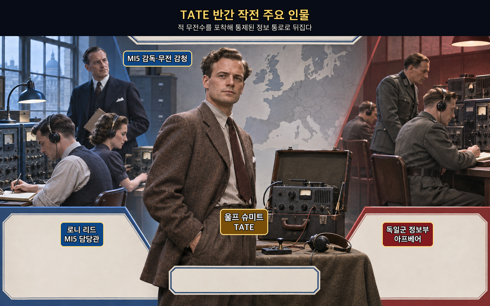

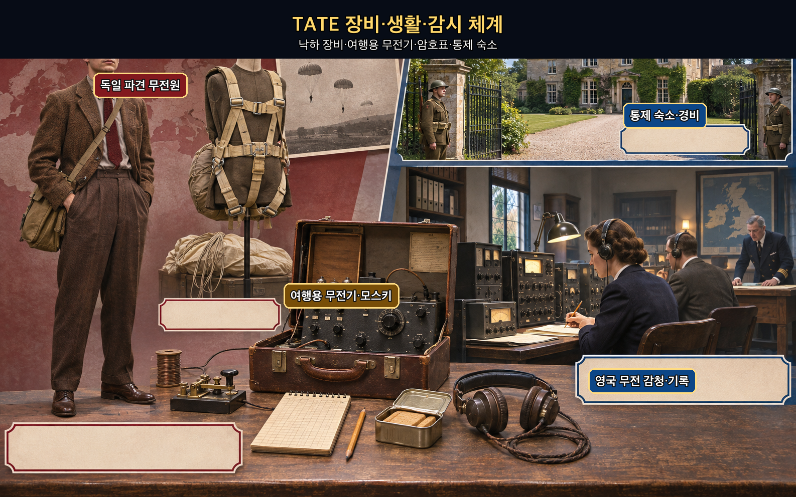

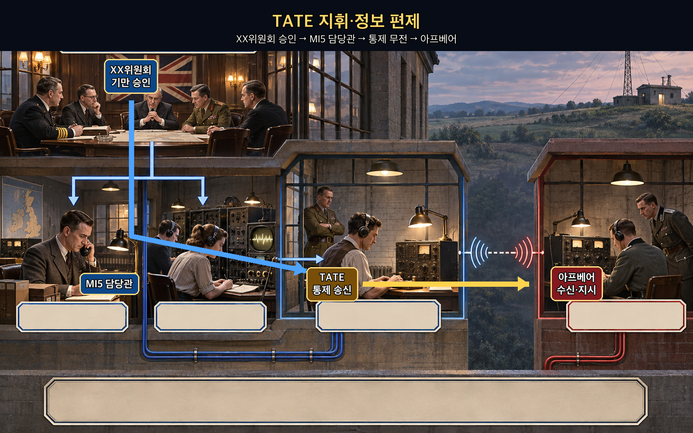

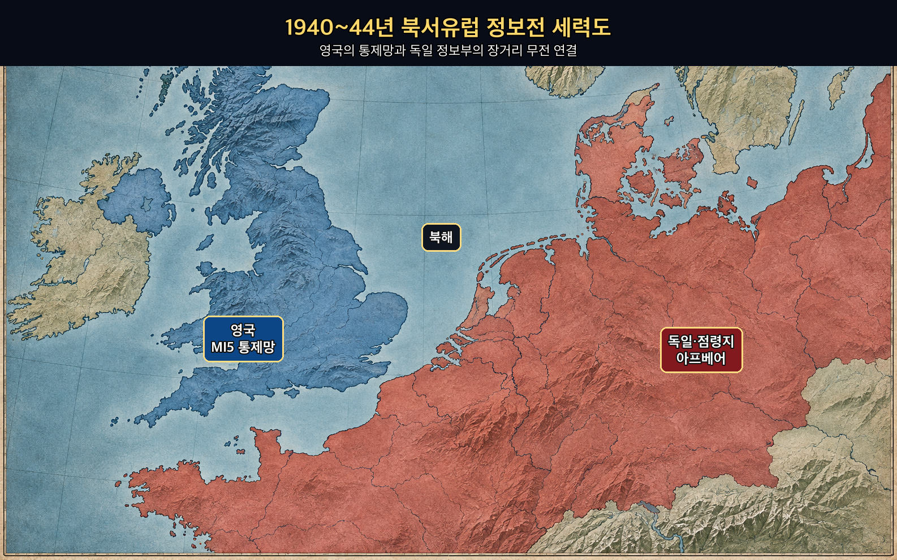

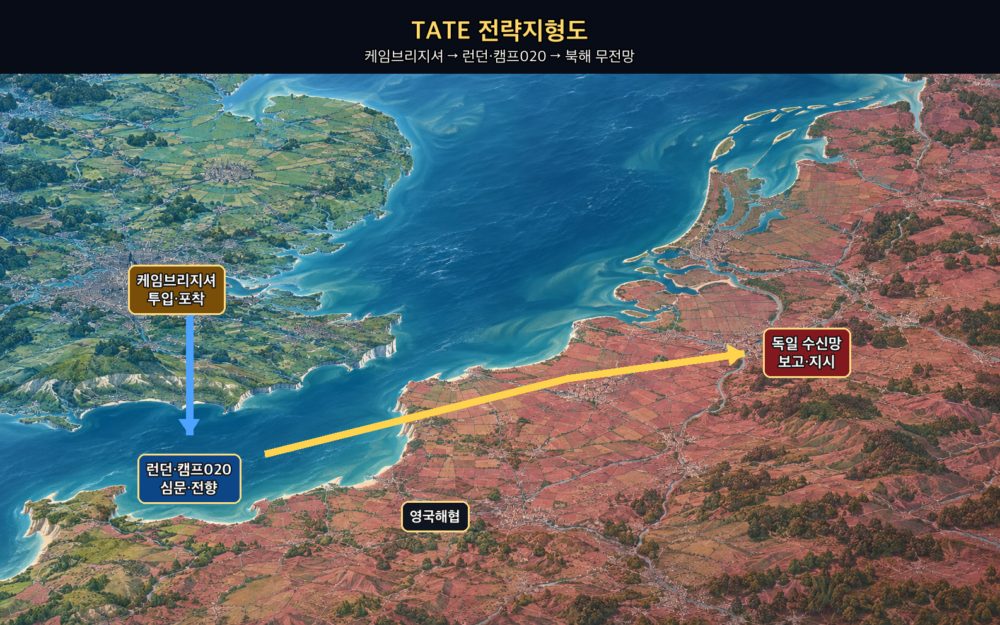

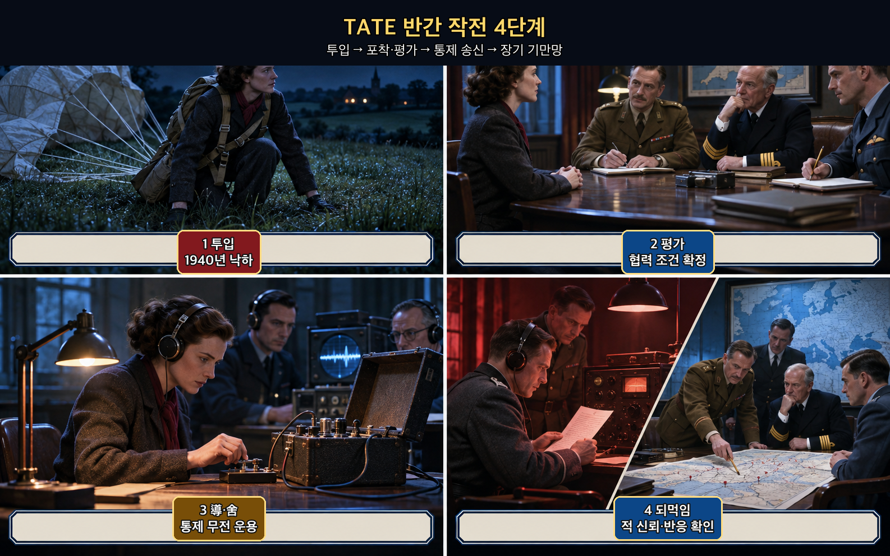

**뒤에서 반복될 지형을 먼저 잡아두기**

- **▰** **케임브리지셔(Cambridgeshire)**는 울프 슈미트가 1940년 9월 낙하한 잉글랜드 동부 농촌이다. 독일의 투입 경로가 영국 방첩망에 포착된 출발점이다.
- **▰** **런던(London)**과 캠프 020은 심문·평가·담당관 배치가 이루어진 통제 중심이었다. 전투의 ‘지형’은 성벽보다 무전기·담당관·승인선으로 이루어진 정보 공간이었다.
- 🌊 **북해(North Sea)**는 TATE의 통제 무전이 독일 수신망으로 건너가는 장거리 통로였다. 영국이 사람의 이동을 막은 뒤에도 적이 믿는 통신 경로는 유지됐다.
- **▰** **독일(Germany) 아프베어 수신망**은 메시지를 받고 지시와 자금을 되돌려 보냈다. 이 되먹임 덕분에 영국은 무엇을 믿었는지 확인할 수 있었다.
- **▰** **도버(Dover)**·🌊 **영국해협(English Channel)**은 뒤의 연합군 기만 작전에서 파드칼레와 노르망디를 갈라 보이게 한 전략 공간이다. TATE 한 명의 성과와 전체 기만 체계의 성과는 구분해야 한다.

#### 상세 전역 서사 — 포착한 무전수를 죽이지 않고 적의 수신망을 보존하다

덴마크 출신 **울프 슈미트(Wulf Schmidt)**는 독일군 정보부가 영국에 보낸 무전원이었다. 1940년 9월 낙하한 그는 도착 직후 영국 당국에 포착됐고, 캠프 020에서 조사받았다. 영국은 침투를 막았다는 사실을 독일에 알리는 대신, 그가 가진 무전기와 호출부호가 열어 둔 통로를 보존했다. 협력 조건을 받아들인 슈미트는 코드명 TATE로 **MI5 담당관**의 통제 아래 송신을 계속했다.

여기서 `因而利之`는 단순한 현금 매수가 아니었다. 생존과 처우, 담당관의 지속적 접촉, 독일이 기대하는 생활 흔적과 보고 주기를 함께 관리해야 했다. 메시지마다 진실과 거짓의 비율을 조절하고 군사 정보 공개 위험을 승인선 안에서 제한했다. 독일 측은 TATE의 보고를 신뢰했고, 전쟁 중 그에게 철십자장을 수여할 정도로 통로를 믿었다. 영국 국립문서보관소는 그를 이중간첩 체계에서 가장 오래 무선 활동을 지속한 요원으로 소개한다.

다만 TATE 한 명이 D-Day의 방향을 바꿨다고 단정하면 결과를 영웅담으로 축소한다. 영국의 이중간첩 체계는 포착된 독일 요원들, 무전 감청, 암호 해독, 이십위원회의 승인, 실제 병력 은폐를 결합했다. TATE의 가치도 거짓말의 재치보다 **독일이 무엇을 요구하고 어떤 보고를 신뢰하는지 되돌려 보여 준 통제 채널**에 있었다.

#### 전투에서 사용된 속임수 — 살아 있는 무전 통로를 그대로 돌려주다

속인 주체는 **MI5와 이십위원회**, 속은 상대는 **독일군 정보부 아프베어**였다. 실제 의도는 독일의 영국 내 관측망을 제거하면서도 독일이 그 사실을 모르게 하는 것이었다. 상대에게 보인 신호는 TATE가 임무를 수행하며 현지 군사 정보를 보고한다는 꾸준한 무전이었다. 독일은 올바른 호출부호·암호·보고 주기와 일부 검증 가능한 사실이 섞였기 때문에 통로를 믿었다. 그 결과 독일은 새로운 요원 투입보다 이미 통제된 채널에 의존했고, 영국은 메시지에 대한 독일의 요구와 반응을 관찰할 수 있었다.

#### 속임수 작동 구조

**주체와 의도.** 영국 방첩기관은 침투자를 공개 처벌해 통로를 닫기보다, 안전하게 통제된 송신자로 바꿔 독일의 정보 요구와 판단을 읽으려 했다.

**보인 신호와 믿은 이유.** TATE는 실제 독일 장비·암호·호출부호로 송신했고 일부 참정보를 섞었다. 장기간 이어지는 일관성과 독일 측의 되먹임이 신뢰를 강화했다.

**유발된 행동과 결과.** 독일은 TATE에게 지시와 자금을 계속 보냈고 그의 보고를 유효한 영국 내 정보로 취급했다. 영국은 적의 관측 방향을 알면서 허용된 정보만 되돌려 보냈다.

**사료의 경계.** 개별 메시지의 효과와 전쟁 전체의 결과를 곧바로 동일시할 수 없다. TATE는 더 큰 Double-Cross 체계의 한 통로였으며 D-Day 기만 효과는 여러 요원·감청·실제 군사조치의 결합으로 평가해야 한다.

#### 속임수 일곱 질문

1. **누가 누구를 속였는가?** 영국 MI5가 통제한 TATE가 독일군 정보부의 담당자와 평가망을 속였다.
2. **어떤 사실이 거짓이었는가?** 영국에서 독립적으로 활동하는 충성스러운 독일 요원이라는 전제가 거짓이었다. 메시지의 군사 내용 일부도 승인된 기만이었다.
3. **어떤 사실은 진실이지만 오해를 유도했는가?** 실제 무전 장비·호출부호·일부 확인 가능한 생활·군사 사실은 진실이었지만, 전체 채널이 영국의 통제 아래 있다는 핵심을 가렸다.
4. **상대는 왜 그것을 믿고 싶어 했는가?** 독일은 영국 본토의 인적 정보가 필요했고, 장기간 유지되는 무전원이 그 공백을 채워 주었다.
5. **속임수가 없었어도 같은 오판이 발생했을까?** 가능성은 낮다. 체포가 공개되거나 통신이 끊겼다면 독일은 채널 상실을 인지했을 가능성이 크다.
6. **속은 사람은 어떤 독립 확인을 생략했는가?** 독일은 영국 내 별도의 자유로운 정보망이 거의 없었고, TATE의 실제 행동 환경을 독립적으로 확인할 수 없었다.
7. **신뢰·동의·안전을 해치지 않으면서 같은 원리를 어디서 연습할 수 있는가?** 보안 모의훈련에서 가짜 피싱 신고 채널의 반응을 측정하거나, 보드게임에서 한 경로에만 의존하지 않고 상대의 되먹임을 기록하는 방식으로 연습할 수 있다.

#### 시계편 兵者詭道也 — 이 전장에 해당하는 속이는 길

<table fit-page-width="true" header-row="true">
<tr><td>해당 구절·독음·뜻</td><td>전장의 장면</td></tr>
<tr><td>近而示之遠 근이시지원 — 가까이 있으면서 멀리 있는 듯 보인다</td><td>TATE는 영국 방첩기관 바로 곁에서 통제됐지만 독일에는 독립적인 현지 요원처럼 보였다.</td></tr>
<tr><td>實而備之 실이비지 — 충실한 곳에는 대비한다</td><td>영국은 통신 채널을 유지하면서도 메시지 승인·감청·교차검증으로 실제 비밀 누출을 막았다.</td></tr>
</table>

#### 法 한눈 비교 — 곡제·관도·주용

<table fit-page-width="true" header-row="true">
<tr><td>진영</td><td>곡제(편제)</td><td>관도(지휘)</td><td>주용(보급·지속)</td></tr>
<tr><td>**영국**</td><td>위원회·담당관·감청·요원을 분리했다.</td><td>모든 메시지를 승인선에 묶었다.</td><td>통신·생활·보호를 전쟁 끝까지 지속했다.</td></tr>
<tr><td>**독일**</td><td>국외 요원과 무전 담당자에 의존했다.</td><td>아프베어 담당선이 보고를 평가했다.</td><td>자금·지시를 보냈으나 현지 독립 검증이 약했다.</td></tr>
</table>

#### 울프 슈미트·아프베어(패군)

<table fit-page-width="true" header-row="true">
<tr><td>요소</td><td>판단</td></tr>
<tr><td color="orange_bg">🤝 **道**</td><td>아프베어는 요원과 본부의 목적을 결속했지만, 요원이 적 통제 아래 놓였다는 가정을 점검하지 못했다. (지기·결속)</td></tr>
<tr><td color="blue_bg">🌤️ **天**</td><td>장기간 정상적으로 보이는 송신을 충성의 표본으로 과대평가했고 영국 감청·체포 가능성의 기저율을 낮게 보았다. (지피·확률 관점)</td></tr>
<tr><td color="green_bg">🧭 **地**</td><td>🌊 **북해(North Sea)** 너머의 현장을 직접 확인할 수 없는 원격 정보지형이 불리했다. (원근·험이)</td></tr>
<tr><td color="purple_bg">🎖️ **將**</td><td>담당자들은 일관된 보고의 대표성에 끌려 채널 전체가 적 통제 아래일 가능성을 충분히 갱신하지 못했다. (지신인용엄)</td></tr>
<tr><td color="yellow_bg">⚙️ **法**</td><td>무전·자금·지시는 유지됐지만 현지 독립 출처가 부족해 관도와 검증이 한 채널에 수렴했다. (곡제·관도·주용)</td></tr>
</table>

**직관·편향 한 줄:** 독일 담당자들이 장기간의 일관된 무전과 몇 차례의 확인 가능한 사실을 전체 충성의 증거로 본 판단에는 대표성 휴리스틱이 작동했을 가능성이 있으며, 그 결과 ‘채널 전체가 통제됐다’는 대안 가설을 늦게까지 배제했다.

🏳️ **패군 측 결과** — 정보망이 영국 방첩기관의 관측창으로 바뀌었다. 「지형편」의 `亂(란, 지휘·명령 체계가 실제 상황과 어긋나 혼란함)`에 가까운 정보지휘 실패다. 🔀 **패군 측 회피 분기점**은 한 요원의 성공적 보고와 채널 전체의 안전을 분리하고, 독립 신호가 없을 때 신뢰도를 단계적으로 낮추는 것이었다.

#### MI5·이십위원회(승군)

<table fit-page-width="true" header-row="true">
<tr><td>요소</td><td>판단</td></tr>
<tr><td color="orange_bg">🤝 **道**</td><td>방첩·군 정보·작전기만 담당자가 같은 승인 목표 아래 메시지를 통제했다. (지기·결속)</td></tr>
<tr><td color="blue_bg">🌤️ **天**</td><td>독일의 지시와 송금, 무전 반응을 관찰해 채널의 효용을 갱신했으며 불확실성을 없앴다고 과장하지 않았다. (지피·확률 관점)</td></tr>
<tr><td color="green_bg">🧭 **地**</td><td>사람의 물리적 이동은 영국 안에 묶고, 무전만 🌊 **북해(North Sea)**를 건너게 해 위험과 효용을 분리했다. (원근·사생)</td></tr>
<tr><td color="purple_bg">🎖️ **將**</td><td>담당관과 위원회는 요원의 재량을 방치하지 않고 보고의 군사적 피해와 기만 가치를 함께 심사했다. (지신인용엄)</td></tr>
<tr><td color="yellow_bg">⚙️ **法**</td><td>요원·담당관·감청·승인을 나눠 단일 실패가 전체 비밀 누출로 번지지 않게 했다. (곡제·관도·주용)</td></tr>
</table>

🏆 **승군 측 결과** — `以虞待不虞者勝(이우대불우자승, 대비한 채 대비하지 못한 적을 상대하는 자가 이긴다)`에 해당한다. 적의 침투를 제거하는 데서 멈추지 않고 통제·검증·되먹임의 제도로 바꾸었다.

##### 法을 압축하지 않고 보기 — 곡제·관도·주용

**곡제 曲制(곡제): 부대를 어떻게 나누고 결합했는가**
<table fit-page-width="true" header-row="true">
<tr><td>진영</td><td>실제 운용</td></tr>
<tr><td>**영국**</td><td>이십위원회·MI5 담당관·무전 감청·TATE를 분리하고 각 메시지에서 결합했다.</td></tr>
<tr><td>**독일**</td><td>아프베어 본부·해외 담당자·현지 무전원으로 나눴으나 현지층이 적에게 통제됐다.</td></tr>
</table>

**관도 官道(관도): 누가 명령하고 어떻게 전달했는가**
<table fit-page-width="true" header-row="true">
<tr><td>진영</td><td>실제 운용</td></tr>
<tr><td>**영국**</td><td>위원회가 기만 목표를 승인하고 담당관이 문안을 조정했으며 감청이 독일 반응을 되돌렸다.</td></tr>
<tr><td>**독일**</td><td>무전으로 지시·질문·자금을 전달했지만 현지 상황의 독립 확인 경로가 부족했다.</td></tr>
</table>

**주용 主用(주용): 군량·장비·전투 지속 능력을 어떻게 썼는가**
<table fit-page-width="true" header-row="true">
<tr><td>진영</td><td>실제 운용</td></tr>
<tr><td>**영국**</td><td>여행용 무전기·암호자료·감청 인력·안전한 숙소·생활비와 담당관 시간을 장기 투입했다.</td></tr>
<tr><td>**독일**</td><td>무전 장비·암호·자금을 제공했으나 장비가 포착된 뒤 통제권을 잃었다.</td></tr>
</table>

#### 참고자료

- [영국 국립문서보관소 — Wulf Schmidt와 Double-Cross 전시·팟캐스트](https://www.nationalarchives.gov.uk/explore-the-collection/on-the-record-podcast/mi5-official-secrets/)
- [영국 국립문서보관소 — MI5: Official Secrets](https://www.nationalarchives.gov.uk/whats-on/exhibitions/mi5-official-secrets/)
- [MI5 — 제2차 세계대전 방첩사](https://www.mi5.gov.uk/history/world-war-ii)
- [Imperial War Museums — Wulf Schmidt, Agent TATE](https://www.iwm.org.uk/sites/default/files/files/2023-10/spies_large_print_guide.pdf)

### 동양 — 🏛️ 조나라 vs 🏛️ 진나라 │ 알여 전투(閼與之戰, 기원전 269년)

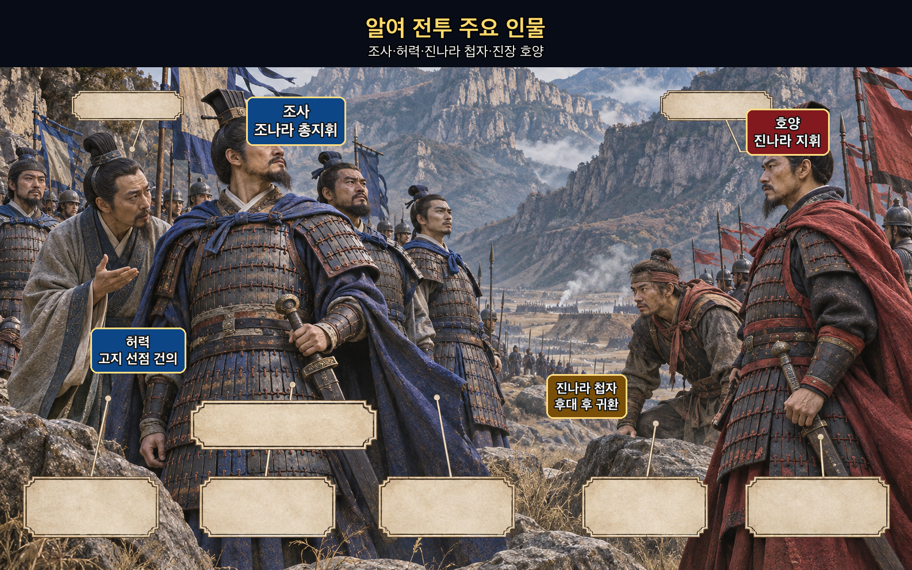

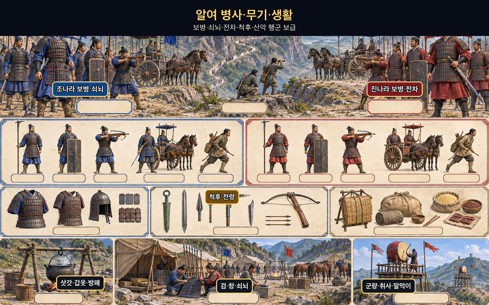

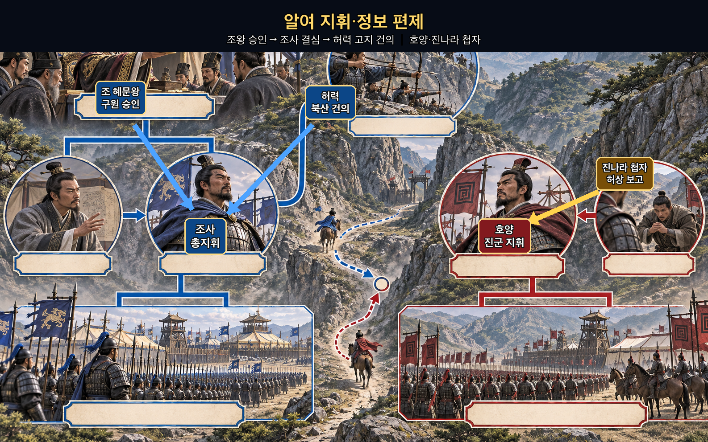

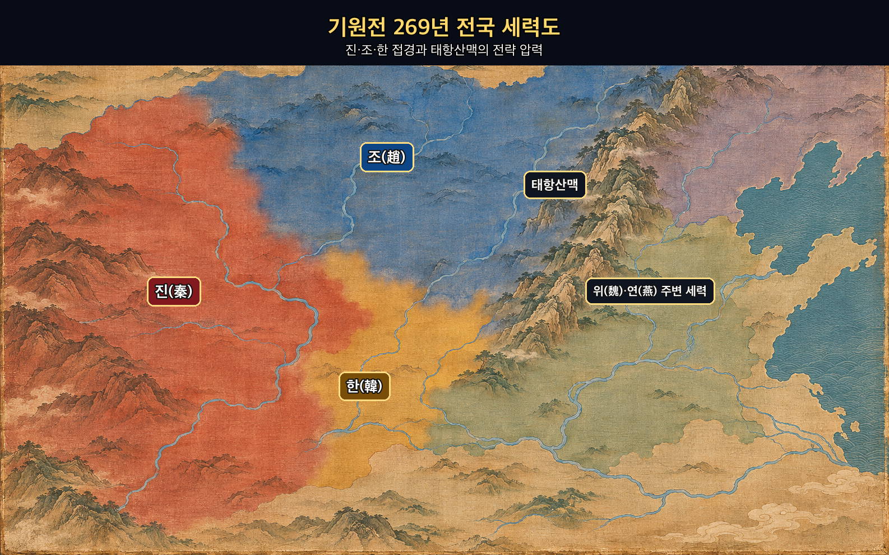

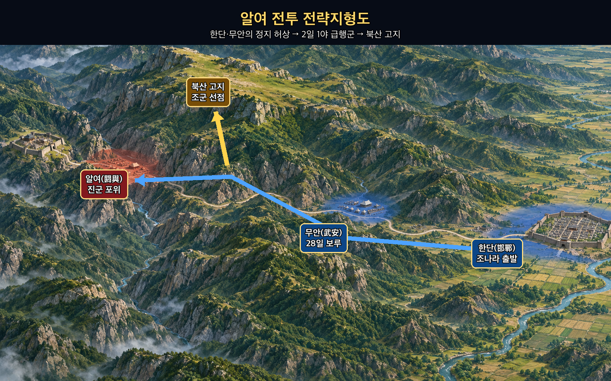

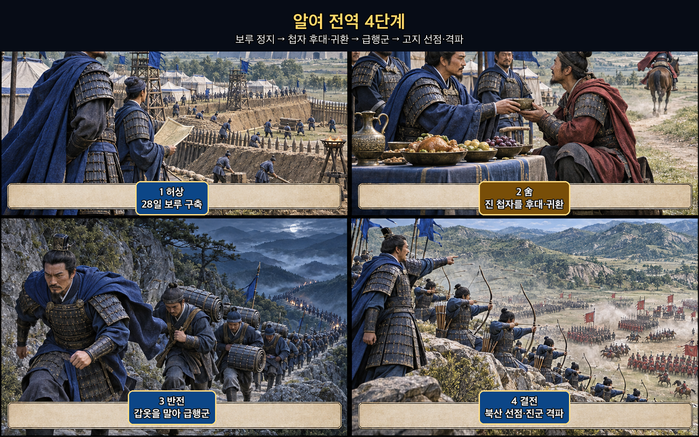

**뒤에서 반복될 지형을 먼저 잡아두기**

- **▰** **한단(邯鄲)**은 조나라의 출발점이다. 조사는 이곳에서 서쪽으로 겨우 30리쯤 나아간 곳에 장기 보루를 만들어 구원을 포기한 듯한 허상을 보였다.
- **▰** **무안(武安)**은 진군의 위세와 조군의 정지 연기가 맞부딪힌 중간 거점이다. 진나라 첩자가 본 조군의 모습은 이 구간의 정적이었다.
- ⛰️ **태항산맥(太行山脈)**의 좁고 험한 길은 대군 이동을 늦추지만, 조사가 갑옷을 말아 휴대하고 급행군했을 때에는 진군의 판단 갱신을 앞서는 시간 장벽이 됐다.
- **▰** **알여(閼與)**는 진나라가 포위한 목표였다. 조군이 늦으면 도시가 떨어지고, 너무 일찍 의도를 드러내면 진군이 산악 접근로를 막을 수 있었다.
- ⛰️ **북산 고지**는 허력이 먼저 차지하자고 건의한 결정적 지형이다. 조군 1만이 고지를 선점하면서 아래에서 접근한 진군의 전투 조건이 급격히 나빠졌다.

#### 상세 전역 서사 — 28일의 정지 허상을 2일 1야의 급행군으로 뒤집다

진나라가 알여를 포위하자 조정은 구원 가능성을 물었고, **조사(趙奢)**는 길이 멀고 좁아 “두 마리 쥐가 굴 안에서 싸우는 것”처럼 용감한 쪽이 이긴다고 판단했다. 출정한 조사는 **▰** **한단(邯鄲)**에서 멀리 가지 않은 곳에 보루를 쌓고 28일 동안 움직이지 않았다. 무안을 구하자고 말한 군사를 군령으로 처형할 만큼 정지 연기를 흔들지 않았다.

그때 진나라 첩자가 조군 진영에 들어왔다. 『사기』는 `秦間來入, 趙奢善食而遣之`(진간래입, 조사선식이견지 — 진나라 첩자가 들어오자 조사가 잘 먹여 돌려보냈다)라고 기록한다. 첩자는 조군 진지를 보고 돌아가 진장에게 보고했고, 진군은 조사가 알여 구원에 나서지 않을 것이라 기뻐했다. 조사는 첩자를 보낸 직후 행동을 반대로 바꿨다. 갑옷을 말아 휴대하게 하고 2일 1야 급행군으로 알여 50리 지점까지 접근해 진지를 완성했다.

허력은 북산을 먼저 차지하는 쪽이 이긴다고 건의했다. 조사는 그를 군정에 앉혀 건의를 받아들이고 군사 1만을 고지로 보냈다. 뒤늦게 도착한 진군은 고지를 다투려 했지만 이미 위에서 내려다보는 조군의 화력과 돌격을 감당하지 못했다. 이 승리는 첩자에게 거짓말 한마디를 시킨 결과가 아니라 **정지 허상·귀환·급행군·고지 선점이 시간순으로 맞물린 결과**였다.

#### 전투에서 사용된 속임수 — 후대한 첩자가 스스로 정지 허상을 보고하게 하다

속인 주체는 **조사**, 속은 상대는 **진나라 지휘부**였다. 실제 의도는 알여 구원이었지만, 조사는 장기 보루와 엄격한 군령으로 움직이지 않을 신호를 보였다. 진나라 첩자는 조작된 문서가 아니라 실제로 본 장면을 보고했기 때문에 그 정보가 더 설득력 있었다. 첩자의 귀환은 진군의 경계를 낮췄고, 그 직후 조군은 속도를 뒤집어 알여 근처까지 먼저 도착했다.

#### 속임수 작동 구조

**주체와 의도.** 조사는 진군의 감시를 끊지 않고, 감시자가 보고할 장면을 설계해 알여 접근의 시간창을 얻으려 했다.

**보인 신호와 믿은 이유.** 28일 보루, 움직임 금지, 무안 구원을 말한 군사에 대한 처벌은 조군이 단기간에 서진하지 않을 것처럼 보였다. 첩자가 직접 관찰했기 때문에 진군은 보고를 믿기 쉬웠다.

**유발된 행동과 결과.** 진군은 조군의 접근을 늦게 인지했고, 조사는 2일 1야 급행군과 북산 선점으로 기만의 시간 이익을 지형 우위로 바꿨다.

**사료의 경계.** 『사기』는 진나라 첩자를 후대해 돌려보낸 사실과 뒤이은 급행군을 전하지만, 첩자의 이름·구체적 보고 문안·진장 내부 회의는 전하지 않는다. 이를 꾸며내지 않는다.

#### 속임수 일곱 질문

1. **누가 누구를 속였는가?** 조사가 진나라 첩자의 관찰을 이용해 진나라 지휘부를 속였다.
2. **어떤 사실이 거짓이었는가?** 조군이 알여 구원을 포기하거나 장기간 움직이지 않을 것이라는 결론이 거짓이었다.
3. **어떤 사실은 진실이지만 오해를 유도했는가?** 조군이 실제로 28일 보루를 쌓고 정지해 있었다는 사실은 진실이었지만, 다음 행동까지 정지일 것이라는 오해를 유도했다.
4. **상대는 왜 그것을 믿고 싶어 했는가?** ⛰️ **태항산맥(太行山脈)**의 험로와 긴 거리는 구원이 어렵다는 기존 기대를 뒷받침했다.
5. **속임수가 없었어도 같은 오판이 발생했을까?** 가능성은 중간 정도다. 지형과 거리는 원래 조군의 지연을 예상하게 했지만, 첩자의 직접 관찰이 확신을 크게 높였다.
6. **속은 사람은 어떤 독립 확인을 생략했는가?** 진군은 첩자 귀환 뒤 조군의 실제 이동을 연속 정찰하고 산악 길목을 조기에 차단하지 못했다.
7. **신뢰·동의·안전을 해치지 않으면서 같은 원리를 어디서 연습할 수 있는가?** 체스·바둑에서 한쪽 의도를 오래 보인 뒤 상대 반응을 확인하고 다른 축으로 전환하는 훈련, 또는 합법적 보안 모의훈련에서 관찰 가능한 신호와 실제 대응을 분리하는 연습이 적절하다.

#### 시계편 兵者詭道也 — 이 전장에 해당하는 속이는 길

<table fit-page-width="true" header-row="true">
<tr><td>해당 구절·독음·뜻</td><td>전장의 장면</td></tr>
<tr><td>近而示之遠 근이시지원 — 가까이 가면서도 멀리 있는 듯 보인다</td><td>조사는 구원 목표를 유지하면서도 한단 근처 보루에 오래 머물러 알여에 접근하지 않을 듯 보였다.</td></tr>
<tr><td>欲戰而示之不欲戰 욕전이시지불욕전 — 싸우려 하면서 싸우지 않으려는 듯 보인다</td><td>28일 정지와 군령은 구원전 의지가 없는 듯한 신호가 됐고, 첩자 귀환 직후 급행군으로 뒤집혔다.</td></tr>
</table>

#### 法 한눈 비교 — 곡제·관도·주용

<table fit-page-width="true" header-row="true">
<tr><td>진영</td><td>곡제(편제)</td><td>관도(지휘)</td><td>주용(보급·지속)</td></tr>
<tr><td>**조나라**</td><td>주력과 북산 선점군을 분리·결합했다.</td><td>조사가 군령을 통제하고 허력의 건의를 즉시 채택했다.</td><td>장기 보루 뒤 경량 급행군으로 지속 방식을 바꿨다.</td></tr>
<tr><td>**진나라**</td><td>알여 포위군과 정찰을 운용했다.</td><td>첩자 보고를 받아 조군의 의도를 판단했다.</td><td>먼 산악 전장에서 고지 경쟁과 증원 속도가 늦었다.</td></tr>
</table>

#### 호양·진군(패군)

<table fit-page-width="true" header-row="true">
<tr><td>요소</td><td>판단</td></tr>
<tr><td color="orange_bg">🤝 **道**</td><td>알여 포위 목표에는 결속했지만 조군 출현 뒤 고지 경쟁에서 주도권을 잃었다. (지기·사기)</td></tr>
<tr><td color="blue_bg">🌤️ **天**</td><td>첩자가 본 28일의 정지를 미래 행동의 확실한 표본으로 일반화해 급행군 가능성을 낮게 보았다. (지피·확률 관점)</td></tr>
<tr><td color="green_bg">🧭 **地**</td><td>⛰️ **태항산맥(太行山脈)**의 험로를 조군의 장애로만 보고 북산 고지가 자기 쪽 병목이 될 가능성을 놓쳤다. (험이·사생)</td></tr>
<tr><td color="purple_bg">🎖️ **將**</td><td>직접 관찰 보고를 신뢰했지만 보고 이후의 변화 가능성을 탐색하는 지혜와 엄격한 연속 정찰이 부족했다. (지신인용엄)</td></tr>
<tr><td color="yellow_bg">⚙️ **法**</td><td>포위군·정찰·고지 선점의 결합이 늦어 조군의 급행과 분견대 운용에 뒤졌다. (곡제·관도·주용)</td></tr>
</table>

**직관·편향 한 줄:** 진군이 첩자가 직접 본 28일의 정지를 ‘앞으로도 움직이지 않을 것’의 대표 표본으로 받아들인 판단에는 대표성 휴리스틱이 작동한 것으로 볼 수 있고, 그 결과 급행군이라는 대안 시나리오의 확률을 과소평가했다.

🏳️ **패군 측 결과** — 고지를 빼앗기고 크게 패했다. `北(배, 적정을 헤아리지 못하고 약한 조건으로 강한 조건을 맞아 패함)`에 가깝다. 🔀 **패군 측 회피 분기점**은 첩자 보고을 결론이 아니라 한 시점의 관찰로 취급하고, 귀환 직후 산악 길목과 북산에 연속 정찰·선점대를 보내는 것이었다.

#### 조사·조군(승군)

<table fit-page-width="true" header-row="true">
<tr><td>요소</td><td>판단</td></tr>
<tr><td color="orange_bg">🤝 **道**</td><td>28일 정지와 급행군이라는 상반된 명령을 같은 구원 목표 아래 집행했고, 허력의 건의를 포상·채택했다. (지기·사기)</td></tr>
<tr><td color="blue_bg">🌤️ **天**</td><td>첩자의 귀환 뒤 진군의 경계가 낮아질 가능성을 이용했지만 승리를 기만만으로 단정하지 않고 고지 선점으로 확률을 높였다. (지피·타이밍·확률 관점)</td></tr>
<tr><td color="green_bg">🧭 **地**</td><td>⛰️ **태항산맥(太行山脈)**의 험로를 경량 급행군으로 통과하고 북산을 먼저 차지했다. (원근·험이·사생)</td></tr>
<tr><td color="purple_bg">🎖️ **將**</td><td>정지 연기를 유지하는 엄격함, 첩자를 후대하는 통제, 허력의 건의를 받아들이는 지혜가 결합됐다. (지신인용엄)</td></tr>
<tr><td color="yellow_bg">⚙️ **法**</td><td>보루군을 급행군으로 전환하고 1만 선점대를 분리해 주력과 고지군을 결합했다. (곡제·관도·주용)</td></tr>
</table>

🏆 **승군 측 결과** — `識衆寡之用者勝(식중과지용자승, 대군과 소수 병력을 각각 쓸 줄 아는 자가 이긴다)`와 `以虞待不虞者勝(이우대불우자승, 대비한 채 대비 없는 적을 상대하는 자가 이긴다)`에 해당한다.

##### 法을 압축하지 않고 보기 — 곡제·관도·주용

**곡제 曲制(곡제): 부대를 어떻게 나누고 결합했는가**
<table fit-page-width="true" header-row="true">
<tr><td>진영</td><td>실제 운용</td></tr>
<tr><td>**조나라**</td><td>주력의 급행군과 북산 선점군 1만을 분리해 시간과 고도를 함께 확보했다.</td></tr>
<tr><td>**진나라**</td><td>알여 포위군을 유지했지만 북산 선점과 조군 차단을 위한 분견 대응이 늦었다.</td></tr>
</table>

**관도 官道(관도): 누가 명령하고 어떻게 전달했는가**
<table fit-page-width="true" header-row="true">
<tr><td>진영</td><td>실제 운용</td></tr>
<tr><td>**조나라**</td><td>조사가 군령을 집중 통제하되 허력의 현장 건의를 받아 군정으로 임명하고 즉시 실행했다.</td></tr>
<tr><td>**진나라**</td><td>첩자의 보고가 지휘부 판단으로 이어졌으나 보고 이후 조군 이동을 갱신하는 정찰선이 부족했다.</td></tr>
</table>

**주용 主用(주용): 군량·장비·전투 지속 능력을 어떻게 썼는가**
<table fit-page-width="true" header-row="true">
<tr><td>진영</td><td>실제 운용</td></tr>
<tr><td>**조나라**</td><td>28일 보루에 필요한 군량을 유지한 뒤 갑옷을 말아 휴대하는 경량화로 2일 1야 급행군을 가능하게 했다. 세부 비용은 사료상 불명이다.</td></tr>
<tr><td>**진나라**</td><td>알여 포위를 지속할 군량과 진지를 갖췄으나 산악 원거리에서 고지 경쟁과 조군 급행에 대응할 여유가 줄었다. 세부 수량은 사료상 불명이다.</td></tr>
</table>

#### 참고자료

- [『사기』 「염파·인상여열전」 원문 — 진나라 첩자 후대·귀환과 급행군](https://www.shidianguji.com/zh/mid-page/7488828832285343781)
- [중국철학서전자화계획 — 『사기집해』](https://ctext.org/wiki.pl?chapter=100450&if=gb)
- [홍콩수인대학교 연구 — 『사기』 전쟁 서술과 『손자병법』](https://chinese.hksyu.edu/chinese/Sharing/%E8%91%89%E5%85%86%E8%81%B0%20%20%20%E3%80%8A%E3%80%88%E5%8F%B2%E8%A8%98%E3%80%89%E6%95%98%E6%88%B0%E8%88%87%E3%80%88%E5%AD%AB%E5%AD%90%E5%85%B5%E6%B3%95%E3%80%89%E3%80%8B.pdf)

---
## 5. 핵심 통찰 + 실생활 적용 + 생활루틴

### 핵심 통찰

이 구절의 날카로운 점은 적의 침투를 실패로만 보지 않는 데 있다. 적이 사람을 보냈다는 사실은 우리 정보가 새고 있다는 위험인 동시에, 적이 무엇을 모르는지·무엇을 알고 싶어 하는지·어떤 통로를 믿는지를 드러내는 관측 신호다. 잘 막는 조직은 문을 닫지만, 더 깊이 보는 조직은 문을 두드린 질문의 방향까지 읽는다.

그렇다고 모든 의심스러운 접근을 반간 기회로 삼아서는 안 된다. 손자가 `索 → 因利 → 導 → 舍 → 得而用`의 순서를 둔 까닭은 통제되지 않은 역이용이 더 큰 침투가 될 수 있기 때문이다. 핵심은 상대를 속이는 재주가 아니라 **출처의 동기, 전달 범위, 되먹임, 독립 검증을 한 묶음으로 관리하는 능력**이다.

생활에서는 누군가의 말을 “우리 편인가, 적인가”로 나누는 대신, 그 말이 어떤 통로를 타고 왔고 무엇을 얻으려 하며 내가 반응하면 어떤 정보가 되돌아가는지를 살피는 판단법으로 바꿀 수 있다. 특히 소문·메신저 전달·교대 인수인계·상급자 질문은 내용만큼 전달 구조가 중요하다. 내가 즉시 흥분해 해명하면 사실보다 더 많은 의도·약점·내부 사정을 상대에게 줄 수 있다.

### 실생활 적용

근무 중 다른 조나 오피스에서 “누가 그랬느냐”, “왜 그렇게 했느냐”는 질문이 갑자기 들어오면 먼저 질문자의 권한과 업무 목적을 확인한다. 바로 사람 이름과 내부 사정을 늘어놓지 말고, 직접 확인한 사실·전해 들은 말·추정을 나눠 답한다. 필요한 정보는 공식 채널과 조장 입회 아래 공유하고, 질문과 답변의 시각을 기록한다. 이것이 현대 생활에서 `索`과 `導`를 안전하게 바꾸는 방법이다.

인물사건관찰시리즈의 B조 조장 이씨 충돌에서는 사용자가 처음에 “우리 조의 운용이고 조장 지시이니 문제라면 조장에게 말하라”고 답한 부분이 중요하다. 그 답은 개인이 모든 내부 맥락을 즉석에서 방어하지 않고 지시권자와 공식 경로로 질문을 되돌렸다. 이후 인신공격에 맞서 기세 싸움으로 넘어가면서 정보 확인과 경계 설정이 섞였으므로, 다음에는 “업무 질문에는 관리자 입회하에 답하겠다. 인신공격은 중단하라”는 두 문장을 분리하는 편이 낫다.

전씨나 신입 최씨의 행동을 다른 사람이 물을 때도 같은 원칙이 필요하다. “원래 그런 사람”이라는 성격 결론을 전달하면 생생한 사례 하나가 전체 인물 평가로 번지고, 그 말이 어떤 맥락으로 재전달될지 통제할 수 없다. 대신 `몇 시 / 어떤 에러 / 누가 어떤 지시를 받음 / 확인된 행동 / 즉시 결과 / 아직 모르는 부분`만 적는다. 상대가 이 기록을 보고 무엇을 묻는지 관찰하면, 실제로 필요한 것이 안전 조치인지 책임 전가인지도 더 분명해진다.

개인적인 관계에서도 제3자가 전한 말을 곧바로 당사자의 의도로 확정하지 않는다. “그 사람이 네 이야기를 이렇게 했다”는 말은 전달자가 관계에서 이익을 얻거나 갈등을 키우려는 통로일 수 있고, 단순한 오해일 수도 있다. 당사자에게 공개적이고 비난 없는 방식으로 사실을 확인하되, 전달자의 사적 정보를 퍼뜨리거나 함정을 만들지 않는다. 목적은 반간 흉내가 아니라 **소문이 나의 감정과 행동을 지휘하지 못하게 출처를 분리하는 것**이다.

사용자의 카너먼 메모를 적용하면, 가장 충격적인 한 문장보다 분모를 먼저 적어야 한다. `최근 한 달 전체 교대 횟수 / 문제 보고 횟수 / 직접 본 횟수 / 전언만 있는 횟수 / 반대 사례`를 함께 보면 가용성 편향이 줄어든다. 그리고 “고의로 떠본다” 하나에만 몰입하지 말고, 정상 업무 확인·잘못 전달된 지시·책임 회피·개인적 감정·실제 보안 문제 같은 대안 가설을 두어야 한다.

### 생활루틴 추천

**상대가 보낸 말을 그대로 믿고 움직이면 재수가 없다.**

**이유:** 교대나 갈등 상황에서 전달자의 말 한마디를 즉시 사실로 받아들이면 감정이 먼저 움직이고, 해명하거나 반격하는 과정에서 필요 이상의 내부 사정과 약점을 드러낸다. 그 말이 잘못 전해졌거나 특정 반응을 끌어내려는 질문이었다면, 첫 반응이 다시 상대에게 전달되어 더 큰 오해·책임 공방·관계 악화로 이어진다. 오늘은 중요한 전언을 들을 때 3분 안에 `직접 본 사실 / 전달자의 해석 / 아직 확인하지 못한 부분 / 공식 확인할 사람` 네 줄을 적고 행동하라. 이는 적의 통로를 먼저 `索`하고, 무엇을 되돌려 보낼지 `導`한 뒤 움직이라는 이번 구절의 생활형 안전장치다.
