<!-- sunzi-analysis-mode: light -->
> 인시이지지, 고향간, 내간가득이사야. — 한 사람의 말만 믿고 현장과 내부 사정을 단정하면 재수가 없다.

---
## 1. 원문 + 독음 + 직역 + 한자어 뜻풀이

因是而知之, 故鄕間, 內間可得而使也. 인시이지지, 고향간, 내간가득이사야.

**직역**
이로 말미암아 그것을 알게 된다. 그러므로 향간과 내간을 얻어 부릴 수 있다.

앞 구절에서 손자는 적이 보낸 간첩을 찾아 이롭게 대우하고 돌려보내 `反間`(반간)으로 쓰라고 했다. 이번 문장은 그 조치가 왜 다른 정보망까지 여는지를 설명한다. 적의 정보망 안팎을 드나드는 반간에게서 **누가 지역 사정을 알고, 누가 관부 안에서 실제 결정을 움직이는지**를 알아낸 뒤에야 향간과 내간을 찾아 쓸 수 있다는 인과다.

핵심은 사람을 많이 모으는 데 있지 않다. 먼저 하나의 검증된 연결점에서 적지의 관계망을 파악하고, 접근 가능한 사람과 실제로 가치 있는 사람을 구분한 다음, 서로 다른 위치의 보고를 맞춰 보는 일이다. `知`가 먼저이고 `得`과 `使`가 뒤다. 알지 못한 채 사람부터 쓰면 정보원이 아니라 소문과 유도에 끌려다니는 통로를 얻게 된다.

#### 因是(인시) — 앞에서 얻은 실마리를 다음 정보망의 출발점으로 삼다

`因`은 기대고 말미암는다는 뜻이다. 여기서 `是`는 막연한 “이것”이 아니라 바로 앞 문장의 반간 운용을 받는다. 적의 간첩을 붙잡아 이익으로 이끌고 다시 놓아보낸 과정에서, 적의 수집 목표·연락선·보고 습관을 알게 된다는 연결이다.

이 두 글자는 정보 수집이 백지에서 무작정 시작되지 않음을 보여 준다. 이미 확인한 관계와 행태를 발판으로 다음 질문을 좁힌다. 그렇다고 반간 한 사람의 말을 곧바로 사실로 확정하라는 뜻은 아니다. 그 사람이 가리킨 지역민과 관리에게서 독립된 보고를 얻고 서로 맞지 않는 부분을 다시 묻는 순간에만 `因`은 연쇄 검증이 된다.

#### 知(알 지) — 이름을 듣는 데서 멈추지 않고 관계와 접근성을 분별하다

`知`는 이 문장에서 단순한 소문이나 인명 목록이 아니다. 누가 무엇을 직접 보았는지, 어떤 직위와 생활권 때문에 그 정보에 접근할 수 있는지, 어떤 동기와 위험을 안고 말하는지를 분별하는 앎이다. 향간과 내간을 쓸 수 있게 만드는 앎이므로, 사람과 정보의 출처를 함께 알아야 한다.

같은 이야기를 여러 사람이 되풀이해도 모두 한 원출처를 옮긴 것이라면 증거는 하나다. 반대로 지역민의 생활 관찰, 관리의 행정 기록, 다른 경로의 물자 변화가 서로 맞아떨어지면 정보의 강도가 올라간다. `知`는 많이 들었다는 느낌이 아니라 **출처의 독립성과 접근 경로를 설명할 수 있는 상태**다.

#### 鄕間(향간) — 지역의 일상과 변화를 몸으로 아는 눈

`鄕`은 마을과 지역 공동체를 가리킨다. 향간은 적국의 평범한 사람을 아무나 포섭한다는 뜻이 아니라, 그 고장의 길·물자·민심·주둔 변화처럼 외부인이 놓치기 쉬운 사실을 생활 속에서 아는 사람을 활용하는 방식이다. 지도에 없는 샛길, 평소와 달라진 징발, 시장의 물가와 이동 같은 정보가 그들의 시야에 들어온다.

그러나 현지성은 정확성과 같지 않다. 한 마을에서 본 변화가 적국 전체의 계획을 뜻하지 않을 수 있고, 소문이나 이해관계가 보고를 물들일 수도 있다. 향간의 강점은 가까이서 보는 데 있으며, 약점은 가까운 장면을 전체로 확대하기 쉽다는 데 있다. 그래서 다른 지역·다른 직무·내간의 정보와 교차해야 한다.

#### 內間(내간) — 관부 안에서 명령과 자원의 흐름을 보는 눈

`內`는 적의 제도와 관부 안쪽을 뜻한다. 내간은 관리·실무자처럼 문서, 인사, 군량, 명령 전달 과정에 접근하는 사람을 이용한다. 향간이 바깥에서 나타난 징후를 본다면, 내간은 그 징후가 어떤 결정에서 나왔는지와 다음 조치가 무엇인지를 볼 가능성이 있다.

직위가 높다고 언제나 좋은 내간은 아니다. 명목상 고위자라도 실제 문서와 실행에서 멀 수 있고, 낮은 직위의 실무자가 이동 명령과 보급 변화를 더 먼저 볼 수도 있다. 중요한 것은 신분의 화려함이 아니라 **그 사람이 실제로 어떤 정보에 접근하며 무엇을 직접 확인했는가**다.

#### 得而使(득이사) — 사람을 확보한 뒤에도 관계·임무·한계를 관리하다

`得`은 얻고 확보함이며, `使`는 임무를 맡겨 부림이다. 두 글자 사이에는 신뢰 형성, 동기 확인, 안전, 보상, 연락, 보고 검증이 들어 있다. 사람을 만났다고 곧 정보원이 되는 것도 아니고, 한 번 정확한 정보를 줬다고 계속 믿을 수 있는 것도 아니다.

부린다는 말은 사람을 소모품처럼 다뤄도 된다는 뜻이 아니다. 강압과 무리한 요구는 보고를 왜곡하고 사람을 위험에 빠뜨리며 장기 정보망을 무너뜨린다. 임무는 실제 접근 범위 안에서 분명하게 주고, 모르는 것을 모른다고 말할 수 있게 하며, 약속한 보호와 대가를 지키는 것이 `使`를 지속 가능하게 만든다.

#### 글자들이 완성하는 한 장면

적의 간첩을 반간으로 돌려세운 뒤, 지휘자는 그 한 사람의 이야기에 취하지 않는다. `因是`로 적의 연락선과 관심사를 실마리 삼아, `知`로 누가 무엇을 볼 수 있는지 가려낸다. 그 다음 지역의 일상 변화를 보는 `鄕間`과 관부 안의 결정 흐름을 보는 `內間`을 각각 얻는다.

마지막 `得而使`는 그 사람들에게 서로 다른 임무를 맡기고 보고를 맞춰 보는 과정이다. **반간은 문을 열고, 향간은 바깥의 변화를 보고, 내간은 안쪽의 원인을 본다. 세 시야가 독립적으로 교차할 때 소문은 비로소 쓸 수 있는 지식이 된다.**

---
## 2. 전통 주석 기반 분석

- **조조(曹操)** — "반간에게서 적의 실정을 알아낸 뒤 향간과 내간을 구하라. **먼저 아는 길을 얻고 사람을 써라.**"
- **이전(李筌)** — "반간이 알려 준 인맥을 따라 지역민과 관리를 찾되, **한 사람의 말로 모두를 믿지 마라.**"
- **두목(杜牧)** — "반간을 얻으면 적국의 향리와 관부 사정을 알 수 있다. **누가 실제 사정을 아는지 가려 임무를 나누어라.**"
- **매요신(梅堯臣)** — "적의 간첩으로 적 내부의 사람을 알아낸 다음 써라. **바깥 소식과 안쪽 결정을 서로 맞춰 보아라.**"
- **장예(張預)** — "반간이 향간과 내간의 성명과 형편을 알려 주게 하라. **연결만 얻지 말고 접근할 정보까지 확인하라.**"
- **왕석(王晳)** — "이로써 안다는 말은 반간으로 말미암는다는 뜻이다. **실마리와 확정된 사실을 구분하라.**"
- **가림(賈林)** — "현지인은 지역의 일을 알고 관리는 내부의 일을 안다. **각자가 직접 볼 수 있는 것만 맡겨라.**"
- **두우(杜佑)** — "반간을 통해 향간과 내간을 얻되 후하게 대하고 보호하라. **사람을 얻고도 신뢰를 잃어 보고를 비틀지 마라.**"
- **진호(陳皞)** — "향간과 내간은 저절로 생기지 않는다. **적의 연락망을 아는 반간에서 차례로 넓혀 가라.**"

#### 리링의 고증과 현대적 독법

리링의 문헌학적 관점에서 `因是而知之`의 `是`는 앞 문장의 반간을 받는다. 그러므로 이 문장을 “어떤 정보를 알았으니 향간과 내간도 쓸 수 있다”는 일반론으로 떼면 연결 고리가 사라진다. **반간으로 적의 내부 사정과 사람 관계를 알게 됨 → 그 지식으로 향간과 내간을 얻어 씀**이라는 문장 구조가 먼저다.

`鄕間`과 `內間`은 오늘날의 직업명과 정확히 일치하지 않는다. 앞 구절의 정의대로 향간은 그 고장의 사람을, 내간은 적의 관인을 이용하는 관계적 분류다. 공개정보 수집가나 내부고발자 같은 현대 범주를 그대로 대입하기보다, 사람이 어느 사회적 위치에서 무엇에 접근하는지를 먼저 보아야 한다.

이 구절을 인간관계에서 약점을 캐는 처세술로 줄이는 것도 경계해야 한다. 고대 군사 문맥은 적국의 인적 정보망을 다룬다. 현대 일상에서 가져올 것은 비밀 포섭 기술이 아니라 **현장 관찰과 내부 기록을 구분하고, 출처의 접근성과 독립성을 확인하며, 불확실성을 표시하는 분석 습관**이다.

---
## 3. 교차 설명

### ① 손자병법 내 교차

앞의 `必索敵人之間來間我者, 因而利之, 導而舍之`(필색적인지간래간아자, 인이리지, 도이사지 — 나를 염탐하러 온 적의 간첩을 찾아 이롭게 하고 인도하여 놓아보낸다)는 이번 문장의 전제다. 반간은 단지 거짓 정보를 되돌려 보내는 도구가 아니다. 적이 무엇을 알고 싶어 하는지, 누구에게 보고하는지, 현지와 관부의 어느 사람에게 접근할 수 있는지를 보여 주는 **관계망의 입구**다.

뒤의 `五間之事, 君必知之, 知之必在於反間`(오간지사, 군필지지, 지지필재어반간 — 오간의 일은 군주가 반드시 알아야 하며, 그 앎은 반드시 반간에 달려 있다)은 이 인과를 다시 묶는다. 반간 하나가 다른 네 간첩을 자동으로 진실하게 만드는 것은 아니다. 반간은 후보와 경로를 알려 주고, 군주는 각각의 정보가 실제 관찰과 맞는지 검증해야 한다.

시계편의 `校之以計而索其情`(교지이계이색기정 — 계산으로 견주어 그 실정을 찾는다)도 같은 태도를 요구한다. 사람에게서 얻은 이야기는 도·천·지·장·법의 관찰 가능한 변화와 견주어야 한다. 정보원이 말한 병력 이동이 실제 보급·도로·명령 구조와 맞지 않는다면, 친밀함이나 직위보다 불일치를 먼저 조사해야 한다.

따라서 이번 구절은 “믿을 사람을 찾아라”보다 엄격하다. **서로 다른 위치에서 본 사실을 연결하되, 같은 원출처가 여러 입으로 반복되는 것을 독립 확인으로 착각하지 말라**는 정보 구조다. 향간의 생활 징후와 내간의 제도 정보를 반간의 관계 지식과 대조해야 비로소 `知`가 된다.

### ② 클라우제비츠 『전쟁론』

클라우제비츠는 전쟁에서 들어오는 정보 대부분이 불확실하거나 모순되며, 상당 부분이 거짓일 수 있다고 경고한다. 그의 `전쟁의 안개`는 정보가 아예 없다는 뜻만이 아니라, 여러 보고 가운데 어느 것을 행동 근거로 삼아야 하는지 판단하기 어렵다는 뜻이다. 향간과 내간을 얻는 것만으로 안개가 사라지지 않는 이유다.

손자는 그 불확실성 속에서 사람의 위치를 분해한다. 지역민은 현장의 징후를, 관인은 제도 내부의 결정을, 반간은 적 정보망의 관심과 연결을 본다. 클라우제비츠는 이런 수집의 성과도 지휘관의 판단과 실제 전투력으로 바뀌지 않으면 쓸모가 없다고 상기시킨다. 정보는 힘의 집중과 정치 목적을 돕는 수단이지 힘을 대신하는 마법이 아니다.

두 사람의 차이도 남는다. 손자는 적의 인적 관계망을 능동적으로 전환하고 결합하는 방법을 압축해 제시한다. 클라우제비츠는 보고의 불확실성과 마찰 때문에 정교한 계획이 현실에서 흔들리는 문제를 더 강조한다. 함께 읽으면 정보망을 넓히되, 보고가 틀릴 경우에도 버틸 예비·중단 조건·대체 계획을 갖추게 된다.

현대 조직에서는 내부자 한 명의 제보나 현장 한 곳의 관찰로 전체 원인을 확정하지 않는 태도로 이어진다. 보고가 중요할수록 그 사람이 실제로 본 범위, 다른 가능한 설명, 결정이 틀렸을 때의 비용을 함께 적어야 한다. 정보의 양보다 **오류를 흡수할 수 있는 판단 구조**가 전쟁의 마찰에 강하다.

### ③ 미야모토 무사시 『오륜서』

『오륜서』의 `観見二つの目付`(관견 두 눈매 — 넓게 꿰뚫어 보는 관과 가까이 살피는 견)는 향간과 내간의 시야를 함께 쓰는 법을 비춘다. 향간의 생활 관찰은 가까운 변화에 밝고, 내간의 행정 정보는 결정 구조를 더 넓게 보여 줄 수 있다. 하나만 보면 작은 징후를 과대평가하거나, 반대로 문서상의 계획만 보고 현장 실행을 놓친다.

무사시는 상대의 겉동작 한 곳에 눈이 붙잡히면 전체 리듬을 잃는다고 본다. 정보 분석도 같다. 극적인 내부 제보 하나에 매달리면 평범한 현장 징후를 버리고, 현장 소문만 좇으면 실제 명령권자의 의도를 상상으로 채운다. `因是而知之`는 한 실마리에서 시작하되 관과 견을 오가며 범위를 넓히라는 구조로 읽을 수 있다.

그러나 개인 검술의 시야 훈련과 국가의 인간정보 활동은 규모와 윤리가 다르다. 일상에서 이를 사람의 사생활이나 약점을 캐는 기술로 옮겨서는 안 된다. 동의된 업무 범위에서 현장 관찰과 공식 기록을 함께 보고, 개인에 대한 판단은 필요한 최소 범위에 한정해야 한다.

실천은 간단하다. 이상 징후를 발견하면 먼저 가까운 사실을 시각·장소·상태로 적고, 다음으로 더 넓은 절차·지시·이력과 연결한다. 둘이 맞지 않으면 어느 쪽을 억지로 버리지 말고, 관찰 오류·기록 지연·다른 원인이라는 경쟁 설명을 남겨 둔다.

### ④ 오자병법·육도삼략

『오자병법』은 사람을 쓰기 전에 그 능력과 성향을 살피고, 임무와 상벌을 분명히 해야 군이 움직인다고 본다. 이번 구절의 `得而使`도 사람을 확보했다는 사실과 제대로 부린다는 능력을 분리한다. 지역 사정을 아는 사람에게 관부의 비밀을 요구하거나, 실무 문서를 보는 사람에게 전 지역 민심을 단정하게 하면 임무와 접근성이 어긋난다.

오자의 엄정함은 보고자를 벌주는 엄격함이 아니다. 무엇을 관찰하고 어느 시각까지 어떻게 보고할지 명확히 하며, 모르는 것을 꾸며내지 않게 하는 규율이다. 예상과 다른 보고를 실패로 취급하면 사람은 지휘자의 기대를 맞추기 시작한다. 그러면 향간과 내간이 둘이어도 사실상 하나의 희망만 되풀이한다.

『육도』는 인재와 정보를 얻을 때 은밀함만큼 신의와 보상을 중시한다. 사람이 위험을 감수해 정보를 제공하는 관계에서는 약속을 지키지 않는 지휘자가 장기 정보망을 유지할 수 없다. `使`는 명령권이 아니라 관계 관리이며, 상대의 안전과 동기를 무시한 포섭은 적에게 다시 넘어갈 조건을 만든다.

현대 조직에서는 이 원리를 역할별 확인으로 바꿀 수 있다. 현장 작업자는 눈앞의 장비 상태를, 상황실은 경보와 시간 흐름을, 관리자는 지시와 자원 배분을 보고한다. 같은 질문을 모두에게 던지는 대신 각자의 접근 범위에 맞는 질문을 주고, 마지막에 사실·추정·미확인을 구분해 합친다.

### ⑤ 현대 심리학·군사학

NATO는 HUMINT를 대인 접촉과 인간 출처에서 얻는 정보 범주로 설명하며, 공개 면담에서 은밀한 방식까지 여러 방법을 포함한다고 밝힌다. 중요한 점은 “사람에게서 들었다”와 “검증된 정보”가 같지 않다는 것이다. 현대의 인간정보 체계는 수집·보고·평가·보호의 공통 기준을 교육하고 상호운용해야 하며, 이는 `得`보다 `使`가 더 긴 관리 과정임을 보여 준다. [NATO Allied Command Transformation, “NATO Centres of Excellence — Human Intelligence”](https://www.act.nato.int/article/nato-coes-humint/)

미 육군의 정보 발견 실험은 공개정보도 출처의 신뢰성·정보의 신빙성·품질을 따로 평가하고, 다른 출처나 정보 분야로 확인해야 한다고 설명한다. 같은 사건을 말하는 게시물이 많아도 원본 영상·정확한 장소·좁은 시간 범위 같은 독립 근거가 없으면 표적 판단에 충분하지 않을 수 있다. 향간과 내간의 보고도 **사람 수가 아니라 독립된 접근 경로와 교차 확인**으로 강해진다. [U.S. Army, “Intelligence Discovery Experiment”](https://www.lineofdeparture.army.mil/Journals/Military-Intelligence/MIPB-January-June-2024/Intelligence-Discovery-Experiment/)

CIA의 경쟁가설분석은 마음에 드는 설명 하나를 먼저 고른 뒤 지지 증거만 모으는 습관을 줄이기 위해 합리적인 대안들을 명시적으로 경쟁시키라고 권한다. 반간이 “이 관리가 협조할 것”이라고 말했을 때도 `실제 협조 의사 / 자기 이익을 위한 과장 / 적의 역공작 / 접근 능력 없음`을 함께 놓고, 각 설명과 어긋나는 증거를 찾아야 한다. [CIA Center for the Study of Intelligence, *Psychology of Intelligence Analysis*](https://www.cia.gov/resources/csi/books-monographs/psychology-of-intelligence-analysis-2/)

사용자의 「생각에대한 생각」 메모는 생생한 한 시나리오에 집중하면 그 확률을 과대평가하고, 분모를 무시하면 드문 사건이 실제보다 크게 느껴진다고 경고한다. 내부자 한 명의 극적인 제보는 평범한 반증 수십 개보다 기억에 남는다. 그래서 보고를 받을 때 `이 사람이 직접 본 범위는 전체 중 얼마인가 / 같은 결과를 만드는 다른 원인은 무엇인가 / 서로 독립된 확인은 몇 개인가`를 적어야 한다.

이 교차에는 한계가 있다. 정보원을 모집하고 운용하는 군사·정보기관의 활동은 법적 권한과 감독 아래 이루어지는 전문 영역이다. 일상에서 가져올 것은 사람을 몰래 포섭하는 방법이 아니라, **현장과 내부 기록을 구분하고, 출처의 접근성·동기·독립성을 확인하며, 결론의 확률과 미확인을 명시하는 습관**뿐이다.

---
## 4. 역사적 실증 사례

### 서양 — 🏛️ 미·프 연합군 vs 🏛️ 영국군 │ 요크타운 전역(Yorktown Campaign, 1781)

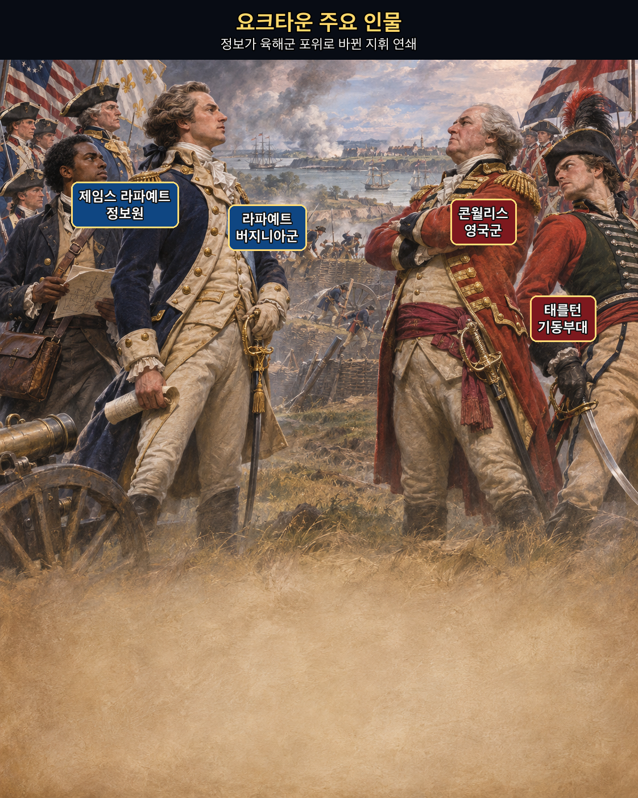
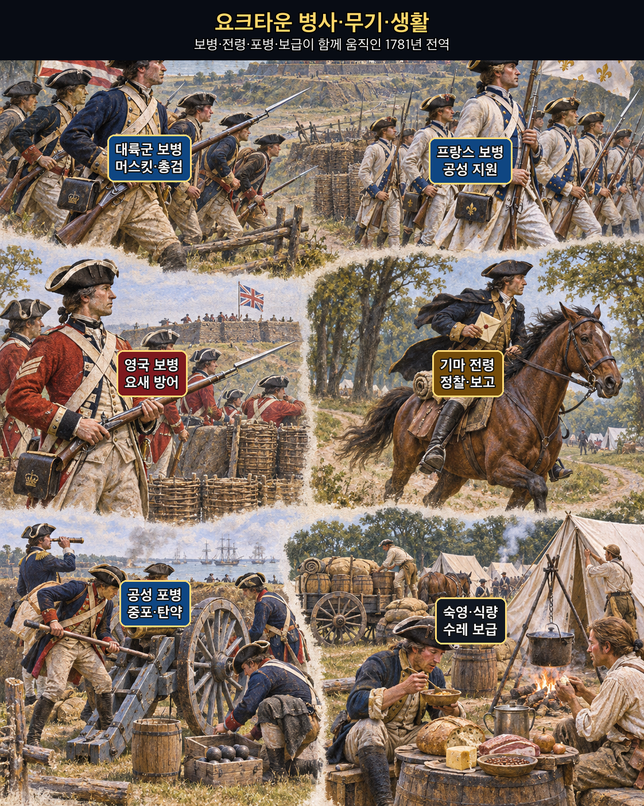
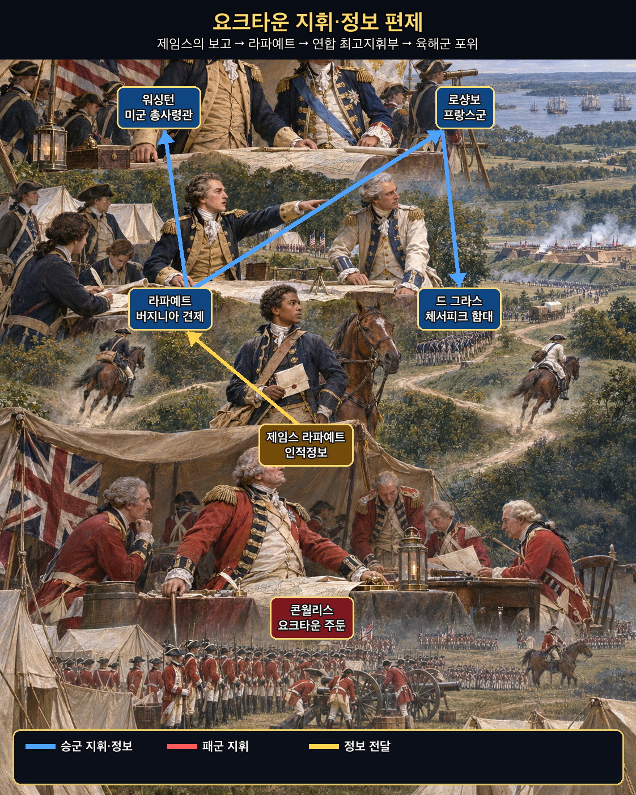
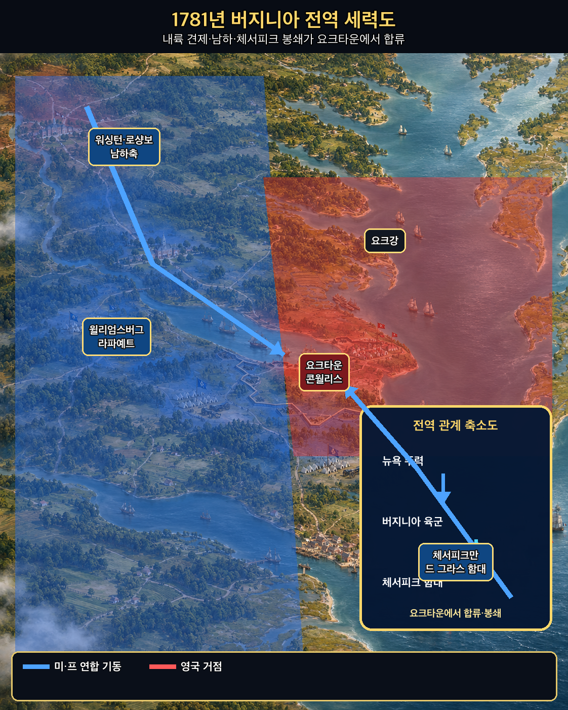
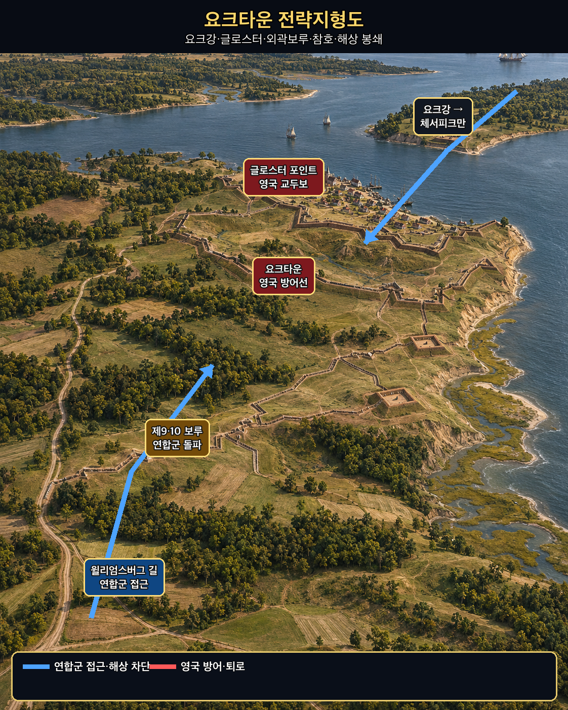
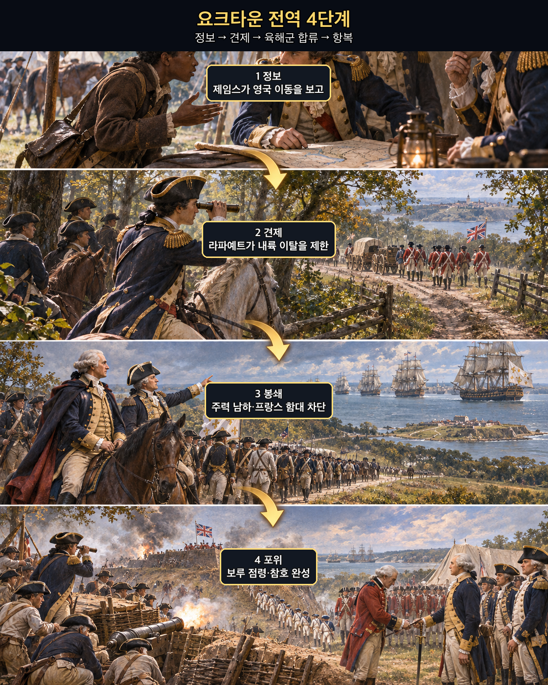

**뒤에서 반복될 지형을 먼저 잡아두기**

- **▰** **윌리엄스버그(Williamsburg)** — **라파예트**가 영국군을 추적하며 요크 반도로 몰아넣는 내륙 거점이었다.
- **▰** **요크타운(Yorktown)** — **콘월리스**가 항구와 해상 지원을 기대해 택한 방어 거점이다.
- 🌊 **요크강(York River)** — 요크타운과 글로스터 포인트 사이의 물길이며 해상 탈출과 보급의 축이었다.
- 🌊 **체서피크만(Chesapeake Bay)** — 프랑스 함대가 장악하면서 영국 구원함대와 해상 퇴로가 차단됐다.
- **▰** **글로스터 포인트(Gloucester Point)** — 영국군의 맞은편 교두보로, 폭풍 속 탈출 시도가 향한 곳이었다.
- **제9·10 보루(Redoubts 9 and 10)** — 연합군 참호 완성을 막던 외곽 거점으로, 점령 뒤 포위선이 닫혔다.

#### 상세 전역 서사 — 제임스의 보고를 라파예트가 봉쇄 판단으로, 연합 지휘부가 포위 작전으로 바꾸다

1781년 버지니아에서 **제임스 라파예트(James Lafayette)**는 노예 신분으로 **라파예트(Marquis de Lafayette)** 휘하의 정보 임무를 수행했다. 그는 영국 측에 미국군 정보를 제공할 사람처럼 접근하면서 **콘월리스(Charles Cornwallis)** 본부에서 들은 병력 이동과 의도를 미국 측에 전했다. **라파예트**의 8월 25일자 편지는 “전에 말한 이 하인을 통해 정보”를 얻었다고 워싱턴에게 보고한다. 다만 후대의 ‘한 사람이 요크타운 승리를 만들었다’는 서사는 경계해야 한다. 제임스의 보고는 정찰·포로 심문·해군 소식과 함께 쓰였고, 정확한 개별 보고의 전부는 남아 있지 않다.

#### 라파예트의 절제 — 보고를 받았지만 조급한 결전을 피하다

**콘월리스**가 요크타운에 주둔해 해상 지원을 기다리자 **라파예트**는 성급한 정면공격 대신 영국군을 감시하고 내륙 이탈을 제한했다. 이어 **워싱턴**과 **로샹보**가 뉴욕 앞 주력을 남쪽으로 돌렸고, 프랑스 함대가 체서피크만의 출입을 막았다. 정보가 ‘적이 어디 있다’는 지식으로 멈추지 않고 대륙군·프랑스군·함대의 시간표를 맞추는 명령으로 바뀐 것이다.

#### 체서피크 봉쇄와 참호 — 정보가 육해군의 같은 시간표가 되다

연합군은 외곽 보루를 점령해 제2평행참호를 완성했고, 해상 구원이 실패한 영국군은 10월 19일 항복했다. 승리는 제임스의 첩보만이 아니라 **라파예트**의 절제된 봉쇄, **워싱턴**·**로샹보**의 남하, 드 그라스 함대의 제해권, 공성 포병과 보급이 결합한 결과였다. 현지 지형을 아는 제임스의 시야와 영국 본부 안에서 들은 정보가 서로 다른 정찰·해군 보고와 맞물렸을 때, `鄕間`(향간, 고장의 사람을 이용한 정보)과 `內間`(내간, 적 내부 사람을 이용한 정보)이 실제 포위 결심으로 바뀌었다.

#### 정보의 작동 구조 — 출처를 존중하되 한 사람의 말로 전쟁 전체를 설명하지 않다

**주체와 정보.** **제임스**는 영국 지휘부에 접근해 병력 이동과 주둔 의도를 전했고, **라파예트**는 이를 상급 지휘부에 올렸다.

**검증과 결심.** 연합군은 그의 보고를 다른 정찰·해군 정보와 맞추며 영국군이 요크 반도에 묶일 시간창을 판단했다.

**삼군의 움직임.** 버지니아의 견제, 뉴욕 전선의 남하, 프랑스 함대의 해상 차단, 참호 공사가 하나의 포위로 이어졌다.

**사료의 경계.** 제임스의 공로는 라파예트의 증명서와 편지로 확인되지만, 특정 보고 하나가 승리를 ‘결정했다’고 단정할 수는 없다.

#### 法 한눈 비교 — 곡제·관도·주용

<table fit-page-width="true" header-row="true">
<tr>
<td>진영</td>
<td>곡제(편제)</td>
<td>관도(지휘)</td>
<td>주용(보급·지속)</td>
</tr>
<tr>
<td>
**연합군**
</td>
<td>대륙군·프랑스군·함대를 봉쇄와 공성에 결합했다.</td>
<td>제임스의 정보가 라파예트·워싱턴으로 올라가 육해군 결심과 연결됐다.</td>
<td>체서피크 해상로와 중포·참호 자재를 확보했다.</td>
</tr>
<tr>
<td>
**영국군**
</td>
<td>요크타운·글로스터에 분산돼 포위됐다.</td>
<td>클린턴의 구원 약속과 콘월리스의 현장 판단이 시간상 어긋났다.</td>
<td>해상 보급과 철수가 프랑스 함대에 막혔다.</td>
</tr>
</table>

##### **영국군(패군)**
<table fit-page-width="true" header-row="true">
<tr>
<td>요소</td>
<td>판단</td>
</tr>
<tr>
<td color="orange_bg">🤝 **道**</td>
<td>현장군과 뉴욕 총사령부의 목적·구원 시간표가 어긋났다. (지기·사기)</td>
</tr>
<tr>
<td color="blue_bg">🌤️ **天**</td>
<td>해상 우세와 적시 구원을 기대했지만 프랑스 함대와 연합군 남하 가능성을 낮게 보았다. (지피·타이밍·확률 관점)</td>
</tr>
<tr>
<td color="green_bg">🧭 **地**</td>
<td>두 물길 사이 반도 끝 거점은 항구가 열리면 유리했으나 봉쇄 뒤에는 퇴로가 좁아졌다. (광협·사생)</td>
</tr>
<tr>
<td color="purple_bg">🎖️ **將**</td>
<td>
**콘월리스**는 요새화했지만 육해군 연결이 끊긴 뒤의 탈출 조건을 충분히 확보하지 못했다. (지신인용엄)</td>
</tr>
<tr>
<td color="yellow_bg">⚙️ **法**</td>
<td>분산 주둔과 해상 의존이 공성 지속력의 약점이 됐다. (곡제·관도·주용)</td>
</tr>
</table>

**직관·편향 한 줄:** **콘월리스**가 영국 해군의 통상적 우세와 구원 약속을 기준점으로 삼은 판단에는 계획 오류가 작동했을 가능성이 있으며, 프랑스 함대가 만을 닫는 대안 시나리오의 가중치가 낮았다.

🏳️ **패군 측 결과**: 六敗(육패)의 `北(배, 적정을 충분히 헤아리지 못함)`에 가깝다. **회피 분기점:** 체서피크 봉쇄가 확정되기 전 포츠머스 방향으로 주력을 빼거나, 요크타운에 머문다면 글로스터 교두보와 수송선을 더 일찍 강화했으면 승리를 보장하지는 못해도 전군 항복 위험을 낮출 수 있었다.

##### **미·프 연합군(승군)**
<table fit-page-width="true" header-row="true">
<tr>
<td>요소</td>
<td>판단</td>
</tr>
<tr>
<td color="orange_bg">🤝 **道**</td>
<td>독립전쟁의 결정적 기회를 공동 목표로 묶고 미국·프랑스군을 결합했다. (지기·사기)</td>
</tr>
<tr>
<td color="blue_bg">🌤️ **天**</td>
<td>현장 정보와 함대 소식을 결합해 영국군이 반도에 묶이는 짧은 시간창을 활용했다. (지피·타이밍·확률 관점)</td>
</tr>
<tr>
<td color="green_bg">🧭 **地**</td>
<td>육상 포위와 체서피크 해상 차단을 연결해 반도를 위지로 만들었다. (원근·광협·사생)</td>
</tr>
<tr>
<td color="purple_bg">🎖️ **將**</td>
<td>
**라파예트**는 정보원을 쓰되 무리한 결전을 피했고, **워싱턴**과 **로샹보**는 전략축을 남쪽으로 전환했다. (지신인용엄)</td>
</tr>
<tr>
<td color="yellow_bg">⚙️ **法**</td>
<td>정찰·첩보·함대·중포·참호를 같은 시간표에 올렸다. (곡제·관도·주용)</td>
</tr>
</table>

🏆 **승군 측 결과**: 五勝(오승)의 `識衆寡之用者勝(식중과지용자승, 많고 적은 병력의 쓰임을 아는 자가 이김)`과 `以虞待不虞者勝(이우대불우자승, 대비한 채 대비 없는 적을 상대하는 자가 이김)`에 해당한다.

##### 法을 압축하지 않고 보기 — 곡제·관도·주용
**곡제 曲制(곡제): 부대를 어떻게 나누고 결합했는가**
<table fit-page-width="true" header-row="true">
<tr>
<td>진영</td>
<td>곡제 曲制(곡제)</td>
</tr>
<tr>
<td>
**승군**
</td>
<td>라파예트의 견제군, 워싱턴·로샹보 주력, 드 그라스 함대, 공성대를 기능별로 결합했다.</td>
</tr>
<tr>
<td>
**패군**
</td>
<td>요크타운과 글로스터의 주둔군이 육상 포위와 해상 봉쇄에 동시에 대응해야 했다.</td>
</tr>
</table>
**관도 官道(관도): 누가 명령하고 어떻게 전달했는가**
<table fit-page-width="true" header-row="true">
<tr>
<td>진영</td>
<td>관도 官道(관도)</td>
</tr>
<tr>
<td>
**승군**
</td>
<td>제임스→라파예트→워싱턴의 정보 경로와 미·프 지휘 협의가 작전으로 이어졌다.</td>
</tr>
<tr>
<td>
**패군**
</td>
<td>콘월리스와 클린턴 사이 서신·구원 시간표가 거리와 해상 상황 때문에 늦었다.</td>
</tr>
</table>
**주용 主用(주용): 군량·장비·전투 지속 능력을 어떻게 썼는가**
<table fit-page-width="true" header-row="true">
<tr>
<td>진영</td>
<td>주용 主用(주용)</td>
</tr>
<tr>
<td>
**승군**
</td>
<td>프랑스 함대의 수송·중포와 연합군 참호 자재가 공성을 지속시켰다.</td>
</tr>
<tr>
<td>
**패군**
</td>
<td>해상 보급이 끊기고 외곽 보루가 함락되면서 식량·탄약·수리·퇴로가 함께 압박받았다.</td>
</tr>
</table>

#### 참고자료
- [Lafayette College Archives — 1781년 8월 25일 라파예트 서신](https://www.lafayette.edu/bicentennial/2026/09/02/from-the-archives-letters-from-the-marquis-de-lafayette-to-gen-george-washington/)
- [National Park Service — James Lafayette](https://www.nps.gov/articles/000/james-lafayette-a-legacy-of-courage-and-espionage.htm)
- [Defense Intelligence Agency — Good intelligence led to victory at Yorktown](https://www.dia.mil/News-Features/Articles/Article-View/Article/566988/good-intelligence-led-to-victory-at-yorktown/)
- [Smithsonian — African Americans at Yorktown](https://americanhistory.si.edu/explore/exhibitions/american-revolution-world-war/online/yorktown/african-americans)

### 동양 — 🏛️ 당 조정군 vs 🏛️ 회서 절도사 세력 │ 이소의 설야입채주(李愬雪夜入蔡州, 817)

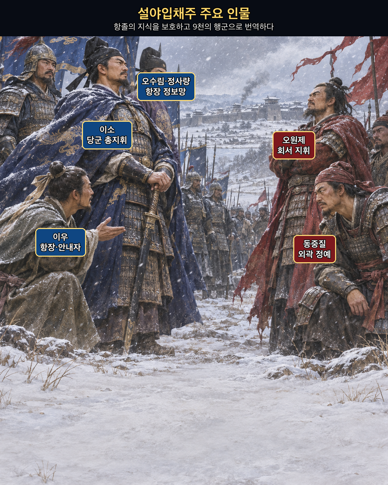
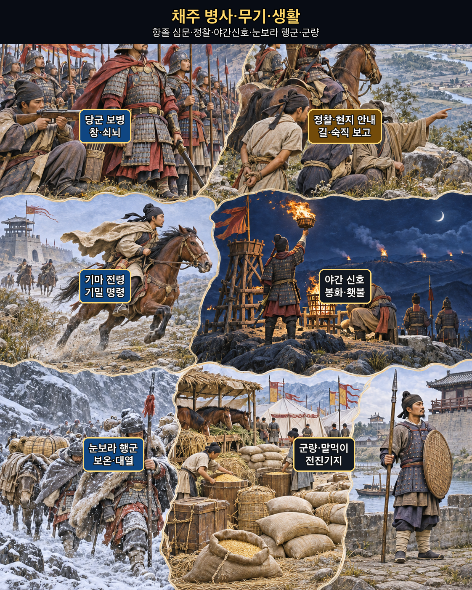
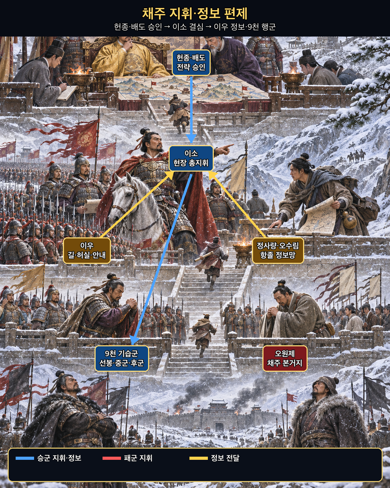
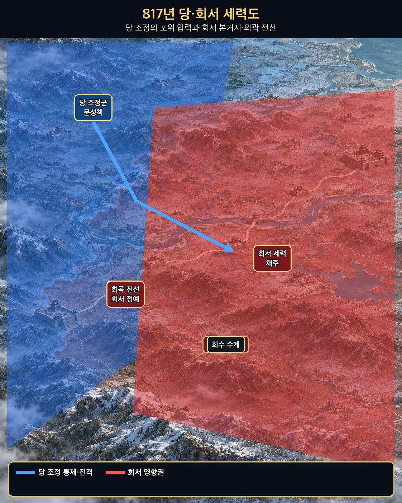
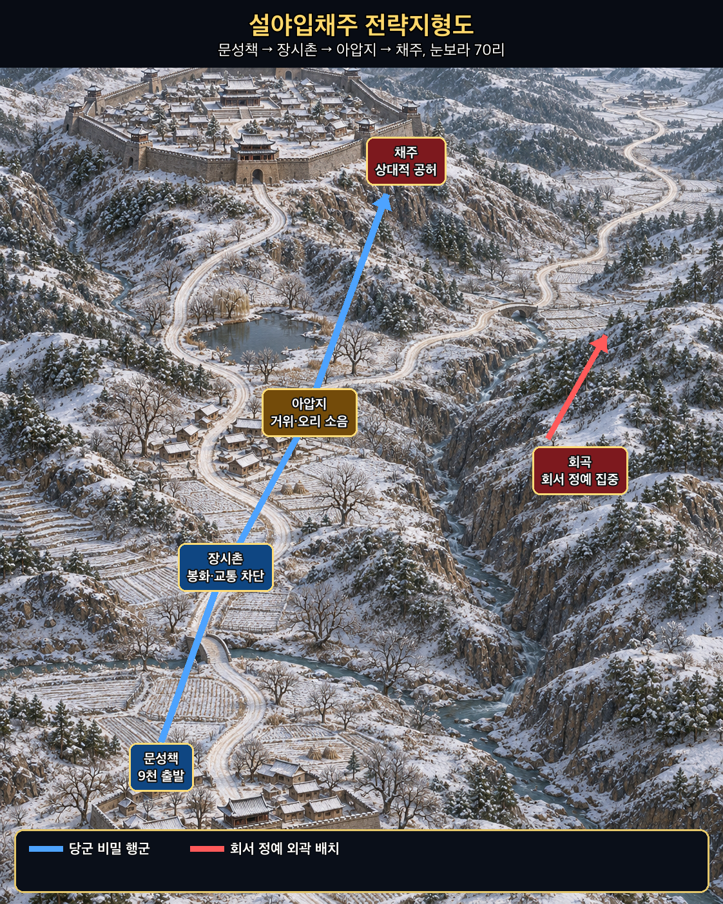
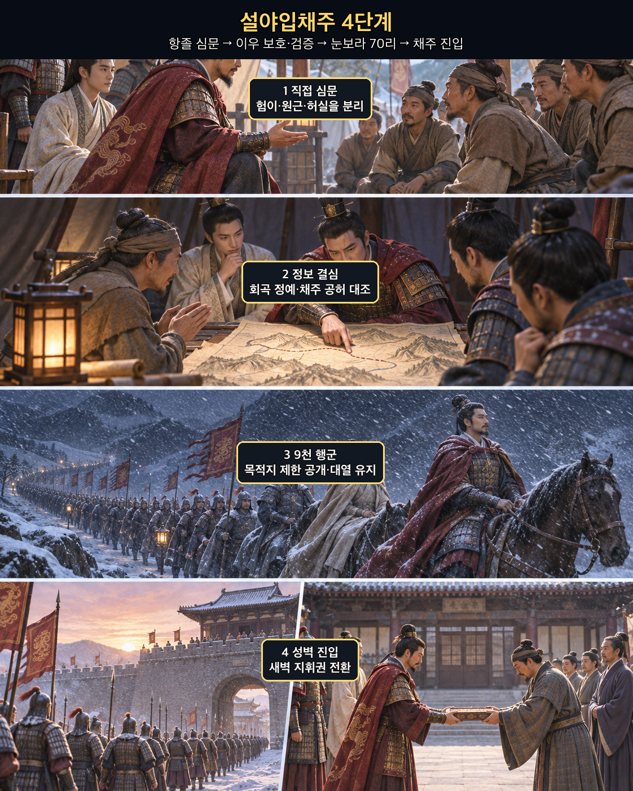

**뒤에서 반복될 지형을 먼저 잡아두기**

- **▰** **문성책(文城柵)** — **이소**가 9천을 출발시킨 전진기지다.
- **▰** **장시촌(張柴村)** — 야간행군의 첫 목표로 봉화와 교통을 끊고 병사를 쉬게 한 곳이다.
- **아압지(鵝鴨池)** — 성 가까이의 거위·오리 울음으로 행군 소음을 가렸다고 전하는 지점이다.
- **▰** **채주(蔡州)** — **오원제**의 본거지이지만 정예가 외곽에 집중된 틈이 있었다.
- **회곡(洄曲)** — 회서 정예가 당군과 대치하던 전선으로, 채주의 상대적 공허를 만들었다.
- **낭산(朗山)** — 채주 주변 작전축을 가르는 산지로, 기밀을 유지한 우회와 길 안내가 중요했다.

#### 상세 전역 서사 — 항졸의 말을 직접 묻고 이우의 지식을 9천 명의 눈보라 행군으로 바꾸다

『자치통감』 권240은 **이소(李愬)**가 항복한 병사를 얻을 때마다 직접 불러 사정을 묻고, 험하고 쉬운 길·멀고 가까움·적의 허실을 모두 알았다고 기록한다. 그는 **정사량**과 **오수림**을 포섭한 뒤 회서의 용장 **이우(李祐)**를 사로잡았다. 부하들이 죽이자고 했지만 이소는 살려 후대하고, 조정의 의심 속에서도 다시 데려와 핵심 계획에 참여시켰다.

#### 이우를 살린 판단 — 배신 전력보다 현재의 지식과 검증을 보다

**이우**는 회서 정예가 회곡과 사경에 몰려 있어 채주가 비었다는 내부 지식과 길을 제공했다. 이소는 이 말을 맹신하지 않고 연속된 항졸 심문과 전초 점령으로 주변 형세를 대조했다. 또한 첩자를 숨긴 집까지 처벌하던 명령을 거두고 적의 정보원을 후대해, 거짓 안도감과 정보 유입을 함께 만들었다.

#### 목적지를 감춘 70리 — 정보가 9천 명의 행군 규율이 되다

817년 음력 10월, 이소는 9천을 이끌고 문성책을 나섰다. 목적지는 지휘부 일부만 알았고, 장시촌을 거쳐 70리를 눈보라 속에 행군했다. 병사들이 목적지를 묻자 “동쪽으로 간다”는 정도만 전달됐다. 밤중에 채주 외곽에 도달한 당군은 경계가 느슨한 틈을 타 성벽을 넘었고, 다음 날 **오원제**를 붙잡았다.

이 승리를 ‘눈보라의 기적’으로만 읽으면 손자의 결론이 사라진다. 기상은 우연한 은폐를 제공했지만, 승리를 가능하게 한 것은 항졸을 정보원으로 바꾸는 처우, 이우의 높은 현지 지식, 여러 보고의 대조, 목적지 보안, 9천 명의 편제와 행군 통제였다. 항졸들의 지역 지식과 회서 지휘부 출신 이우의 내부 지식이 서로 검증되면서 `鄕間`(향간, 고장의 사람을 이용한 정보)과 `內間`(내간, 적 내부 사람을 이용한 정보)이 하나의 야간 행군로로 수렴한 사례다.

#### 정보의 작동 구조 — 포로를 소모품이 아니라 지형과 지휘를 읽는 전문가로 쓰다

**주체와 정보.** 정사량·오수림·이우는 회서 내부의 길·장수·배치·경계 습관을 제공했다.

**검증과 결심.** 이소는 항졸을 직접 심문하고 전초를 차례로 확보해 ‘채주 공허’ 판단을 누적했다.

**삼군의 움직임.** 9천을 기능별로 나눠 장시촌 차단, 야간행군, 성벽 진입, 성내 통제를 연속시켰다.

**사료의 경계.** 세부 숫자와 극적인 장면은 후대 편찬 사료에 의존하며, 이우 한 사람만으로 성공했다고 축소할 수 없다.

#### 法 한눈 비교 — 곡제·관도·주용
<table fit-page-width="true" header-row="true">
<tr>
<td>진영</td>
<td>곡제(편제)</td>
<td>관도(지휘)</td>
<td>주용(보급·지속)</td>
</tr>
<tr>
<td>
**당군**
</td>
<td>9천을 선봉·중군·후군과 안내·차단 임무로 묶었다.</td>
<td>목적지를 제한 공개하고 이우의 정보가 이소의 단일 결심으로 이어졌다.</td>
<td>짧은 기습을 위해 경량 행군하고 현지 거점을 연속 확보했다.</td>
</tr>
<tr>
<td>
**회서군**
</td>
<td>정예가 회곡 등 외곽 전선에 집중됐다.</td>
<td>항장 이탈과 채주 경계 정보가 본부에 충분히 반영되지 않았다.</td>
<td>본거지의 장기 방어 물자는 있었으나 기습 경보와 즉응 전력이 부족했다.</td>
</tr>
</table>

##### **회서군(패군)**
<table fit-page-width="true" header-row="true">
<tr>
<td>요소</td>
<td>판단</td>
</tr>
<tr>
<td color="orange_bg">🤝 **道**</td>
<td>연속된 항복과 포섭으로 내부 인재·정보·사기가 빠져나갔다. (지기·사기)</td>
</tr>
<tr>
<td color="blue_bg">🌤️ **天**</td>
<td>악천후에는 대규모 접근이 어렵다는 기대가 경계를 낮췄다. (지피·타이밍·확률 관점)</td>
</tr>
<tr>
<td color="green_bg">🧭 **地**</td>
<td>외곽 전선에 정예를 두면서 본거지로 이어지는 겨울 길과 성벽의 허실을 노출했다. (원근·험이·사생)</td>
</tr>
<tr>
<td color="purple_bg">🎖️ **將**</td>
<td>
**오원제**는 이우 등 이탈자의 지식이 당군 작전으로 전환될 위험을 막지 못했다. (지신인용엄)</td>
</tr>
<tr>
<td color="yellow_bg">⚙️ **法**</td>
<td>외곽 전투력과 본거지 경계·예비대가 분리됐다. (곡제·관도·주용)</td>
</tr>
</table>

**직관·편향 한 줄:** **오원제** 측이 눈보라와 당군의 이전 부진을 ‘오늘도 기습은 어렵다’는 대표적 장면으로 본 판단에는 정상성 편향과 가용성의 영향이 작동했을 가능성이 있다.

🏳️ **패군 측 결과**: 六敗(육패)의 `亂(란, 지휘·경계의 혼란)`과 `北(배, 적정을 헤아리지 못함)`이 겹쳤다. **회피 분기점:** 항장 이탈 직후 채주 성문의 암호·숙직·순찰로를 바꾸고 외곽 정예 일부를 예비대로 복귀시켰다면 승리를 보장하지는 못해도 본거지가 하룻밤에 무너지는 결과는 피할 가능성이 컸다.

##### **당 조정군(승군)**
<table fit-page-width="true" header-row="true">
<tr>
<td>요소</td>
<td>판단</td>
</tr>
<tr>
<td color="orange_bg">🤝 **道**</td>
<td>항졸을 죽이기보다 쓰고 보호해 정보와 전투력을 함께 얻었다. (지기·사기)</td>
</tr>
<tr>
<td color="blue_bg">🌤️ **天**</td>
<td>눈보라의 위험을 인정하면서도 적의 경계가 낮아질 시간창으로 바꿨다. (지피·타이밍·확률 관점)</td>
</tr>
<tr>
<td color="green_bg">🧭 **地**</td>
<td>현지 안내와 직접 심문으로 70리 겨울길·성벽·경계의 허실을 구체화했다. (원근·험이·광협)</td>
</tr>
<tr>
<td color="purple_bg">🎖️ **將**</td>
<td>
**이소**는 이우를 보호하고 반대 속에서도 책임졌으며 기밀과 행군을 통제했다. (지신인용엄)</td>
</tr>
<tr>
<td color="yellow_bg">⚙️ **法**</td>
<td>정보·안내·차단·행군·성내 통제를 9천의 임무로 번역했다. (곡제·관도·주용)</td>
</tr>
</table>

🏆 **승군 측 결과**: 五勝(오승)의 `上下同欲者勝(상하동욕자승, 상하가 뜻을 같이하면 이김)`, `以虞待不虞者勝(이우대불우자승, 대비한 채 대비 없는 적을 상대하면 이김)`, `將能而君不御者勝(장능이군불어자승, 장수가 유능하고 군주가 억누르지 않으면 이김)`에 해당한다.

##### 法을 압축하지 않고 보기 — 곡제·관도·주용
**곡제 曲制(곡제): 부대를 어떻게 나누고 결합했는가**
<table fit-page-width="true" header-row="true">
<tr>
<td>진영</td>
<td>곡제 曲制(곡제)</td>
</tr>
<tr>
<td>
**승군**
</td>
<td>선봉·중군·후군, 장시촌 차단, 이우의 안내, 성벽 진입대를 한 행군열에 결합했다.</td>
</tr>
<tr>
<td>
**패군**
</td>
<td>정예는 회곡 등 외곽에, 채주에는 상대적으로 약한 경계병이 남았다.</td>
</tr>
</table>
**관도 官道(관도): 누가 명령하고 어떻게 전달했는가**
<table fit-page-width="true" header-row="true">
<tr>
<td>진영</td>
<td>관도 官道(관도)</td>
</tr>
<tr>
<td>
**승군**
</td>
<td>헌종·배도의 승인 아래 이소가 현장 지휘권을 갖고, 이우의 정보와 길 안내를 제한된 참모선에서만 공유했다.</td>
</tr>
<tr>
<td>
**패군**
</td>
<td>항장과 첩자망의 이탈 신호가 오원제의 본거지 경계 변경으로 이어지지 않았다.</td>
</tr>
</table>
**주용 主用(주용): 군량·장비·전투 지속 능력을 어떻게 썼는가**
<table fit-page-width="true" header-row="true">
<tr>
<td>진영</td>
<td>주용 主用(주용)</td>
</tr>
<tr>
<td>
**승군**
</td>
<td>장기 공성 대신 9천의 단기 경량 기습을 택해 눈보라 속 보급 부담을 시간으로 상쇄했다.</td>
</tr>
<tr>
<td>
**패군**
</td>
<td>채주의 저장과 성벽은 있었지만 외곽 정예가 돌아올 때까지 버틸 경보·숙직·즉응 체계가 실패했다.</td>
</tr>
</table>

#### 참고자료
- [『資治通鑑』 권240 — 이소의 항졸 심문·이우 후대·설야입채주](https://www.sidneyluo.net/c/240.html)
- [위키문헌 사고전서본 『資治通鑑』 권240](https://zh.wikisource.org/wiki/%E8%B3%87%E6%B2%BB%E9%80%9A%E9%91%91_(%E5%9B%9B%E5%BA%AB%E5%85%A8%E6%9B%B8%E6%9C%AC)/%E5%8D%B7240)
- [Chinese Text Project — 『舊唐書』](https://ctext.org/wiki.pl?if=en&res=456771)

## 5. 핵심 통찰 + 실생활 적용 + 생활루틴

### 핵심 통찰

이 구절의 핵심은 반간·향간·내간이라는 이름의 암기가 아니라 **정보망을 넓히는 순서**다. 먼저 반간으로 적의 관계와 관심사를 알고, 그 실마리로 지역의 생활 변화를 보는 사람과 제도 내부의 결정을 보는 사람을 찾는다. 그 다음 서로 다른 시야의 보고를 대조한다. 한 사람을 믿는 일이 아니라, 한 사람에게서 시작해 그 사람의 말까지 검증할 구조를 만드는 일이다.

`知之`가 `得而使`보다 앞에 있다는 순서를 놓치면 사람 수가 늘수록 오히려 위험해진다. 같은 소문이 여러 입을 거쳐 돌아오고, 지휘자가 듣고 싶은 결론에 보상이 붙으며, 현장과 문서가 충돌해도 내부자의 권위가 이긴다. 반대로 접근 범위와 독립성을 먼저 알면 작은 정보도 어디까지 믿을 수 있는지 표시할 수 있다.

### 실생활 적용

3교대 현장에서 설비 이상이 생겼을 때 첫 보고자는 반간처럼 전체 관계망의 입구가 될 수 있지만 최종 답은 아니다. 먼저 `직접 본 것 / 다른 사람에게 들은 것 / 추정한 것`을 나눈다. 그 다음 현장 작업자의 장비 상태와 상황실의 경보·이력, 관리자나 인계 기록의 지시 내용을 각각 확인한다. 현장 관찰은 향간의 시야, 공식 기록과 결정 흐름은 내간의 시야에 가깝다.

예를 들어 “앞 조가 설정을 바꿨다”는 말을 들었다면 사람을 먼저 탓하지 않는다. 변경 로그, 알람 발생 시각, 실제 설정값, 인계 메시지, 같은 장비의 기저율을 확인한다. `실제 변경 / 센서 오작동 / 표시 지연 / 다른 조치의 부작용`을 후보로 놓고, 어느 증거가 각 후보와 맞지 않는지 본다. 보고자 수가 아니라 **서로 다른 원천에서 같은 인과가 확인되는가**가 판단 기준이다.

인물사건관찰시리즈의 전씨나 근무조 신입 최씨에 관한 기록도 같은 방식으로 제한해 써야 한다. 특정 날의 수면, 응답, 업무 누락은 관찰 사실이지만 그것만으로 사람 전체의 성격이나 의도를 확정하지 않는다. 당일 피로·직무 배치·실제 지시·반복 여부를 분리하고, 업무상 필요한 행동만 기록한다. 이 원칙은 사람을 평가하는 대신 다음 교대에서 확인할 사실과 책임을 선명하게 만든다.

오늘 인계를 받을 때는 한 사람에게 “문제없죠?”라고 묻고 끝내지 않는다. 현장에는 현재 상태와 직접 확인한 항목을, 상황실에는 알람·시간·미복구 항목을, 담당자에게는 승인된 변경과 다음 조치를 묻는다. 답이 다르면 즉시 하나를 거짓으로 몰지 말고, 각자가 실제로 볼 수 있었던 범위를 표시한 뒤 다음 확인자를 정한다.

### 생활루틴 추천

**한 사람의 말만 믿고 현장과 내부 사정을 단정하면 재수가 없다.**

**이유:** 근무 중 중요한 보고를 받으면 3분 안에 메모를 세 칸으로 나눠 `현장 관찰 / 기록·지시 / 아직 확인 안 된 추정`을 각각 한 줄씩 적는다. 이 절차를 빼면 생생한 첫 이야기가 전체 원인처럼 굳고, 같은 소문의 반복을 독립 증거로 착각해 잘못된 조치가 다음 교대까지 이어진다. 반간에서 향간과 내간으로 넓혀 가는 원리는 **서로 다른 위치의 눈으로 첫 정보를 검증하라**는 규칙이다.
