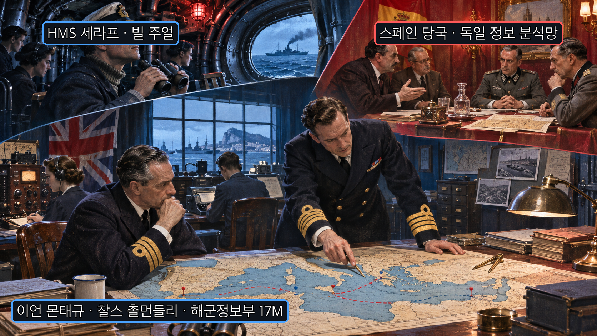
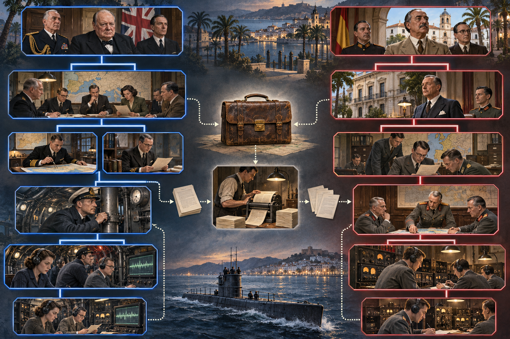
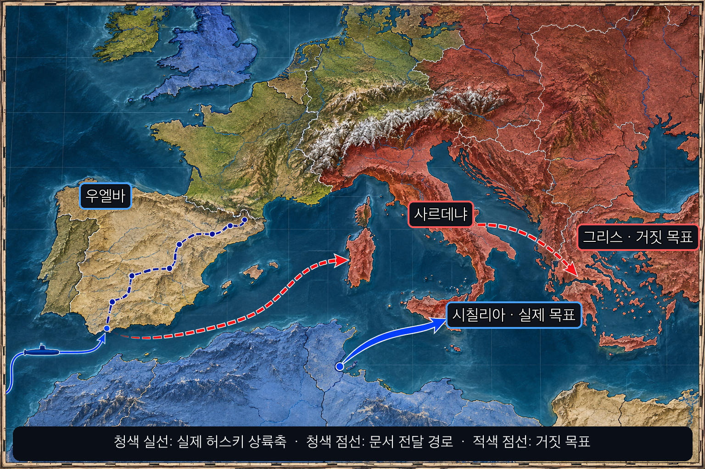
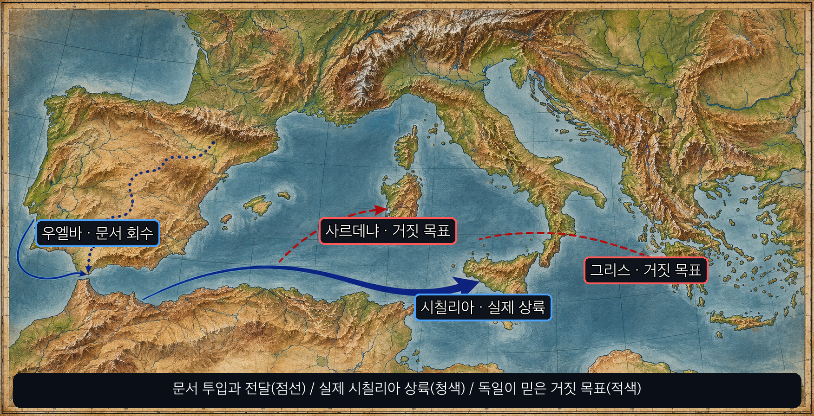
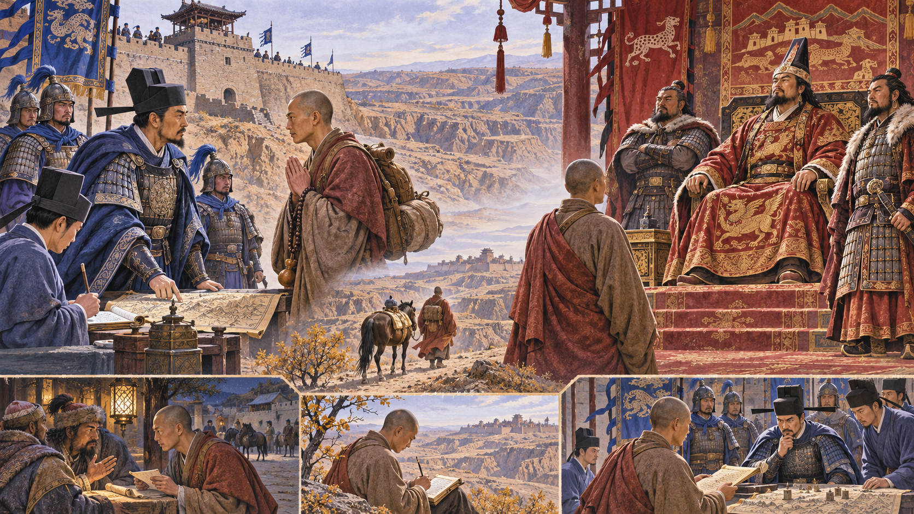
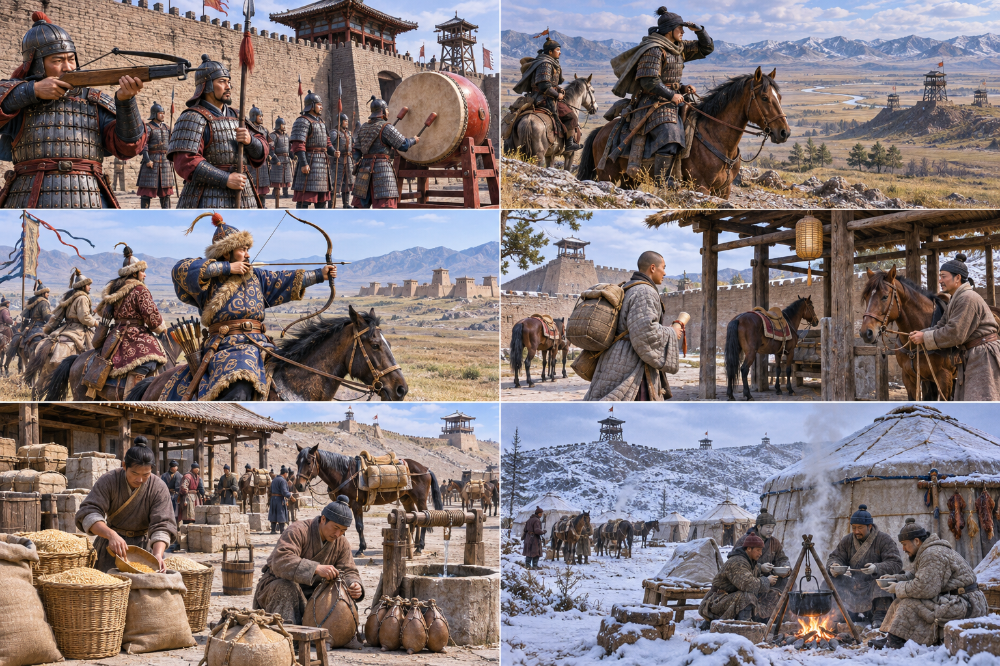
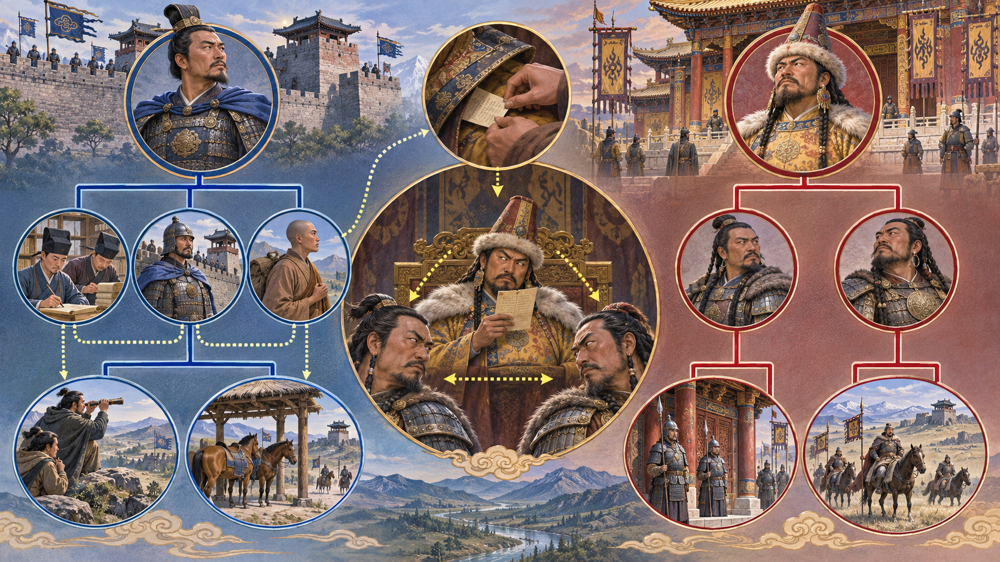
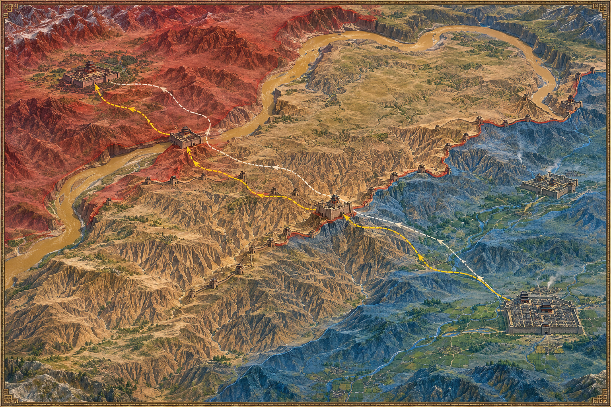
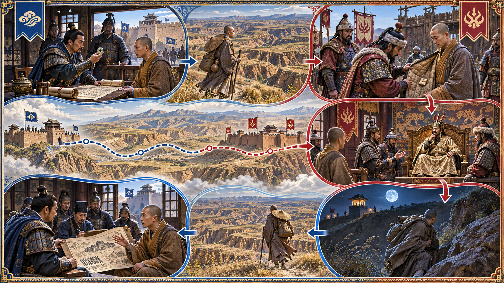

<!-- sunzi-analysis-mode: full -->
> 인시이지지. 고사간위광사가사고적, 인시이지지, 고생간, 가사여기. — 확인하지 않은 정보로 남을 움직이거나 귀환 약속을 잡으면 재수가 없다.

---
## 1. 원문 + 독음 + 직역 + 한자어 뜻풀이

因是而知之. 故死間爲誑事可使告敵, 因是而知之, 故生間, 可使如期. 인시이지지. 고사간위광사가사고적, 인시이지지, 고생간, 가사여기.

**직역**
이로 말미암아 그것을 안다. 그러므로 사간에게 속이는 일을 만들어 적에게 알리게 할 수 있다. 이로 말미암아 그것을 안다. 그러므로 생간을 기약한 때에 맞게 부릴 수 있다.

앞 구절에서 반간은 적의 연락망과 내부 사정을 여는 첫 실마리가 되었다. 이번 문장은 그 앎이 서로 반대되는 두 임무를 어떻게 가능하게 하는지 보여 준다. 사간에게는 적이 믿을 만한 거짓을 실어 보내고, 생간에게는 적정과 길·경계·연락 주기를 계산해 돌아올 때를 정한다. **거짓 정보의 설계와 참된 정보의 회수는 모두 적을 먼저 안다는 같은 바닥 위에 선다.**

여기서 사간은 단순히 죽으라고 보내는 사람이 아니다. 적에게 넘어갈 것을 전제로 꾸민 정보가 그의 행동과 함께 신빙성을 얻지만, 발각되거나 이용된 뒤 살아 돌아오기 어려운 임무를 맡는다. 생간도 용감한 침투자라는 이름만으로 성립하지 않는다. 관찰 범위와 귀환 경로, 약속 시각이 적의 실제 사정에 맞아야 보고가 돌아온다. `因是而知之`가 두 번 반복되는 까닭은 **기만도 귀환도 정보 없는 배짱으로 만들 수 없기 때문**이다.

#### 因是而知之(인시이지지) — 같은 앎을 두 갈래 임무의 설계도로 바꾸다

`因`은 말미암고 기대는다는 뜻이며, `是`는 앞에서 얻은 반간의 정보와 그로부터 연결된 향간·내간의 지식을 받는다. `知之`는 적의 일반적 성향을 안다는 막연한 자신감이 아니라, 누가 보고를 받고 무엇을 의심하며 언제 움직이는지를 구체적으로 아는 상태다.

첫 번째 반복은 적이 받아들일 신호를 고르는 근거가 되고, 두 번째 반복은 생간이 관찰하고 돌아올 시간표의 근거가 된다. 같은 정보라도 임무에 따라 쓰임이 달라진다. 거짓을 만들 때는 적의 기대와 확인 절차를 알아야 하고, 귀환을 계획할 때는 순찰·거리·접선·변경 가능성을 알아야 한다.

#### 死間(사간) — 거짓을 짊어지고 적의 검증망 속으로 들어가는 사람

`死`는 이 임무가 실패하면 죽을 수 있다는 일반적 위험보다 더 무겁다. 사간은 아군이 밖으로 꾸민 일을 알고 그것을 적에게 전하게 되므로, 정보가 거짓임이 드러날 때 적에게 처형되거나 아군도 보호하기 어려운 처지에 놓인다. 전통 정의의 핵심은 그 사람의 희생 자체가 아니라 **적이 믿도록 설계한 거짓 정보의 전달 경로**다.

그러므로 사간을 영웅적 희생담으로 미화해서는 안 된다. 지휘자는 그 임무의 필요와 위험, 다른 수단의 가능성을 먼저 따져야 한다. 현대의 법과 윤리에서는 사람을 소모품처럼 속여 보내는 행위를 일상적 조직 운영에 옮길 수 없다. 이 구절이 보여 주는 것은 전쟁 기만의 냉혹한 구조와 그 구조를 지휘자가 책임져야 한다는 사실이다.

#### 誑事(광사) — 말 한마디가 아니라 적이 스스로 확인했다고 믿게 할 일

`誑`은 속이고 미혹한다는 뜻이고 `事`는 말만이 아니라 실제로 보이는 일과 정황을 포함한다. 병력 이동의 흔적, 공개된 준비, 일부러 드러낸 문서와 행동이 하나의 이야기로 맞물려야 적이 그 정보를 자기 수집의 결과라고 받아들인다.

거짓이 적의 기존 정보와 전혀 맞지 않으면 쉽게 의심받는다. 반대로 진짜 요소와 거짓 결론을 섞으면 적은 자기 기대에 따라 빈칸을 채울 수 있다. 그러나 이는 기만이 만능이라는 뜻이 아니다. 실제 전력·작전·보안이 받쳐 주지 않으면 광사는 들키고, 거짓 신호에 맞추느라 아군의 행동까지 뒤틀릴 수 있다.

#### 可使告敵(가사고적) — 적에게 닿는 것과 적을 움직이는 것을 구분하다

`告`는 알리고 전한다는 뜻이다. 사간의 말이 적에게 도착했다고 임무가 끝나는 것은 아니다. 적의 어느 결정권자가 그것을 받고, 어떤 독립 확인을 하며, 그 결과 병력과 시간을 어떻게 바꾸는지까지 예상해야 `可使`가 성립한다.

여기에는 중앙 통제가 필요하다. 여러 사람이 제각기 다른 거짓을 흘리면 아군의 진짜 계획도 새고 거짓끼리 충돌한다. 기만은 적에게 “무엇을 믿게 할까”보다 **그 믿음으로 어떤 행동을 하게 할까**를 먼저 정하고, 실행 중 적의 반응을 관찰하며 중단할 조건을 갖춰야 한다.

#### 生間(생간) — 살아 돌아와 관찰을 보고로 완성하는 사람

`生`은 단지 임무 뒤 생존했다는 뜻이 아니라, 적지에서 직접 본 사실을 가지고 돌아와 보고하는 기능을 가리킨다. 관찰만 하고 돌아오지 못하면 지휘부의 앎으로 바뀌지 않는다. 그래서 생간의 가치는 침투의 대담함보다 **무엇을 확인하고 어떻게 귀환해 누구에게 보고하는가**에 있다.

생간의 안전은 우연에 맡길 일이 아니다. 임무 범위를 넓힐수록 정보는 많아질 수 있지만 체류 시간이 길어지고 노출 위험도 커진다. 꼭 필요한 질문, 중간 접선, 철수 기준, 연락 두절 시 대체 계획이 있어야 살아 돌아오는 기능이 보존된다.

#### 如期(여기) — 약속한 때를 고정하지 말고 적정에 맞춰 관리하다

`期`는 기약한 시점과 약속을 뜻하고 `如`는 그에 맞는다는 뜻이다. 여기의 시간표는 낙관적 희망이 아니다. 거리, 경계 교대, 성문 개폐, 연락망, 날씨와 돌발 상황을 반간·향간·내간의 정보로 계산한 결과다.

약속 시각은 통제 수단이면서 위험 신호이기도 하다. 너무 일찍 강요하면 생간이 확인하지 못한 내용을 꾸밀 수 있고, 늦어졌다고 곧 배신으로 단정하면 구조 기회를 잃는다. “기한 내 귀환 / 지연 / 연락 두절” 각각의 의미와 대응을 미리 나누어야 `如期`가 사람을 몰아붙이는 마감이 아니라 안전한 회수 계획이 된다.

#### 글자들이 완성하는 한 장면

지휘자는 반간으로 적의 보고망과 경계 습관을 알아낸다. 첫 `因是而知之`에서 그 앎을 사간에게 실을 `誑事`로 바꾸고, 적이 자기 판단으로 받아들일 경로를 만든다. 두 번째 `因是而知之`에서는 같은 적정을 생간의 관찰 범위와 귀환 시간표로 바꾼다.

한쪽은 거짓을 적에게 들여보내고 다른 쪽은 사실을 아군에게 가져온다. 그러나 둘 모두 먼저 알아야 움직일 수 있다. **사간의 기만은 적의 검증 습관을 알아야 작동하고, 생간의 귀환은 적의 시간과 공간을 알아야 지켜진다. 앎이 없는 기만은 허풍이고, 앎이 없는 기한은 사람을 잃는 명령이다.**

---
## 2. 전통 주석 기반 분석

- **조조(曹操)** — “반간에게서 적의 사정을 얻은 뒤 사간에게 거짓 일을 알리고 생간의 귀환을 정하라. **적정을 모른 채 두 임무를 보내지 마라.**”
- **이전(李筌)** — “사간의 말이 적의 평소 믿음과 맞게 하고 생간의 길이 적의 경계와 어긋나게 하라. **형세에 기대어 속이고 형세에 기대어 돌아오게 하라.**”
- **두목(杜牧)** — “거짓 일은 적이 스스로 얻었다고 여길 만큼 꾸미고, 생간에게는 돌아올 계산을 주어라. **죽음을 이름으로 삼아 무모함을 감추지 마라.**”
- **매요신(梅堯臣)** — “사간은 거짓을 전하고 생간은 참을 돌려 보고한다. **들어가는 거짓과 돌아오는 사실을 뒤섞지 마라.**”
- **장예(張預)** — “반간이 알려 준 적의 허실로 사간의 말을 만들고 생간의 기약을 정하라. **두 임무 모두 앞선 정보에서 시작해야 한다.**”
- **왕석(王晳)** — “`因是而知之`가 거듭 나온 까닭을 보아라. **기만의 가능성과 귀환의 가능성을 각각 따져라.**”
- **가림(賈林)** — “적이 믿을 대상과 생간이 드나들 때를 먼저 알아라. **말을 보내는 일과 사람을 돌려받는 일을 함께 계산하라.**”
- **두우(杜佑)** — “거짓을 누설할 자와 돌아와 보고할 자의 임무를 구별하라. **보상·비밀·기한을 명확히 하여 정보망을 지켜라.**”
- **진호(陳皞)** — “사간은 적을 그릇 움직이게 하고 생간은 아군을 바르게 움직이게 한다. **거짓과 참을 한 지휘 아래 두어라.**”

#### 리링의 고증과 현대적 독법

리링의 문헌학적 관점에서 눈여겨볼 것은 `因是而知之`의 반복이다. `是`는 앞 문장의 반간 운용과 그로부터 얻은 적정을 받으며, 사간과 생간은 독립된 묘수가 아니라 반간을 중심으로 연결된 오간 체계의 뒤쪽 단계다. 판본 차이를 억지로 만들기보다 이 문장 구조가 보여 주는 선후를 지키는 편이 중요하다.

또한 `死間`과 `生間`을 현대 직업명에 일대일로 대응시키면 고대 문장의 기능적 구분이 흐려진다. 전자는 꾸민 일을 적에게 전달하도록 운용되는 자, 후자는 돌아와 보고하는 자다. 오늘날에는 기술정보·공개정보·법적 감독이 결합되므로, 고대의 분류를 그대로 실행 지침으로 삼을 수 없다.

이 구절을 일상의 거짓말 기술로 축소해서도 안 된다. 군사 기만은 적대 상황의 법과 지휘 책임 아래 다뤄지는 행위다. 실생활에서 옮길 수 있는 것은 **상대가 어떻게 확인할지 생각하고, 사실을 가져올 사람에게 현실적인 범위·기한·중단 조건을 주는 계획 원리**다.

---
## 3. 교차 설명

### ① 손자병법 내 교차

앞 구절 `因是而知之, 故鄕間, 內間可得而使也`(인시이지지, 고향간, 내간가득이사야 — 이로 말미암아 알기에 향간과 내간을 얻어 부릴 수 있다)는 이번 문장의 정보 기반이다. 반간이 가리킨 지역 인맥과 내부 관리를 통해 적의 관심·절차·경계를 알게 된 뒤에야 사간의 거짓과 생간의 귀환이 구체화된다.

뒤 구절 `五間之事, 君必知之, 知之必在於反間`(오간지사, 군필지지, 지지필재어반간 — 오간의 일은 군주가 반드시 알아야 하며 그 앎은 반드시 반간에 달려 있다)은 지휘 책임을 다시 중앙으로 모은다. 사간과 생간을 각각 따로 보내는 기술이 아니라, 서로의 정보와 위험을 한 사람이 알고 조정하는 체계다.

시계편의 `能而示之不能, 用而示之不用`(능이시지불능, 용이시지불용 — 능하면서 능하지 못한 듯 보이고, 쓰면서 쓰지 않는 듯 보인다)은 광사의 원리와 닿는다. 다만 “반대로 보이라”는 표면만 따라 하면 허술하다. 이번 구절은 적정을 알아야 어떤 무능과 비사용이 적의 기존 판단에 들어맞는지 정할 수 있다고 보완한다.

군쟁편의 `以迂爲直, 以患爲利`(이우위직, 이환위리 — 굽은 길을 곧은 길로 만들고 해로움을 이로움으로 만든다)도 생간의 귀환과 연결된다. 가장 빠른 길보다 들키지 않고 돌아와 보고를 완성하는 길이 실제로는 곧은 길이다. 기한은 속도 경쟁이 아니라 임무 완성 확률을 높이는 시간 설계다.

### ② 클라우제비츠 『전쟁론』

클라우제비츠는 전쟁에서 들어오는 정보가 불확실하고 모순되며 거짓일 수 있다고 경고한다. 이 관점에서 광사의 성공은 적이 어리석기 때문이 아니라, 전쟁의 안개 속에서 제한된 시간과 증거로 판단해야 하기 때문에 가능하다. 사간은 그 불확실성에 하나의 그럴듯한 설명을 집어넣는다.

그러나 클라우제비츠의 마찰은 아군 계획에도 작용한다. 사간이 예상과 다른 경로로 붙잡히고, 생간이 경계 변화 때문에 늦어지며, 지휘부가 적의 반응을 잘못 해석할 수 있다. 그러므로 기만의 세부 각본보다 목적·예비·중단 조건이 중요하다.

손자는 적의 정보망을 이용해 적의 판단을 능동적으로 움직이는 방법을 압축한다. 클라우제비츠는 이런 정교한 계획도 우연과 마찰 속에서 무너질 수 있음을 더 강하게 경고한다. 둘을 합치면 **기만이 실패해도 진짜 작전이 버티고, 생간이 지연돼도 성급한 결론을 내리지 않는 구조**가 필요하다.

현대 조직에서는 보고 시한과 메시지 설계에 적용할 수 있다. 상대가 이해하기 쉬운 설명을 만들되 중요한 사실을 숨겨 조종하지 않고, 보고자에게는 정상 기한과 지연 신호, 중단 기준을 함께 준다. 군사 기만과 평시 협업의 윤리적 조건은 분명히 다르다.

### ③ 미야모토 무사시 『오륜서』

『오륜서』의 `観見二つの目付`(관견 두 눈매 — 넓게 꿰뚫는 눈과 가까이 살피는 눈)는 광사와 귀환을 함께 관리하는 시야를 비춘다. 가까운 눈은 적이 실제로 어떤 신호에 반응하는지 보고, 넓은 눈은 그 반응이 전체 작전과 시간표에 어떤 변화를 만드는지 본다.

무사시는 한 동작에 눈이 붙잡히면 상대의 리듬을 놓친다고 경고한다. 적이 거짓 정보 하나를 믿는 듯 보였다고 곧 기만 성공을 선언하면 역기만에 빠질 수 있다. 생간이 한 번 제시간에 돌아왔다고 다음 임무도 같은 시간표로 고정하면 경계 변화와 학습을 놓친다.

개인 검술의 거리와 국가 정보전은 규모가 다르다. 따라서 관견의 비유를 실제 포섭·기만 기술로 확대하지 않는다. 일상에서는 메시지를 받은 사람의 즉각 반응과, 이후 실제 행동·기록·결과를 나누어 보는 훈련으로 제한한다.

예를 들어 업무 공지를 낸 뒤 “읽음” 표시만 보고 전달이 끝났다고 여기지 않는다. 가까이서는 수신과 질문을, 넓게는 실행 결과와 다음 교대의 상태를 본다. 보고 기한도 한 번의 평균이 아니라 업무 난도와 돌발 변수를 반영해 갱신한다.

### ④ 오자병법·육도삼략

『오자병법』은 군을 움직일 때 명령과 상벌, 임무의 분명함을 중시한다. 사간과 생간의 임무를 구별하지 않으면 한 사람에게 거짓 전달과 참된 관찰을 동시에 요구하게 되고, 어느 보고를 믿어야 할지 지휘부도 혼란스러워진다. 역할 분리는 정보의 무결성을 지키는 편제다.

특히 `如期`는 벌을 주기 위한 단순 마감이 아니다. 임무와 거리, 접선 조건을 고려해 가능한 기한을 정하고, 지연 원인을 확인할 절차가 있어야 한다. 무리한 시한은 보고자가 미확인 내용을 채워 넣게 하거나 안전한 귀환보다 시계에 매달리게 한다.

『육도』가 사람을 쓰는 데 신의와 후한 대우를 강조하는 관점은 이번 구절의 냉혹함에 책임의 축을 더한다. 사간에게 위험을 숨기고 생간에게 불가능한 약속을 강요하면 단기 정보는 얻어도 장기 정보망은 무너진다. 사람을 쓰는 능력은 명령의 강도가 아니라 관계와 약속을 지키는 능력이다.

현대 조직에서는 `누가 전달하고 / 누가 확인하고 / 누가 최종 보고하는가`를 나누는 방식으로 바꿀 수 있다. 반대 의견을 말한 사람에게 불이익을 주지 않고, 미확인 상태를 그대로 보고할 수 있게 하며, 지연을 즉시 은폐나 무능으로 단정하지 않는 제도가 필요하다.

### ⑤ 현대 심리학·군사학

미 육군 교리는 군사 기만을 단순한 거짓말이 아니라 표적 의사결정자가 아군에게 유리한 행동이나 비행동을 하게 만드는 계획된 과정으로 설명한다. 표적의 권한·동기·기존 기대, 정보가 도착할 경로, 반응을 관찰할 시간, 중앙 통제와 보안이 함께 필요하다. 이는 `誑事可使告敵`이 “거짓을 전한다”에서 끝나지 않는 이유다. [U.S. Army FM 6-0, *Commander and Staff Organization and Operations*](https://home.army.mil/wood/download_file/view/6638/1525)

2026년 미 육군의 적극 방호 논의도 기만 설계를 적의 수집 모델·지표·평가에 근거시켜야 한다고 설명한다. 적이 무엇을 보고 어떻게 확인하는지를 모르면 미끼는 현실과 동떨어진 장식이 된다. 다만 최신 전장 기술의 사례를 고대 사간과 동일시하지 않고, **상대의 수집 체계를 알아야 기만 신호가 작동한다는 구조적 공통점**만 취한다. [U.S. Army, “A Layered Approach to Active Protection”](https://www.lineofdeparture.army.mil/Journals/Protection/Protection-Archive/2026-Edition/A-Layered-Approach-to-Active-Protection/)

카너먼의 판단 연구에 비추면, 사람은 기존 기대에 맞는 신호를 더 쉽게 받아들이고 생생한 한 시나리오가 떠오르면 다른 가능성을 덜 살필 수 있다. 기만자는 이 취약성을 이용할 수 있지만, 방어자는 반대로 `이 정보가 너무 쉽게 들어온 것은 아닌가 / 독립된 확인은 무엇인가 / 틀렸을 때 어떤 행동을 멈출 것인가`를 물어야 한다.

사용자의 「생각에대한 생각」 메모에서 강조된 분모와 대안 시나리오도 `如期` 판단에 중요하다. 한두 번 제시간에 끝난 임무만 기억하면 지연의 기저율을 과소평가하고 비현실적인 마감을 만들 수 있다. 최근 유사 업무의 전체 건수와 지연 원인, 최악 조건을 함께 보고 정상 범위와 중단 조건을 정해야 한다.

윤리적 한계는 분명하다. 군사 기만은 무력충돌법과 지휘 책임의 적용을 받으며, 평시 직장이나 인간관계에서 타인의 신뢰를 조작하는 허가가 아니다. 일상에서 취할 것은 거짓을 퍼뜨리는 법이 아니라 **받는 사람이 어떻게 검증할지 고려해 사실을 명료하게 전하고, 보고자에게 현실적인 기한과 안전한 실패 신호를 주는 습관**이다.

---

## 4. 역사적 실증 사례

### 서양 — 연합군 vs 추축군 │ 미트 작전(Operation Mincemeat, 1943)

**뒤에서 반복될 지형을 먼저 잡아두기**

- 🌊 **지브롤터 해협(Strait of Gibraltar)**은 잠수함 세라프가 대서양으로 빠져나가는 관문이었다. 이 통로가 막히면 우엘바 투입 자체가 성립하지 않는다.
- **▰** **우엘바(Huelva)**는 친독일 정보망과 조류 조건 때문에 선택된 회수 지점이었다. 문서가 스페인 당국을 거쳐 독일 정보기관에 닿는 연결점이다.
- 🌊 **지중해(Mediterranean Sea)**의 중앙에는 시칠리아·사르데냐·그리스가 갈라져 있었다. 같은 연합군 준비를 어느 목표로 해석하느냐가 추축군 배치를 바꿨다.
- **▰** **시칠리아(Sicily)**는 실제 허스키 작전의 목표였다. 미트 작전은 이곳을 양동처럼 보이게 해야 했다.
- **▰** **사르데냐(Sardinia)**와 그리스는 꾸민 문서가 가리킨 거짓 목표였다. 독일군이 이쪽을 보강할수록 시칠리아의 방어 집중은 약해졌다.

#### 상세 전역 서사 — 적의 검증 습관을 시신과 서류 한 묶음으로 통과시키다

1943년 연합군이 북아프리카를 장악한 뒤 다음 상륙지로 **▰** **시칠리아(Sicily)**가 너무 뻔해졌다. **이언 몬태규(Ewen Montagu)**와 **찰스 촐먼들리(Charles Cholmondeley)**는 글린더 마이클의 시신에 가공의 왕립해병 소령 ‘윌리엄 마틴’이라는 신원을 만들고, 그리스와 **▰** **사르데냐(Sardinia)**를 주공처럼 보이게 하는 서신을 휴대시켰다. 이때 글린더 마이클은 자발적 간첩이 아니었으므로, 사람을 영웅적 사간으로 미화하지 않고 **시신을 매개로 만든 광사**라고 구분해야 한다.

잠수함 HMS 세라프는 시신과 서류가방을 **▰** **우엘바(Huelva)** 앞바다에 투입했다. 스페인은 중립국이었지만 현지의 친독일 정보 경로가 활발했고, 영국은 서류를 애써 되찾으려는 외교적 몸짓까지 보여 문서의 가치가 높아 보이게 했다. 독일 측이 문서를 복제하고 진짜라고 판단했다는 사실은 울트라 해독으로 다시 확인됐다. 이것이 첫 `因是而知之`와 두 번째 `因是而知之` 사이의 피드백 고리다.

독일은 발칸·그리스·사르데냐 방어를 보강했고, 연합군은 7월 10일 실제 목표인 시칠리아에 상륙했다. 다만 성공을 미트 한 건에만 돌릴 수는 없다. 바클레이 등 더 큰 기만 체계, 추축군의 해공군 열세, 연합군의 실제 전력이 함께 작용했다. **사간형 메시지는 적을 움직였지만, 생간의 기능은 살아 돌아온 한 사람이 아니라 통신감청·외교 관찰·정찰 채널로 분화되었다.**

#### 전투에서 사용된 속임수 — 진짜 생활 흔적이 떠받친 거짓 작전문서

연합군은 거짓 서신만 만들지 않았다. 신분증·영수증·연인의 사진·은행 통지처럼 한 사람의 생활 흔적을 붙여 독일 분석관이 독립적으로 확인했다고 느끼게 했다. 실제 의도는 시칠리아 상륙이었지만, 적에게 보인 신호는 그리스와 사르데냐가 주공이라는 것이었다. 독일은 이미 발칸 방어를 중시했고, 중립국 경로에서 우연히 얻은 듯한 문서를 신뢰할 이유가 있었다.

#### 속임수 작동 구조

**주체와 의도.** 영국 해군정보부와 XX위원회는 시칠리아 상륙의 예측 가능성을 낮추려 했다.

**보인 신호와 믿은 이유.** 가공 인물의 생활 흔적, 고위 지휘관 서신, 영국의 회수 요구가 ‘우연히 노출된 진짜 문서’라는 서사를 만들었다.

**유발된 행동과 결과.** 독일은 그리스·발칸·사르데냐를 보강했고 시칠리아 상륙은 전략적 기습 효과를 얻었다.

**사료의 경계.** 미트가 독일 지휘부 전체를 단독으로 움직였다는 평가는 과장될 수 있다. 광범위한 기만 계획과 전력 조건을 함께 보아야 한다.

#### 속임수 일곱 질문

1. **누가 누구를 속였는가?** 영국 기만 지휘부가 스페인 경유 정보망을 통해 독일 정보기관과 최고지휘부를 속였다.
2. **어떤 사실이 거짓이었는가?** 그리스·사르데냐가 주공이고 시칠리아가 양동이라는 작전 방향이 거짓이었다.
3. **어떤 사실은 진실이지만 오해를 유도했는가?** 연합군의 지중해 상륙 준비 자체는 진짜였고, 그 사실이 거짓 목표를 더 믿기 쉽게 했다.
4. **상대는 왜 그것을 믿고 싶어 했는가?** 발칸을 잃을 위험을 크게 본 기존 전략 판단과 우연히 입수한 고급 문서라는 출처 효과가 결합했다.
5. **속임수가 없었어도 같은 오판이 발생했을까?** 가능성은 있었지만 낮아졌을 것이다. 시칠리아는 지리적으로 가장 뚜렷한 목표였다.
6. **속은 사람은 어떤 독립 확인을 생략했는가?** 문서의 진위를 세밀히 보았지만, 실제 상륙 물량과 시칠리아 접근 능력을 충분히 반대 증거로 쓰지 못했다.
7. **신뢰·동의·안전을 해치지 않으면서 같은 원리를 어디서 연습할 수 있는가?** 보드게임·보안 모의훈련에서 미끼 신호와 독립 확인 절차를 함께 설계할 수 있다.

#### 시계편 兵者詭道也 — 이 전장에 해당하는 속이는 길

<table fit-page-width="true" header-row="true">
<tr><td>해당 구절·독음·뜻</td><td>전장의 장면</td></tr>
<tr><td>近而示之遠(근이시지원) 가까운 곳을 치면서 먼 곳을 치는 듯 보임</td><td>실제 목표 시칠리아를 감추고 그리스·사르데냐를 주공처럼 보였다.</td></tr>
<tr><td>用而示之不用(용이시지불용) 쓰면서 쓰지 않는 듯 보임</td><td>실제 상륙 준비를 계속하면서 그 준비가 다른 목표를 향한 것처럼 해석되게 했다.</td></tr>
</table>

#### 法 한눈 비교 — 곡제·관도·주용

<table fit-page-width="true" header-row="true">
<tr><td>진영</td><td>곡제(편제)</td><td>관도(지휘)</td><td>주용(보급·지속)</td></tr>
<tr><td>**연합군**</td><td>기만 전담부서·잠수함·통신감청을 결합했다.</td><td>XX위원회가 메시지와 실제 작전을 중앙 조정했다.</td><td>서류·신원·잠수함·울트라 확인을 지속적으로 연결했다.</td></tr>
<tr><td>**추축군**</td><td>정보 분석과 방어군 배치가 여러 지역으로 분산됐다.</td><td>독일 정보기관의 판단이 최고지휘부 배치로 이어졌다.</td><td>발칸·그리스·사르데냐 보강이 시칠리아 집중을 약화했다.</td></tr>
</table>

#### **독일 정보·지휘부 (패)**

<table fit-page-width="true" header-row="true">
<tr><td>요소</td><td>판단</td></tr>
<tr><td color="orange_bg">🤝 **道**</td><td>기존 발칸 위협 인식이 조직의 판단을 한 방향으로 묶었다. 반대 가설을 충분히 살리지 못했다. (지기·결속)</td></tr>
<tr><td color="blue_bg">🌤️ **天**</td><td>중립국 경로와 우연한 회수라는 드문 사건에 높은 비중을 주고 시칠리아라는 기저율 높은 목표를 낮게 보았다. (지피·확률 관점)</td></tr>
<tr><td color="green_bg">🧭 **地**</td><td>시칠리아의 중앙 위치와 연합군 항공 엄호 범위를 알면서도 동부 지중해의 정치적 공포에 끌렸다. (원근·광협)</td></tr>
<tr><td color="purple_bg">🎖️ **將**</td><td>입수 문서의 진위를 확인하는 데 집중했지만, 문서가 진짜여도 내용이 조작될 가능성을 별도 가설로 유지하지 못했다. (지신인용엄)</td></tr>
<tr><td color="yellow_bg">⚙️ **法**</td><td>방어군·항공기·해군 자산을 여러 거짓 목표에 분산했다. (곡제·관도·주용)</td></tr>
</table>

**직관·편향 한 줄:** 우연히 얻은 고급 문서의 생생함에 붙잡혀 시칠리아 상륙의 높은 기저율을 낮게 본 판단에는 가용성·확증편향이 작동한 것으로 볼 수 있다.

🏳️ **패군 측 결과** — 六敗 가운데 `北(배, 적을 헤아리지 못하고 약점을 내줌)`에 가깝다. 독립 확인을 ‘문서 진위’가 아니라 ‘상륙 능력과 목표 분포’까지 넓혔다면 적어도 방어 분산을 줄일 수 있었다.

#### **연합군 기만 지휘부 (승)**

<table fit-page-width="true" header-row="true">
<tr><td>요소</td><td>판단</td></tr>
<tr><td color="orange_bg">🤝 **道**</td><td>정보·외교·해군·실전 작전이 같은 목표 아래 움직였다. (지기·사기)</td></tr>
<tr><td color="blue_bg">🌤️ **天**</td><td>독일의 발칸 우려와 스페인 정보망이라는 외부 조건을 이용하되 울트라로 반응을 확인했다. (지피·타이밍·확률 관점)</td></tr>
<tr><td color="green_bg">🧭 **地**</td><td>우엘바의 조류와 정보 경로, 지중해 목표들의 거리 차이를 하나의 서사로 묶었다. (원근·험이·광협)</td></tr>
<tr><td color="purple_bg">🎖️ **將**</td><td>세부 일관성을 만들고 실제 작전과 거짓 신호를 분리했다. (지신인용엄)</td></tr>
<tr><td color="yellow_bg">⚙️ **法**</td><td>문서 제작·운반·회수 연기·감청 확인을 단계별 책임으로 나눴다. (곡제·관도·주용)</td></tr>
</table>

🏆 **승군 측 결과** — 五勝 중 `以虞待不虞者勝`(이우대불우자승, 대비한 채 대비 없는 적을 상대하는 자가 이김)에 해당한다.

##### 法을 압축하지 않고 보기 — 곡제·관도·주용

**곡제 曲制(곡제): 부대를 어떻게 나누고 결합했는가**
<table fit-page-width="true" header-row="true">
<tr><td>진영</td><td>실제 운용</td></tr>
<tr><td>**연합군**</td><td>정보 기획자, 잠수함 승조원, 외교 채널, 감청 분석을 서로 다른 임무로 나누고 같은 기만 목표에 결합했다.</td></tr>
<tr><td>**추축군**</td><td>문서 분석과 지역 방어를 연결했으나 반대 가설을 전담하는 검증 기능이 약했다.</td></tr>
</table>

**관도 官道(관도): 누가 명령하고 어떻게 전달했는가**
<table fit-page-width="true" header-row="true">
<tr><td>진영</td><td>실제 운용</td></tr>
<tr><td>**연합군**</td><td>XX위원회와 해군정보부가 세라프의 현장 임무, 외교적 회수 요구, 울트라 피드백을 중앙에서 통제했다.</td></tr>
<tr><td>**추축군**</td><td>스페인 현지망–아브베어–최고지휘부를 거친 판단이 광범위한 재배치 명령으로 확대됐다.</td></tr>
</table>

**주용 主用(주용): 군량·장비·전투 지속 능력을 어떻게 썼는가**
<table fit-page-width="true" header-row="true">
<tr><td>진영</td><td>실제 운용</td></tr>
<tr><td>**연합군**</td><td>잠수함 항해, 위조 신원과 서류, 통신감청, 실제 허스키 상륙 물량을 별도로 유지했다.</td></tr>
<tr><td>**추축군**</td><td>항공기와 방어 전력을 발칸·그리스·사르데냐로 나누어 시칠리아의 지속 방어 여력을 낮췄다.</td></tr>
</table>

**출처:** [Imperial War Museums, Operation Mincemeat](https://www.iwm.org.uk/sites/default/files/files/2023-10/spies_large_print_guide.pdf) · [National Museum of the Royal Navy, HMS Seraph](https://www.royalnavymuseums.org.uk/news/operation-mincemeat-hms-seraphs-special-operations-and-man-who-never-was) · [U.S. Naval History and Heritage Command, Sicilian Campaign](https://www.history.navy.mil/browse-by-topic/wars-conflicts-and-operations/world-war-ii/1943/sicilian-campaign.html)

### 동양 — 🏛️ 북송 vs 🏛️ 서하 │ 종세형의 법숭 사간·생환 작전(1040년대)

**뒤에서 반복될 지형을 먼저 잡아두기**

- **▰** **청간성(青澗城)**은 종세형이 쌓은 북송 변경 거점이자 법숭의 출발·귀환 지점이었다.
- ⛰️ **황토고원 협곡대(黃土高原)**는 길이 갈리고 감시가 어려운 잠입 공간이면서, 붙잡히면 구조가 어려운 장벽이었다.
- 🌊 **황하(黃河)**의 큰 굽이는 북송과 서하 변경의 이동축을 갈랐다. 나루와 계곡길을 아는 것이 귀환 가능성을 좌우했다.
- **▰** **하주(夏州)**와 서하 북경은 법숭이 심문·이송된 적지의 권력 공간이었다.
- **▰** **천도산(天都山)** 일대는 야리우걸 등 서하 중신의 영향권이었다. 숨긴 서신은 이 권력관계를 겨냥했다.

#### 상세 전역 서사 — 죽으라고 보낸 사간이 적정을 품고 살아 돌아오다

심괄의 《몽계필담》은 **종세형(種世衡)**이 **법숭(法崧, 뒤의 왕숭 王嵩)**을 오래 후대하고도 혹독하게 시험해 비밀을 지킬지를 확인했다고 기록한다. 종세형은 그에게 몇 가지 군사기밀과 거짓 보고를 주고, 자신이 입던 솜옷까지 건넸다. 그러나 옷깃에는 법숭이 모르는 서하 중신 야리우걸에게 보내는 친밀한 서신을 숨겼다.

법숭은 변경을 넘어 서하로 들어갔고, 의심을 받아 붙잡혔다. 서하 측이 옷깃에서 편지를 찾아내자 법숭은 자신도 몰랐던 증거 때문에 가혹한 심문을 받았다. 이 장치의 실제 표적은 법숭이 아니라 서하 군주와 야리우걸 사이의 신뢰였다. 법숭은 여기서 전형적인 사간의 위치에 놓인다. 자신이 믿는 임무와 지휘부가 숨긴 광사가 달랐고, 진상이 드러나면 살아남기 어려웠다.

서하 측은 야리우걸을 의심했고, 법숭은 북쪽으로 옮겨졌다가 오래 뒤 탈출해 돌아왔다. 그는 적지의 사정을 모두 보고했고 조정은 공을 기록해 관직을 주었다. 심괄은 이 결말을 `世衡本賣崧爲死間, 邂逅得生還`(세형본매숭위사간, 해후득생환 — 종세형은 본래 법숭을 사간으로 팔았으나 우연히 살아 돌아왔다)이라고 정리한다. **한 사람이 사간으로 투입되었다가 생간의 기능까지 수행한 희귀 사례**지만, 귀환은 계획된 `如期`가 아니라 우연한 생환이었다는 한계를 감추면 안 된다.

#### 전투에서 사용된 속임수 — 전달자도 모르는 옷깃 속 서신

종세형은 법숭이 심문에서 일관되게 무지함을 드러낼 수 있도록 핵심 서신을 숨겼다. 법숭이 알고 있는 군사정보와 그가 모르는 편지가 섞였기 때문에 서하 측은 편지를 조작물보다 실제 내통 흔적으로 오인할 여지가 커졌다. 상대의 의심을 이용했지만 전달자의 동의를 빼앗고 죽음에 노출시킨 냉혹한 계책이었다.

#### 속임수 작동 구조

**주체와 의도.** 종세형은 서하 군주와 핵심 참모의 신뢰를 깨뜨려 변경의 지휘력을 약화하려 했다.

**보인 신호와 믿은 이유.** 법숭의 솜옷 속 비밀편지는 당사자도 모르는 물증이었고, 친밀한 문구는 실제 내통처럼 보였다.

**유발된 행동과 결과.** 서하 측은 야리우걸을 의심했고, 후대 기록은 그가 의심 속에 죽었다고 전한다. 법숭은 뜻밖에 탈출해 적정을 보고했다.

**사료의 경계.** 《몽계필담》은 심괄이 변경 사람들에게 자세히 들었다고 밝힌 후대 기록이다. 야리 형제의 처형 원인과 세부 순서는 다른 송대 기록과 차이가 있어 단일 인과로 확정하지 않는다.

#### 속임수 일곱 질문

1. **누가 누구를 속였는가?** 종세형이 법숭과 서하의 포획·심문망을 거쳐 서하 군주를 속였다.
2. **어떤 사실이 거짓이었는가?** 야리우걸이 북송과 내통한다는 친밀한 서신과 귀순 약속이 거짓이었다.
3. **어떤 사실은 진실이지만 오해를 유도했는가?** 법숭이 실제로 종세형의 임무를 받고 적지에 들어온 사실이 숨긴 서신의 신빙성을 높였다.
4. **상대는 왜 그것을 믿고 싶어 했는가?** 변경 중신의 독자 병력과 기존 정치적 긴장이 배신 가능성을 크게 보게 했다.
5. **속임수가 없었어도 같은 오판이 발생했을까?** 내부 긴장은 있었겠지만 특정 서신이 없었다면 같은 속도와 강도로 의심이 확대될 가능성은 낮다.
6. **속은 사람은 어떤 독립 확인을 생략했는가?** 필적·전달 경로·법숭의 인지 여부와 북송이 증거를 심을 유인을 분리해 확인하지 못했다.
7. **신뢰·동의·안전을 해치지 않으면서 같은 원리를 어디서 연습할 수 있는가?** 보안훈련에서 심어진 문서의 출처·내용·전달 경로를 독립 확인하는 연습으로 바꿀 수 있다.

#### 시계편 兵者詭道也 — 이 전장에 해당하는 속이는 길

<table fit-page-width="true" header-row="true">
<tr><td>해당 구절·독음·뜻</td><td>전장의 장면</td></tr>
<tr><td>近而示之遠(근이시지원) 가까이 있으면서 멀리 있는 듯 보임</td><td>실제 표적은 서하 군주와 야리우걸의 신뢰였지만, 겉으로는 법숭의 정보 전달 임무처럼 보였다.</td></tr>
<tr><td>利而誘之(이이유지) 이익으로 꾐</td><td>귀순과 관직의 이익을 암시한 숨은 서신이 서하 지휘부의 의심을 스스로 키우게 했다.</td></tr>
</table>

#### 法 한눈 비교 — 곡제·관도·주용

<table fit-page-width="true" header-row="true">
<tr><td>진영</td><td>곡제(편제)</td><td>관도(지휘)</td><td>주용(보급·지속)</td></tr>
<tr><td>**북송**</td><td>변경 지휘관·승려 정보원·성채 정찰망을 결합했다.</td><td>종세형이 기만 정보와 전달 경로를 단독 통제했다.</td><td>솜옷·말·노자와 변경 길 지식이 침투를 지탱했다.</td></tr>
<tr><td>**서하**</td><td>변경 순찰·심문·궁정 판단이 이어졌다.</td><td>포획 정보가 군주와 중신 사이의 의심으로 직결됐다.</td><td>북방 이송과 감시가 있었지만 법숭의 탈출을 막지 못했다.</td></tr>
</table>

#### **서하 지휘부 (패)**

<table fit-page-width="true" header-row="true">
<tr><td>요소</td><td>판단</td></tr>
<tr><td color="orange_bg">🤝 **道**</td><td>군주와 중신의 신뢰가 한 장의 서신으로 흔들렸다. (지기·결속)</td></tr>
<tr><td color="blue_bg">🌤️ **天**</td><td>법숭이 편지를 몰랐다는 반대 설명보다 내통이라는 단일 시나리오를 높게 보았다. (지피·확률 관점)</td></tr>
<tr><td color="green_bg">🧭 **地**</td><td>깊은 적지와 북방 이송로를 통제했지만 황토고원의 복잡한 귀환로를 완전히 봉쇄하지 못했다. (험이·원근)</td></tr>
<tr><td color="purple_bg">🎖️ **將**</td><td>물증을 중시했으나 출처가 의도적으로 심어진 가능성을 검증하지 못했다. (지신인용엄)</td></tr>
<tr><td color="yellow_bg">⚙️ **法**</td><td>포획·심문·이송은 했지만 정보 검증과 내부 신뢰 보호가 분리되지 않았다. (곡제·관도·주용)</td></tr>
</table>

**직관·편향 한 줄:** 숨겨진 서신이라는 생생한 물증을 배신의 증거로 곧장 연결한 판단에는 단일 시나리오 집중과 확증편향이 작동했을 가능성이 있다.

🏳️ **패군 측 결과** — 六敗 중 `亂(란, 지휘와 질서가 흔들림)`에 가깝다. 서신의 필적·전달 경로·상대가 이 증거를 심을 유인을 독립 검증했다면 적어도 내부 불신의 확대는 줄일 수 있었다.

#### **종세형·법숭 (승)**

<table fit-page-width="true" header-row="true">
<tr><td>요소</td><td>판단</td></tr>
<tr><td color="orange_bg">🤝 **道**</td><td>법숭의 충성·인내와 변경 조직의 지원이 임무를 가능하게 했다. 다만 위험을 온전히 알리지 않은 윤리적 결함이 크다. (지기·사기)</td></tr>
<tr><td color="blue_bg">🌤️ **天**</td><td>서하 내부의 의심을 이용했고, 법숭의 생환이라는 낮은 확률의 우연까지 정보 수확으로 바꿨다. (지피·타이밍·확률 관점)</td></tr>
<tr><td color="green_bg">🧭 **地**</td><td>청간성에서 서하 권력권으로 이어지는 변경길과 겨울 기후를 계산해 솜옷·노자를 준비했다. (원근·험이)</td></tr>
<tr><td color="purple_bg">🎖️ **將**</td><td>종세형의 지략은 강했지만 부하를 속여 소모품으로 삼은 엄격함은 인의 한계를 넘었다. (지신인용엄·장유오위)</td></tr>
<tr><td color="yellow_bg">⚙️ **法**</td><td>거짓 기밀, 숨긴 편지, 이동 지원, 귀환 후 보고를 한 작전으로 엮었다. (곡제·관도·주용)</td></tr>
</table>

🏆 **승군 측 결과** — 五勝 중 `以虞待不虞者勝`에 닿지만, 생환은 예정된 승리가 아니라 우연이었다. 이 사례는 사간의 효율보다 지휘 책임의 냉혹한 비용을 함께 보여 준다.

##### 法을 압축하지 않고 보기 — 곡제·관도·주용

**곡제 曲制(곡제): 부대를 어떻게 나누고 결합했는가**
<table fit-page-width="true" header-row="true">
<tr><td>진영</td><td>실제 운용</td></tr>
<tr><td>**북송**</td><td>청간성 수비·정찰과 법숭의 단독 잠입을 분리하고, 숨긴 서신을 별도 기만 장치로 붙였다.</td></tr>
<tr><td>**서하**</td><td>변경 포획대·심문기관·궁정 판단이 순차 대응했으나 내부 중신 검증은 취약했다.</td></tr>
</table>

**관도 官道(관도): 누가 명령하고 어떻게 전달했는가**
<table fit-page-width="true" header-row="true">
<tr><td>진영</td><td>실제 운용</td></tr>
<tr><td>**북송**</td><td>종세형이 임무·거짓정보·숨긴 편지를 통제했고 법숭은 자신이 아는 범위만 전달했다.</td></tr>
<tr><td>**서하**</td><td>현장 발견이 야리우걸과 군주 사이의 정치 판단으로 곧장 올라가 의심을 증폭했다.</td></tr>
</table>

**주용 主用(주용): 군량·장비·전투 지속 능력을 어떻게 썼는가**
<table fit-page-width="true" header-row="true">
<tr><td>진영</td><td>실제 운용</td></tr>
<tr><td>**북송**</td><td>솜옷·여비·말과 변경 안내가 장거리 침투를 지탱했다. 구체적 식량·비용은 사료상 불명이다.</td></tr>
<tr><td>**서하**</td><td>포획 후 장기 구금과 북방 이송을 유지했으나 감시·수송의 구체 비용은 사료상 불명이다.</td></tr>
</table>

**출처:** [심괄 《몽계필담》 권지 기록](https://www.shidianguji.com/book/SBCK364/chapter/SBCK364_26) · [《몽계필담》 법숭 원문·번역](https://www.quanben.io/n/wanjuanlouguoxuejingdian-zhencangban-mengxibitan/37.html) · [송대 왕숭 관련 기록 대조](https://www.shidianguji.com/mid-page/7540775826317770802)

---

## 5. 핵심 통찰 + 실생활 적용 + 생활루틴

### 핵심 통찰

이 구절은 사간과 생간을 죽는 자와 사는 자로만 대비하지 않는다. 둘의 임무는 정보의 방향이 반대다. 사간은 적의 판단망 안으로 거짓을 들여보내고, 생간은 적지의 사실을 아군 판단망 안으로 가져온다. 두 방향을 가능하게 하는 공통 조건이 반복된 `因是而知之`다.

그러므로 핵심은 대담함보다 설계다. 적이 무엇을 믿고 어떻게 확인하는지 모르면 광사는 허풍이 되고, 적의 경계·거리·연락 주기를 모르면 `如期`는 사람을 잃는 마감이 된다. 정보가 먼저이고 임무와 기한은 뒤다.

이 구조는 지휘 책임도 드러낸다. 위험한 전달을 시키는 사람과 귀환 기한을 정하는 사람은 결과를 부하 개인의 충성심 탓으로 돌릴 수 없다. 임무 필요성, 위험 공개, 대체 수단, 중단 조건, 보호와 보상을 함께 책임져야 한다.

### 실생활 적용

3교대 현장에서 “앞 조가 이렇게 했다”는 말을 다음 조에 전달할 때, 추정과 확인 사실을 섞으면 작은 광사가 된다. 전달자는 과장할 의도가 없어도, 듣는 사람의 기존 불만과 결합한 이야기가 특정 사람을 범인으로 만들 수 있다. 먼저 로그·시각·설정값·직접 관찰을 확인하고, 확인하지 못한 부분은 `미확인`으로 표시한다.

반대로 현장 확인을 맡은 사람에게 “10분 안에 원인까지 알아오라”고 하면 `如期`가 무너진다. 이동·보호구·설비 접근·재현 여부를 계산하지 않은 기한은 서두른 오조치나 추측 보고를 부른다. `10분 안에 현재 상태와 위험만 1차 보고 / 원인 분석은 로그 확보 후 2차 보고 / 위험하면 즉시 중단`처럼 임무와 시점을 나누는 편이 정확하다.

인물사건관찰시리즈의 전씨나 근무조 신입 최씨에 관한 기록도 전달 전에 사실과 평가를 분리해야 한다. 수면·응답·업무 누락처럼 관찰된 행동은 시각과 조건을 붙여 기록하되, 의도나 성격을 사실처럼 다음 사람에게 넘기지 않는다. 피로·직무 배치·지시의 명확성·반복 여부를 확인하고, 다음 교대가 검증할 행동만 남긴다.

오늘 인계에서는 각 항목에 `확인 사실 / 추정 / 담당자 / 1차 보고 시각 / 중단 조건`을 붙인다. 담당자가 늦으면 곧 태만이나 은폐로 단정하지 않고 안전 문제, 접근 실패, 새 변수 여부를 먼저 확인한다. 이것이 거짓이 퍼지는 길을 막고 사실이 살아 돌아오는 길을 만드는 현대적 분업이다.

### 생활루틴 추천

**확인하지 않은 정보로 남을 움직이거나 귀환 약속을 잡으면 재수가 없다.**

**이유:** 인계나 현장 확인을 맡기기 전 3분 동안 `확인된 사실 / 상대가 취할 행동 / 담당자의 1차 보고 시각 / 지연·중단 조건`을 한 줄씩 적는다. 이 절차가 없으면 추정이 사실처럼 퍼져 잘못된 조치가 시작되고, 현실성 없는 기한이 서두른 보고와 안전 누락을 낳아 다음 교대까지 위험이 이어진다. `因是而知之`가 두 번 반복되는 까닭은 **남을 움직이는 메시지와 사람을 돌려받는 기한 모두 먼저 알아본 뒤 정해야 하기 때문**이다.
