<!-- sunzi-analysis-mode: full -->

> 오간지사, 군필지지, 지지필재어반간, 고반간불가불후야 — 정보망의 중심을 맡긴 사람을 값싸게 대하면 재수가 없다.

---

## 1. 원문 + 독음 + 직역 + 한자어 뜻풀이

五間之事, 君必知之, 知之必在於反間, 故反間不可不厚也. 오간지사, 군필지지, 지지필재어반간, 고반간불가불후야.

**직역**

다섯 간첩의 일은 군주가 반드시 알아야 한다. 그것을 아는 일은 반드시 반간에게 달려 있으므로, 반간을 후하게 대우하지 않아서는 안 된다.

앞 문장들은 반간을 통해 향간과 내간을 얻고, 사간에게 실을 거짓을 만들며, 생간의 귀환 시점을 정한다고 차례로 설명했다. 이번 문장은 그 연결을 지휘부의 책임으로 모은다. 오간은 다섯 사람이 제각기 묘기를 부리는 목록이 아니다. 적이 아군을 어떻게 살피는지 아는 반간이 정보망의 접속점이 되고, 군주는 그 접속점에서 나온 사실과 위험을 직접 파악해야 한다.

그래서 결론이 `厚`다. 이는 돈을 많이 주라는 한마디보다 넓다. 보상, 신뢰, 보호, 비밀 유지, 임무 뒤의 처우까지 합쳐 반간이 다시 적에게 돌아가거나 양쪽 모두를 속일 유인을 줄이라는 명령이다. 그러나 후대의 법과 윤리까지 건너뛰어 무조건 매수하라는 뜻은 아니다. 핵심은 **정보망의 결정적 부담을 떠맡긴 사람에게 위험과 책임에 맞는 대우를 하라**는 것이다.

#### 間(사이 간) — 두 진영 사이에서 정보의 방향을 바꾸다

`間`은 문이나 벽 사이의 틈, 그리고 그 틈으로 드나드는 관계를 가리킨다. 이 구절의 `五間`은 향간·내간·반간·사간·생간이라는 다섯 기능이다. 각각의 출신과 이동 방향은 다르지만, 모두 적과 아군 사이의 보이지 않는 통로를 다룬다.

여기서 간자는 단순히 몰래 보고 오는 사람만이 아니다. 누가 무엇을 믿는지, 어느 정보가 어느 길로 전달되는지, 그 전달이 어떤 명령을 낳는지를 바꾸는 사람이다. 특히 반간은 적이 보낸 통로를 아군의 통로로 돌린다. 이 때문에 다섯 갈래의 정보가 반간을 거치며 한 지휘 체계 안에서 맞물린다.

#### 君(임금 군) — 정보 실패의 책임을 맨 위에 두다

`君`은 군주, 곧 최종 결정을 내리는 사람이다. 손자는 `將`이나 실무 간자에게만 오간을 맡기지 않고 군주가 `必知`해야 한다고 못 박는다. 정보망은 비밀스럽지만, 그 결과에 대한 책임까지 보이지 않아서는 안 된다.

군주가 모든 접선의 세부를 직접 간섭하라는 뜻은 아니다. 어느 정보가 어디서 왔고, 어떤 이해관계와 위험을 품었으며, 서로 독립된 확인이 있는지를 알아야 전쟁 결정을 남의 보고 한 줄에 맡기지 않는다. 현대 조직으로 옮기면 최고책임자가 비밀을 핑계로 출처의 신뢰도와 검증 절차를 모르는 상태를 허용하지 말라는 경고다.

#### 必知(반드시 필·알 지) — 보고를 받는 데서 검증 가능한 앎으로 나아가다

`必`은 선택이 아니라 빠뜨릴 수 없는 조건을 세우고, `知`는 단순히 소문을 들었다는 뜻을 넘어 판단에 쓸 수 있게 안다는 뜻이다. 오간의 존재를 명단으로 외우는 것은 `知`가 아니다. 각 간자가 무엇을 보았고 무엇을 전해 들었으며 무엇을 속이도록 맡았는지 구별해야 한다.

같은 정보가 여러 사람의 입에서 나와도 출처가 하나라면 독립된 확인이 아니다. 반간이 알려 준 적의 경계 습관을 향간과 내간이 다시 말했을 때, 군주는 세 보고가 정말 다른 관찰인지 한 통로의 반복인지 따져야 한다. `必知`는 확신을 크게 말하라는 요구가 아니라 **출처·경로·검증·한계를 끝까지 추적하라는 의무**다.

#### 在於反間(있을 재·어조사 어·돌이킬 반·사이 간) — 적의 눈을 되돌려 전체 망의 기준점으로 삼다

`反`은 방향을 돌린다는 뜻이다. `反間`은 적이 아군을 살피러 보낸 간자를 포섭해 되돌려 쓰는 기능이다. 그는 적 내부의 요구와 보고 관행을 알 뿐 아니라, 적이 아군을 어떤 모습으로 보고 싶어 하는지도 안다.

앞 구절의 반복된 `因是而知之`가 여기에서 한 문장으로 수렴한다. 반간을 통해 적의 지역 인맥과 관리를 찾아 향간·내간을 얻고, 적이 믿을 만한 거짓을 사간에게 실으며, 생간이 피해야 할 경계와 시간표를 정한다. 반간은 다섯 유형 중 하나이면서 다른 네 유형을 실제 적정에 연결하는 기준점이다.

다만 반간의 말이 곧 진실이라는 뜻은 아니다. 살아남기 위해 양쪽에 서로 다른 말을 할 수 있고, 원래 주인이 의도적으로 보낸 역기만일 수도 있다. 중심에 놓을수록 독립 확인과 제한된 접근권, 지속적인 검증이 더 중요하다.

#### 厚(두터울 후) — 보상·보호·신뢰를 위험보다 두껍게 만들다

`厚`는 얇음의 반대로, 물질적 보상이 넉넉하고 관계와 처우가 두텁다는 뜻을 함께 품는다. 바로 앞의 `因而利之, 導而舍之`와 연결하면 이익을 주고, 잘 이끌고, 안전히 머물게 하는 전 과정이 포함된다. 일회성 돈만 주고 위험이 드러난 뒤 버리는 것은 후대가 아니다.

반간이 감수하는 위험은 양쪽에서 온다. 적에게는 배신자로, 아군에게는 끝없이 의심받는 사람으로 남을 수 있다. 따라서 합당한 보상, 약속한 보호, 신분과 가족의 안전, 접촉 정보의 비밀, 임무 종료 뒤의 처우가 일관되어야 협력이 지속된다.

현대의 직장과 일상에서는 사람을 매수하라는 말로 옮기면 안 된다. 대신 조직의 오류를 알려 주는 사람, 여러 부서의 정보를 연결하는 사람, 현장 사실을 불편하게 보고하는 사람이 보복과 과로를 떠안지 않도록 권한·보호·인정·휴식을 주라는 원리로 바꿀 수 있다.

#### 글자들이 완성하는 한 장면

다섯 `間`이 서로 다른 길로 적과 아군 사이를 오간다. `君`은 그들을 비밀 부서 뒤에 숨겨 둔 채 결과만 받지 않고, 무엇이 관찰이고 무엇이 유도된 말인지 `必知`한다. 그 앎의 기준점은 적의 정보 통로를 되돌린 `反間`에 있지만, 중심이라는 이유로 맹신하지 않고 다른 출처와 대조한다.

마지막 `厚`는 정보망을 움직이는 사람을 소모품으로 다루지 말라는 결론이다. **책임자는 정보의 경로를 알아야 하고, 결정적 위험을 맡긴 사람에게는 그 위험보다 두터운 보상·보호·신뢰를 제공해야 한다. 그래야 정보망이 배신과 공포가 아니라 검증 가능한 협력으로 이어진다.**

---

## 2. 전통 주석 기반 분석

- **조조(曹操)** — “오간을 부리는 일은 군주가 직접 그 사정을 알아야 한다. **반간이 네 간의 길을 열어 주니 녹과 대우를 아끼지 마라.**”
- **이전(李筌)** — “적의 간자를 돌려 쓰면 적의 허실과 정보 길이 함께 드러난다. **그 마음을 얻을 만큼 후하게 하되 말은 반드시 살펴라.**”
- **두목(杜牧)** — “향간·내간·사간·생간은 반간이 알려 준 적정에서 비로소 쓸 수 있다. **위험을 맡기고 보상을 아끼는 어리석음을 범하지 마라.**”
- **매요신(梅堯臣)** — “다섯 간의 쓰임을 지휘자가 모두 알아야 서로 어긋나지 않는다. **반간을 두텁게 대하여 정보의 근본을 보전하라.**”
- **장예(張預)** — “반간은 적의 사정을 안에서 전해 네 간을 성립시킨다. **공이 크고 위험이 깊으니 상과 보호를 가장 후하게 하라.**”
- **왕석(王晳)** — “`知之`가 거듭되는 까닭을 보아라. **오간의 이름보다 정보가 이어지는 까닭과 경로를 알아야 한다.**”
- **가림(賈林)** — “적이 믿는 것과 꺼리는 것을 반간에게서 얻어라. **사람을 얻고도 박대하여 다시 적에게 기울게 하지 마라.**”
- **두우(杜佑)** — “반간의 말로 향간과 내간을 찾고 사간과 생간의 임무를 정하라. **한 사람의 보고에 맡기지 말고 비밀과 검증을 함께 세워라.**”
- **진호(陳皞)** — “군주가 오간의 실정을 모르고 아랫사람에게만 맡기면 정보가 사사로워진다. **책임은 위에서 지고 공과 보상은 아래에 돌려라.**”

#### 리링의 고증과 현대적 독법

전승본에는 `君必知之`와 `主必知之`가 함께 보이지만, 두 글자 모두 이 문장에서 최종 지휘권자의 책임을 가리킨다. 판본 차이를 과장해 다른 교훈을 만들기보다, 앞에서 네 번 반복된 `因是而知之`가 이번 `知之必在於反間`으로 수렴하는 문장 구조를 보는 편이 중요하다. 반간은 단독 묘수가 아니라 오간 체계를 연결하는 정보의 관절이다.

리링의 해설 취지를 따르면 `厚`도 음모술의 비법으로 축소할 수 없다. 용간편 앞부분은 전쟁의 막대한 비용과 비교해 정보에 드는 작록과 백금을 아끼는 일이 불인하다고 질책한다. 후대의 조직에서 취할 것은 배신을 사는 기술이 아니라, 위험한 사실을 제공하는 사람을 값싸게 소모하지 않고 출처 검증과 지휘 책임을 함께 세우는 원리다.

---

## 3. 교차 설명

### ① 손자병법 내 교차

바로 앞의 `因是而知之, 故鄕間, 內間可得而使也`(인시이지지, 고향간, 내간가득이사야 — 이로 말미암아 알기에 향간과 내간을 얻어 부릴 수 있다)와 `故死間爲誑事可使告敵…故生間可使如期`(고사간위광사가사고적…고생간가사여기 — 그러므로 사간에게 꾸민 일을 적에게 알리게 하고 생간을 기약대로 부릴 수 있다)는 이번 구절의 논증이다. 반간의 정보가 사람 찾기, 기만 설계, 귀환 계획으로 차례로 변환되었으므로 군주는 결과만이 아니라 그 연결을 알아야 한다.

앞쪽의 `故三軍之事, 莫親於間, 賞莫厚於間, 事莫密於間`(고삼군지사, 막친어간, 상막후어간, 사막밀어간 — 삼군의 일에서 간자보다 친할 이가 없고 상은 간자보다 후할 수 없으며 일은 간첩의 일보다 비밀스러울 수 없다)도 `厚`의 범위를 넓힌다. 친밀함·보상·비밀은 따로가 아니다. 돈은 주되 보호하지 않거나, 친하다는 이유로 검증을 생략하거나, 비밀을 핑계로 군주가 책임을 모르면 모두 오간 체계가 무너진다.

시계편의 `主孰有道, 將孰有能`(주숙유도, 장숙유능 — 어느 군주에게 도가 있고 어느 장수가 유능한가)은 비교 가능한 정보를 요구한다. 이번 구절은 그 비교 자료가 어디에서 오고 누가 책임져야 하는지를 보완한다. 다만 반간 한 사람의 말로 일곱 계산을 전부 채우면 출처가 서로 독립적이지 않아 확신만 커질 수 있다.

허실편의 `策之而知得失之計, 作之而知動靜之理`(책지이지득실지계, 작지이지동정지리 — 헤아려 득실의 계산을 알고 움직여 동정의 이치를 안다)처럼 정보는 시험과 관찰로 갱신되어야 한다. 반간의 보고는 출발점이지 종착점이 아니다. 작은 탐색, 다른 출처, 실제 적의 반응과 대조할 때 `知`가 살아 있다.

### ② 클라우제비츠 『전쟁론』

클라우제비츠는 전쟁의 정보 대부분이 모순되고 상당 부분이 거짓이며 대다수가 불확실하다고 경고한다. 이 관점에서 반간은 매우 가치 있지만 동시에 가장 위험한 출처다. 적의 의도와 보고 체계를 알 수 있는 가까운 통로인 동시에, 적이 역으로 설계한 정보가 들어오는 통로일 수 있기 때문이다.

손자는 이 불확실성 속에서도 누구를 중심으로 오간을 연결할지 말한다. 클라우제비츠는 어떤 정교한 정보망도 마찰, 우연, 공포, 지연 때문에 계획대로 움직이지 않을 수 있음을 상기시킨다. 둘을 합치면 반간의 정보에 작전 전체를 걸기보다, 그 정보가 틀려도 버틸 예비와 중단 기준을 마련해야 한다.

정치 목적과 수단의 층위에서도 차이가 있다. 클라우제비츠에게 정보는 정치적 목적 아래 군사 판단을 돕는 수단이며, 손자의 `厚` 또한 간첩 자체를 숭배하라는 말이 아니다. 전쟁 목적에 비해 정보의 가치와 위험을 계산하고, 그 정보를 제공한 사람을 보호하며, 최종 결정은 군주가 책임져야 한다.

평시 조직에서는 익명 제보 하나가 들어왔다고 사람을 처벌하는 방식으로 옮길 수 없다. 제보자를 보호하되 주장과 증거를 구분하고, 피제보자에게도 절차적 권리를 주며, 독립된 조사로 사실을 확인해야 한다. 군사 정보와 직장 절차는 법적·윤리적 조건이 다르다.

### ③ 미야모토 무사시 『오륜서』

『오륜서』의 `観見二つの目付`(관견 두 눈매 — 넓게 꿰뚫어 보는 눈과 가까이 살피는 눈)는 반간을 다루는 시야와 연결된다. `見`의 가까운 눈은 반간이 전하는 이름·경계·시간표를 살피고, `観`의 넓은 눈은 그 정보가 오간 전체와 전쟁 목적에서 어떤 위치를 차지하는지 본다.

가까운 정보가 생생할수록 넓은 판단은 오히려 좁아질 수 있다. 적진을 직접 아는 사람이 자신 있게 말하면 다른 출처보다 과대평가하기 쉽다. 무사시의 시야는 한 점을 응시해 몸 전체의 리듬을 놓치지 말라는 경고로 읽을 수 있다.

그러나 개인 검술에서 상대의 움직임을 읽는 일과 국가의 정보망을 운용하는 일은 규모와 책임이 다르다. 한 검객은 자신의 감각을 즉시 수정할 수 있지만, 군주의 오판은 수많은 사람에게 비용을 떠넘긴다. 그래서 이번 구절의 `君必知之`에는 제도적 검증과 책임이 더 강하게 붙는다.

일상에서는 현장 전문가의 구체적인 말과 전체 기록을 함께 보는 습관으로 바꿀 수 있다. 고장 현장을 본 사람의 보고를 존중하되 설비 로그, 이전 발생률, 다른 교대의 관찰을 함께 확인한다. 전문가를 박대하지 않으면서도 전문가 한 명을 무오류로 만들지 않는 것이 관견의 두 눈이다.

### ④ 오자병법·육도삼략

『오자병법』은 병사를 쓰기 전에 명령과 편제, 상벌을 분명히 해야 군이 한몸처럼 움직인다고 본다. 오간도 마찬가지다. 향간은 지역 정보, 내간은 내부 제도, 사간은 역정보, 생간은 귀환 보고, 반간은 적의 정보망을 되돌리는 임무가 서로 다르다. 군주가 구별하지 못하면 같은 출처의 말을 여러 보고로 착각하고 상벌도 어긋난다.

오자의 엄정함은 손자의 후대와 반대가 아니다. 임무·권한·비밀 등급·보고 경로·보상이 명확해야 약속이 지켜진다. 후하게 준다는 명목으로 규칙 없이 특혜를 주면 내부의 불신을 키우고, 반간에게도 지휘부의 약점과 분열을 드러낼 수 있다.

『육도』는 사람을 얻는 데 이익만이 아니라 신의와 인의가 필요하다고 본다. 이는 `非仁義不能使間`(비인의불능사간 — 인의가 아니면 간자를 부릴 수 없다)과 직접 만난다. 돈은 협력의 조건일 수 있지만, 약속한 보호와 처우를 지키지 않으면 다음 사람은 어떤 보상도 믿지 않는다.

오늘날에는 위험한 보고를 맡은 사람에게 명확한 보호 절차와 예측 가능한 보상을 주는 방식으로 읽어야 한다. 내부고발자 보호, 현장 위험수당, 오류를 조기에 알린 사람에 대한 비보복 원칙은 구조적으로 닮았다. 다만 군사 간첩과 노동·공익 제보를 동일시해서는 안 되며 각각의 법과 절차를 따라야 한다.

### ⑤ 현대 심리학·군사학

현대 미 육군 교리는 정보를 단일 수단이 아니라 인간정보·방첩·신호정보·공개출처정보 등 상호 보완적인 능력의 통합으로 다룬다. 이는 기술 자산이 많아져도 반간 같은 인간 출처가 사라지는 것이 아니라, 다른 출처와 검증 관계를 맺어야 한다는 뜻이다. 2024년 미 육군 교리 개요는 HUMINT와 CI를 별도 단일출처 정보 능력으로 두면서도 모든 출처의 통합을 강조한다. [U.S. Army Doctrine Smart Book, 2024](https://cascom.army.mil/asrp/slr/files/DoctrineSmartBookJuly2024.pdf)

최신 미 육군의 방첩 논의도 적대 정보기관을 탐지·식별·평가하고 대응·활용하는 임무를 강조한다. 손자의 반간과 구조적으로 만나는 지점은 적이 만든 정보 통로를 발견해 아군의 이해와 방호에 활용한다는 데 있다. 그러나 현대 방첩은 법적 권한, 감독, 출처 검증, 여러 정보 분야와의 통합을 전제로 하므로 고대의 포섭 장면을 곧바로 현대 절차로 옮길 수 없다. [Military Intelligence Professional Bulletin, “How can I fight worth a damn without counterintelligence people around me?”](https://mipb.ikn.army.mil/media/j3jnf12o/mipb-2022-07-12-full-collection_reduced.pdf)

카너먼의 판단 연구로 보면 내부에 가까운 출처의 구체적 이야기는 가용성이 높고 인과가 선명해 보여 다른 가능성을 밀어낼 수 있다. 사용자의 「생각에대한 생각」 메모가 경계하는 한 가지 시나리오 집중과 분모 무시는 여기에도 적용된다. 반간의 보고 한 건이 맞았다는 사실과, 그 출처의 전체 보고 중 검증된 비율은 다른 정보다.

따라서 군주는 `이 보고가 사실일 기저율은 무엇인가 / 독립된 출처가 있는가 / 적이 일부러 믿게 만들 유인은 없는가 / 틀렸을 때 어떤 결정을 되돌릴 것인가`를 물어야 한다. 반간을 후하게 대우하는 것과 그의 말을 무조건 믿는 것은 정반대다. 좋은 처우는 사실을 숨길 유인을 낮추고, 독립 검증은 사람의 호의와 정확성을 혼동하지 않게 한다.

최근의 연구와 교리는 인간 관계의 질이 정보 공유에 영향을 준다고 보지만, 보상이 클수록 정보가 자동으로 정확해지는 것은 아니다. 보상 기준이 “듣고 싶은 말”에 붙으면 출처는 확신과 극적인 정보를 과장할 수 있다. 보상은 결과의 화려함보다 절차 준수, 불확실성의 솔직한 표시, 검증 가능한 사실에 연결해야 한다.

윤리적 한계도 분명하다. 적대 상황의 방첩과 평시 인간관계를 혼동해 동료를 감시·포섭하거나 비밀을 캐내는 기술로 쓰면 안 된다. 일상에서 취할 수 있는 것은 **불편한 사실을 말하는 사람을 보호하고, 그 말은 독립적으로 검증하며, 최종 판단의 책임을 위에서 지는 구조**다.

---

## 4. 역사적 실증 사례

이 구절은 반간 한 사람의 재치보다 **적이 신뢰한 정보 통로를 되돌리고, 최고지휘부가 그 통로의 한계까지 알며, 위험에 맞는 보호·보상을 지속하는 체계**를 묻는다. 서양 사례에서는 영국이 GARBO를 비롯한 이중간첩망을 장기간 관리해 독일군의 노르망디 대응을 늦춘 과정을, 동양 사례에서는 전진에 억류된 주서가 동진군에 정보를 주고 전진군의 후퇴 순간에 붕괴를 증폭했다는 전승을 살핀다. 비수대전의 세부 장면은 사건보다 수세기 뒤 편찬된 『진서』와 더 뒤의 『자치통감』에 크게 의존하므로, 주서의 행위가 전승되는 사실과 그 효과를 정밀하게 계량할 수 없다는 한계를 함께 둔다.

### 서양 — 🏛️ 연합군 vs 🏛️ 나치 독일 │ 포티튜드 작전과 노르망디 상륙(Operation Fortitude and D-Day, 1944)

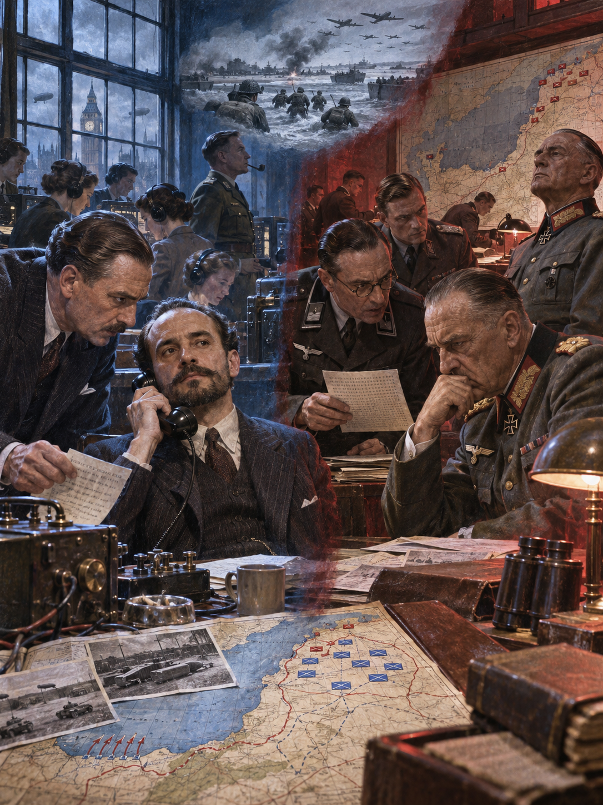

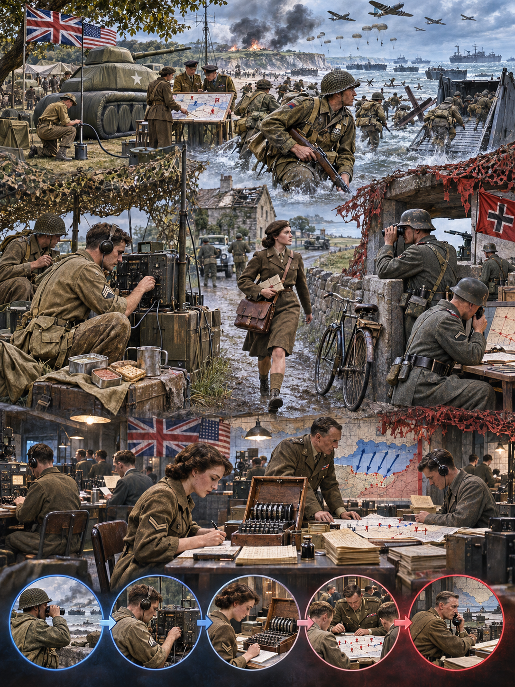

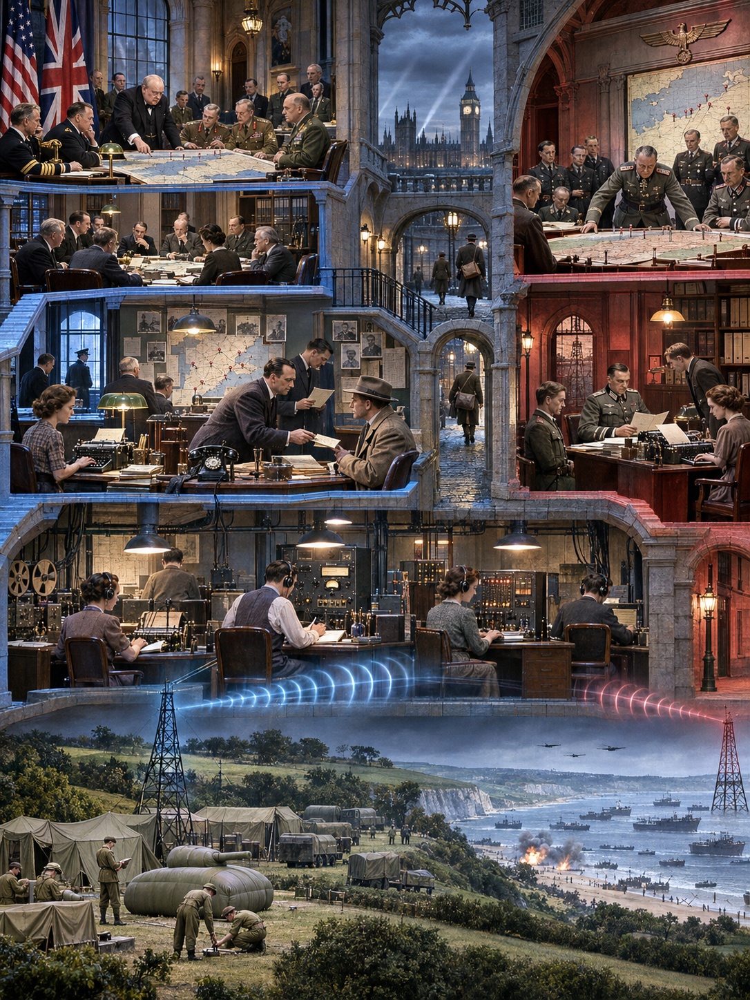

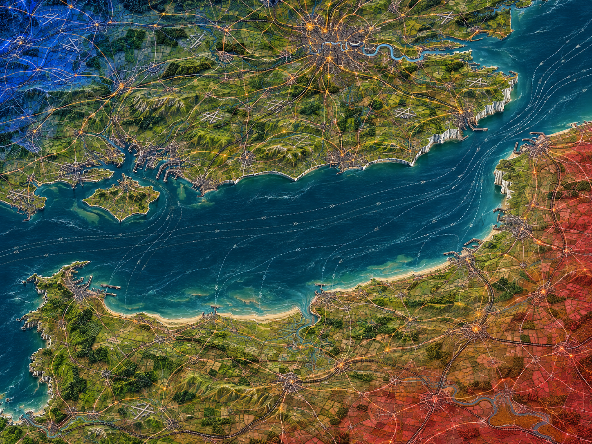

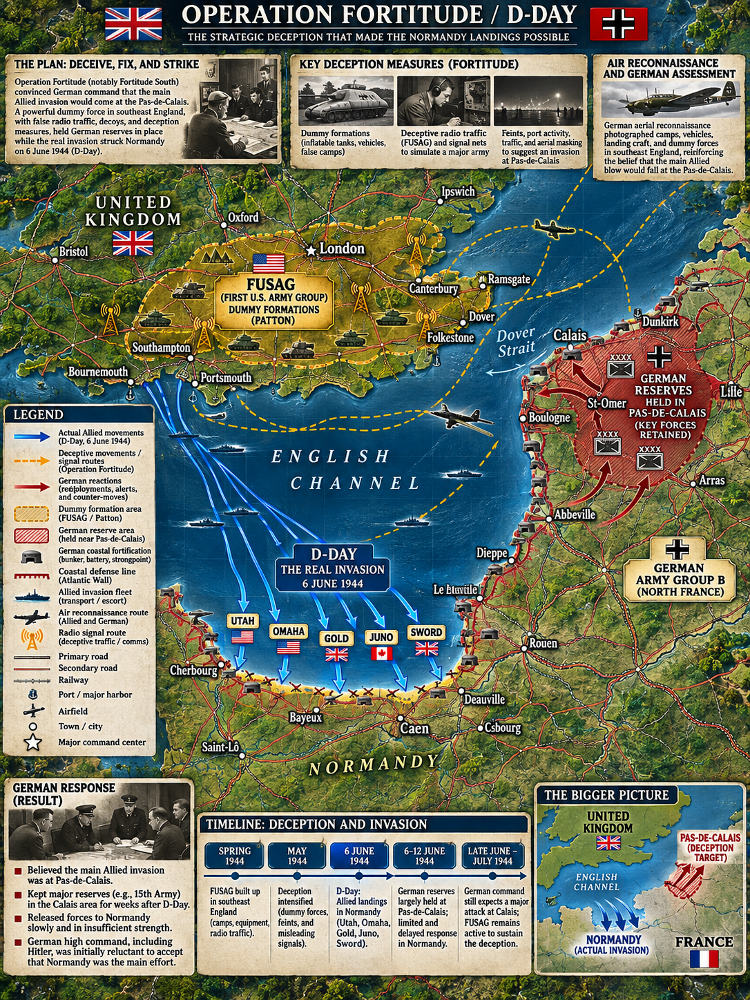

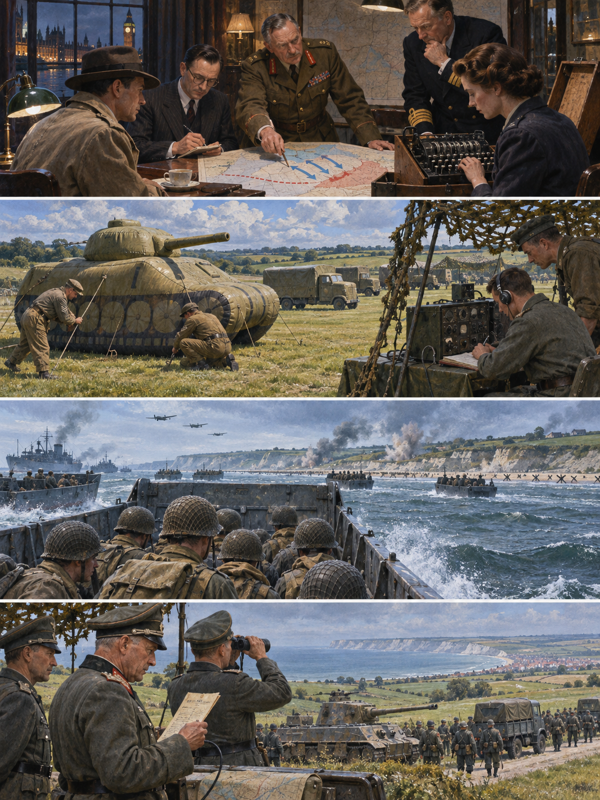

**뒤에서 반복될 지형을 먼저 잡아두기**

- 🌊 **영국해협(English Channel)** — 영국 남부 집결지와 프랑스 해안을 가르는 수로다. 어느 항구와 해변을 향하는지가 기만의 핵심이었다.
- **▰** **파드칼레(Pas-de-Calais)** — 영국과 가장 가까워 독일군이 주공 후보로 중시한 지역이다. 가상 제1미군집단과 GARBO의 보고는 이 기대를 강화했다.
- **▰** **노르망디(Normandy)** — 실제 오버로드 상륙지다. 1944년 6월 6일 해안 교두보가 열렸지만, 독일군이 이를 주공으로 확정하는 시간을 늦추는 것이 중요했다.
- **▰** **도버(Dover)**와 잉글랜드 남동부 — 파드칼레를 마주 보는 가상 집결지였다. 무선·부대 흔적·이중간첩 보고가 서로 같은 이야기를 만들었다.
- **▰** **베를린(Berlin)**·독일 정보지휘부 — 현장 관측과 이중간첩 보고를 종합해 예비대 배치를 판단한 최종 수신부였다.

#### 상세 전역 서사 — 거짓 부대를 믿게 만든 것은 한 통의 거짓말이 아니라 오래 쌓은 신뢰였다

연합군은 프랑스 상륙을 숨길 수 없었으므로, 상륙의 **장소와 뒤따를 주공**을 잘못 판단하게 만드는 쪽을 택했다. 포티튜드 사우스는 **조지 S. 패튼(George S. Patton)**이 지휘하는 것처럼 보이는 가상 제1미군집단을 잉글랜드 남동부에 두고 파드칼레 공격 서사를 만들었다. 그러나 모형 장비만으로는 독일 정보기관의 질문을 견딜 수 없었다. 영국의 이십위원회와 MI5는 포착한 독일 간첩을 통제해 되돌려 쓰는 Double Cross 체계를 운용했고, **후안 푸홀 가르시아(Juan Pujol García), 암호명 GARBO**와 담당관 **토마스 해리스(Thomas Harris)**는 실제로 존재하지 않는 하위 정보원망까지 장기간 일관되게 연기했다.

GARBO는 독일 측이 확인할 수 있는 참된 정보와 늦어서 쓸모없어진 정보를 섞어 신뢰를 축적했다. D-Day 직전 경고는 독일 측에 너무 늦게 도착하도록 설계되어, 상륙 뒤에도 그가 진짜 정보를 보냈다는 인상을 남겼다. 6월 9일 그의 보고는 노르망디 상륙을 파드칼레 주공을 위한 양동으로 해석하게 했다. 이 메시지 하나가 독일군 전체를 멈췄다고 단정할 수는 없다. 파드칼레의 지리적 개연성, 연합군의 다른 기만 수단, 독일 지휘구조의 분열, 공군·해군 열세가 함께 작용했다. 그럼에도 독일 최고지휘부가 파드칼레 위협을 상당 기간 유지해 본 것은 반간망이 기존 기대를 정교하게 확인해 준 결과였다.

#### 전투에서 사용된 속임수 — GARBO의 가상 정보망과 ‘노르망디는 양동’이라는 후속 보고

**연합군 정보기관**은 실제 목표가 노르망디라는 사실을 숨기고, 파드칼레에 별도의 대규모 주공이 남아 있다는 신호를 보였다. 독일 측은 파드칼레가 가장 짧은 도해 지점이고 패튼이 공격적 지휘관이라는 기존 판단 때문에 그 신호를 믿을 이유가 있었다. 그 결과 **독일 최고지휘부**는 노르망디 상륙 뒤에도 파드칼레 방어 전력을 즉시 모두 돌리지 않았다.

#### 속임수 작동 구조

**주체와 의도.** 연합군의 기만·방첩 조직은 오버로드의 상륙지와 후속 증원 계획을 보호하려 했다. GARBO는 그 체계 안에서 독일이 신뢰하는 ‘자기 간첩’의 목소리로 움직였다.

**보인 신호와 믿은 이유.** 가상 부대, 무선 흔적, 지리적으로 그럴듯한 파드칼레 목표, 오랫동안 세부가 맞아떨어진 GARBO의 보고가 하나의 서사를 만들었다. 독일 측은 이미 파드칼레를 합리적인 주공 후보로 보았기에 새 정보가 기존 판단과 맞았다.

**유발된 행동과 결과.** 노르망디 상륙이 시작된 뒤에도 독일 측은 두 번째 상륙 가능성을 경계했다. 이 판단은 연합군이 교두보를 확대하는 동안 파드칼레 방면 전력을 묶어 두는 데 기여했다. 다만 상륙 성공을 기만 하나의 공으로 환원하면 해·공군 우세, 저항군, 화력, 공병, 독일 지휘 지연을 지운다.

**사료의 경계.** 영국 국가기록원은 GARBO의 6월 9일 전문과 Double Cross 관련 문서를 제시한다. 특정 독일 사단의 매 시간 이동을 오직 한 메시지의 결과로 연결하는 강한 인과는 피해야 한다. 확인 가능한 결론은 GARBO가 노르망디를 양동으로 보고했고, 그 보고가 더 큰 포티튜드 서사와 결합해 파드칼레 위협을 유지하는 데 사용됐다는 것이다.

#### 속임수 일곱 질문

1. **누가 누구를 속였는가?** 연합군의 기만·방첩 조직과 통제된 이중간첩망이 독일 정보기관과 최고지휘부를 속였다.
2. **어떤 사실이 거짓이었는가?** 파드칼레를 칠 대규모 제1미군집단이 실재하며 노르망디가 양동이라는 주장이 거짓이었다.
3. **어떤 사실은 진실이지만 오해를 유도했는가?** 영국 남동부의 실제 병력·무선 활동과 패튼의 존재는 진실이었지만, 가상 주공 서사 안에 배치됐다.
4. **상대는 왜 그것을 믿고 싶어 했는가?** 파드칼레는 도해 거리가 짧고 주요 목표와 가까워 기존 작전 상식에 맞았다.
5. **속임수가 없었어도 같은 오판이 발생했을까?** 어느 정도 가능했지만 지속 가능성은 낮아졌을 것이다. 지리적 기대는 있었어도 일관된 인간정보가 없었다면 노르망디 상륙 뒤 판단을 더 빨리 수정할 여지가 컸다.
6. **속은 사람은 어떤 독립 확인을 생략했는가?** 가상 정보원망의 실재성, 무선 흔적과 실제 편제의 대응, 노르망디 증원 흐름이 ‘양동’ 가설과 계속 맞는지를 충분히 독립 검증하지 못했다.
7. **신뢰·동의·안전을 해치지 않으면서 같은 원리를 어디서 연습할 수 있는가?** 보안 모의훈련과 워게임에서 가상 신호를 주되 참가자 동의와 사후 해설을 보장하고, 단일 출처가 아니라 여러 센서의 독립성을 판별하는 연습을 할 수 있다.

#### 시계편 兵者詭道也 — 이 전장에 해당하는 속이는 길

<table fit-page-width="true" header-row="true">
<tr><td>해당 구절·독음·뜻</td><td>전장의 장면</td></tr>
<tr><td>近而示之遠 근이시지원 — 가까운 목표를 먼 듯 보인다</td><td>실제 노르망디 상륙 준비를 파드칼레 주공 서사 뒤에 숨겼다.</td></tr>
<tr><td>用而示之不用 용이시지불용 — 쓰려 하면서 쓰지 않는 듯 보인다</td><td>실제 병력과 지휘관의 존재를 가상 부대의 증거로 보이게 해 진짜 용도를 감췄다.</td></tr>
<tr><td>攻其無備, 出其不意 공기무비, 출기불의 — 대비하지 않은 곳을 치고 뜻하지 않은 곳으로 나온다</td><td>독일군이 가장 강하게 예상한 파드칼레가 아니라 노르망디에 주공을 상륙시켰다.</td></tr>
</table>

#### 法 한눈 비교 — 곡제·관도·주용

<table fit-page-width="true" header-row="true">
<tr><td>진영</td><td>곡제(편제)</td><td>관도(지휘)</td><td>주용(보급·지속)</td></tr>
<tr><td>**연합군**</td><td>실전 상륙군과 기만·방첩·이중간첩망을 분업시켰다.</td><td>기만 목표를 최고계획과 연결하고 요원별 메시지를 담당관이 통제했다.</td><td>장기간 신뢰를 축적할 통신·보호·보상과 상륙 보급을 병행했다.</td></tr>
<tr><td>**독일군**</td><td>대서양 방벽과 기갑예비를 넓은 해안에 분산했다.</td><td>현장·서부전선·최고지휘부의 예비대 권한이 갈렸다.</td><td>연합군 공중우세와 수송망 타격 속에서 증원 지속성이 약했다.</td></tr>
</table>

#### 패군과 승군의 五事

##### **독일군(패군)**

<table fit-page-width="true" header-row="true">
<tr><td>요소</td><td>판단</td></tr>
<tr><td color="orange_bg">🤝 **道**</td><td>정보기관·현장군·최고지휘부가 같은 증거를 같은 기준으로 갱신하지 못했다. (지기·결속)</td></tr>
<tr><td color="blue_bg">🌤️ **天**</td><td>파드칼레라는 개연성 높은 가설에 매여 노르망디 교두보 확대라는 새 표본의 비중을 늦게 높였다. (지피·타이밍·확률 관점)</td></tr>
<tr><td color="green_bg">🧭 **地**</td><td>영국해협 최단거리와 실제 상륙 가능 지형을 혼동해 파드칼레에 과도한 의미를 부여했다. (원근·험이·광협)</td></tr>
<tr><td color="purple_bg">🎖️ **將**</td><td>**히틀러**와 서부 지휘부의 예비대 통제·상륙 해석이 갈려 신속한 집중을 막았다. (지신인용엄)</td></tr>
<tr><td color="yellow_bg">⚙️ **法**</td><td>방어 편제와 수송망이 광범위한 위협에 묶였고, 파괴된 철도·도로가 재배치를 늦췄다. (곡제·관도·주용)</td></tr>
</table>

**직관·편향 한 줄:** **독일 최고지휘부**가 노르망디의 실제 증원보다 파드칼레 주공을 오래 경계한 판단에서는 기존 기대와 맞는 GARBO 보고를 크게 본 확증편향이 작동한 것으로 볼 수 있다.

🏳️ **패군 측 결과**: 六敗(육패) 중 `亂(란, 지휘와 정보판단의 혼선)`에 가깝다. **회피 분기점:** 6월 6일 뒤 파드칼레 가설에 시간 제한을 두고, 실제 상륙 물동량·교두보 확대·후속 부대 식별을 독립 지표로 재평가했다면 노르망디 교두보를 반드시 격파하지는 못해도 예비대가 장기간 묶이는 손실은 줄일 수 있었다.

##### **연합군(승군)**

<table fit-page-width="true" header-row="true">
<tr><td>요소</td><td>판단</td></tr>
<tr><td color="orange_bg">🤝 **道**</td><td>군사계획·방첩·통신·현장 상륙군이 하나의 목표 아래 각자 비밀등급과 임무를 지켰다. (지기·결속)</td></tr>
<tr><td color="blue_bg">🌤️ **天**</td><td>독일이 파드칼레를 중시한다는 기존 기대를 이용하되, 기만만 믿지 않고 압도적 상륙·증원 능력을 준비했다. (지피·타이밍·확률 관점)</td></tr>
<tr><td color="green_bg">🧭 **地**</td><td>파드칼레와 노르망디의 거리·항공권·해변·항만 조건을 서로 다른 이야기로 설계했다. (원근·험이·사생)</td></tr>
<tr><td color="purple_bg">🎖️ **將**</td><td>최고지휘부는 **GARBO**의 가치와 위험을 알면서 메시지를 전체 기만계획에 제한적으로 결합했다. (지신인용엄)</td></tr>
<tr><td color="yellow_bg">⚙️ **法**</td><td>통제된 간첩망, 가상 편제, 무선, 실제 상륙·보급을 같은 시간표에 맞췄다. (곡제·관도·주용)</td></tr>
</table>

🏆 **승군 측 결과**: 五勝(오승) 중 `以虞待不虞者勝(이우대불우자승, 대비한 채 대비하지 못한 적을 상대하는 자가 이김)`과 `將能而君不御者勝(장능이군불어자승, 장수가 유능하고 군주가 함부로 간섭하지 않으면 이김)`에 해당한다.

#### 法을 압축하지 않고 보기 — 곡제·관도·주용

**곡제 曲制(곡제): 부대를 어떻게 나누고 결합했는가**
<table fit-page-width="true" header-row="true">
<tr><td>진영</td><td>곡제 曲制(곡제)</td></tr>
<tr><td>**승군**</td><td>실제 오버로드 상륙군과 포티튜드 기만조직을 분리하되, 가상 편제의 흔적이 실전 계획과 충돌하지 않게 결합했다.</td></tr>
<tr><td>**패군**</td><td>대서양 연안을 넓게 방어하고 기갑예비를 보유했으나 실제 상륙지에 즉시 집중하지 못했다.</td></tr>
</table>

**관도 官道(관도): 누가 명령하고 어떻게 전달했는가**
<table fit-page-width="true" header-row="true">
<tr><td>진영</td><td>관도 官道(관도)</td></tr>
<tr><td>**승군**</td><td>이십위원회·MI5 담당관·이중간첩의 메시지가 승인·기록되었고 오버로드 지휘부의 기만 목표에 종속됐다.</td></tr>
<tr><td>**패군**</td><td>정보평가와 예비대 방출 권한이 여러 지휘층에 걸쳐 있어 새 증거에 대한 수정이 늦었다.</td></tr>
</table>

**주용 主用(주용): 군량·장비·전투 지속 능력을 어떻게 썼는가**
<table fit-page-width="true" header-row="true">
<tr><td>진영</td><td>주용 主用(주용)</td></tr>
<tr><td>**승군**</td><td>상륙정·함포·항공·인공항·수송선이라는 실제 물량을 준비하면서, 장기 간첩운용에는 안전한 통신·생활비·보호·담당관의 시간을 지속 투입했다.</td></tr>
<tr><td>**패군**</td><td>연안 방어물자와 예비대를 넓게 배치했으며 연합군의 공중차단으로 철도·도로 증원과 보급이 제약됐다.</td></tr>
</table>

#### 참고자료

- [The UK National Archives — Operation Overlord and D-Day](https://www.nationalarchives.gov.uk/explore-the-collection/explore-by-time-period/second-world-war/operation-overlord-and-d-day/)
- [The UK National Archives — Double Agent Operations: GARBO files](https://www.nationalarchives.gov.uk/double-agent-operations/)
- [U.S. Army Center of Military History — Normandy campaign resources](https://history.army.mil/)
- [Imperial War Museums — D-Day deception and Operation Fortitude](https://www.iwm.org.uk/history/d-days-parachuting-dummies-and-inflatable-tanks)

**토론용 논점:** 반간에게 `厚(후, 두텁게 대우함)`하는 것과 반간의 말을 크게 믿는 것은 왜 다른가? GARBO의 성공은 보상액보다 담당관·검증·다른 기만수단·실전 전력의 결합에 있었으며, 출처 보호가 곧 출처 맹신이 되어서는 안 된다.

### 동양 — 🏛️ 동진 vs 🏛️ 전진 │ 비수대전(淝水之戰, 383)

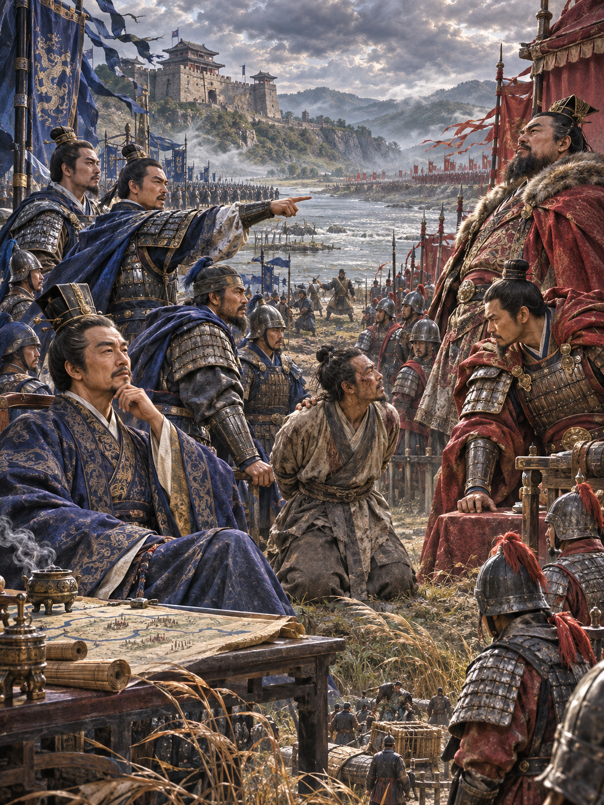

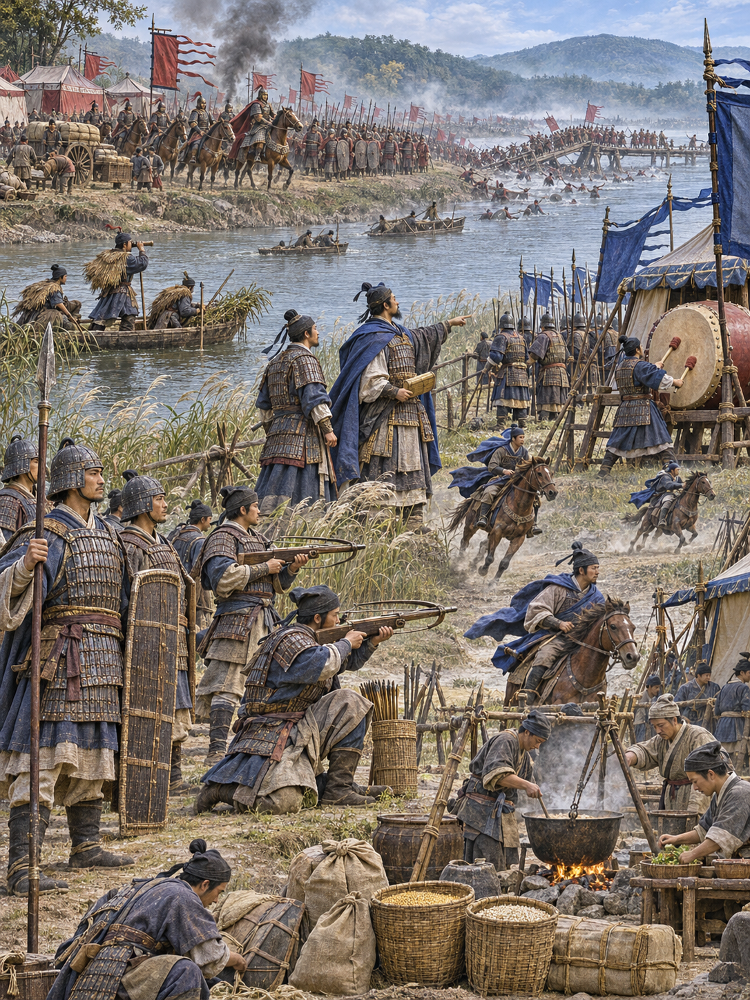

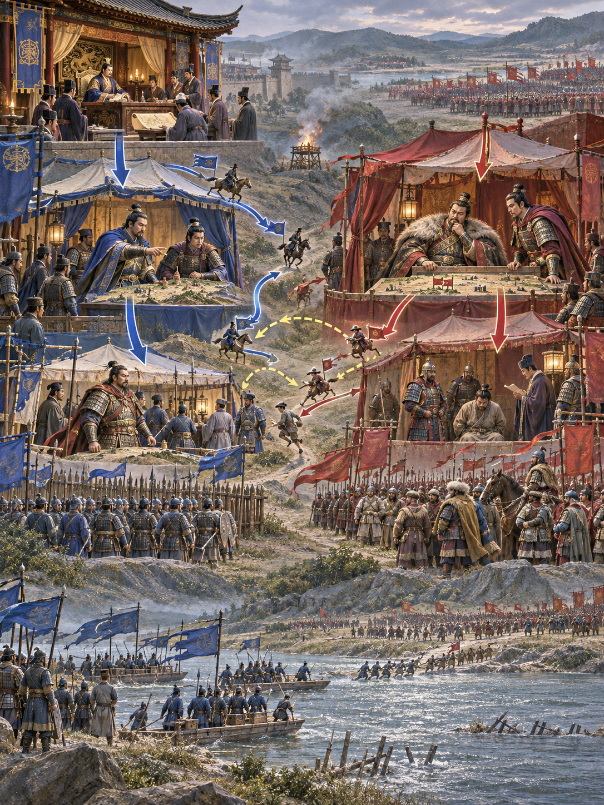

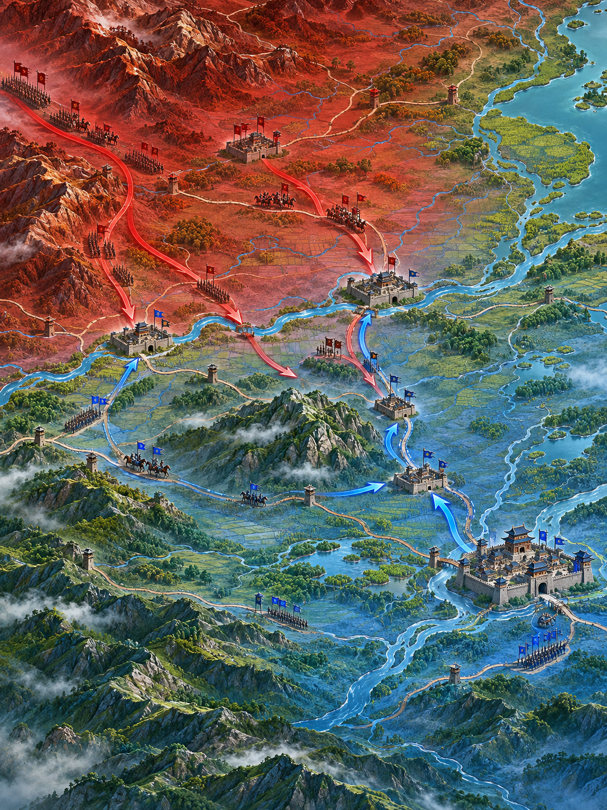

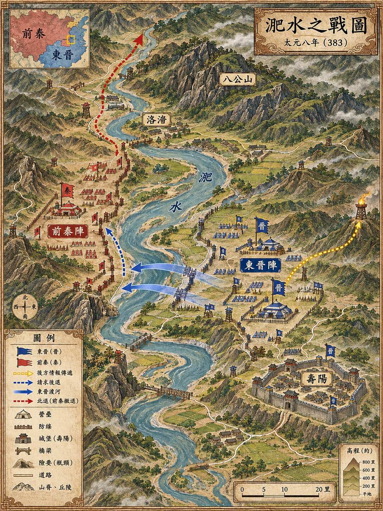

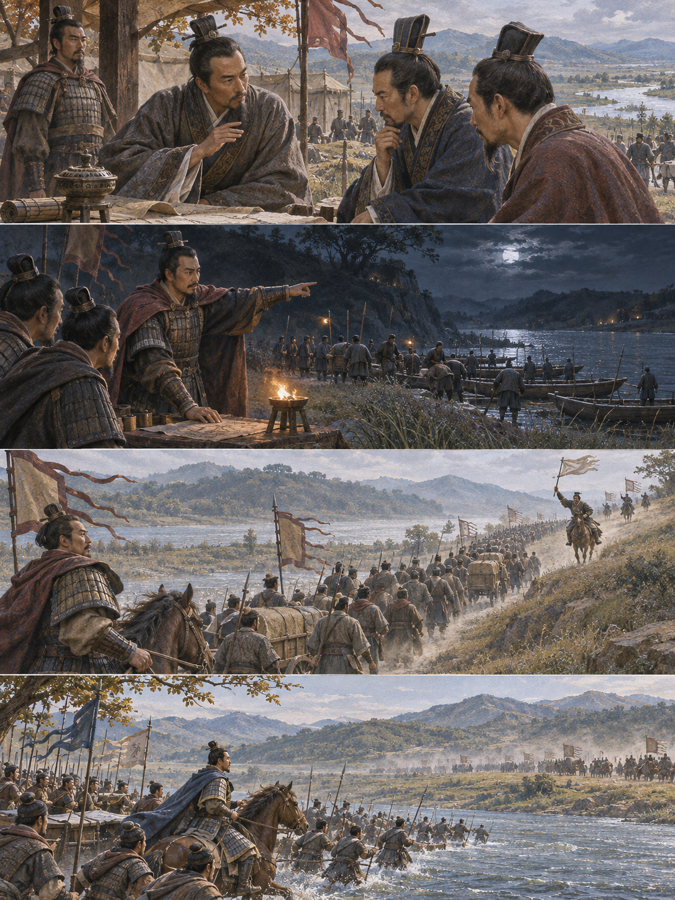

**뒤에서 반복될 지형을 먼저 잡아두기**

- 🌊 **회수(淮水)** — 전진군이 남하해 동진 방어권으로 들어오는 큰 수계다. 전선과 후방의 연결을 제약했다.
- 🌊 **낙간(洛澗)** — **유뢰지**가 전진 선봉을 격파한 곳이다. 이 승리가 주서의 ‘집결 전에 선봉을 치라’는 조언의 실행 가능성을 보였다.
- **▰** **수양(壽陽)** — 전진이 점령한 전방 거점이며 **부견**과 **부융**이 전황을 본 곳이다.
- 🌊 **비수(淝水)** — 양군 사이의 물길이다. 전진군이 물가에서 물러나 동진군의 도하를 허용하는 순간 통제 가능한 전술 후퇴가 붕괴로 바뀌었다.
- ⛰️ **팔공산(八公山)** — 수양 건너편의 산지다. 후대 전승은 **부견**이 산의 초목까지 적병으로 보았다고 전한다.
- **▰** **건강(建康)** — 동진의 수도이자 전쟁의 전략적 목표였다. 비수 방어선이 무너지면 수도권이 직접 위협받았다.

#### 상세 전역 서사 — 주서의 정보는 ‘대군 전체’가 아니라 아직 모이지 않은 선봉의 시간표를 겨냥했다

**전진의 부견(苻堅)**은 여러 지역에서 모은 대군으로 동진을 압박했지만, 전군이 한 시각에 한 지휘 아래 집결한 상태는 아니었다. 전진은 수양을 점령한 뒤, 과거 양양에서 붙잡아 관직을 준 동진 장수 **주서(朱序)**를 동진 진영에 보내 항복을 권하게 했다. 『자치통감』은 주서가 공식 임무와 달리 **사석** 등에게 전진군 전체가 모이기 전에 선봉을 빨리 치라고 은밀히 조언했다고 전한다. **사현**은 **유뢰지**의 정예를 낙간으로 보내 **양성**의 선봉을 격파했다.

동진군이 비수 동쪽에 이르자 전진군은 물가에 진을 쳐 도하를 막았다. **사현** 측은 전진군이 조금 물러나 도하 공간을 주고 결전하자고 제안했다. 전진 지휘부는 동진군이 절반쯤 건넜을 때 기병으로 치려는 계산으로 후퇴를 허락했다. 그러나 여러 지역 병력과 새로 편입된 집단이 섞인 대군은 ‘조금 물러남’을 일제히 멈출 통제력을 갖추지 못했다. 전승은 이때 후방의 **주서**가 “전진군이 패했다”고 외쳐 퇴각을 패주로 키웠다고 기록한다. **부융**이 군을 돌리려다 말에서 넘어져 죽고, 동진군이 도하해 추격하면서 붕괴가 커졌다.

이 서사는 주서를 반간의 전형으로 읽게 하지만 사료의 시간적 거리를 잊어서는 안 된다. 『진서』는 7세기, 『자치통감』은 11세기에 편찬됐고, 병력 규모와 사상자·구호의 정확한 파급은 과장 가능성이 있다. 따라서 ‘주서 한 명이 백만 대군을 무너뜨렸다’가 아니라, **전진 내부의 집결·지휘·사기 문제가 이미 존재했고 주서의 정보와 구호가 그 취약한 순간을 동진에 유리하게 연결했다는 전승**으로 제한해 읽는 것이 안전하다.

#### 전투에서 사용된 속임수 — 항복 사절의 임무 전환과 후퇴를 패주로 보이게 한 구호

전진은 주서를 동진 출신의 설득자로 이용하려 했으나, 주서는 그 접근권을 동진에 정보를 주는 통로로 되돌렸다고 전한다. 결전 때의 “전진군이 패했다”는 외침은 아직 전술 후퇴 중인 병력에게 패배가 이미 확정됐다는 신호를 주었다. 이 두 행위는 주서의 의도가 기록된 전승에 근거하지만, 외침을 실제로 몇 명이 들었고 붕괴에 얼마나 기여했는지는 알 수 없다.

#### 속임수 작동 구조

**주체와 의도.** 주서는 전진이 맡긴 항복 권유 임무를 거슬러 동진에 전진군의 미집결 상태와 선제공격 기회를 알리고, 결전에서는 후퇴 중인 전진군의 통제를 무너뜨리려 했다고 전한다.

**보인 신호와 믿은 이유.** 전진 지휘부에는 충성하는 관료·사절처럼 보였고, 병사들에게는 후방에서 들려온 “패했다”는 말이 실제 후퇴 장면과 맞물렸다. 이미 대열이 뒤로 움직였기에 거짓 구호가 눈앞의 현상과 맞아 보였다.

**유발된 행동과 결과.** 동진 지휘부는 전진군 집결 전에 낙간 선봉을 쳤고, 전진 병력은 제한 후퇴를 멈추지 못한 채 무너졌다. 동진군의 도하·공격과 부융의 전사가 공황을 확대했다.

**사료의 경계.** 주서의 밀고와 구호는 『진서』·『자치통감』 계열의 핵심 전승이지만 동시대 작전일지처럼 취급할 수 없다. 전진군 붕괴의 원인은 혼성 대군의 통제, 과도한 전선, 선봉 패배, 후퇴 명령, 동진군의 공격이 함께 만든 것으로 써야 한다.

#### 속임수 일곱 질문

1. **누가 누구를 속였는가?** 전승상 주서는 자신을 사절로 쓴 전진 지휘부를 속였고, 결전에서는 전진 병사들에게 패배가 확정됐다는 신호를 주었다.
2. **어떤 사실이 거짓이었는가?** 후퇴가 시작된 순간 “전진군이 이미 패했다”는 단정은 사실보다 앞선 말이었다.
3. **어떤 사실은 진실이지만 오해를 유도했는가?** 전진 대열이 실제로 뒤로 움직이고 일부 선봉이 이미 패한 것은 진실이었지만, 전군 패배가 확정됐다는 뜻은 아니었다.
4. **상대는 왜 그것을 믿고 싶어 했는가?** 믿고 싶었다기보다 혼성 대군의 병사들이 후퇴 이유와 정지선을 알지 못한 상태에서 눈앞의 이동과 후방 구호를 같은 패주 신호로 해석하기 쉬웠다.
5. **속임수가 없었어도 같은 오판이 발생했을까?** 가능성은 높다. 물가에서 대군을 뒤로 물리는 명령 자체가 위험했고 지휘통제가 약했다. 다만 구호가 붕괴 속도를 높였다는 것이 전승의 판단이다.
6. **속은 사람은 어떤 독립 확인을 생략했는가?** 부대별 후퇴 한계선, 정지 신호, 예비대의 차단선, ‘패배’ 소문의 공식 확인 경로가 작동하지 않았다.
7. **신뢰·동의·안전을 해치지 않으면서 같은 원리를 어디서 연습할 수 있는가?** 재난대응 훈련에서 거짓 소문 카드를 합의된 모의상황으로 투입하고, 현장 방송·지휘망·복수 확인을 통해 공황성 정보를 차단하는 훈련을 할 수 있다.

#### 시계편 兵者詭道也 — 이 전장에 해당하는 속이는 길

<table fit-page-width="true" header-row="true">
<tr><td>해당 구절·독음·뜻</td><td>전장의 장면</td></tr>
<tr><td>亂而取之 난이취지 — 혼란하게 만들어 취한다</td><td>통제된 후퇴가 흔들리는 순간 패배 구호가 혼란을 증폭했고 동진군이 도하해 공격했다. 다만 구호의 효과는 후대 전승에 의존한다.</td></tr>
<tr><td>攻其無備, 出其不意 공기무비, 출기불의 — 대비하지 않은 곳을 치고 뜻하지 않은 때에 나온다</td><td>동진군은 전진 대군이 모두 집결하기 전에 낙간 선봉을 먼저 쳤다.</td></tr>
</table>

#### 法 한눈 비교 — 곡제·관도·주용

<table fit-page-width="true" header-row="true">
<tr><td>진영</td><td>곡제(편제)</td><td>관도(지휘)</td><td>주용(보급·지속)</td></tr>
<tr><td>**동진군**</td><td>북부병 정예를 선봉 타격과 본전 도하에 집중했다.</td><td>사석·사현·사염·유뢰지의 임무가 단계별로 이어졌다.</td><td>짧은 방어선에서 수로와 수도권 보급을 활용했다.</td></tr>
<tr><td>**전진군**</td><td>여러 지역·세력의 대군이 시차를 두고 남하해 선봉과 본대가 분리됐다.</td><td>부견·부융의 전술 후퇴 의도가 대군 전체의 정지 명령으로 전달되지 못했다.</td><td>깊어진 남정과 긴 보급선이 대군의 지속·집결을 어렵게 했다.</td></tr>
</table>

#### 패군과 승군의 五事

##### **전진군(패군)**

<table fit-page-width="true" header-row="true">
<tr><td>요소</td><td>판단</td></tr>
<tr><td color="orange_bg">🤝 **道**</td><td>정복·편입된 여러 세력과 병력이 같은 전쟁 목적과 신호체계로 묶이지 못했다. (지기·사기)</td></tr>
<tr><td color="blue_bg">🌤️ **天**</td><td>동진이 겁먹고 버틸 것이라는 기대와 병력 우세를 과신해 집결 전 선봉 패배와 소문 확산의 위험을 낮게 보았다. (지피·타이밍·확률 관점)</td></tr>
<tr><td color="green_bg">🧭 **地**</td><td>비수에 붙여 세운 대군을 뒤로 물리는 순간 물길과 좁은 도하축이 통제 실패를 키웠다. (원근·광협·사생)</td></tr>
<tr><td color="purple_bg">🎖️ **將**</td><td>**부견**과 **부융**은 반도하 타격의 이익은 보았으나 혼성 대군이 후퇴를 멈출 능력은 충분히 계산하지 못했다. (지신인용엄)</td></tr>
<tr><td color="yellow_bg">⚙️ **法**</td><td>선봉·본대·후속군의 집결과 명령·보급이 분리되어 규모가 통제력으로 전환되지 않았다. (곡제·관도·주용)</td></tr>
</table>

**직관·편향 한 줄:** **부견**이 수적 우세와 반도하 타격 구상에 기대어 전군 후퇴 통제력을 충분히 시험하지 않은 판단에서는 계획 오류와 과신이 작동한 것으로 볼 수 있다.

🏳️ **패군 측 결과**: 六敗(육패) 중 `亂(란, 명령·대열의 혼란)`과 `北(배, 적정을 헤아리지 못한 패주)`가 겹쳤다. **회피 분기점:** 강가 진형을 그대로 유지하고 동진군의 다른 도하 시도를 감시하거나, 후퇴가 필요했다면 부대별 정지선·예비대 차단선·신호를 먼저 정한 뒤 순차적으로 물러났다면 승리를 보장하지는 못해도 전군 패주로 번지는 결과는 피할 가능성이 있었다.

##### **동진군(승군)**

<table fit-page-width="true" header-row="true">
<tr><td>요소</td><td>판단</td></tr>
<tr><td color="orange_bg">🤝 **道**</td><td>수도 방어라는 공동 목적 아래 북부병의 정예와 지휘부가 위험한 선제공격을 수행했다. (지기·사기)</td></tr>
<tr><td color="blue_bg">🌤️ **天**</td><td>주서의 말을 맹목적으로 기다리지 않고 ‘대군 미집결’이라는 짧은 시간창을 낙간 공격으로 시험했다. (지피·타이밍·확률 관점)</td></tr>
<tr><td color="green_bg">🧭 **地**</td><td>낙간 선봉을 꺾고 비수 도하의 순간을 공격 기회로 바꿨다. (원근·험이·광협)</td></tr>
<tr><td color="purple_bg">🎖️ **將**</td><td>**사현**과 **유뢰지**는 정보가 가리킨 취약 시간을 정예의 속도와 결합했다. (지신인용엄)</td></tr>
<tr><td color="yellow_bg">⚙️ **法**</td><td>적은 정예를 선봉 격파와 도하 공격에 집중하고 지휘 임무를 분명히 했다. (곡제·관도·주용)</td></tr>
</table>

🏆 **승군 측 결과**: 五勝(오승) 중 `識衆寡之用者勝(식중과지용자승, 많고 적은 병력의 쓰임을 아는 자가 이김)`과 `以虞待不虞者勝(이우대불우자승, 대비한 채 대비하지 못한 적을 상대하는 자가 이김)`에 해당한다.

#### 法을 압축하지 않고 보기 — 곡제·관도·주용

**곡제 曲制(곡제): 부대를 어떻게 나누고 결합했는가**
<table fit-page-width="true" header-row="true">
<tr><td>진영</td><td>곡제 曲制(곡제)</td></tr>
<tr><td>**승군**</td><td>유뢰지의 정예 선봉이 낙간을 열고, 사현·사염·환이의 본대가 비수 도하와 추격을 이어 맡았다.</td></tr>
<tr><td>**패군**</td><td>선봉·본대·후속 대군이 시차를 두고 흩어졌고, 여러 출신 병력을 단일 후퇴대형으로 통제하지 못했다.</td></tr>
</table>

**관도 官道(관도): 누가 명령하고 어떻게 전달했는가**
<table fit-page-width="true" header-row="true">
<tr><td>진영</td><td>관도 官道(관도)</td></tr>
<tr><td>**승군**</td><td>주서의 정보가 사석·사현 지휘부에 전달됐고, 낙간 선제공격과 비수 도하라는 별도 명령으로 전환됐다.</td></tr>
<tr><td>**패군**</td><td>부견·부융의 제한 후퇴 명령이 대군 말단까지 같은 뜻과 정지선으로 전달되지 못했고 비공식 구호가 공식 명령을 압도했다.</td></tr>
</table>

**주용 主用(주용): 군량·장비·전투 지속 능력을 어떻게 썼는가**
<table fit-page-width="true" header-row="true">
<tr><td>진영</td><td>주용 主用(주용)</td></tr>
<tr><td>**승군**</td><td>동진군은 수도권과 회수 방어선에 가까운 수륙 이동로를 활용하고 정예를 짧은 결정 구간에 집중했다.</td></tr>
<tr><td>**패군**</td><td>전진군은 광대한 점령지에서 대군을 남하시켜 집결·식량·말먹이·명령 전달 부담을 키웠으며, 정확한 비용과 병력 수는 사료상 불확실하다.</td></tr>
</table>

#### 참고자료

- [中國哲學書電子化計劃 — 『資治通鑑』](https://ctext.org/wiki.pl?if=gb&res=778112)
- [『資治通鑑』 권105 비수대전 관련 원문 모음](https://wentongjian.com/site/stories/165.html)
- [Chinese Text Project — 朱序 인물 자료](https://ctext.org/datawiki.pl?if=en&res=301980)
- [Hong Kong Education Bureau — 淝水之戰 교육자료](https://www.edb.gov.hk/attachment/sc/curriculum-development/kla/pshe/references-and-resources/chinese-history/war3_sc.pdf)

**토론용 논점:** 주서의 전승은 반간의 가치를 보여 주지만, ‘내부자 한 명이 대군을 무너뜨렸다’는 영웅서사로 읽으면 전진군의 집결·지휘·보급 실패가 가려진다. 내부자의 정보는 취약한 시간과 지점을 열었고, 실제 승패는 동진 지휘부가 그 정보를 작은 선제공격으로 시험하고 편제·지형·속도와 결합하면서 갈렸다.

---
## 5. 핵심 통찰 + 실생활 적용 + 생활루틴

### 핵심 통찰

이번 구절의 날카로움은 반간을 가장 영리한 스파이로 칭찬하는 데 있지 않다. 오간의 정보가 한 지휘 체계에서 서로 작동하려면 적의 정보망이 무엇을 보고 어떻게 보고하는지 알려 주는 접속점이 필요하고, 그 접속점을 군주가 이해해야 한다는 데 있다. 정보는 실무자의 비밀 상자에 갇힌 재료가 아니라 최고결정자의 책임이다.

`厚`는 이 책임의 물질적 표현이다. 전쟁 위험을 떠안긴 사람에게 보상과 보호를 아끼면서 충성과 정확성만 요구할 수 없다. 값싼 대우는 사실을 숨기거나 듣기 좋은 말을 만들거나 더 나은 조건을 제시한 쪽으로 돌아설 유인을 만든다. 정보 실패는 개인의 도덕성만이 아니라 지휘부가 만든 보상·보호 구조의 실패다.

그러나 후대는 맹신이 아니다. 반간은 가장 안쪽을 아는 사람인 동시에 양쪽의 이해관계가 겹치는 사람이다. 후하게 대우할수록 접근권을 무제한으로 주는 것이 아니라, 필요한 범위만 공유하고 다른 출처로 검증하며 거짓이나 오류를 안전하게 정정할 통로를 둬야 한다.

### 실생활 적용

3교대 현장에서 조와 조 사이를 오가며 설비 상태를 설명하는 사람은 작은 의미의 접속점이다. 그 사람이 어느 시각에 무엇을 직접 보았고, 누구에게서 무엇을 들었으며, 어떤 조치를 했는지 정확히 전달하면 다음 조는 로그와 현장을 빠르게 연결할 수 있다. 반대로 “다들 그렇게 말한다”는 한 문장이 반복되면 하나의 추정이 여러 출처처럼 보인다.

그래서 인계받을 때는 사람을 추궁하기보다 출처를 분리한다. `직접 관찰 / 설비 로그 / 앞 조의 전달 / 아직 확인하지 못한 추정` 네 칸으로 나누고, 같은 사실을 말한 사람이 여러 명이어도 최초 출처가 하나인지 확인한다. 이는 동료를 의심하라는 말이 아니라, 사람의 신뢰와 정보의 검증을 서로 다른 축으로 관리하라는 뜻이다.

인물사건관찰시리즈에서 전씨는 복잡한 조치 때 긴장하거나 다른 사람의 말을 충분히 듣지 않는 행동이 기록되어 있고, 근무조 신입 최씨는 피로와 수면 문제 속에서 모니터링·보고가 누락된 장면이 기록되어 있다. 이 관찰을 성격 진단으로 고정하지 말고, 당시 피로·업무 배치·직접 관찰·로그를 분리해야 한다. 특히 2026년 7월 31일 B조 조장 이씨와의 충돌 기록은 영구 제외 규칙에 따라 이번 적용에서 사용하지 않았다.

전씨나 최씨가 현장과 상황실 사이의 정보를 연결해야 할 때, “왜 제대로 못 했나”부터 묻기보다 보고 범위와 시점을 작게 정한다. 예를 들어 `5분 안에 현재 알람과 직접 본 상태만 1차 보고 / 원인 추정은 로그 확인 뒤 2차 보고 / 졸림·통증·접근 불가면 즉시 교대 요청`으로 나눈다. 사실을 빨리 알린 사람에게 비난이 돌아가면 다음부터는 문제가 작아 보일 때 숨기게 된다.

후하게 대우한다는 원리를 현장에서는 돈만으로 좁힐 필요가 없다. 정확한 인계에 시간을 배정하고, 위험을 먼저 알린 사람을 탓하지 않으며, 어려운 조치 뒤 휴식과 지원을 주고, 공을 보고자에게 돌리는 것이 후대다. 반대로 귀찮은 사실을 알려 주는 사람에게 일만 더 얹으면 정보망의 중심을 벌주는 셈이다.

사용자 자신도 최종 판단을 남에게 넘기지 않는다. 조장이든 경험자든 “그렇다더라”는 말만으로 사람이나 설비를 단정하지 않고, 현재 화면·로그·실물·이전 발생률을 확인한다. 보고자를 존중하면서도 독립 검증을 붙이는 것이 `君必知之`의 생활형 실천이다.

### 생활루틴 추천

**정보망의 중심을 맡긴 사람을 값싸게 대하면 재수가 없다.**

**이유:** 오늘 인계 한 건을 골라 3분 동안 `최초 출처 / 직접 확인 / 미확인 / 다음 확인자`를 적고, 사실을 먼저 알린 사람에게 감사와 다음 지원을 분명히 전한다. 이 절차가 없으면 한 사람의 추정이 여러 보고처럼 불어나고, 불편한 사실을 전한 사람은 비난과 추가 업무를 피해 다음 문제를 늦게 알리게 된다. 작은 박대가 보고 지연과 오판을 거쳐 다음 교대의 안전·품질 문제로 커지므로, `君必知之`로 책임을 위에 두고 `反間不可不厚`로 정보 제공자의 보호와 대우를 두텁게 해야 한다.
