<!-- sunzi-analysis-mode: full -->

> 석은지흥야, 이지재하, 주지흥야, 여아재은 — 결과를 보고 사람의 지난 자리를 꾸며 말하면 재수가 없다.

---

## 1. 원문 + 독음 + 직역 + 한자어 뜻풀이

昔殷之興也, 伊摯在夏, 周之興也. 呂牙在殷. 석은지흥야, 이지재하, 주지흥야. 여아재은.

**직역**

옛날 은나라가 일어날 때 이지가 하나라에 있었고, 주나라가 일어날 때 여아가 은나라에 있었다.

문장은 두 왕조의 흥기를 말하지만 승리 장면을 보여 주지 않는다. 손자가 먼저 가리키는 것은 사람이 서 있던 자리다. 은을 일으키는 데 공을 세운 이지는 원래 하나라 쪽 사정을 접할 수 있는 곳에 있었고, 주를 돕는 여아도 은나라의 질서 안에 있었다. 새 나라가 적국을 멀리서 추측한 것이 아니라, 그 안의 사람·제도·형편을 실제로 아는 인재에게서 선지를 얻었다는 뜻이다.

그렇다고 두 사람의 생애를 오늘날 의미의 직업 간첩 기록으로 단정할 수는 없다. 이윤과 여상의 전기는 후대 전승과 정치적 이상화가 겹쳐 있고, 바로 다음 문장의 `上智爲間`이 이들을 용간의 모범으로 배치한다. 따라서 확실한 본문과 후대 서사를 구분해야 한다. 본문이 말하는 최소한의 사실은 **흥기한 세력의 핵심 조력자가 상대 왕조의 내부 사정과 접촉한 이력이 있었다**는 것이다.

#### 昔(옛 석) — 승리 뒤의 전설을 현재의 증거처럼 쓰지 않다

`昔`은 지금의 판단을 옛 사례로 돌려 확인하게 한다. 그러나 옛일은 이미 결말을 알고 읽기 때문에, 성공한 인물의 모든 과거가 처음부터 승리를 향한 준비였던 것처럼 보이기 쉽다. 이 구절에서 `昔`은 권위를 빌리는 장식인 동시에 결과론을 경계해야 하는 표지다.

이윤이 하나라에 있었고 여상이 은나라에 있었다는 문장은 짧지만, 그들이 언제 어떤 신분으로 어떤 정보를 얻었는지까지 말하지 않는다. 후대 전승을 사용할 때에는 본문이 확정한 자리, 주석이 부여한 기능, 전설이 덧붙인 장면을 갈라 읽어야 한다. 그래야 역사 사례가 그럴듯한 이야기로 정보를 대신하지 않는다.

#### 殷之興(은나라 은·갈 지·일어날 흥) — 새 질서가 내부 지식을 받아들여 일어나다

`興`은 단순히 나라가 생겼다는 말보다 쇠한 질서 대신 새로운 정치 세력이 일어난다는 움직임을 담는다. 은의 흥기는 탕 한 사람의 용맹만으로 설명되지 않는다. 누구를 등용하고, 하나라의 형편을 어떻게 판단하며, 어느 때 움직일지를 아는 지식이 군사 행동 앞에 놓였다.

이 문장에서 `殷`과 `興` 사이에는 `伊摯在夏`가 원인의 한 고리처럼 붙는다. 상대 내부를 아는 사람의 지식이 곧바로 승리를 보장하지는 않지만, 잘못된 적정 위에서 병력을 움직일 위험을 줄인다. 흥기는 정보 하나의 마술이 아니라 인재 식별·정치 목적·군사력·시기의 결합이다.

#### 伊摯在夏(저 이·잡을 지·있을 재·하나라 하) — 적국에 닿아 있던 사람을 자기 판단 체계로 들이다

`伊摯`는 이윤을 가리키는 이름이다. `在夏`는 그가 하나라의 영역과 사정에 접촉해 있었다는 자리 정보를 준다. 고주석은 이 점을 은이 하나라를 알 수 있었던 인적 통로로 읽는다. 중요한 것은 낭만적인 출신담이 아니라, 그가 어느 정보에 접근할 수 있었고 탕이 그 지식을 어떻게 판단에 연결했는가다.

`在`는 소속과 충성이 언제나 같은 것은 아님을 보여 준다. 어떤 조직 안에 있었다고 그 조직의 모든 비밀을 아는 것도 아니고, 떠나왔다고 곧바로 새 조직에 정확한 정보를 주는 것도 아니다. 접근 범위·경험 시점·이해관계·검증 가능한 사실을 따져야 `在夏`가 선지로 바뀐다.

#### 周之興(두루 주·갈 지·일어날 흥) — 같은 구조를 반복해 우연이 아닌 원리로 만들다

손자는 은의 사례 하나로 멈추지 않고 주의 흥기를 나란히 놓는다. 두 문장의 대칭은 특정 영웅의 신비한 재능보다 반복되는 구조를 드러낸다. 새 질서는 낡은 질서 밖에서 구호만 외쳐 일어난 것이 아니라, 그 질서의 작동과 균열을 아는 사람을 얻어 판단의 해상도를 높였다.

다만 두 사례가 닮았다고 세부까지 같다고 보면 안 된다. 이윤과 여상의 생애, 탕과 문왕·무왕의 정치 조건, 하와 은의 붕괴 과정은 서로 다르다. 반복되는 것은 **상대 내부에 닿아 있던 상지의 지식을 새 지휘부가 알아보고 활용했다는 정보 구조**이지, 동일한 간첩 작전의 복제판이 아니다.

#### 呂牙在殷(성 여·어금니 아·있을 재·은나라 은) — 떠돌던 인재를 결과가 아니라 접근성과 판단으로 평가하다

`呂牙`는 여상, 곧 강태공을 가리키는 이름이다. 전승은 그를 은말의 혼란을 겪고 주를 도운 책사로 그린다. 이 구절의 `在殷`도 그가 은의 사람과 제도, 쇠퇴의 징후에 닿아 있었음을 강조한다. 주가 얻은 것은 유명인이 된 뒤의 이름이 아니라, 아직 결과가 나기 전에 상대를 실제로 아는 사람의 판단이었다.

여기서 가장 쉬운 오독은 성공한 뒤의 명성을 거꾸로 투사하는 것이다. 오늘날 조직에서도 전직자라는 이유만으로 내부 전문가가 되는 것은 아니다. 무엇을 직접 보았는지, 언제 보았는지, 자신의 역할 밖을 얼마나 아는지, 떠난 뒤 무엇이 바뀌었는지를 확인해야 한다. `在殷`은 경력 한 줄이 아니라 정보 접근 범위를 묻는 말로 읽어야 한다.

#### 글자들이 완성하는 한 장면

`昔`이 이미 결말을 아는 독자를 과거로 데려간다. `殷之興` 앞에는 `伊摯在夏`라는 사람이 서 있고, 같은 문장 구조가 `周之興`과 `呂牙在殷`에서 다시 나타난다. 두 새 왕조는 상대를 멀리서 상상하는 대신, 낡은 왕조 안에 실제로 있었던 인재의 지식을 판단 체계에 받아들였다.

그러나 사람의 지난 자리만으로 진실이 완성되지는 않는다. **어디에 있었는가를 확인하고, 무엇을 직접 알았는가를 가르고, 그 지식이 지금도 유효한지 검증하며, 최종 결정은 군주와 장수가 책임져야 한다.** 이 순서를 지킬 때 옛 영웅담은 결과론이 아니라 선지의 방법이 된다.

---

## 2. 전통 주석 기반 분석

- **조조(曹操)** — “이윤은 하나라의 일을 알고 여상은 은나라의 일을 알았다. **적의 실정을 아는 상지를 얻어 큰일의 눈과 귀로 삼아라.**”
- **이전(李筌)** — “탕과 주가 일어날 때 모두 적국에 닿아 있던 현자를 썼다. **먼 추측보다 그 안을 겪은 사람의 실제 앎을 먼저 구하라.**”
- **두목(杜牧)** — “이윤과 여상은 상대 왕조의 형편을 살핀 뒤 새 군주를 도왔다. **사람의 이름이 아니라 그가 아는 적정의 깊이를 헤아려 써라.**”
- **매요신(梅堯臣)** — “나라를 일으킨 까닭에는 안에서 얻은 선지가 있었다. **군사를 먼저 내지 말고 적의 사정을 아는 사람을 먼저 얻어라.**”
- **장예(張預)** — “이윤과 여상은 모두 한 시대의 뛰어난 지혜로 상대의 실정을 전했다. **상지를 알아보지 못하면 가까운 진실을 두고도 멀리서 헤매게 됨을 잊지 마라.**”
- **왕석(王晳)** — “두 사례를 나란히 둔 뜻을 보아라. **왕업은 우연한 소문이 아니라 적국을 실제로 아는 현자의 도움에서 이루어진다.**”
- **가림(賈林)** — “현자는 쇠한 나라의 형편을 보고 갈 곳을 안다. **그가 전하는 득실을 듣되 충성의 말만으로 사실 확인을 대신하지 마라.**”
- **두우(杜佑)** — “앞 왕조에 있던 사람은 그 신하와 풍속과 허실을 알 수 있다. **그 접근 범위를 가려 묻고 다른 보고와 맞추어 써라.**”
- **진호(陳皞)** — “흥망이 정해진 뒤 두 사람을 신이한 존재로 꾸미지 마라. **당시 얻을 수 있었던 정보와 군주의 식별력을 함께 보아라.**”

#### 리링의 고증과 현대적 독법

리링의 해설 취지를 따르면 이 문장은 이윤과 여상의 영웅 전기를 길게 증명하려는 대목이 아니다. 앞에서 반간을 오간의 중심으로 세운 뒤, 다음 문장의 `能以上智爲間者`로 넘어가기 위한 역사적 징검다리다. 두 인물은 상대 왕조의 내부 사정에 닿아 있던 `上智`의 대표로 배열된다.

따라서 판본 차이가 확인되지 않는 부분에 이문을 꾸밀 필요가 없다. 더 중요한 것은 `A之興也, B在敵國`이라는 대칭 문장이다. 이 구조는 왕조의 흥기를 한 영웅의 비밀 공작으로 축소하지 않고, 상대 내부를 아는 뛰어난 사람을 발견하고 쓸 수 있는 정치·지휘 능력과 연결한다. 후대 전승의 세부는 사료의 층위를 밝혀 제한적으로 사용해야 한다.

---

## 3. 교차 설명

### ① 손자병법 내 교차

바로 앞 구절 `五間之事, 君必知之, 知之必在於反間, 故反間不可不厚也`(오간지사, 군필지지, 지지필재어반간, 고반간불가불후야 — 오간의 일은 군주가 반드시 알아야 하며 그 앎은 반간에 달려 있으므로 반간을 후하게 대우해야 한다)는 이번 역사 사례의 제도적 전제다. 이윤과 여상 같은 사람을 얻었다고 군주가 판단 책임을 넘길 수 없다. 접근 범위와 동기, 보고 경로를 알고 합당하게 대우하면서도 검증해야 한다.

다음 구절 `故惟明君賢將, 能以上智爲間者, 必成大功`(고유명군현장, 능이상지위간자, 필성대공 — 오직 밝은 군주와 현명한 장수라야 뛰어난 지혜를 가진 사람을 간자로 써 큰 공을 이룬다)는 이번 문장의 결론을 직접 푼다. 관건은 간자의 존재만이 아니라 `明君賢將`의 식별과 운용이다. 뛰어난 내부자를 알아보지 못하거나 듣고 싶은 말만 고르면 `上智`도 장식이 된다.

시계편의 `主孰有道, 將孰有能`(주숙유도, 장숙유능 — 어느 군주에게 도가 있고 어느 장수가 유능한가)은 양쪽의 실제 조건을 비교하라고 한다. 이윤과 여상의 지식은 그 비교에 현실 접촉을 더한다. 그러나 한 사람의 기억을 여러 독립 사실로 오인해서는 안 되며, 시계의 계산은 다른 출처와 현재 관측으로 갱신되어야 한다.

군쟁편의 `不知諸侯之謀者, 不能豫交`(부지제후지모자, 불능예교 — 제후의 계책을 알지 못하면 미리 교제할 수 없다)도 연결된다. 상대의 정치적 관계와 의도를 모르면서 동맹이나 전쟁을 설계할 수 없다. 다만 내부 지식은 시간이 지나면 낡으므로, 과거에 그 나라에 있었다는 사실만으로 현재의 모략을 안다고 단정해서는 안 된다.

### ② 클라우제비츠 『전쟁론』

클라우제비츠는 전쟁에서 들어오는 정보가 서로 모순되고, 거짓이 섞이며, 불확실하다고 경고한다. 이 관점에서 이윤과 여상은 귀중한 인간 출처이지만 무오류의 예언자가 아니다. 상대 내부 경험은 추상적 추측보다 낫지만, 기억의 한계와 개인의 이해관계, 정보가 낡았을 가능성을 함께 가진다.

손자는 적정에 접근한 사람을 얻는 방법을 강조하고, 클라우제비츠는 그 정보가 실제 작전에서 마찰과 우연을 만나 변형된다는 점을 강조한다. 둘을 합치면 내부자의 보고를 작전 가설로 사용하되, 실제 적의 반응을 관측하고 계획을 수정할 여지를 남겨야 한다. `在夏`와 `在殷`은 확신의 끝이 아니라 더 나은 질문의 시작이다.

정치 목적의 층위도 중요하다. 왕조 교체는 정보 작전 하나로 완성되지 않는다. 정치적 정당성, 동맹, 군사력, 보급, 민심, 지휘가 함께 움직여야 한다. 이윤과 여상의 사례를 “좋은 스파이 한 명이면 나라를 얻는다”로 읽으면 손자의 병법을 삼십육계식 묘수로 축소하게 된다.

현대 조직에서도 전직자나 내부 제보자의 말은 결정을 돕는 수단이지 처벌이나 인수의 자동 근거가 아니다. 제보자를 보호하고 정보의 가치를 인정하되, 문서·로그·현장 관찰과 대조하고 반대 증거를 찾으며, 최종 결정의 법적·윤리적 책임은 의사결정자가 져야 한다.

### ③ 미야모토 무사시 『오륜서』

『오륜서』의 `観見二つの目付`(관견 두 눈매 — 넓게 꿰뚫는 눈과 가까이 보는 눈)는 이 구절을 읽는 좋은 대비가 된다. `見`의 눈은 이윤과 여상이 실제로 접한 사람·제도·풍속·군정의 세부를 본다. `観`의 눈은 그 세부가 왕조의 흥망과 전쟁 목적이라는 전체 형세에서 어떤 의미인지 본다.

내부자는 가까운 세부에 강하지만 전체를 다 본다고 보장할 수 없다. 자기 부서의 혼란을 국가 전체의 붕괴로 일반화하거나, 과거의 상사를 군주 전체의 의도로 착각할 수 있다. 반대로 외부 지휘부는 큰 그림을 말하면서 현장의 작은 징후를 놓칠 수 있다. 두 눈을 함께 써야 한다.

무사시의 개인 검술은 상대와 맞선 한 사람의 지각과 리듬을 다루고, 손자의 용간은 조직화된 정보망과 국가 결정을 다룬다. 전자는 몸과 시선의 즉각적 교정을 강조하지만, 후자는 출처 보호·교차 검증·접근 제한·지휘 책임 같은 제도가 더 필요하다. 구조적 유사성만으로 규모의 차이를 지우면 안 된다.

일상에서는 현장을 직접 겪은 동료의 말을 먼저 듣되, 그 말이 어느 시간과 범위에 해당하는지 묻는 습관으로 옮길 수 있다. “직접 본 것은 무엇인가, 전해 들은 것은 무엇인가, 지금도 같은가”를 나누면 가까운 눈의 힘을 살리면서 넓은 눈의 오류를 줄일 수 있다.

### ④ 오자병법·육도삼략

『오자병법』은 나라를 다스리고 백성을 화합시킨 뒤 군사를 쓰는 순서를 중시한다. 이윤과 여상의 내부 지식도 그것을 받아들일 정치·지휘 질서가 없으면 효력을 잃는다. 보고를 듣는 군주가 파벌의 호오에 따라 사람을 버리거나, 상벌이 불명확해 사실보다 아첨이 유리하면 내부자는 정확한 말을 할 이유가 없다.

오자의 조직 관점은 `明君賢將`을 보완한다. 상지는 개인의 천재성만이 아니라 질문을 제대로 받고, 사실과 추정을 구분해 보고하며, 다른 정보와 대조되는 체계 안에서 능력을 발휘한다. 사람을 얻는 일과 그 말을 쓸 수 있는 제도를 만드는 일은 분리되지 않는다.

『육도』는 현자를 구하고 사람의 능력을 살피는 일을 왕업의 토대로 둔다. 이는 이윤과 여상을 이미 유명한 영웅이 된 뒤 찬양하는 태도와 다르다. 결과가 나오기 전에 낯선 경력과 불편한 보고를 평가하고, 말의 화려함보다 실제 접근성과 판단력을 구분해야 한다.

하지만 고대의 왕조 교체와 현대의 채용·제보를 동일시할 수는 없다. 경쟁 조직의 영업비밀을 불법으로 빼내거나 동료를 포섭하라는 뜻이 아니다. 합법적으로 얻은 경험, 공개 자료, 적법한 제보, 현장 관찰을 존중하고 개인정보·비밀·절차적 권리를 지키는 범위에서만 구조를 적용해야 한다.

### ⑤ 현대 심리학·군사학

미 육군 FM 2-0은 작전 판단이 여러 관련 출처를 통합한 전출처 정보에 주로 기초한다고 설명한다. 단일출처 정보보다 시간이 더 들 수 있지만 기만에 덜 취약하고 신뢰성이 높으며, 들어온 정보는 기존 정보와 비교해 중요성과 신뢰도를 평가한다. 이 원칙은 `在夏`와 `在殷`의 인간 출처를 존중하면서도 한 사람에게 전체 판단을 맡기지 말아야 함을 뒷받침한다. [U.S. Army FM 2-0, Intelligence, 2023](https://rdl.train.army.mil/catalog-ws/view/100.ATSC/B6B654D9-7553-4B08-9DD6-0891F8F04039-1360339759307/fm2_0.pdf)

2025년 미 육군 교리 개요도 인간정보·방첩·공개출처정보·신호정보 등을 구별하면서 지휘관과 참모의 관여, 지속적인 정보 수집, 협업적 정보 체계를 강조한다. 사람에게서 나왔다는 이유만으로 모두 전문 HUMINT가 되는 것도 아니다. 훈련·권한·방법·감독이 붙어야 하며, 일상적 관찰과 정식 정보 활동을 혼동하지 않아야 한다. [U.S. Army Doctrine Smart Book, 2025](https://rdl.train.army.mil/catalog-ws/view/100.ATSC/F5D823F5-B5AF-4F55-B50D-E03563E31637-1726168740296/DSBx2025_AUG25_Final.pdf)

심리학에서는 결과를 안 뒤 과거의 예측 가능성을 부풀리는 사후확신편향을 경계한다. 이윤과 여상이 훗날 왕조 창업의 현자가 되었다는 사실을 알면, 그들의 모든 이전 행적이 이미 정답을 향하고 있었던 것처럼 재구성하기 쉽다. 미국심리학회 자료도 결과를 안 뒤 그것이 처음부터 더 예측 가능했다고 여기는 경향을 설명한다. [APA, Reconstructive Memory and Cognitive Biases](https://www.apa.org/ed/precollege/topss/lessons/reconstructive-memory-eyewitness-testimony-cognitive-biases.pdf)

사용자의 「생각에대한 생각」 메모가 경계하는 한 가지 시나리오 집중과 분모 무시도 적용된다. 성공한 두 내부 조력자만 보고 “적국 출신 책사는 정확하다”는 법칙을 만들면, 틀린 정보로 실패했거나 신뢰받지 못한 수많은 사례를 분모에서 지우게 된다. 관찰 가능한 것은 출신지가 아니라 구체적 접근성, 보고의 적중률, 반대 증거에 대한 태도, 독립 검증 결과다.

실무 질문은 네 가지면 충분하다. `무엇을 직접 보았는가 / 그 경험은 언제의 것인가 / 자신의 역할 밖의 사실은 어떻게 알았는가 / 틀릴 경우 무엇으로 조기에 알아챌 것인가`를 적는다. 이 질문은 사람을 의심하기 위한 심문이 아니라, 사람의 귀중한 경험을 과장과 맹신에서 보호하는 검증 장치다.

윤리적 한계도 분명하다. 고대 왕조 교체의 간첩 운용을 직장 동료 감시나 경쟁사의 비밀 탈취로 옮겨서는 안 된다. 현대에 취할 수 있는 것은 적법하게 현장을 아는 사람을 보호하고, 그의 관찰 범위를 정확히 기록하며, 여러 출처와 대조하고, 결정권자가 결과 책임을 지는 구조다.

---

## 4. 역사적 실증 사례

### 서양 — 🏛️ 옥타비아누스 진영 vs 🏛️ 안토니우스·클레오파트라 진영 │ 악티움 해전(Battle of Actium, BCE 31)

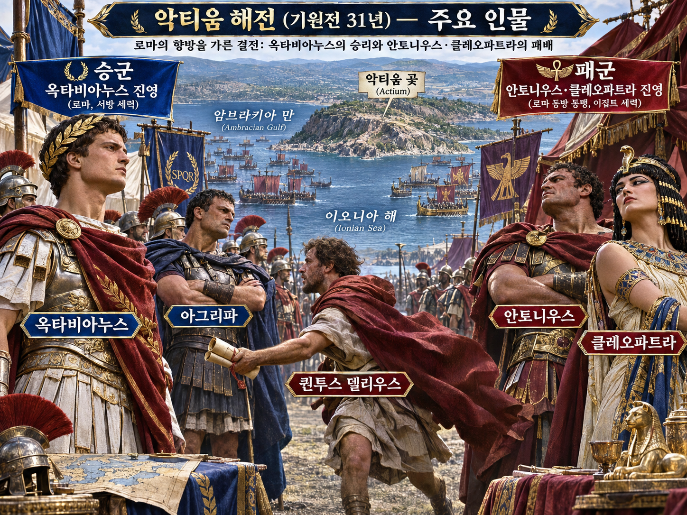

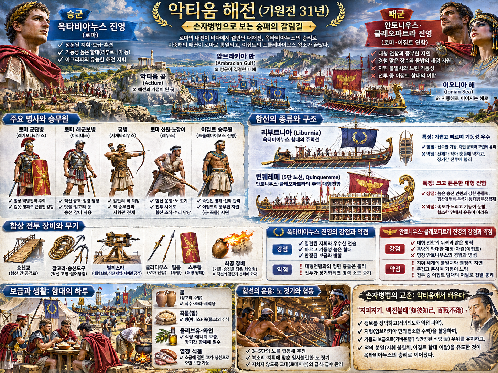

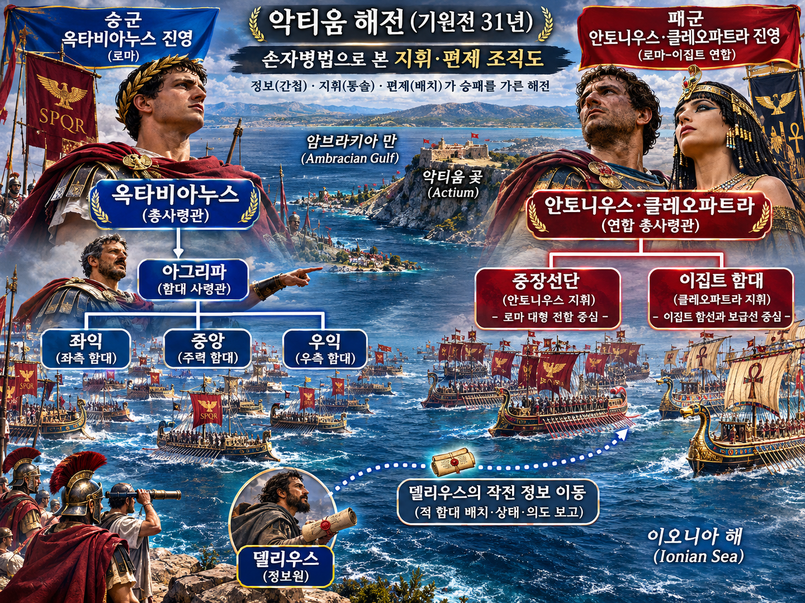

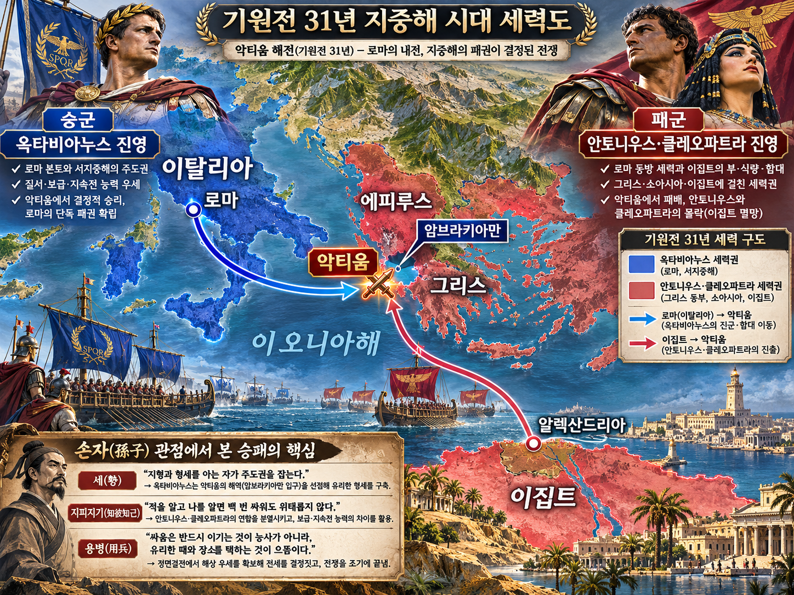

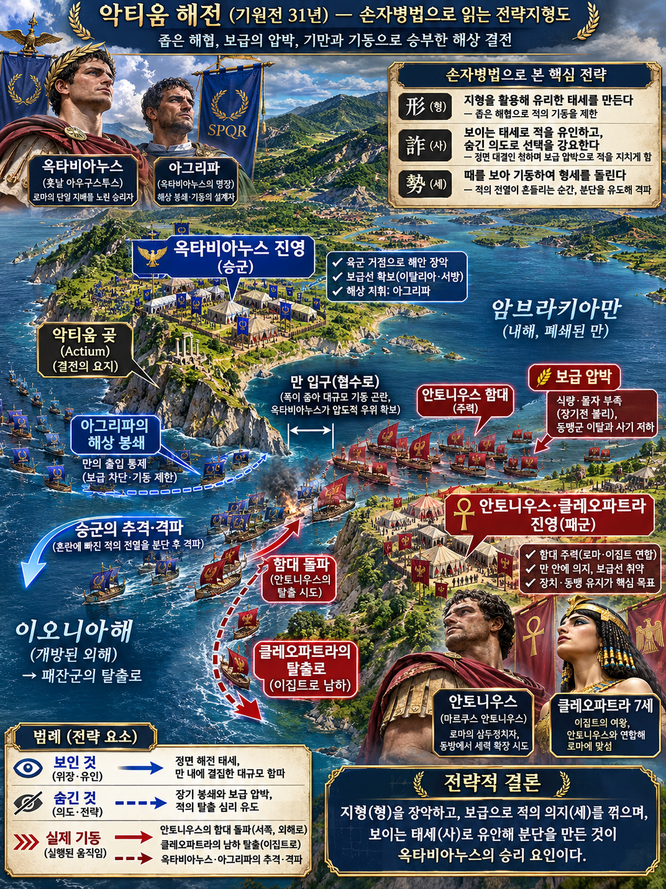

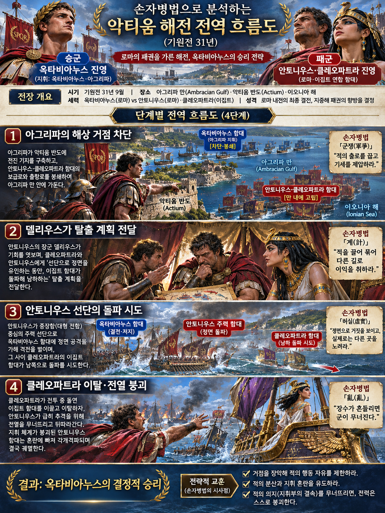

**옥타비아누스(Octavian)**와 **마르쿠스 빕사니우스 아그리파(Marcus Vipsanius Agrippa)**는 **마르쿠스 안토니우스(Mark Antony)**·**클레오파트라 7세(Cleopatra VII)**의 연합 함대를 🌊 **암브라키아만(Ambracian Gulf)** 안에 압박했다. 핵심은 내부자의 말만 믿은 승리가 아니라, 해상 거점과 보급로를 먼저 장악한 상태에서 **퀸투스 델리우스(Quintus Dellius)**가 가져온 작전 정보를 실제 배치와 대조한 승리였다.

**뒤에서 반복될 지형을 먼저 잡아두기**

- 🌊 **암브라키아만(Ambracian Gulf)** — 좁은 입구가 내해와 🌊 **이오니아해(Ionian Sea)**를 잇는다. 출구가 막히면 중장선의 크기는 힘보다 정체의 원인이 된다.
- **악티움 곶(Actium Promontory)** — 만 입구 남쪽의 함대·육군 거점이다. **안토니우스**의 전열이 이곳을 떠나야만 보급 압박에서 벗어날 수 있었다.
- **▰** **레우카스(Leucas)**와 **▰** **파트라이(Patrae)** — **아그리파**가 빼앗은 해상 거점들이다. 남쪽 보급과 퇴로를 차례로 좁혔다.
- 🌊 **이오니아해(Ionian Sea)** — 돌파에 성공하면 이집트로 향할 수 있지만, 열린 바다로 나오기 전 좁은 출구에서 진형을 유지해야 했다.

#### 상세 전역 서사 — 내부자의 계획은 이미 닫혀 가던 바다에서 효력을 얻었다

**아그리파**는 정면 해전을 서두르지 않고 메토네·코르키라·파트라이 등 해상 연결점을 공격해 **안토니우스**의 식량과 통신을 압박했다. 만 안의 병력에는 질병과 보급 부족이 겹쳤고, 육상 철수와 해상 돌파 사이의 선택이 좁아졌다. 이때 **델리우스**가 진영을 떠나 **옥타비아누스**에게 해전을 벌이는 동안 돌파한다는 계획을 알렸다는 전승이 카시우스 디오 계열 기록에 남는다.

**옥타비아누스** 측은 이 제보를 마법 같은 예언으로 쓰지 않았다. **아그리파**의 경량 함선은 거리를 두어 대형선의 충각을 피하고, 전열이 벌어지는 순간을 기다렸다. **클레오파트라**의 함대가 틈을 따라 남쪽으로 빠져나가자 **안토니우스**도 뒤따랐고, 남은 전열의 지휘 일관성이 무너졌다. 내부 정보는 이미 구축된 봉쇄·기동·지휘 체계와 결합했을 때만 결정을 바꿨다.

#### 전투에서 사용된 속임수 — 결전을 보이되 실제 목적은 돌파와 탈출이었다

**안토니우스** 측은 정면 결전을 준비하는 대형을 보였지만, 일부 함선에는 돛과 재산을 실어 전투 중 탈출할 조건을 마련했다. **델리우스**의 이탈은 그 숨은 목적을 상대에게 노출했다. 결과적으로 보이는 전열은 **옥타비아누스** 측을 묶어 두지 못했고, 탈출은 전열 붕괴의 신호로 바뀌었다.

#### 속임수 작동 구조

**주체와 의도.** **안토니우스**·**클레오파트라** 측은 함대 전체의 승리보다 핵심 세력의 돌파 가능성을 남겼다.

**보인 신호와 믿은 이유.** 대형선 중심의 정면 전열은 결전 의지를 보였다. 상대가 가까이 붙으면 중장선의 충각과 승선전이 유리했다.

**유발된 행동과 결과.** **아그리파**는 성급히 접근하지 않았고 전열이 늘어지기를 기다렸다. 남쪽 탈출이 시작되자 남은 함대의 결속이 무너졌다.

**사료의 경계.** 탈출 계획의 구체적 범위와 **델리우스**가 전달한 정보의 정확한 내용은 고대 저자마다 강조가 다르다. 제보 하나가 승리를 만들었다고 단정할 수 없다.

#### 속임수 일곱 질문

1. **누가 누구를 속였는가?** **안토니우스** 측은 결전 전열로 실제 돌파 목적을 감추려 했다.
2. **어떤 사실이 거짓이었는가?** 함대 전체가 끝까지 정면 결전을 수행한다는 인상이 실제 우선순위와 달랐다.
3. **어떤 사실은 진실이지만 오해를 유도했는가?** 대형 함선의 전투력은 진짜였지만 그것이 전 함대의 공동 목표를 보증하지는 않았다.
4. **상대는 왜 그것을 믿고 싶어 했는가?** 결정적 해전 한 번으로 내전을 끝낼 기회가 필요했다.
5. **속임수가 없었어도 같은 오판이 발생했을까?** 가능성은 낮다. **아그리파**의 봉쇄로 돌파 의도 자체는 추론 가능했지만 내부 정보가 대비를 구체화했다.
6. **속은 사람은 어떤 독립 확인을 생략했는가?** **안토니우스** 측은 탈출 계획이 여러 지휘관에게 노출된 보안 취약성을 통제하지 못했다.
7. **신뢰·동의·안전을 해치지 않으면서 같은 원리를 어디서 연습할 수 있는가?** 보드게임에서 공개 전력과 숨은 목표를 분리하고, 상대의 한 수를 독립 단서 둘로 확인하는 훈련이 적합하다.

#### 시계편 兵者詭道也 — 이 전장에 해당하는 속이는 길

<table fit-page-width="true" header-row="true">
<tr><td>해당 구절·독음·뜻</td><td>전장의 장면</td></tr>
<tr><td>用而示之不用 용이시지불용 — 쓰려 하면서 쓰지 않는 듯 보인다</td><td>돌파를 위한 함대 운용을 정면 결전처럼 보였다.</td></tr>
<tr><td>近而示之遠 근이시지원 — 가까운 목적을 멀리 있는 듯 보인다</td><td>당장의 출구 돌파보다 전열 전체의 교전을 앞세워 의도를 가렸다.</td></tr>
</table>

#### 法 한눈 비교 — 곡제·관도·주용

<table fit-page-width="true" header-row="true">
<tr><td>진영</td><td>곡제(편제)</td><td>관도(지휘)</td><td>주용(보급·지속)</td></tr>
<tr><td>**옥타비아누스 진영**</td><td>경량 함선과 해병을 **아그리파**가 유연하게 운용했다.</td><td>**옥타비아누스**의 정치 지휘와 **아그리파**의 해상 지휘가 분명했다.</td><td>서쪽 거점과 해상 보급망을 유지했다.</td></tr>
<tr><td>**안토니우스 진영**</td><td>대형선은 강했지만 질병·결원으로 운용 밀도가 떨어졌다.</td><td>돌파와 결전이 섞여 하위 지휘관이 공동 목표를 잃었다.</td><td>봉쇄로 식량·물·건강이 악화했다.</td></tr>
</table>

#### 패군과 승군의 五事

##### **안토니우스·클레오파트라 진영(패군)**

<table fit-page-width="true" header-row="true">
<tr><td>요소</td><td>판단</td></tr>
<tr><td color="orange_bg">🤝 **道**</td><td>탈출 우선순위가 전 함대와 충분히 공유되지 않아 결속이 끊겼다. (지기·사기)</td></tr>
<tr><td color="blue_bg">🌤️ **天**</td><td>봉쇄가 길어질수록 질병과 이탈 위험이 커지는 분포를 축소 평가했다. (지피·타이밍·확률 관점)</td></tr>
<tr><td color="green_bg">🧭 **地**</td><td>좁은 만 입구는 대형선의 전개와 동시 돌파를 어렵게 했다. (험이·광협·사생)</td></tr>
<tr><td color="purple_bg">🎖️ **將**</td><td>**안토니우스**는 용기는 있었으나 결전과 보존 중 목표를 하나로 묶지 못했다. (지신인용엄)</td></tr>
<tr><td color="yellow_bg">⚙️ **法**</td><td>강한 함선이 지휘·보급 단절을 상쇄하지 못했다. (곡제·관도·주용)</td></tr>
</table>

**직관·편향 한 줄:** **안토니우스**가 대형 함선의 국지적 우세에 판단을 고정한 행동에서는 기준점 효과가 작동해 봉쇄가 만든 누적 위험을 늦게 반영한 것으로 볼 수 있다.

🏳️ **패군 측 결과**: 六敗(육패) 중 `亂(란, 지휘와 진형이 어지러움)`에 가깝다. **회피 분기점:** 해전 전에 육군 철수와 함대 돌파 중 하나를 전군 목표로 확정하고 정보 접근을 최소화했다면 적어도 함대 전체의 급속한 붕괴는 줄일 수 있었다.

##### **옥타비아누스·아그리파 진영(승군)**

<table fit-page-width="true" header-row="true">
<tr><td>요소</td><td>판단</td></tr>
<tr><td color="orange_bg">🤝 **道**</td><td>정치 목표와 해상 작전이 한 지휘 체계에 묶였다. (지기·사기)</td></tr>
<tr><td color="blue_bg">🌤️ **天**</td><td>내부 정보 하나를 맹신하지 않고 봉쇄·정찰과 대조해 돌파 가능성에 대비했다. (지피·타이밍·확률 관점)</td></tr>
<tr><td color="green_bg">🧭 **地**</td><td>만 입구와 외해를 잇는 통로를 장악해 적 선택지를 줄였다. (험이·광협·사생)</td></tr>
<tr><td color="purple_bg">🎖️ **將**</td><td>**아그리파**는 거점 점령·거리 유지·추격의 순서를 지켰다. (지신인용엄)</td></tr>
<tr><td color="yellow_bg">⚙️ **法**</td><td>기동성 높은 선단과 안정된 보급을 결합했다. (곡제·관도·주용)</td></tr>
</table>

🏆 **승군 측 결과**: 五勝(오승) 중 `以虞待不虞者勝(이우대불우자승, 대비한 채 대비하지 못한 적을 상대하는 자가 이김)`에 해당한다.

#### 法을 압축하지 않고 보기 — 곡제·관도·주용

**곡제 曲制(곡제): 부대를 어떻게 나누고 결합했는가**
<table fit-page-width="true" header-row="true">
<tr><td>진영</td><td>곡제 曲制(곡제)</td></tr>
<tr><td>**승군**</td><td>경량 함선의 측면 기동과 해병 승선전을 결합했다.</td></tr>
<tr><td>**패군**</td><td>중장선과 이집트 선단이 같은 탈출 목표 아래 완전히 통합되지 않았다.</td></tr>
</table>

**관도 官道(관도): 누가 명령하고 어떻게 전달했는가**
<table fit-page-width="true" header-row="true">
<tr><td>진영</td><td>관도 官道(관도)</td></tr>
<tr><td>**승군**</td><td>**아그리파**의 해상 재량과 **옥타비아누스**의 총지휘가 분리·연결됐다.</td></tr>
<tr><td>**패군**</td><td>탈출 계획의 제한적 공유가 전투 중 명령 해석을 갈라놓았다.</td></tr>
</table>

**주용 主用(주용): 군량·장비·전투 지속 능력을 어떻게 썼는가**
<table fit-page-width="true" header-row="true">
<tr><td>진영</td><td>주용 主用(주용)</td></tr>
<tr><td>**승군**</td><td>해상 거점을 통해 식량·물·수리 능력을 유지했다.</td></tr>
<tr><td>**패군**</td><td>장기 봉쇄로 식량·식수·건강·노 젓는 인력이 함께 약화됐다.</td></tr>
</table>

### 동양 — 🏛️ 조조 진영 vs 🏛️ 원소 진영 │ 관도대전(官渡之戰, 200)

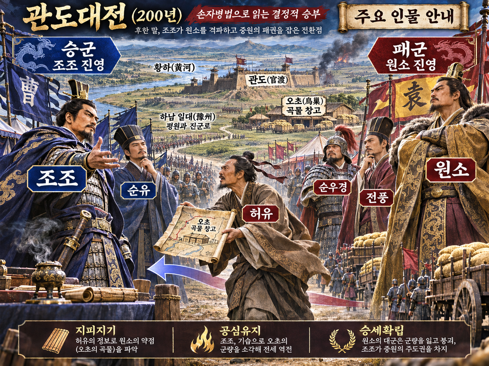

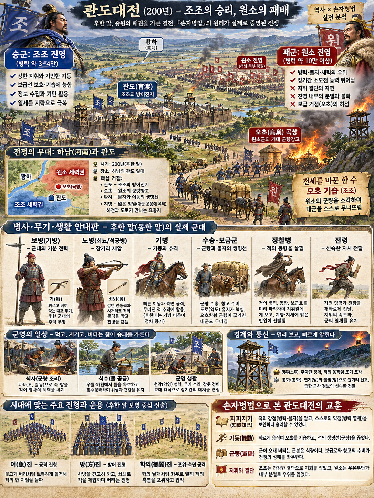

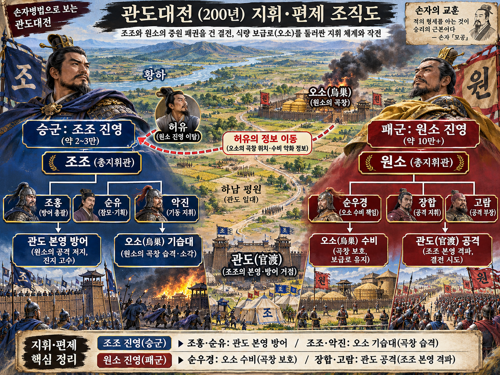

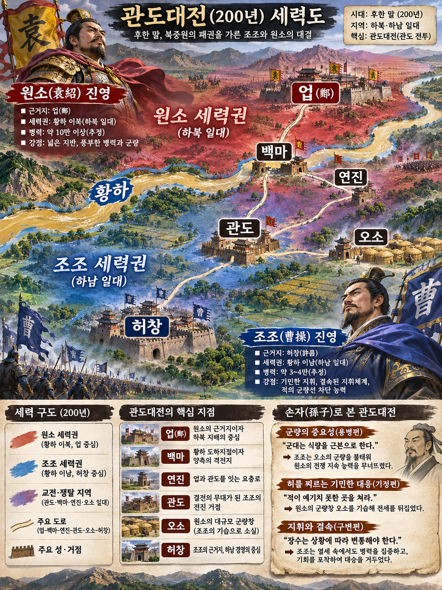

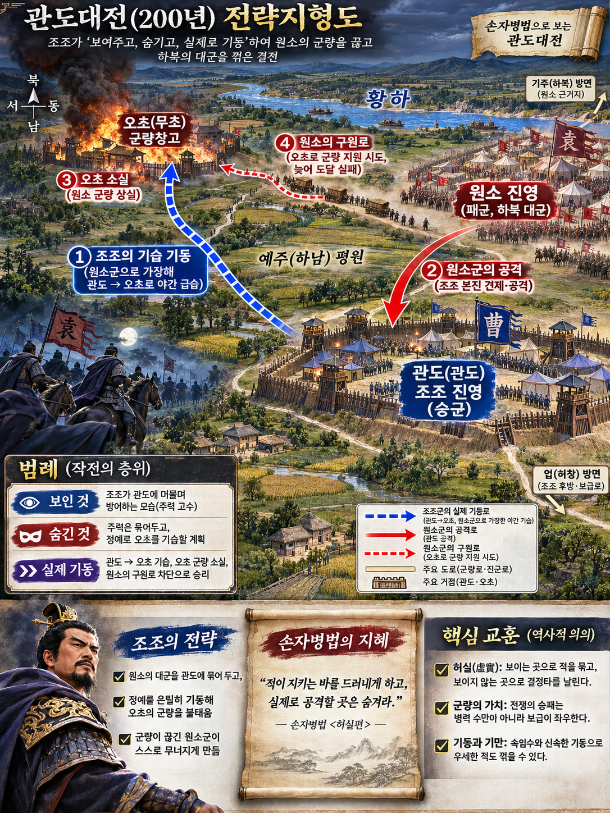

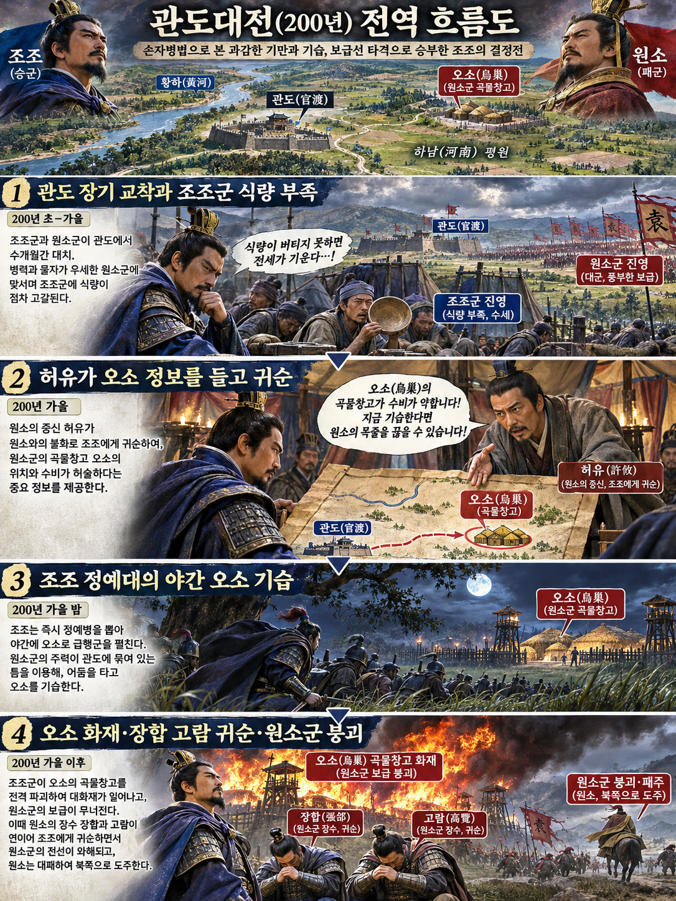

**뒤에서 반복될 지형을 먼저 잡아두기**

- 🌊 **황하(黃河)** — 하북과 하남을 가르는 거대한 수계다. **원소**의 병력과 군량은 이 강을 건너 남하했다.
- **▰** **관도(官渡)** — **조조**가 버틴 방어 거점이다. 허창으로 이어지는 길을 막는 동시에 북쪽 오소를 기습할 출발점이었다.
- **▰** **오소(烏巢)** — **원소**군의 군량 집적지다. 전선의 대군을 지속시키는 생명선이었다.
- **▰** **허창(許昌)** — **조조**의 후방 정치·보급 중심이다. 관도가 무너지면 직접 위협받는다.

#### 상세 전역 서사 — 허유의 귀순은 오소라는 좌표와 수비 상태를 가져왔다

관도의 교착은 병력이 적고 식량이 줄어드는 **조조(曹操)**에게 불리했다. **순욱(荀彧)**은 후퇴론을 막았고, **순유(荀攸)**는 새 군량 수송대와 오소의 취약성을 공격할 기회로 보았다. 그때 **원소(袁紹)**의 참모였던 **허유(許攸)**가 진영을 떠나 **조조**에게 귀순해 **순우경(淳于瓊)**이 지키는 오소 군량고의 위치와 경계 취약성을 알렸다.

**조조**는 본영을 **조홍**과 **순유**에게 맡기고 정예를 직접 이끌어 밤길로 오소를 쳤다. 기습대는 원소군처럼 보이게 이동해 검문을 넘었다는 기록이 전한다. **원소**는 오소를 전력으로 구원하지 않고 **장합**·**고람**에게 관도 본영 공격을 맡겼다. 본영은 버텼고 오소는 불탔으며, **장합**과 **고람**은 이후 **조조**에게 귀순했다. 내부자의 정보는 좌표를 열었지만, 승리는 그 좌표에 즉시 병력을 집중한 결심과 본영 방어의 지속 능력이 완성했다.

#### 전투에서 사용된 속임수 — 원소군으로 가장한 야간 기동

**조조**의 기습대는 겉으로 원소군의 명령을 수행하는 부대처럼 보이며 관도에서 오소로 이동했다. 실제 목적은 군량고 방화였고, 속도와 어둠이 신원 확인의 시간을 줄였다. **원소**는 본영 공격으로 상대를 흔들 수 있다고 보았지만, 오소 상실이 먼저 대군의 지속 능력을 꺾었다.

#### 속임수 작동 구조

**주체와 의도.** **조조**는 주력을 관도에 묶어 둔 것처럼 보이면서 정예대를 오소로 보냈다.

**보인 신호와 믿은 이유.** 야간에 원소군 표식을 흉내 낸 이동은 후방 도로에서 아군 수송·전령처럼 보였다.

**유발된 행동과 결과.** 경계는 즉각 봉쇄되지 않았고, 오소 수비대가 대응하기 전에 불이 붙었다. 군량 상실 소식은 전선의 지휘와 사기를 동시에 흔들었다.

**사료의 경계.** 병력 수와 세부 이동 방식은 전승마다 차이가 있다. 확실한 중심은 **허유**의 귀순, 오소 기습, 군량 소각, 원소군 붕괴의 연쇄다.

#### 속임수 일곱 질문

1. **누가 누구를 속였는가?** **조조**의 기습대가 **원소**군의 후방 경계를 속였다.
2. **어떤 사실이 거짓이었는가?** 야간 이동 부대가 원소군이라는 외형이 거짓이었다.
3. **어떤 사실은 진실이지만 오해를 유도했는가?** 관도 본영에 조조군이 남아 있다는 사실은 주력 전체가 움직이지 않았다는 오해를 만들었다.
4. **상대는 왜 그것을 믿고 싶어 했는가?** 대군을 가진 **원소** 측은 후방 도로가 자기 통제 아래 있다고 전제하기 쉬웠다.
5. **속임수가 없었어도 같은 오판이 발생했을까?** 가능성은 중간이다. 오소 방비의 취약성은 있었지만 가장이 없었다면 경보가 더 빨랐을 수 있다.
6. **속은 사람은 어떤 독립 확인을 생략했는가?** 후방 통과 부대의 명령서·출발지·지휘관을 교차 확인하는 경계가 약했다.
7. **신뢰·동의·안전을 해치지 않으면서 같은 원리를 어디서 연습할 수 있는가?** 체스·바둑에서 한쪽 압박을 유지한 채 다른 목표를 치는 양동을 연습할 수 있다.

#### 시계편 兵者詭道也 — 이 전장에 해당하는 속이는 길

<table fit-page-width="true" header-row="true">
<tr><td>해당 구절·독음·뜻</td><td>전장의 장면</td></tr>
<tr><td>近而示之遠 근이시지원 — 가까운 곳을 멀리 있는 듯 보인다</td><td>관도 본영의 대치를 유지해 가까운 오소 기습을 감췄다.</td></tr>
<tr><td>攻其無備 공기무비 — 대비하지 않은 곳을 공격한다</td><td>대군 정면이 아니라 경계가 느슨한 군량고를 쳤다.</td></tr>
</table>

#### 法 한눈 비교 — 곡제·관도·주용

<table fit-page-width="true" header-row="true">
<tr><td>진영</td><td>곡제(편제)</td><td>관도(지휘)</td><td>주용(보급·지속)</td></tr>
<tr><td>**조조 진영**</td><td>본영 방어와 기습대를 분리했다.</td><td>**조조**가 기습을 직접 지휘하고 **조홍**이 본영을 지켰다.</td><td>열세인 보급을 적 군량 파괴로 보완했다.</td></tr>
<tr><td>**원소 진영**</td><td>대군과 군량고 수비가 분리됐다.</td><td>오소 구원과 관도 공격 사이에서 명령이 갈렸다.</td><td>군량이 오소 한 거점에 집중됐다.</td></tr>
</table>

#### 패군과 승군의 五事

##### **원소 진영(패군)**

<table fit-page-width="true" header-row="true">
<tr><td>요소</td><td>판단</td></tr>
<tr><td color="orange_bg">🤝 **道**</td><td>참모의 반대 의견을 흡수하지 못하고 귀순을 연쇄적으로 허용했다. (지기·사기)</td></tr>
<tr><td color="blue_bg">🌤️ **天**</td><td>군량고 상실의 낮지만 치명적인 위험을 과소평가했다. (지피·타이밍·확률 관점)</td></tr>
<tr><td color="green_bg">🧭 **地**</td><td>관도·오소 두 거점의 거리를 하나의 방어 체계로 묶지 못했다. (원근·사생)</td></tr>
<tr><td color="purple_bg">🎖️ **將**</td><td>**원소**는 병력 우세를 결심의 일관성으로 바꾸지 못했다. (지신인용엄)</td></tr>
<tr><td color="yellow_bg">⚙️ **法**</td><td>보급 집중과 분할 명령이 동시에 취약점이 됐다. (곡제·관도·주용)</td></tr>
</table>

**직관·편향 한 줄:** **원소**가 오소 구원보다 관도 본영 공격에 기대를 건 명령에서는 기존 정면 승리 시나리오에 매인 확증편향이 작동해 군량 상실의 파급을 축소한 것으로 볼 수 있다.

🏳️ **패군 측 결과**: 六敗(육패) 중 `亂(란, 명령 체계의 혼란)`과 `北(배, 적정을 헤아리지 못한 패주)`가 겹쳤다. **회피 분기점:** **장합**의 건의대로 오소 구원에 주력을 집중했다면 승리를 보장할 수는 없어도 군량고 소실과 전군 붕괴가 같은 시간에 일어나는 완패는 피할 가능성이 있었다.

##### **조조 진영(승군)**

<table fit-page-width="true" header-row="true">
<tr><td>요소</td><td>판단</td></tr>
<tr><td color="orange_bg">🤝 **道**</td><td>불리한 교착 속에서도 본영 방어와 기습 임무를 분명히 나눴다. (지기·사기)</td></tr>
<tr><td color="blue_bg">🌤️ **天**</td><td>**허유**의 정보가 거짓일 위험을 감수하되 정예 소수로 손실 상한을 관리했다. (지피·타이밍·확률 관점)</td></tr>
<tr><td color="green_bg">🧭 **地**</td><td>관도에서 오소까지 야간 기동로를 이용해 적 후방의 빈틈을 찔렀다. (원근·험이·사생)</td></tr>
<tr><td color="purple_bg">🎖️ **將**</td><td>**조조**는 정보를 결심과 속도로 바꾸고 본영 지휘를 위임했다. (지신인용엄)</td></tr>
<tr><td color="yellow_bg">⚙️ **法**</td><td>소수 정예·본영 수비·적 보급 파괴를 결합했다. (곡제·관도·주용)</td></tr>
</table>

🏆 **승군 측 결과**: 五勝(오승) 중 `識衆寡之用者勝(식중과지용자승, 많고 적은 병력의 쓰임을 아는 자가 이김)`과 `以虞待不虞者勝(이우대불우자승, 대비한 채 대비하지 못한 적을 상대하는 자가 이김)`에 해당한다.

#### 法을 압축하지 않고 보기 — 곡제·관도·주용

**곡제 曲制(곡제): 부대를 어떻게 나누고 결합했는가**
<table fit-page-width="true" header-row="true">
<tr><td>진영</td><td>곡제 曲制(곡제)</td></tr>
<tr><td>**승군**</td><td>관도 수비와 오소 기습의 임무를 분리하고 소수 정예를 집중했다.</td></tr>
<tr><td>**패군**</td><td>오소 구원과 관도 공격에 병력을 나눠 어느 쪽도 결정력을 얻지 못했다.</td></tr>
</table>

**관도 官道(관도): 누가 명령하고 어떻게 전달했는가**
<table fit-page-width="true" header-row="true">
<tr><td>진영</td><td>관도 官道(관도)</td></tr>
<tr><td>**승군**</td><td>**조조**·**조홍**·**순유**의 임무와 재량이 분명했다.</td></tr>
<tr><td>**패군**</td><td>**원소**의 명령이 **장합**의 구원 건의와 충돌했다.</td></tr>
</table>

**주용 主用(주용): 군량·장비·전투 지속 능력을 어떻게 썼는가**
<table fit-page-width="true" header-row="true">
<tr><td>진영</td><td>주용 主用(주용)</td></tr>
<tr><td>**승군**</td><td>자군 군량이 부족한 상황에서 적의 집중 보급 거점을 파괴해 지속 능력의 차이를 뒤집었다.</td></tr>
<tr><td>**패군**</td><td>대군의 식량을 오소에 집중하고 경계와 신속한 구원 체계를 충분히 두지 못했다.</td></tr>
</table>

#### 참고자료

- [Plutarch, Life of Antony](https://penelope.uchicago.edu/Thayer/E/Roman/Texts/Plutarch/Lives/Antony*.html)
- [Cassius Dio, Roman History, Book 50](https://penelope.uchicago.edu/Thayer/E/Roman/Texts/Cassius_Dio/50*.html)
- [Institute for the Study of the Ancient World — New Light on the Battle of Actium](https://mc.dlib.nyu.edu/files/books/isaw_aphs000029/isaw_aphs000029_lo.pdf)
- [三國志 魏書 — 순욱·순유·가후전 번역](https://sanguozhi.app/en/chapter/10)
- [中國哲學書電子化計劃 — 三國志](https://ctext.org/sanguozhi)
- [Encyclopaedia Britannica — Battle of Guandu](https://www.britannica.com/event/Battle-of-Guandu)

---

## 5. 핵심 통찰 + 실생활 적용 + 생활루틴

### 핵심 통찰

이 구절의 핵심은 “적국에서 인재를 빼 오면 이긴다”가 아니다. **상대의 실정을 실제로 접한 사람을 알아보고, 그가 무엇을 어느 범위까지 아는지 가려, 국가의 판단 체계 안에 넣는 능력**이 왕조의 흥기만큼 큰 결과를 만든다는 말이다. 사람을 얻는 것과 사람의 말을 검증하는 일은 한 과정이다.

이윤과 여상을 성공 뒤의 전설로만 읽으면 가장 중요한 시간이 사라진다. 탕과 주의 지도부는 결과가 아직 없을 때 그들을 판단해야 했다. 출신과 소문만 볼 것인지, 실제 경험과 식견을 물을 것인지, 불편한 적정도 들을 것인지가 분기점이었다. 선지는 미래를 맞히는 신통력이 아니라 **현재의 정보원을 올바르게 식별하는 책임**에서 시작한다.

### 실생활 적용

3교대 현장에서 에러가 생기면 직위가 높은 사람의 추측보다 실제 설비를 보고 조치한 사람의 관찰이 먼저 필요하다. 그러나 “현장에 있었다”는 한마디로 전부를 믿어도 안 된다. 직접 본 알람·수치·조작, 다른 사람에게 들은 내용, 원인 추정, 아직 확인하지 못한 부분을 나누어 기록해야 한다. 그래야 다음 조가 보고를 사실처럼 이어받아 같은 오류를 키우지 않는다.

사용자의 인물사건관찰 기록에서 전씨는 복잡한 조치 때 당황하거나 말을 잘 듣지 않는 모습이 관찰된 한편, 불확실한 타인의 개입 가능성까지 고려해야 한다는 의견을 낸 적도 있다. 이 구절에 연결되는 것은 성격 진단이 아니라 **상황별로 실제 관찰과 추정을 분리해 평가해야 한다는 점**이다. 평소 인상만으로 모든 보고를 깎아내리거나, 한 번 맞힌 우려 때문에 모든 추측을 사실로 올려놓으면 둘 다 사람의 지난 자리를 결과에 맞춰 꾸미는 오류다.

다음 근무에서는 에러 보고를 받을 때 먼저 “직접 본 화면과 시각은 무엇입니까?”라고 묻는다. 이어 “전해 들은 부분과 현재 추정은 무엇입니까?”를 분리한다. 로그·메신저·설비 상태 중 하나 이상으로 확인하고, 확인되지 않은 내용에는 담당자와 재확인 시각을 붙인다. 이 절차는 보고자를 몰아세우지 않으면서도 그의 접근 범위를 정확히 보존한다.

개인적인 큰 결정에서도 같다. 이직·구매·투자·건강관리처럼 비용이 큰 일은 성공담을 한 사람에게 듣고 결론내리지 않는다. 그 사람이 어떤 조건에서 무엇을 직접 겪었는지, 지금의 나와 다른 조건은 무엇인지, 실패하거나 중단한 사람의 분모는 얼마나 되는지 확인한다. 내부 경험은 지도 한 장을 더 주지만 목적지 전체를 대신하지 않는다.

### 생활루틴

**추천 문구**

결과를 보고 사람의 지난 자리를 꾸며 말하면 재수가 없다.

**이유**

성공이나 실패를 먼저 안 뒤 과거의 발언과 경력을 그 결과에 맞춰 읽으면, 직접 관찰·전언·추정의 경계가 사라진다. 그러면 한 번 맞힌 사람이 모든 것을 안다고 여겨지고, 한 번 틀린 사람의 중요한 현장 관찰까지 버려진다. 작은 평가 오류가 보고 왜곡과 책임 회피로 이어져 다음 조치의 위험을 키운다. `伊摯在夏, 呂牙在殷`이 요구하는 것은 영웅을 사후에 꾸미는 일이 아니라, **결과가 나기 전에 접근 범위와 증거를 확인해 사람의 실제 앎을 알아보는 것**이다.

오늘부터 중요한 보고 하나를 받을 때 3분 안에 `직접 봄 / 전해 들음 / 추정 / 미확인` 네 칸으로 나눈다. 미확인에는 확인할 자료와 시각을 하나씩 붙인다. 이 네 칸을 채우지 않은 상태에서는 사람의 신뢰도나 원인을 단정하지 않는다.

---

#### 참고자료

- [中國哲學書電子化計劃 — 孫子兵法 用間](https://ctext.org/text.pl?if=gb&node=20990&show=parallel)
- [U.S. Army FM 2-0 — Intelligence (2023)](https://rdl.train.army.mil/catalog-ws/view/100.ATSC/B6B654D9-7553-4B08-9DD6-0891F8F04039-1360339759307/fm2_0.pdf)
- [U.S. Army Doctrine Smart Book (2025)](https://rdl.train.army.mil/catalog-ws/view/100.ATSC/F5D823F5-B5AF-4F55-B50D-E03563E31637-1726168740296/DSBx2025_AUG25_Final.pdf)
- [American Psychological Association — Reconstructive Memory, Eyewitness Testimony, and Cognitive Biases](https://www.apa.org/ed/precollege/topss/lessons/reconstructive-memory-eyewitness-testimony-cognitive-biases.pdf)
