<!-- sunzi-analysis-mode: light -->
> 고유명군현장, 능이상지위간자, 필성대공, 차병지요, 삼군지소시이동야. — 보고의 출처와 판단 근거를 확인하지 않고 사람을 움직이면 재수가 없다.

---
## 1. 원문 + 독음 + 직역 + 한자어 뜻풀이

故惟明君賢將, 能以上智爲間者, 必成大功, 此兵之要, 三軍之所恃而動也. 고유명군현장, 능이상지위간자, 필성대공, 차병지요, 삼군지소시이동야.

**직역**
그러므로 오직 밝은 군주와 어진 장수만이 가장 뛰어난 지혜를 지닌 사람을 간첩으로 삼을 수 있으며, 반드시 큰 공을 이룬다. 이것이 군사의 요체이고, 삼군이 믿고 움직이는 바이다.

용간편의 마지막 문장은 간첩의 재주를 칭찬하며 끝나지 않는다. 앞에서 오간의 역할과 반간의 중심성을 설명한 손자는 이제 정보가 실제 군대의 움직임으로 바뀌는 마지막 책임을 군주와 장수에게 돌린다. **뛰어난 사람을 알아보고, 관계를 지키며, 보고를 가려 받아, 수많은 병사의 기동으로 번역하는 지휘**가 없으면 비밀 정보는 소문에 머물고 오히려 군을 그릇된 곳으로 움직인다.

`上智`는 단순히 머리가 좋은 사람이라는 말이 아니다. 적지에서 사람과 형세의 미세한 변화를 읽고, 사실과 추정을 구분하며, 살아 있는 정보로 지휘부의 결정을 바꿀 수 있는 최고 수준의 판단력을 뜻한다. 그러나 그 지혜를 알아보지 못하는 군주와 장수, 불리한 보고를 듣지 않는 조직, 출처를 확인하지 않고 확신만 소비하는 지휘부에서는 상지조차 쓰이지 못한다. 그래서 문장은 `上智`보다 먼저 `明君賢將`을 놓는다.

#### 明君賢將(명군현장) — 정보를 얻기 전에 들을 자격을 갖춘 지휘부

`明`(밝을 명)은 해와 달이 함께 비추듯 드러난 것과 감춰진 것을 분별하는 밝음이고, `賢`(어질 현)은 능력 있는 사람을 알아보고 합당하게 대우하는 덕과 판단을 함께 품는다. 이 문장에서 밝은 군주는 수많은 보고 가운데 무엇이 결정에 필요한지 가리고, 어진 장수는 위험을 감수한 정보원과 분석자를 소모품이 아니라 전문 인력으로 다룬다.

두 말은 도덕적 칭찬에 그치지 않는다. 군주가 듣고 싶은 보고만 상으로 사고, 장수가 현장 정보보다 자기 체면을 앞세우면 간자는 사실을 가져오지 않고 윗사람이 좋아할 이야기를 가져온다. **정보의 품질은 수집자의 능력만이 아니라 지휘부가 진실을 받아들이는 방식에서 결정된다.**

#### 上智爲間(상지위간) — 가장 어려운 자리에 가장 높은 판단력을 놓다

`上`(위 상)은 등급과 수준의 으뜸을, `智`(지혜 지)는 사정을 보고 옳은 판단을 내리는 능력을 가리킨다. `間`(사이 간)은 두 진영 사이의 틈에 들어가 정보를 얻고 전달하는 사람이다. 이 문장에서 `上智`는 간첩이 속임수를 잘 쓴다는 뜻보다, 서로 모순되는 신호 속에서 적의 실정을 분별하고 보고의 한계를 아는 지혜에 가깝다.

손자는 위험한 임무에 아무나 밀어 넣지 않는다. 향간·내간·반간·사간·생간을 연결하려면 지역의 말과 관습, 인맥과 이해관계, 적의 확인 절차, 아군 지휘부가 필요로 하는 결정 시점을 함께 읽어야 한다. 오늘날의 정보 조직도 한 출처의 생생한 이야기를 그대로 결론으로 올리지 않고, 공개정보·기술정보·현장보고를 교차해 신뢰도와 불확실성을 표시할 때 비로소 `上智`의 기능에 가까워진다.

#### 必成大功(필성대공) — 비밀의 양이 아니라 올바른 기동이 만드는 큰 성과

`功`(공 공)은 단지 정보를 많이 모은 성과가 아니라 그 정보로 전쟁의 비용과 위험을 줄이며 목적을 달성한 결과다. `大`(큰 대)가 붙은 까닭은 작은 첩보 하나가 삼군의 출발 시각·진격로·공격 목표·중단 조건을 바꾸어 수많은 생명과 국가의 자원을 좌우하기 때문이다.

다만 `必`을 정보만 있으면 승리가 보장된다는 마술적 약속으로 읽어서는 안 된다. 문장의 조건은 엄격하다. 밝은 군주와 어진 장수가 최고 수준의 지혜를 올바르게 쓰고, 그 정보가 작전과 편제에 통합될 때 큰 공이 성립한다. 정보가 낡았거나 지휘부가 과신하거나 실행 능력이 없으면 비밀은 많아도 공은 이루어지지 않는다.

#### 兵之要(병지요) — 모든 기동 앞에서 잠금장치처럼 확인할 핵심

`要`(요긴할 요)는 허리의 중심이나 묶음의 매듭처럼 전체를 붙잡는 핵심을 뜻한다. 용간은 별도의 장식 업무가 아니라 군대를 언제 어디로 움직일지 정하는 결심의 요체다. 적의 지휘관·좌우 측근·문지기·숙소 담당자의 이름까지 먼저 알아보라는 앞 문장들이 이 매듭으로 모인다.

요체라고 해서 정보 부서가 지휘를 대신하는 것은 아니다. 정보는 적과 환경에 관한 판단 재료를 제공하고, 군주와 장수는 목적·법·윤리·아군 능력까지 합쳐 결심한다. 정보와 지휘의 역할을 섞으면 분석자는 정책을 정당화하는 사람이 되고, 지휘관은 불리한 결과를 정보 탓으로 돌리게 된다.

#### 三軍之所恃而動(삼군지소시이동) — 믿음이 있어야 수많은 몸이 한 방향으로 움직인다

`恃`(믿을 시)는 의지하고 기대는다는 뜻이다. 병사들이 간첩 개인을 직접 믿고 움직인다는 말이 아니라, 검증된 정보에 근거해 내려온 지휘를 믿고 삼군 전체가 움직인다는 구조다. 정찰과 보고가 지휘관의 결심을 받치고, 명령의 이유와 목적이 각 부대에 전달될 때 대규모 기동은 단순한 복종이 아니라 공유된 상황 인식 위에서 이루어진다.

믿음은 확신을 크게 말한다고 생기지 않는다. 출처가 무엇인지, 무엇을 모르는지, 상황이 바뀌면 어떤 신호에서 계획을 고칠지를 함께 제시해야 한다. 현장 보고가 틀렸을 때 처벌만 하고, 맞았을 때 윗사람의 공으로 돌리는 조직에서는 다음 보고가 늦거나 꾸며진다. `所恃`는 **정확성·적시성·정직한 불확실성·지휘 책임이 반복되어 쌓인 신뢰**다.

#### 글자들이 완성하는 한 장면

군주는 먼저 `明`하여 듣고 싶은 말과 필요한 사실을 가른다. 장수는 `賢`하여 가장 어려운 정보 임무에 `上智`를 알아보고 쓰며, 그 사람의 보고를 다른 자료와 대조한다. 그렇게 얻은 앎을 목표·시각·경로·중단 조건으로 번역할 때 비로소 `大功`이 된다.

그래서 용간편의 끝은 간자의 비밀 활동이 아니라 삼군의 공개된 움직임이다. **지혜로운 사람을 쓰는 일 → 믿을 만한 정보를 만드는 일 → 지휘 결심으로 바꾸는 일 → 삼군이 믿고 움직이는 일**이 한 줄로 이어진다. 이 연결이 끊기면 상지는 고립되고, 대공은 우연에 맡겨지며, 삼군은 근거 없는 명령에 몸을 내맡기게 된다.

---
## 2. 전통 주석 기반 분석

- **조조(曹操)** — “간첩의 임무는 미세하고 무거우니 총명한 사람을 골라 맡겨라. **그가 얻은 실정으로 삼군의 움직임을 정하라.**”
- **이전(李筌)** — “밝지 못한 군주는 참과 거짓을 가리지 못하고, 어질지 못한 장수는 뛰어난 사람을 오래 쓰지 못한다. **먼저 쓰는 자의 밝음과 어짊을 갖추어라.**”
- **두목(杜牧)** — “상지는 적의 틈에 들어가 말과 얼굴빛만이 아니라 이해관계와 변화를 살핀다. **작은 징후를 큰 결심으로 이어 갈 사람을 택하라.**”
- **매요신(梅堯臣)** — “간자가 실정을 얻어도 지휘부가 쓰지 못하면 공이 없다. **정보를 얻는 일과 군을 움직이는 일을 한 계획으로 묶어라.**”
- **장예(張預)** — “앞에서 이지와 여아를 든 뜻을 보아라. **다른 나라에 있던 현자를 알아보고 써야 천하의 큰 공을 이룬다.**”
- **왕석(王晳)** — “`上智`는 보통 재주가 아니라 깊고 미세한 사정을 통달하는 지혜다. **위험한 틈에는 가장 높은 판단력을 두어라.**”
- **가림(賈林)** — “삼군이 움직이기 전에 적의 실정을 믿을 만하게 얻어라. **근거 없는 용맹으로 많은 사람을 먼저 보내지 마라.**”
- **두우(杜佑)** — “간자를 후하게 대우하고 비밀을 지키며 그 보고를 지휘에 연결하라. **사람을 얻고도 의심과 박대로 정보망을 무너뜨리지 마라.**”
- **진호(陳皞)** — “큰 공은 간자 한 사람의 기교만으로 생기지 않는다. **군주·장수·정보원·삼군의 믿음을 끊김 없이 이어라.**”

#### 리링의 고증과 현대적 독법

리링의 문헌학적 관점에서 이 문장은 용간편 전체의 결론이다. 앞 문장의 이지(伊摯)와 여아(呂牙)가 보여 준 인재 운용을 받아 `故`로 시작하고, `明君賢將 → 上智爲間 → 大功 → 三軍之動`의 인과를 차례로 묶는다. 판본 차이를 꾸며내기보다 이 문장 구조가 정보 활동을 군주의 책임과 대규모 기동에 연결한다는 점이 중요하다.

`上智`를 첨단 기술이나 영리한 속임수 하나로 줄여 읽어서도 안 된다. 고대의 간자는 사람 사이에서 적정을 얻었지만, 현대 정보 활동은 인적정보·신호정보·영상정보·공개정보를 제도적으로 결합한다. 공통점은 자료의 양보다 **그 자료의 출처·시점·한계를 가려 지휘 결심에 쓸 수 있게 만드는 높은 판단력**에 있다.

또한 이 문장을 직장과 인간관계의 몰래 엿보기나 조종술로 옮길 수 없다. 현대의 법과 사생활, 조직 윤리는 고대 전쟁과 다르다. 일상에서 취할 수 있는 것은 사람을 간첩처럼 다루는 기술이 아니라, 중요한 결정을 내리기 전에 현장에 가장 가까운 유능한 사람의 보고를 듣고 독립된 근거로 확인하는 지휘 원리다.

---
## 3. 교차 설명

### ① 손자병법 내 교차

용간편 첫머리의 `故明君賢將, 所以動而勝人, 成功出於衆者, 先知也`(고명군현장, 소이동이승인, 성공출어중자, 선지야 — 밝은 군주와 어진 장수가 움직여 남을 이기고 남보다 뛰어난 공을 이루는 까닭은 먼저 알기 때문이다)는 마지막 문장과 수미를 이룬다. 처음의 `先知`가 마지막에는 `上智爲間`이라는 사람과 제도로 구체화되고, `動而勝人`은 `三軍之所恃而動`으로 되돌아온다.

이 연결은 정보의 목적이 지식 축적이 아니라 더 나은 기동임을 보여 준다. 그러나 먼저 안다는 말을 미래를 맞히는 능력으로 과장해서는 안 된다. 같은 편의 `不可取於鬼神, 不可象於事, 不可驗於度, 必取於人`(불가취어귀신, 불가상어사, 불가험어도, 필취어인 — 귀신에게서 얻거나 과거 일에 빗대거나 법칙만으로 검증할 수 없고 반드시 적의 실정을 아는 사람에게서 얻어야 한다)은 예측의 출발을 관찰 가능한 인간 정보에 둔다.

모공편의 `知彼知己, 百戰不殆`(지피지기, 백전불태 — 적을 알고 나를 알면 백 번 싸워도 위태롭지 않다)는 이번 구절의 범위를 넓힌다. 간자가 적을 알아도 지휘관이 아군의 체력·보급·편제·정치 목적을 모르면 삼군은 잘못 움직인다. `知彼`를 제공하는 정보와 `知己`를 책임지는 지휘가 함께 있어야 한다.

군형편의 `先爲不可勝, 以待敵之可勝`(선위불가승, 이대적지가승 — 먼저 적이 이길 수 없는 나를 만들고 적에게 이길 틈이 생기기를 기다린다)은 정보의 한계를 보완한다. 좋은 첩보는 적의 틈을 빨리 찾게 하지만, 정보가 틀려도 한 번에 무너지지 않을 형과 예비가 먼저 필요하다. `上智`는 불확실성을 없애는 능력이 아니라 잘못될 가능성까지 포함해 안전하게 움직이게 하는 지혜다.

### ② 클라우제비츠 『전쟁론』

클라우제비츠는 전쟁에서 들어오는 정보의 상당 부분이 모순되고, 더 많은 부분이 거짓이며, 대부분이 불확실하다고 경고한다. 이 관점은 `上智`를 비밀을 많이 아는 사람보다 불확실한 보고의 신뢰도를 가리고 결심에 필요한 부분을 추려 내는 사람으로 읽게 한다. 보고가 생생하고 지휘관의 기대와 맞는다고 해서 참이 되는 것은 아니다.

손자는 사람을 통해 적의 실정을 먼저 얻는 적극적 정보 활동을 강조하고, 클라우제비츠는 그 정보가 전쟁의 안개와 마찰 속에서 왜 쉽게 왜곡되는지를 강하게 드러낸다. 둘을 같다고 보면 안 된다. 손자의 문장은 정보 우위를 삼군 기동의 토대로 압축하지만, 클라우제비츠는 가장 좋은 정보와 계획도 현장에서 마찰을 만나므로 지휘관의 판단력과 결단이 대신될 수 없다고 본다.

클라우제비츠의 전쟁 천재는 직관만 믿는 영웅이 아니다. 위험과 불확실성 속에서도 본질을 붙들고 결심을 유지하는 판단력을 포함한다. 그러나 현대 조직에서 이를 한 사람의 천재성으로만 운영하면 반대 증거가 묻힌다. 분석자가 불확실성을 말할 수 있고 지휘관이 계획을 갱신할 수 있는 절차가 개인의 재능을 보완해야 한다.

실생활에서는 중요한 장애 원인을 들었을 때 곧바로 사람과 자원을 움직이지 않고, 보고 시각·직접 관찰 여부·로그·대안 가설을 확인하는 방식으로 옮길 수 있다. 군사 첩보와 평시 업무 보고는 법적·윤리적 조건이 다르지만, **불확실한 정보를 결정 가능한 형태로 바꾸고도 수정 가능성을 남기는 원리**는 공통된다.

### ③ 미야모토 무사시 『오륜서』

『오륜서』의 `観見二つの目付`(관견 두 눈매 — 넓게 꿰뚫어 보는 눈과 가까이 살펴보는 눈)는 상지의 시야를 설명하는 데 도움이 된다. `見`은 눈앞의 자세·거리·움직임을 보고, `観`은 그 뒤의 리듬과 전체 형세를 읽는다. 정보원은 세부 사실을 놓치지 않아야 하지만 지휘관은 그 사실이 전체 목적과 기동에 어떤 뜻인지 함께 보아야 한다.

눈앞의 보고 하나에 시선이 붙잡히면 관견은 갈라진다. 예컨대 한 번의 장비 오류가 생생하다고 그것만을 모든 장애의 원인으로 삼거나, 평소 유능한 사람의 보고라는 이유로 독립 확인을 생략하면 `見`은 있어도 `観`이 없다. 반대로 큰 흐름만 말하고 현장의 구체적 수치와 징후를 무시하면 관념이 된다.

무사시는 상대의 박자와 자신의 박자를 함께 다루지만, 개인 검술의 감각을 국가 규모 정보 조직과 동일시할 수는 없다. 개인의 숙련된 시야가 빠른 판단을 돕더라도 다수 출처의 교차 확인, 기록, 책임 분리는 제도적으로 필요하다. 상지는 개인의 눈과 조직의 검증이 결합될 때 오래 간다.

현장에서는 최초 보고를 `직접 본 사실 / 해석 / 아직 모르는 것 / 다음 확인 시각`으로 나누어 적는다. 가까운 눈으로 사실을 붙들고, 넓은 눈으로 대안 원인과 전체 공정 영향을 본다. 이 네 칸은 뛰어난 사람의 직관을 죽이는 형식이 아니라 다른 사람이 그 판단에 기대어 안전하게 움직이게 만드는 다리다.

### ④ 오자병법·육도삼략

『오자병법』은 `用兵之害, 猶豫最大`(용병지해, 유예최대 — 용병의 해로움 가운데 머뭇거림이 가장 크다)라고 하면서도, 성급함 자체를 칭찬하지 않는다. 병사의 마음과 지형, 적의 형세를 분명히 안 뒤 명령이 하나로 나가야 한다. 이번 구절의 `三軍之所恃而動`도 정보가 결심을 끝없이 미루게 하는 것이 아니라 적시에 믿을 만한 근거를 만들어 기동을 가능하게 한다는 뜻이다.

두 병법이 만나는 지점은 명령의 속도가 아니라 판단과 실행의 연결이다. 다만 오자의 문장을 “빨리 결정하라”는 압박으로만 쓰면 현장 보고가 충분히 올라오기 전에 결론을 굳힐 수 있다. 결정 시한과 필요한 정보, 미확인 상태에서 취할 가역적 조치를 미리 나눠야 유예와 성급함을 함께 피한다.

『육도』의 상현·거능 관점은 재능 있는 사람을 알아보고 그에 맞는 직임을 맡기는 데 초점을 둔다. `明君賢將`이 `上智`를 쓰는 구조와 닿지만, 단순히 총명한 한 명을 총애하라는 뜻은 아니다. 사람의 능력과 충성, 보고의 사실성을 구분하고 여러 경로가 서로 검증하게 해야 사적 친분이 국가의 눈을 가리지 않는다.

현대 조직에서는 현장 경험이 많은 사람을 회의에 불러 놓고 결론을 정해 둔 채 형식적으로 듣는 일을 경계해야 한다. 무엇을 판단해 달라는지 질문을 분명히 하고, 불리한 보고에도 불이익을 주지 않으며, 최종 결정에서 어떤 근거를 채택했는지 남긴다. 사람을 존중한다는 말은 그의 보고를 무조건 믿는 것이 아니라 **검증 가능한 방식으로 결정에 참여시키는 것**이다.

### ⑤ 현대 심리학·군사학

미 육군 FM 2-0은 정보의 목적을 지휘관과 참모에게 적시성·정확성·관련성·예측성·맞춤성을 갖춘 정보를 제공하여 작전을 지원하는 것으로 정리한다. 2025년 교리 요약도 지휘관이 정보 기능을 이끌고, 참모가 상황 이해와 결심을 지원한다고 강조한다. 이는 `上智爲間`을 정보 전문가의 역량으로, `明君賢將`을 요구 사항과 결심을 책임지는 지휘로, `三軍之所恃而動`을 작전 통합으로 읽게 한다. [U.S. Army, *Doctrine Smart Book*, August 2025](https://rdl.train.army.mil/catalog-ws/view/100.ATSC/F5D823F5-B5AF-4F55-B50D-E03563E31637-1726168740296/DSBx2025_AUG25_Final.pdf)

2026년에 공개된 미 육군 FY25 관찰 보고서는 부대가 지휘관 핵심정보요구를 지속적으로 갱신하지 않거나 상세한 정보수집 계획을 충분히 발전시키지 못하면 적 행동을 예측하고 결심 주기에서 우위를 얻는 능력이 약해진다고 지적한다. 뛰어난 분석자 한 명보다 **질문→수집→분석→결심→재평가**의 순환이 중요하다는 실제 훈련 신호다. 다만 특정 군의 훈련 관찰을 모든 조직의 보편 법칙으로 확대하지는 않는다. [U.S. Army, *FY25 Mission Command Training Program: Key Observations*](https://api.army.mil/e2/c/downloads/2026/02/13/f6b2aa2f/fy25-mission-command-training-program-key-observations.pdf)

카너먼의 판단 연구에 비추면 권위 있는 사람의 생생한 보고 하나는 가용성과 대표성에 기대어 과대평가될 수 있다. 사용자의 「생각에대한 생각」 메모처럼 한 가지 시나리오만 구체적으로 떠올리면 그 확률을 높게 느끼고 다른 가능한 시나리오의 총합을 놓치기 쉽다. 따라서 `상지`라는 사람의 명성보다, 그 보고가 어떤 전체 사례 중 하나인지와 대안 설명이 무엇인지 확인해야 한다.

교정 방법은 직관을 없애는 것이 아니다. 현장 전문가에게 먼저 독립 판단을 기록하게 하고, 지휘관은 자신의 예상 결론을 너무 일찍 암시하지 않으며, 상반된 가설마다 확인되면 보여야 할 신호를 적는다. 이후 새 정보가 들어오면 확률과 계획을 갱신한다. 이것이 `所恃`를 맹신이 아니라 **검증과 갱신을 견디는 신뢰**로 바꾸는 방법이다.

2025년 미 육군 정보 분야 논의는 정보 장교가 지휘 결심과 제대로 통합되지 못하면 기동의 민첩성과 정보에 대한 신뢰가 함께 약해진다고 지적한다. 이는 분석의 정확성만큼 전달 시점과 지휘 관계가 중요하다는 뜻이다. 평시 조직에서는 이를 감시나 비밀 포섭으로 옮기지 않고, 보고자가 불확실성과 반대 증거를 안전하게 말할 수 있는 회의·인계·기록 절차로 제한해야 한다. [U.S. Army, “The Intelligence Warfighting Function in Crisis: Training, Trust, and Readiness”](https://www.lineofdeparture.army.mil/Journals/Military-Intelligence/Military-Intelligence-Archive/2025-July-December/Intelligence-Warfighting/)

---
## 4. 역사적 실증 사례

### 서양 — 🏛️ 미·프 연합군 vs 🏛️ 영국군 │ 요크타운 전역(Yorktown Campaign, 1781)

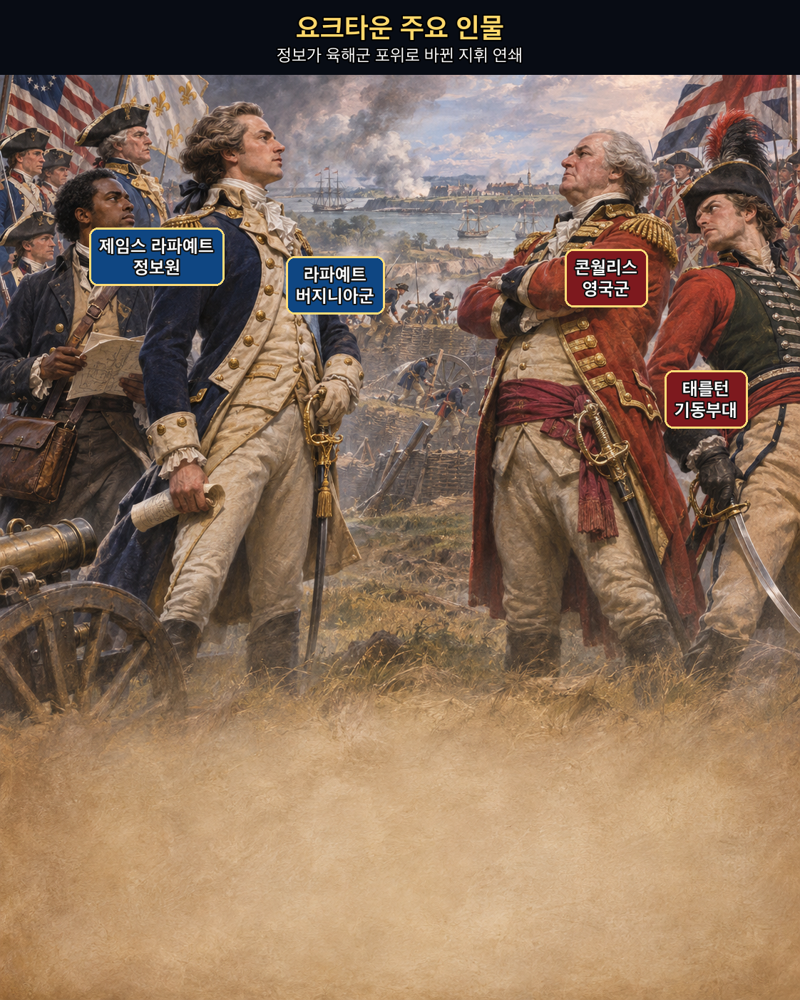
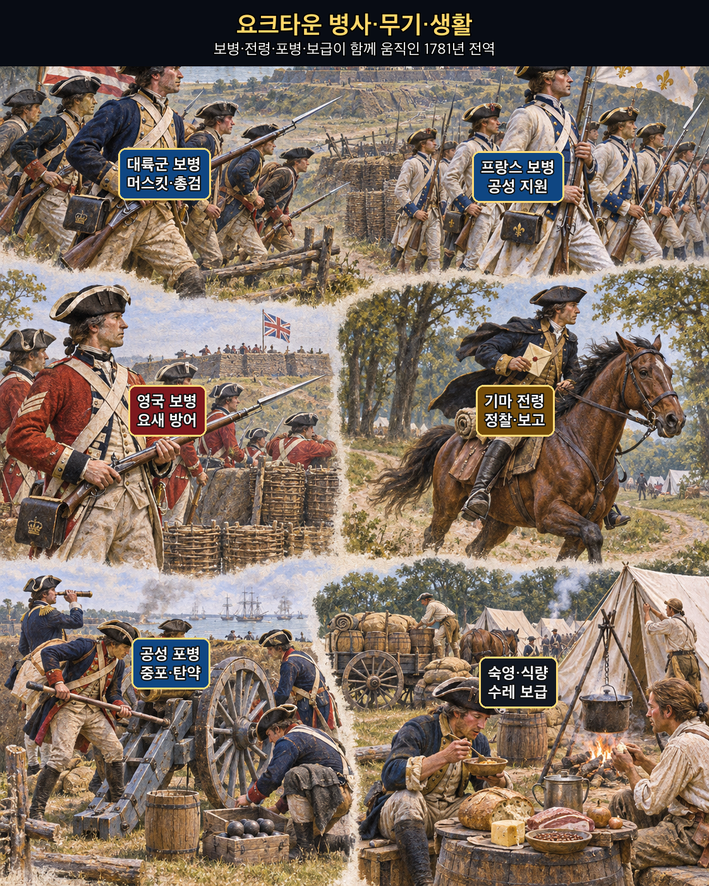
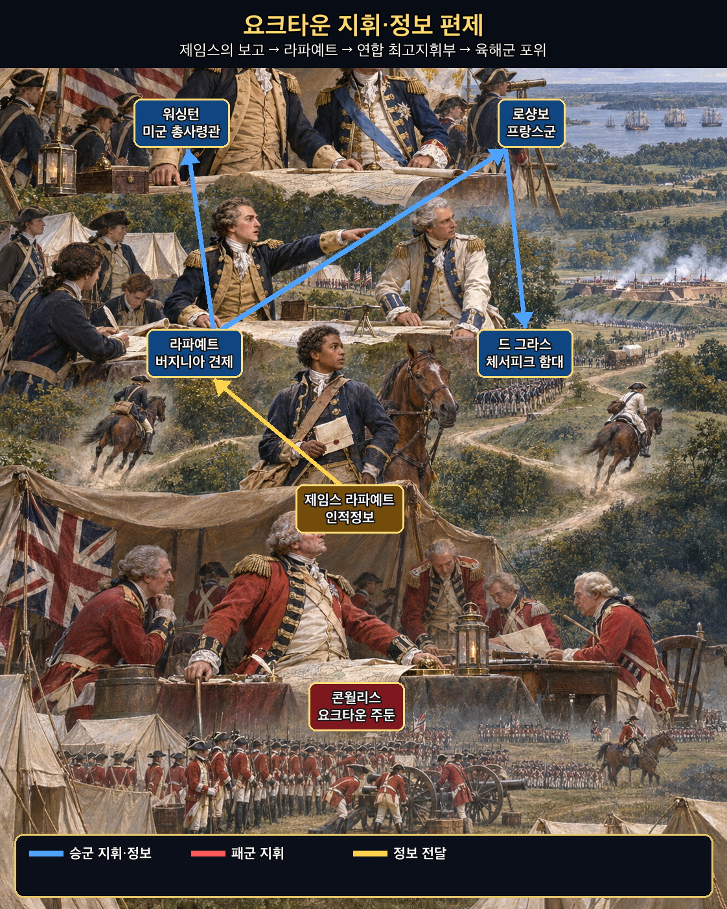
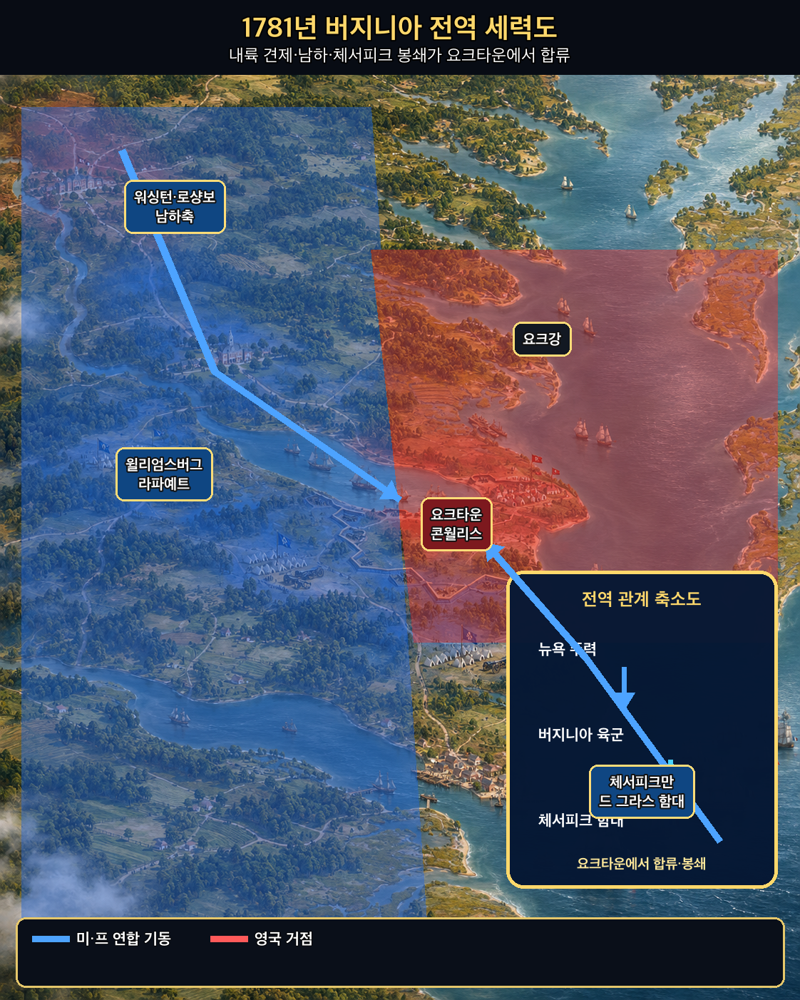
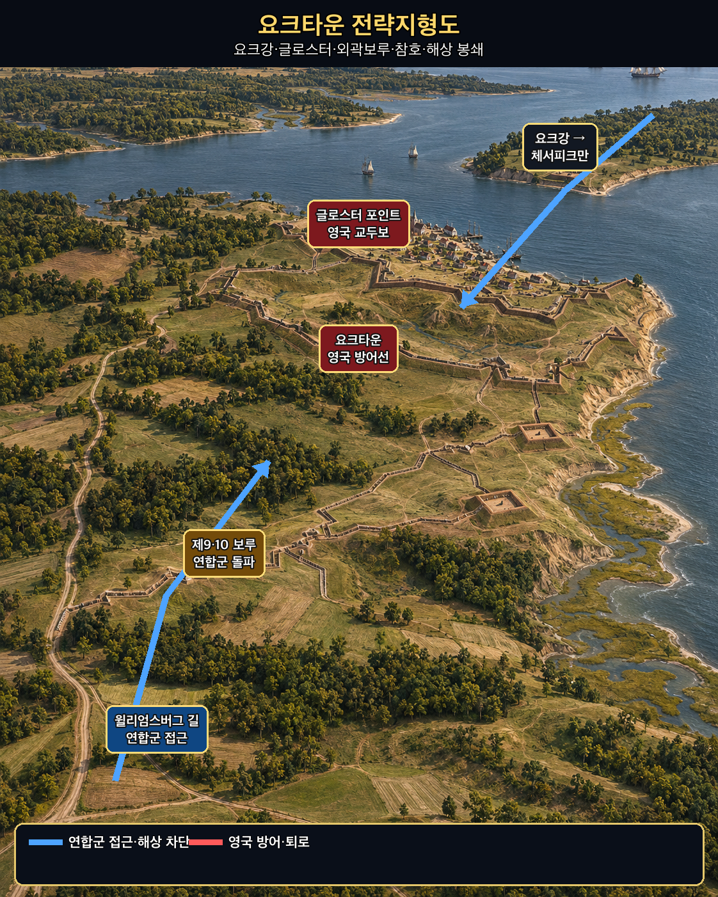
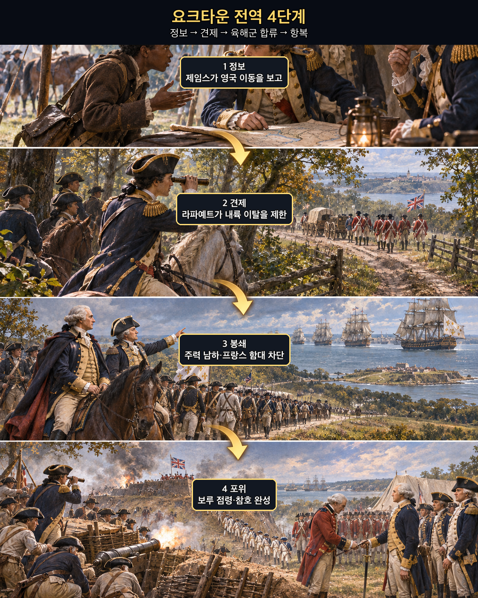

**뒤에서 반복될 지형을 먼저 잡아두기**

- **▰** **윌리엄스버그(Williamsburg)** — **라파예트**가 영국군을 추적하며 요크 반도로 몰아넣는 내륙 거점이었다.
- **▰** **요크타운(Yorktown)** — **콘월리스**가 항구와 해상 지원을 기대해 택한 방어 거점이다.
- 🌊 **요크강(York River)** — 요크타운과 글로스터 포인트 사이의 물길이며 해상 탈출과 보급의 축이었다.
- 🌊 **체서피크만(Chesapeake Bay)** — 프랑스 함대가 장악하면서 영국 구원함대와 해상 퇴로가 차단됐다.
- **▰** **글로스터 포인트(Gloucester Point)** — 영국군의 맞은편 교두보로, 폭풍 속 탈출 시도가 향한 곳이었다.
- **제9·10 보루(Redoubts 9 and 10)** — 연합군 참호 완성을 막던 외곽 거점으로, 점령 뒤 포위선이 닫혔다.

#### 상세 전역 서사 — 제임스의 보고를 라파예트가 봉쇄 판단으로, 연합 지휘부가 포위 작전으로 바꾸다

1781년 버지니아에서 **제임스 라파예트(James Lafayette)**는 노예 신분으로 **라파예트(Marquis de Lafayette)** 휘하의 정보 임무를 수행했다. 그는 영국 측에 미국군 정보를 제공할 사람처럼 접근하면서 **콘월리스(Charles Cornwallis)** 본부에서 들은 병력 이동과 의도를 미국 측에 전했다. **라파예트**의 8월 25일자 편지는 “전에 말한 이 하인을 통해 정보”를 얻었다고 워싱턴에게 보고한다. 다만 후대의 ‘한 사람이 요크타운 승리를 만들었다’는 서사는 경계해야 한다. 제임스의 보고는 정찰·포로 심문·해군 소식과 함께 쓰였고, 정확한 개별 보고의 전부는 남아 있지 않다.

#### 라파예트의 절제 — 보고를 받았지만 조급한 결전을 피하다

**콘월리스**가 요크타운에 주둔해 해상 지원을 기다리자 **라파예트**는 성급한 정면공격 대신 영국군을 감시하고 내륙 이탈을 제한했다. 이어 **워싱턴**과 **로샹보**가 뉴욕 앞 주력을 남쪽으로 돌렸고, 프랑스 함대가 체서피크만의 출입을 막았다. 정보가 ‘적이 어디 있다’는 지식으로 멈추지 않고 대륙군·프랑스군·함대의 시간표를 맞추는 명령으로 바뀐 것이다.

#### 체서피크 봉쇄와 참호 — 정보가 육해군의 같은 시간표가 되다

연합군은 외곽 보루를 점령해 제2평행참호를 완성했고, 해상 구원이 실패한 영국군은 10월 19일 항복했다. 승리는 제임스의 첩보만이 아니라 **라파예트**의 절제된 봉쇄, **워싱턴**·**로샹보**의 남하, 드 그라스 함대의 제해권, 공성 포병과 보급이 결합한 결과였다. 이것이 `上智爲間`을 `三軍之所恃而動`으로 바꾼 실제 구조다.

#### 정보의 작동 구조 — 출처를 존중하되 한 사람의 말로 전쟁 전체를 설명하지 않다

**주체와 정보.** **제임스**는 영국 지휘부에 접근해 병력 이동과 주둔 의도를 전했고, **라파예트**는 이를 상급 지휘부에 올렸다.

**검증과 결심.** 연합군은 그의 보고를 다른 정찰·해군 정보와 맞추며 영국군이 요크 반도에 묶일 시간창을 판단했다.

**삼군의 움직임.** 버지니아의 견제, 뉴욕 전선의 남하, 프랑스 함대의 해상 차단, 참호 공사가 하나의 포위로 이어졌다.

**사료의 경계.** 제임스의 공로는 라파예트의 증명서와 편지로 확인되지만, 특정 보고 하나가 승리를 ‘결정했다’고 단정할 수는 없다.

#### 法 한눈 비교 — 곡제·관도·주용

<table fit-page-width="true" header-row="true">
<tr>
<td>진영</td>
<td>곡제(편제)</td>
<td>관도(지휘)</td>
<td>주용(보급·지속)</td>
</tr>
<tr>
<td>
**연합군**
</td>
<td>대륙군·프랑스군·함대를 봉쇄와 공성에 결합했다.</td>
<td>제임스의 정보가 라파예트·워싱턴으로 올라가 육해군 결심과 연결됐다.</td>
<td>체서피크 해상로와 중포·참호 자재를 확보했다.</td>
</tr>
<tr>
<td>
**영국군**
</td>
<td>요크타운·글로스터에 분산돼 포위됐다.</td>
<td>클린턴의 구원 약속과 콘월리스의 현장 판단이 시간상 어긋났다.</td>
<td>해상 보급과 철수가 프랑스 함대에 막혔다.</td>
</tr>
</table>

##### **영국군(패군)**
<table fit-page-width="true" header-row="true">
<tr>
<td>요소</td>
<td>판단</td>
</tr>
<tr>
<td color="orange_bg">🤝 **道**</td>
<td>현장군과 뉴욕 총사령부의 목적·구원 시간표가 어긋났다. (지기·사기)</td>
</tr>
<tr>
<td color="blue_bg">🌤️ **天**</td>
<td>해상 우세와 적시 구원을 기대했지만 프랑스 함대와 연합군 남하 가능성을 낮게 보았다. (지피·타이밍·확률 관점)</td>
</tr>
<tr>
<td color="green_bg">🧭 **地**</td>
<td>두 물길 사이 반도 끝 거점은 항구가 열리면 유리했으나 봉쇄 뒤에는 퇴로가 좁아졌다. (광협·사생)</td>
</tr>
<tr>
<td color="purple_bg">🎖️ **將**</td>
<td>
**콘월리스**는 요새화했지만 육해군 연결이 끊긴 뒤의 탈출 조건을 충분히 확보하지 못했다. (지신인용엄)</td>
</tr>
<tr>
<td color="yellow_bg">⚙️ **法**</td>
<td>분산 주둔과 해상 의존이 공성 지속력의 약점이 됐다. (곡제·관도·주용)</td>
</tr>
</table>

**직관·편향 한 줄:** **콘월리스**가 영국 해군의 통상적 우세와 구원 약속을 기준점으로 삼은 판단에는 계획 오류가 작동했을 가능성이 있으며, 프랑스 함대가 만을 닫는 대안 시나리오의 가중치가 낮았다.

🏳️ **패군 측 결과**: 六敗(육패)의 `北(배, 적정을 충분히 헤아리지 못함)`에 가깝다. **회피 분기점:** 체서피크 봉쇄가 확정되기 전 포츠머스 방향으로 주력을 빼거나, 요크타운에 머문다면 글로스터 교두보와 수송선을 더 일찍 강화했으면 승리를 보장하지는 못해도 전군 항복 위험을 낮출 수 있었다.

##### **미·프 연합군(승군)**
<table fit-page-width="true" header-row="true">
<tr>
<td>요소</td>
<td>판단</td>
</tr>
<tr>
<td color="orange_bg">🤝 **道**</td>
<td>독립전쟁의 결정적 기회를 공동 목표로 묶고 미국·프랑스군을 결합했다. (지기·사기)</td>
</tr>
<tr>
<td color="blue_bg">🌤️ **天**</td>
<td>현장 정보와 함대 소식을 결합해 영국군이 반도에 묶이는 짧은 시간창을 활용했다. (지피·타이밍·확률 관점)</td>
</tr>
<tr>
<td color="green_bg">🧭 **地**</td>
<td>육상 포위와 체서피크 해상 차단을 연결해 반도를 위지로 만들었다. (원근·광협·사생)</td>
</tr>
<tr>
<td color="purple_bg">🎖️ **將**</td>
<td>
**라파예트**는 정보원을 쓰되 무리한 결전을 피했고, **워싱턴**과 **로샹보**는 전략축을 남쪽으로 전환했다. (지신인용엄)</td>
</tr>
<tr>
<td color="yellow_bg">⚙️ **法**</td>
<td>정찰·첩보·함대·중포·참호를 같은 시간표에 올렸다. (곡제·관도·주용)</td>
</tr>
</table>

🏆 **승군 측 결과**: 五勝(오승)의 `識衆寡之用者勝(식중과지용자승, 많고 적은 병력의 쓰임을 아는 자가 이김)`과 `以虞待不虞者勝(이우대불우자승, 대비한 채 대비 없는 적을 상대하는 자가 이김)`에 해당한다.

##### 法을 압축하지 않고 보기 — 곡제·관도·주용
**곡제 曲制(곡제): 부대를 어떻게 나누고 결합했는가**
<table fit-page-width="true" header-row="true">
<tr>
<td>진영</td>
<td>곡제 曲制(곡제)</td>
</tr>
<tr>
<td>
**승군**
</td>
<td>라파예트의 견제군, 워싱턴·로샹보 주력, 드 그라스 함대, 공성대를 기능별로 결합했다.</td>
</tr>
<tr>
<td>
**패군**
</td>
<td>요크타운과 글로스터의 주둔군이 육상 포위와 해상 봉쇄에 동시에 대응해야 했다.</td>
</tr>
</table>
**관도 官道(관도): 누가 명령하고 어떻게 전달했는가**
<table fit-page-width="true" header-row="true">
<tr>
<td>진영</td>
<td>관도 官道(관도)</td>
</tr>
<tr>
<td>
**승군**
</td>
<td>제임스→라파예트→워싱턴의 정보 경로와 미·프 지휘 협의가 작전으로 이어졌다.</td>
</tr>
<tr>
<td>
**패군**
</td>
<td>콘월리스와 클린턴 사이 서신·구원 시간표가 거리와 해상 상황 때문에 늦었다.</td>
</tr>
</table>
**주용 主用(주용): 군량·장비·전투 지속 능력을 어떻게 썼는가**
<table fit-page-width="true" header-row="true">
<tr>
<td>진영</td>
<td>주용 主用(주용)</td>
</tr>
<tr>
<td>
**승군**
</td>
<td>프랑스 함대의 수송·중포와 연합군 참호 자재가 공성을 지속시켰다.</td>
</tr>
<tr>
<td>
**패군**
</td>
<td>해상 보급이 끊기고 외곽 보루가 함락되면서 식량·탄약·수리·퇴로가 함께 압박받았다.</td>
</tr>
</table>

#### 참고자료
- [Lafayette College Archives — 1781년 8월 25일 라파예트 서신](https://www.lafayette.edu/bicentennial/2026/09/02/from-the-archives-letters-from-the-marquis-de-lafayette-to-gen-george-washington/)
- [National Park Service — James Lafayette](https://www.nps.gov/articles/000/james-lafayette-a-legacy-of-courage-and-espionage.htm)
- [Defense Intelligence Agency — Good intelligence led to victory at Yorktown](https://www.dia.mil/News-Features/Articles/Article-View/Article/566988/good-intelligence-led-to-victory-at-yorktown/)
- [Smithsonian — African Americans at Yorktown](https://americanhistory.si.edu/explore/exhibitions/american-revolution-world-war/online/yorktown/african-americans)

### 동양 — 🏛️ 당 조정군 vs 🏛️ 회서 절도사 세력 │ 이소의 설야입채주(李愬雪夜入蔡州, 817)

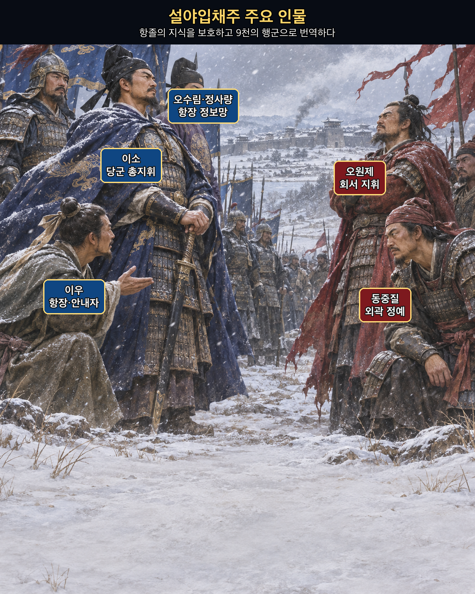
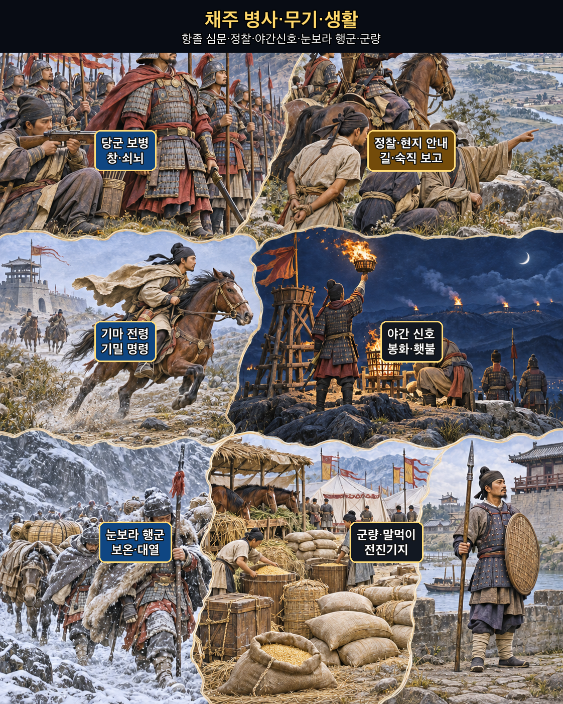
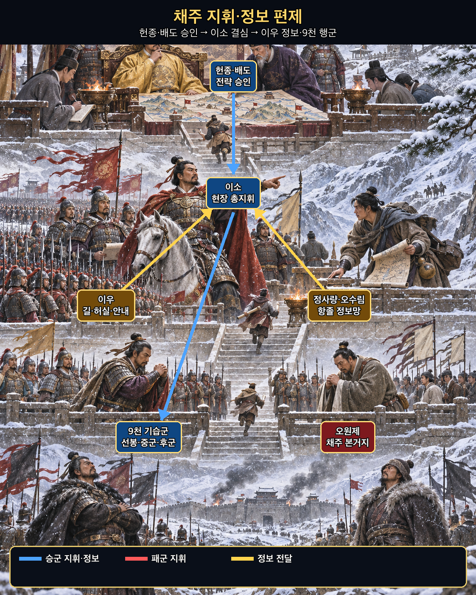
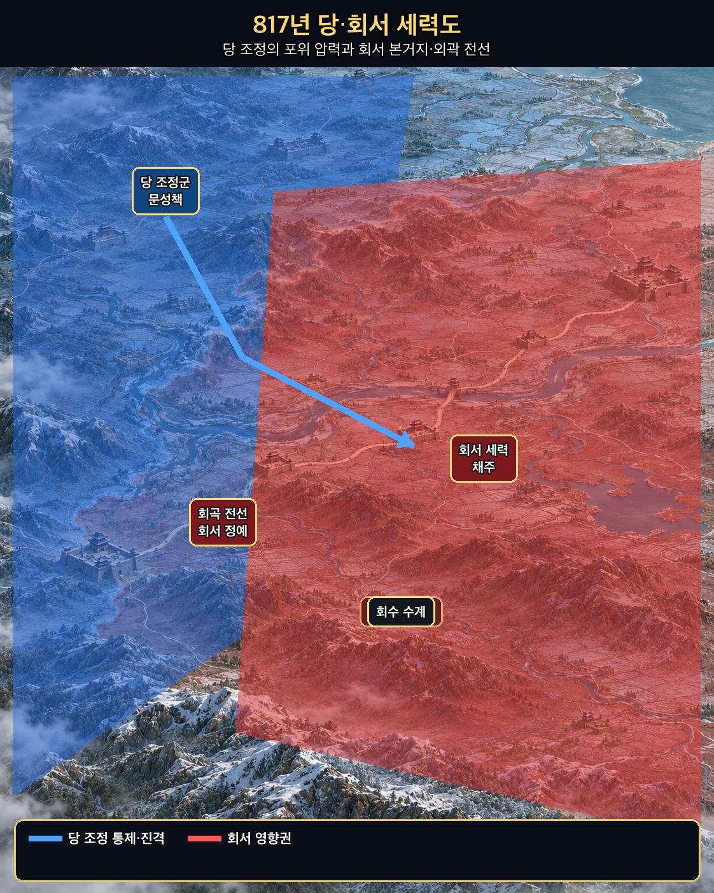
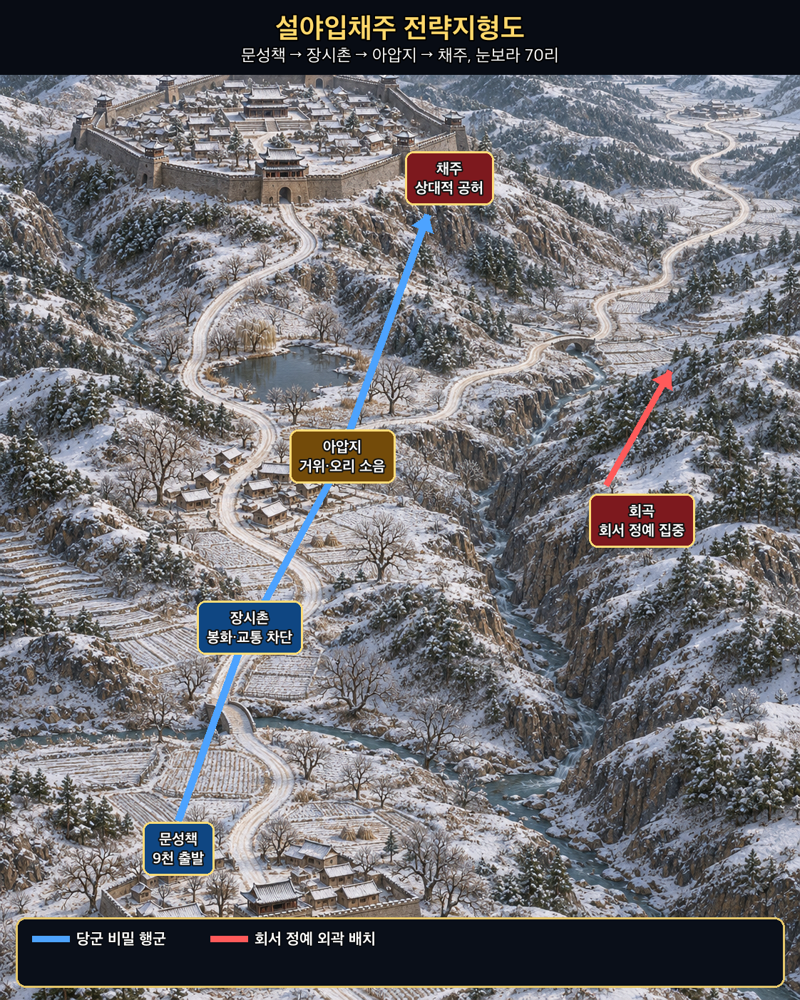
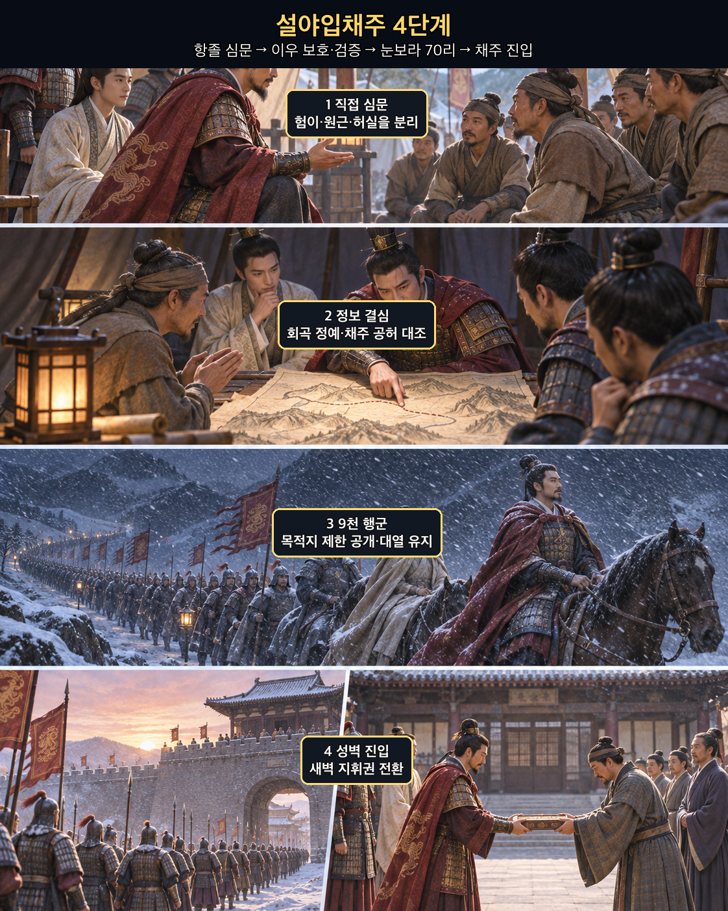

**뒤에서 반복될 지형을 먼저 잡아두기**

- **▰** **문성책(文城柵)** — **이소**가 9천을 출발시킨 전진기지다.
- **▰** **장시촌(張柴村)** — 야간행군의 첫 목표로 봉화와 교통을 끊고 병사를 쉬게 한 곳이다.
- **아압지(鵝鴨池)** — 성 가까이의 거위·오리 울음으로 행군 소음을 가렸다고 전하는 지점이다.
- **▰** **채주(蔡州)** — **오원제**의 본거지이지만 정예가 외곽에 집중된 틈이 있었다.
- **회곡(洄曲)** — 회서 정예가 당군과 대치하던 전선으로, 채주의 상대적 공허를 만들었다.
- **낭산(朗山)** — 채주 주변 작전축을 가르는 산지로, 기밀을 유지한 우회와 길 안내가 중요했다.

#### 상세 전역 서사 — 항졸의 말을 직접 묻고 이우의 지식을 9천 명의 눈보라 행군으로 바꾸다

『자치통감』 권240은 **이소(李愬)**가 항복한 병사를 얻을 때마다 직접 불러 사정을 묻고, 험하고 쉬운 길·멀고 가까움·적의 허실을 모두 알았다고 기록한다. 그는 **정사량**과 **오수림**을 포섭한 뒤 회서의 용장 **이우(李祐)**를 사로잡았다. 부하들이 죽이자고 했지만 이소는 살려 후대하고, 조정의 의심 속에서도 다시 데려와 핵심 계획에 참여시켰다.

#### 이우를 살린 판단 — 배신 전력보다 현재의 지식과 검증을 보다

**이우**는 회서 정예가 회곡과 사경에 몰려 있어 채주가 비었다는 내부 지식과 길을 제공했다. 이소는 이 말을 맹신하지 않고 연속된 항졸 심문과 전초 점령으로 주변 형세를 대조했다. 또한 첩자를 숨긴 집까지 처벌하던 명령을 거두고 적의 정보원을 후대해, 거짓 안도감과 정보 유입을 함께 만들었다.

#### 목적지를 감춘 70리 — 정보가 9천 명의 행군 규율이 되다

817년 음력 10월, 이소는 9천을 이끌고 문성책을 나섰다. 목적지는 지휘부 일부만 알았고, 장시촌을 거쳐 70리를 눈보라 속에 행군했다. 병사들이 목적지를 묻자 “동쪽으로 간다”는 정도만 전달됐다. 밤중에 채주 외곽에 도달한 당군은 경계가 느슨한 틈을 타 성벽을 넘었고, 다음 날 **오원제**를 붙잡았다.

이 승리를 ‘눈보라의 기적’으로만 읽으면 손자의 결론이 사라진다. 기상은 우연한 은폐를 제공했지만, 승리를 가능하게 한 것은 항졸을 정보원으로 바꾸는 처우, 이우의 높은 현지 지식, 여러 보고의 대조, 목적지 보안, 9천 명의 편제와 행군 통제였다. `上智`가 보고한 길을 `賢將`이 삼군의 실제 움직임으로 번역한 사례다.

#### 정보의 작동 구조 — 포로를 소모품이 아니라 지형과 지휘를 읽는 전문가로 쓰다

**주체와 정보.** 정사량·오수림·이우는 회서 내부의 길·장수·배치·경계 습관을 제공했다.

**검증과 결심.** 이소는 항졸을 직접 심문하고 전초를 차례로 확보해 ‘채주 공허’ 판단을 누적했다.

**삼군의 움직임.** 9천을 기능별로 나눠 장시촌 차단, 야간행군, 성벽 진입, 성내 통제를 연속시켰다.

**사료의 경계.** 세부 숫자와 극적인 장면은 후대 편찬 사료에 의존하며, 이우 한 사람만으로 성공했다고 축소할 수 없다.

#### 法 한눈 비교 — 곡제·관도·주용
<table fit-page-width="true" header-row="true">
<tr>
<td>진영</td>
<td>곡제(편제)</td>
<td>관도(지휘)</td>
<td>주용(보급·지속)</td>
</tr>
<tr>
<td>
**당군**
</td>
<td>9천을 선봉·중군·후군과 안내·차단 임무로 묶었다.</td>
<td>목적지를 제한 공개하고 이우의 정보가 이소의 단일 결심으로 이어졌다.</td>
<td>짧은 기습을 위해 경량 행군하고 현지 거점을 연속 확보했다.</td>
</tr>
<tr>
<td>
**회서군**
</td>
<td>정예가 회곡 등 외곽 전선에 집중됐다.</td>
<td>항장 이탈과 채주 경계 정보가 본부에 충분히 반영되지 않았다.</td>
<td>본거지의 장기 방어 물자는 있었으나 기습 경보와 즉응 전력이 부족했다.</td>
</tr>
</table>

##### **회서군(패군)**
<table fit-page-width="true" header-row="true">
<tr>
<td>요소</td>
<td>판단</td>
</tr>
<tr>
<td color="orange_bg">🤝 **道**</td>
<td>연속된 항복과 포섭으로 내부 인재·정보·사기가 빠져나갔다. (지기·사기)</td>
</tr>
<tr>
<td color="blue_bg">🌤️ **天**</td>
<td>악천후에는 대규모 접근이 어렵다는 기대가 경계를 낮췄다. (지피·타이밍·확률 관점)</td>
</tr>
<tr>
<td color="green_bg">🧭 **地**</td>
<td>외곽 전선에 정예를 두면서 본거지로 이어지는 겨울 길과 성벽의 허실을 노출했다. (원근·험이·사생)</td>
</tr>
<tr>
<td color="purple_bg">🎖️ **將**</td>
<td>
**오원제**는 이우 등 이탈자의 지식이 당군 작전으로 전환될 위험을 막지 못했다. (지신인용엄)</td>
</tr>
<tr>
<td color="yellow_bg">⚙️ **法**</td>
<td>외곽 전투력과 본거지 경계·예비대가 분리됐다. (곡제·관도·주용)</td>
</tr>
</table>

**직관·편향 한 줄:** **오원제** 측이 눈보라와 당군의 이전 부진을 ‘오늘도 기습은 어렵다’는 대표적 장면으로 본 판단에는 정상성 편향과 가용성의 영향이 작동했을 가능성이 있다.

🏳️ **패군 측 결과**: 六敗(육패)의 `亂(란, 지휘·경계의 혼란)`과 `北(배, 적정을 헤아리지 못함)`이 겹쳤다. **회피 분기점:** 항장 이탈 직후 채주 성문의 암호·숙직·순찰로를 바꾸고 외곽 정예 일부를 예비대로 복귀시켰다면 승리를 보장하지는 못해도 본거지가 하룻밤에 무너지는 결과는 피할 가능성이 컸다.

##### **당 조정군(승군)**
<table fit-page-width="true" header-row="true">
<tr>
<td>요소</td>
<td>판단</td>
</tr>
<tr>
<td color="orange_bg">🤝 **道**</td>
<td>항졸을 죽이기보다 쓰고 보호해 정보와 전투력을 함께 얻었다. (지기·사기)</td>
</tr>
<tr>
<td color="blue_bg">🌤️ **天**</td>
<td>눈보라의 위험을 인정하면서도 적의 경계가 낮아질 시간창으로 바꿨다. (지피·타이밍·확률 관점)</td>
</tr>
<tr>
<td color="green_bg">🧭 **地**</td>
<td>현지 안내와 직접 심문으로 70리 겨울길·성벽·경계의 허실을 구체화했다. (원근·험이·광협)</td>
</tr>
<tr>
<td color="purple_bg">🎖️ **將**</td>
<td>
**이소**는 이우를 보호하고 반대 속에서도 책임졌으며 기밀과 행군을 통제했다. (지신인용엄)</td>
</tr>
<tr>
<td color="yellow_bg">⚙️ **法**</td>
<td>정보·안내·차단·행군·성내 통제를 9천의 임무로 번역했다. (곡제·관도·주용)</td>
</tr>
</table>

🏆 **승군 측 결과**: 五勝(오승)의 `上下同欲者勝(상하동욕자승, 상하가 뜻을 같이하면 이김)`, `以虞待不虞者勝(이우대불우자승, 대비한 채 대비 없는 적을 상대하면 이김)`, `將能而君不御者勝(장능이군불어자승, 장수가 유능하고 군주가 억누르지 않으면 이김)`에 해당한다.

##### 法을 압축하지 않고 보기 — 곡제·관도·주용
**곡제 曲制(곡제): 부대를 어떻게 나누고 결합했는가**
<table fit-page-width="true" header-row="true">
<tr>
<td>진영</td>
<td>곡제 曲制(곡제)</td>
</tr>
<tr>
<td>
**승군**
</td>
<td>선봉·중군·후군, 장시촌 차단, 이우의 안내, 성벽 진입대를 한 행군열에 결합했다.</td>
</tr>
<tr>
<td>
**패군**
</td>
<td>정예는 회곡 등 외곽에, 채주에는 상대적으로 약한 경계병이 남았다.</td>
</tr>
</table>
**관도 官道(관도): 누가 명령하고 어떻게 전달했는가**
<table fit-page-width="true" header-row="true">
<tr>
<td>진영</td>
<td>관도 官道(관도)</td>
</tr>
<tr>
<td>
**승군**
</td>
<td>헌종·배도의 승인 아래 이소가 현장 지휘권을 갖고, 이우의 정보와 길 안내를 제한된 참모선에서만 공유했다.</td>
</tr>
<tr>
<td>
**패군**
</td>
<td>항장과 첩자망의 이탈 신호가 오원제의 본거지 경계 변경으로 이어지지 않았다.</td>
</tr>
</table>
**주용 主用(주용): 군량·장비·전투 지속 능력을 어떻게 썼는가**
<table fit-page-width="true" header-row="true">
<tr>
<td>진영</td>
<td>주용 主用(주용)</td>
</tr>
<tr>
<td>
**승군**
</td>
<td>장기 공성 대신 9천의 단기 경량 기습을 택해 눈보라 속 보급 부담을 시간으로 상쇄했다.</td>
</tr>
<tr>
<td>
**패군**
</td>
<td>채주의 저장과 성벽은 있었지만 외곽 정예가 돌아올 때까지 버틸 경보·숙직·즉응 체계가 실패했다.</td>
</tr>
</table>

#### 참고자료
- [『資治通鑑』 권240 — 이소의 항졸 심문·이우 후대·설야입채주](https://www.sidneyluo.net/c/240.html)
- [위키문헌 사고전서본 『資治通鑑』 권240](https://zh.wikisource.org/wiki/%E8%B3%87%E6%B2%BB%E9%80%9A%E9%91%91_(%E5%9B%9B%E5%BA%AB%E5%85%A8%E6%9B%B8%E6%9C%AC)/%E5%8D%B7240)
- [Chinese Text Project — 『舊唐書』](https://ctext.org/wiki.pl?if=en&res=456771)

---
## 5. 핵심 통찰 + 실생활 적용 + 생활루틴

### 핵심 통찰

용간편의 마지막 결론은 “좋은 간첩을 써라”보다 넓다. 정보는 사람에게서 오고, 그 사람의 능력을 알아보며 진실을 말하게 만드는 책임은 지휘부에 있다. 지휘부는 보고를 검증 가능한 판단으로 바꾸고, 그 판단을 삼군이 이해하고 의지할 수 있는 명령으로 번역해야 한다. 어느 한 고리가 빠지면 정보 활동은 비밀스러운 소문이나 권력자의 확신으로 변한다.

특히 `明君賢將`이 `上智`보다 먼저 나온 순서를 기억해야 한다. 유능한 현장 담당자가 있어도 윗사람이 듣고 싶은 결론을 먼저 정하거나 불확실성을 무능으로 취급하면 정보는 왜곡된다. 반대로 좋은 지휘자는 가장 가까이서 본 사람의 의견을 존중하면서도 한 사람의 권위에 기대지 않고 로그·시각·다른 출처와 대조한다.

`三軍之所恃而動`은 신뢰가 행동으로 검증되는 지점이다. 팀이 보고 체계를 믿는다는 말은 모든 보고를 의심 없이 따른다는 뜻이 아니다. 누가 무엇을 직접 봤는지, 무엇은 추정인지, 상황이 달라지면 어디서 멈출지 알기 때문에 함께 움직일 수 있다는 뜻이다.

### 실생활 적용

3교대 현장에서 에러가 발생하면 가장 가까이서 설비·로그·알람 순서를 본 사람이 `上智`의 자리에 설 수 있다. 직급이나 말의 크기가 아니라 이번 사건에 관한 관찰의 질로 판단해야 한다. 최초 보고에는 `발생 시각 / 직접 본 값 / 이미 한 조치 / 아직 확인하지 못한 것`을 붙이고, 조장은 원인 단정 전에 다른 로그와 다음 공정 영향을 확인한다.

인물사건관찰시리즈에 기록된 전씨의 경우, 단순 조치에서 흥분하거나 복잡한 상황에서 다른 사람의 말을 잘 듣지 않는 장면이 관찰되었다. 이를 성격 전체의 낙인으로 전달하면 사람에 대한 소문만 커진다. 다음 근무에서는 에러 직전 수면·업무량·화면 상태·실제 지시와 응답을 시간순으로 분리하고, 조치가 복잡해질 때 한 사람이 명령하고 다른 사람이 로그와 복구 조건을 읽게 하는 편이 낫다.

근무조 신입 최씨에 관한 기록도 같은 원칙을 요구한다. 졸음·메신저 미응답·BM 시트 누락처럼 관찰된 행동은 구체적으로 남기되, 의지나 세대 전체의 성향을 사실처럼 결론 내리지 않는다. 피로와 직무 배치, 교육 수준, 실제 누락 빈도를 따로 확인하고, 인계 시에는 다음 조가 취할 행동과 검증 시각만 전달한다. 사람에 관한 평가보다 움직임을 바꾸는 정보가 먼저다.

사용자의 최신 독서 메모는 생생한 한 사건에만 집중하면 그 시나리오의 확률을 과대평가할 수 있다고 경고한다. 에러 한 건을 보고 “항상 이 원인”이라고 결론 내리기 전에 최근 유사 에러 전체 건수와 다른 원인 후보를 적는다. `가장 가능성 높은 원인 / 놓치면 피해가 큰 원인 / 빠르게 배제할 수 있는 원인`을 하나씩 두면 직관과 안전을 함께 살릴 수 있다.

오늘 인계에서는 보고마다 `출처·시각·확인 사실·추정·다음 확인·중단 조건` 여섯 칸을 채운다. 조장은 그중 삼군의 움직임에 해당하는 업무 재배치나 설비 조작을 명령하기 전에 최소 두 개의 독립 근거를 확인한다. 즉시 안전 조치가 필요하면 가역적인 차단을 먼저 하고, 원인 확정과 비가역 조치는 뒤로 나눈다.

### 생활루틴 추천

**보고의 출처와 판단 근거를 확인하지 않고 사람을 움직이면 재수가 없다.**

**이유:** 근무 시작과 에러 인계 때 3분을 써서 `누가 직접 보았는가 / 언제의 정보인가 / 로그와 일치하는가 / 다른 설명은 무엇인가 / 무엇이 바뀌면 멈출 것인가`를 확인한다. 이 과정이 없으면 생생한 말이나 직급이 사실을 대신하고, 잘못된 원인으로 인력과 설비가 움직여 작은 오판이 공정 지연·책임 공방·다음 교대의 반복 오류로 커진다. `明君賢將`이 `上智`를 알아보고 `三軍`을 움직인다는 순서는 **사람의 권위가 아니라 검증된 정보가 행동을 받쳐야 한다**는 원리다.
