> 내외소동, 태어도로, 부득조사자, 칠십만가. — 긴급한 일에 사람을 끌어모으기 전에, 그 이동 때문에 멈출 본업과 흔들릴 주변부터 계산해야 한다.

---
## 1. 원문 + 독음 + 직역 + 한자어 뜻풀이

內外騷動, 怠於道路, 不得操事者, 七十萬家, 내외소동, 태어도로, 부득조사자, 칠십만가.

**직역**  
안과 밖이 소란하게 움직이고, 도로에서 지쳐 늘어지며, 생업을 맡아 처리할 수 없는 집이 칠십만 가에 이른다.

	앞 구절은 십만 군대가 천 리를 나갈 때 날마다 천금이 든다고 했다. 이 문장은 그 가격표 뒤에 가려진 사람들의 시간을 펼친다. 전쟁이 움직이면 궁정과 군영만 바빠지는 것이 아니다. 나라 안에서는 징발·조달·행정이 흔들리고, 나라 밖으로 이어지는 길에는 수송과 왕래가 몰린다. 길에 묶인 사람은 자기 밭과 작업장으로 돌아가지 못한다. 손자가 세는 것은 전투원만이 아니라 **전쟁 때문에 본래 일을 멈춘 사회 전체의 동원 범위**다.

	#### 內外(내외) — 전선과 후방을 한 장의 비용표에 놓다

	`內`(안 내)는 국가 안쪽의 가정·관부·창고와 생산 기반을, `外`(바깥 외)는 출정한 군대와 국경 밖 원정 공간을 가리킨다. 둘은 고립된 두 세계가 아니다. 밖의 군대가 먹고 움직일수록 안에서는 사람과 물자를 모아 보내야 하고, 안쪽의 지연은 곧 바깥의 결핍으로 나타난다.

	이 구절에서 `內外`를 단순히 “여기저기”로 풀면 중요한 연결이 사라진다. 손자는 승리를 전선의 무용만으로 계산하지 않는다. 전선의 한 걸음마다 후방의 여러 손이 따라 움직이는 구조를 먼저 보게 한다. 바깥의 성과가 안쪽의 생업을 지나치게 비우면, 전쟁은 적을 꺾기 전에 자기 기반부터 갉아먹는다.

	#### 騷動(소동) — 시끄러움이 아니라 질서가 제자리에서 벗어난 상태

	`騷`(떠들 소)는 어지럽고 불안하게 흔들리는 상태이며, `動`(움직일 동)은 가만있던 사람과 물자가 자리를 떠나 움직이는 일이다. 여기서 `騷動`은 단순히 사람들이 떠들썩하다는 뜻이 아니다. 평소 농사·수공업·행정을 맡던 사람과 수레가 군역과 수송으로 재배치되면서 사회의 정상적인 리듬이 흔들리는 장면이다.

	움직임 자체가 곧 성과는 아니다. 명령이 중복되고 길이 막히며 누가 무엇을 맡는지 바뀌면 많은 사람이 바쁘게 움직여도 실제 생산과 판단은 줄어든다. `騷`가 붙은 `動`은 질서 있는 기동과 다르다. 손자는 **활동량이 늘어난 모습과 일을 제대로 해내는 능력을 구분하라**고 압박한다.

	#### 怠於道路(태어도로) — 길 위에서 힘과 시간이 새다

	`怠`(게으를 태)는 평소의 성실성 부족만을 가리키지 않는다. 이 문장에서는 긴 수송과 왕래로 지치고 처져 본래의 일을 할 힘이 줄어드는 상태다. `道路`(도로)는 목적지 사이의 빈 공간이 아니라 사람·군량·명령이 통과해야 하는 작전 체계다.

	먼 길은 이동 시간만 더하지 않는다. 수레가 고장 나고 가축이 지치며, 호송과 숙영이 필요하고, 전달은 늦어진다. 길에서 하루를 쓰면 생산 현장에서는 그 하루가 빈다. 그러므로 `怠於道路`는 개인의 나태를 꾸짖는 말이 아니라 **동원이 사람을 길에 붙잡아 두면서 생기는 구조적 피로와 마찰**을 보여 준다.

	#### 不得操事(부득조사) — 하고 싶어도 자기 일을 손에 잡지 못하다

	`操`(잡을 조)는 손에 쥐고 맡아 처리한다는 뜻이다. `事`(일 사)는 여기서 각 가정이 생계를 꾸리고 생산을 이어 가는 본래의 일이다. `不得操事`는 일을 하기 싫다는 말이 아니라, 징발과 수송에 묶여 **자기 일을 붙잡을 조건 자체를 잃었다**는 뜻이다.

	이 차이는 책임 판단에서 중요하다. 본업이 멈췄는데 그것을 개인의 태만으로 돌리면 동원 체계가 만든 손실을 숨기게 된다. 누군가를 긴급 업무에 투입했다면 그가 비운 자리, 중단된 기록, 미뤄진 정비, 대신 일할 사람까지 명령을 내린 쪽의 계산에 들어가야 한다.

	#### 七十萬家(칠십만가) — 병사 한 명 뒤의 여러 집을 세다

	`家`(집 가)는 단순한 건물이나 한 개인이 아니라 생산과 부양의 단위인 가호를 가리킨다. `七十萬`은 현대 인구통계처럼 정확히 환산할 숫자라기보다, 십만 군대의 동원이 그 몇 배에 달하는 후방 가호를 흔든다는 압도적 비례를 드러낸다. 전통 주석은 병사 한 집을 내보내기 위해 여러 집이 경작과 공급을 분담하는 고대의 징발 구조와 연결해 설명해 왔다.

	핵심은 숫자의 문자적 정확성을 억지로 증명하는 데 있지 않다. 보이는 전투원보다 보이지 않는 지원·대체·부양 인구가 훨씬 넓다는 것이다. 한 사람을 빼내면 한 자리만 비는 것이 아니다. 그 사람에게 의존하던 일과 가족, 그 공백을 메우는 이들의 시간까지 연쇄적으로 움직인다.

	#### 글자들이 완성하는 한 장면

	`內外`가 전선과 후방을 한 화면에 올린다. 출정 명령이 떨어지자 두 공간의 사람과 물자가 `騷動`하여 평소의 자리를 떠난다. 그 흐름은 `道路`에 길게 늘어서고, 왕래와 수송에 묶인 사람들은 `怠`하여 힘과 시간을 잃는다. 마침내 각 가정은 자기 `事`를 손에 `操`할 수 없게 된다. `七十萬家`는 그 공백이 몇몇 병사 가족의 사정이 아니라 사회 전체로 번졌음을 보여 준다.

	그래서 이 문장은 앞의 비용론과 뒤의 정보론을 잇는 다리다. 정보가 부족해 전쟁이 길어지고 잘못된 곳으로 병력이 움직이면, 손실은 전선의 패배보다 먼저 후방의 중단으로 누적된다. 적정을 미리 아는 데 합당한 값을 쓰라는 뒤의 주장은 간첩을 숭배하라는 말이 아니다. **불필요한 동원과 헛된 왕래를 줄여 수많은 집의 본업을 보전하라**는 책임의 논리다.

---
## 2. 전통 주석 기반 분석

- **조조(曹操)** — “한 병사를 내보내는 일만 세지 마라. **그를 공급하고 대신 일하느라 여러 집이 생업을 놓는 구조까지 헤아려라.**”
- **이전(李筌)** — “안과 밖이 함께 움직이면 백성이 길에서 피로해진다. **군세의 장대함보다 후방의 흔들림을 먼저 경계하라.**”
- **두목(杜牧)** — “칠십만 가라는 큰 수를 빈 과장으로 버리지 마라. **십만 군대를 유지하려면 그 몇 배의 가호가 역역과 공급을 진다는 뜻으로 보아라.**”
- **매요신(梅堯臣)** — “도로에 오래 묶인 백성은 밭과 일을 돌볼 수 없다. **전쟁이 길어질수록 군비뿐 아니라 멈춘 생산이 나라를 가난하게 함을 잊지 마라.**”
- **장예(張預)** — “출정 뒤의 수송만 마련했다고 안심하지 마라. **누가 길에 나가고 누가 그 빈자리를 메울지 출정 전에 계산하라.**”
- **왕석(王晳)** — “`騷動`은 단순한 소란이 아니다. **평시의 질서가 군역 때문에 뒤집혀 사람들이 제 일을 잃는 상태로 보아라.**”
- **가림(賈林)** — “백성이 길에서 지치는 동안 생업의 때도 지나간다. **수송의 하루가 후방에서는 생산의 하루를 잃는 일임을 계산하라.**”
- **두우(杜佑)** — “고대의 가호와 부역 체계를 함께 살펴라. **전투병 숫자 뒤에 농사·운반·부양을 맡은 더 큰 조직이 서 있어야 군대가 움직인다.**”
- **진호(陳皞)** — “앞의 천금과 이 구절의 칠십만 가를 이어 읽어라. **전쟁의 값은 재물과 사람의 중단된 일에서 동시에 생긴다.**”

#### 리링의 고증과 현대적 독법

리링의 해설 취지를 따라 읽으면 `七十萬家`는 현대식 인구 센서스 수치가 아니라 고대 국가의 가호·부역·군역 조직을 배경으로 한 규모 표현이다. 십만 군대를 떼어 내면 그보다 훨씬 넓은 가호가 경작·수송·공급에 연쇄적으로 묶인다는 점이 중요하다. 판본 차이를 꾸미기보다 `家`가 개인이 아니라 생산과 부양의 단위라는 문장 구조를 살피는 편이 이 구절을 정확히 읽게 한다.

또한 `怠`를 백성의 도덕적 게으름으로 읽으면 문맥이 뒤집힌다. 이들은 `道路`에 동원되었기 때문에 지친 것이며, 그 결과 `不得操事`에 이른다. 원인은 개인의 성품이 아니라 국가가 만든 이동과 배치다. 용간편은 이렇게 동원의 사회적 비용을 먼저 세운 뒤, 적정을 미리 알 사람에게 작록과 백금을 아끼는 군주를 `不仁之至`(불인지지, 어질지 못함의 극치)라고 질책한다.

현대 생활에 옮길 때도 “사람을 많이 쓰면 일이 커진다”는 일반론으로 줄이면 안 된다. 먼저 고대 전쟁에서 전투병·운송·가호·생업이 어떻게 연결되는지 복원하고, 그다음 조직의 긴급 대응이 본업 중단과 대체 인력의 부담을 만든다는 구조적 유사점만 취해야 한다. 전쟁의 강제 동원과 현대 직장의 업무 배분은 권력과 위험의 크기가 다르므로 같은 것으로 취급하지 않는다.

---
## 3. 교차 설명

### ① 손자병법 내 교차

「작전편」의 `國之貧於師者遠輸, 遠輸則百姓貧`(국지빈어사자원수, 원수즉백성빈 — 나라가 군대로 가난해지는 까닭은 멀리 수송하기 때문이며, 멀리 수송하면 백성이 가난해진다)은 `怠於道路`의 경제적 인과를 직접 풀어 준다. 길이 멀어지면 운반하는 사람과 가축도 먹어야 하고, 운반에 나간 사람은 자기 생산에서 빠진다. 수송은 물자를 옮기는 기능인 동시에 다른 생산을 멈추게 하는 비용이다.

「군쟁편」의 `軍無輜重則亡, 無糧食則亡, 無委積則亡`(군무치중즉망, 무량식즉망, 무위적즉망 — 치중이 없으면 망하고, 양식이 없으면 망하며, 비축이 없으면 망한다)은 후방을 없애서 소동을 피할 수 없다는 점을 분명히 한다. 보급은 선택이 아니다. 과제는 보급을 무시하는 것이 아니라 목적·거리·기간을 정확히 알아 불필요한 왕래와 중복 동원을 줄이는 데 있다.

같은 용간편 뒤의 `相守數年, 以爭一日之勝`(상수삭년, 이쟁일일지승 — 여러 해 서로 지키다가 하루의 승부를 다툰다)은 이 문장의 시간축을 완성한다. 잘못된 정보로 수년을 대치하면 `七十萬家`의 중단도 수년간 누적된다. 그래서 `先知`(선지, 미리 앎)는 멋진 기습을 위한 장식이 아니라, 사회 전체가 불확실성에 묶이는 시간을 줄이는 수단이다.

### ② 클라우제비츠 『전쟁론』

클라우제비츠의 마찰은 계획서에서 간단해 보이는 행동이 현실에서는 수많은 작은 장애와 우연 때문에 힘들어지는 현상이다. `怠於道路`는 마찰이 길 위의 피로·지연·고장·혼잡으로 물질화된 장면이다. 부대 하나를 움직이는 명령은 한 줄이지만 실제 이동에는 노선, 휴식, 보급, 호송, 전달과 대체가 필요하고 그 과정마다 시간이 샌다.

전쟁이 정치적 목적을 위한 수단이라는 관점에서는, 후방의 소동과 생업 중단도 목적을 위해 감수할 비용에 포함되어야 한다. 목적이 제한적인데 동원의 폭이 끝없이 커진다면 수단이 목적을 삼켜 버린다. 손자는 `內外`와 `七十萬家`를 한 문장에 놓아 지휘관이 전장 밖의 부담까지 정치적 계산에 넣게 한다.

다만 두 저자를 같은 비용 이론가로 합쳐서는 안 된다. 클라우제비츠는 적과의 상호작용과 전쟁의 불확실성을 체계적으로 분석하고, 손자는 고대의 가호 동원과 도로 수송을 압축적으로 제시한 뒤 정보의 윤리로 나아간다. 둘의 접점은 전쟁을 지도 위 화살표로만 보지 않고, 실제 사람이 움직일 때 생기는 마찰과 사회적 대가를 계산한다는 데 있다.

### ③ 미야모토 무사시 『오륜서』

『오륜서』의 `拍子`(효시, 박자·리듬)는 자기 움직임과 상대의 움직임이 언제 맞고 어긋나는지를 아는 감각이다. `騷動`은 많은 움직임이 있어도 하나의 박자로 정리되지 않은 상태로 읽을 수 있다. 누구는 출발하고 누구는 기다리며 누구는 같은 지시를 다시 확인하면, 활동은 많아도 결과는 늦어진다.

무사시는 동작이 막히거나 같은 수를 되풀이할 때 집착하지 말고 리듬을 바꾸는 판단을 중시한다. 조직에서도 긴급 업무가 들어왔을 때 모두를 동시에 끌어들이기보다, 전면 대응·기록·본업 유지의 박자를 나눠야 한다. 그래야 바깥의 대응 때문에 안쪽의 일이 전부 멈추지 않는다.

그러나 개인 검술의 박자를 국가의 동원 비용과 동일시할 수는 없다. 무사시의 초점은 대결 속 타이밍과 몸의 운용이고, 손자의 초점은 여러 가호가 도로와 역역에 묶이는 구조다. 현대 적용에서도 개인의 집중법만 말하지 말고, 누가 호출되고 누가 본업을 유지하며 언제 교대하는지 조직 설계까지 내려와야 한다.

### ④ 오자병법·육도삼략

『오자병법』은 백성을 가르치고 화합시켜 평시의 질서를 갖춘 뒤 군대를 쓸 수 있다고 본다. 이 관점에서 `內外騷動`은 사기가 시끄럽다는 정도가 아니라, 동원의 기반인 정치적·생산적 질서가 흔들리는 문제다. 전투병을 늘리면서 백성의 생업과 신뢰를 무너뜨리면 겉의 병력은 커져도 오래 버틸 힘은 줄어든다.

『육도』는 인재와 재정, 창고와 운송을 평시에 마련하고 백성의 때를 빼앗지 않는 통치를 군사력의 토대로 본다. `不得操事`는 농사의 때와 생업의 연속성을 놓친 동원이 어떤 값을 치르는지 보여 준다. 필요할 때마다 사람을 즉흥적으로 끌어오면 오늘의 수송은 해결해도 내일의 생산과 신뢰가 약해진다.

손자는 이 통치의 문제를 용간의 가치로 연결한다. 정확한 적정은 공격하지 않아도 될 곳을 거르고, 동원 규모와 기간을 줄이며, 종결할 때를 앞당길 수 있다. 다만 정보라는 이름으로 무제한 감시를 허용할 수는 없다. 현대 조직의 정보 수집은 법적 권한, 목적 제한, 최소 수집, 검증과 책임이라는 조건 안에서만 정당하다.

### ⑤ 현대 심리학·군사학

현대의 과업 중단 연구는 `不得操事`와 구조적으로 맞닿는다. 하던 일을 중단한 뒤 돌아오면 즉시 원래 수준으로 복귀하는 것이 아니라, 목표와 진행 위치를 다시 불러오는 재개 지연이 생기고 오류 가능성도 커진다. 실험 연구와 체계적 문헌고찰은 중단 뒤 성급히 재개하기보다 짧은 재정렬 시간, 단서와 체크포인트 같은 개입이 정확도를 높일 수 있음을 보여 준다. 고대의 부역과 현대 인지 실험은 같지 않지만, 사람을 본업에서 떼어 내는 비용이 호출 시간으로 끝나지 않는다는 점은 공통이다.

현대 군사학의 지속지원은 병력 수와 화력만이 아니라 수송로, 보급 거점, 정비, 의료, 통신이 작전을 얼마나 유지할 수 있는지 본다. 특히 경쟁·교란되는 군수 환경에서는 도로와 철도, 상업 운송 능력, 허브가 공격이나 혼잡의 대상이 된다. `道路`는 수동적인 배경이 아니라 작전 능력을 결정하는 체계이며, 그 흐름이 막히면 전선과 후방이 동시에 흔들린다.

카너먼의 틀에서는 전면의 큰 사건이 생생할수록 뒤에서 멈춘 수많은 작은 일을 과소평가하기 쉽다. “에러 한 건을 해결했다”는 성공 장면만 보면 그동안 누락된 모니터링·기록·교대·본업의 확률을 분모에서 빼 버린다. 사용자의 최신 독서 메모가 경고하듯 한 시나리오에만 주목하지 말고, `즉시 해결 / 장기화 / 재발 / 인수인계 실패` 시나리오를 함께 만들고 확률의 합이 전체가 되게 보아야 한다.

적용의 한계도 분명하다. 인지 연구는 통제된 과제에서 평균적인 경향을 보여 줄 뿐, 특정 개인이 실수할 것이라고 단정하지 않는다. 군사 교리는 전쟁의 생존 조건을 다루므로 평범한 사무실에 그대로 옮길 수도 없다. 우리가 취할 수 있는 것은 **긴급 대응 인원만 세지 말고 중단·재개·대체·검증의 비용까지 사전에 기록하라**는 제한된 원리다.

---
## 4. 역사적 실증 사례

이 구절은 대군의 전투력보다 그 대군을 움직이느라 길과 후방에 묶이는 사람을 센다. 아래 두 사례는 승패를 추위나 명장 한 사람에게 환원하지 않고, 보이는 전투병과 보이지 않는 운송·대체·생산 중단이 어떻게 한 작전의 한계를 만들었는지 살핀다.

### 서양 — 🏛️ 러시아 제국군 vs 🏛️ 프랑스 제국 대육군 │ 1812년 러시아 원정(French invasion of Russia, 1812)

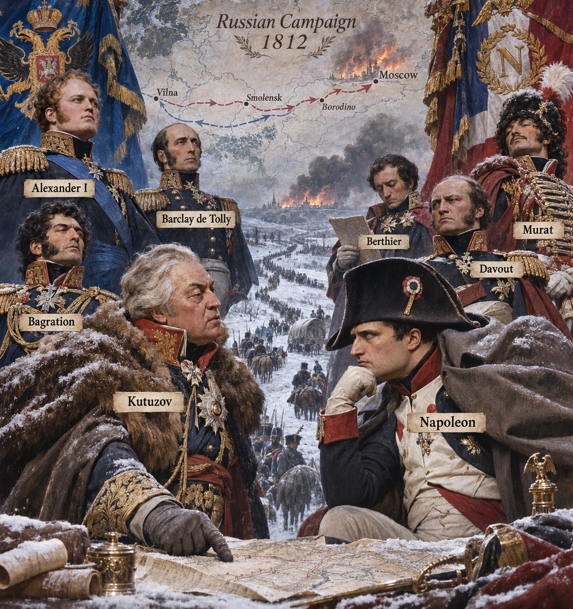

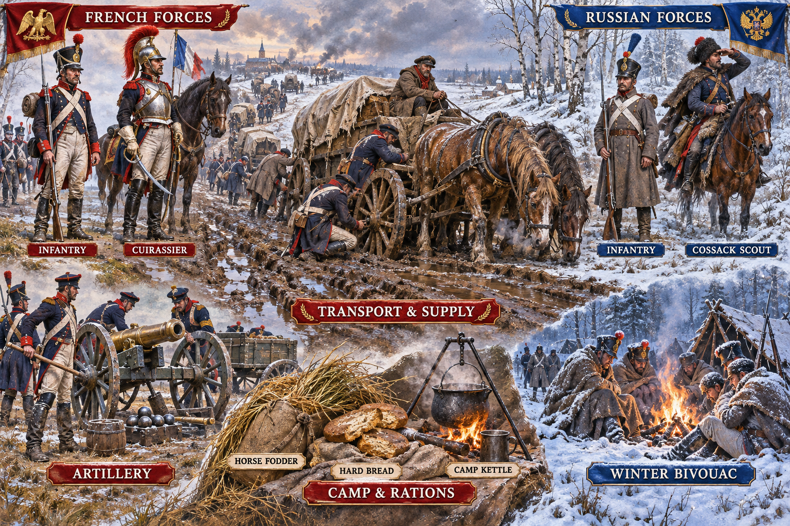

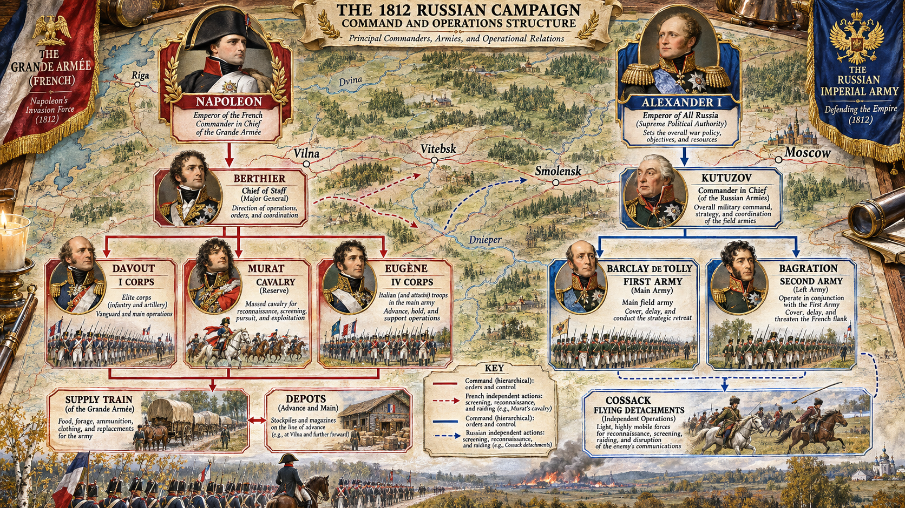

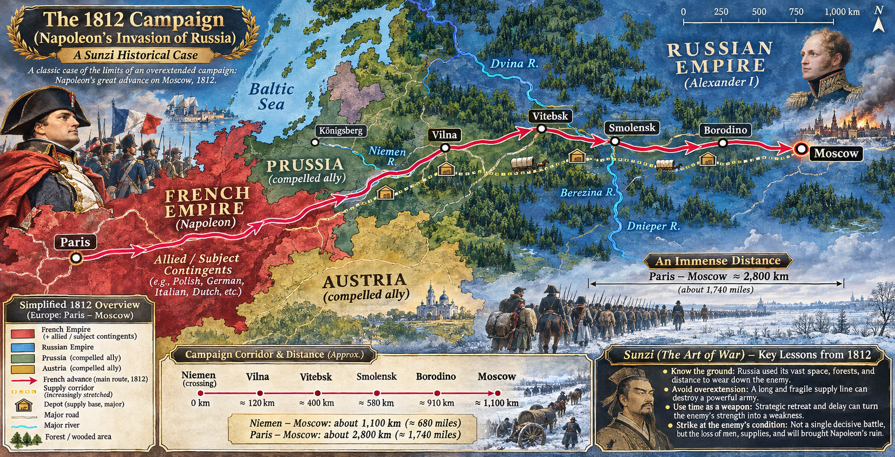

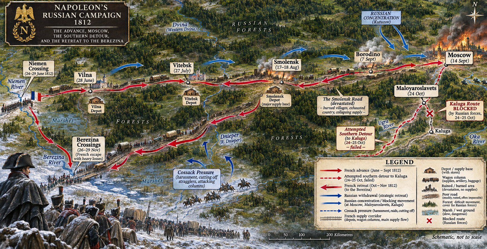

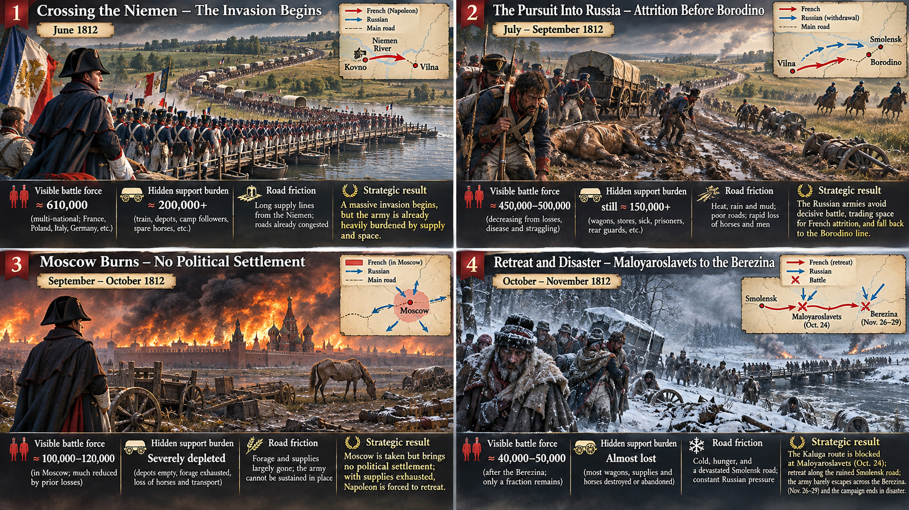

**뒤에서 반복될 지형을 먼저 잡아두기**

- 🌊 **네만강(Niemen River)**은 원정의 출발선이었다. 이 강을 건넌 뒤 전투부대와 수송대가 같은 빈약한 도로를 동쪽으로 밀고 들어갔다.
- **▰** **빌나(Vilna)**와 **▰** **비테프스크(Vitebsk)**는 전진 보급 거점이었지만 대군의 소비와 진격 속도를 따라잡지 못했다.
- **▰** **스몰렌스크(Smolensk)**는 도로와 창고가 모이는 중간축이었다. 퇴각 때 같은 길을 다시 사용하면서 이미 소진된 지역을 통과해야 했다.
- **▰** **모스크바(Moscow)** 점령은 정치적 종결을 만들지 못했고, 불탄 도시와 빈 창고는 장기 주둔의 기반이 되지 못했다.
- **▰** **말로야로슬라베츠(Maloyaroslavets)**는 남쪽 칼루가 방면으로 나가려던 길을 막았다. 대육군은 소진된 스몰렌스크 도로로 돌아섰다.
- 🌊 **베레지나강(Berezina River)**은 퇴각군과 남은 수송이 한꺼번에 몰린 마지막 병목이었다.

#### 상세 전역 서사 — 결전을 강요하려던 속도가 수송망을 앞질렀다

**나폴레옹 보나파르트(Napoleon Bonaparte)**는 1812년 6월 다국적 대육군을 네만강 너머로 진입시켰다. 원정 전 창고와 수송대가 준비됐지만, 러시아의 거리·불량 도로·희박한 취락은 계획된 보급을 전진부대까지 밀어 넣는 속도를 낮췄다. 비와 진흙은 수레와 말을 소모했고, 병사와 군마는 결전 전부터 질병·탈영·피로로 줄었다.

**미하일 쿠투조프(Mikhail Kutuzov)**와 앞선 러시아 지휘부는 대육군이 원한 조기 결전을 계속 피하며 공간을 내주었다. 보로디노에서 큰 전투가 벌어졌지만 러시아군은 완전히 소멸하지 않았다. **나폴레옹**이 모스크바를 점령했을 때에도 **알렉산드르 1세(Alexander I)**는 강화를 거부했고, 프랑스군은 정치적 성과 없이 보급선 끝에 머물렀다.

10월 철수에서 남쪽의 덜 소진된 지역으로 이동하려던 시도는 말로야로슬라베츠에서 막혔다. 대육군은 이미 태우고 먹어 치운 스몰렌스크 도로를 되짚었다. 추위는 참사를 키웠지만, 실패를 겨울 하나로 설명하면 진격 단계부터 누적된 도로 마찰·말 손실·수송 지연·러시아군의 잔존이라는 인과를 놓친다.

#### 전투에서 사용된 속임수 — 결전을 피한 후퇴가 만든 시간과 거리

러시아의 후퇴는 허위 문서 한 장의 기만이라기보다 적이 기대한 결전의 시점과 장소를 계속 거부한 조건 설계였다. 프랑스군에는 러시아군이 약해져 물러나는 듯 보였지만, 실제 결과는 대육군이 보급축에서 멀어지고 러시아군은 전력을 보존하는 것이었다. 다만 후퇴 전체를 사전에 완벽히 설계된 ‘초토화 기만’으로 단정해서는 안 된다. 지휘 갈등과 강제된 철수도 함께 있었다.

#### 속임수 작동 구조

**주체와 의도.** 러시아 지휘부의 핵심 의도는 야전군을 보존하고 프랑스가 원하는 조기 섬멸전을 피하는 것이었다.

**보인 신호와 믿은 이유.** 연속된 후퇴는 프랑스군에게 러시아군이 결정적 패배 직전이라는 기대를 주었다. 유럽에서 빠른 결전으로 전쟁을 끝낸 경험이 그 기대를 강화했다.

**유발된 행동과 결과.** 대육군은 더 깊이 진격했고 수송대와 전투부대의 간격이 벌어졌다. 모스크바 점령 뒤에도 러시아군이 남아 있어 점령은 종결이 되지 못했다.

**사료의 경계.** 러시아의 모든 후퇴와 화재를 하나의 중앙 기만 계획으로 묶을 수는 없다. 확인되는 것은 야전군 보존, 길어진 보급선, 빈 모스크바와 강화 거부의 결합이다.

#### 속임수 일곱 질문

1. **누가 누구를 속였는가?** 러시아 지휘부는 프랑스군이 후퇴를 약화와 종결 임박으로 읽게 했다.
2. **어떤 사실이 거짓이었는가?** 러시아군이 곧 완전히 붕괴한다는 결론은 사실이 아니었다.
3. **어떤 사실은 진실이지만 오해를 유도했는가?** 러시아군이 실제로 후퇴하고 도시를 내준 것은 참이었지만 전쟁 수행능력 전체가 사라진 것은 아니었다.
4. **상대는 왜 그것을 믿고 싶어 했는가?** **나폴레옹**은 빠른 결전과 정치적 강화로 대원정을 끝내야 보급 한계를 피할 수 있었다.
5. **속임수가 없었어도 같은 오판이 발생했을까?** 가능성이 높다. 광대한 거리와 빈약한 도로 자체가 전진부대와 수송을 갈라놓았기 때문이다.
6. **속은 사람은 어떤 독립 확인을 생략했는가?** 점령지가 실제로 군량·말·숙영을 제공하는지, 러시아 야전군의 잔존이 강화를 거부할 능력을 남기는지 충분히 반영하지 못했다.
7. **신뢰·동의·안전을 해치지 않으면서 같은 원리를 어디서 연습할 수 있는가?** 보드게임이나 모의훈련에서 점령지 숫자와 실제 보급 지속일을 따로 계산하고, 상대 주력의 잔존 여부를 독립 승리조건으로 두어 연습할 수 있다.

#### 시계편 兵者詭道也 — 이 전장에 해당하는 속이는 길

<table fit-page-width="true" header-row="true">
<tr><td>해당 구절·독음·뜻</td><td>전장의 장면</td></tr>
<tr><td>退而示之不退 퇴이시지불퇴 — 물러나면서도 싸울 힘이 남은 형세를 보인다</td><td>러시아군은 후퇴하면서 야전군을 보존하고 보로디노·말로야로슬라베츠에서 다시 길을 막았다.</td></tr>
<tr><td>利而誘之 리이유지 — 이익을 보여 유인한다</td><td>모스크바라는 큰 정치적 목표는 대육군을 보급선 끝까지 끌어들였으나 점령 자체는 강화를 보장하지 않았다.</td></tr>
</table>

#### 法 한눈 비교 — 곡제·관도·주용

<table fit-page-width="true" header-row="true">
<tr><td>진영</td><td>곡제(편제)</td><td>관도(지휘)</td><td>주용(보급·지속)</td></tr>
<tr><td>**러시아군**</td><td>분리된 야전군을 합류시키며 후퇴·차단·기병 습격을 결합했다.</td><td>초기 갈등 뒤 쿠투조프가 주력을 보존하는 방향으로 통합했다.</td><td>자국 후방으로 물러나며 수송거리를 줄이고 프랑스의 길을 길게 만들었다.</td></tr>
<tr><td>**대육군**</td><td>다국적 군단과 대규모 기병·포병·수송대를 한 축으로 밀어 넣었다.</td><td>나폴레옹의 결전 요구가 군단의 속도와 수송의 한계를 압박했다.</td><td>창고와 수레를 준비했지만 도로·거리·말 사료가 전진 속도를 감당하지 못했다.</td></tr>
</table>

#### **나폴레옹(패)**

<table fit-page-width="true" header-row="true">
<tr><td>요소</td><td>판단</td></tr>
<tr><td color="orange_bg">🤝 **道**</td><td>다국적 대군의 결속은 행군 손실과 보급 부족 속에서 빠르게 약해졌다. (지기·사기)</td></tr>
<tr><td color="blue_bg">🌤️ **天**</td><td>러시아군이 결전을 피하고 강화도 거부할 가능성을 낮게 잡아, 점령 뒤의 선택지를 줄였다. (지피·타이밍·확률 관점)</td></tr>
<tr><td color="green_bg">🧭 **地**</td><td>장거리·불량 도로·강과 진흙이 수송속도를 떨어뜨렸고 퇴각 때 같은 소진축이 병목이 됐다. (원근·험이·사생)</td></tr>
<tr><td color="purple_bg">🎖️ **將**</td><td>**나폴레옹**은 결전 창출에는 대담했지만 정치적 종결 없는 점령을 중단할 기준을 늦게 적용했다. (지·용과 장유오위)</td></tr>
<tr><td color="yellow_bg">⚙️ **法**</td><td>전진 창고와 수송대가 있었어도 대군의 소비·말 사료·도로 정체가 공급능력을 앞질렀다. (곡제·관도·주용)</td></tr>
</table>

**직관·편향 한 줄:** 유럽에서 반복된 빠른 결전의 성공을 러시아에서도 재현할 수 있다고 본 판단에는 대표성·과신이 작동한 것으로 볼 수 있으며, 철수 기준을 늦췄다.

🏳️ **패군 측 결과** — 六敗의 `北(배)`처럼 적의 전쟁지속 능력과 장거리 지형을 충분히 헤아리지 못한 원정이었다. 🔀 **패군 측 회피 분기점**은 러시아 야전군 섬멸이 이루어지지 않은 스몰렌스크 전후에 원정 목표를 제한하고, 동계 이전에 전진축을 축소하는 것이었다.

#### **쿠투조프(승)**

<table fit-page-width="true" header-row="true">
<tr><td>요소</td><td>판단</td></tr>
<tr><td color="orange_bg">🤝 **道**</td><td>모스크바를 내주는 정치적 고통 속에서도 야전군 보존과 항전을 이어 갔다. (지기·사기)</td></tr>
<tr><td color="blue_bg">🌤️ **天**</td><td>프랑스의 보급 저하와 계절 변화를 승리의 보증이 아니라 반격 확률을 높이는 조건으로 썼다. (지피·타이밍·확률 관점)</td></tr>
<tr><td color="green_bg">🧭 **地**</td><td>말로야로슬라베츠에서 남쪽 길을 막아 적을 소진된 스몰렌스크 도로로 돌렸다. (원근·험이·사생)</td></tr>
<tr><td color="purple_bg">🎖️ **將**</td><td>**쿠투조프**은 상징적 도시보다 야전군과 시간의 가치를 우선했다. (지·인·엄)</td></tr>
<tr><td color="yellow_bg">⚙️ **法**</td><td>주력 보존·코사크 압박·후방 보급을 결합해 적의 퇴각로를 계속 마모시켰다. (곡제·관도·주용)</td></tr>
</table>

🏆 **승군 측 결과** — `知可以戰與不可以戰者勝(지가이전여불가이전자승, 싸울 수 있는 때와 없는 때를 아는 자가 이긴다)`의 사례다.

##### 法을 압축하지 않고 보기 — 곡제·관도·주용

**곡제 曲制(곡제): 부대를 어떻게 나누고 결합했는가**
<table fit-page-width="true" header-row="true">
<tr><td>진영</td><td>곡제(편제)</td></tr>
<tr><td>**러시아군**</td><td>주력 야전군·후위·코사크 기동대를 나누어 보존·지연·습격 임무를 결합했다.</td></tr>
<tr><td>**대육군**</td><td>군단별 독립기동 능력이 있었지만 같은 도로와 수송망에 몰리며 다국적 부대의 이탈이 커졌다.</td></tr>
</table>

**관도 官道(관도): 누가 명령하고 어떻게 전달했는가**
<table fit-page-width="true" header-row="true">
<tr><td>진영</td><td>관도(지휘)</td></tr>
<tr><td>**러시아군**</td><td>쿠투조프가 주력의 보존과 길목 차단을 통합하고 기동대는 후방 압박을 지속했다.</td></tr>
<tr><td>**대육군**</td><td>나폴레옹–베르티에–군단장 체계는 명료했지만 거리와 말 손실로 명령·보고의 시간차가 커졌다.</td></tr>
</table>

**주용 主用(주용): 군량·장비·전투 지속 능력을 어떻게 썼는가**
<table fit-page-width="true" header-row="true">
<tr><td>진영</td><td>주용(보급·지속)</td></tr>
<tr><td>**러시아군**</td><td>자국 후방과 짧아지는 보급축을 활용하고 적이 현지조달할 수 있는 자원을 줄였다.</td></tr>
<tr><td>**대육군**</td><td>창고·수레·현지조달을 함께 썼으나 말 사료·식량·정비가 진격속도를 따라가지 못했다.</td></tr>
</table>

**출처:** [Eric A. Sibul, The Logistical Aspects of Napoleon’s 1812 Russian Campaign](https://publications.tlu.ee/index.php/eymh/article/view/472) · [U.S. Army Center of Military History, Terrain Factors in the Russian Campaign](https://history.army.mil/Portals/143/Images/Publications/Publication%20By%20Title%20Images/T%20PDF/CMH_Pub_104-5.pdf) · [Oxford Reference, Russian Campaign of 1812](https://academic.oup.com/reference/62399/reference-article-abstract/555374004)

### 동양 — 🏛️ 고구려군 vs 🏛️ 수나라 원정군 │ 612년 고수전쟁과 살수대첩(高句麗–隋戰爭, 612)

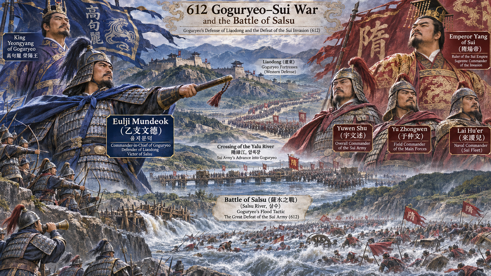

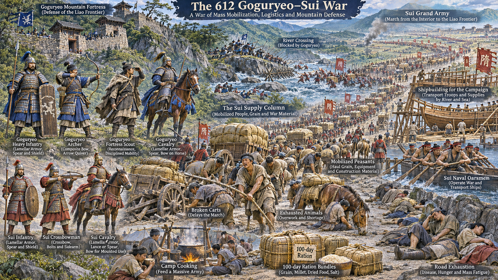

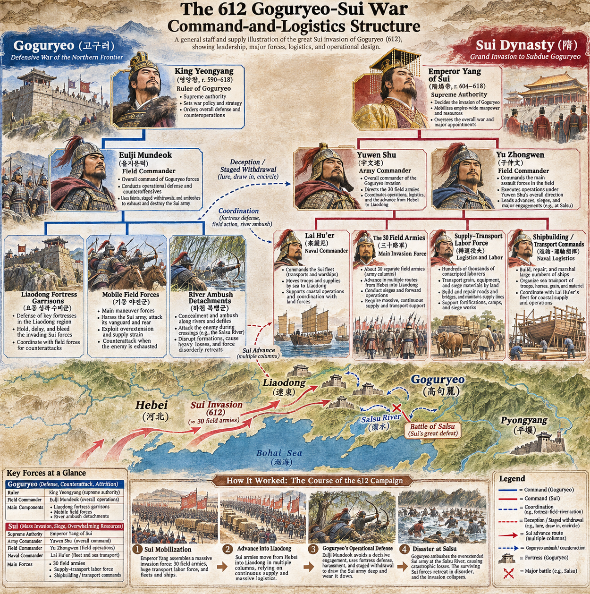

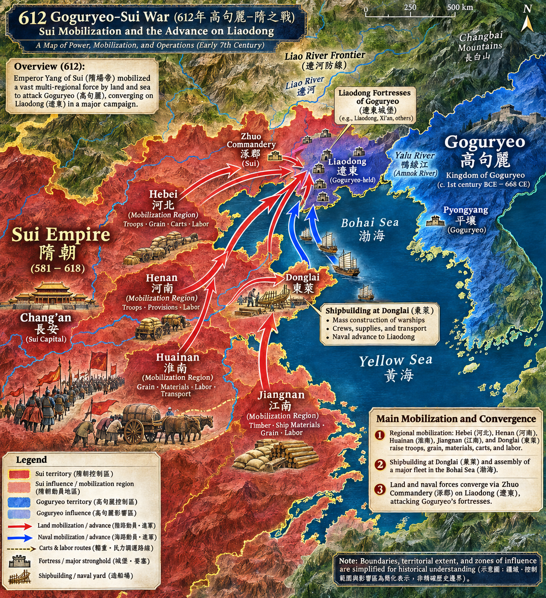

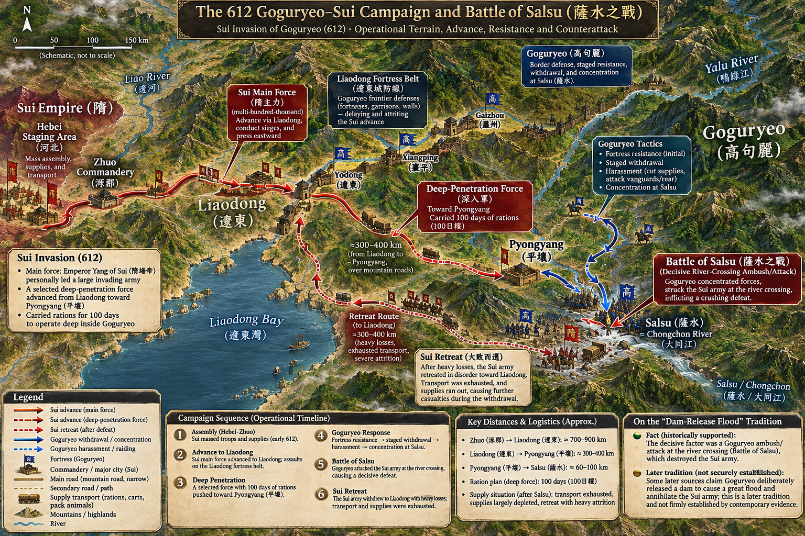

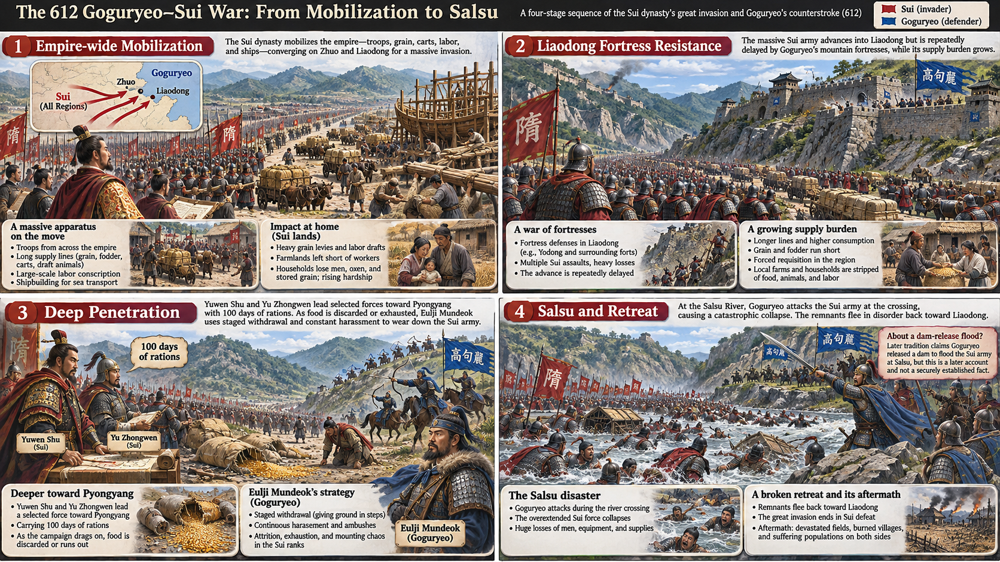

**뒤에서 반복될 지형을 먼저 잡아두기**

- **▰** **탁군(涿郡)**은 병력과 물자가 모인 집결지였다. 전국에서 온 인력과 수레가 이곳에서 동쪽 전선으로 이어졌다.
- 🌊 **요하(遼河)**와 **▰** **요동성(遼東城)** 일대는 고구려 성곽 방어가 수군의 진격을 오래 붙든 첫 병목이었다.
- 🌊 **압록강(鴨綠江)**을 넘은 별동군은 본국 운송망과 더 멀어졌고, 병사 각자에게 지운 100일분 군량의 무게가 기동을 깎았다.
- **▰** **평양성(平壤城)**은 깊숙한 목표였지만 수나라 수륙군의 협동은 어긋났다.
- 🌊 **살수(薩水, 오늘날 청천강으로 비정)**는 퇴각군이 강을 건너는 동안 대오가 갈라지는 병목이었다. 둑을 터뜨렸다는 이야기는 후대 전승이며 동시대 기록으로 확정할 수 없다.

#### 상세 전역 서사 — 전투병의 두 배를 운반에 붙이고도 국경 너머에서 끊긴 보급

**수 양제(隋煬帝)**는 611년부터 대규모 징발을 본격화했다. 2024년 연구는 동래의 선박 제조, 하남·회남·강남의 수레와 물자, 여러 지역에서 뽑은 운반 인력을 대조해 사실상 전국이 원정 준비에 묶였다고 설명한다. 정규 전투병 1,133,800명이라는 기록과 별도로 그 두 배에 이르는 궤운자 2,267,600명이 군수 운반에 동원되었다.

그러나 이 거대한 후방은 고구려 영토 깊숙이까지 작동하지 못했다. 요동 성곽의 지연을 피하려 별동군이 평양으로 향할 때, **우문술(宇文述)**과 **우중문(于仲文)** 휘하 병사들은 100일분 군량을 직접 졌다. 무게를 견디지 못한 병사들이 군량을 버리자 깊은 진격은 곧 결핍으로 바뀌었다.

**을지문덕(乙支文德)**은 수군의 형편을 살피고 후퇴와 접전을 반복해 더 깊이 끌어들였다. 수나라 별동군은 평양을 얻지 못한 채 돌아섰고 살수 도하에서 고구려군의 공격을 받았다. 이 패배를 물 한 번의 기적으로만 설명하면, 전국 동원에서 100일분 자가운반과 긴 퇴각으로 이어진 구조적 실패가 가려진다.

#### 전투에서 사용된 속임수 — 거듭 물러나며 적의 군량을 먼저 소진시키다

**을지문덕**의 후퇴는 수나라 별동군에 평양까지 밀고 갈 수 있다는 신호를 주었다. 실제 의도는 즉시 결전하기보다 적을 요동의 보급 기반에서 멀어지게 하고, 군량이 줄어든 퇴각 때 공격할 조건을 만드는 것이었다. 다만 세부 접전 횟수와 시문 일화의 해석에는 후대 서술이 섞여 있어, 확실한 작전 흐름과 문학적 장식을 구분해야 한다.

#### 속임수 작동 구조

**주체와 의도.** 고구려군은 성곽 방어와 지연으로 주력을 붙들고, 별동군에는 후퇴와 습격을 반복해 시간을 무기로 삼았다.

**보인 신호와 믿은 이유.** 수군은 고구려군의 물러남을 평양 진입 가능성으로 읽었다. 대군과 황제의 압력이 후퇴 결정을 어렵게 했다.

**유발된 행동과 결과.** 수나라군은 100일 군량을 짊어진 채 깊이 들어갔고, 버린 군량과 길어진 행군 때문에 퇴각 때 전투 지속능력을 잃었다.

**사료의 경계.** 살수에서 인공 둑을 터뜨렸다는 홍수 서사는 널리 알려졌으나 동시대 근거가 확실하지 않다. 본문은 강 도하 중 공격과 대오 붕괴까지만 사실의 중심에 둔다.

#### 속임수 일곱 질문

1. **누가 누구를 속였는가?** **을지문덕**과 고구려군이 **우문술·우중문**의 별동군을 깊은 진격으로 끌어들였다.
2. **어떤 사실이 거짓이었는가?** 고구려군의 후퇴가 곧 방어의 붕괴라는 결론은 거짓이었다.
3. **어떤 사실은 진실이지만 오해를 유도했는가?** 고구려군이 실제로 여러 차례 물러난 것은 참이지만 전투능력을 잃은 것은 아니었다.
4. **상대는 왜 그것을 믿고 싶어 했는가?** 대원정의 규모와 황제의 명령은 평양 점령이라는 가시적 성과를 요구했다.
5. **속임수가 없었어도 같은 오판이 발생했을까?** 가능성이 높다. 100일분 자가운반과 장거리 진격은 후퇴가 없어도 병력을 지치게 했다.
6. **속은 사람은 어떤 독립 확인을 생략했는가?** 버려진 군량 뒤 남은 실제 지속일, 수륙군 협동 가능성, 퇴각 시 강 도하 안전을 충분히 확인하지 못했다.
7. **신뢰·동의·안전을 해치지 않으면서 같은 원리를 어디서 연습할 수 있는가?** 워게임에서 병력 숫자와 운반능력을 분리하고, 목표 도달보다 안전한 복귀에 필요한 잔여 보급을 의무적으로 계산할 수 있다.

#### 시계편 兵者詭道也 — 이 전장에 해당하는 속이는 길

<table fit-page-width="true" header-row="true">
<tr><td>해당 구절·독음·뜻</td><td>전장의 장면</td></tr>
<tr><td>利而誘之 리이유지 — 이익을 보여 유인한다</td><td>평양으로 향하는 길을 열어 둔 듯 보이며 수나라 별동군을 보급 기반에서 멀어지게 했다.</td></tr>
<tr><td>佚而勞之 일이로지 — 편안한 쪽이 지친 적을 만든다</td><td>고구려군은 성곽과 산하를 이용해 시간을 벌고 수나라군은 군량을 직접 지며 행군했다.</td></tr>
</table>

#### 法 한눈 비교 — 곡제·관도·주용

<table fit-page-width="true" header-row="true">
<tr><td>진영</td><td>곡제(편제)</td><td>관도(지휘)</td><td>주용(보급·지속)</td></tr>
<tr><td>**고구려군**</td><td>성곽 수비와 기동 야전군·도하 공격을 결합했다.</td><td>을지문덕이 정찰·후퇴·반격의 시간을 연결했다.</td><td>짧아지는 자국 보급축과 성곽 비축을 활용했다.</td></tr>
<tr><td>**수나라군**</td><td>30군과 수군·별동군·대규모 궤운자를 동원했다.</td><td>황제 명령과 장수간 이견이 현장 재량을 억눌렀다.</td><td>국경까지의 거대 운송 뒤 적지에서는 100일분 자가운반에 의존했다.</td></tr>
</table>

#### **우문술·우중문(패)**

<table fit-page-width="true" header-row="true">
<tr><td>요소</td><td>판단</td></tr>
<tr><td color="orange_bg">🤝 **道**</td><td>병사에게 과중한 군량을 지운 뒤 투기와 피로를 통제하지 못했다. (지기·사기)</td></tr>
<tr><td color="blue_bg">🌤️ **天**</td><td>고구려의 후퇴를 붕괴로 읽고 황제의 성과 압박 아래 철수 시점을 놓쳤다. (지피·타이밍·확률 관점)</td></tr>
<tr><td color="green_bg">🧭 **地**</td><td>요동에서 평양까지의 산악로·강·긴 거리가 전투력보다 보급을 먼저 소진시켰다. (원근·험이·사생)</td></tr>
<tr><td color="purple_bg">🎖️ **將**</td><td>**우문술·우중문**은 지휘 이견 속에서도 깊은 진격을 중단할 명확한 기준을 세우지 못했다. (지·엄과 장유오위)</td></tr>
<tr><td color="yellow_bg">⚙️ **法**</td><td>전국적 운송망이 국경 안에서 멈추고 적지에서는 병사 개인의 휴대량에 의존했다. (곡제·관도·주용)</td></tr>
</table>

**직관·편향 한 줄:** 압도적 동원 규모가 고구려의 저항과 보급 한계를 덮을 것이라 본 판단에는 규모를 능력으로 착각하는 과신이 작동한 것으로 볼 수 있다.

🏳️ **패군 측 결과** — 六敗의 `北(배)`에 해당한다. 적과 지형·보급을 헤아리지 못한 채 깊이 들어갔다. 🔀 **패군 측 회피 분기점**은 버려진 군량으로 실제 지속일이 무너졌을 때 평양 진격을 멈추고 요동성 공방과 수륙군 협동을 재평가하는 것이었다.

#### **을지문덕(승)**

<table fit-page-width="true" header-row="true">
<tr><td>요소</td><td>판단</td></tr>
<tr><td color="orange_bg">🤝 **道**</td><td>성곽 수비와 야전 기동을 한 목표 아래 묶어 열세의 병력을 보존했다. (지기·사기)</td></tr>
<tr><td color="blue_bg">🌤️ **天**</td><td>적의 군량 투기와 지휘 갈등을 관찰해 퇴각 때의 취약성이 커질 확률을 높였다. (지피·타이밍·확률 관점)</td></tr>
<tr><td color="green_bg">🧭 **地**</td><td>요동 성곽·산악로·살수 도하라는 연속 병목을 방어와 반격에 이용했다. (원근·험이·사생)</td></tr>
<tr><td color="purple_bg">🎖️ **將**</td><td>**을지문덕**은 접전의 승리보다 적의 지속능력을 먼저 깎았다. (지·용·엄)</td></tr>
<tr><td color="yellow_bg">⚙️ **法**</td><td>고정 성곽과 기동군을 분담시키고 짧은 보급축을 유지했다. (곡제·관도·주용)</td></tr>
</table>

🏆 **승군 측 결과** — `識衆寡之用者勝(식중과지용자승, 대군과 소수 병력의 쓰임을 아는 자가 이긴다)`에 해당한다.

##### 法을 압축하지 않고 보기 — 곡제·관도·주용

**곡제 曲制(곡제): 부대를 어떻게 나누고 결합했는가**
<table fit-page-width="true" header-row="true">
<tr><td>진영</td><td>곡제(편제)</td></tr>
<tr><td>**고구려군**</td><td>성곽 주둔군·기동 야전군·도하 공격대를 나누어 지연과 결전을 결합했다.</td></tr>
<tr><td>**수나라군**</td><td>30군·수군·별동군·운반 인력을 크게 동원했지만 성곽전과 평양 진격의 협동이 갈라졌다.</td></tr>
</table>

**관도 官道(관도): 누가 명령하고 어떻게 전달했는가**
<table fit-page-width="true" header-row="true">
<tr><td>진영</td><td>관도(지휘)</td></tr>
<tr><td>**고구려군**</td><td>을지문덕이 적정을 직접 살피고 후퇴·습격·도하 공격의 시점을 연결했다.</td></tr>
<tr><td>**수나라군**</td><td>수 양제의 세부 통제와 우문술·우중문의 이견이 현장 판단을 늦췄다.</td></tr>
</table>

**주용 主用(주용): 군량·장비·전투 지속 능력을 어떻게 썼는가**
<table fit-page-width="true" header-row="true">
<tr><td>진영</td><td>주용(보급·지속)</td></tr>
<tr><td>**고구려군**</td><td>요동 성곽의 비축과 자국 내 짧은 이동을 이용해 장기 지연을 감당했다.</td></tr>
<tr><td>**수나라군**</td><td>전투병의 두 배에 이르는 운반 인력을 동원했지만 적지 깊숙이에서는 병사에게 100일 군량을 지워 운송 실패를 개인 부담으로 넘겼다.</td></tr>
</table>

**출처:** [최진열, 「612년 고수 전쟁 전후 수나라의 병사 징발과 물자 동원」](https://www.kci.go.kr/kciportal/ci/sereArticleSearch/ciSereArtiView.kci?sereArticleSearchBean.artiId=ART003156510) · [동북아역사넷, 612년 수의 고구려 원정 준비](https://contents.nahf.or.kr/item/level.do?levelId=gt.d_0006_0010_0030_0010) · [군사편찬연구소, 고수전쟁의 동원 연구](https://medcmd.mil.kr/user/imhc/upload/pblictn/PBLICTNEBOOK_202508041007432180.pdf)

---
## 5. 핵심 통찰 + 실생활 적용 + 생활루틴

### 핵심 통찰

이 구절의 가장 예리한 통찰은 **사람을 한 자리에서 빼내면 그 사람의 몸만 움직이는 것이 아니라 그가 붙잡고 있던 일의 연결망도 함께 흔들린다**는 데 있다. 보이는 전선과 보이지 않는 후방, 긴급 업무와 평소 업무를 따로 계산하면 동원의 실제 비용을 놓친다. 바깥에서 성과를 냈어도 안쪽의 기록·생산·회복이 무너지면 총결과는 승리가 아닐 수 있다.

용간편의 논리는 이 손실을 줄이는 방향으로 나아간다. 먼저 알아야 필요한 사람만, 필요한 길로, 필요한 기간 동안 움직일 수 있다. 정보의 품질이 낮으면 모두를 불러 모으고 여러 번 왕래시키며 같은 설명을 반복하게 된다. 따라서 좋은 정보는 단지 결정을 빠르게 하는 것이 아니라 **불필요하게 중단되는 사람과 일을 줄이는 자원**이다.

### 실생활 적용

현장 에러가 생겼을 때 조치자 수만 늘리면 `內外騷動`이 되기 쉽다. 사용자의 근무 기록에서는 현장 조치에 나간 사람, 상황실을 지키는 사람, BM 시트·인폼을 쓰는 사람이 서로 다른 역할을 맡는다. 그런데 후면 기록을 맡은 사람이 응답하지 않거나 잠들어 있으면, 현장 조치를 끝낸 사람과 전씨가 돌아와 기록과 설명까지 다시 떠안는다. 에러는 해결됐어도 모니터링과 기록의 본업이 비고, 다음 교대가 그 공백을 이어받는다.

다음에는 에러 발생 직후 “누가 더 올 수 있나”보다 먼저 네 역할을 고정한다. `현장 조치 / 상황실 감시 / 기록·인폼 / 교대 인수인계`를 한 사람씩 지정하고, 10분 뒤 응답 확인 시각을 잡는다. 피로나 퇴사 예정 같은 관찰 사실이 있는 구성원에게 핵심 후면 업무를 맡길 때는 성격을 비난하지 말고 첫 기록이 실제로 올라왔는지 확인한다. 실패하면 미리 정한 대체자가 넘겨받는다. 이렇게 해야 전면의 조치가 후면의 붕괴를 만들지 않는다.

전씨와의 관계에서도 `騷動`과 `操事`를 구분할 필요가 있다. 복잡한 조치 중 목소리와 지시가 많아지면 모두가 바쁘게 움직이는 것처럼 보여도, 사용자가 지금 잡아야 할 한 단계가 흐려질 수 있다. “현재 단계는 이것이고, 다음 확인 시각은 몇 시입니다”라고 짧게 되받아 말하면 사람의 성격을 논쟁하지 않고 작업 상태를 공동의 외부 정보로 만들 수 있다. 피로와 소화 문제 같은 민감한 정보는 판단 근거로 확대하지 말고, 실제 관찰된 응답과 인수인계 여부만 기록한다.

개인 생활에서도 긴급한 새 계획 하나가 들어오면 그 시간만 달력에 넣지 않는다. 수면, 식사, 운동, 이미 하던 공부 중 무엇이 밀리는지 함께 적는다. 특히 야간근무 뒤에는 깨어 있는 시간을 전부 사용 가능 시간으로 세지 않는다. 회복 시간을 빼앗은 계획은 당일에는 성과처럼 보여도 다음 근무의 집중과 기록을 흔들 수 있다.

카너먼의 경고를 적용하면 생생한 에러 한 건 때문에 모든 인력을 붙이는 결정도 다시 봐야 한다. 먼저 기저율을 묻는다. 비슷한 에러 중 현장 출동이 정말 필요했던 비율, 원격 확인으로 끝난 비율, 장기화된 비율을 나눈다. 그리고 “이번에도 곧 끝날 것” 하나만 상상하지 말고 장기화·재발·후면 기록 누락의 가능성을 함께 둔다. 이 점검은 직관을 없애는 것이 아니라, 직관이 놓친 분모를 보충하는 절차다.

### 생활루틴

**급한 일에 사람을 붙이면서 그 사람이 비울 일을 적지 않으면 재수가 없다.**

**이유:** 긴급 업무는 눈앞에 커 보이기 때문에 사람을 더 붙이는 행동이 즉시 안전해 보인다. 그러나 빠져나간 자리의 모니터링·기록·식사·휴식이 비면 작은 누락이 재작업과 인수인계 오류로 이어지고, 해결한 한 건보다 더 넓은 피로와 혼란을 만든다. 이는 `內外騷動`이 `怠於道路`를 거쳐 `不得操事`로 이어지는 원리다.

오늘부터 누군가를 새 일에 투입하기 전 60초 동안 `새 임무 / 비우는 일 / 대체자 / 재확인 시각` 네 칸을 적는다. 대체자가 없으면 전원을 동시에 움직이지 말고 본업 유지 인원을 남긴다. 중단된 일을 재개할 때는 바로 손부터 대지 말고 마지막 완료 지점과 다음 한 단계를 소리 내어 확인한 뒤 시작한다.
