<!-- sunzi-analysis-mode: full -->
> 상수삭년, 이쟁일일지승, 이애작녹백금, 부지적지정자, 불인지지야. — 오래 끌 일의 결정적 정보를 아끼면 재수가 없다.

---
## 1. 원문 + 독음 + 직역 + 한자어 뜻풀이

相守數年, 以爭一日之勝, 而愛爵祿百金, 不知敵之情者, 不仁之至也. 상수삭년, 이쟁일일지승, 이애작녹백금, 부지적지정자, 불인지지야.

**직역**  
서로 대치하여 여러 해를 지키다가 하루의 승리를 다투면서도, 작위와 봉록과 백금을 아껴 적의 실정을 알지 못하는 자는 어질지 못함의 극치다.

	이 문장은 정보의 가치를 “많이 알면 유리하다”는 효율의 말로 끝내지 않는다. 양군이 여러 해 맞서면 병사와 백성은 이미 시간·생업·재물을 치른다. 그런데 지휘자가 정보원에게 줄 작위와 봉록, 조사에 들 백금만 아껴 적의 실제 상태를 모른다면, 그 절약은 공공의 돈을 지키는 검소함이 아니다. **작은 확정 비용을 피하려고 더 많은 사람에게 훨씬 큰 불확실한 손실을 떠넘기는 일**이다.

	앞 구절의 `日費千金`(일비천금, 날마다 천금이 든다)과 `七十萬家`(칠십만가, 수많은 가호가 생업을 놓는다)를 기억하면 질책의 무게가 선명해진다. 매일 천금이 들고 수많은 집이 흔들리는 상황에서 `百金`을 아끼는 계산은 숫자부터 맞지 않는다. 더구나 그 정보가 헛된 대치와 잘못된 공격을 줄일 수 있다면, 정보비를 아낀 결과는 지휘자 한 사람의 손해가 아니라 공동체 전체의 희생이다. 그래서 손자는 무능보다 더 강한 말인 `不仁之至`를 쓴다.

	#### 相守數年(상수삭년) — 서로 붙들린 채 시간이 군량을 먹다

	`相`(서로 상)은 한쪽만 기다리는 장면이 아니라 두 적대자가 서로를 의식하며 움직임을 제한하는 관계를 만든다. `守`(지킬 수)는 성을 지킨다는 뜻에 머물지 않고, 여기서는 상대를 견제하며 진지를 유지하고 기회를 기다리는 대치를 맡는다. `數年`(삭년)은 정확히 몇 해라는 통계보다 긴 시간이 겹겹이 쌓였음을 드러낸다.

	싸우지 않는 날도 공짜가 아니다. 병사는 먹고 장비는 닳으며 경계는 이어지고, 전선에 묶인 사람은 본업으로 돌아가지 못한다. 적도 같은 부담을 지지만 어느 쪽이 먼저 정보로 구조를 깨느냐에 따라 누적 손실의 방향이 달라진다. `相守數年`은 **결전이 없는 시간이 중립이 아니라 계속 비용을 청구하는 상태**임을 보여 준다.

	#### 爭一日之勝(쟁일일지승) — 수년의 무게가 하루의 판단에 몰리다

	`爭`(다툴 쟁)은 이미 정해진 승리를 받는 일이 아니라, 서로 빼앗으려는 능동적 경쟁이다. `一日`(일일)은 긴 대치와 대조되는 짧은 결정의 시간이며, `勝`(이길 승)은 그날의 전투만 아니라 오랜 준비가 판정되는 결과다. 수년을 쌓았다고 자동으로 이기는 것이 아니다. 마지막 하루에 적의 배치·의도·약점·대응을 잘못 읽으면 긴 준비가 한꺼번에 무너질 수 있다.

	이 대조는 정보의 시간 가치를 드러낸다. 정보는 결전이 시작된 뒤 얻으면 너무 늦을 수 있다. 오랜 대치 동안 무엇을 알아야 하는지 묻고 출처를 만들고 서로 다른 보고를 대조해야, 짧은 결정 순간에 쓸 수 있는 판단이 된다. `一日之勝`은 영웅적 한 방을 찬양하는 말이 아니라 **결정의 시간은 짧으므로 사전 앎은 오래 준비해야 한다**는 경고다.

	#### 愛爵祿百金(애작녹백금) — 아낌이 절약에서 인색으로 뒤집히다

	`愛`(사랑 애)는 여기서 사랑한다는 미덕보다 아까워 붙들고 내놓지 않는다는 뜻이다. `爵`(벼슬 작)은 지위와 명예, `祿`(녹 록)은 지속적으로 지급하는 녹봉, `百金`(백금)은 정보 활동에 들이는 큰 보상을 가리킨다. 사람을 움직이는 대가는 한 번의 돈만이 아니라 신분·생계·보호·신뢰의 약속까지 포함한다.

	문제는 무조건 많이 지급하지 않았다는 데 있지 않다. 앞에서는 날마다 천금이 들고 뒤에서는 하루의 승패가 걸렸는데, 정보를 얻는 데 필요한 백금을 절약의 대상으로만 본 계산 비례가 문제다. 정보원의 안전과 정당한 보상을 무시하면 보고가 끊기거나 왜곡되고, 출처는 더 큰 값을 주는 쪽으로 움직일 수 있다. `愛`는 **돈을 지키려다 이미 투입한 모든 비용과 사람을 위험에 빠뜨리는 거짓 절약**으로 변한다.

	#### 知敵之情(지적지정) — 숫자가 아니라 적의 실제 사정을 알다

	`知`(알 지)는 소문을 한 번 듣는 것이 아니라 확인하고 분별하여 판단에 쓸 수 있게 아는 일이다. `敵`(원수 적)은 추상적인 위협이 아니라 의도와 능력, 제약을 가진 상대다. `情`(뜻 정)은 감정만을 뜻하지 않는다. 이 문맥에서는 적의 실제 사정, 곧 병력·배치·보급·의도·내부 관계와 행동 가능성을 가리킨다.

	자료가 많다고 `知`가 되는 것도 아니다. 적이 보여 주고 싶은 신호, 정보원의 이해관계, 오래되어 가치가 떨어진 보고, 서로 모순되는 관찰을 구분해야 한다. 이 구절은 뒤의 `先知`(선지, 미리 앎)와 `必取於人`(필취어인, 반드시 사람에게서 취한다)으로 이어진다. 즉 적의 실정은 점괘나 과거 사례의 기계적 복제가 아니라 **현장에 닿은 사람의 보고를 검증하는 체계**에서 얻는다.

	#### 不仁之至(불인지지) — 정보 부족을 공동체에 대한 책임으로 묻다

	`仁`(어질 인)은 막연한 친절이 아니라 사람을 사람답게 대하고 그 생명과 생업을 책임지는 정치적 덕목이다. `不仁`(불인)은 그 책임을 저버린 상태이며, `至`(이를 지)는 끝에 닿았다는 뜻으로 질책을 최고조로 올린다. 손자는 정보 실패를 단순한 기술 부족이나 운 나쁨으로 낮추지 않는다.

	지휘자가 알 수 없었던 것과 알아볼 비용을 아껴 알려 하지 않은 것은 다르다. 모든 불확실성을 없앨 수는 없지만, 중요한 결정 전에 필요한 질문을 정하고 합법적·정당한 방법으로 자료를 모으며 출처를 보호하고 대안을 검증할 책임은 남는다. 그 책임을 피한 채 수년의 부담과 하루의 위험을 병사와 백성에게 넘기는 것이 `不仁之至`다.

	#### 글자들이 완성하는 한 장면

	`相守`가 양군을 서로 묶고, `數年`이 그 대치 위에 비용과 피로를 쌓는다. 그러다 `一日`이라는 짧은 창이 열리고, 쌓인 모든 준비가 `勝`을 두고 다투게 된다. 지휘자는 이미 막대한 값을 치렀는데도 `爵祿百金`을 `愛`하여 붙들고, 그 결과 `敵之情`을 `知`하지 못한다. 마지막 `不仁之至`는 실패의 이름을 바꾼다. 이는 단순히 정보를 덜 가진 상태가 아니라, **알기 위해 감당해야 할 적정한 비용을 피함으로써 타인의 희생을 키운 책임의 실패**다.

	이 흐름은 용간편의 문을 연다. 손자는 간첩을 숭배하지 않는다. 먼저 전쟁의 총비용과 후방의 중단을 세고, 정보비와 비교한 다음, 사람에게서 적정을 얻는 구체적 체계를 설명한다. 따라서 이 구절의 생활 교훈도 남을 몰래 캐라는 말이 아니다. 중대한 결정을 오래 끌고 있다면, 어떤 사실이 결정을 바꿀지 먼저 정하고 그 사실을 정당하게 확인하는 데 필요한 시간과 비용을 아끼지 말라는 뜻이다.

---
## 2. 전통 주석 기반 분석

- **조조(曹操)** — “여러 해 서로 지키다가 하루에 승부를 정한다. **작록과 백금을 아껴 적정을 모르는 자를 어질다고 여기지 마라.**”
- **이전(李筌)** — “병사와 백성이 오래 수고했는데 정보의 값을 아끼지 마라. **작은 재물을 보전하려다 수년의 비용과 목숨을 함께 잃는다.**”
- **두목(杜牧)** — “`爵祿`은 공을 인정해 사람을 붙들고 `百金`은 일을 이루게 하는 비용이다. **정보를 얻을 사람에게 합당한 명분과 보상을 모두 갖추어라.**”
- **매요신(梅堯臣)** — “결전은 하루지만 그날 쓸 앎은 미리 길러야 한다. **싸움이 닥친 뒤에야 적정을 찾으면 이미 늦었음을 잊지 마라.**”
- **장예(張預)** — “날마다 천금을 쓰면서 백금을 아끼는 계산을 절약이라 부르지 마라. **큰 손실을 줄일 작은 비용의 비례를 먼저 따져라.**”
- **왕석(王晳)** — “`情`을 뜬소문으로 채우지 마라. **적의 허실과 의도, 내부 사정을 실제 사람에게서 얻고 서로 맞추어 보아라.**”
- **가림(賈林)** — “대치가 길수록 익숙한 추측을 사실로 착각하기 쉽다. **오래 믿어 온 판단일수록 새 보고로 다시 시험하라.**”
- **두우(杜佑)** — “작위·녹봉·재물은 정보 체계를 유지하는 서로 다른 수단이다. **한 번의 포상보다 지속적인 신뢰와 보호까지 마련하라.**”
- **진호(陳皞)** — “여기서 `不仁`은 부드러운 마음의 부족만이 아니다. **알아볼 수 있었는데도 비용을 아껴 공동체의 희생을 키운 책임을 물어라.**”

#### 리링의 고증과 현대적 독법

리링의 해설 취지를 따라 문장 구조를 보면 `相守數年 / 一日之勝 / 爵祿百金 / 不知敵之情 / 不仁之至`가 시간과 비용의 비례를 차례로 압축한다. 수년의 대치와 하루의 결전, 전쟁 전체의 막대한 소모와 정보에 쓰는 제한된 보상을 맞세운 뒤, 잘못된 비용 배분을 윤리적 실패로 판정한다. 확인되지 않은 이문을 꾸미기보다 이 대조 구조를 살리는 편이 중요하다.

`爵`·`祿`·`百金`은 현대의 정보 구매 가격표와 곧바로 대응하지 않는다. 고대 군주가 사람을 등용하고 붙들며 공을 보상하는 정치·군사 제도를 함께 가리킨다. 따라서 “돈이면 어떤 정보든 산다”로 읽어서는 안 된다. 보상은 출처의 신뢰를 자동으로 보증하지 않으며, 오히려 원하는 답을 말하게 만드는 유인이 될 수도 있다. 후한 대가와 엄격한 검증은 함께 가야 한다.

또한 `仁`을 전쟁과 무관한 사적 선량함으로 축소하면 손자의 논지가 흐려진다. 이 구절의 인은 이미 동원된 병사와 백성의 시간을 헛되이 소비하지 않을 책임이다. 현대에 옮길 때도 불법 감시나 사생활 침해를 합리화할 수 없다. 군사적 강제와 일상 조직의 정보 수집은 법적 권한과 위험이 다르므로, 적용은 **결정에 필요한 최소 정보를 정당한 방식으로 확인하고 그 비용을 총손실과 비교한다**는 범위에 한정해야 한다.

---
## 3. 교차 설명

### ① 손자병법 내 교차

「작전편」의 `故兵聞拙速, 未睹巧之久也`(고병문졸속, 미도교지구야 — 전쟁에서 서툴러도 빠르게 끝냈다는 말은 들었으나 교묘하게 오래 끌었다는 말은 보지 못했다)는 `相守數年`의 위험을 시간의 문제로 드러낸다. 오래 버틴 사실은 그 자체로 능력이 아니다. 목적 없이 시간이 늘어나면 군대의 예기와 국가의 재정이 함께 닳는다.

같은 편의 `夫兵久而國利者, 未之有也`(부병구이국리자, 미지유야 — 전쟁을 오래 끌어 나라에 이로운 경우는 있지 않다)는 이번 구절의 윤리적 판단을 받친다. 적정을 알 비용을 아껴 대치를 늘리는 것은 단순한 정보 부서의 실수가 아니라 국가 전체의 손실을 키우는 선택이다. 다만 “무조건 빨리 공격하라”는 뜻은 아니다. 부정확한 정보로 서두르면 손실이 커질 수 있으므로, 손자는 결전 이전의 `先知`를 요구한다.

「모공편」의 `知彼知己, 百戰不殆`(지피지기, 백전불태 — 적을 알고 나를 알면 백 번 싸워도 위태롭지 않다)는 널리 알려진 결론이고, 용간편은 그 앎의 가격과 책임을 묻는다. 적을 알아야 한다는 표어만 반복해서는 적정을 얻을 수 없다. 어떤 질문이 승패를 바꾸는지 정하고, 사람과 시간을 배치하고, 출처를 보호하며, 보고를 교차 확인해야 한다. **지피는 무료로 생기는 통찰이 아니라 책임 있게 구축한 절차**다.

### ② 클라우제비츠 『전쟁론』

클라우제비츠가 말한 전쟁의 정보는 상당 부분 불확실하고 모순되며, 지휘관은 그 안에서 판단해야 한다. 이는 `知敵之情`을 완전한 전지로 오해하지 않게 한다. 정보비를 충분히 쓴다고 안개가 모두 걷히는 것은 아니다. 필요한 것은 불확실성을 0으로 만드는 일이 아니라, 결정에 중대한 가설을 구분할 만큼 신뢰도 높은 단서를 얻고 남은 불확실성을 명시하는 일이다.

그의 마찰 개념은 `相守數年`의 비용을 설명한다. 계획서에서는 “대치하며 기회를 기다린다”는 한 문장이지만, 현실에서는 보급·질병·이탈·오해·장비 고장과 정치적 압력이 날마다 붙는다. 시간이 흐르면 더 많은 정보를 얻는 장점도 있지만, 동시에 적응과 기만, 자료의 노후화가 생긴다. 오래 기다린 만큼 자동으로 더 잘 아는 것이 아니다.

차이도 분명하다. 클라우제비츠는 정보의 불확실성과 지휘관의 판단력을 전쟁의 마찰 안에서 다루고, 손자는 정보에 필요한 보상을 아끼는 행위를 `不仁之至`라고 정치윤리적으로 단죄한다. 둘을 합치면 “완전한 정보가 올 때까지 기다리라”가 아니라, **정보의 한계를 인정하되 얻을 수 있는 핵심 정보를 외면한 책임까지 불확실성 탓으로 돌리지 말라**는 원리가 나온다.

### ③ 미야모토 무사시 『오륜서』

『오륜서』의 `拍子`(효시, 박자·리듬)는 자기와 상대의 움직임에서 때를 읽고 유리한 순간을 잡는 감각이다. `數年`과 `一日`의 대조도 시간의 길이보다 결정적 박자를 강조한다. 오래 준비했어도 상대의 변화와 결정 순간을 읽지 못하면 그 시간은 승리로 전환되지 않는다.

무사시는 한 수가 통하지 않을 때 같은 행동에 매달리지 말고 방법과 리듬을 바꾸는 판단을 중시한다. 대치가 길어질수록 처음 세운 적의 상을 고정해 두기보다, 관찰 결과에 따라 가설을 갱신해야 한다. 보고가 기존 예상과 다를 때 출처를 무조건 배척하지 말고, 적이 변했는지·보고가 틀렸는지·내 전제가 좁았는지를 나누어 본다.

그러나 개인 검술의 박자와 국가적 정보 체계는 같지 않다. 무사시의 숙련된 감각만으로 조직의 정보 수집·검증·보호를 대신할 수 없다. 현대 조직에서 취할 수 있는 것은 결정 시한과 재평가 시점을 미리 정하고, 그때까지 무엇을 확인해야 행동을 바꿀지 명확히 한다는 제한된 대응이다.

### ④ 오자병법·육도삼략

『오자병법』은 `內修文德, 外治武備`(내수문덕, 외치무비 — 안으로 문덕을 닦고 밖으로 무비를 다스린다)처럼 전쟁 준비를 군사 장비만이 아니라 정치적 질서와 연결한다. 정보를 얻는 사람에게 보상하면서도 백성의 신뢰와 내부 규율을 해친다면 준비의 한쪽만 세운 것이다. `不仁之至`는 정보 활동도 나라의 책임과 분리될 수 없음을 상기시킨다.

오자는 장수가 백성과 병사의 사정을 알고 상벌을 분명히 해야 군대를 쓸 수 있다고 본다. `知敵之情`만 있고 아군의 피로·보급·이해관계를 모르면 절반의 앎이다. 적의 약점을 알아도 아군이 실행할 능력이 없으면 정보는 승리로 바뀌지 않는다. 따라서 수집 요구에는 “적이 무엇을 할까”와 함께 “우리는 그 신호를 받으면 실제로 무엇을 바꿀 수 있는가”가 들어가야 한다.

『육도』는 현자를 얻고 백성의 생업을 안정시키며 국가의 부와 인재를 오래 길러야 군사를 운용할 수 있다고 본다. 이 관점에서 `爵祿`은 일회성 매수가 아니라 사람을 알아보고 적재적소에 두며 관계를 지속하는 제도다. 다만 고대의 용간을 현대의 직장 관계에 그대로 옮겨 동료를 감시해서는 안 된다. 합법적 자료, 당사자 동의, 업무상 필요한 최소 범위, 오류 정정 기회를 갖춘 정보만 사용해야 한다.

### ⑤ 현대 심리학·군사학

의사결정 이론의 정보가치(Value of Information)는 추가 정보가 불확실성을 얼마나 줄이는지만 보지 않는다. 그 정보 때문에 선택이 바뀌어 기대 손실을 얼마나 줄일 수 있는지와, 정보를 얻는 비용·지연을 함께 비교한다. 2022년의 종설은 여러 불확실성 중 어느 자료를 더 모을지 우선순위를 정하는 틀로 정보가치를 설명하고, 2023년 연구는 예측의 불확실성과 이해관계자의 선호 불확실성을 함께 볼 필요를 제시한다. 이는 `百金`의 크기를 단독으로 묻지 말고, 잘못된 결전과 수년 대치에서 줄일 수 있는 손실에 견주라는 이번 구절과 구조적으로 만난다.

그러나 모든 정보가 가치 있는 것은 아니다. 이미 결정을 바꾸지 못할 자료, 너무 늦게 오는 보고, 신뢰도가 낮아 혼란만 늘리는 수집은 비용을 더할 수 있다. 정보가치의 핵심은 “더 많이 모으기”가 아니라 **어떤 불확실성을 줄이면 행동이 달라지는가**를 먼저 정하는 데 있다. 그래서 결정 전에는 `이 답이 A면 무엇을 하고 B면 무엇을 할 것인가`를 써야 한다. 어느 답에서도 행동이 같다면 그 수집의 우선순위는 낮다.

현대 미 육군의 정보 교리는 지휘관의 핵심정보요구(CCIR)와 우선정보요구(PIR)를 결정에 필요한 질문으로 좁히고, 가능한 적 행동방책을 빠뜨리지 않도록 수집을 설계한다. 2024년 교리 검토는 유효한 적 행동방책을 충분히 개발하지 않으면 필요한 수집 전략을 만들지 못해 기습당할 수 있다고 경고한다. 이는 `敵之情`을 한 가지 예상으로 고정하지 말고, 서로 다른 가능성을 확인하거나 기각할 관찰 지표를 마련하라는 현대적 대응이다.

카너먼의 틀에서는 이미 수년을 투입했다는 사실이 매몰비용이 되어 “이제 와서 방향을 바꿀 수 없다”는 판단을 만들 수 있다. 동시에 백금이라는 눈앞의 확정 지출은 크게 느껴지고, 정보 부족으로 생길 미래 손실은 불확실해 작게 느껴진다. 사용자의 최신 독서 메모가 경고하듯 한 시나리오에만 집중하지 말고 `정보 수집 후 공격 / 수집 없이 공격 / 대치 연장 / 철수·축소`를 함께 놓고 확률과 손실을 비교해야 한다.

이 연결에는 한계가 있다. 정보가치 연구의 수학적 모형과 고대 전쟁의 `百金`은 같은 측정 체계가 아니며, 현대 군사 교리는 합법적 민간 조직에 그대로 적용할 수 없다. 또한 특정 지휘자의 내면을 “손실회피”라고 단정할 수 없다. 우리가 사용할 수 있는 것은 **확정된 작은 비용과 불확실한 큰 손실을 같은 표에 올리고, 결정을 바꿀 질문에만 수집 자원을 집중하라**는 판단 절차다.

참고: [Value of Information Analysis 종설](https://doi.org/10.1146/annurev-statistics-040120-010730), [예측·선호 불확실성의 정보가치 연구](https://doi.org/10.1016/j.omega.2023.102936), [미 육군 우선정보요구 관리](https://www.army.mil/article/285410/priority_intelligence_requirement_management_in_divisions_and_corps)

---
## 4. 역사적 실증 사례

### 서양 — 🇺🇸 미국 태평양함대 vs 🏛️ 일본 제국 해군 │ 미드웨이 해전(Battle of Midway, 1942)

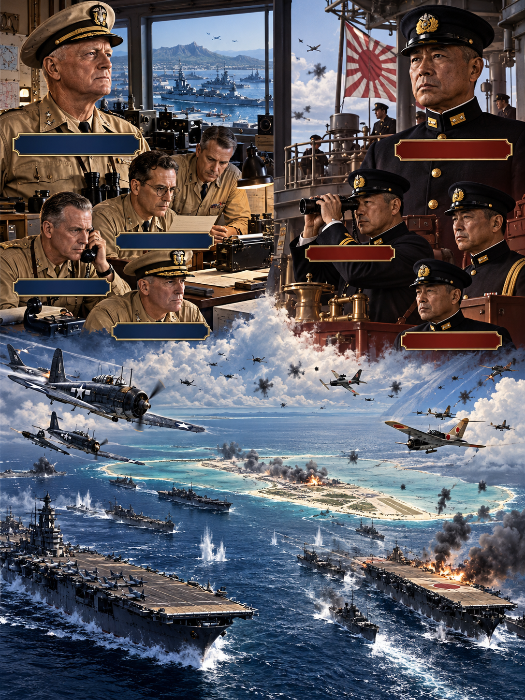

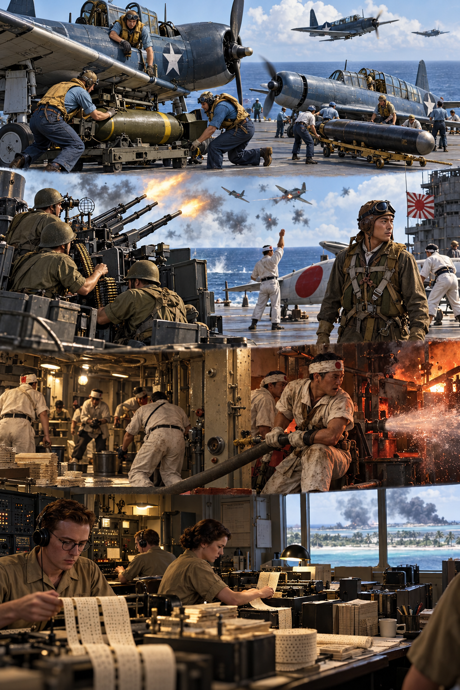

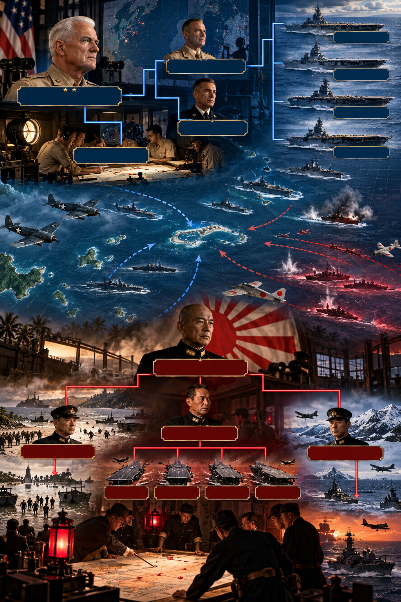

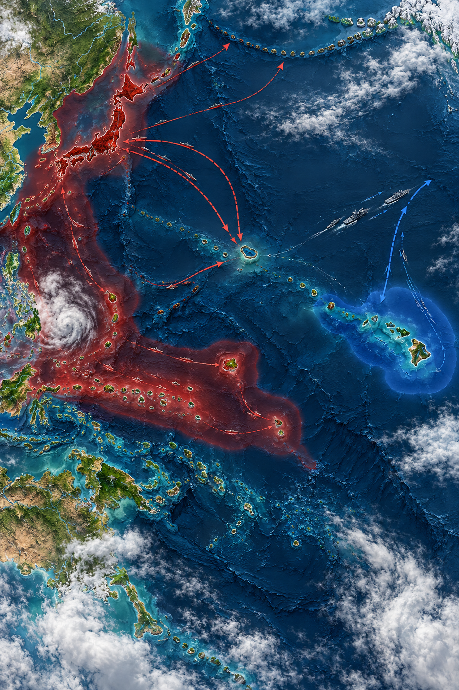

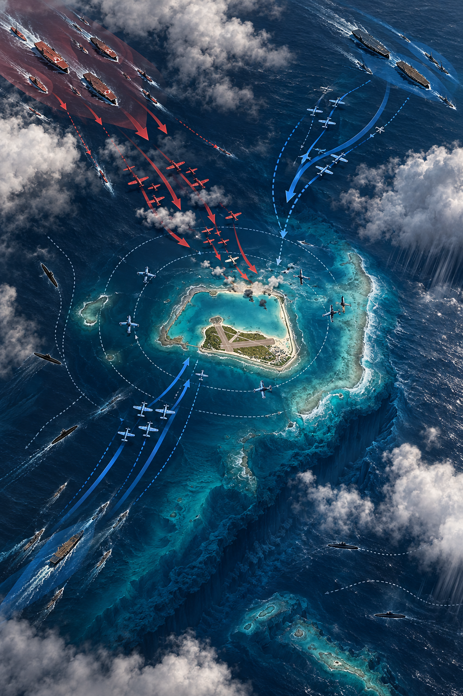

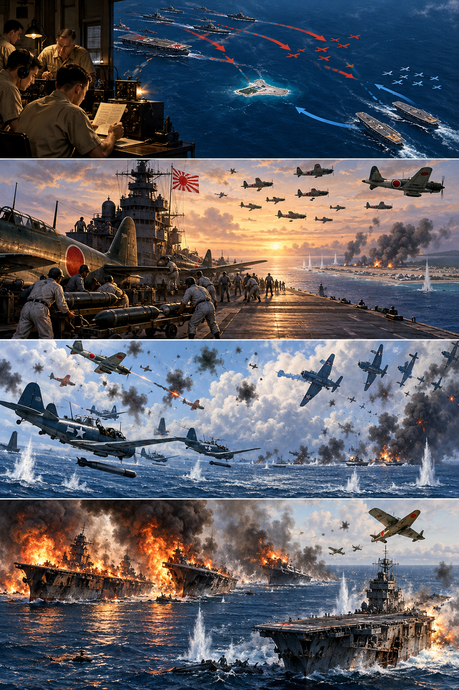

**뒤에서 반복될 지형을 먼저 잡아두기**

- 🌊 **태평양(Pacific Ocean)**: 🏛️ 일본 본토와 🇺🇸 하와이 사이의 거대한 거리 자체가 정찰·무선·연료를 전투력으로 바꾸었다. 함대를 먼저 발견한 쪽이 항공모함의 짧은 타격 창을 얻었다.
- **▰** **진주만(Pearl Harbor)**: 니미츠의 사령부와 스테이션 HYPO가 있던 출발점이다. 암호해독 결과가 함대 배치 명령으로 이어진 곳이다.
- **▰** **미드웨이 환초(Midway Atoll)**: 활주로·정찰기·잠수함을 갖춘 전초기지이자 일본군이 `AF`라 부른 목표였다. 물 부족 위장 전문은 이 목표를 확인하는 검증 실험이 되었다.
- **미드웨이 북동 해역**: **플레처**와 **스프루언스**의 항공모함 세 척이 대기한 매복 공간이다. 일본 정찰선 바깥에서 먼저 타격할 위치를 잡았다.
- **미드웨이 북서 해역**: **나구모**의 제1항공함대가 접근한 축이다. 섬 공격대와 대함 타격대 사이에서 무장을 바꾸는 동안 갑판 운용이 꼬였다.

#### 상세 전역 서사 — 암호해독에 쓴 비용이 매복 위치와 하루의 승부로 바뀌다

1942년 봄, **야마모토 이소로쿠(Isoroku Yamamoto)**는 미드웨이를 공격해 미국 항공모함을 끌어내고 격멸하려 했다. 그러나 🇺🇸 미 해군은 수개월 동안 통신감청소와 암호해독 인력을 유지했고, 진주만의 **조지프 로슈포트(Joseph Rochefort)** 팀은 일본 해군 암호 JN-25의 일부와 통신 패턴을 이어 맞추었다. `AF`가 어느 곳인지 논쟁이 남자 미드웨이에서 담수 부족을 평문으로 흘렸고, 일본 통신이 `AF`의 물 부족을 보고하면서 가설을 확인했다.

**체스터 니미츠(Chester W. Nimitz)**는 완전한 해독을 기다리지 않았다. 목표·대략의 날짜·항공모함 수라는 결정에 필요한 정보를 받아, 수리 중이던 요크타운까지 투입하고 세 항공모함을 미드웨이 북동쪽에 배치했다. 반대로 일본군은 미국 항공모함이 진주만에 있으리라는 가정과 복잡하게 분산된 작전계획에 묶였다.

6월 4일 새벽 일본군은 미드웨이를 공습했지만, 섬의 활주로와 항공전력은 완전히 제거되지 않았다. **나구모 주이치(Chuichi Nagumo)**는 대함 무장을 유지할지 섬 공격용으로 바꿀지 판단해야 했고, 정찰 보고는 늦고 불완전했다. 미국 뇌격기들의 희생적 공격은 직접 명중을 내지 못했지만 일본 전투기를 저공으로 끌어내고 진형을 흐트러뜨렸다. 이어 급강하폭격기가 도착해 아카기·가가·소류를 짧은 시간에 치명적으로 타격했다. 히류의 반격으로 요크타운도 결국 잃었으나 일본은 항공모함 네 척과 숙련 항공요원을 상실했다.

#### 전투에서 사용된 속임수 — `AF` 담수 부족 전문과 일본의 알류샨 양동

미군의 담수 전문은 무작위 거짓말이 아니라 하나의 식별 가설을 시험한 통제된 신호였다. 일본군이 그 신호를 자기 암호망에서 `AF`와 연결해 재전송하자, 미군은 목표를 확인했다. 일본의 알류샨 작전도 미국 전력을 북쪽으로 흩뜨릴 양동이었지만, 통신정보 분석은 그것이 주공이 아님을 구분했다.

#### 속임수 작동 구조

**주체와 의도.** 미군 정보팀은 `AF=미드웨이`라는 가설을 검증하고 일본 주공을 특정하려 했다.

**보인 신호와 믿은 이유.** 미드웨이가 담수 부족을 평문으로 보냈고, 일본 측은 자신들이 감청한 현지 사정을 내부 보고에 반영했다.

**유발된 행동과 결과.** 일본 암호망의 반응이 목표를 확인해 주자 니미츠는 항공모함을 매복 위치에 먼저 보냈다.

**사료의 경계.** 승리는 암호해독 하나의 자동 결과가 아니다. 정찰, 함재기 조종사의 희생, 일본 정찰 지연, 우연한 조우와 전술 판단이 함께 작용했다.

#### 속임수 일곱 질문

1. **누가 누구를 속였는가?** 미군 정보팀은 일본 통신망이 담수 전문에 반응하도록 유도했고, 일본군은 알류샨 양동으로 미국의 시선을 나누려 했다.
2. **어떤 사실이 거짓이었는가?** 계획적으로 만든 핵심 신호는 미드웨이의 긴급 담수 부족이었다.
3. **어떤 사실은 진실이지만 오해를 유도했는가?** 일본의 알류샨 공격은 실제 작전이었지만 주공처럼 보이게 배치되었다.
4. **상대는 왜 그것을 믿고 싶어 했는가?** 일본군은 미 태평양함대가 기습에 늦게 반응하리라는 작전 전제를 유지했다.
5. **속임수가 없었어도 같은 오판이 발생했을까?** 목표 추정은 가능했지만 확신과 배치 시점은 약해졌을 가능성이 높다.
6. **속은 사람은 어떤 독립 확인을 생략했는가?** 일본군은 장거리 정찰과 잠수함 경계선을 제때 완성하지 못해 미국 항공모함의 출항을 확인하지 못했다.
7. **신뢰·동의·안전을 해치지 않으면서 같은 원리를 어디서 연습할 수 있는가?** 보안 모의훈련에서 식별 가능한 시험 신호를 넣고, 한 출처가 아니라 독립 로그로 가설을 확인할 수 있다.

#### 시계편 兵者詭道也 — 이 전장에 해당하는 속이는 길

<table fit-page-width="true" header-row="true">
<tr><td>해당 구절·독음·뜻</td><td>전장의 장면</td></tr>
<tr><td>近而示之遠 근이시원 — 가까우면서 멀리 있는 듯 보임</td><td>미 항공모함은 미드웨이 북동 해역에 이미 접근했지만 일본군은 진주만에 남았으리라 판단했다.</td></tr>
<tr><td>攻其無備, 出其不意 공기무비, 출기불의 — 대비 없는 곳을 치고 뜻하지 않은 때에 나옴</td><td>미 급강하폭격기는 일본 전투기가 저공에 몰리고 항공모함 갑판 운용이 혼란한 순간을 타격했다.</td></tr>
</table>

#### 法 한눈 비교 — 곡제·관도·주용

<table fit-page-width="true" header-row="true">
<tr><td>진영</td><td>곡제(편제)</td><td>관도(지휘)</td><td>주용(보급·지속)</td></tr>
<tr><td>**미군**</td><td>미드웨이 육상항공대와 TF16·TF17을 분산 배치하되 목표를 하나로 묶었다.</td><td>니미츠의 의도 아래 플레처가 전술지휘하고 스프루언스가 기동부대를 운용했다.</td><td>진주만 수리·암호·정찰 기반을 활용해 요크타운까지 급히 복귀시켰다.</td></tr>
<tr><td>**일본군**</td><td>주력·침공·알류샨·잠수함 전력을 넓게 분산했다.</td><td>야마모토의 복잡한 계획과 나구모 현장 판단 사이 정보 지연이 컸다.</td><td>항공모함의 무장 전환과 연료·정찰 운용이 짧은 결전 창에 집중되었다.</td></tr>
</table>

#### 〈**나구모 주이치** — 패군〉

<table fit-page-width="true" header-row="true">
<tr><td>요소</td><td>판단</td></tr>
<tr><td color="orange_bg">🤝 **道**</td><td>숙련된 승조원은 강했지만 임무 변경과 정보 지연 속에서 공동 상황인식이 흔들렸다. (지기·사기)</td></tr>
<tr><td color="blue_bg">🌤️ **天**</td><td>미 항공모함 위치를 확인하지 못한 채 기존 가정을 유지했다. 불완전한 정찰 보고가 올 때 여러 가능성을 동시에 보존하지 못했다. (지피·타이밍·확률 관점)</td></tr>
<tr><td color="green_bg">🧭 **地**</td><td>광대한 해역에서 탐색 부채와 정찰 시간이 곧 생사 통로였다. 미국 매복 위치를 늦게 발견했다. (원근·광협·사생)</td></tr>
<tr><td color="purple_bg">🎖️ **將**</td><td>절차를 지켰으나 급변한 정보에 대응하는 결단이 늦었고, 섬과 함대라는 두 목표 사이에서 전환 비용을 키웠다. (지신인용엄·장유오위)</td></tr>
<tr><td color="yellow_bg">⚙️ **法**</td><td>정찰기 출발 지연, 무장 전환, 전투기 엄호가 얽혀 항공모함의 시간표가 무너졌다. (곡제·관도·주용)</td></tr>
</table>

**직관·편향 한 줄:** 미 항공모함이 아직 나타나지 않았다는 제한된 관측을 부재의 증거로 취급한 명령에는 기존 계획을 지지하는 신호를 더 무겁게 보는 **확증편향**이 작동한 것으로 볼 수 있고, 그 결과 대비 전환이 늦었다.

🏳️ **패군 측 결과**: 일본군은 지형편의 `北`(배, 적정을 헤아리지 못하고 강적과 맞서 패함)에 가까운 정보 실패를 겪고 항공모함 네 척을 잃었다.

🔀 **패군 측 회피 분기점**: 미국 항공모함의 위치를 확인할 때까지 예비 대함 타격대의 즉응성을 보존하고 정찰선을 앞당겼다면 승리를 보장할 수는 없어도 네 척이 한꺼번에 노출되는 완패 가능성은 낮출 수 있었다.

#### 〈**체스터 니미츠** — 승군〉

<table fit-page-width="true" header-row="true">
<tr><td>요소</td><td>판단</td></tr>
<tr><td color="orange_bg">🤝 **道**</td><td>워싱턴과 HYPO의 견해 차이 속에서도 현지 정보팀을 신뢰하고 함대가 쓸 수 있는 결론으로 바꾸었다. (지기·사기)</td></tr>
<tr><td color="blue_bg">🌤️ **天**</td><td>해독을 전지로 과장하지 않고 목표·날짜·규모의 범위를 사용해 유리한 확률을 높였다. 우연과 조종사 희생이 남았음을 감수했다. (지피·타이밍·확률 관점)</td></tr>
<tr><td color="green_bg">🧭 **地**</td><td>미드웨이의 정찰 반경과 북동 해역의 은폐 거리를 매복 지형으로 사용했다. (원근·광협·사생)</td></tr>
<tr><td color="purple_bg">🎖️ **將**</td><td>부하의 전문성을 믿고 제한된 정보로 기한 안에 결단했으며 현장 지휘관에게 재량을 주었다. (지신인용엄)</td></tr>
<tr><td color="yellow_bg">⚙️ **法**</td><td>암호해독·정찰·수리·항모 편제를 하나의 결정 체계로 결합했다. (곡제·관도·주용)</td></tr>
</table>

##### 法을 압축하지 않고 보기 — 곡제·관도·주용

**곡제 曲制(곡제): 부대를 어떻게 나누고 결합했는가**
<table fit-page-width="true" header-row="true">
<tr><td>진영</td><td>곡제 曲制(곡제)</td></tr>
<tr><td>**미군**</td><td>TF16·TF17과 미드웨이 육상항공대를 별도 축으로 두고 같은 일본 항모군을 압박했다.</td></tr>
<tr><td>**일본군**</td><td>항모 주력, 전함 본대, 침공대, 알류샨대를 분산해 상호지원 시간이 길어졌다.</td></tr>
</table>

**관도 官道(관도): 누가 명령하고 어떻게 전달했는가**
<table fit-page-width="true" header-row="true">
<tr><td>진영</td><td>관도 官道(관도)</td></tr>
<tr><td>**미군**</td><td>정보팀→레이턴→니미츠→플레처·스프루언스로 판단과 명령이 연결되었다.</td></tr>
<tr><td>**일본군**</td><td>분산 함대와 무선침묵 때문에 야마모토가 나구모의 전술 상황을 즉시 교정하기 어려웠다.</td></tr>
</table>

**주용 主用(주용): 군량·장비·전투 지속 능력을 어떻게 썼는가**
<table fit-page-width="true" header-row="true">
<tr><td>진영</td><td>주용 主用(주용)</td></tr>
<tr><td>**미군**</td><td>진주만 수리창이 요크타운을 급히 복구했고 섬·잠수함·초계기까지 정찰망에 넣었다.</td></tr>
<tr><td>**일본군**</td><td>장거리 작전의 연료와 함재기 무장 전환이 지속 능력과 즉응성을 제한했다.</td></tr>
</table>

🏆 **승군 측 결과**: 미군은 `以虞待不虞者勝`(이우대불우자승, 대비하여 대비하지 않은 적을 상대하는 자가 이김)을 구현했다. 정보 조직에 든 지속 비용이 하루의 배치 우위로 전환되었다.

**서양 실증 사례 출처:** [미 해군 역사유산사령부 — Battle of Midway](https://www.history.navy.mil/browse-by-topic/wars-conflicts-and-operations/world-war-ii/1942/midway.html) · [미 해군 — The Role of COMINT in the Battle of Midway](https://www.history.navy.mil/content/history/nhhc/research/library/online-reading-room/title-list-alphabetically/r/the-role-of-comint-in-the-battle-of-midway.html) · [NSA 국립암호박물관 — Battle of Midway](https://www.nsa.gov/History/National-Cryptologic-Museum/Exhibits-Artifacts/Exhibit-View/Article/2719156/world-war-2-battle-of-midway/)

### 동양 — 🏛️ 조조군 vs 🏛️ 원소군 │ 관도대전(官渡之戰, 200)

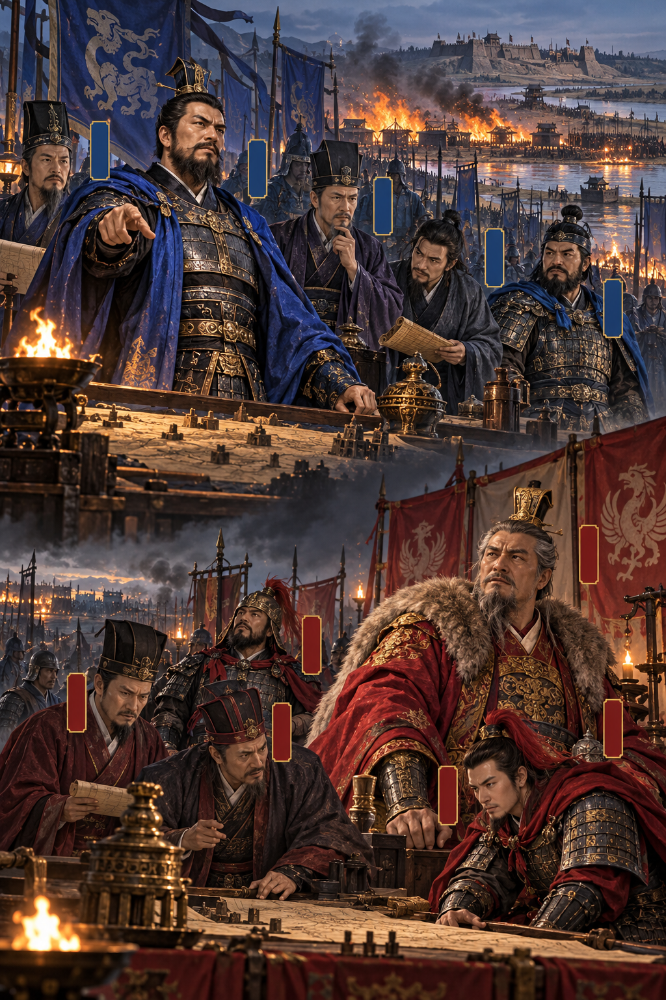

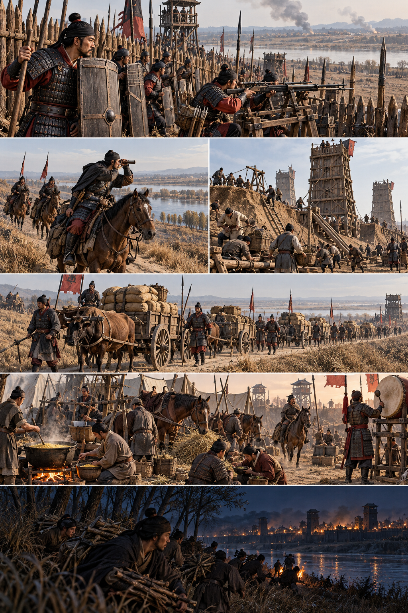

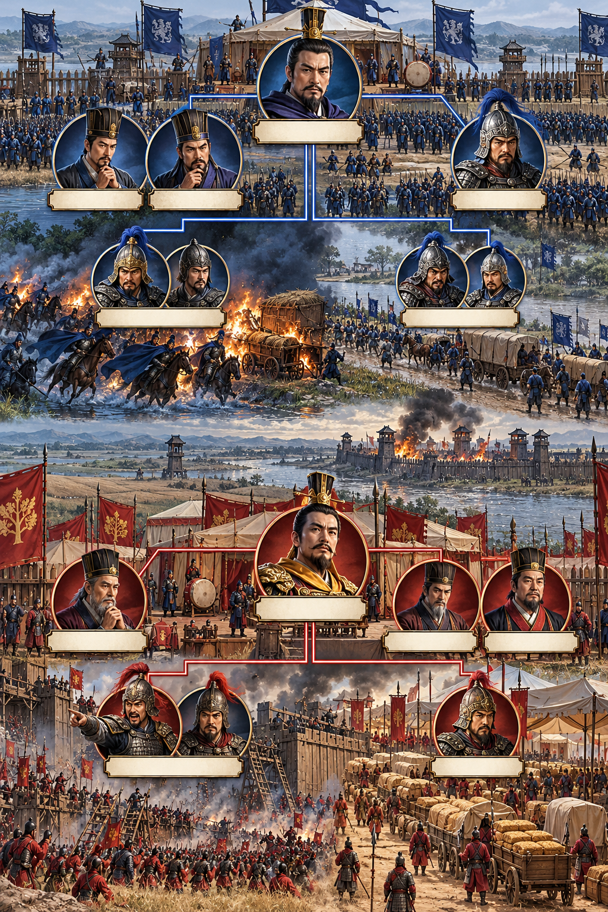

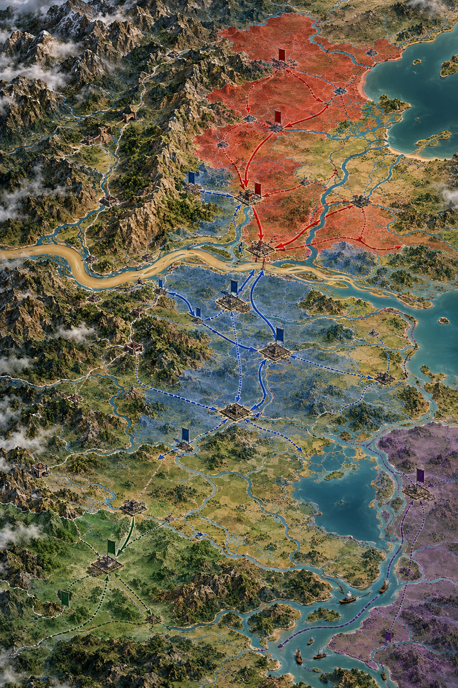

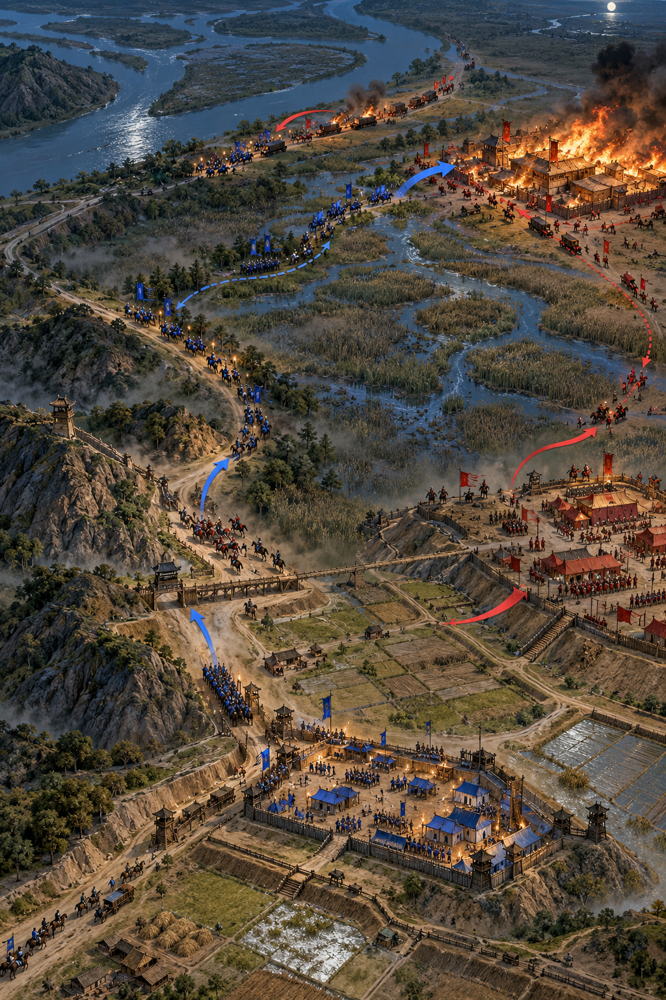

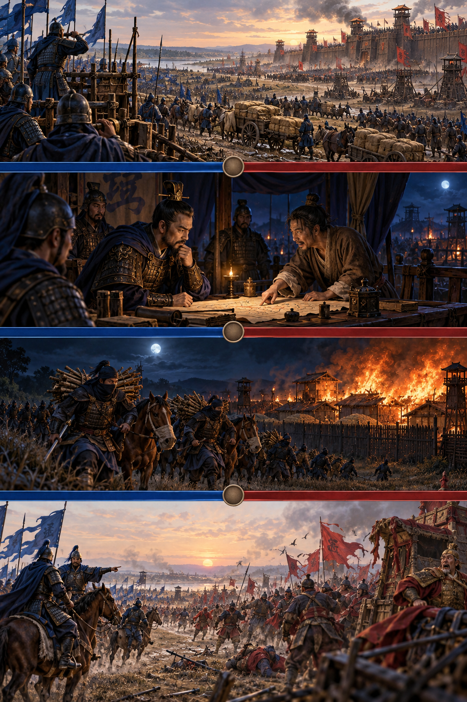

**뒤에서 반복될 지형을 먼저 잡아두기**

- 🌊 **황하(黃河)**: 하북의 **원소**가 남하할 때 건너야 하는 보급 장벽이었다. 백마·연진의 나루와 관도 전선이 연결된다.
- **▰** **관도(官渡)**: **조조**가 토루와 방책으로 버틴 주진지다. 병력 열세를 좁은 정면과 견고한 진영으로 줄였다.
- **▰** **오소(烏巢)**: **순우경**이 지킨 원소군의 군량 집적지다. 관도 본영과 떨어진 거리가 정보가 행동으로 바뀌는 시간 창을 만들었다.
- **▰** **허창(許昌)**: 헌제를 둔 조조의 정치·군수 중심지다. 관도 방어선이 무너지면 직접 위협받을 후방이었다.
- **오소로 가는 소로**: **조조**의 5천 정예가 원소군 표지를 가장하고 밤에 통과한 우회축이다.

#### 상세 전역 서사 — 허유의 정보가 오소 기습으로 전환되기까지

관도의 교착은 병력이 적고 군량이 빠듯한 **조조(曹操)**에게 시간이 불리한 싸움이었다. **원소(袁紹)**는 우세한 병력으로 토산과 누차를 운용했지만 견고한 관도 진영을 단숨에 무너뜨리지 못했다. **순유**의 건의로 서황·사환이 운송대를 먼저 습격해 보급의 취약성을 드러냈다.

결정적 정보는 **원소** 진영을 이탈한 **허유**에게서 왔다. 허유는 오소에 대량의 군량이 있고 수비가 허술하다고 알렸다. 조조의 장수 일부는 투항자의 말을 의심했지만 **순유**와 **가후**가 공격을 권했다. 조조는 조홍에게 관도 본영을 맡기고 보·기병 5천을 이끌어 밤길로 오소를 쳤다.

기습대는 원소군 증원부대로 가장하고 사람은 재갈을 물고 말의 입을 묶어 소리를 줄였다는 기록이 전한다. 오소의 군량이 불타자 원소 지휘부는 구원과 조조 본영 공격 사이에서 병력을 나누었다. **장합**과 **고람**의 관도 공격은 성과를 내지 못했고, 책임 추궁을 두려워한 두 장수가 투항하면서 원소군은 붕괴했다. 정보는 그 자체로 승리가 아니었다. 출처의 이해관계를 의심하되 시간 안에 검증하고, 정예병·위장·우회·본영 방어를 붙여 실행한 순간에 승리로 바뀌었다.

#### 전투에서 사용된 속임수 — 원소군 증원대로 가장한 오소 야습

조조의 5천 기습대는 불쏘시개를 휴대하고 밤길로 이동하면서 길에서 만난 원소군에게 “장기가 보낸 증원”이라 속였다고 전한다. 이 위장은 소수 병력이 적진 깊은 군량고에 접근할 시간을 벌었다. 그러나 허유의 투항 동기와 세부 대화는 후대 서술에서 각색되었을 가능성을 구분해야 한다.

#### 속임수 작동 구조

**주체와 의도.** 조조는 관도 정면이 아니라 오소 군량을 태워 원소군의 지속 능력과 사기를 동시에 끊으려 했다.

**보인 신호와 믿은 이유.** 야간 행군대는 원소군 표지를 쓰고 증원부대라고 답했다. 원소군도 오소 방어를 강화할 병력이 올 수 있는 상황이었다.

**유발된 행동과 결과.** 검문과 경보가 늦어졌고 조조군은 군량고 가까이 접근해 불을 놓았다. 원소의 분산 대응은 본영과 오소 어느 쪽도 구하지 못했다.

**사료의 경계.** 『삼국지』와 『자치통감』 계열은 기습의 큰 골격을 지지하지만, 병력 수·대화·잔혹행위의 세부는 기록별 차이와 후대 편집을 감안해야 한다.

#### 속임수 일곱 질문

1. **누가 누구를 속였는가?** 조조의 오소 기습대가 길목의 원소군과 오소 수비대를 속였다.
2. **어떤 사실이 거짓이었는가?** 기습대가 원소군의 증원부대라는 신분이었다.
3. **어떤 사실은 진실이지만 오해를 유도했는가?** 실제로 오소 방어가 위급해져 증원이 필요했으므로 이동 자체는 그럴듯했다.
4. **상대는 왜 그것을 믿고 싶어 했는가?** 대군을 거느린 원소 측은 후방 도로와 표지가 자기 통제 아래 있다고 기대했다.
5. **속임수가 없었어도 같은 오판이 발생했을까?** 야간 경계와 지휘 분산 때문에 침투 가능성은 있었지만 오소 가까이까지 무경보 접근하기는 어려웠을 것이다.
6. **속은 사람은 어떤 독립 확인을 생략했는가?** 이동 명령의 출처와 지휘관 신원을 본영에 재확인하지 못했다.
7. **신뢰·동의·안전을 해치지 않으면서 같은 원리를 어디서 연습할 수 있는가?** 보드게임과 보안 모의훈련에서 가짜 이동과 신원 재확인 절차를 함께 시험할 수 있다.

#### 시계편 兵者詭道也 — 이 전장에 해당하는 속이는 길

<table fit-page-width="true" header-row="true">
<tr><td>해당 구절·독음·뜻</td><td>전장의 장면</td></tr>
<tr><td>遠而示之近 원이시지근 — 멀면서 가까운 듯 보임</td><td>조조군은 적진 깊숙한 오소로 향하면서 원소군 내부의 정상 증원 이동처럼 보였다.</td></tr>
<tr><td>攻其無備, 出其不意 공기무비, 출기불의 — 대비 없는 곳을 치고 뜻하지 않은 때에 나옴</td><td>관도 정면이 아니라 떨어진 군량고를 밤에 공격했다.</td></tr>
</table>

#### 法 한눈 비교 — 곡제·관도·주용

<table fit-page-width="true" header-row="true">
<tr><td>진영</td><td>곡제(편제)</td><td>관도(지휘)</td><td>주용(보급·지속)</td></tr>
<tr><td>**조조군**</td><td>본영 방어와 5천 기습대를 분리하고 임무를 명확히 했다.</td><td>순유·가후의 판단을 받은 조조가 직접 기습대를 지휘했다.</td><td>열세한 군량 때문에 적 보급 파괴를 결전 목표로 삼았다.</td></tr>
<tr><td>**원소군**</td><td>대군과 공성장비는 강했지만 오소 후방 수비가 취약했다.</td><td>구원과 본영 공격 사이 명령이 갈리고 장합·고람에게 책임이 전가되었다.</td><td>대량 군량을 오소 한곳에 집중해 단일 실패점이 되었다.</td></tr>
</table>

#### 〈**원소** — 패군〉

<table fit-page-width="true" header-row="true">
<tr><td>요소</td><td>판단</td></tr>
<tr><td color="orange_bg">🤝 **道**</td><td>저수의 경고와 허유의 건의를 받아들이지 못하고 패전 책임이 예하 장수에게 돌아가 내부 신뢰가 무너졌다. (지기·사기)</td></tr>
<tr><td color="blue_bg">🌤️ **天**</td><td>조조군 군량이 먼저 고갈되리라는 시나리오에 집중했고, 오소 상실이라는 낮게 본 위험이 실제화될 때 대응을 나눴다. (지피·타이밍·확률 관점)</td></tr>
<tr><td color="green_bg">🧭 **地**</td><td>황하를 건넌 대군의 긴 보급선과 관도에서 떨어진 오소 사이 거리를 보호하지 못했다. (원근·험이·광협·사생)</td></tr>
<tr><td color="purple_bg">🎖️ **將**</td><td>많은 계책 가운데 일관된 우선순위를 세우지 못하고 실패 책임을 조정하지 못했다. (지신인용엄·장유오위)</td></tr>
<tr><td color="yellow_bg">⚙️ **法**</td><td>군량을 집중했으나 경계·보고·증원 절차를 그 가치에 맞게 강화하지 않았다. (곡제·관도·주용)</td></tr>
</table>

**직관·편향 한 줄:** 조조군이 먼저 소진될 것이라는 초기 전망을 붙든 채 오소 기습 가능성과 허유 이탈 신호를 낮게 본 명령에는 **확증편향과 과신**이 작동한 것으로 볼 수 있고, 구원과 본영 공격을 나눈 대응이 패배를 키웠다.

🏳️ **패군 측 결과**: 원소군은 지형편의 `亂`(란, 명령과 편제가 어지러움)과 `崩`(붕, 예하 장수가 불복·독자 행동하고 장수가 통제하지 못함)의 연쇄로 무너졌다.

🔀 **패군 측 회피 분기점**: 군량고를 분산하고 저수의 호위 강화 건의를 받아들였거나, 오소 피습 뒤 구원과 본영 공격 중 한 목표에 전력을 집중했다면 적어도 전군 붕괴는 피할 가능성이 있었다.

#### 〈**조조** — 승군〉

<table fit-page-width="true" header-row="true">
<tr><td>요소</td><td>판단</td></tr>
<tr><td color="orange_bg">🤝 **道**</td><td>교착과 군량 부족을 숨기지 않고 참모의 상반된 판단을 들은 뒤 역할을 나눴다. (지기·사기)</td></tr>
<tr><td color="blue_bg">🌤️ **天**</td><td>허유의 정보가 거짓일 가능성을 남겨 두되 순유·가후의 판단과 기존 보급 습격 경험으로 행동 가치가 더 크다고 보았다. (지피·타이밍·확률 관점)</td></tr>
<tr><td color="green_bg">🧭 **地**</td><td>관도 방책으로 정면을 묶고 오소 소로를 이용해 적의 후방 깊숙이 기동했다. (원근·험이·광협·사생)</td></tr>
<tr><td color="purple_bg">🎖️ **將**</td><td>정보의 시간가치를 알아 직접 위험을 감수하면서도 조홍에게 본영을 맡겼다. (지신인용엄)</td></tr>
<tr><td color="yellow_bg">⚙️ **法**</td><td>5천 정예·위장·불쏘시개·본영 방어를 하나의 짧은 작전으로 결합했다. (곡제·관도·주용)</td></tr>
</table>

##### 法을 압축하지 않고 보기 — 곡제·관도·주용

**곡제 曲制(곡제): 부대를 어떻게 나누고 결합했는가**
<table fit-page-width="true" header-row="true">
<tr><td>진영</td><td>곡제 曲制(곡제)</td></tr>
<tr><td>**조조군**</td><td>본영 수비대와 보·기병 5천의 기습대를 나누고, 서황의 선행 운송대 습격과 연결했다.</td></tr>
<tr><td>**원소군**</td><td>대군·공성대·오소 수비대를 두었으나 후방과 정면의 상호지원 설계가 약했다.</td></tr>
</table>

**관도 官道(관도): 누가 명령하고 어떻게 전달했는가**
<table fit-page-width="true" header-row="true">
<tr><td>진영</td><td>관도 官道(관도)</td></tr>
<tr><td>**조조군**</td><td>조조가 기습을 직접 지휘하고 조홍·순유가 관도 본영을 지키는 명령선을 세웠다.</td></tr>
<tr><td>**원소군**</td><td>순우경의 오소 수비와 장합·고람의 관도 공격이 하나의 우선순위로 통합되지 못했다.</td></tr>
</table>

**주용 主用(주용): 군량·장비·전투 지속 능력을 어떻게 썼는가**
<table fit-page-width="true" header-row="true">
<tr><td>진영</td><td>주용 主用(주용)</td></tr>
<tr><td>**조조군**</td><td>군량 열세를 인정하고 적 군량을 태워 지속 능력의 비교 자체를 뒤집었다.</td></tr>
<tr><td>**원소군**</td><td>하북에서 황하를 건넌 군량을 오소에 대량 집적해 화재 한 번에 손실이 집중되었다.</td></tr>
</table>

🏆 **승군 측 결과**: 조조군은 `識衆寡之用者勝`(식중과지용자승, 대군과 소수 병력의 쓰임을 아는 자가 이김)을 구현했다. 허유의 정보에 보상·신뢰·검증·기동을 붙여 하루의 승부로 바꾸었다.

**동양 실증 사례 출처:** [『삼국지』 위서 무제기·순유전 계열 — Chinese Text Project](https://ctext.org/sanguozhi) · [『자치통감』 권63 — Chinese Text Project](https://ctext.org/wiki.pl?if=gb&chapter=427095) · [관도대전 개요와 원전 대조](https://zh.wikipedia.org/wiki/%E5%AE%98%E6%B8%A1%E4%B9%8B%E6%88%98)

---
## 5. 핵심 통찰 + 실생활 적용 + 생활루틴

### 핵심 통찰

이 구절의 가장 예리한 통찰은 **정보의 가격을 정보비 자체와 비교하지 말고, 정보 없이 내릴 결정의 총손실과 비교하라**는 데 있다. 백금은 장부에 바로 찍히지만, 잘못된 공격·대치 연장·병사와 백성의 피로는 여러 곳에 흩어져 늦게 드러난다. 보이는 작은 비용을 아끼면 재정이 건전해 보일 수 있으나, 그 선택이 보이지 않는 큰 손실을 키운다면 실제로는 낭비다.

`不仁之至`는 이 계산에 책임을 더한다. 의사결정자는 자기 예산만 지키면 끝나는 사람이 아니다. 정보 부족으로 생길 재작업과 위험을 누가 떠안을지까지 봐야 한다. 반대로 정보를 많이 모으는다는 명목으로 사생활을 침해하거나 결정을 무한정 미루는 것 역시 인이 아니다. **결정에 필요한 최소한의 핵심 질문을 정당한 방법으로 제때 확인하는 것**이 이 구절의 균형점이다.

### 실생활 적용

3교대 현장에서 장애가 반복되면 `相守數年`과 비슷한 상태가 생긴다. 매번 현장 조치로 넘기고 BM·인폼을 쓰지만, 어떤 조건에서 시작됐는지·어느 조치가 실제로 복구시켰는지·재발 간격이 어떤지를 묶어 보지 않으면 같은 대치가 이어진다. 눈앞의 장애는 하루에 끝나도 교대마다 경계·설명·재작업 비용이 다시 든다.

이때 “바빠서 분석할 시간이 없다”는 판단은 `愛百金`이 될 수 있다. 사용자의 관찰 기록에서 현장 조치, 상황실 감시, 기록이 서로 다른 사람에게 나뉘었는데 후면 기록이 누락되면, 조치를 마친 사람과 전씨가 돌아와 설명과 문서를 다시 떠안았다. 관찰 가능한 사실은 누가 나쁜 사람인가가 아니라 **첫 기록·응답·인수인계가 정해진 시각에 실제로 남았는가**다. 여기서 15분의 정리 비용을 아끼면 다음 교대가 더 긴 재구성 비용을 낸다.

다음 장애에서는 시작 직후 결정 질문을 하나 적는다. 예를 들어 `원격 복구로 끝낼 수 있는가, 현장 출동이 필요한가?`를 쓰고, 그 판단을 바꿀 증거를 `알람 조합 / 장비 상태 / 마지막 정상 시각 / 같은 증상의 과거 복구 결과`로 제한한다. 현장·상황실·기록 담당을 정한 뒤 10분 후 첫 확인을 한다. 응답이 없으면 사람의 의도를 추측하지 말고 미리 정한 대체자에게 넘긴다. 이는 동료를 감시하는 일이 아니라 업무 상태를 공동 정보로 만드는 일이다.

전씨와 의견이 다를 때도 모든 과거 불만을 모아 사람 전체를 판정하지 않는다. “현재 확인된 사실은 A이고, 아직 모르는 것은 B이며, B가 이 값이면 C로 바꾸겠습니다”라고 말한다. 상대의 직위나 말투가 아니라 결정을 바꿀 증거를 외부에 적어 두면, 피로한 상황에서도 최초 주장에 매달리는 일을 줄일 수 있다. 기록에 없는 의도·성격·건강 상태는 추론하지 않는다.

개인 생활에서는 큰 구매, 구독, 장기 학습, 병원 예약처럼 오래 미루는 결정에 적용한다. 자료를 계속 모으기 전에 `무엇을 알면 결정이 바뀌는가`를 한 문장으로 쓴다. 가격 비교 하나로 선택이 달라진다면 20분을 쓰고, 어느 결과에서도 같은 선택을 할 것이라면 더 찾지 않는다. 반대로 안전·건강·법적 위험처럼 잘못 판단했을 때 손실이 큰 문제는 전문가 상담비나 검사 시간을 단순한 낭비로 보지 않는다.

카너먼의 관점에서는 이미 들인 시간과 앞으로의 선택을 분리한다. 수년을 기다렸다는 사실은 다음 결정을 정당화하지 않는다. 가능한 시나리오를 `그대로 진행 / 한 번 더 확인 / 축소 / 중단`으로 나누고, 각각의 기저율·손실·되돌릴 수 있는지를 적는다. 생생한 성공 사례 하나나 최근 실패 하나만으로 확률을 대신하지 않는다. 이 절차는 직관을 없애는 것이 아니라, 직관이 놓친 분모와 대안을 보충한다.

### 생활루틴

**오래 끌 일의 결정적 정보를 아끼면 재수가 없다.**

**이유:** 확인에 드는 시간과 돈은 지금 바로 보여 아깝게 느껴지지만, 확인하지 않은 채 미루면 대기·재작업·설명·불안이 매일 누적된다. 그러다 짧은 결정 순간에 틀리면 그동안 들인 비용과 다음 사람의 시간까지 함께 잃는다. 이는 `相守數年`의 긴 부담을 지면서 `爵祿百金`을 아껴 `敵之情`을 모르는 일을 `不仁之至`라고 한 원리다.

오늘 10분 이상 망설이는 결정 하나를 골라 종이에 세 줄을 쓴다: `결정을 바꿀 질문 1개 / 그 답을 확인할 가장 정당하고 신뢰할 만한 출처 / 확인 종료 시각`. 답에 따라 행동이 달라지지 않으면 더 찾지 않고 결정한다. 행동이 달라진다면 확인 비용을 먼저 지불하고, 정한 시각에 남은 불확실성을 적은 채 선택한다.
