> 비인지장야, 비주지좌야, 비승지주야, 고명군현장, 소이동이승인, 성공출어중자, 선지야. — 움직이기 전에 판단을 바꿀 사실을 확인하지 않으면 재수가 없다.

---
## 1. 원문 + 독음 + 직역 + 한자어 뜻풀이

非人之將也, 非主之佐也, 非勝之主也, 故明君賢將, 所以動而勝人, 成功出於衆者, 先知也. 비인지장야, 비주지좌야, 비승지주야, 고명군현장, 소이동이승인, 성공출어중자, 선지야.

**직역**  
그런 자는 사람을 맡는 장수가 아니며, 군주를 보좌하는 자도 아니며, 승리의 주재자도 아니다. 그러므로 밝은 군주와 어진 장수가 움직여 남을 이기고, 공을 이루어 무리보다 뛰어난 까닭은 먼저 알기 때문이다.

	앞 구절은 수년간 대치하고도 작위·봉록·백금을 아껴 적의 실정을 알아보지 않는 자를 `不仁之至`(불인지지, 어질지 못함의 극치)라고 꾸짖었다. 이번 문장은 그 꾸지람을 직책의 자격 문제로 밀어붙인다. 정보를 덜 가진 것이 곧 죄라는 뜻이 아니다. **알아볼 수 있고 반드시 알아야 할 일을 외면한 채 타인을 움직이는 사람은 지휘·보좌·승리의 중심을 맡을 자격이 없다**는 말이다.

	이어지는 후반은 뛰어난 군주와 장수가 남보다 먼저 움직여서 이긴다고 말하지 않는다. 순서는 반대다. 먼저 알고, 그 앎이 행동을 바꿀 때 움직이며, 그 결과가 남보다 두드러진다. `先知`는 미래를 맞히는 신비한 예언이 아니라 다음 구절의 `必取於人, 知敵之情者也`(필취어인, 지적지정자야 — 반드시 사람에게서 취하여 적의 실정을 아는 것이다)로 이어지는 **행동 이전의 검증된 상황 인식**이다.

	#### 將(장수 장) — 사람과 위험을 대신 짊어지는 자리

	`將`은 군대를 거느리는 사람이며, 여기서는 전투 기술이 좋은 개인보다 타인의 생명·시간·물자를 결정을 통해 움직이는 책임자를 가리킨다. 앞의 `非人之將`은 글자 그대로만 보면 “사람의 장수가 아니다”이지만, 문맥에서는 사람을 맡길 만한 장수가 아니라는 강한 자격 박탈이다.

	장수에게 모든 사실을 미리 알라고 요구할 수는 없다. 그러나 무엇을 모르는지, 그 무지가 어떤 결정을 흔드는지, 누구에게 어떤 보고를 받아야 하는지를 정할 수는 있다. 그 절차를 세우지 않은 채 명령부터 내리면 병사는 지휘관의 확신이 아니라 지휘관이 외면한 불확실성까지 몸으로 떠안는다. 그래서 `將`은 권한보다 **확인 책임이 먼저 붙는 자리**다.

	#### 佐(도울 좌) — 군주의 시야에 빠진 부분을 보충하다

	`佐`는 곁에서 돕고 보완한다는 뜻이다. 군주의 뜻을 그대로 반복하거나 듣기 좋은 보고만 올리는 사람은 보좌자가 아니다. 군주가 보지 못한 조건, 계획이 실패할 징후, 적이 선택할 다른 행동을 찾아 결정의 시야를 넓혀야 비로소 `佐`가 된다.

	이 구절에서 정보 없는 보좌는 단순한 실무 부족이 아니다. 지휘자가 한 가지 시나리오에 빠질 때 참모까지 같은 확신을 되풀이하면 조직은 여러 사람의 머리를 두고도 한 사람의 맹점만 확대한다. `非主之佐`는 **권력 가까이에 있다는 사실이 아니라, 권력의 오판을 줄이는 기능으로 보좌자를 평가하라**는 문장이다.

	#### 主(주인 주) — 승리를 소유하는 사람이 아니라 조건을 주재하다

	`主`는 주인, 중심, 주재자를 뜻한다. `非勝之主`는 승리의 영광을 차지할 사람이 아니라는 말보다 더 깊다. 승리가 나오도록 목표·정보·시간·자원을 묶어 판단하는 중심이 될 수 없다는 뜻이다. 우연히 한 번 맞혔다고 그 사람이 승리의 주재자가 되는 것은 아니다.

	결과만 보고 판단의 질을 평가하면 운 좋은 무모함이 능력으로 둔갑한다. 승리의 주재자는 성공했을 때 공을 독점하는 사람이 아니라, 성공과 실패의 가능한 경로를 미리 나누고 새 정보가 오면 계획을 바꿀 수 있게 만든다. `主`는 **결과의 소유권보다 결정 과정의 책임**을 가리킨다.

	#### 明君賢將(명군현장) — 밝게 보는 군주와 제대로 고르는 장수

	`明`(밝을 명)은 햇빛처럼 훤하다는 데서 가려진 것을 분별하는 능력으로 넓어지고, `賢`(어질 현)은 재능과 덕을 갖춘 사람을 뜻한다. 여기서 명군과 현장은 타고난 천재의 칭호가 아니다. 자신이 모르는 것을 인정하고, 적절한 사람에게 묻고, 보고의 신뢰도를 따져 행동 시점을 고르는 통치와 지휘의 방식이다.

	밝음은 정보량과 같지 않다. 보고가 넘쳐도 어떤 사실이 결정을 바꾸는지 모르면 어둡고, 자료가 제한되어도 핵심 가정과 반증 조건을 분명히 하면 더 밝게 볼 수 있다. 어짊 또한 부드러운 성품만이 아니다. 불확실성을 부하에게 숨기지 않고, 확인 비용을 지불하며, 틀렸을 때 수정할 길을 남기는 책임이 `明`과 `賢`을 실제 행동으로 만든다.

	#### 動而勝人(동이승인) — 먼저 움직이는 것이 아니라 알고 움직이다

	`動`(움직일 동)은 정지에서 행동으로 옮기는 순간이고, `勝`(이길 승)은 상대보다 우세한 결과를 얻는 일이다. 두 글자 사이의 `而`는 움직임과 승리를 이어 주지만, 그 원인은 문장 끝의 `先知`에 있다. 손자는 성급한 선수를 칭찬하지 않는다. 무엇을 확인한 뒤 어느 조건에서 움직였는지를 묻는다.

	행동이 늦어질수록 정보가 늘 수 있지만 기회가 사라질 수 있고, 빨라질수록 기회는 잡아도 오류가 커질 수 있다. 그러므로 선지는 완전한 정보를 기다리는 일이 아니다. **결정을 바꿀 핵심 사실을 정해진 시각까지 확인하고, 남은 불확실성을 안은 채 조건부로 움직이는 것**이다.

	#### 成功出於衆(성공출어중) — 남보다 뛰어난 결과는 보이지 않는 준비에서 나오다

	`成`(이룰 성)은 일이 완결되는 것이고 `功`(공 공)은 그 결과로 쌓인 성취다. `衆`(무리 중)은 많은 사람, 보통의 다수를 가리킨다. 겉으로 드러난 결정적 행동만 보면 뛰어난 성공은 영웅의 직감처럼 보이지만, 손자는 그 앞단의 앎을 원인으로 놓는다.

	남보다 뛰어났다는 말은 항상 남을 이겨야 한다는 경쟁 강박이 아니다. 같은 조건에서 더 적은 희생으로 목표를 이루고, 불리한 싸움을 피하며, 틀린 계획을 일찍 고친 결과까지 포함한다. 눈에 띄는 성공을 흉내 내려 하지 말고, 그 성공을 가능하게 한 질문·관찰·교차 확인을 복원해야 한다.

	#### 先知(선지) — 미래를 점치는 대신 행동보다 먼저 사실을 얻다

	`先`(먼저 선)은 시간상 앞섬이고 `知`(알 지)는 구분하고 판단할 수 있게 아는 일이다. 둘을 합친 `先知`는 예언자의 능력이 아니다. 손자는 바로 다음 문장에서 귀신, 과거 사례의 기계적 유추, 고정된 법칙만으로는 선지를 얻을 수 없다고 잘라 말하고, 사람에게서 적의 실제 사정을 취하라고 한다.

	따라서 선지는 정보원의 말 한마디를 그대로 믿는 것도 아니다. 출처가 무엇을 직접 보았는지, 무엇을 전해 들었는지, 어떤 이해관계가 있는지, 다른 자료와 어디서 맞고 어긋나는지를 살펴야 한다. 생활에서의 선지도 남을 캐는 기술이 아니라 **결정 전에 당사자·기록·현장 상태를 정당하게 확인하고, 사실과 추정을 분리하는 습관**이다.

	#### 글자들이 완성하는 한 장면

	앞 구절에서 정보비를 아낀 사람은 먼저 `將`의 자리에서 밀려난다. 군주의 시야를 보충하지 못하니 `佐`도 될 수 없고, 우연한 결과에 기대니 `勝`을 주재하는 `主`도 될 수 없다. 반대편에서는 `明君`이 모르는 것을 밝히고 `賢將`이 판단을 바꿀 보고를 정한다. 그들은 아무 때나 `動`하지 않고 확인된 조건에서 움직이며, 그래서 `勝人`하고 `成功`이 `衆`보다 두드러진다. 이 모든 흐름을 여는 첫 동작이 `先知`다.

	문장의 핵심은 “정보가 많으면 이긴다”가 아니다. 정보는 행동과 연결되지 않으면 창고에 쌓인 자료에 불과하고, 행동은 반증 가능한 정보 없이 나가면 확신을 입은 도박이 된다. **먼저 알아야 할 것을 정하고, 확인한 뒤 움직이며, 결과로 다시 판단을 교정하는 사람만이 타인의 위험을 맡을 자격이 있다.**

---
## 2. 전통 주석 기반 분석

- **조조(曹操)** — “적정을 알지 못하면서 군대를 맡으려 하지 마라. **먼저 안 뒤에 움직여야 비로소 사람을 이기고 공을 이룬다.**”
- **이전(李筌)** — “군주와 장수의 밝고 어짊을 말뿐인 덕으로 보지 마라. **숨은 사정을 살펴 화복이 생기기 전에 결단하라.**”
- **두목(杜牧)** — “앞에서 작록과 백금을 아낀 자를 불인하다 한 까닭을 이어 보아라. **사람을 아끼려면 먼저 정보를 얻는 비용과 책임을 감당해야 한다.**”
- **매요신(梅堯臣)** — “무리보다 뛰어난 공은 남보다 무모하게 앞선 데서 나오지 않는다. **적의 허실을 먼저 알고 그 뒤에 기동하라.**”
- **장예(張預)** — “싸운 뒤에 적의 형세를 깨달으면 이미 병사를 잃었다. **결정을 내리기 전에 정세를 갖추어 승리할 조건부터 만들어라.**”
- **왕석(王晳)** — “`先知`를 점복이나 타고난 예감으로 꾸미지 마라. **사람에게서 얻은 적의 실제 사정을 분별하여 쓰라.**”
- **가림(賈林)** — “보고 하나를 들었다고 안다고 하지 마라. **거짓과 진실, 직접 본 것과 전해 들은 것을 나누어 확인하라.**”
- **두우(杜佑)** — “군주와 장수가 정보 체계를 남의 일로 넘기면 중심을 잃는다. **질문·수집·보호·보상을 제도로 묶어 지휘하라.**”
- **진호(陳皞)** — “우연히 이긴 자를 승리의 주인이라 부르지 마라. **반복해 판단을 바로잡을 수 있는 선지를 갖춘 자에게 일을 맡겨라.**”

#### 리링의 고증과 현대적 독법

리링의 해설 취지를 따라 문장 구조를 보면 앞의 세 부정문 `非人之將 / 非主之佐 / 非勝之主`가 자격을 차례로 박탈하고, 뒤의 긍정문이 `明君賢將 → 動而勝人 → 成功出於衆 → 先知`로 그 자격의 근거를 역추적한다. 마지막에 놓인 `先知`가 앞의 모든 성취를 설명한다. 이 구조를 살리면 선지는 장식적 예지력이 아니라 지휘권의 정당성을 만드는 실무가 된다.

판본 차이가 확인되지 않는 곳에서 이문을 꾸밀 필요는 없다. 더 중요한 것은 `先知`를 현대적 초능력이나 빅데이터 숭배로 바꾸지 않는 일이다. 다음 문장이 귀신·유추·법칙만으로 얻는 앎을 부정하고 `必取於人`으로 좁히므로, 이 문장의 앎은 구체적 행위자와 상황에 닿은 정보다. 동시에 사람의 보고도 이해관계와 오류를 품으므로 교차 확인이 필요하다.

고대 국가의 군주·장수·간첩 체계를 오늘의 직장에 그대로 옮길 수도 없다. 군사 정보 활동에는 강제와 기밀의 맥락이 있고, 현대 조직에는 개인정보·노동권·안전 절차가 있다. 일상 적용은 동료를 몰래 조사하는 데 있지 않다. **권한을 행사하기 전에 관련 당사자와 기록에서 필요한 사실을 확인하고, 추정과 사실을 구분하며, 틀렸을 때 수정 가능한 명령을 내리는 것**까지가 정당한 대응이다.

---
## 3. 교차 설명

### ① 손자병법 내 교차

「모공편」의 `知彼知己, 百戰不殆`(지피지기, 백전불태 — 적을 알고 나를 알면 백 번 싸워도 위태롭지 않다)는 이번 구절의 널리 알려진 결론이고, 용간편은 그 앎이 어디에서 오는지를 묻는다. 적을 안다는 표어만 외워서는 부족하다. 어떤 정보가 결정에 필요한지 정하고, 현장에 닿은 사람에게서 얻고, 거짓 가능성을 걸러야 `知彼`가 실제 지휘 능력이 된다.

「시계편」의 `經之以五事, 校之以計, 而索其情`(경지이오사, 교지이계, 이색기정 — 다섯 일로 헤아리고 계산으로 비교하여 그 실정을 찾는다)도 선지의 절차를 보여 준다. 道·天·地·將·法을 비교하는 목적은 표를 채우는 것이 아니라 아직 모르는 `情`을 드러내는 데 있다. 용간편의 사람을 통한 정보는 이 계산을 갱신하지만, 보고 하나가 오사를 대신하지는 않는다.

「허실편」의 `因形而錯勝於衆, 衆不能知`(인형이조승어중, 중불능지 — 드러난 형세에 따라 승리를 만들어도 무리는 그 까닭을 알지 못한다)는 `成功出於衆`과 연결된다. 남이 보는 것은 성공한 기동이고, 그 기동 전에 무엇을 관찰하고 어떤 가정을 버렸는지는 잘 보이지 않는다. 다만 결과만 보고 “역시 천재였다”고 설명하면 결과편향에 빠진다. 성공 이전에 세운 판단 기준과 실패 가능성까지 확인해야 한다.

### ② 클라우제비츠 『전쟁론』

클라우제비츠가 말하는 전쟁의 안개와 마찰은 `先知`를 완전한 전지로 오해하지 않게 한다. 실제 전쟁의 보고는 늦고 모순되며 일부는 거짓이다. 그러므로 훌륭한 지휘관은 모든 사실이 확정될 때까지 멈추는 사람이 아니라, 불확실한 자료에서 무엇이 충분히 믿을 만한지 판단하고 남은 위험을 감수할 시점을 고르는 사람이다.

두 사상은 지휘관의 판단을 중시하지만 강조점이 다르다. 클라우제비츠는 불확실성 속에서 결단을 유지하는 지휘관의 용기와 판단력을 깊이 다루고, 이번 손자 구절은 적정 파악에 필요한 비용과 체계를 외면한 사람의 자격부터 박탈한다. 둘을 합치면 “정보가 불완전하니 직감으로 가라”도, “완벽히 알 때까지 기다려라”도 아니다. **핵심 가정을 검증할 만큼 먼저 알고, 알 수 없는 부분은 위험으로 명시한 뒤 결단하라**는 원리가 된다.

전략과 전술의 층위도 구분해야 한다. 적 부대의 위치를 먼저 안 것은 전술적 우세가 될 수 있지만, 전쟁의 정치 목적이 잘못되었다면 그 정보가 전략적 승리를 보장하지 않는다. `勝人`과 `成功`을 눈앞의 교전 승리로만 좁히지 말고, 애초에 움직이지 않아야 할 전쟁을 피하는 선지까지 포함해야 한다.

### ③ 미야모토 무사시 『오륜서』

『오륜서』의 `觀見二眼`(관견이안 — 넓게 꿰뚫어 보는 눈과 가까이 세밀하게 보는 눈)은 선지의 두 시야와 맞닿는다. 가까운 이상 신호만 보면 전체 흐름을 놓치고, 큰 계획만 보면 손앞의 변화에 늦는다. 지휘자는 목표·상대·시간의 큰 구조와, 지금 결정을 바꿀 구체적 징후를 동시에 보아야 한다.

무사시가 중시한 `拍子`(효시, 박자·리듬)는 아는 것과 움직이는 것 사이의 시간 문제를 드러낸다. 맞는 정보도 너무 늦으면 쓸모가 없고, 너무 이른 단정은 상대의 변화를 놓친다. 선지는 자료를 쌓아 두는 일이 아니라 어느 신호에서 전진·중지·전환할지를 미리 정하는 데서 행동으로 바뀐다.

그러나 개인 검술에서 길러지는 지각과 국가 조직의 정보 체계는 동일하지 않다. 숙련자의 감각은 빠르지만 경험 표본이 좁거나 최근 사건이 강렬하면 편향될 수 있다. 현대 조직에서는 개인의 관견을 존중하되, 다른 관찰자·기록·수치와 맞추고 반대 가설을 맡은 사람을 두어야 한다.

### ④ 오자병법·육도삼략

『오자병법』의 `內修文德, 外治武備`(내수문덕, 외치무비 — 안으로 문덕을 닦고 밖으로 무비를 다스린다)는 승리의 준비를 외부 정보에만 가두지 않는다. 적을 먼저 알아도 아군의 피로·규율·보급·정치적 목적을 모르면 지피만 있고 지기는 없다. `非主之佐`는 군주에게 적의 약점만 보고하는 참모보다, 아군이 그 기회를 감당할 수 있는지도 함께 말하는 보좌자를 요구한다.

오자는 장수가 부하의 사정과 능력을 알아 상벌과 임무를 맞추어야 한다고 본다. 이는 선지의 대상이 적에게만 있지 않음을 보완한다. 적의 의도에 대한 정확한 보고가 와도 어느 부대가 실행 가능한지, 실패하면 누가 수습할지 모르면 행동은 승리로 이어지지 않는다.

『육도』는 군주가 현자를 얻고 백성과 장수의 사정을 듣는 통치 기반을 강조한다. 정보가 위로 올라오려면 듣기 싫은 보고를 한 사람을 벌하지 않고, 공과 책임을 분명히 하며, 보고 경로를 보호해야 한다. 이런 제도 없이 “왜 먼저 알리지 않았느냐”고 꾸짖으면 다음 보고는 더 늦어진다.

다만 고대 병법의 군신 관계를 현대 직장에 그대로 이식하면 권위주의가 된다. 오늘의 보좌는 상사를 위해 진실을 독점하는 일이 아니라, 업무상 필요한 사실을 투명한 절차로 공유하고 당사자가 오류를 정정할 기회를 보장하는 일이다. 선지를 명분으로 사생활을 캐거나 소문을 수집하는 행위는 이 구절의 책임 원리와 어긋난다.

### ⑤ 현대 심리학·군사학

미 육군의 2025년 우선정보요구(PIR) 관리 자료는 현대 전장에서 자료가 부족해서만 실패하는 것이 아니라, 너무 많은 자료 속에서 결정에 중요한 질문을 가려내지 못해 실패한다고 지적한다. PIR은 지휘관이 적과 작전환경에 관해 꼭 알아야 할 핵심 공백을 정하고 수집을 집중시키는 도구다. 이는 `先知`를 “무엇이든 많이 알기”가 아니라 **현재 또는 가까운 미래의 결정을 바꿀 질문을 먼저 정하는 것**으로 번역하게 한다.

같은 해 미 육군 관찰은 작전 중 CCIR을 계속 갱신하지 않으면 위협 행동을 예측하고 결심 주기의 우위를 얻는 능력이 떨어진다고 보고했다. 한 번 만든 질문을 끝까지 붙드는 것도 선지가 아니다. 상황이 변하면 정보 요구와 관찰 지표도 바뀌어야 한다. 전투 이전의 앎, 전투 중의 재평가, 결과 뒤의 학습이 하나의 순환을 이룬다.

현대 인지 연구는 전문가도 확증편향·후견지명·첫 정보의 고정 효과에서 자유롭지 않으며, 편향을 안다는 사실만으로 충분히 교정되지는 않는다고 본다. 사용자의 「생각에대한 생각」 메모가 경고하는 한 가지 시나리오 집중과 분모 무시는 여기서 직접 연결된다. `상대가 공격한다`는 생생한 보고 하나만 보지 말고 `공격 / 시위 / 철수 / 협상 / 정보 부족`처럼 상호 배타적인 대안을 만들고, 전체 확률이 100%가 되도록 나누며, 각 가설을 뒤집을 증거를 정해야 한다.

이 절차는 직관을 폐기하지 않는다. 시스템 1은 이상 신호를 빠르게 포착하고, 시스템 2는 그 신호의 기저율·출처·대안 설명을 확인한다. 예컨대 현장 알람이 평소와 다르다는 직감은 중요한 출발점이지만, 최근 한 번의 큰 장애가 생생하다는 이유로 같은 원인이라고 단정해서는 안 된다. 마지막 정상 시각, 함께 발생한 알람, 동일 증상의 전체 건수와 실제 원인 분포를 확인해야 한다.

한계도 있다. 고대의 `先知`와 현대의 CCIR·PIR은 제도와 기술이 다르고, 군사 정보 절차를 민간 조직에 그대로 적용할 수 없다. 또한 확률을 적는다고 객관성이 자동으로 생기지 않는다. 숫자의 근거, 누락된 시나리오, 잘못 판정했을 때의 비용을 함께 기록해야 한다. 현대적 핵심은 **먼저 안다는 자부심이 아니라, 행동 전 가정을 외부 증거에 노출하고 새 사실에 따라 바꾸는 규율**이다.

참고: [미 육군 PIR 관리(2025)](https://www.army.mil/article/285410/priority_intelligence_requirement_management_in_divisions_and_corps), [미 육군 FY25 지휘소훈련 핵심 관찰](https://api.army.mil/e2/c/downloads/2026/02/13/f6b2aa2f/fy25-mission-command-training-program-key-observations.pdf), [미 육군 군사결심수립과정](https://api.army.mil/e2/c/downloads/2023/11/17/f7177a3c/23-07-594-military-decision-making-process-nov-23-public.pdf), [전문가 판단의 인지편향 체계적 검토](https://www.apa.org/pubs/highlights/spotlight/issue-235)

---
## 4. 역사적 실증 사례

### 서양 — 🇺🇸 미국 태평양함대 vs 🏛️ 일본 제국 해군 │ 미드웨이 해전(Battle of Midway, 1942)

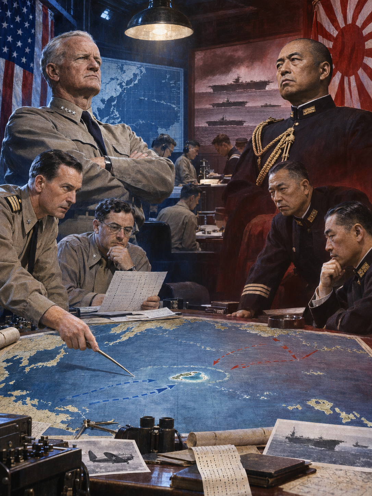

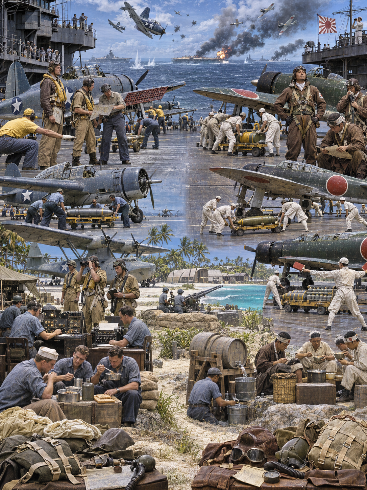

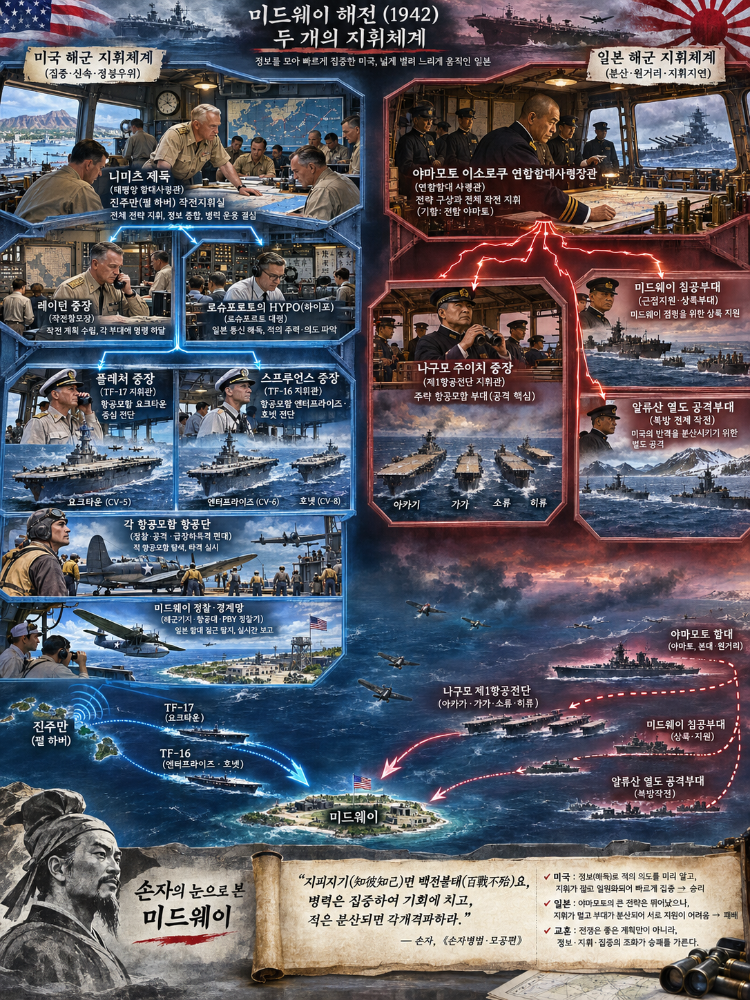

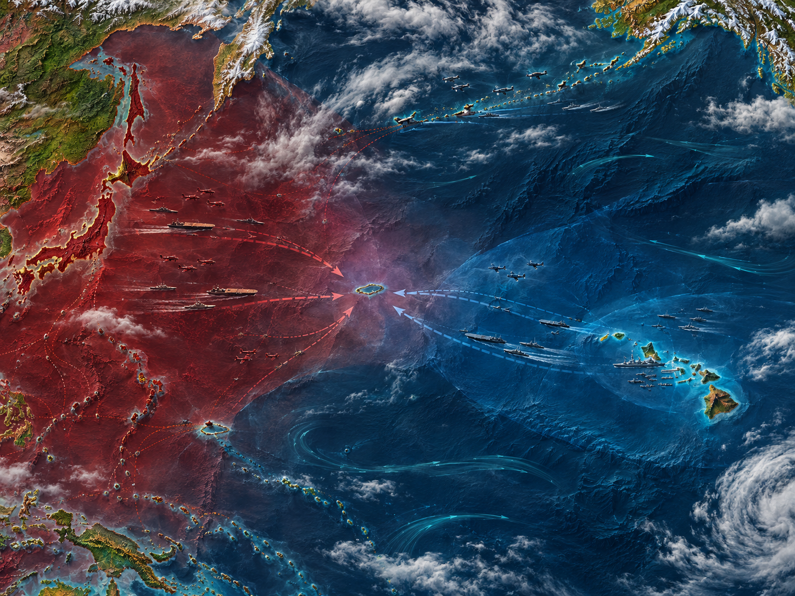

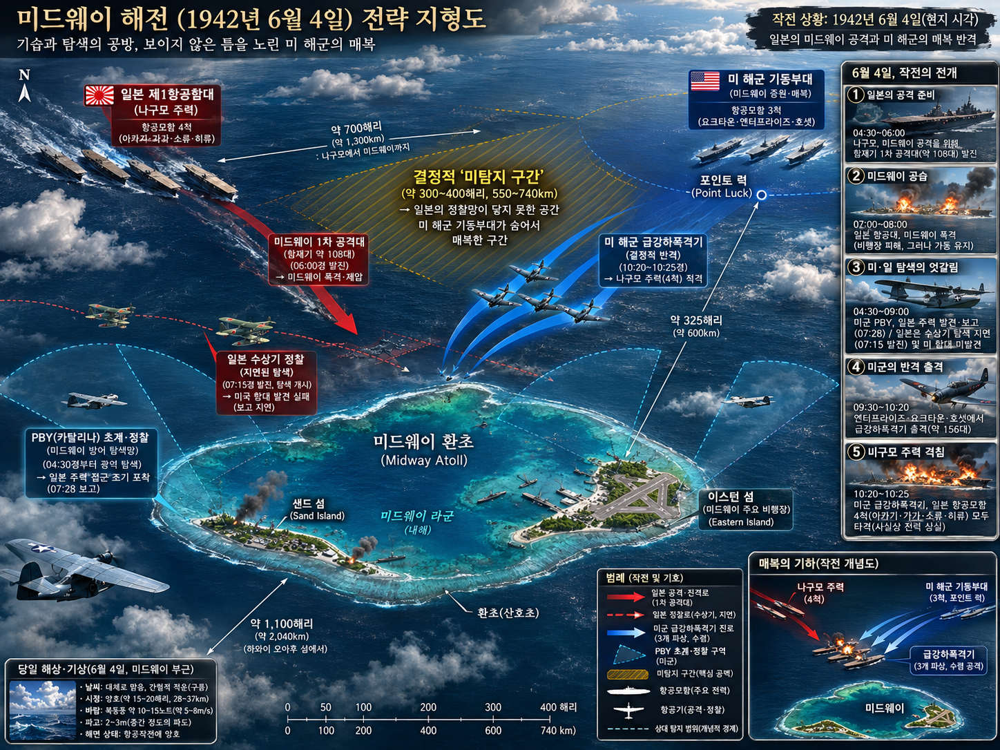

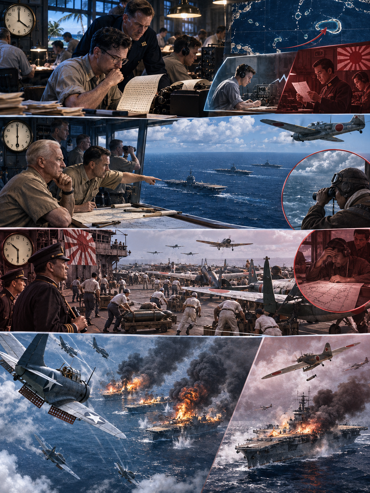

**뒤에서 반복될 지형을 먼저 잡아두기**

- 🌊 **태평양(Pacific Ocean)**: 🏛️ 일본 본토와 🇺🇸 하와이 사이의 거대한 거리 자체가 정찰·무선·연료를 전투력으로 바꾸었다. 함대를 먼저 발견한 쪽이 항공모함의 짧은 타격 창을 얻었다.
- **▰** **진주만(Pearl Harbor)**: 니미츠의 사령부와 스테이션 HYPO가 있던 출발점이다. 암호해독 결과가 함대 배치 명령으로 이어진 곳이다.
- **▰** **미드웨이 환초(Midway Atoll)**: 활주로·정찰기·잠수함을 갖춘 전초기지이자 일본군이 `AF`라 부른 목표였다. 물 부족 위장 전문은 이 목표를 확인하는 검증 실험이 되었다.
- **미드웨이 북동 해역**: **플레처**와 **스프루언스**의 항공모함 세 척이 대기한 매복 공간이다. 일본 정찰선 바깥에서 먼저 타격할 위치를 잡았다.
- **미드웨이 북서 해역**: **나구모**의 제1항공함대가 접근한 축이다. 섬 공격대와 대함 타격대 사이에서 무장을 바꾸는 동안 갑판 운용이 꼬였다.

#### 상세 전역 서사 — 암호해독에 쓴 비용이 매복 위치와 하루의 승부로 바뀌다

1942년 봄, **야마모토 이소로쿠(Isoroku Yamamoto)**는 미드웨이를 공격해 미국 항공모함을 끌어내고 격멸하려 했다. 그러나 🇺🇸 미 해군은 수개월 동안 통신감청소와 암호해독 인력을 유지했고, 진주만의 **조지프 로슈포트(Joseph Rochefort)** 팀은 일본 해군 암호 JN-25의 일부와 통신 패턴을 이어 맞추었다. `AF`가 어느 곳인지 논쟁이 남자 미드웨이에서 담수 부족을 평문으로 흘렸고, 일본 통신이 `AF`의 물 부족을 보고하면서 가설을 확인했다.

**체스터 니미츠(Chester W. Nimitz)**는 완전한 해독을 기다리지 않았다. 목표·대략의 날짜·항공모함 수라는 결정에 필요한 정보를 받아, 수리 중이던 요크타운까지 투입하고 세 항공모함을 미드웨이 북동쪽에 배치했다. 반대로 일본군은 미국 항공모함이 진주만에 있으리라는 가정과 복잡하게 분산된 작전계획에 묶였다.

6월 4일 새벽 일본군은 미드웨이를 공습했지만, 섬의 활주로와 항공전력은 완전히 제거되지 않았다. **나구모 주이치(Chuichi Nagumo)**는 대함 무장을 유지할지 섬 공격용으로 바꿀지 판단해야 했고, 정찰 보고는 늦고 불완전했다. 미국 뇌격기들의 희생적 공격은 직접 명중을 내지 못했지만 일본 전투기를 저공으로 끌어내고 진형을 흐트러뜨렸다. 이어 급강하폭격기가 도착해 아카기·가가·소류를 짧은 시간에 치명적으로 타격했다. 히류의 반격으로 요크타운도 결국 잃었으나 일본은 항공모함 네 척과 숙련 항공요원을 상실했다.

#### 전투에서 사용된 속임수 — `AF` 담수 부족 전문과 일본의 알류샨 양동

미군의 담수 전문은 무작위 거짓말이 아니라 하나의 식별 가설을 시험한 통제된 신호였다. 일본군이 그 신호를 자기 암호망에서 `AF`와 연결해 재전송하자, 미군은 목표를 확인했다. 일본의 알류샨 작전도 미국 전력을 북쪽으로 흩뜨릴 양동이었지만, 통신정보 분석은 그것이 주공이 아님을 구분했다.

#### 속임수 작동 구조

**주체와 의도.** 미군 정보팀은 `AF=미드웨이`라는 가설을 검증하고 일본 주공을 특정하려 했다.

**보인 신호와 믿은 이유.** 미드웨이가 담수 부족을 평문으로 보냈고, 일본 측은 자신들이 감청한 현지 사정을 내부 보고에 반영했다.

**유발된 행동과 결과.** 일본 암호망의 반응이 목표를 확인해 주자 니미츠는 항공모함을 매복 위치에 먼저 보냈다.

**사료의 경계.** 승리는 암호해독 하나의 자동 결과가 아니다. 정찰, 함재기 조종사의 희생, 일본 정찰 지연, 우연한 조우와 전술 판단이 함께 작용했다.

#### 속임수 일곱 질문

1. **누가 누구를 속였는가?** 미군 정보팀은 일본 통신망이 담수 전문에 반응하도록 유도했고, 일본군은 알류샨 양동으로 미국의 시선을 나누려 했다.
2. **어떤 사실이 거짓이었는가?** 계획적으로 만든 핵심 신호는 미드웨이의 긴급 담수 부족이었다.
3. **어떤 사실은 진실이지만 오해를 유도했는가?** 일본의 알류샨 공격은 실제 작전이었지만 주공처럼 보이게 배치되었다.
4. **상대는 왜 그것을 믿고 싶어 했는가?** 일본군은 미 태평양함대가 기습에 늦게 반응하리라는 작전 전제를 유지했다.
5. **속임수가 없었어도 같은 오판이 발생했을까?** 목표 추정은 가능했지만 확신과 배치 시점은 약해졌을 가능성이 높다.
6. **속은 사람은 어떤 독립 확인을 생략했는가?** 일본군은 장거리 정찰과 잠수함 경계선을 제때 완성하지 못해 미국 항공모함의 출항을 확인하지 못했다.
7. **신뢰·동의·안전을 해치지 않으면서 같은 원리를 어디서 연습할 수 있는가?** 보안 모의훈련에서 식별 가능한 시험 신호를 넣고, 한 출처가 아니라 독립 로그로 가설을 확인할 수 있다.

#### 시계편 兵者詭道也 — 이 전장에 해당하는 속이는 길

<table fit-page-width="true" header-row="true">
<tr><td>해당 구절·독음·뜻</td><td>전장의 장면</td></tr>
<tr><td>近而示之遠 근이시원 — 가까우면서 멀리 있는 듯 보임</td><td>미 항공모함은 미드웨이 북동 해역에 이미 접근했지만 일본군은 진주만에 남았으리라 판단했다.</td></tr>
<tr><td>攻其無備, 出其不意 공기무비, 출기불의 — 대비 없는 곳을 치고 뜻하지 않은 때에 나옴</td><td>미 급강하폭격기는 일본 전투기가 저공에 몰리고 항공모함 갑판 운용이 혼란한 순간을 타격했다.</td></tr>
</table>

#### 法 한눈 비교 — 곡제·관도·주용

<table fit-page-width="true" header-row="true">
<tr><td>진영</td><td>곡제(편제)</td><td>관도(지휘)</td><td>주용(보급·지속)</td></tr>
<tr><td>**미군**</td><td>미드웨이 육상항공대와 TF16·TF17을 분산 배치하되 목표를 하나로 묶었다.</td><td>니미츠의 의도 아래 플레처가 전술지휘하고 스프루언스가 기동부대를 운용했다.</td><td>진주만 수리·암호·정찰 기반을 활용해 요크타운까지 급히 복귀시켰다.</td></tr>
<tr><td>**일본군**</td><td>주력·침공·알류샨·잠수함 전력을 넓게 분산했다.</td><td>야마모토의 복잡한 계획과 나구모 현장 판단 사이 정보 지연이 컸다.</td><td>항공모함의 무장 전환과 연료·정찰 운용이 짧은 결전 창에 집중되었다.</td></tr>
</table>

#### 〈**나구모 주이치** — 패군〉

<table fit-page-width="true" header-row="true">
<tr><td>요소</td><td>판단</td></tr>
<tr><td color="orange_bg">🤝 **道**</td><td>숙련된 승조원은 강했지만 임무 변경과 정보 지연 속에서 공동 상황인식이 흔들렸다. (지기·사기)</td></tr>
<tr><td color="blue_bg">🌤️ **天**</td><td>미 항공모함 위치를 확인하지 못한 채 기존 가정을 유지했다. 불완전한 정찰 보고가 올 때 여러 가능성을 동시에 보존하지 못했다. (지피·타이밍·확률 관점)</td></tr>
<tr><td color="green_bg">🧭 **地**</td><td>광대한 해역에서 탐색 부채와 정찰 시간이 곧 생사 통로였다. 미국 매복 위치를 늦게 발견했다. (원근·광협·사생)</td></tr>
<tr><td color="purple_bg">🎖️ **將**</td><td>절차를 지켰으나 급변한 정보에 대응하는 결단이 늦었고, 섬과 함대라는 두 목표 사이에서 전환 비용을 키웠다. (지신인용엄·장유오위)</td></tr>
<tr><td color="yellow_bg">⚙️ **法**</td><td>정찰기 출발 지연, 무장 전환, 전투기 엄호가 얽혀 항공모함의 시간표가 무너졌다. (곡제·관도·주용)</td></tr>
</table>

**직관·편향 한 줄:** 미 항공모함이 아직 나타나지 않았다는 제한된 관측을 부재의 증거로 취급한 명령에는 기존 계획을 지지하는 신호를 더 무겁게 보는 **확증편향**이 작동한 것으로 볼 수 있고, 그 결과 대비 전환이 늦었다.

🏳️ **패군 측 결과**: 일본군은 지형편의 `北`(배, 적정을 헤아리지 못하고 강적과 맞서 패함)에 가까운 정보 실패를 겪고 항공모함 네 척을 잃었다.

🔀 **패군 측 회피 분기점**: 미국 항공모함의 위치를 확인할 때까지 예비 대함 타격대의 즉응성을 보존하고 정찰선을 앞당겼다면 승리를 보장할 수는 없어도 네 척이 한꺼번에 노출되는 완패 가능성은 낮출 수 있었다.

#### 〈**체스터 니미츠** — 승군〉

<table fit-page-width="true" header-row="true">
<tr><td>요소</td><td>판단</td></tr>
<tr><td color="orange_bg">🤝 **道**</td><td>워싱턴과 HYPO의 견해 차이 속에서도 현지 정보팀을 신뢰하고 함대가 쓸 수 있는 결론으로 바꾸었다. (지기·사기)</td></tr>
<tr><td color="blue_bg">🌤️ **天**</td><td>해독을 전지로 과장하지 않고 목표·날짜·규모의 범위를 사용해 유리한 확률을 높였다. 우연과 조종사 희생이 남았음을 감수했다. (지피·타이밍·확률 관점)</td></tr>
<tr><td color="green_bg">🧭 **地**</td><td>미드웨이의 정찰 반경과 북동 해역의 은폐 거리를 매복 지형으로 사용했다. (원근·광협·사생)</td></tr>
<tr><td color="purple_bg">🎖️ **將**</td><td>부하의 전문성을 믿고 제한된 정보로 기한 안에 결단했으며 현장 지휘관에게 재량을 주었다. (지신인용엄)</td></tr>
<tr><td color="yellow_bg">⚙️ **法**</td><td>암호해독·정찰·수리·항모 편제를 하나의 결정 체계로 결합했다. (곡제·관도·주용)</td></tr>
</table>

##### 法을 압축하지 않고 보기 — 곡제·관도·주용

**곡제 曲制(곡제): 부대를 어떻게 나누고 결합했는가**
<table fit-page-width="true" header-row="true">
<tr><td>진영</td><td>곡제 曲制(곡제)</td></tr>
<tr><td>**미군**</td><td>TF16·TF17과 미드웨이 육상항공대를 별도 축으로 두고 같은 일본 항모군을 압박했다.</td></tr>
<tr><td>**일본군**</td><td>항모 주력, 전함 본대, 침공대, 알류샨대를 분산해 상호지원 시간이 길어졌다.</td></tr>
</table>

**관도 官道(관도): 누가 명령하고 어떻게 전달했는가**
<table fit-page-width="true" header-row="true">
<tr><td>진영</td><td>관도 官道(관도)</td></tr>
<tr><td>**미군**</td><td>정보팀→레이턴→니미츠→플레처·스프루언스로 판단과 명령이 연결되었다.</td></tr>
<tr><td>**일본군**</td><td>분산 함대와 무선침묵 때문에 야마모토가 나구모의 전술 상황을 즉시 교정하기 어려웠다.</td></tr>
</table>

**주용 主用(주용): 군량·장비·전투 지속 능력을 어떻게 썼는가**
<table fit-page-width="true" header-row="true">
<tr><td>진영</td><td>주용 主用(주용)</td></tr>
<tr><td>**미군**</td><td>진주만 수리창이 요크타운을 급히 복구했고 섬·잠수함·초계기까지 정찰망에 넣었다.</td></tr>
<tr><td>**일본군**</td><td>장거리 작전의 연료와 함재기 무장 전환이 지속 능력과 즉응성을 제한했다.</td></tr>
</table>

🏆 **승군 측 결과**: 미군은 `以虞待不虞者勝`(이우대불우자승, 대비하여 대비하지 않은 적을 상대하는 자가 이김)을 구현했다. 정보 조직에 든 지속 비용이 하루의 배치 우위로 전환되었다.

**서양 실증 사례 출처:** [미 해군 역사유산사령부 — Battle of Midway](https://www.history.navy.mil/browse-by-topic/wars-conflicts-and-operations/world-war-ii/1942/midway.html) · [미 해군 — The Role of COMINT in the Battle of Midway](https://www.history.navy.mil/content/history/nhhc/research/library/online-reading-room/title-list-alphabetically/r/the-role-of-comint-in-the-battle-of-midway.html) · [NSA 국립암호박물관 — Battle of Midway](https://www.nsa.gov/History/National-Cryptologic-Museum/Exhibits-Artifacts/Exhibit-View/Article/2719156/world-war-2-battle-of-midway/)

### 동양 — 🏛️ 조조군 vs 🏛️ 원소군 │ 관도대전(官渡之戰, 200)

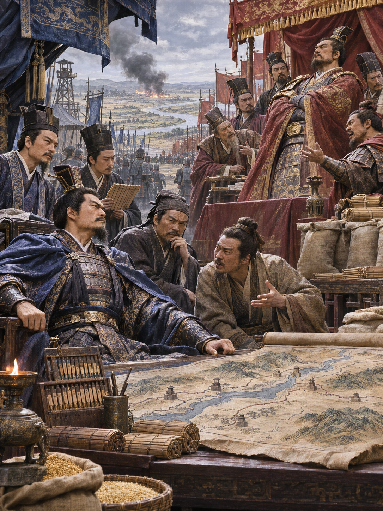

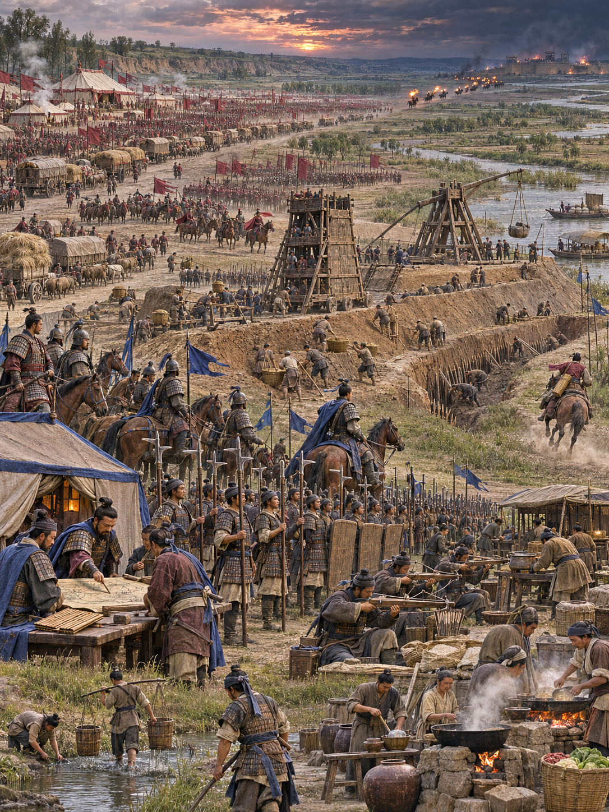

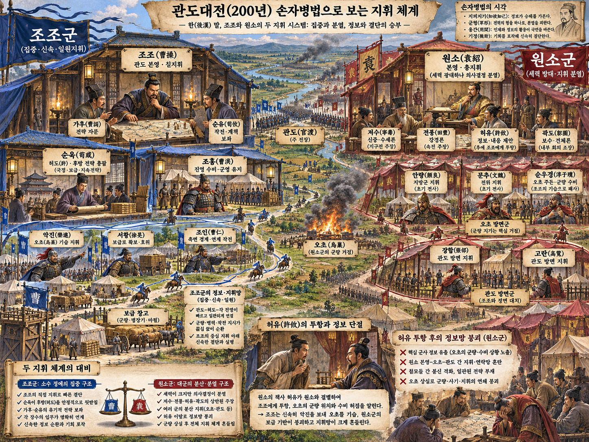

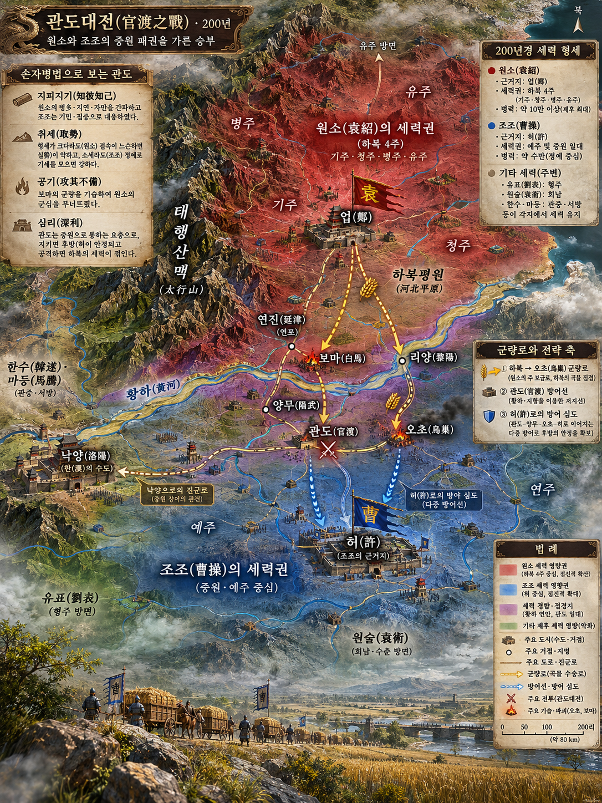

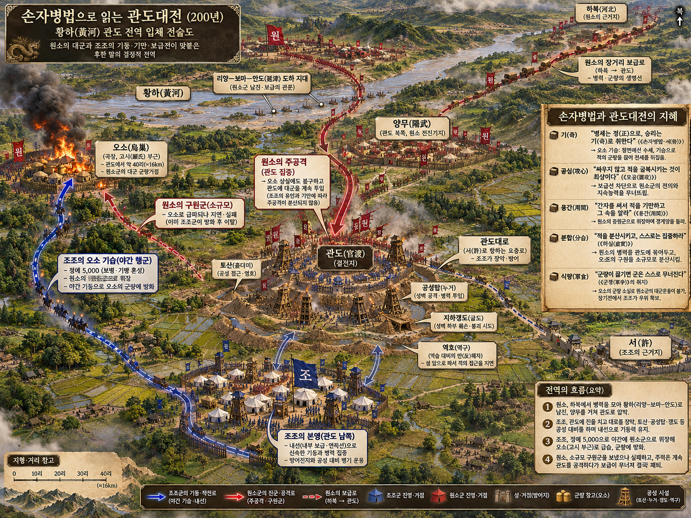

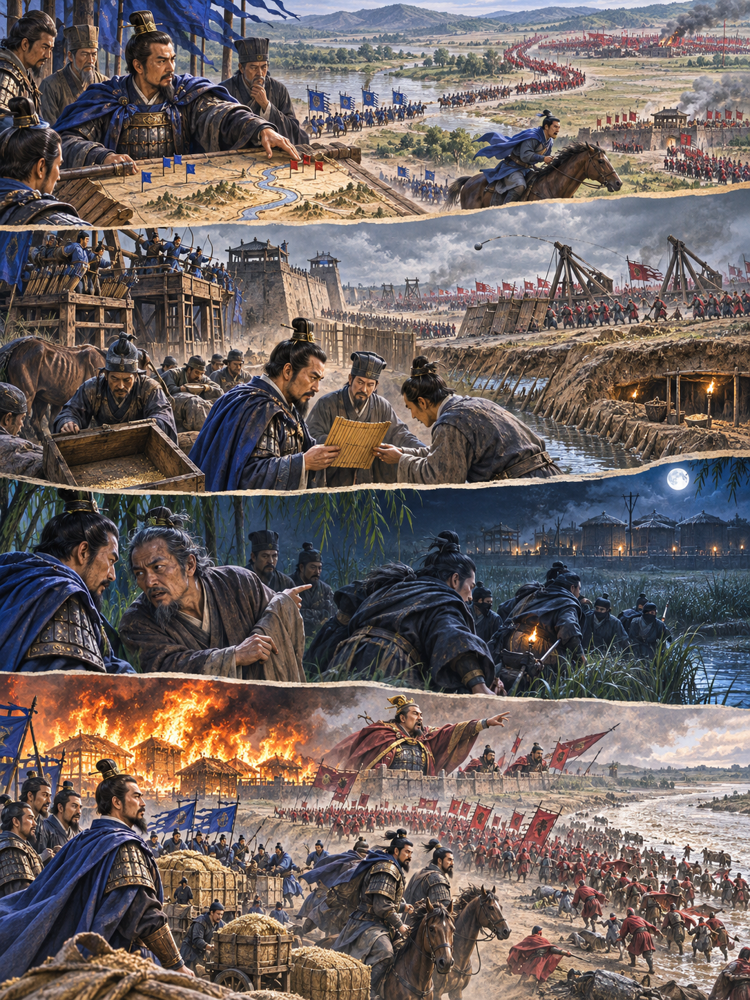

**뒤에서 반복될 지형을 먼저 잡아두기**

- 🌊 **황하(黃河)**: 하북의 **원소**가 남하할 때 건너야 하는 보급 장벽이었다. 백마·연진의 나루와 관도 전선이 연결된다.
- **▰** **관도(官渡)**: **조조**가 토루와 방책으로 버틴 주진지다. 병력 열세를 좁은 정면과 견고한 진영으로 줄였다.
- **▰** **오소(烏巢)**: **순우경**이 지킨 원소군의 군량 집적지다. 관도 본영과 떨어진 거리가 정보가 행동으로 바뀌는 시간 창을 만들었다.
- **▰** **허창(許昌)**: 헌제를 둔 조조의 정치·군수 중심지다. 관도 방어선이 무너지면 직접 위협받을 후방이었다.
- **오소로 가는 소로**: **조조**의 5천 정예가 원소군 표지를 가장하고 밤에 통과한 우회축이다.

#### 상세 전역 서사 — 허유의 정보가 오소 기습으로 전환되기까지

관도의 교착은 병력이 적고 군량이 빠듯한 **조조(曹操)**에게 시간이 불리한 싸움이었다. **원소(袁紹)**는 우세한 병력으로 토산과 누차를 운용했지만 견고한 관도 진영을 단숨에 무너뜨리지 못했다. **순유**의 건의로 서황·사환이 운송대를 먼저 습격해 보급의 취약성을 드러냈다.

결정적 정보는 **원소** 진영을 이탈한 **허유**에게서 왔다. 허유는 오소에 대량의 군량이 있고 수비가 허술하다고 알렸다. 조조의 장수 일부는 투항자의 말을 의심했지만 **순유**와 **가후**가 공격을 권했다. 조조는 조홍에게 관도 본영을 맡기고 보·기병 5천을 이끌어 밤길로 오소를 쳤다.

기습대는 원소군 증원부대로 가장하고 사람은 재갈을 물고 말의 입을 묶어 소리를 줄였다는 기록이 전한다. 오소의 군량이 불타자 원소 지휘부는 구원과 조조 본영 공격 사이에서 병력을 나누었다. **장합**과 **고람**의 관도 공격은 성과를 내지 못했고, 책임 추궁을 두려워한 두 장수가 투항하면서 원소군은 붕괴했다. 정보는 그 자체로 승리가 아니었다. 출처의 이해관계를 의심하되 시간 안에 검증하고, 정예병·위장·우회·본영 방어를 붙여 실행한 순간에 승리로 바뀌었다.

#### 전투에서 사용된 속임수 — 원소군 증원대로 가장한 오소 야습

조조의 5천 기습대는 불쏘시개를 휴대하고 밤길로 이동하면서 길에서 만난 원소군에게 “장기가 보낸 증원”이라 속였다고 전한다. 이 위장은 소수 병력이 적진 깊은 군량고에 접근할 시간을 벌었다. 그러나 허유의 투항 동기와 세부 대화는 후대 서술에서 각색되었을 가능성을 구분해야 한다.

#### 속임수 작동 구조

**주체와 의도.** 조조는 관도 정면이 아니라 오소 군량을 태워 원소군의 지속 능력과 사기를 동시에 끊으려 했다.

**보인 신호와 믿은 이유.** 야간 행군대는 원소군 표지를 쓰고 증원부대라고 답했다. 원소군도 오소 방어를 강화할 병력이 올 수 있는 상황이었다.

**유발된 행동과 결과.** 검문과 경보가 늦어졌고 조조군은 군량고 가까이 접근해 불을 놓았다. 원소의 분산 대응은 본영과 오소 어느 쪽도 구하지 못했다.

**사료의 경계.** 『삼국지』와 『자치통감』 계열은 기습의 큰 골격을 지지하지만, 병력 수·대화·잔혹행위의 세부는 기록별 차이와 후대 편집을 감안해야 한다.

#### 속임수 일곱 질문

1. **누가 누구를 속였는가?** 조조의 오소 기습대가 길목의 원소군과 오소 수비대를 속였다.
2. **어떤 사실이 거짓이었는가?** 기습대가 원소군의 증원부대라는 신분이었다.
3. **어떤 사실은 진실이지만 오해를 유도했는가?** 실제로 오소 방어가 위급해져 증원이 필요했으므로 이동 자체는 그럴듯했다.
4. **상대는 왜 그것을 믿고 싶어 했는가?** 대군을 거느린 원소 측은 후방 도로와 표지가 자기 통제 아래 있다고 기대했다.
5. **속임수가 없었어도 같은 오판이 발생했을까?** 야간 경계와 지휘 분산 때문에 침투 가능성은 있었지만 오소 가까이까지 무경보 접근하기는 어려웠을 것이다.
6. **속은 사람은 어떤 독립 확인을 생략했는가?** 이동 명령의 출처와 지휘관 신원을 본영에 재확인하지 못했다.
7. **신뢰·동의·안전을 해치지 않으면서 같은 원리를 어디서 연습할 수 있는가?** 보드게임과 보안 모의훈련에서 가짜 이동과 신원 재확인 절차를 함께 시험할 수 있다.

#### 시계편 兵者詭道也 — 이 전장에 해당하는 속이는 길

<table fit-page-width="true" header-row="true">
<tr><td>해당 구절·독음·뜻</td><td>전장의 장면</td></tr>
<tr><td>遠而示之近 원이시지근 — 멀면서 가까운 듯 보임</td><td>조조군은 적진 깊숙한 오소로 향하면서 원소군 내부의 정상 증원 이동처럼 보였다.</td></tr>
<tr><td>攻其無備, 出其不意 공기무비, 출기불의 — 대비 없는 곳을 치고 뜻하지 않은 때에 나옴</td><td>관도 정면이 아니라 떨어진 군량고를 밤에 공격했다.</td></tr>
</table>

#### 法 한눈 비교 — 곡제·관도·주용

<table fit-page-width="true" header-row="true">
<tr><td>진영</td><td>곡제(편제)</td><td>관도(지휘)</td><td>주용(보급·지속)</td></tr>
<tr><td>**조조군**</td><td>본영 방어와 5천 기습대를 분리하고 임무를 명확히 했다.</td><td>순유·가후의 판단을 받은 조조가 직접 기습대를 지휘했다.</td><td>열세한 군량 때문에 적 보급 파괴를 결전 목표로 삼았다.</td></tr>
<tr><td>**원소군**</td><td>대군과 공성장비는 강했지만 오소 후방 수비가 취약했다.</td><td>구원과 본영 공격 사이 명령이 갈리고 장합·고람에게 책임이 전가되었다.</td><td>대량 군량을 오소 한곳에 집중해 단일 실패점이 되었다.</td></tr>
</table>

#### 〈**원소** — 패군〉

<table fit-page-width="true" header-row="true">
<tr><td>요소</td><td>판단</td></tr>
<tr><td color="orange_bg">🤝 **道**</td><td>저수의 경고와 허유의 건의를 받아들이지 못하고 패전 책임이 예하 장수에게 돌아가 내부 신뢰가 무너졌다. (지기·사기)</td></tr>
<tr><td color="blue_bg">🌤️ **天**</td><td>조조군 군량이 먼저 고갈되리라는 시나리오에 집중했고, 오소 상실이라는 낮게 본 위험이 실제화될 때 대응을 나눴다. (지피·타이밍·확률 관점)</td></tr>
<tr><td color="green_bg">🧭 **地**</td><td>황하를 건넌 대군의 긴 보급선과 관도에서 떨어진 오소 사이 거리를 보호하지 못했다. (원근·험이·광협·사생)</td></tr>
<tr><td color="purple_bg">🎖️ **將**</td><td>많은 계책 가운데 일관된 우선순위를 세우지 못하고 실패 책임을 조정하지 못했다. (지신인용엄·장유오위)</td></tr>
<tr><td color="yellow_bg">⚙️ **法**</td><td>군량을 집중했으나 경계·보고·증원 절차를 그 가치에 맞게 강화하지 않았다. (곡제·관도·주용)</td></tr>
</table>

**직관·편향 한 줄:** 조조군이 먼저 소진될 것이라는 초기 전망을 붙든 채 오소 기습 가능성과 허유 이탈 신호를 낮게 본 명령에는 **확증편향과 과신**이 작동한 것으로 볼 수 있고, 구원과 본영 공격을 나눈 대응이 패배를 키웠다.

🏳️ **패군 측 결과**: 원소군은 지형편의 `亂`(란, 명령과 편제가 어지러움)과 `崩`(붕, 예하 장수가 불복·독자 행동하고 장수가 통제하지 못함)의 연쇄로 무너졌다.

🔀 **패군 측 회피 분기점**: 군량고를 분산하고 저수의 호위 강화 건의를 받아들였거나, 오소 피습 뒤 구원과 본영 공격 중 한 목표에 전력을 집중했다면 적어도 전군 붕괴는 피할 가능성이 있었다.

#### 〈**조조** — 승군〉

<table fit-page-width="true" header-row="true">
<tr><td>요소</td><td>판단</td></tr>
<tr><td color="orange_bg">🤝 **道**</td><td>교착과 군량 부족을 숨기지 않고 참모의 상반된 판단을 들은 뒤 역할을 나눴다. (지기·사기)</td></tr>
<tr><td color="blue_bg">🌤️ **天**</td><td>허유의 정보가 거짓일 가능성을 남겨 두되 순유·가후의 판단과 기존 보급 습격 경험으로 행동 가치가 더 크다고 보았다. (지피·타이밍·확률 관점)</td></tr>
<tr><td color="green_bg">🧭 **地**</td><td>관도 방책으로 정면을 묶고 오소 소로를 이용해 적의 후방 깊숙이 기동했다. (원근·험이·광협·사생)</td></tr>
<tr><td color="purple_bg">🎖️ **將**</td><td>정보의 시간가치를 알아 직접 위험을 감수하면서도 조홍에게 본영을 맡겼다. (지신인용엄)</td></tr>
<tr><td color="yellow_bg">⚙️ **法**</td><td>5천 정예·위장·불쏘시개·본영 방어를 하나의 짧은 작전으로 결합했다. (곡제·관도·주용)</td></tr>
</table>

##### 法을 압축하지 않고 보기 — 곡제·관도·주용

**곡제 曲制(곡제): 부대를 어떻게 나누고 결합했는가**
<table fit-page-width="true" header-row="true">
<tr><td>진영</td><td>곡제 曲制(곡제)</td></tr>
<tr><td>**조조군**</td><td>본영 수비대와 보·기병 5천의 기습대를 나누고, 서황의 선행 운송대 습격과 연결했다.</td></tr>
<tr><td>**원소군**</td><td>대군·공성대·오소 수비대를 두었으나 후방과 정면의 상호지원 설계가 약했다.</td></tr>
</table>

**관도 官道(관도): 누가 명령하고 어떻게 전달했는가**
<table fit-page-width="true" header-row="true">
<tr><td>진영</td><td>관도 官道(관도)</td></tr>
<tr><td>**조조군**</td><td>조조가 기습을 직접 지휘하고 조홍·순유가 관도 본영을 지키는 명령선을 세웠다.</td></tr>
<tr><td>**원소군**</td><td>순우경의 오소 수비와 장합·고람의 관도 공격이 하나의 우선순위로 통합되지 못했다.</td></tr>
</table>

**주용 主用(주용): 군량·장비·전투 지속 능력을 어떻게 썼는가**
<table fit-page-width="true" header-row="true">
<tr><td>진영</td><td>주용 主用(주용)</td></tr>
<tr><td>**조조군**</td><td>군량 열세를 인정하고 적 군량을 태워 지속 능력의 비교 자체를 뒤집었다.</td></tr>
<tr><td>**원소군**</td><td>하북에서 황하를 건넌 군량을 오소에 대량 집적해 화재 한 번에 손실이 집중되었다.</td></tr>
</table>

🏆 **승군 측 결과**: 조조군은 `識衆寡之用者勝`(식중과지용자승, 대군과 소수 병력의 쓰임을 아는 자가 이김)을 구현했다. 허유의 정보에 보상·신뢰·검증·기동을 붙여 하루의 승부로 바꾸었다.

**동양 실증 사례 출처:** [『삼국지』 위서 무제기·순유전 계열 — Chinese Text Project](https://ctext.org/sanguozhi) · [『자치통감』 권63 — Chinese Text Project](https://ctext.org/wiki.pl?if=gb&chapter=427095) · [관도대전 개요와 원전 대조](https://zh.wikipedia.org/wiki/%E5%AE%98%E6%B8%A1%E4%B9%8B%E6%88%98)
---
## 5. 핵심 통찰 + 실생활 적용 + 생활루틴

### 핵심 통찰

이 구절의 가장 날카로운 통찰은 **선지가 승리의 기술이기 전에 권한의 자격이라는 것**이다. 손자는 정보를 못 얻은 지휘관을 곧바로 무능하다고만 하지 않는다. 그런 사람은 장수도, 군주의 보좌도, 승리의 주재자도 아니라고 한다. 타인을 움직이는 권한은 그들에게 떠넘길 위험을 먼저 알아보려는 책임과 묶여 있다.

동시에 선지는 결과를 먼저 아는 능력이 아니다. 행동 전에 판단을 바꿀 사실을 찾고, 출처를 확인하고, 서로 다른 가능성을 남겨 두는 절차다. 이 절차를 거쳤어도 실패할 수 있다. 그러나 실패 가능성을 명시하고 수정 조건을 둔 결정은, 한 가지 직감에 모두를 건 결정과 다르다. **좋은 지휘는 틀리지 않는 체면보다 빨리 틀림을 발견하는 구조를 만든다.**

### 실생활 적용

3교대 현장에서 알람이나 에러가 생기면 가장 위험한 순간은 아무것도 모를 때만이 아니다. 첫 설명이 그럴듯해 모두가 이미 안다고 느끼는 순간도 위험하다. 최근의 큰 장애, 목소리가 큰 사람의 단정, 평소 문제를 일으켰던 장비 이름이 시스템 1의 첫 가설을 만든다. 그 가설을 곧바로 조치 명령으로 바꾸면 `先知`가 아니라 선입견이 움직인다.

다음 에러에서는 조치 전에 90초만 써서 네 줄을 남긴다. `확인된 사실 / 아직 모르는 것 / 가장 가능성 높은 원인과 다른 원인 하나 / 어느 증거가 조치를 바꾸는가`. 예를 들어 “A장비 고장”이라고 단정하는 대신 `02:14 A·B 알람 동시 발생은 확인 / 마지막 정상 시각 미확인 / A 단독 고장 또는 상위 통신 장애 / B 상태와 직전 변경 이력이 다르면 현장 출동 순서를 바꿈`처럼 쓴다. 이것이 현장판 선지다.

사용자의 관찰 기록에서 전씨가 복잡한 조치 때 긴장하고 말을 잘 듣지 않는 경향이 있었다는 과거 기록은 참고일 뿐, 다음 사건의 원인을 미리 판결하는 증거가 아니다. 피로·장질환 같은 민감한 정보나 성격 평가는 조치 판단에서 빼고, 실제로 누가 어떤 지시를 들었는지, 어느 버튼과 기록이 확인되었는지, 현재 응답이 있는지를 본다. **사람에 대한 기억을 사건에 대한 증거로 착각하지 않는 것**이 보좌자의 역할이다.

반대로 전씨가 책임감 때문에 먼저 움직일 때 사용자는 무조건 제지하기보다 결정 조건을 외부에 적는다. “지금 확인된 것은 A입니다. B까지 확인되면 현장 출동하고, 5분 안에 확인되지 않으면 안전 쪽으로 전환하겠습니다”라고 말한다. 이 문장은 누가 더 세게 주장했는지가 아니라 무엇이 행동을 바꾸는지를 팀이 함께 보게 한다. 조치 후에는 최초 가설과 실제 원인을 비교해 다음 교대가 사용할 기저율을 쌓는다.

이씨처럼 직위와 여러 질문으로 압박하는 사람이 나타났을 때도 즉시 상대의 의도를 단정하지 않는다. `업무 질문 / 욕설·낙인 / 실제 지시권 / 증인과 기록`을 분리한다. 확인할 사실에는 답하되, 인신공격에는 “업무 질문에는 답하겠습니다. 욕설과 낙인은 중단하고 양쪽 조장 입회 아래 계속하겠습니다”라고 경계를 세운다. 상대의 속마음을 캐는 것이 아니라 공개된 절차로 사실을 먼저 확보하는 대응이다.

개인 생활에서는 큰 구매·구독·병원 예약·근무 교환처럼 되돌리기 어려운 결정을 앞두고 적용한다. 검색을 끝없이 늘리지 말고 `결정을 바꿀 질문`을 하나 정한다. 건강·법률·안전처럼 손실이 큰 문제는 전문가나 공식 자료를 확인하고, 취향 문제는 제한 시간을 둔다. 선지는 모든 불안을 없애는 일이 아니라 **확인 가치가 큰 질문과 그냥 감수할 불확실성을 구분하는 일**이다.

카너먼의 관점에서는 한 가지 시나리오가 생생할수록 대안을 일부러 만든다. 종이에 `가설 A / 가설 B / 내가 아직 생각하지 못한 경우`를 쓰고, 각 가설을 지지하는 증거보다 반박할 증거를 먼저 한 줄씩 적는다. 최근 사건 하나의 빈도를 전체 빈도로 착각하지 않도록 지난 10건이나 가능한 전체 건수를 분모로 본다. 숫자를 알 수 없으면 “모름”이라고 쓰고 확신도를 낮춘다.

### 생활루틴

**움직이기 전에 판단을 바꿀 사실을 확인하지 않으면 재수가 없다.**

**이유:** 첫 설명을 사실로 믿고 움직이면 잘못된 출동·중복 조치·책임 공방이 이어지고, 뒤늦게 다른 원인이 드러났을 때 시간과 신뢰를 함께 잃는다. 이는 먼저 알 책임을 외면한 사람은 장수도 보좌도 승리의 주재자도 될 수 없고, 명군과 현장이 남보다 뛰어난 공을 이루는 까닭은 `先知`에 있다고 한 원리다.

오늘 첫 중요한 결정 전에 3분 타이머를 켜고 `확인된 사실 2개 / 추정 1개 / 결정을 바꿀 미확인 사실 1개`를 적는다. 미확인 사실은 당사자·공식 기록·현장 상태 중 가장 가까운 출처에서 확인한다. 제한 시간 안에 확인되지 않으면 추정을 사실처럼 말하지 말고, 되돌릴 수 있는 선택부터 실행한다.
