> 선지자, 불가취어귀신, 불가상어사, 불가험어도, 필취어인, 지적지정자야. — 당사자와 현장을 확인하지 않고 짐작만으로 결론 내리면 재수가 없다.

---
## 1. 원문 + 독음 + 직역 + 한자어 뜻풀이

先知者, 不可取於鬼神, 不可象於事, 不可驗於度, 必取於人, 知敵之情者也. 선지자, 불가취어귀신, 불가상어사, 불가험어도, 필취어인, 지적지정자야.

**직역**  
먼저 아는 것은 귀신에게서 취할 수 없고, 지나간 일에 견주어 얻을 수 없으며, 일정한 법도에 비추어 검증할 수도 없다. 반드시 사람에게서 취해야 하니, 적의 실제 사정을 아는 자를 통해서다.

	앞 구절은 밝은 군주와 어진 장수가 남보다 뛰어난 성과를 내는 까닭을 `先知`(선지, 먼저 앎)에 두었다. 이번 문장은 그 말을 신비롭게 남겨 두지 않는다. 미래를 먼저 안다는 표현에서 독자가 곧바로 떠올릴 세 가지 지름길—점복, 과거 사례의 닮은꼴, 미리 세운 척도—을 차례로 막고, 마지막에 살아 있는 사람과 현재의 적정으로 돌아오게 한다.

	그렇다고 손자가 경험·계산·규칙을 모두 버리라고 한 것은 아니다. 과거 사례와 척도는 질문을 만들고 가능성을 비교하는 데 쓸 수 있다. 다만 그것만으로 **지금 이 적이 실제로 무엇을 준비하고 어떤 사정에 놓였는지**를 확인했다고 말할 수는 없다. 지도와 표가 아무리 정교해도 현장에 닿은 보고가 없으면 모델은 현실을 대신하는 그림에 머문다.

	#### 先知(선지) — 미래를 맞히는 재주가 아니라 행동보다 먼저 현재를 확인하다

	`先`(먼저 선)은 시간상 앞에 놓인다는 뜻이고, `知`(알 지)는 대상을 분별해 판단할 수 있게 안다는 뜻이다. 두 글자가 붙으면 예언처럼 들리기 쉽지만, 문장 끝의 `知敵之情`이 그 범위를 제한한다. 알아야 할 것은 먼 미래의 운명이 아니라 **결정 시점에 아직 드러나지 않은 적의 현재 사정**이다.

	앞 구절에서 선지는 지휘권의 자격이었다. 이번 구절에서는 그 자격을 얻는 절차가 된다. 먼저 안다는 것은 남보다 빨리 단정하는 일이 아니라, 명령을 내리기 전에 무엇을 직접 확인해야 하는지 정하고 적절한 사람을 통해 그 공백을 줄이는 일이다.

	#### 鬼神(귀신 귀·귀신 신) — 설명할 수 없는 권위로 불확실성을 덮지 않다

	`鬼神`은 고대의 점복과 초월적 징조를 가리킨다. 전쟁처럼 결과가 두렵고 정보가 부족한 상황일수록 사람은 확실한 목소리를 원한다. 그러나 근거를 다시 확인할 수 없는 권위는 틀렸을 때 어디를 고쳐야 하는지도 알려 주지 못한다.

	이 구절에서 귀신을 부정하는 핵심은 종교 일반에 대한 논쟁이 아니다. **적정이라는 경험적 질문의 답을 검증 불가능한 수단에서 꺼내지 말라**는 경계다. 오늘날에는 출처 없는 확신, 권위자의 감, 근거를 보여 주지 않는 알고리즘 점수도 같은 자리를 차지할 수 있다.

	#### 象於事(상어사) — 지난 사건의 모양을 현재에 그대로 씌우지 않다

	`象`(본뜰 상)은 형상을 닮게 하고 견준다는 뜻이며, `事`(일 사)는 이미 벌어진 사건과 사례를 가리킨다. 과거는 유용하지만 두 상황이 닮아 보인다는 이유만으로 적의 현재 의도까지 같다고 할 수는 없다. 비슷한 진형, 같은 지명, 같은 조직 유형도 지휘관·목표·보급·시간이 달라지면 전혀 다른 행동을 낳는다.

	사례는 답안지가 아니라 질문 목록이어야 한다. “지난번에도 이랬다”에서 멈추면 유추가 현실을 가리고, “지난번과 무엇이 같고 무엇이 달라졌는가”라고 물으면 사례가 조사 방향을 연다. `不可象於事`는 경험을 폐기하라는 말이 아니라 **유사성을 증거로 오인하지 말라**는 뜻이다.

	#### 驗於度(험어도) — 계산이 맞는지보다 계산이 현실에 닿았는지 묻다

	`驗`(시험 험)은 대조하여 맞음을 확인하는 일이고, `度`(법도 도)는 일정한 척도·법칙·계산의 틀을 가리킨다. 전통 주석에는 천문 역수나 정해진 수리로 적정을 알아내려는 뜻까지 포함된다. 어떤 독법을 택해도 중심은 같다. 일반 법칙에 맞는다는 이유만으로 특정한 적의 사정이 확인된 것은 아니다.

	척도는 비교를 가능하게 하지만 무엇을 재지 못했는지 스스로 말해 주지 않는다. 병력 수가 같아도 피로, 명령 충돌, 보급 불안, 철수 의도는 숫자 밖에 남을 수 있다. 계산을 버리지 말되, **계산의 전제와 현장의 보고가 어긋나면 현장을 다시 조사하고 모델을 고쳐야 한다.**

	#### 必取於人(필취어인) — 사람의 말이 아니라 사람에게 닿은 증거를 얻다

	`必`(반드시 필)은 선택지가 아님을 못 박고, `取`(취할 취)는 필요한 정보를 실제로 얻어 오는 움직임을 담는다. `人`은 추상적인 대중이 아니라 적의 형편을 직접 보았거나 그 안에 접근할 수 있는 구체적인 사람이다. 이어지는 용간편의 다섯 간첩 유형은 바로 이 접근 경로를 제도화한다.

	하지만 사람에게서 얻는다고 해서 들은 말을 곧 사실로 삼는 것은 아니다. 사람은 기억을 틀릴 수 있고, 이해관계 때문에 꾸밀 수 있으며, 일부만 보고 전체를 추정할 수 있다. 따라서 접근 범위·직접 관찰과 전언·동기·시점·다른 출처와의 일치를 따져야 한다. `必取於人`은 사람을 무조건 믿으라는 말이 아니라 **현실에 닿는 출처를 확보하고 그 출처까지 평가하라**는 명령이다.

	#### 情(뜻 정) — 겉모습 뒤에서 실제로 움직이는 사정

	`情`은 감정만을 뜻하지 않는다. 이 문맥에서는 적의 실정, 곧 겉으로 보이는 형세 아래의 실제 상태와 의도를 가리킨다. 병력의 위치만이 아니라 누가 명령하는지, 무엇이 부족한지, 어떤 갈등과 제약이 있는지, 다음 선택을 바꿀 조건이 무엇인지가 모두 적정에 들어간다.

	그래서 정보 수집의 목표는 남의 사생활을 많이 아는 데 있지 않다. 현재 결정과 관계없는 세부 정보는 쌓여도 `情`이 되지 않는다. **어떤 사실이 아군의 행동을 바꾸는가**를 먼저 정하고, 그 질문에 답할 수 있는 사람과 기록을 찾을 때 정보가 판단으로 바뀐다.

	#### 글자들이 완성하는 한 장면

	지휘관은 아직 보이지 않는 적정을 `先知`해야 한다. 불안하다고 `鬼神`의 확언에 기대지 않고, 과거 `事`의 모양을 오늘에 그대로 베끼지 않으며, 고정된 `度`에 맞았다는 이유로 확인을 끝내지도 않는다. 세 길이 막힌 뒤에야 `必`이라는 강한 말이 나온다. 현실에 닿은 `人`에게서 정보를 `取`하고, 그 접근과 동기와 시점을 따져 비로소 적의 `情`을 안다.

	이 흐름은 직관과 모델을 적으로 만들지 않는다. 직관은 질문을 빨리 만들고, 사례는 가능한 패턴을 넓히며, 척도는 비교를 돕는다. 다만 셋 모두 현장 확인을 대신하지 못한다. **가설은 머리에서 만들 수 있지만, 결론은 현실과 접촉한 증거가 고쳐 쓰게 해야 한다.**

---
## 2. 전통 주석 기반 분석

- **조조(曹操)** — “먼저 안다는 말을 점복으로 꾸미지 마라. **반드시 간첩에게서 적의 실정을 얻어 움직여라.**”
- **이전(李筌)** — “귀신과 재이로 승부를 묻지 마라. **사람의 일을 사람에게 물어 실제 형편을 밝혀라.**”
- **두목(杜牧)** — “지나간 일을 끌어와 오늘의 적을 단정하지 마라. **시세와 인사가 이미 달라졌으니 현재의 보고를 취하라.**”
- **매요신(梅堯臣)** — “예전의 성공을 본떠도 지금의 속마음은 알 수 없다. **적진에 닿은 사람에게 허실을 확인하라.**”
- **장예(張預)** — “천문과 역수의 일정한 법칙으로 적정을 증명하려 하지 마라. **움직이는 정세는 살아 있는 정보로 살펴야 한다.**”
- **왕석(王晳)** — “`事`는 이미 지나간 자취이고 `情`은 지금 변하는 실상이다. **자취를 실상으로 바꾸어 읽지 마라.**”
- **가림(賈林)** — “사람에게서 취했다는 이유만으로 모두 믿지 마라. **접근한 곳과 전해진 경로를 따져 참과 거짓을 가려라.**”
- **두우(杜佑)** — “사례와 법도는 참고가 될 뿐 적진 안의 일을 대신 말하지 못한다. **사람을 쓰되 여러 보고로 서로 증험하라.**”
- **진호(陳皞)** — “먼저 안다는 것은 신묘한 술법이 아니다. **적의 사정을 아는 자를 찾아 제대로 묻고 판단에 쓰라.**”

#### 리링의 고증과 현대적 독법

리링의 해설 취지를 따라 문장 구조를 보면 세 개의 부정문이 먼저 나온다. `鬼神`은 초월적 계시, `事`는 지나간 사례, `度`는 일정한 척도와 법칙이다. 셋은 서로 다른 지식의 원천처럼 보이지만 공통점이 있다. **지금 적진 안에서 변하는 구체적 사정과 직접 접촉하지 않는다.** 마지막의 `必取於人`은 그래서 단순한 네 번째 선택지가 아니라 앞의 세 지름길을 폐기한 뒤 남는 필수 조건이다.

`不可象於事`를 과거에서 배우지 말라는 반역사주의로, `不可驗於度`를 계산과 통계를 버리라는 반지성주의로 읽으면 문맥이 무너진다. 손자는 「시계편」에서 오사를 비교하고 다산을 중시했으며, 여러 편에서 거리·시간·병력·지형을 계산한다. 여기서 부정되는 것은 사례와 척도의 보조 기능이 아니라, 그것만으로 특정한 적의 `情`을 이미 안다고 하는 비약이다.

또한 현대의 `사람에게서 취함`을 동료 감시나 사생활 탐문으로 옮겨서는 안 된다. 고대 군사 정보의 맥락과 현대 직장의 법·윤리·개인정보 조건은 다르다. 오늘의 정당한 적용은 업무상 필요한 범위에서 당사자의 설명, 현장 기록, 책임자의 지시, 센서·로그를 함께 확인하고 오류 정정의 기회를 보장하는 것이다. 사람은 현실에 이르는 통로이지만, 그 사람 역시 오류와 이해관계를 지닌다는 점까지 포함해야 한다.

---
## 3. 교차 설명

### ① 손자병법 내 교차

앞 구절의 `所以動而勝人, 成功出於衆者, 先知也`(소이동이승인, 성공출어중자, 선지야 — 움직여 남을 이기고 남보다 뛰어난 공을 이루는 까닭은 먼저 알기 때문이다)는 이번 문장의 질문이다. 이번 구절은 그 답을 `必取於人, 知敵之情者也`로 준다. 선지는 행동보다 먼저 성립하지만, 미래에 대한 점괘가 아니라 **현재 적정에 관한 검증 가능한 보고**다.

「모공편」의 `知彼知己, 百戰不殆`(지피지기, 백전불태 — 적을 알고 나를 알면 백 번 싸워도 위태롭지 않다)는 널리 알려진 결론이다. 용간편은 `知彼`가 어떻게 가능한지를 더 엄격하게 묻는다. 적을 안다고 말하기 전에 정보가 귀신의 권위, 역사적 유추, 고정 척도의 자동 결론인지, 아니면 실제 적정에 접근한 출처에서 나왔는지를 구분해야 한다.

「시계편」의 `經之以五事, 校之以計, 而索其情`(경지이오사, 교지이계, 이색기정 — 다섯 일로 헤아리고 계산으로 비교하여 그 실정을 찾는다)은 `不可驗於度`와 긴장 속에서 이어진다. 계산은 `情`을 찾는 질문을 만들지만, 계산표 자체가 `情`은 아니다. 道·天·地·將·法이라는 틀로 정보 공백을 발견하고, 사람에게서 얻은 현장 정보로 그 틀을 갱신해야 한다.

### ② 클라우제비츠 『전쟁론』

클라우제비츠의 전쟁의 안개와 마찰은 왜 귀신·사례·척도 어느 하나도 확실한 선지를 보장하지 못하는지 설명한다. 보고는 늦고 모순되며, 행위자는 두려움과 기대 속에서 정보를 해석한다. 따라서 사람에게서 온 정보도 깨끗한 현실의 복사본이 아니라 불확실성을 품은 자료다.

두 사상은 불확실성 속의 판단을 다루지만 초점이 다르다. 클라우제비츠는 불완전한 보고 속에서도 중심을 잃지 않는 지휘관의 판단과 결단을 강조하고, 손자는 그 결단 전에 적정에 접근할 사람을 확보해야 한다고 못 박는다. 이를 합치면 보고가 불완전하다는 이유로 직감만 따르지도, 완전한 확실성을 기다리며 멈추지도 않는다. **출처의 접근성과 신뢰도를 표시하고, 판단을 바꿀 새 정보가 오면 계획을 수정한다.**

전략과 전술도 구분해야 한다. 현장 정보가 특정 부대의 위치를 정확히 알려 주어도 전쟁의 정치 목적이 잘못되었다면 전술적 앎이 전략적 성공을 만들지 못한다. 사람에게서 얻은 적정은 수단의 효율을 높일 뿐, 목적의 정당성과 비용을 대신 결정하지 않는다.

### ③ 미야모토 무사시 『오륜서』

『오륜서』의 `觀見二眼`(관견이안 — 넓게 꿰뚫어 보는 눈과 가까이 세밀하게 보는 눈)은 `度`와 `人`의 관계를 이해하게 한다. 넓은 `觀`은 전체 형세와 여러 가능성을 놓치지 않게 하고, 가까운 `見`은 지금 눈앞에서 실제로 달라진 징후를 붙잡는다. 어느 한쪽만으로는 선지가 되지 않는다.

무사시의 `拍子`(효시, 박자·리듬)도 정보의 시효를 드러낸다. 사람에게서 정확한 보고를 받아도 행동할 때 이미 상황이 바뀌었다면 쓸 수 없다. 보고에는 관찰 시각과 전달 지연을 붙이고, 어느 시점이 지나면 다시 확인할지를 정해야 한다.

그러나 숙련자의 눈과 국가·조직의 정보 체계를 같은 것으로 볼 수는 없다. 개인의 관견은 빠르지만 최근 경험이나 성공 사례에 고정될 수 있다. 중요한 결정일수록 한 사람의 감각을 존중하되 다른 관찰자·기록·반대 가설과 대조해야 한다.

### ④ 오자병법·육도삼략

『오자병법』의 `內修文德, 外治武備`(내수문덕, 외치무비 — 안으로 문덕을 닦고 밖으로 무비를 다스린다)는 적정 수집만으로 승리가 완성되지 않음을 보완한다. 밖의 적을 정확히 알아도 안의 지휘가 보고자를 벌하고 불편한 사실을 묻어 버리면 정보는 행동으로 이어지지 않는다. 사람에게서 취하려면 먼저 사람이 사실을 말할 수 있는 조직을 만들어야 한다.

오자는 장수가 병사의 능력과 형편을 알고 임무와 상벌을 맞추어야 한다고 본다. 이는 `知敵之情`과 짝을 이루는 지기다. 적의 약점을 알려 주는 보고가 와도 아군의 피로·장비·권한을 모르면 실행 가능성을 잘못 계산한다.

『육도』는 현자를 얻고 여러 경로로 사정을 들으며 군주가 듣기 좋은 말에 갇히지 않는 통치 기반을 중시한다. 한 출처가 실제로 접근했는지, 다른 출처와 독립적인지, 보상 때문에 같은 이야기를 반복하는지 살펴야 한다. 여러 사람이 말한다고 여러 증거가 되는 것은 아니다.

고대 병법의 용간을 현대 생활에 옮길 때에는 법적·윤리적 경계를 세워야 한다. 개인정보를 몰래 캐거나 소문을 모으는 것은 `必取於人`의 책임 있는 적용이 아니다. 업무상 필요한 최소 정보, 정당한 권한, 당사자 확인, 기록 보존, 반론과 정정 기회가 갖춰져야 한다.

### ⑤ 현대 심리학·군사학

미 중앙정보국의 분석기법 지침은 판단의 신뢰도가 정보 기반의 정확성과 신뢰성에 달려 있으므로 출처의 품질을 계속 점검해야 한다고 설명한다. 특히 사람 출처는 그 사람의 접근 범위, 제공 동기, 보고가 만들어진 조건을 검토해야 한다. 여러 출처가 있다는 사실은 좋은 정보 하나를 꼼꼼히 평가하는 일을 대신하지 못한다. 이는 `取於人`을 단순한 인원수 경쟁이 아니라 **사람이 무엇을 실제로 알 수 있었는지 평가하는 과정**으로 읽게 한다. [CIA, *A Tradecraft Primer*](https://www.cia.gov/resources/csi/static/Tradecraft-Primer-apr09.pdf)

미 육군의 작전환경정보준비 교리는 적·지형·날씨·민간 요소가 작전에 미칠 영향을 평가해 불확실성을 줄이되, 그 결론을 작전 내내 새 정보로 계속 정제해야 한다고 한다. 사람의 보고, 지형 자료, 기술 정보는 서로 대체하는 경쟁자가 아니라 하나의 상황 이해를 계속 고치는 입력이다. [U.S. Army, ATP 2-01.3](https://rdl.train.army.mil/catalog-ws/view/100.ATSC/A9FDC58E-ADD6-4436-9F79-D48C0D2582C8-1415825546954/ATP2_01x3wc3.pdf)

심리학적으로 `象於事`의 위험은 대표성 휴리스틱과 한 가지 시나리오 집중에서 선명해진다. 과거의 생생한 사건과 닮았다는 이유로 같은 원인·결과의 확률을 높게 잡으면 기저율과 다른 가능한 설명을 놓친다. 사용자의 「생각에대한 생각」 메모처럼 `고장 / 조작 미숙 / 통신 지연 / 센서 오류 / 실제 공격`처럼 가능한 시나리오를 나누고, 각각 무엇을 관찰하면 구별되는지 정해야 한다.

다만 “사람에게 물었다”는 사실만으로 편향이 사라지지 않는다. 질문 방식이 답을 유도할 수 있고, 같은 소문을 들은 여러 사람이 독립된 출처처럼 보일 수 있으며, 권위가 높은 사람의 말이 과대평가될 수 있다. 출처의 접근 범위와 독립성, 관찰 시각, 이해관계, 반증 자료를 함께 기록해야 귀신의 권위를 사람의 권위로 바꾸는 데서 멈추지 않는다.

---
## 4. 역사적 실증 사례

### 서양 — 🇺🇸·🇬🇧 연합군 vs 🏛️ 나치 독일군 │ 노르망디 상륙과 포티튜드(Operation Fortitude & Normandy, 1944)

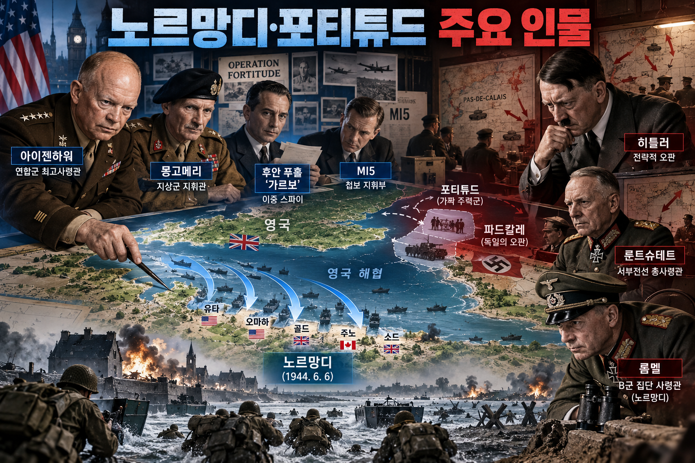

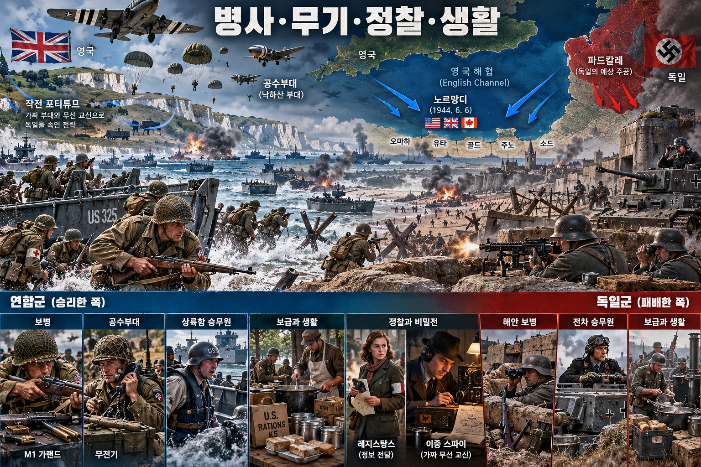

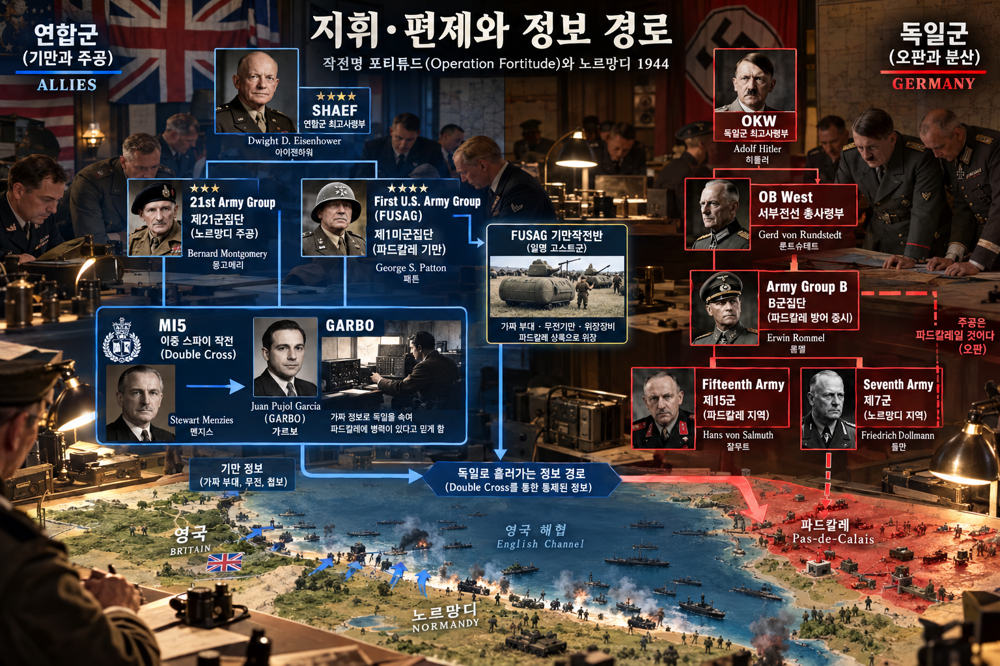

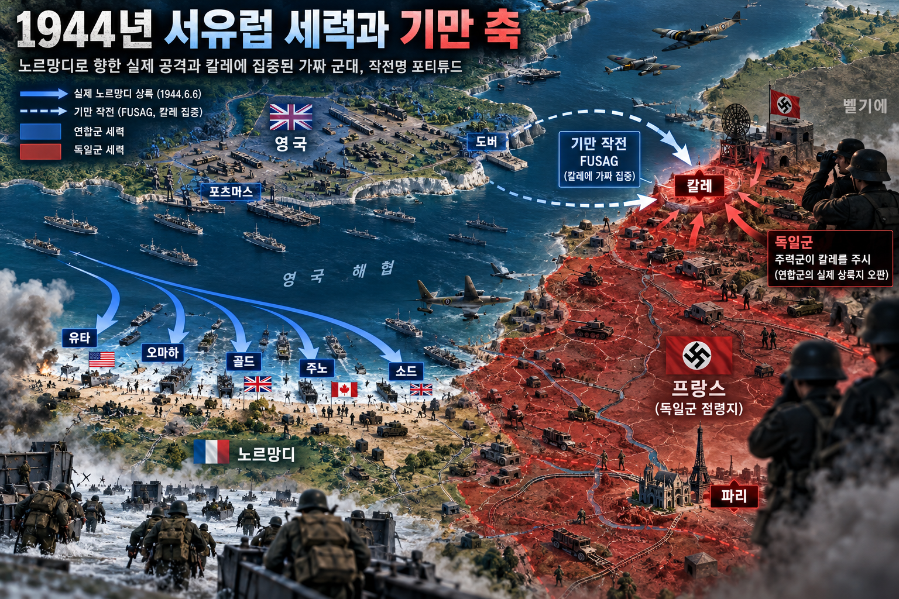

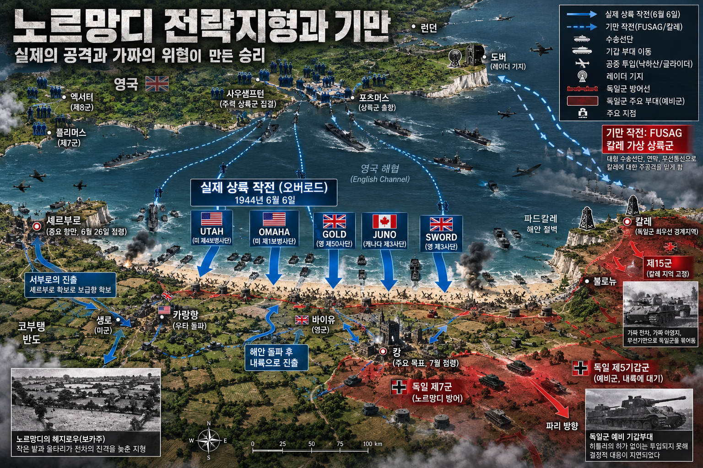

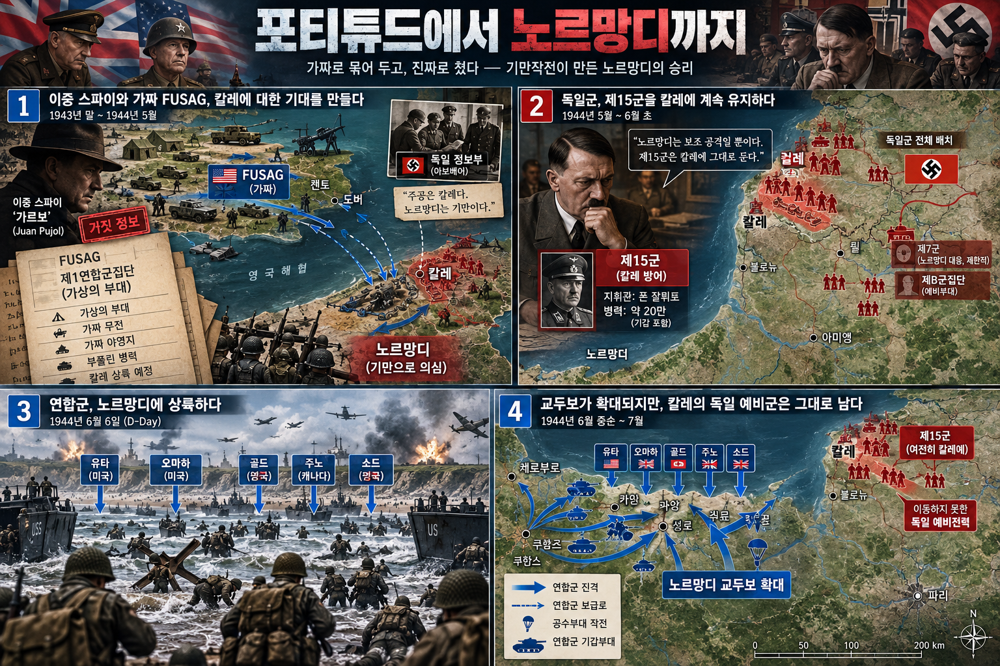

**뒤에서 반복될 지형을 먼저 잡아두기**

- 🇬🇧 **영국 남동부**는 실제 상륙군이 출항한 남부 항만과 가상의 제1미군집단(FUSAG)이 꾸며진 도버 방면을 동시에 품었다. 독일 정찰이 본 실제 집결과 가짜 무선·장비가 한 그림 안에 섞였다.
- 🌊 **영국해협(English Channel)**은 가장 짧은 도버–칼레 축을 상식적인 침공로처럼 보이게 했지만, 실제 함대는 더 서쪽의 노르망디로 건넜다.
- **▰** **파드칼레(Pas-de-Calais)**는 독일 제15군이 붙들린 예상 주공 지점이었다. 이 예비대가 즉시 빠져나오면 노르망디 교두보가 훨씬 위험해졌다.
- **▰** **노르망디(Normandy)**의 유타·오마하·골드·주노·소드 해안은 실제 상륙 지점이었다. 해안 뒤 보카주와 도로 병목 때문에 상륙 성공 뒤에도 증원이 중요했다.
- **▰** **셰르부르(Cherbourg)**와 **▰** **캉(Caen)**은 항만·도로망 확보의 핵심이었다. 독일 예비대가 늦게 움직인 시간은 연합군이 교두보를 넓힐 시간을 주었다.

#### 상세 전역 서사 — 통제된 사람 출처가 독일의 ‘칼레가 주공’이라는 모델을 굳히다

**아이젠하워**의 연합군은 대규모 함대와 상륙 준비를 완전히 숨길 수 없었다. 그래서 존재 자체를 감추기보다 **어디가 주공인가**를 틀리게 읽도록 만들었다. 영국 방첩기관은 독일이 영국에 보낸 요원 대부분을 체포하거나 통제했고, 이중간첩망을 통해 사실과 거짓을 섞은 보고를 보냈다. **후안 푸홀 가르시아(Juan Pujol García, GARBO)**는 독일이 실재한다고 믿은 가상 하부 요원망의 보고를 축적해 신뢰를 만들었다.

포티튜드 사우스는 도버 맞은편 **▰** **파드칼레(Pas-de-Calais)**가 가장 짧은 해협이라는 지리적 상식, **패튼**의 명성, 가짜 무선량과 모형 장비를 하나의 이야기로 묶었다. 6월 6일 실제 상륙이 시작된 뒤에도 **가르보**는 노르망디가 양동이고 주공은 아직 칼레로 온다는 취지의 보고를 독일에 전달했다. 독일 지휘부는 이 말을 단독으로 믿은 것이 아니라, 이미 세워 둔 ‘칼레 주공’ 가설과 다른 기만 신호가 서로 맞는다고 보았다.

그 결과 **히틀러**와 독일 최고지휘부는 **룬트슈테트**·**롬멜**이 맞닥뜨린 노르망디 현장과 떨어진 채 예비대를 분산했다. 제15군의 상당 전력은 칼레 방면에 남았다. 노르망디의 독일 제7군은 실제 상륙을 보고도 그것이 전체 침공의 중심인지 확신하지 못했고, 연합군은 해안 교두보를 연결하고 증원을 쌓을 시간을 얻었다.

#### 전투에서 사용된 속임수 — 믿을 만한 사람 출처에 가짜 주공을 실어 보내다

속인 주체는 연합군 기만기획부와 영국의 이중간첩 체계였고, 실제 의도는 노르망디 상륙이었다. 독일에는 가상의 FUSAG, 도버 일대 집결, 칼레 주공 보고를 보였다. 독일이 이를 믿은 이유는 칼레의 지리적 개연성과 **패튼**에 대한 기대, 그리고 오랜 기간 정확한 일부 정보를 섞어 신뢰를 쌓은 사람 출처가 결합했기 때문이다.

#### 속임수 작동 구조

**주체와 의도.** 연합군은 노르망디의 실제 주공을 보호하고 독일 예비대를 칼레에 묶으려 했다.

**보인 신호와 믿은 이유.** 가상 군집단·무선·모형 장비와 이중간첩 보고가 칼레라는 기존 예상에 맞아떨어졌다.

**유발된 행동과 결과.** 독일 제15군이 칼레에 남고 노르망디 증원이 지연되어 연합군 교두보의 생존 확률이 높아졌다.

**사료의 경계.** 노르망디 승리를 기만 하나로 환원할 수 없다. 제공권·해군력·병참·현장 전투와 독일 지휘구조의 제약도 함께 작용했다.

#### 속임수 일곱 질문

1. **누가 누구를 속였는가?** 연합군 기만조직과 통제된 이중간첩들이 독일 정보기관과 최고지휘부를 속였다.
2. **어떤 사실이 거짓이었는가?** FUSAG의 실전 전력과 칼레 주공 계획이 거짓이었다.
3. **어떤 사실은 진실이지만 오해를 유도했는가?** 연합군이 영국에 대군을 모았고 **패튼**이 유력 지휘관이라는 사실은 참이었지만, 그 의미는 조작됐다.
4. **상대는 왜 그것을 믿고 싶어 했는가?** 최단 해협과 좋은 항만이라는 기존 모델에 부합했고, 익숙한 사람 출처가 반복해 확인해 주었다.
5. **속임수가 없었어도 같은 오판이 발생했을까?** 칼레의 지리 때문에 가능성은 있었지만, 상륙 뒤까지 예비대를 붙든 기간은 짧아졌을 가능성이 높다.
6. **속은 사람은 어떤 독립 확인을 생략했는가?** 노르망디 현장 보고가 기존 칼레 가설을 깨는지 신속히 재평가하지 못했다.
7. **신뢰·동의·안전을 해치지 않으면서 같은 원리를 어디서 연습할 수 있는가?** 워게임과 보안 모의훈련에서 가설별 독립 확인 항목을 정해 연습할 수 있다.

#### 시계편 兵者詭道也 — 이 전장에 해당하는 속이는 길

<table fit-page-width="true" header-row="true">
<tr>
<td>해당 구절·독음·뜻</td>
<td>전장의 장면</td>
</tr>
<tr>
<td>近而示之遠 
근이시지원 — 가까우면서 멀리 있는 듯 보인다</td>
<td>실제 노르망디 공격을 숨기고 칼레를 주공처럼 보였다.</td>
</tr>
<tr>
<td>攻其無備, 出其不意 
공기무비, 출기불의 — 대비하지 않은 곳을 치고 뜻하지 않은 데서 나온다</td>
<td>독일이 주공을 기다린 칼레가 아니라 노르망디에 대규모 상륙했다.</td>
</tr>
</table>

#### 法 한눈 비교 — 곡제·관도·주용

<table fit-page-width="true" header-row="true">
<tr>
<td>진영</td>
<td>곡제(편제)</td>
<td>관도(지휘)</td>
<td>주용(보급·지속)</td>
</tr>
<tr>
<td>
**연합군**
</td>
<td>상륙군·공수군·해공군과 기만조직을 분업했다.</td>
<td>SHAEF 아래 실제 작전과 기만 정보가 조정됐다.</td>
<td>멀버리 항과 해상 수송으로 교두보를 지속했다.</td>
</tr>
<tr>
<td>
**독일군**
</td>
<td>제7군과 제15군이 떨어져 있었고 기갑 예비대 권한이 갈렸다.</td>
<td>현장·서부전선·최고지휘부의 권한 충돌로 대응이 늦었다.</td>
<td>연합군 제공권과 철도·도로 타격으로 증원과 보급이 지연됐다.</td>
</tr>
</table>

#### **독일군 (패군)**

<table fit-page-width="true" header-row="true">
<tr>
<td>요소</td>
<td>판단</td>
</tr>
<tr>
<td color="orange_bg">🤝 **道**</td>
<td>현장 지휘관과 최고지휘부가 예비대 운용에 뜻을 모으지 못했다. (지기·결속)</td>
</tr>
<tr>
<td color="blue_bg">🌤️ **天**</td>
<td>사람 출처의 신뢰 이력과 칼레 기저 가설을 과대평가하고 노르망디의 새 증거로 확률을 갱신하지 못했다. (지피·타이밍·확률 관점)</td>
</tr>
<tr>
<td color="green_bg">🧭 **地**</td>
<td>최단거리인 칼레의 이점이 실제 상륙지 선택을 결정한다고 보아 노르망디 해안과 보카주의 작전 가치를 늦게 읽었다. (원근·험이·광협)</td>
</tr>
<tr>
<td color="purple_bg">🎖️ **將**</td>
<td>
**히틀러**·**룬트슈테트**·**롬멜** 사이 권한 분산이 결단 속도를 떨어뜨렸다. (지신인용엄)</td>
</tr>
<tr>
<td color="yellow_bg">⚙️ **法**</td>
<td>해안군·기갑예비대·제15군을 하나의 반격 체계로 결합하지 못했다. (곡제·관도·주용)</td>
</tr>
</table>

**직관·편향 한 줄:** 노르망디 상륙 뒤에도 칼레 주공을 기다린 명령은 기존 가설과 맞는 이중간첩 보고를 더 무겁게 본 확증편향이 작동한 것으로 볼 수 있으며, 예비대 전환을 늦췄다.

🏳️ **패군 측 결과** — 독일군은 六敗의 `亂`(란, 지휘와 명령 체계가 어지러움)에 가까웠다. 🔀 **패군 측 회피 분기점**은 6월 6일 이후 칼레 가설을 임시 보류하고 노르망디 현장 증거를 독립 평가해 일부 예비대를 조기에 전환하는 것이었다.

#### **연합군 (승군)**

<table fit-page-width="true" header-row="true">
<tr>
<td>요소</td>
<td>판단</td>
</tr>
<tr>
<td color="orange_bg">🤝 **道**</td>
<td>다국적군과 정보기관이 실제 작전과 기만의 목적을 공유했다. (지기·결속)</td>
</tr>
<tr>
<td color="blue_bg">🌤️ **天**</td>
<td>독일의 믿음을 확정 사실로 보지 않고 감청과 이중간첩 반응으로 기만 효과를 계속 확인했다. (지피·타이밍·확률 관점)</td>
</tr>
<tr>
<td color="green_bg">🧭 **地**</td>
<td>칼레의 명백한 원근 이점을 미끼로 삼고 노르망디의 다섯 해안을 실제 진입구로 열었다. (원근·광협·사생)</td>
</tr>
<tr>
<td color="purple_bg">🎖️ **將**</td>
<td>
**아이젠하워**는 해공군·상륙군·정보조직의 역할을 통합했다. (지신인용엄)</td>
</tr>
<tr>
<td color="yellow_bg">⚙️ **法**</td>
<td>기만·상륙·공수·해상보급을 시간표에 맞춰 결합했다. (곡제·관도·주용)</td>
</tr>
</table>

🏆 **승군 측 결과** — 연합군은 五勝의 `以虞待不虞者勝`(이우대불우자승, 대비한 채 대비하지 못한 적을 상대하는 자가 이긴다)에 해당했다.

##### 法을 압축하지 않고 보기 — 곡제·관도·주용

**곡제 曲制(곡제): 부대를 어떻게 나누고 결합했는가**
<table fit-page-width="true" header-row="true">
<tr>
<td>진영</td>
<td>실제 운용</td>
</tr>
<tr>
<td>
**연합군**
</td>
<td>다섯 해안 상륙부대, 공수부대, 함대·항공군과 별도의 기만조직을 공동 시간표로 결합했다.</td>
</tr>
<tr>
<td>
**독일군**
</td>
<td>제7군·제15군·기갑예비대가 지역과 권한별로 갈려 주공 판단 변화에 빠르게 재편되지 못했다.</td>
</tr>
</table>

**관도 官道(관도): 누가 명령하고 어떻게 전달했는가**
<table fit-page-width="true" header-row="true">
<tr>
<td>진영</td>
<td>실제 운용</td>
</tr>
<tr>
<td>
**연합군**
</td>
<td>SHAEF가 작전 보안을 유지하며 해·공·지상군과 이중간첩 메시지를 조정했다.</td>
</tr>
<tr>
<td>
**독일군**
</td>
<td>현장군·OB West·최고지휘부 사이에서 기갑 투입 권한과 주공 판단이 갈렸다.</td>
</tr>
</table>

**주용 主用(주용): 군량·장비·전투 지속 능력을 어떻게 썼는가**
<table fit-page-width="true" header-row="true">
<tr>
<td>진영</td>
<td>실제 운용</td>
</tr>
<tr>
<td>
**연합군**
</td>
<td>수송선·상륙정·멀버리 항·해저 송유관과 제공권을 통해 병력과 물자를 계속 투입했다.</td>
</tr>
<tr>
<td>
**독일군**
</td>
<td>철도·도로망이 공습을 받아 증원과 보급이 느렸고, 칼레에 남은 전력은 노르망디에서 즉시 쓰이지 못했다.</td>
</tr>
</table>

출처: [영국 국립문서보관소 — Operation Overlord and D-Day](https://www.nationalarchives.gov.uk/explore-the-collection/explore-by-time-period/second-world-war/operation-overlord-and-d-day/) · [영국 국립문서보관소 — Double Agent Operations](https://www.nationalarchives.gov.uk/double-agent-operations/) · [미 육군 군사사 연구](https://history.army.mil/Portals/143/Images/Publications/ArmyHistoryMag/pdf/20002009/AH70%28W%29.pdf)

### 동양 — 🏛️ 당군 vs 🏛️ 회서군 │ 설야 채주 기습(雪夜襲蔡州, 817)

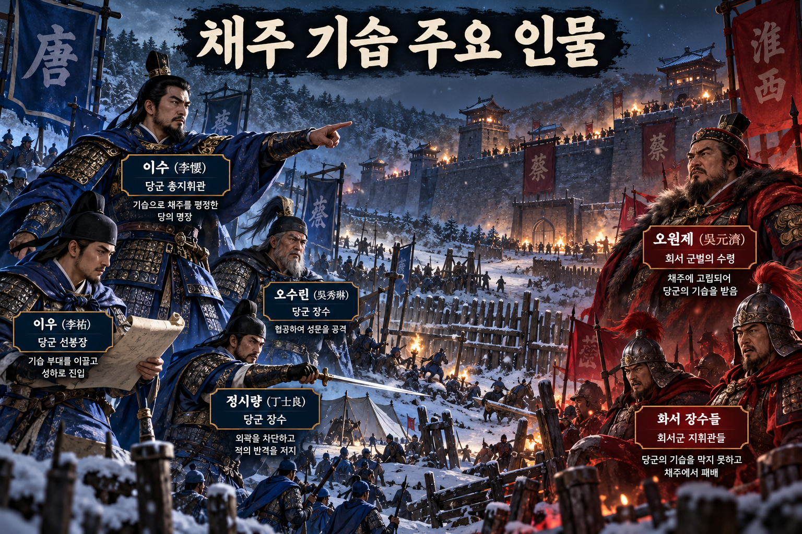

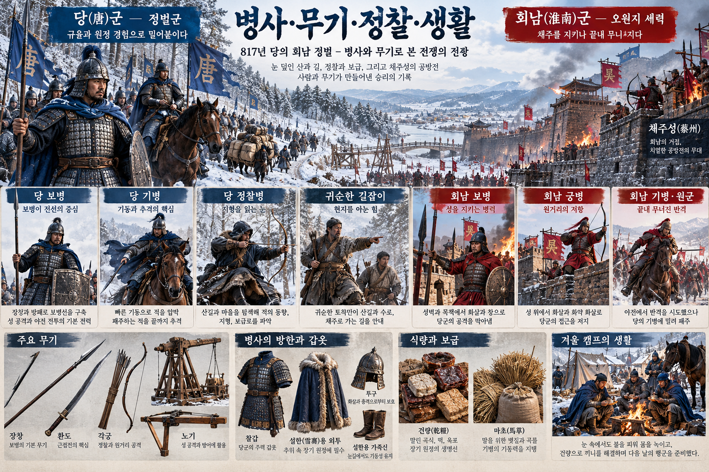

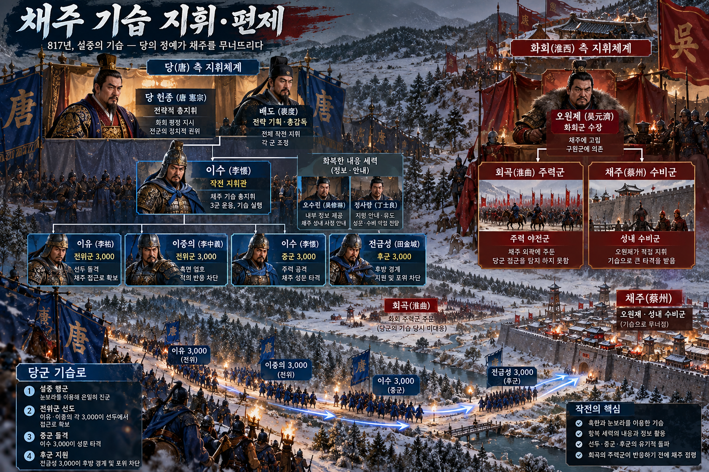

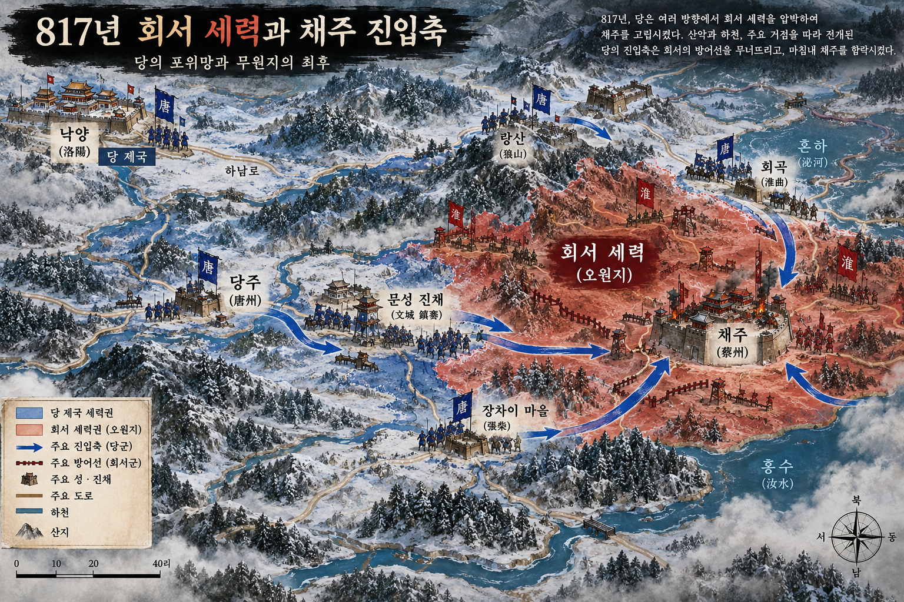

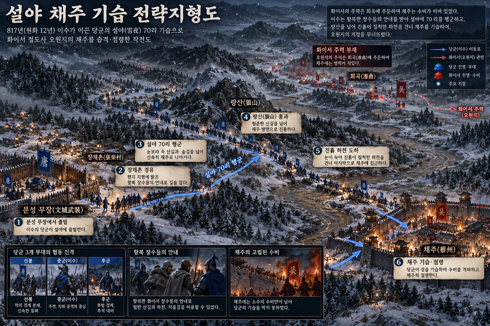

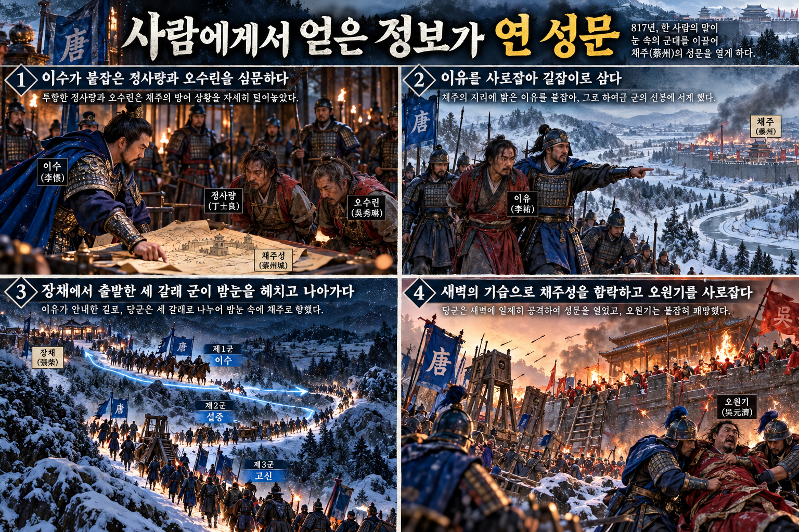

**뒤에서 반복될 지형을 먼저 잡아두기**

- **▰** **문성책(文城柵)**은 오수림이 귀순한 뒤 당군의 전진 기지가 되었다. 적 내부 인물과 병력이 이 지점에서 당군 편제로 전환됐다.
- **▰** **장시촌(張柴村)**은 이우를 사로잡은 곳이자 설야 행군의 출발 거점이었다. 여기서 채주까지 약 70리 기습이 시작됐다.
- ⛰️ **낭산(朗山) 일대**의 산길과 겨울 눈은 대군 이동을 어렵게 했지만, 귀순 장수의 안내가 위험을 줄였다.
- 🌊 **진흙 하천과 수로**는 눈이 녹아 병사들이 고생한 장애물이었다. 행군을 포기하면 비밀이 새고, 계속하면 탈락자가 생기는 분기였다.
- **▰** **회곡(洄曲)**에는 회서 주력이 묶여 있었다. 이 배치 때문에 **▰** **채주(蔡州)** 본성의 수비가 얇아졌다.

#### 상세 전역 서사 — 포로를 죽이지 않고 묻자 채주의 허실과 길이 열리다

이전 당군 지휘관들은 회서군의 보루를 정면으로 압박하다 손실을 냈다. **이소(李愬)**는 부임 뒤 붙잡은 장졸을 직접 불러 사정을 자세히 물었고, 그 결과 적지의 험하고 평탄한 길, 멀고 가까움, 허실을 알게 됐다고 《자치통감》은 기록한다. 그는 포로 **정사량(丁士良)**을 살려 써서 **오수림(吳秀琳)**의 문성책 귀순을 이끌었다.

**오수림**은 채주를 취하려면 **이우(李祐)**가 필요하다고 말했다. **이소**는 장시촌에서 보리를 거두던 **이우**가 당군을 가볍게 여긴다는 정보를 이용해 매복으로 생포했다. 조정과 군중에서 처형 요구가 나왔지만 그는 **이우**를 살리고 가까이 두어 밤늦게까지 적 내부의 허실을 물었다.

817년 10월, **이소**는 **이우**·**이충의**의 선봉 3천, 자신의 중군 3천, **전진성**의 후군 3천으로 나누어 장시촌을 떠났다. 목적지를 소수에게만 알리고 눈보라 속을 70리 행군했다. 회서 주력이 회곡에 나가 있고 채주가 비었다는 정보, 성으로 가는 길과 방비를 아는 귀순자의 안내가 없었다면 계산만으로 감행하기 어려운 기동이었다.

새벽에 당군은 성 아래 도착해 성벽을 넘어 문을 열었다. **오원제(吳元濟)**는 처음 소동을 대수롭지 않게 여겼지만, 외부 주력은 돌아오지 못했고 성 안 지휘는 무너졌다. **이소**는 채주를 점령하고 **오원제**를 사로잡았다. 승리를 연 것은 눈 자체가 아니라, 포로와 귀순 장수를 통해 **현재 채주의 빈틈·길·수비 습관**을 알아낸 과정이었다.

#### 전투에서 사용된 속임수 — 약한 척하며 경계를 늦추고 목적지를 숨기다

**이소**는 새 지휘관이 전투에 적극적이지 않은 듯 알리고 군기를 느슨하게 보이게 해 회서군의 경계를 낮췄다. 실제로는 군을 정비하고 귀순자를 통해 적정을 모았다. 최종 행군 때도 목적지를 숨겨 정보 누설을 막았고, 회서군은 채주 본성이 직접 공격받을 것이라는 신호를 충분히 얻지 못했다.

#### 속임수 작동 구조

**주체와 의도.** **이소**는 회서군이 방비를 강화하기 전에 채주 본성을 찌르려 했다.

**보인 신호와 믿은 이유.** 이전 지휘관들의 실패 뒤 부임한 그가 온건하고 소극적으로 보이자 회서군은 즉각적 위협을 낮게 평가했다.

**유발된 행동과 결과.** 회서 주력은 외곽에 남고 채주 수비는 얇아져 설야 기습에 고립됐다.

**사료의 경계.** 폭설은 기습을 도왔지만 당군도 큰 고통을 겪었다. 날씨만으로 승리를 설명하면 귀순 장수의 정보와 편제·보급 준비를 지운다.

#### 속임수 일곱 질문

1. **누가 누구를 속였는가?** **이소**가 **오원제**와 회서 지휘부의 경계를 흐렸다.
2. **어떤 사실이 거짓이었는가?** 적극적으로 싸울 뜻이 없다는 인상이 실제 준비와 달랐다.
3. **어떤 사실은 진실이지만 오해를 유도했는가?** 당군이 이전 패배로 지쳐 있다는 사실은 참이었지만 회복·정비 중이라는 점은 감춰졌다.
4. **상대는 왜 그것을 믿고 싶어 했는가?** 앞선 당군 지휘관을 물리친 경험이 새 지휘관도 위협적이지 않다는 과신을 만들었다.
5. **속임수가 없었어도 같은 오판이 발생했을까?** 외곽 주력 배치 때문에 가능했지만, 채주 방비를 강화했을 가능성이 더 높다.
6. **속은 사람은 어떤 독립 확인을 생략했는가?** 귀순이 연쇄적으로 일어난 뒤에도 당군의 준비와 장시촌 움직임을 충분히 재확인하지 못했다.
7. **신뢰·동의·안전을 해치지 않으면서 같은 원리를 어디서 연습할 수 있는가?** 워게임에서 목적지를 제한 공개하고 정찰 보고로 계획을 갱신하는 훈련이 가능하다.

#### 시계편 兵者詭道也 — 이 전장에 해당하는 속이는 길

<table fit-page-width="true" header-row="true">
<tr>
<td>해당 구절·독음·뜻</td>
<td>전장의 장면</td>
</tr>
<tr>
<td>能而示之不能 
능이시지불능 — 능하면서 능하지 못한 듯 보인다</td>
<td>
**이소**는 정비와 정보 수집을 진행하면서도 소극적인 지휘관처럼 보였다.</td>
</tr>
<tr>
<td>攻其無備, 出其不意 
공기무비, 출기불의 — 대비하지 않은 곳을 치고 뜻하지 않은 데서 나온다</td>
<td>회서 주력이 외곽에 있는 동안 설야에 채주 본성을 직접 기습했다.</td>
</tr>
</table>

#### 法 한눈 비교 — 곡제·관도·주용

<table fit-page-width="true" header-row="true">
<tr>
<td>진영</td>
<td>곡제(편제)</td>
<td>관도(지휘)</td>
<td>주용(보급·지속)</td>
</tr>
<tr>
<td>
**당군**
</td>
<td>선봉·중군·후군 각 3천으로 분절했다.</td>
<td>목적지를 소수만 알고 귀순 장수가 길을 안내했다.</td>
<td>장시촌에서 휴식·급양한 뒤 70리 야간행군을 감행했다.</td>
</tr>
<tr>
<td>
**회서군**
</td>
<td>주력과 본성 수비가 분리됐다.</td>
<td>귀순 연쇄로 내부 정보와 지휘 연결이 무너졌다.</td>
<td>외곽 주력은 본성 위기에 제때 복귀하지 못했다.</td>
</tr>
</table>

#### **회서군 (패군)**

<table fit-page-width="true" header-row="true">
<tr>
<td>요소</td>
<td>판단</td>
</tr>
<tr>
<td color="orange_bg">🤝 **道**</td>
<td>포로·장수의 귀순이 이어져 내부 결속과 사기가 무너졌다. (지기·사기)</td>
</tr>
<tr>
<td color="blue_bg">🌤️ **天**</td>
<td>앞선 승리를 새 지휘관에게 일반화하고, 귀순자가 제공할 정보의 위험을 낮게 봤다. (지피·타이밍·확률 관점)</td>
</tr>
<tr>
<td color="green_bg">🧭 **地**</td>
<td>회곡 주력과 채주 본성이 떨어져 설야 기습에 본성이 고립됐다. (원근·험이·사생)</td>
</tr>
<tr>
<td color="purple_bg">🎖️ **將**</td>
<td>
**오원제**는 새벽 성내 소동을 늦게 심각하게 받아들였고 외부군을 통제하지 못했다. (지신인용엄)</td>
</tr>
<tr>
<td color="yellow_bg">⚙️ **法**</td>
<td>본성 수비·외곽 주력·정보 방첩을 하나로 묶지 못했다. (곡제·관도·주용)</td>
</tr>
</table>

**직관·편향 한 줄:** **오원제**가 앞선 당군의 실패를 새 지휘관에게도 적용한 판단은 대표성·과신이 작동한 것으로 볼 수 있으며, 채주 본성의 낮은 방비를 방치했다.

🏳️ **패군 측 결과** — 회서군은 六敗의 `崩`(붕, 부대와 지휘가 분리되어 무너짐)에 가까웠다. 🔀 **패군 측 회피 분기점**은 오수림·이우 귀순 뒤 채주 수비를 강화하고 회곡 주력과 본성의 조기경보·복귀 계획을 새로 세우는 것이었다.

#### **당군 (승군)**

<table fit-page-width="true" header-row="true">
<tr>
<td>요소</td>
<td>판단</td>
</tr>
<tr>
<td color="orange_bg">🤝 **道**</td>
<td>
**이소**는 패전 뒤 병사를 돌보고 귀순자를 신뢰해 결속과 사기를 회복했다. (지기·사기)</td>
</tr>
<tr>
<td color="blue_bg">🌤️ **天**</td>
<td>포로 한 명의 말에 머물지 않고 정사량·오수림·이우의 접근 범위가 다른 보고를 이어 붙여 채주 공백의 가능성을 높였다. (지피·타이밍·확률 관점)</td>
</tr>
<tr>
<td color="green_bg">🧭 **地**</td>
<td>귀순자의 안내로 산길·거리·하천·성벽의 위험을 실제 행군 계획으로 바꿨다. (원근·험이·광협·사생)</td>
</tr>
<tr>
<td color="purple_bg">🎖️ **將**</td>
<td>
**이소**는 포로를 알아보는 지혜와 믿고 맡기는 신의, 설야 행군의 용기를 결합했다. (지신인용엄)</td>
</tr>
<tr>
<td color="yellow_bg">⚙️ **法**</td>
<td>9천을 세 갈래 제대로 나누고 정보 안내자·선봉·중군·후군을 결합했다. (곡제·관도·주용)</td>
</tr>
</table>

🏆 **승군 측 결과** — 당군은 五勝의 `知可以戰與不可以戰者勝`(지가이전여불가이전자승, 싸울 때와 싸우지 않을 때를 아는 자가 이긴다)과 `將能而君不御者勝`(장능이군불어자승, 장수가 유능하고 군주가 억누르지 않으면 이긴다)에 해당했다.

##### 法을 압축하지 않고 보기 — 곡제·관도·주용

**곡제 曲制(곡제): 부대를 어떻게 나누고 결합했는가**
<table fit-page-width="true" header-row="true">
<tr>
<td>진영</td>
<td>실제 운용</td>
</tr>
<tr>
<td>
**당군**
</td>
<td>
**이우**·**이충의** 선봉 3천, **이소** 중군 3천, **전진성** 후군 3천으로 나눠 돌파·지휘·후방경계를 결합했다.</td>
</tr>
<tr>
<td>
**회서군**
</td>
<td>주력이 회곡에 있고 채주 본성 수비가 얇아 상호 지원이 끊겼다.</td>
</tr>
</table>

**관도 官道(관도): 누가 명령하고 어떻게 전달했는가**
<table fit-page-width="true" header-row="true">
<tr>
<td>진영</td>
<td>실제 운용</td>
</tr>
<tr>
<td>
**당군**
</td>
<td>
**이소**가 목적지를 제한 공개하고 귀순 장수에게 길 안내와 선봉 임무를 맡겼다.</td>
</tr>
<tr>
<td>
**회서군**
</td>
<td>
**오원제**의 본성과 외곽 주력 사이 보고·복귀 경로가 기습 속도를 따라가지 못했다.</td>
</tr>
</table>

**주용 主用(주용): 군량·장비·전투 지속 능력을 어떻게 썼는가**
<table fit-page-width="true" header-row="true">
<tr>
<td>진영</td>
<td>실제 운용</td>
</tr>
<tr>
<td>
**당군**
</td>
<td>겨울 장비와 휴대 식량, 말 사료를 갖추고 장시촌을 중간 거점으로 삼았으나 설야 행군의 상세 비용은 사료상 불명이다.</td>
</tr>
<tr>
<td>
**회서군**
</td>
<td>채주 성내 물자는 있었으나 외곽 주력과 분리되어 기습 당일 전투 지속 능력으로 전환하지 못했다.</td>
</tr>
</table>

출처: [《자치통감》 권240 원문 계열](https://ourartnet.com/%E8%B3%87%E6%B2%BB%E9%80%9A%E9%91%91%E5%85%A8%E9%9B%86.pdf) · [《자치통감》 당기56 번역 대조](https://shishuguan.com/books/zizhi-tongjian-baihuawen-full/volume-11/chapter-240) · [칭화대 공개강의 자료](https://ocw.nthu.edu.tw/ocw/upload/21/417/9702_%E5%BC%B5%E5%85%83%E6%95%99%E6%8E%88_%E7%AC%AC11%E8%AC%9B_%E5%A4%95%E9%99%BD%E7%84%A1%E9%99%90%E5%A5%BD----%E5%AE%89%E5%8F%B2%E4%B9%8B%E4%BA%82%E5%8F%8A%E5%85%B6%E5%BE%8C%E7%9A%84%E5%94%90%E4%BB%A3.pdf)

---
## 5. 핵심 통찰 + 실생활 적용 + 생활루틴

### 핵심 통찰

이 구절의 가장 예리한 통찰은 “사람이 중요하다”보다 **현실과 접촉하지 않은 지식은 적정을 대신할 수 없다**는 데 있다. 귀신은 검증할 수 없는 확실성, 지나간 일은 닮은 모양, 도수는 일반화된 척도다. 셋은 모두 판단을 돕기도 하지만 현재의 특정한 상대와 상황에서 떨어져 있다. 손자는 그 간격을 사람으로 잇는다.

그러나 사람은 오류 없는 센서가 아니다. 그래서 순서는 `사람에게 묻기 → 곧 믿기`가 아니라 `결정을 바꿀 질문 정하기 → 그 사실에 접근한 사람 찾기 → 직접 본 것과 전해 들은 것 나누기 → 기록·로그·다른 독립 출처로 대조하기 → 남은 불확실성 표시하기`가 되어야 한다. 선지는 확신의 크기가 아니라 **현실이 내 판단을 수정할 수 있도록 통로를 열어 둔 상태**다.

### 실생활 적용

3교대 현장에서 별도의 에러가 발생했을 때, 과거에 비슷한 오류가 있었다는 기억만으로 원인을 단정하면 `象於事`의 함정에 빠진다. 화면의 한 수치가 기준을 벗어났다는 이유로 원인을 확정하면 `驗於度`를 과신한 셈이다. 먼저 어느 설비에서 언제부터 어떤 증상이 생겼는지, 당시 조작자와 인수인계자가 직접 무엇을 보았는지, 알람·작업 지시·조치 로그가 어디서 일치하는지를 확인해야 한다.

인물사건관찰시리즈에 기록된 교대 직전 에러 사건에서도 이 원리는 중요하다. 이씨가 핸드폰 두 대를 가져간 이유와 대응 계획을 연속해서 물은 행위 자체는 사실 확인이 될 수 있었다. 그러나 사용자가 설명한 조장 지시와 실제 에러 조치 맥락을 충분히 확인하기 전에 대화가 욕설·낙인으로 넘어가면서 질문은 정보 수집 기능을 잃었다. 반대로 사용자도 상대의 의도를 성격으로 단정해 맞서기보다 “업무 질문에는 답하되 욕설과 손가락질은 중단하라”고 경계를 세운 뒤 양쪽 조장·작업 기록·현장 동료를 같은 자리에 모으면, 추정을 공개된 사실 확인으로 바꿀 수 있다.

다음에 비슷한 일이 생기면 첫째, `내가 아는 사실 / 남에게 들은 말 / 아직 모르는 것`을 세 칸으로 나눈다. 둘째, 모르는 것 가운데 조치를 바꿀 항목만 당사자·조장·로그로 확인한다. 셋째, 사람의 설명이 다르면 누가 거짓말한다고 즉시 결론 내리지 말고 각자가 직접 본 시각과 범위를 적는다. 넷째, 확인 전 임시 조치는 되돌릴 수 있게 하고, 안전 위험이 있으면 설비 정지와 관리자 입회를 우선한다.

사람 관계에서도 소문과 유형표는 `事`와 `度`일 뿐 현재 사건의 결론이 아니다. 전씨·이씨·안씨에 관한 과거 관찰은 다음 상황에서 살필 질문을 주지만, 오늘의 행동을 미리 판결하지는 않는다. 익숙한 인물 유형에 맞지 않는 증거가 나오면 유형을 지키기 위해 사실을 버리지 말고, 최신의 구체적 행동을 우선해야 한다.

### 생활루틴

**추천 문구**

당사자와 현장을 확인하지 않고 짐작만으로 결론 내리면 재수가 없다.

**이유**

교대 시작 전이나 중요한 판단 직전에 3분을 정해 `직접 확인한 사실 1개 / 전해 들은 말 1개 / 아직 모르는 것 1개`를 적고, 결정을 바꿀 미확인 항목 하나만 당사자나 로그로 확인한다. 이 작은 확인을 생략하면 과거와 닮았다는 느낌이나 한 수치가 곧 원인처럼 굳고, 잘못된 조치가 다음 교대의 추가 오류·책임 공방·관계 악화로 이어질 수 있다. 사람에게서 적정을 취한다는 원리는 남을 캐라는 말이 아니라, **현실에 닿은 증거가 추정을 고칠 기회를 반드시 한 번 만들라**는 생활 규칙이다.
