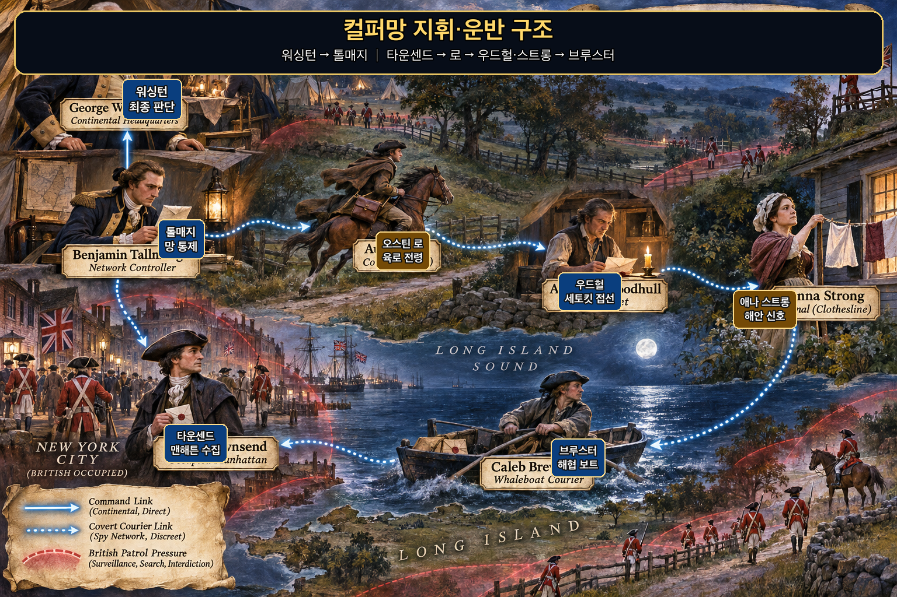
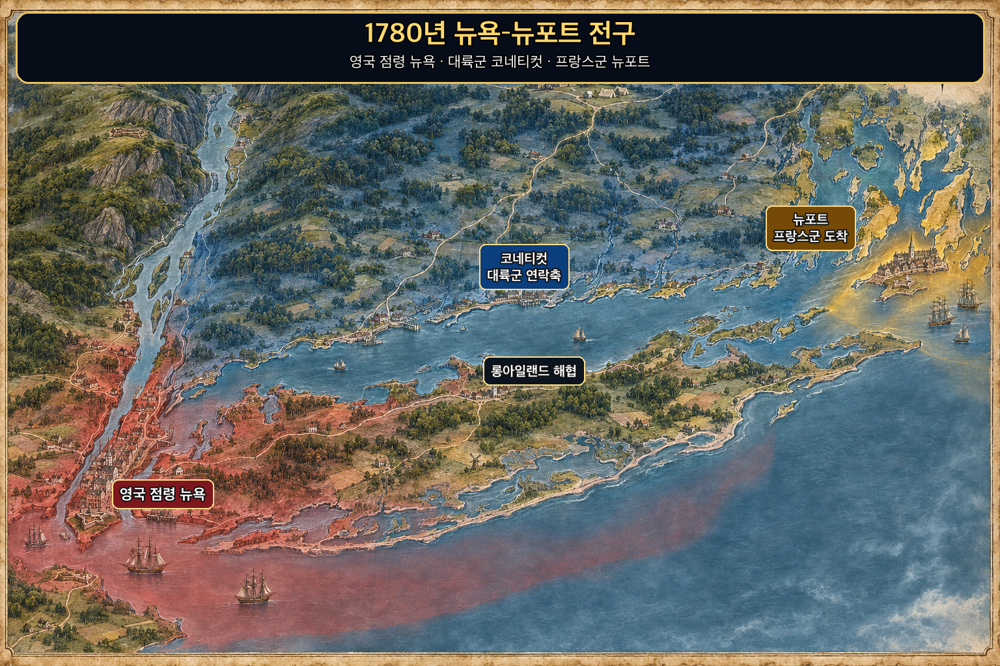
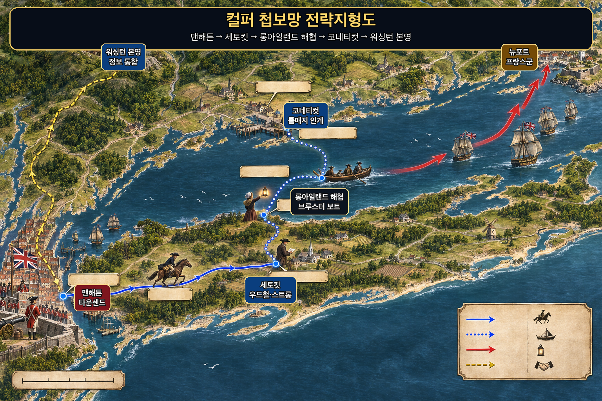
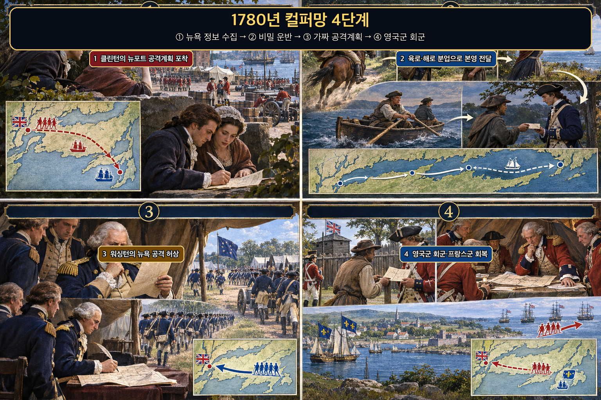
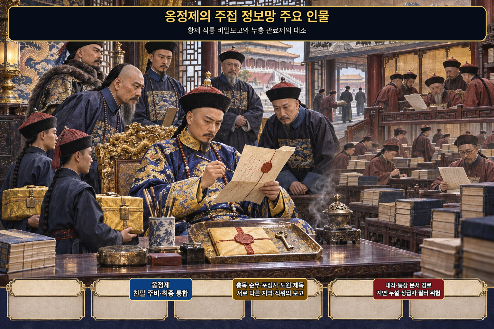
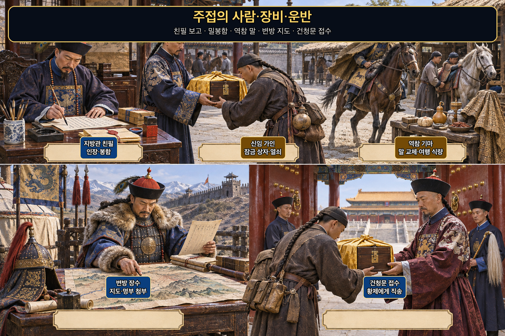
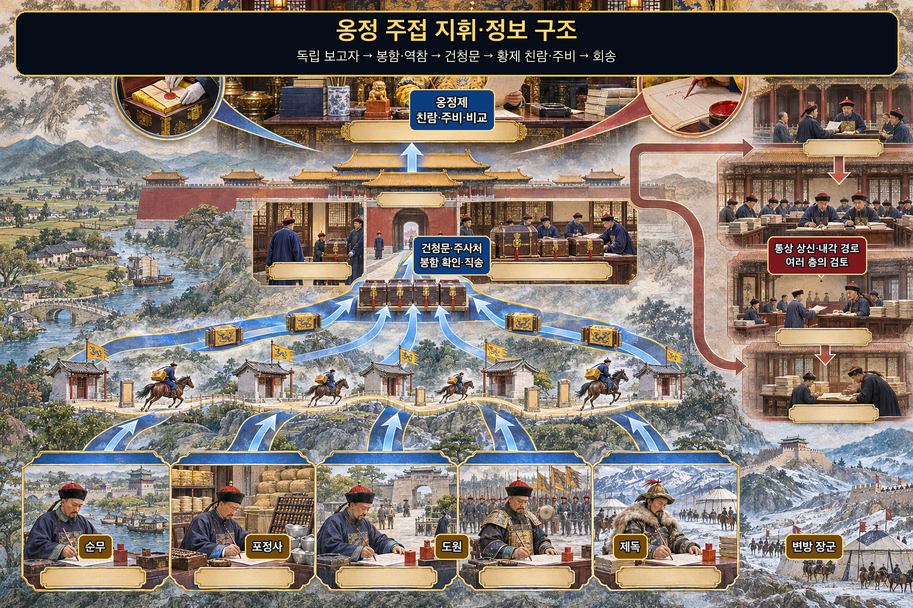
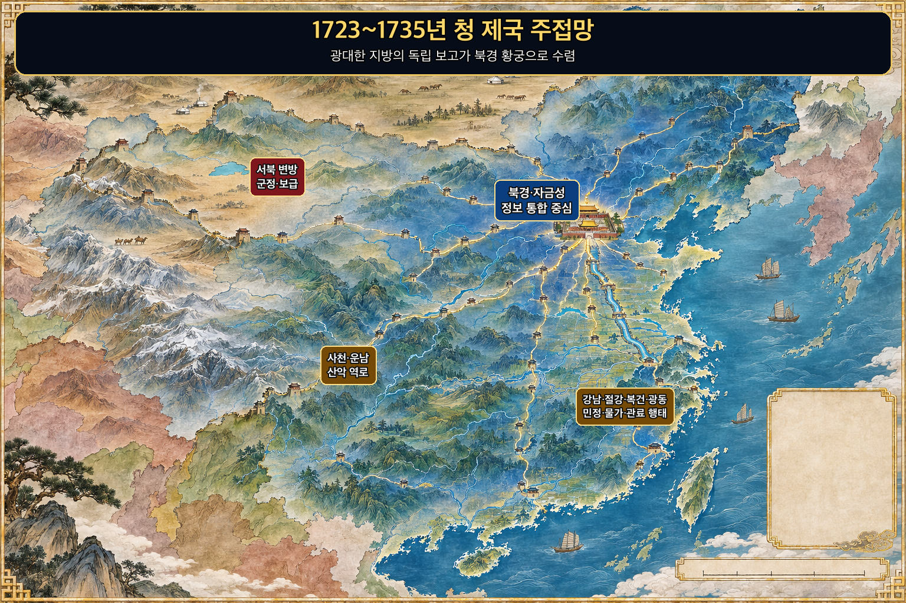
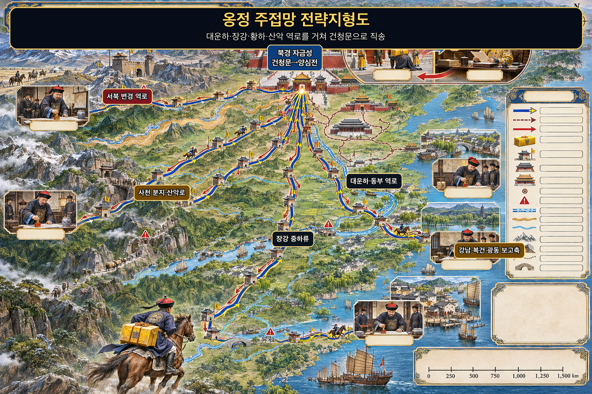
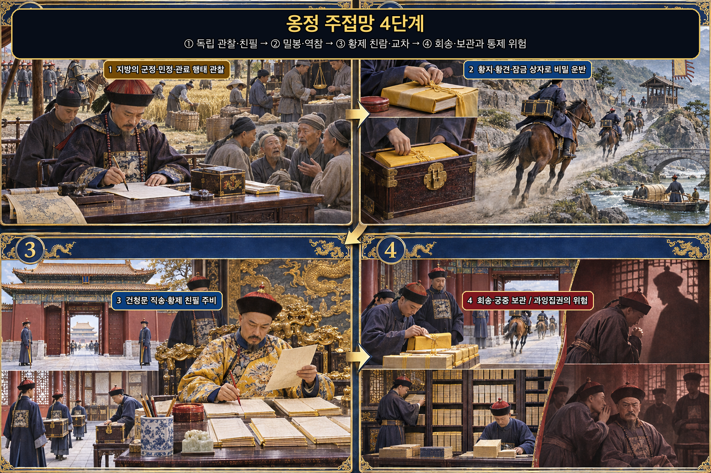

> 고용간유오, 유향간, 유내간, 유반간, 유사간, 유생간. — 중요한 판단에서 출처의 위치와 이해관계를 구분하지 않으면 재수가 없다.

---
## 1. 원문 + 독음 + 직역 + 한자어 뜻풀이

故用間有五, 有鄕間, 有內間, 有反間, 有死間, 有生間, 고용간유오, 유향간, 유내간, 유반간, 유사간, 유생간.

**직역**  
그러므로 간첩을 쓰는 데에는 다섯 가지가 있으니, 향간이 있고, 내간이 있고, 반간이 있고, 사간이 있고, 생간이 있다.

	앞 구절은 먼저 아는 지식이 귀신·과거의 닮은꼴·고정된 척도에서 나오지 않고 반드시 사람에게서 나온다고 했다. 이번 구절은 곧바로 그 `人`을 다섯 갈래로 나눈다. 손자가 세는 것은 사람의 신분만이 아니다. **누가 적의 생활권과 관청과 첩보망에 접근하는지, 정보가 어느 방향으로 흐르는지, 임무 뒤 돌아와 검증받을 수 있는지**를 함께 분류한다.

	다섯 이름을 현대의 고정 직책과 일대일로 맞추면 문장이 좁아진다. 한 사람이 상황에 따라 향간의 현지 접근성과 생간의 귀환 보고 기능을 함께 가질 수도 있다. 중요한 것은 이름표보다 출처의 위치·접근 범위·동기·전달 경로·생환 가능성을 구분해 지휘관이 서로 다른 위험을 관리하는 데 있다.

	#### 間(사이 간) — 두 진영 사이의 틈을 정보가 지나가다

	`間`은 본래 문틈과 사이를 가리키며, 여기서는 두 진영 사이를 오가며 감춰진 사정을 알아내거나 보이게 하는 사람과 활동을 뜻한다. 첩자는 적진 안에 있다는 사실만으로 가치가 생기지 않는다. 무엇에 접근했고, 어느 쪽으로 정보를 보냈으며, 그 보고를 누가 검증할 수 있는지가 분명해야 한다.

	이 글자가 다섯 이름마다 반복되는 까닭도 여기에 있다. 향리·관청·적의 첩보망·역정보 경로·귀환 보고라는 서로 다른 틈을 같은 방식으로 다루면 실패한다. **간첩의 수보다 먼저 틈의 종류를 구분해야 한다.**

	#### 五(다섯 오) — 사람 다섯 명이 아니라 접근 경로 다섯 갈래

	`五`는 뒤에 이어질 유형의 수를 미리 못 박는다. 전통 본문은 다음 문장들에서 향간은 현지인, 내간은 적 관리, 반간은 적이 보낸 간첩, 사간은 적에게 거짓 정보를 믿게 하는 경로, 생간은 돌아와 보고하는 사람이라고 각각 풀어 준다.

	따라서 다섯은 인원수가 아니다. 지휘관이 정보망을 설계할 때 빠뜨리기 쉬운 기능을 나눈 분류다. 현지 생활의 관찰, 제도 내부의 사정, 적 정보망의 역이용, 적 판단에 들어갈 신호, 그리고 귀환해 결과를 갱신하는 보고가 서로 맞물려야 한다.

	#### 鄕間(고을 향·사이 간) — 적의 일상에 뿌리내린 사람이 바깥에서 보이지 않는 변화를 알리다

	`鄕`은 사람들이 함께 살아가는 고을과 향리를 뜻한다. 향간은 적국의 현지인을 활용하여 도로·물자·민심·출입과 같은 생활권의 변화를 아는 유형이다. 정식 명령서보다 먼저 드러나는 작은 이상을 볼 수 있지만, 지역적 경험을 적 전체의 사정으로 일반화할 위험도 있다.

	일부 十一家注 계통에는 첫 글자를 `因間`으로 적은 이문이 있다. 장예는 뒤에서 `鄕間`이라고 다시 부르는 문맥을 근거로 `因間`은 `鄕間`이어야 한다고 지적한다. 이번 페이지는 사용자 승인 원문과 그 문맥에 따라 `鄕間`을 정본으로 삼는다.

	#### 內間(안 내·사이 간) — 적의 제도 안에서 결정과 집행의 틈을 보다

	`內`는 단순히 성 안쪽이 아니라 관직과 지휘 체계의 내부를 가리킨다. 내간은 적 관리나 내부 관계자를 통해 정책·명령·인사·보급의 실제 작동을 알아내는 유형이다. 향간이 생활권의 표면 변화를 잘 본다면 내간은 결정이 어디서 막히고 누가 무엇을 집행하는지에 더 가까이 접근한다.

	내부 접근은 강한 정보와 강한 왜곡 가능성을 함께 지닌다. 직책이 높아도 모든 부서를 알지 못하고, 실각·보상·갈등 같은 이해관계가 보고를 비틀 수 있다. 그러므로 직위의 권위보다 실제 접근 범위와 동기를 따져야 한다.

	#### 反間(돌이킬 반·사이 간) — 나를 보러 온 적의 눈을 되돌려 적을 보다

	`反`은 방향을 돌린다는 뜻이다. 반간은 적이 아군을 엿보려고 보낸 사람을 찾아 포섭하거나 통제하여 되돌려 쓰는 유형이다. 정보의 통로를 새로 만드는 것이 아니라 이미 적이 열어 둔 통로의 방향을 바꾼다.

	그래서 반간은 정보와 기만이 만나는 자리다. 상대 첩자의 보고를 통해 적이 무엇을 궁금해하는지 알 수 있고, 상대가 믿을 신호의 형식도 파악할 수 있다. 그러나 이중 역할은 충성·동기·통제에 가장 큰 불확실성을 품으므로, 한 사람의 말에 전체 판단을 맡겨서는 안 된다.

	#### 死間(죽을 사·사이 간) — 거짓 정보가 성공해도 전달자가 돌아오지 못할 수 있는 경로

	`死`는 단순히 용감하게 죽는 사람이라는 미화가 아니다. 뒤의 정의처럼 아군이 만든 거짓 일을 적에게 전하게 하고 실제 행동을 달리하면, 그 정보를 전한 사람은 거짓이 드러난 뒤 죽임을 당할 수 있다. 이름 자체가 기만의 비용과 사람의 위험을 숨기지 않는다.

	현대 생활에서 이를 타인을 속이는 기술로 연습해서는 안 된다. 허위 정보는 안전한 모의훈련과 명시적 동의가 있는 게임 같은 제한된 환경을 벗어나면 신뢰·안전·법적 권리를 해칠 수 있다. 이 유형이 주는 생활 교훈은 기만을 권하는 것이 아니라 **정보 계획의 효과와 그 비용을 사람에게 떠넘기지 말라**는 경계다.

	#### 生間(살 생·사이 간) — 보고하고 돌아와 다음 판단을 고치다

	`生`은 임무 뒤 살아 돌아온다는 뜻이며, 뒤 문장은 이를 `反報`(반보, 돌아와 보고함)라고 간결하게 정의한다. 생간의 가치는 한 번 본 장면에 있지 않다. 관찰 시각·접근 경로·불확실성을 설명하고 질문에 답하면서 지휘부의 판단을 갱신할 수 있다는 데 있다.

	귀환 보고 역시 자동으로 진실이 되지는 않는다. 기억의 왜곡, 보고자의 기대, 지휘관이 듣고 싶어 하는 결론이 개입할 수 있다. 생간을 제대로 쓰려면 떠나기 전 정보 요구를 분명히 하고, 돌아온 뒤 직접 관찰과 전언을 나누며, 다른 자료와 교차 확인해야 한다.

	#### 글자들이 완성하는 한 장면

	`故`는 앞 구절의 결론을 이번 분류로 잇는다. 먼저 앎은 사람에게서 와야 하므로, 지휘관은 `間`이 지나가는 틈을 `五`로 나눈다. `鄕間`이 적의 생활권을 보고, `內間`이 제도 안을 비추며, `反間`이 적의 정보 통로를 되돌린다. `死間`은 적 판단에 들어갈 거짓 신호와 그 비싼 위험을 맡고, `生間`은 돌아와 결과를 보고한다.

	다섯을 함께 읽으면 정보망은 사람 목록이 아니라 순환 구조가 된다. 현지와 내부에서 얻은 사실이 적의 정보 요구와 대조되고, 기만이 필요하다면 그 위험이 계산되며, 귀환 보고가 가설을 다시 고친다. **출처의 이름보다 위치와 흐름과 검증 가능성을 관리하는 것이 오간의 핵심**이다.

---
## 2. 전통 주석 기반 분석

- **조조(曹操)** — “다섯 간첩을 때에 맞추어 함께 써라. **한 갈래의 보고만으로 적정을 다 안다고 여기지 마라.**”
- **이전(李筌)** — “다섯 이름을 외우는 데 그치지 마라. **각기 다른 사람과 통로를 그 쓰임에 맞게 움직여라.**”
- **두목(杜牧)** — “향간은 적 고을의 사람을 후하게 대하여 쓰고, 반간은 나를 엿보러 온 자를 돌려 써라. **접근한 자리와 동기를 먼저 살펴라.**”
- **매요신(梅堯臣)** — “향간은 그 나라 사람을 이롭게 하여 쓰고, 생간은 지혜롭고 분별 있는 이를 보내라. **얻는 정보와 돌아올 능력을 함께 보아라.**”
- **장예(張預)** — “`因間`이라 적힌 곳은 뒤 문맥에 따라 `鄕間`으로 바로잡아라. **다섯 이름과 뒤의 정의가 서로 맞는지 확인하라.**”
- **왕석(王晳)** — “사간은 거짓을 적에게 알린 뒤 일이 어긋나면 죽을 수 있는 간첩이다. **계책의 이익만 보고 사람의 위험을 감추지 마라.**”
- **가림(賈林)** — “향간은 적국 사람에게서 안팎의 허실을 살피고, 생간은 돌아와 보고하게 하라. **보았는지 전해 들었는지를 갈라 물어라.**”
- **두우(杜佑)** — “반간은 적이 보낸 사람을 이용하고, 생간은 적의 동정과 계책을 살핀 뒤 돌아오게 하라. **정보의 방향과 귀환 보고를 함께 통제하라.**”
- **진호(陳皞)** — “다섯 간첩은 신분만 다른 것이 아니다. **현지·관청·적의 첩보망·역정보·귀환 보고의 기능을 구별하라.**”

#### 리링의 고증과 현대적 독법

리링의 문헌학적 관점을 따라 보면 이번 구절은 앞 문장의 `必取於人`을 곧바로 제도화한다. 먼저 사람에게서 알아야 한다고 선언하고, 다음 문장에서 그 사람과 정보 경로를 다섯 유형으로 나눈다. 이어지는 `五間俱起`는 다섯 이름이 독립된 백과사전 항목이 아니라 함께 작동하는 체계임을 보여 준다.

판본상 주의할 점은 `鄕間`과 `因間`이다. 현전 十一家注 계통의 일부 본문에는 `因間`이 보이지만, 장예는 바로 뒤 정의와 후문의 `鄕間可得而使`를 근거로 `鄕間`이어야 한다고 교감한다. 이문을 억지로 서로 다른 여섯 번째 유형처럼 늘리지 않고, 사용자 승인 원문인 `鄕間`을 본문에 유지하는 것이 문장 구조에도 맞다.

다섯 간첩을 현대 조직의 직원 유형에 곧바로 대입하는 것도 경계해야 한다. 고대 전쟁의 적대 관계와 현대 직장의 개인정보·노동권·법적 절차는 다르다. 현대적 독법의 핵심은 사람을 몰래 분류하는 데 있지 않고, 업무상 필요한 정보가 현장 관찰·조직 내부 기록·외부 제보·검증 실험·사후 보고 중 어느 경로에서 왔는지 밝혀 그 한계를 관리하는 데 있다.

---
## 3. 교차 설명

### ① 손자병법 내 교차

바로 앞의 `必取於人, 知敵之情者也`(필취어인, 지적지정자야 — 반드시 사람에게서 취하여 적의 실정을 알아야 한다)는 이번 분류의 출발점이다. 사람에게서 얻으라는 말만으로는 누가 무엇을 알 수 있는지 불분명하다. `鄕·內·反·死·生`은 사람의 위치와 정보 흐름을 갈라, 접근 범위와 위험을 판단하게 한다.

바로 뒤의 `五間俱起, 莫知其道, 是謂神紀`(오간구기, 막지기도, 시위신기 — 다섯 간첩이 함께 일어나되 그 길을 아무도 알지 못하니 이를 신묘한 기강이라 한다)는 오간의 목표가 목록 완성이 아니라 결합 운용임을 밝힌다. 향간의 지역 정보가 내간의 제도 정보와 맞는지 보고, 반간을 통해 적의 정보 요구를 읽고, 생간의 귀환 보고로 결과를 갱신해야 한다.

「모공편」의 `知彼知己, 百戰不殆`(지피지기, 백전불태 — 적을 알고 나를 알면 백 번 싸워도 위태롭지 않다)는 결과를 말하고, 용간편은 그 앎의 출처 구조를 말한다. 출처를 구분하지 않은 `知彼`는 소문과 확신을 지식으로 잘못 부를 수 있다. 다만 출처가 많다고 자동으로 진실이 되는 것도 아니므로 독립성·접근성·시점을 함께 따져야 한다.

### ② 클라우제비츠 『전쟁론』

클라우제비츠는 전쟁에서 들어오는 정보의 상당 부분이 모순되고, 더 많은 부분이 거짓이며, 대부분이 불확실하다고 경고한다. 이는 사람 출처를 쓰지 말라는 뜻이 아니라, 보고가 지휘관에게 도착하는 순간 이미 마찰과 기대를 거쳤음을 기억하라는 뜻이다. 손자의 오간 분류는 그 불확실성을 출처 위치와 정보 방향으로 더 세분한다.

두 사상은 불확실성을 인정하지만 강조점은 다르다. 클라우제비츠는 불완전한 정보 속에서도 판단을 유지하는 지휘관의 힘을 중시하고, 손자는 판단 전에 여러 인간 경로를 설계한다. 함께 읽으면 보고가 모순된다고 직관 하나로 도망치지도 않고, 다섯 유형을 채웠다고 완전한 확실성을 주장하지도 않는다.

전략과 전술의 층위도 나누어야 한다. 내간이나 생간이 특정 부대의 위치를 알려 주는 것은 전술 정보를 개선할 수 있지만, 전쟁의 정치 목적이 잘못되었다면 정보 우위가 전략적 정당성과 성공을 보장하지 않는다. 더 좋은 정보는 더 정확한 수단 선택을 돕지만 목적 그 자체를 대신하지 않는다.

### ③ 미야모토 무사시 『오륜서』

『오륜서』의 `觀見二眼`(관견이안 — 넓게 꿰뚫어 보는 눈과 가까이 세밀하게 보는 눈)은 향간과 내간의 차이를 이해하는 데 도움을 준다. 향간은 생활권의 넓은 변화를, 내간은 결정 구조의 가까운 내부를 더 잘 볼 수 있다. 어느 한 눈만으로 전체를 보았다고 하면 사각이 생긴다.

무사시의 `拍子`(효시, 박자·리듬)는 생간의 귀환 보고에 시효가 있음을 일깨운다. 어제 정확했던 배치도 오늘 이동 뒤에는 틀릴 수 있다. 보고에는 관찰 시각과 전달 시각을 붙이고, 결정 시점 전에 무엇을 다시 확인할지 정해야 한다.

그러나 개인 검객의 관견과 국가의 정보망은 규모와 책임이 다르다. 숙련자의 감각은 빠르지만 독립된 검증과 기록을 대신하지 못한다. 현대 조직에서는 개인의 통찰을 존중하되, 다른 출처와 로그·현장 확인으로 수정 가능하게 만들어야 한다.

### ④ 오자병법·육도삼략

『오자병법』의 `內修文德, 外治武備`(내수문덕, 외치무비 — 안으로 문덕을 닦고 밖으로 무비를 다스린다)는 정보망도 내부 정치와 분리될 수 없음을 보여 준다. 보고자를 처벌하고 듣기 좋은 말만 보상하는 조직은 다섯 통로를 갖춰도 모두 같은 왜곡을 낳는다. 정보의 질은 수집 기술뿐 아니라 사실을 말해도 안전한 지휘 풍토에 달려 있다.

오자는 사람의 능력에 맞게 임무와 상벌을 정해야 한다고 본다. 이는 오간을 고정된 신분이 아니라 기능으로 읽게 한다. 현지 사정을 잘 아는 사람에게 내부 정책 전체를 추정하게 하거나, 내부 문서를 보는 사람에게 민심 전체를 단정하게 하면 접근 범위를 넘어선다.

『육도』는 여러 인재와 경로를 통해 사정을 듣되, 군주 곁의 총애와 사사로운 이해가 판단을 가리지 않게 해야 한다고 본다. 여러 보고가 같은 최초 소문을 되풀이한다면 숫자는 많아도 독립된 증거가 아니다. 출처 사이의 관계를 그려야 실제로 몇 갈래의 정보가 있는지 알 수 있다.

현대 적용에서는 법과 윤리가 먼저다. 정당한 권한 없이 동료의 사생활을 캐거나 거짓 정보를 흘리는 행위는 오간의 교훈이 아니다. 업무상 필요한 최소 정보, 수집 목적의 공개 가능성, 개인정보 보호, 반론과 정정 기회를 갖춘 범위에서만 출처를 구분해야 한다.

### ⑤ 현대 심리학·군사학

미 중앙정보국의 분석기법 지침은 판단의 신뢰도가 정보 기반의 정확성과 신뢰성에 달려 있으므로 출처 품질을 계속 점검해야 한다고 설명한다. 특히 사람 출처는 그 사람의 배경·실제 접근 범위·정보 제공 동기를 살펴야 하며, 여러 출처가 있다는 사실만으로 좋은 정보 하나를 면밀히 검토하는 일을 대신할 수 없다고 한다. 이는 오간을 인원수 목록이 아니라 **서로 다른 접근과 취약성을 가진 정보 기반**으로 읽게 한다. [CIA, *A Tradecraft Primer*](https://www.cia.gov/resources/csi/static/Tradecraft-Primer-apr09.pdf)

미 육군 교리는 정보의 적시성·교차 확인·합법성을 함께 평가하고, 가능하면 두 개의 독립 출처로 확인하되 확인되지 않은 보고는 그 한계를 표시하라고 한다. 출처의 신뢰성과 정보 자체의 개연성을 분리하는 방식은 “누가 말했는가”와 “그 말이 다른 증거와 맞는가”를 구분한다. [U.S. Army, ATP 3-39.20](https://rdl.train.army.mil/catalog-ws/view/100.ATSC/920BFCED-47AE-4898-84CC-6409989FBF4E-1428335174187/atp3-39x20.pdf)

심리학적으로는 한 출처의 생생한 이야기가 가용성 휴리스틱을 일으키고, 서로 연결된 여러 사람이 같은 말을 반복하면 합의가 있는 것처럼 보일 수 있다. 사용자의 「생각에대한 생각」 메모가 경계하는 한 가지 시나리오 집중과 분모 무시도 여기서 작동한다. 보고 수를 세기 전에 독립된 원출처의 수, 틀렸던 보고의 분모, 대안 설명을 함께 적어야 한다.

다만 교차 확인을 무한히 늘리면 결정이 마비될 수 있다. 정보의 중요도와 가역성에 따라 확인 기준을 다르게 두어야 한다. 안전·징계·대규모 중단처럼 피해가 큰 결정은 독립 확인과 반론 기회를 강화하고, 되돌릴 수 있는 작은 조치는 불확실성을 표시한 채 제한적으로 시험할 수 있다.

## 4. 역사적 실증 사례

오간은 다섯 사람을 채우는 명단이 아니라 서로 다른 접근·전달·검증 기능을 결합하는 정보 체계다. 아래 두 사례는 향간·내간·반간·사간·생간이 현대의 고정 직책과 일대일로 대응한다고 주장하지 않는다. 대신 현지 관찰, 제도 내부 보고, 적의 정보 요구 역이용, 의도적으로 보인 신호, 돌아와 확인하는 보고가 실제 의사결정에서 어떻게 연결되거나 실패했는지 검증한다.

### 서양 — 🇺🇸 대륙군 정보망 vs 🏛️ 영국군 뉴욕 지휘부 │ 컬퍼 첩보망과 1780년 뉴포트 위기(Culper Spy Ring, 1778~1783)

컬퍼망은 한 명의 전설적 첩자가 아니라 서로 다른 접근권과 운반 능력을 가진 사람들을 분리해 연결한 체계였다. **로버트 타운센드(Robert Townsend)**는 영국 점령지 **▰** **뉴욕(New York City)**에서 장교와 상인의 움직임을 관찰했고, **오스틴 로(Austin Roe)**는 상점 거래를 위장해 보고를 동쪽으로 옮겼다. **에이브러햄 우드헐(Abraham Woodhull)**은 **▰** **세토킷(Setauket)**에서 접선과 육로 구간을 맡았으며, **애나 스트롱(Anna Strong)**의 해안 신호와 **케일럽 브루스터(Caleb Brewster)**의 고래잡이 보트가 🌊 **롱아일랜드 해협(Long Island Sound)**을 건넜다. **벤저민 톨매지(Benjamin Tallmadge)**가 망을 통제했고 최종 수신자는 **조지 워싱턴(George Washington)**이었다.

**뒤에서 반복될 지형을 먼저 잡아두기**

- **▰** **맨해튼(Manhattan)**은 영국군 본부·항만·상점이 밀집한 수집 지점이었다. 정보를 얻기 쉬운 만큼 영국 순찰과 방첩에 노출될 위험도 가장 컸다.
- **▰** **세토킷(Setauket)**은 맨해튼에서 동쪽으로 이어지는 육로와 해상 운반이 만나는 중계점이었다. 이 연결이 끊기면 도시의 보고가 워싱턴 본영까지 가지 못했다.
- 🌊 **롱아일랜드 해협(Long Island Sound)**은 영국 점령지와 대륙군 지역을 가르는 장벽이자 브루스터가 밤에 넘은 은밀한 통로였다.
- **▰** **페어필드(Fairfield)**와 코네티컷 연안은 해상 보고를 대륙군 육로로 바꾸는 인계 지점이었다.
- **▰** **뉴포트(Newport)**는 1780년 7월 프랑스 로샹보 군이 도착한 항구였다. 영국군이 회복 전의 프랑스군을 공격하면 동맹 전력이 무너질 수 있었다.

#### 상세 전역 서사 — 뉴포트 공격정보를 뉴욕 공격의 허상으로 되돌리다

1778년부터 톨매지는 우드헐·타운센드·로·브루스터의 임무를 나누고, 가명·숫자 암호·보이지 않는 잉크·중계 운반을 결합했다. 워싱턴은 타운센드에게 상점을 그만두고 전업 첩자가 되라고 하지 않았다. 상점이야말로 영국 점령지에서 의심받지 않고 관찰할 수 있는 위장이었기 때문이다.

1780년 7월, 컬퍼망의 보고는 **헨리 클린턴(Henry Clinton)**이 뉴욕의 영국 병력을 바다로 보내 막 도착한 프랑스군을 뉴포트에서 공격하려 한다는 계획을 워싱턴에게 전했다. CIA의 미국 독립전쟁 정보사 연구는 이 정보가 7월 21일 오후 워싱턴에게 도착했고, 워싱턴이 곧바로 가짜 뉴욕 공격계획을 작성했다고 설명한다.

워싱턴은 서명된 가짜 계획을 한 농부가 길에서 주웠다고 주장하며 영국 전초에 넘기게 했다. 동시에 대륙군을 뉴욕 쪽으로 실제 이동시켜 문서가 단독 거짓말로 보이지 않게 했다. 클린턴은 뉴욕 공격이 임박했다고 판단해 뉴포트로 향하던 병력을 회군시켰다. 정보 수집·운반·분석·기만·가시적 병력 이동이 하나의 결론을 만들었지만, 각 참여자는 전체 경로를 알 필요가 없었다.

이 성과를 컬퍼망 하나로 미국 독립전쟁을 이겼다고 확대해서는 안 된다. 프랑스 함대와 로샹보 군의 존재, 영국의 지휘 부담, 대륙군의 실제 이동이 함께 작용했다. 다만 이 사건은 다수의 은밀한 통로가 한 판단으로 모이고, 그 판단이 다시 공개 신호와 기만으로 변환된 `五間俱起`의 구조를 선명하게 보여 준다.

#### 전투에서 사용된 속임수 — 서명된 가짜 계획과 실제 병력 이동

속인 주체는 **워싱턴**과 대륙군 지휘부였고 실제 목적은 뉴포트의 프랑스군을 보호하는 것이었다. 영국군에는 뉴욕 공격계획 문서와 대륙군의 접근이라는 서로 맞는 신호가 보였다. **클린턴**이 이를 믿은 까닭은 뉴욕이 실제로 중요한 영국 거점이었고 병력 이동이 문서의 내용을 독립적으로 확인하는 듯 보였기 때문이다. 그 판단은 해상 병력의 회군을 낳았고 프랑스군은 회복할 시간을 얻었다.

#### 속임수 작동 구조

**주체와 의도.** 컬퍼망은 클린턴의 계획을 알아냈고 워싱턴은 그 지식을 프랑스군 보호라는 작전목표로 바꾸었다.

**보인 신호와 믿은 이유.** 서명된 가짜 계획과 실제 대륙군 이동은 서로 다른 출처처럼 같은 결론을 지지했다. 뉴욕의 전략적 가치가 그 결론을 더 그럴듯하게 했다.

**유발된 행동과 결과.** 영국군은 뉴포트 공격을 지속하지 않고 뉴욕 방어를 강화하려 회군했다. 수집 정보가 적의 배치를 바꾸는 작전으로 닫혔다.

**사료의 경계.** ‘Lady’의 정확한 신원과 일부 운반 세부에는 논쟁이 남는다. 확인되는 것은 클린턴의 계획정보, 워싱턴의 허위 문서와 병력 이동, 영국군 회군의 연결이며 불확실한 개인 신원은 성과의 단일 원인으로 삼지 않는다.

#### 속임수 일곱 질문

1. **누가 누구를 속였는가?** 워싱턴의 대륙군 지휘부가 클린턴의 영국군 뉴욕 지휘부를 속였다.
2. **어떤 사실이 거짓이었는가?** 대륙군이 곧 뉴욕을 공격한다는 서명 계획은 의도적으로 만든 허위 계획이었다.
3. **어떤 사실은 진실이지만 오해를 유도했는가?** 대륙군 병력이 뉴욕 쪽으로 움직였다는 사실은 참이었지만 그 이동의 실제 목적은 공격 확정이 아니라 기만 강화였다.
4. **상대는 왜 그것을 믿고 싶어 했는가?** 뉴욕은 영국의 핵심 항만·지휘 거점이어서 공격 가능성을 무시했을 때의 손실이 컸다.
5. **속임수가 없었어도 같은 오판이 발생했을까?** 가능성은 낮다. 문서와 가시적 이동이 없었다면 클린턴은 뉴포트 공격을 계속할 더 강한 근거를 가졌다.
6. **속은 사람은 어떤 독립 확인을 생략했는가?** 병력 이동이 실제 공성·보급 준비와 연결되는지, 문서의 발견 경로가 조작될 수 있는지 충분히 분리하지 못했다.
7. **신뢰·동의·안전을 해치지 않으면서 같은 원리를 어디서 연습할 수 있는가?** 레드팀 모의훈련에서 문서·로그·현장 움직임이 같은 원천에서 설계됐는지 추적하고, 독립 검증팀이 행동 증거를 따로 확인하는 방식으로 연습할 수 있다.

#### 시계편 兵者詭道也 — 이 전장에 해당하는 속이는 길

<table fit-page-width="true" header-row="true">
<tr><td>해당 구절·독음·뜻</td><td>전장의 장면</td></tr>
<tr><td>用而示之不用 용이시지불용 — 쓰면서 쓰지 않는 듯 보인다</td><td>컬퍼망의 실제 목적은 뉴포트 보호였지만 외부에는 뉴욕 공격 준비가 전면에 보였다.</td></tr>
<tr><td>近而示之遠 근이시지원 — 가까운 것을 멀리 보인다</td><td>뉴포트의 즉각적 위험을 숨기고 영국군이 자기 본거지 뉴욕의 위협에 집중하게 했다.</td></tr>
</table>

#### 法 한눈 비교 — 곡제·관도·주용

<table fit-page-width="true" header-row="true">
<tr><td>진영</td><td>곡제(편제)</td><td>관도(지휘)</td><td>주용(보급·지속)</td></tr>
<tr><td>**대륙군 정보망**</td><td>수집·육로·해로·통제·최종판단을 분리했다.</td><td>톨매지가 접점과 암호를 통제하고 워싱턴이 목적을 결정했다.</td><td>상점·농장·보트·기병 등 기존 생활 기반을 위장과 운반에 활용했다.</td></tr>
<tr><td>**영국군 뉴욕 지휘부**</td><td>뉴욕 수비와 뉴포트 원정 전력이 같은 병력 풀에서 경쟁했다.</td><td>클린턴이 문서와 군 이동을 뉴욕 공격 신호로 통합했다.</td><td>해상 원정은 회군 명령에 민감했고 프랑스군 공격 시간창을 잃었다.</td></tr>
</table>

#### **헨리 클린턴(Henry Clinton, 패)**

<table fit-page-width="true" header-row="true">
<tr><td>요소</td><td>판단</td></tr>
<tr><td color="orange_bg">🤝 **道**</td><td>뉴욕 방어와 뉴포트 공격의 우선순위를 동시에 만족시키지 못해 원정 의지가 흔들렸다. (지기·결속)</td></tr>
<tr><td color="blue_bg">🌤️ **天**</td><td>서명 문서와 대륙군 이동이 독립 증거일 가능성뿐 아니라 하나의 기만 설계일 가능성을 충분히 계산하지 못했다. (지피·타이밍·확률 관점)</td></tr>
<tr><td color="green_bg">🧭 **地**</td><td>뉴욕과 뉴포트 사이의 해상 거리는 병력을 한쪽에 보내는 순간 다른 쪽의 위험을 키웠다. (원근·사생)</td></tr>
<tr><td color="purple_bg">🎖️ **將**</td><td>**클린턴**은 뉴욕 상실 위험을 중하게 보았으나 허위 문서의 전달경로를 재검증하지 못했다. (지신인용엄)</td></tr>
<tr><td color="yellow_bg">⚙️ **法**</td><td>원정 함대와 뉴욕 수비의 전환 비용 때문에 한 번의 회군이 작전 시간창을 닫았다. (곡제·관도·주용)</td></tr>
</table>

**직관·편향 한 줄:** 서명 문서와 눈앞의 병력 이동을 같은 공격 서사의 독립 증거로 묶은 판단에는 일관된 한 시나리오에 집중하는 확증편향이 작동한 것으로 볼 수 있으며, 뉴포트 공격의 시기를 잃게 했다.

🏳️ **패군 측 결과** — 六敗 가운데 정보와 명령선이 허상에 끌린 `亂(란)`의 성격이 강하다. 🔀 **패군 측 회피 분기점**은 발견 문서의 출처와 대륙군 이동의 실제 보급·공성 준비를 분리 검증하고, 뉴욕 방어예비대와 뉴포트 원정대를 전부 회군시키지 않는 것이었다.

#### **조지 워싱턴(George Washington, 승)**

<table fit-page-width="true" header-row="true">
<tr><td>요소</td><td>판단</td></tr>
<tr><td color="orange_bg">🤝 **道**</td><td>**워싱턴**은 각 첩보원의 전모 접근을 제한하면서 톨매지의 통제 아래 공동목표를 유지했다. (지기·신뢰)</td></tr>
<tr><td color="blue_bg">🌤️ **天**</td><td>프랑스군이 항해 직후 취약하고 영국군이 뉴욕 방어를 중시한다는 외부 변수를 결합해 회군 확률을 높였다. (지피·타이밍·확률 관점)</td></tr>
<tr><td color="green_bg">🧭 **地**</td><td>맨해튼–세토킷–해협–코네티컷의 분절된 지형을 오히려 정보망의 구획과 방호에 사용했다. (원근·험이)</td></tr>
<tr><td color="purple_bg">🎖️ **將**</td><td>**워싱턴**은 정보 수신에서 멈추지 않고 허위 문서와 실제 이동을 결합해 적 행동을 바꾸었다. (지·용·엄)</td></tr>
<tr><td color="yellow_bg">⚙️ **法**</td><td>암호·가명·보이지 않는 잉크·육해 중계·필요지식 원칙으로 한 구간 노출이 전체 망으로 번지지 않게 했다. (곡제·관도·주용)</td></tr>
</table>

🏆 **승군 측 결과** — `以虞待不虞者勝(이우대불우자승, 준비한 채 준비되지 않은 적을 상대하는 자가 이긴다)`에 가깝다. 다중 보고를 한 판단으로 묶고 그 판단을 적의 이동을 바꾸는 작전으로 전환했다.

##### 法을 압축하지 않고 보기 — 곡제·관도·주용

**곡제 曲制(곡제): 부대를 어떻게 나누고 결합했는가**
<table fit-page-width="true" header-row="true">
<tr><td>진영</td><td>곡제(편제)</td></tr>
<tr><td>**대륙군 정보망**</td><td>도시 수집·육로 운반·해협 횡단·망 통제·최종판단을 다른 사람에게 맡겨 서로의 노출 범위를 제한했다.</td></tr>
<tr><td>**영국군**</td><td>뉴욕 수비와 뉴포트 원정이 같은 지휘 판단에 묶여 기만 신호 하나가 양쪽 배치를 함께 흔들었다.</td></tr>
</table>

**관도 官道(관도): 누가 명령하고 어떻게 전달했는가**
<table fit-page-width="true" header-row="true">
<tr><td>진영</td><td>관도(지휘)</td></tr>
<tr><td>**대륙군 정보망**</td><td>톨매지가 암호명·운반 순서·과업을 통제했고 워싱턴이 정보 요구와 기만 결심을 직접 연결했다.</td></tr>
<tr><td>**영국군**</td><td>클린턴이 입수 문서와 군 이동을 종합했으나 두 증거가 같은 기만 목적에서 나왔는지 역추적하지 못했다.</td></tr>
</table>

**주용 主用(주용): 군량·장비·전투 지속 능력을 어떻게 썼는가**
<table fit-page-width="true" header-row="true">
<tr><td>진영</td><td>주용(보급·지속)</td></tr>
<tr><td>**대륙군 정보망**</td><td>상점·농장·말·고래잡이 보트와 보이지 않는 잉크를 활용해 대규모 전담조직 없이 장기 운용했다.</td></tr>
<tr><td>**영국군**</td><td>뉴포트 해상작전은 선박·병력·시간의 집중이 필요해 회군 뒤 같은 기회를 즉시 되살리기 어려웠다.</td></tr>
</table>

**출처:** [CIA, Three Key Intelligence Contributions of the Culper Ring](https://www.cia.gov/stories/story/three-key-intelligence-contributions-of-the-little-known-culper-ring/) · [CIA, The Founding Fathers of American Intelligence](https://www.cia.gov/resources/csi/static/4c28451b90165b446ac948e3dd47c972/The-Founding-Fathers-of-American-Intelligence-.pdf) · [George Washington's Mount Vernon, George Washington Spymaster](https://www.mountvernon.org/george-washington/the-revolutionary-war/spying-and-espionage/george-washington-spymaster)

### 동양 — 🏛️ 청 황제 직통 주접망 vs 누층 관료제의 지연·누설 │ 옹정제의 궁중주접 제도(1723~1735)

궁중주접은 전투의 첩자망과 같지는 않지만, 서로 다른 지방과 직위의 보고를 비밀 직통경로로 결합한 역사적 정보체계였다. 강희제 때 시작된 제도를 **옹정제(雍正帝)**가 확대·정규화했다. 총독·순무뿐 아니라 포정사·도원·제독 등 더 다양한 고위 관원이 민정·군정·물가·풍속·관리 행태를 친필로 보고하면서, 상급자 한 명이 지방의 모든 정보를 걸러 올리는 구조를 우회했다.

**뒤에서 반복될 지형을 먼저 잡아두기**

- **▰** **북경(北京)**의 자금성은 보고가 수렴하는 중심이었다. 건청문 부근의 주사처를 통과한 봉함은 황제에게 직접 전달됐다.
- 🌊 **대운하(大運河)**와 동부 역로는 강남·절강의 재정·곡물·민정 보고가 북상하는 핵심 축이었다.
- 🌊 **장강(長江)**과 🌊 **황하(黃河)**는 넓은 행정권역을 잇지만 홍수·계절·도하가 전달시간을 바꾸는 자연 장벽이기도 했다.
- ⛰️ **사천 산로(四川山路)**와 ⛰️ **서북 변경(西北邊境)**은 거리와 험로 때문에 역참·말 교체·봉함의 무결성이 특히 중요했다.
- **▰** **건청문(乾清門)**에서 양심전까지의 마지막 짧은 구간은 일반 문서경로와 황제 직통경로를 가르는 제도적 병목이었다.

#### 상세 통치 서사 — 지방의 눈을 늘리되 봉함의 열쇠와 최종 판단은 중앙에 모으다

명·청의 통상 상신은 여러 관청과 상급자의 검토를 거쳐 황제에게 갔다. 이 과정은 행정적 검토를 제공했지만 긴급문서를 늦추고 민감한 내용이 새거나 지방 상급자가 불리한 정보를 걸러낼 여지도 만들었다. 강희제는 별도의 사적 보고경로를 만들었고 옹정제는 이를 넓혀 지방의 서로 다른 직위가 독립적으로 보고하게 했다.

국립고궁박물원 자료에 따르면 보고자는 문서를 직접 써서 봉하고, 신임하는 가인이 말로 운반했다. 문서는 황지와 황견으로 싸고 잠금 상자에 넣었으며, 열쇠와 상자는 내정이 관리했다. 건청문 당직자가 이를 황제에게 올리면 황제는 직접 붉은 글씨로 답하고 같은 보호경로로 돌려보냈다.

이 구조는 보고자 수를 늘리는 데서 끝나지 않았다. 서로 다른 직위가 같은 지방의 군정·세정·관리 행태를 보고하면 황제는 불일치 자체를 질문으로 바꿀 수 있었다. 옹정제는 보고가 개인 수중에 흩어져 망의 기억을 잃지 않도록 연말 회수와 궁중 보관을 명했고, 나중에는 발송 기록의 참조 사본도 남겼다. `神紀`에 가까운 지점은 비밀의 신비화가 아니라 수집·봉함·회송·보관의 반복 가능한 규율이다.

그러나 성공은 곧 한계를 만들었다. 황제에게 정보와 결재가 과도하게 집중되면 독립 보고가 교차검증이 아니라 경쟁적 밀고로 변할 수 있고, 외부 관료제는 책임 있게 판단하기보다 황제의 비공개 의중을 추측하게 된다. 옹정대 주접망은 `莫知其道`의 효과와 함께, 경로를 아는 책임자가 검증·반론·기록을 독점할 때 생기는 위험도 보여 준다.

#### 法 한눈 비교 — 곡제·관도·주용

<table fit-page-width="true" header-row="true">
<tr><td>진영</td><td>곡제(편제)</td><td>관도(지휘)</td><td>주용(보급·지속)</td></tr>
<tr><td>**궁중주접망**</td><td>지역·직위가 다른 보고자를 병렬로 두고 황제가 통합했다.</td><td>친필·봉함·건청문 직송·황제 주비·원보고자 회송으로 경로를 줄였다.</td><td>역참 말·잠금함·황지·황견·궁중 보관으로 장거리 지속성을 확보했다.</td></tr>
<tr><td>**통상 문서경로**</td><td>하급 보고가 상급자와 중앙 관청을 차례로 거쳤다.</td><td>검토층이 많아 전문성은 얻지만 지연·누설·선별 위험이 컸다.</td><td>공식 문서망은 넓고 안정적이지만 긴급·민감 보고에 둔했다.</td></tr>
</table>

#### **누층 관료제의 정보 필터(패)**

<table fit-page-width="true" header-row="true">
<tr><td>요소</td><td>판단</td></tr>
<tr><td color="orange_bg">🤝 **道**</td><td>하급자가 상급자에게 불리한 사실을 올릴 유인이 약해지면 보고가 실제보다 일치된 목소리로 변했다. (지기·결속)</td></tr>
<tr><td color="blue_bg">🌤️ **天**</td><td>거리와 계절뿐 아니라 중간 검토자의 선택이 도착 정보의 분포를 바꾸는 외부변수였다. (지피·타이밍·확률 관점)</td></tr>
<tr><td color="green_bg">🧭 **地**</td><td>광대한 제국과 강·산·변경의 거리가 문서 지연과 정보 비대칭을 키웠다. (원근·험이)</td></tr>
<tr><td color="purple_bg">🎖️ **將**</td><td>상급 관원이 자기 평가에 불리한 보고까지 전달하는지에 따라 중앙의 현실 인식이 달라졌다. (신·엄)</td></tr>
<tr><td color="yellow_bg">⚙️ **法**</td><td>누층 결재는 책임 분산과 누설 지점을 늘려 민감 정보의 속도와 원형을 훼손할 수 있었다. (곡제·관도·주용)</td></tr>
</table>

**직관·편향 한 줄:** 여러 단계에서 다듬어진 보고를 객관적 합의로 보는 판단에는 같은 위계의 필터를 거친 상관된 보고를 독립 증거로 착각하는 편향이 작동할 수 있으며, 지방의 나쁜 소식을 늦게 발견하게 한다.

🏳️ **패군 측 결과** — 전투의 六敗에 직접 대응시키면 명령·보고경로가 실제를 흐리는 `亂(란)`의 제도적 형태다. 🔀 **패군 측 회피 분기점**은 통상 경로를 폐기하는 것이 아니라, 긴급·민감 사안에 독립 직통보고와 사후 대조를 허용하는 것이었다.

#### **옹정제(雍正帝, 승)**

<table fit-page-width="true" header-row="true">
<tr><td>요소</td><td>판단</td></tr>
<tr><td color="orange_bg">🤝 **道**</td><td>**옹정제**는 서로 다른 직위의 보고자를 황제와 직접 연결해 상급자 한 사람의 정보독점을 약화했다. (지기·결속)</td></tr>
<tr><td color="blue_bg">🌤️ **天**</td><td>지방관의 관찰 범위와 이해관계가 다르다는 변수를 없애지 않고 보고 수와 위치를 늘려 단일 실패 확률을 낮췄다. (지피·확률 관점)</td></tr>
<tr><td color="green_bg">🧭 **地**</td><td>역참과 잠금 상자를 통해 강·산·장거리의 전달손실을 줄였지만 거리 자체는 없애지 못했다. (원근·험이)</td></tr>
<tr><td color="purple_bg">🎖️ **將**</td><td>**옹정제**가 직접 읽고 주비하면서 통합 책임을 졌으나 과도한 집중은 반론 통로를 약화시키는 위험도 만들었다. (지·엄과 한계)</td></tr>
<tr><td color="yellow_bg">⚙️ **法**</td><td>친필·밀봉·잠금·직송·회송·연말 회수·보관을 한 절차로 묶었다. (곡제·관도·주용)</td></tr>
</table>

🏆 **승군 측 결과** — `識衆寡之用者勝(식중과지용자승, 많고 적은 수의 쓰임을 아는 자가 이긴다)`에 비유할 수 있다. 보고자를 무작정 늘리지 않고 서로 다른 위치의 제한된 눈을 직통경로와 기록으로 결합했다.

##### 法을 압축하지 않고 보기 — 곡제·관도·주용

**곡제 曲制(곡제): 부대를 어떻게 나누고 결합했는가**
<table fit-page-width="true" header-row="true">
<tr><td>진영</td><td>곡제(편제)</td></tr>
<tr><td>**궁중주접망**</td><td>총독·순무·포정사·도원·제독 등 접근 범위가 다른 보고자를 병렬로 배치했다.</td></tr>
<tr><td>**통상 경로**</td><td>문서가 동일 위계선을 순차 통과해 상급자가 하급자의 관찰을 합치거나 지울 수 있었다.</td></tr>
</table>

**관도 官道(관도): 누가 명령하고 어떻게 전달했는가**
<table fit-page-width="true" header-row="true">
<tr><td>진영</td><td>관도(지휘)</td></tr>
<tr><td>**궁중주접망**</td><td>보고자 친필→신임 가인→역참→건청문→황제 친람·주비→원보고자 회송으로 책임자를 명확히 했다.</td></tr>
<tr><td>**통상 경로**</td><td>지방 상급자·내각 등 여러 검토층이 전문성을 제공하는 동시에 긴급성·기밀성과 충돌했다.</td></tr>
</table>

**주용 主用(주용): 군량·장비·전투 지속 능력을 어떻게 썼는가**
<table fit-page-width="true" header-row="true">
<tr><td>진영</td><td>주용(보급·지속)</td></tr>
<tr><td>**궁중주접망**</td><td>황지·황견·봉랍·잠금 상자·열쇠·역참 말을 표준화하고 회수·보관으로 제도 기억을 만들었다.</td></tr>
<tr><td>**통상 경로**</td><td>기존 관청과 운송망을 넓게 쓸 수 있었지만 문서 복제·대기·누설 지점이 많았다.</td></tr>
</table>

**출처:** [National Palace Museum, Understanding Qing Dynasty Palace Memorials](https://www.npm.gov.tw/Publications-Content.aspx?l=2&sno=04013226) · [National Palace Museum, Palace Memorials](https://theme.npm.edu.tw/selection/Article.aspx?lang=2&sNo=04001049) · [Mark C. Elliott, The Manchu-Language Archives and the Palace Memorial System](https://elliott.scholars.harvard.edu/sites/g/files/omnuum10991/files/elliott/files/elliott_lic_manchu_language_archives_and_palace_memorial_system.pdf) · [Social Forces, Information Foundations of State Capacity](https://academic.oup.com/sf/advance-article/doi/10.1093/sf/soaf106/8208286?guestAccessKey=709dd3a5-1c65-41c7-b235-48e26b177de6)

---
---
## 5. 핵심 통찰 + 실생활 적용 + 생활루틴

### 핵심 통찰

이 구절의 가장 예리한 통찰은 “사람을 많이 써라”가 아니라 **사람이 서 있는 자리와 정보가 흐르는 방향이 다르면, 같은 사건도 서로 다른 일부만 보인다**는 데 있다. 향간은 생활권, 내간은 제도 내부, 반간은 적의 정보망, 사간은 적 판단에 들어가는 신호, 생간은 귀환 보고를 맡는다. 어느 한 유형도 전체 현실의 복사본이 아니다.

따라서 오간을 쓰는 지휘관의 일은 다섯 이름을 채우는 것이 아니라 `질문 정하기 → 필요한 접근 범위 정하기 → 출처의 위치와 동기 기록하기 → 직접 관찰과 전언 분리하기 → 출처 사이의 의존 관계 확인하기 → 새 보고로 판단 갱신하기`를 반복하는 것이다. **정보의 양보다 출처 구조가 보일 때 선지는 책임 있는 판단이 된다.**

### 실생활 적용

3교대 현장에서 에러가 발생했을 때 상황실 화면을 본 사람, 현장 장비를 직접 확인한 사람, 이전 조의 인수인계, 오피스의 지시, 로그는 서로 다른 위치에서 일부를 본다. 화면만 본 사람에게 장비 내부 상태를 단정하게 하거나, 현장 작업자 한 사람의 체감으로 전체 시스템의 원인을 확정하면 출처의 접근 범위를 넘어선다.

먼저 “무엇이 멈췄는가, 언제 시작됐는가, 안전에 영향이 있는가, 어느 조치 뒤 변했는가”를 질문으로 나눈다. 이어 각 답 옆에 `직접 관찰 / 당사자 전언 / 시스템 기록 / 추정`을 표시한다. 서로 독립된 두 근거가 맞는지 확인하고, 맞지 않으면 즉시 사람의 성실성부터 의심하지 말고 관찰 시각·권한·설비 범위가 달랐는지부터 본다.

예를 들어 피로한 신입 최씨가 모니터링 중 알람을 놓쳤다는 기존 관찰은 책임 추궁 하나로 끝낼 자료가 아니다. 당시 사용자가 현장 조치를 맡고 최씨가 상황실·BM 시트·인폼을 맡았다는 역할 구조, 알람 기록, 교대 인수인계, 실제 조치 시각을 분리해야 한다. 다음 근무에서는 “누가 무엇을 직접 보고, 누가 기록하며, 이상 시 누구에게 언제 복창하는가”를 미리 정하고, 피로 때문에 역할 수행이 어렵다면 업무를 재배치한 뒤 기록 책임을 다른 사람에게 명시적으로 넘겨야 한다.

이 방식은 동료를 간첩처럼 취급하라는 뜻이 아니다. 사람에 대한 평가는 최소화하고 업무 사실과 접근 범위만 기록한다. 개인 감시·사생활 탐문·허위 정보 유포는 하지 않으며, 안전이나 인사에 영향을 주는 결론에는 당사자의 설명과 정정 기회를 포함한다.

### 생활루틴 추천

**추천 문구:** 출처의 위치와 이해관계를 적지 않고 보고를 믿으면 재수가 없다.

**이유:** 오늘 중요한 보고 하나를 받을 때 1분 안에 `누가 / 무엇을 직접 봤는가 / 언제 봤는가 / 무엇을 전해 들었는가 / 판단을 바꿀 독립 확인은 무엇인가`를 메모한다. 이 구분을 생략하면 한 사람의 제한된 관찰이나 반복된 소문이 전체 사실처럼 굳고, 잘못된 조치가 다음 교대의 기록과 책임 판단까지 연쇄시킨다. 오간의 원리는 사람을 의심하라는 말이 아니라, **서로 다른 자리에 선 사람이 서로 다른 일부를 본다는 사실을 지휘 절차에 반영하라**는 것이다.
