<!-- sunzi-analysis-mode: light -->
> 오간구기, 막지기도, 시위신기, 인군지보야. — 여러 보고를 한 흐름으로 엮되 그 경로를 함부로 드러내면 재수가 없다.

---
## 1. 원문 + 독음 + 직역 + 한자어 뜻풀이

五間俱起, 莫知其道, 是謂神紀, 人君之寶也. 오간구기, 막지기도, 시위신기, 인군지보야.

**직역**  
다섯 간첩을 모두 함께 일으키되, 그 운용의 길을 아무도 알지 못하게 하니, 이를 신묘한 기강이라 하며 군주의 보배이다.

	앞 구절이 향간·내간·반간·사간·생간을 다섯 갈래로 나누었다면, 이번 구절은 그 다섯을 다시 하나의 움직임으로 묶는다. 분류만 해서는 정보가 쌓일 뿐이다. 현지의 관찰, 적 내부의 사정, 적 첩보망의 역이용, 적에게 보일 신호, 돌아온 사람의 보고가 서로 질문하고 보정할 때 비로소 지휘관의 판단이 된다.

	그러나 결합에는 역설이 있다. 지휘관은 전체 구조를 알아야 하지만, 참여자와 적은 그 전모를 알아서는 안 된다. `莫知其道`는 아무도 아무것도 모르게 하라는 무질서가 아니다. **필요한 사람에게 필요한 만큼만 맡기면서, 최고 지휘부에서는 서로 다른 경로를 검증 가능한 한 흐름으로 통합하라**는 통제 원리다.

	#### 五間俱起(오간구기) — 다섯 통로가 따로 보고하지 않고 한 판단을 함께 일으키다

	`俱`는 함께, `起`는 일어나 움직인다는 뜻이다. 조조는 이를 다섯 간첩을 동시에 임용하는 것으로 읽었고, 장예는 다섯 간첩이 순환하여 쓰인다고 보았다. 핵심은 사람 다섯 명을 같은 시각에 출발시키는 데 있지 않다. 한 통로의 결과가 다른 통로의 질문과 행동을 바꾸는 **연동 운용**에 있다.

	향간이 알려 준 지역 변화는 내간의 제도 정보로 확인되고, 반간은 적이 무엇을 알고 싶어 하는지를 드러낸다. 그에 따라 사간을 통한 신호의 효과와 위험을 따지고, 생간의 귀환 보고가 전체 가설을 고친다. 독립된 통로가 서로 베끼지 않으면서 결론에서는 만나는 구조가 `俱起`다.

	#### 莫知其道(막지기도) — 결과는 보이되 정보가 이어진 길은 노출되지 않다

	`莫`은 아무도, `道`는 여기서 정보와 공작이 이어지는 운용 경로를 가리킨다. 두목은 적이 정보가 새고 형세가 드러난 길을 알지 못한다고 설명한다. 적이 한 명의 정체만 알아내도 전체 망이 연쇄적으로 무너지는 구조라면 `莫知其道`에 이르지 못한 것이다.

	비밀은 검증 부재와 다르다. 출처를 보호한다고 해서 지휘관까지 근거를 모르면 소문이 명령으로 둔갑한다. 반대로 모두에게 원출처·접촉법·전체 계획을 공개하면 편리함을 얻는 대신 망 전체를 잃는다. 따라서 출처 보호, 임무 분리, 기록, 독립 확인, 최고 책임자의 통합 판단이 함께 있어야 한다.

	#### 神紀(신기) — 기적이 아니라 보이지 않는 연결을 다스리는 큰 벼리

	`神`은 헤아리기 어려울 만큼 미묘한 작동을, `紀`는 실마리와 벼리, 질서의 큰 줄기를 뜻한다. 가림은 `紀`를 이치로 풀고, 매요신과 왕석은 신묘한 강기와 큰 기율로 읽는다. 손자가 칭찬하는 것은 초자연적 예언이 아니라, 여러 인간 경로를 쓰면서도 그 구조가 적에게 측정되지 않게 하는 조직 능력이다.

	그 신묘함은 한 명의 천재가 모든 것을 직감하는 모습과도 다르다. 서로 다른 보고가 모순될 때 출처의 접근 범위와 시점을 다시 묻고, 적이 심은 보고가 섞였을 가능성을 확인하며, 결론을 바꿀 조건을 남기는 절차가 `紀`다. 보이지 않지만 반복 가능하고 책임을 물을 수 있는 질서다.

	#### 人君之寶(인군지보) — 최고 권력자가 지켜야 할 것은 비밀 그 자체보다 판단 체계다

	`人君`은 국가의 군주이며, `寶`는 귀중하게 지키는 보배다. 정보망은 전술 장수 한 사람의 재주가 아니라 전쟁과 국가의 존망을 결정하는 통치 자산이다. 그래서 군주는 돈을 아끼지 않는 데서 그치지 않고, 출처를 보호하고 서로 다른 보고가 권력자의 기호에 맞춰 한 목소리로 변질되지 않도록 해야 한다.

	현대 조직에서 이 말을 무제한 감시나 사적 정보 수집의 허가로 옮기면 안 된다. 법적 권한, 목적의 정당성, 필요한 최소 범위, 개인정보 보호, 사후 책임이 먼저다. 오늘날의 `寶`는 사람을 몰래 장악하는 기술이 아니라 **중요한 판단을 독립된 근거로 만들고도 민감한 출처를 안전하게 지키는 체계**다.

	#### 글자들이 완성하는 한 장면

	`五間`은 서로 다른 자리에 선 다섯 정보 경로다. `俱起`가 그 경로를 한 작전과 판단 안에서 움직이게 한다. 동시에 `莫知其道`가 각 경로의 전모와 연결선을 적에게 감춘다. 이 결합이 우연한 묘수가 아니라 계속 운용되는 질서가 될 때 `神紀`가 되고, 국가의 최고 책임자가 보호해야 할 `人君之寶`가 된다.

	문장은 정보의 양이 아니라 구조를 칭찬한다. **서로 다른 눈을 함께 쓰되 하나의 눈처럼 노출하지 않고, 비밀을 지키되 근거 없는 직감으로 만들지 않는 것**이 오간 운용의 완성이다.

---
## 2. 전통 주석 기반 분석

- **조조(曹操)** — “다섯 간첩을 한때에 함께 임용하라. **각 통로를 따로 놀게 두지 말고 한 작전으로 움직여라.**”
- **이전(李筌)** — “다섯 간첩은 저마다 다른 사람과 길을 통해 써라. **같은 소문을 다섯 번 듣고 오간을 썼다고 여기지 마라.**”
- **두목(杜牧)** — “적이 정보가 새고 형세가 드러난 길을 알지 못하게 하라. **한 갈래가 드러나도 전체 망이 따라 드러나지 않게 끊어 두어라.**”
- **매요신(梅堯臣)** — “다섯 간첩을 함께 일으켜 적을 엿보되 내가 쓰는 길을 모르게 하라. **그 비밀과 결합이 곧 신묘한 강기다.**”
- **장예(張預)** — “다섯 간첩을 순환하여 쓰고 그 이치를 헤아리지 못하게 하라. **얻은 정보가 다음 질문과 공작을 고치게 하라.**”
- **왕석(王晳)** — “다섯 길을 함께 움직여도 남이 측량하지 못하게 하라. **신묘함은 무질서가 아니라 큰 기율에서 나온다.**”
- **가림(賈林)** — “`紀`를 이치로 보아라. **적이 내가 어느 길로 아는지 모를 때 운용이 신묘한 이치에 통한다.**”
- **두우(杜佑)** — “향간·내간·반간·사간·생간의 쓰임을 서로 이어라. **출처와 임무를 나누고 지휘부에서만 그 결과를 합쳐라.**”
- **진호(陳皞)** — “한 간첩에게 모든 길을 맡기지 마라. **앎·기만·귀환 보고를 분리해야 배신과 노출을 한곳에 묶지 않는다.**”

#### 리링의 고증과 현대적 독법

리링의 문헌학적 관점을 따라 문장 구조를 보면, 앞 구절의 분류가 이번 구절에서 곧바로 체계로 바뀐다. `五間` 뒤에 `俱起`가 붙어 다섯 유형의 동시·연동 운용을 선언하고, `莫知其道`가 그 운용의 보안 조건을 붙이며, `神紀`와 `人君之寶`가 군사 기술을 국가 통치의 수준으로 끌어올린다. 판본 차이를 꾸미기보다 이 네 마디의 단계적 상승을 읽는 편이 중요하다.

`紀`는 신비한 예언자의 능력이 아니라 흩어진 실마리를 묶는 벼리다. 『손자』가 앞에서 선지를 귀신과 상사와 도수에서 얻을 수 없고 사람에게서 얻어야 한다고 못 박은 뒤 `神`을 말한다는 점도 중요하다. 신묘함의 재료는 끝까지 사람과 제도이며, 초자연으로 되돌아가지 않는다.

현대적 오독은 두 방향에서 생긴다. 하나는 오간을 직장 처세의 은밀한 사람 조종술로 축소하는 것이고, 다른 하나는 여러 데이터가 자동으로 정확한 결론을 만든다고 믿는 것이다. 원문이 요구하는 것은 적대적 전쟁 속의 엄격한 정보 운용이다. 평시 조직에 적용할 때는 합법성·동의·개인정보 보호를 먼저 두고, 출처의 독립성과 접근 범위, 결론을 바꿀 검증 조건만 구조적으로 가져와야 한다.

---
## 3. 교차 설명

### ① 손자병법 내 교차

바로 앞의 `五間` 분류는 `必取於人, 知敵之情者也`(필취어인, 지적지정자야 — 반드시 사람에게서 취하여 적의 실정을 알아야 한다)를 구체화했다. 이번 구절은 그 사람들을 한 단계 더 묶는다. 한 사람에게서 얻은 앎이 다른 위치의 사람과 맞지 않는다면 확정하지 않고, 서로 다른 경로가 독립적으로 같은 형세를 가리킬 때 판단의 신뢰를 높인다.

뒤에 나오는 `故三軍之事, 莫親於間, 賞莫厚於間, 事莫密於間`(고삼군지사, 막친어간, 상막후어간, 사막밀어간 — 삼군의 일에서 간첩보다 친할 것이 없고, 상은 더 후할 것이 없으며, 일은 더 비밀스러울 것이 없다)은 `人君之寶`를 운영하는 조건을 펼친다. 사람을 소모품으로 쓰는 체계는 오래 비밀을 지킬 수 없다. 관계·보상·보안이 함께 있어야 오간이 순환한다.

「허실편」의 `形兵之極, 至於無形`(형병지극, 지어무형 — 군대의 형세를 드러내는 극치는 무형에 이른다)도 `莫知其道`와 만난다. 다만 허실편이 아군의 배치와 의도를 적이 측정하지 못하게 하는 데 초점을 둔다면, 용간편은 그 무형을 가능하게 하는 정보망의 연결선까지 숨긴다. 무형은 아무 계획도 없는 상태가 아니라, 내부 질서는 선명하고 외부 관측만 실패하는 상태다.

### ② 클라우제비츠 『전쟁론』

클라우제비츠는 전쟁에서 들어오는 정보의 상당 부분이 모순되고 거짓이거나 불확실하다고 경고한다. 오간을 모두 일으킨다고 이 안개가 사라지는 것은 아니다. 오히려 보고가 많아지면 서로 의존한 출처가 독립된 확인처럼 보이거나, 지휘관이 듣고 싶은 결론만 골라내는 새 마찰이 생긴다.

손자와 클라우제비츠는 불확실성을 다루는 위치가 다르다. 손자는 사람과 통로를 설계하여 적보다 먼저 알고 의도를 감추려 하고, 클라우제비츠는 불완전한 앎 속에서도 목적과 수단을 잃지 않는 판단력을 강조한다. 함께 읽으면 `神紀`를 전지성으로 과장하지 않게 된다. 좋은 정보망은 불확실성을 제거하는 장치가 아니라 **불확실성의 출처를 나누고 수정 가능하게 만드는 장치**다.

또한 정보 우위는 정치 목적을 대신하지 않는다. 다섯 경로를 완벽히 결합해 전술적 기회를 알아도 전쟁의 목적이 비용과 맞지 않으면 승리가 아니다. 군주는 `寶`를 가졌다는 이유로 더 많이 개입하는 것이 아니라, 어떤 결정에 그 비밀 정보를 쓸 정당한 이유가 있는지까지 책임져야 한다.

### ③ 미야모토 무사시 『오륜서』

『오륜서』의 `觀見二眼`(관견이안 — 넓게 꿰뚫는 눈과 가까이 세밀히 보는 눈)은 오간의 결합을 이해하는 좋은 비유다. 현지의 넓은 변화와 내부의 세밀한 결정을 함께 보되, 어느 한쪽을 다른 쪽의 대용으로 삼지 않는다. 가까운 보고가 생생하다고 전체를 대표하지 않고, 넓은 통계가 안정적이라고 현장의 급변을 지우지 않는다.

무사시는 상대의 칼끝만 보지 않고 전체의 움직임과 `拍子`(효시, 박자·리듬)를 읽으라고 한다. 오간 역시 보고 내용뿐 아니라 보고가 도착한 시점과 간격을 본다. 같은 사실도 결정 뒤에 도착하면 가치가 달라지고, 갑자기 끊긴 보고는 그 자체로 확인해야 할 변화가 된다.

그러나 검객 한 사람의 숙련된 관찰과 국가 정보망은 같지 않다. 개인의 관견은 빠른 행동을 돕지만, 여러 사람의 권한·보안·책임을 다루는 `神紀`에는 기록과 분업이 필요하다. 현대 조직에서는 노련한 사람의 감각을 존중하되, 그 감각이 다른 사람이 검토할 수 있는 관찰과 가설로 표현되게 해야 한다.

### ④ 오자병법·육도삼략

『오자병법』의 `內修文德, 外治武備`(내수문덕, 외치무비 — 안으로 문덕을 닦고 밖으로 무비를 다스린다)는 정보망의 품질이 내부 통치에서 시작함을 보여 준다. 보고자가 나쁜 소식을 전했다는 이유로 벌을 받으면 다섯 통로가 있어도 모두 군주가 듣고 싶은 한 문장만 올린다. 외부의 기밀보다 먼저 내부에서 사실을 말할 수 있는 질서가 필요하다.

오자는 사람의 능력에 맞는 임무와 상벌을 강조한다. 이는 오간을 한 명의 만능 첩자로 합치지 말라는 경계와 통한다. 현지 사정을 보는 사람, 관청 내부를 아는 사람, 적 첩보망을 상대하는 사람, 돌아와 설명하는 사람의 능력과 위험은 다르며, 임무와 정보 접근 권한도 그에 맞게 달라야 한다.

『육도』의 용인론은 군주 곁의 사사로운 총애가 인재 판단을 흐리지 않게 하고 여러 경로로 실정을 살피라고 한다. 그러나 보고 숫자만 늘리면 공통 원출처의 소문이 증폭될 수 있다. 누가 누구에게서 들었는지 의존 관계를 그려야 실제로 몇 개의 독립된 근거가 있는지 알 수 있다.

고대 병법의 밀간을 평시 인간관계에 그대로 옮길 수는 없다. 현대의 조직은 법적 권한, 노동권, 개인정보 보호, 정당한 절차를 지켜야 한다. 적용 가능한 것은 몰래 사람을 시험하는 기술이 아니라, 중요한 결정을 한 사람의 말에 맡기지 않고 필요한 최소 정보만 역할별로 분리해 검증하는 원리다.

### ⑤ 현대 심리학·군사학

미 합동 정보교리의 `fusion`은 가능한 모든 출처와 정보 분야의 상호 보완적 강점을 사용해 더 완전한 평가를 만드는 의도적·지속적 과정이다. 단일 출처 편향을 줄이고 적의 기만과 작전보안을 상대하려면 여러 출처가 필요하지만, 단순 합산이 아니라 각 분야의 약점을 다른 분야가 보완해야 한다. 이는 `五間俱起`를 현대적으로 가장 가깝게 설명한다. [U.S. Joint Chiefs of Staff, *JP 2-0 Joint Intelligence*](https://www.benning.army.mil/infantry/doctrinesupplement/atp3-21.8/PDFs/jp2_0.pdf)

미 육군의 2023년 정보교리는 정보가 작전과 계속 연결되어 지휘관에게 적시성·정확성·관련성·예측성을 갖춘 판단 자료를 제공해야 한다고 본다. 최근 대규모 전투 연구도 서로 분리된 기술별 산출물보다 여러 영역의 정보를 특정 임무와 결정에 맞춰 융합하는 조직이 더 빠르게 대응한다고 지적한다. 다만 속도를 이유로 출처 검증과 법적 권한을 생략하면 `神紀`가 아니라 빠른 오류가 된다. [U.S. Army Doctrine Smart Book, 2025](https://rdl.train.army.mil/catalog-ws/view/100.ATSC/F5D823F5-B5AF-4F55-B50D-E03563E31637-1726168740296/DSBx2025_AUG25_Final.pdf)

심리학에서는 여러 보고가 같은 원자료를 공유할 때 사람이 그 상관을 놓치고 독립된 합의로 과대평가할 수 있다. 사용자의 「생각에대한 생각」 메모가 경계한 한 가지 시나리오 집중과 분모 무시도 여기에 겹친다. 다섯 사람이 같은 메신저 글을 되풀이하면 보고자는 다섯이지만 근거는 하나다. 출처 지도와 대안 가설을 함께 두어야 한다.

반대로 정보가 많을수록 무조건 좋다는 생각도 위험하다. 중요한 판단 하나마다 `결정을 바꿀 질문`, `그 질문에 접근할 독립 경로`, `확인 종료 시각`, `틀렸을 때 되돌릴 방법`을 먼저 정해야 한다. 이 제한이 있어야 정보융합이 정보과부하와 책임 회피로 변하지 않는다.

---
## 4. 역사적 실증 사례

### 서양 — 🇺🇸 대륙군 정보망 vs 🏛️ 영국군 뉴욕 지휘부 │ 컬퍼 첩보망과 1780년 뉴포트 위기(Culper Spy Ring, 1778~1783)

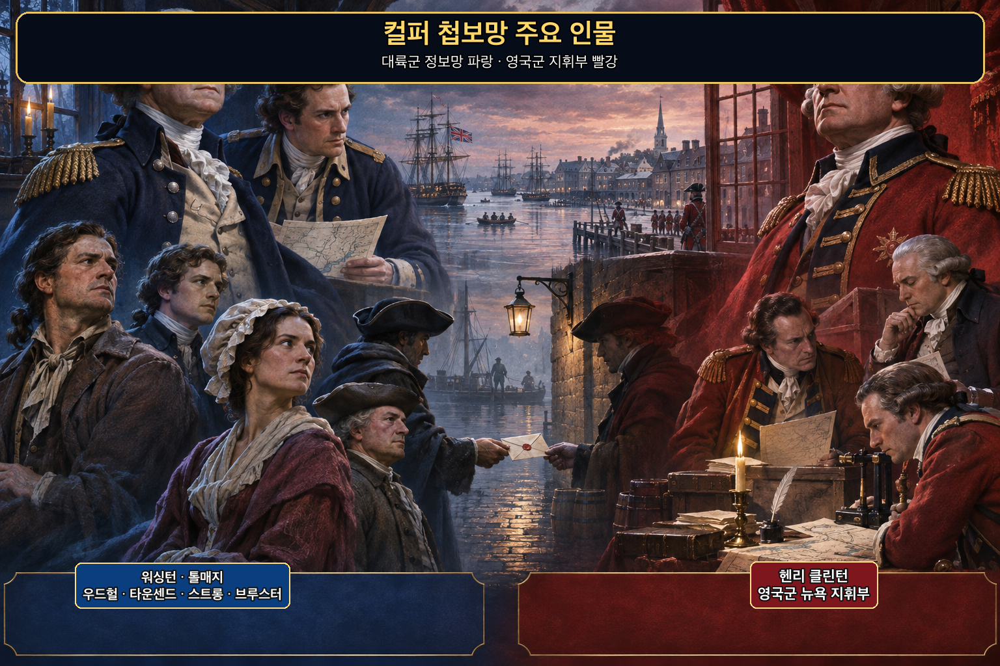

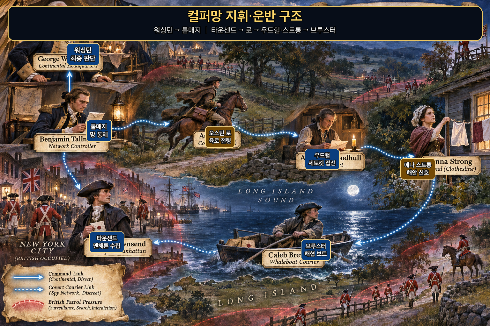

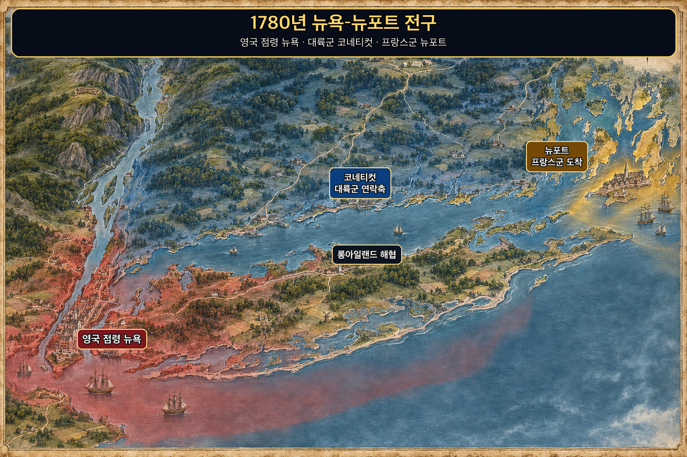

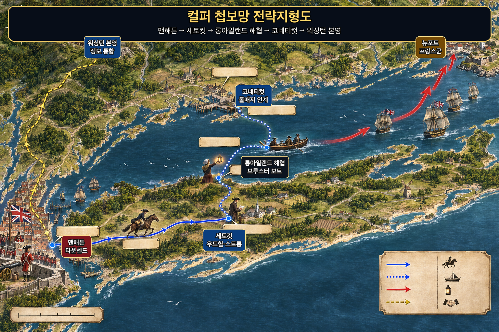

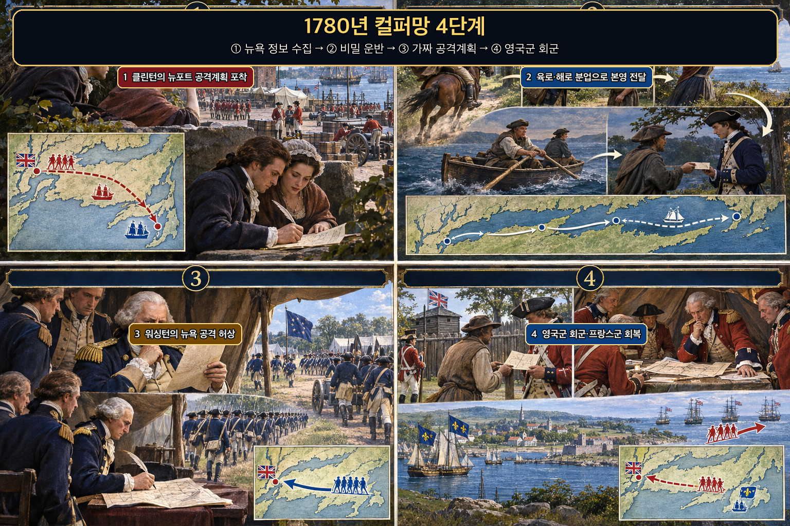

컬퍼망은 한 명의 전설적 첩자가 아니라 서로 다른 접근권과 운반 능력을 가진 사람들을 분리해 연결한 체계였다. **로버트 타운센드(Robert Townsend)**는 영국 점령지 **▰** **뉴욕(New York City)**에서 장교와 상인의 움직임을 관찰했고, **오스틴 로(Austin Roe)**는 상점 거래를 위장해 보고를 동쪽으로 옮겼다. **에이브러햄 우드헐(Abraham Woodhull)**은 **▰** **세토킷(Setauket)**에서 접선과 육로 구간을 맡았으며, **애나 스트롱(Anna Strong)**의 해안 신호와 **케일럽 브루스터(Caleb Brewster)**의 고래잡이 보트가 🌊 **롱아일랜드 해협(Long Island Sound)**을 건넜다. **벤저민 톨매지(Benjamin Tallmadge)**가 망을 통제했고 최종 수신자는 **조지 워싱턴(George Washington)**이었다.

**뒤에서 반복될 지형을 먼저 잡아두기**

- **▰** **맨해튼(Manhattan)**은 영국군 본부·항만·상점이 밀집한 수집 지점이었다. 정보를 얻기 쉬운 만큼 영국 순찰과 방첩에 노출될 위험도 가장 컸다.
- **▰** **세토킷(Setauket)**은 맨해튼에서 동쪽으로 이어지는 육로와 해상 운반이 만나는 중계점이었다. 이 연결이 끊기면 도시의 보고가 워싱턴 본영까지 가지 못했다.
- 🌊 **롱아일랜드 해협(Long Island Sound)**은 영국 점령지와 대륙군 지역을 가르는 장벽이자 브루스터가 밤에 넘은 은밀한 통로였다.
- **▰** **페어필드(Fairfield)**와 코네티컷 연안은 해상 보고를 대륙군 육로로 바꾸는 인계 지점이었다.
- **▰** **뉴포트(Newport)**는 1780년 7월 프랑스 로샹보 군이 도착한 항구였다. 영국군이 회복 전의 프랑스군을 공격하면 동맹 전력이 무너질 수 있었다.

#### 상세 전역 서사 — 뉴포트 공격정보를 뉴욕 공격의 허상으로 되돌리다

1778년부터 톨매지는 우드헐·타운센드·로·브루스터의 임무를 나누고, 가명·숫자 암호·보이지 않는 잉크·중계 운반을 결합했다. 워싱턴은 타운센드에게 상점을 그만두고 전업 첩자가 되라고 하지 않았다. 상점이야말로 영국 점령지에서 의심받지 않고 관찰할 수 있는 위장이었기 때문이다.

1780년 7월, 컬퍼망의 보고는 **헨리 클린턴(Henry Clinton)**이 뉴욕의 영국 병력을 바다로 보내 막 도착한 프랑스군을 뉴포트에서 공격하려 한다는 계획을 워싱턴에게 전했다. CIA의 미국 독립전쟁 정보사 연구는 이 정보가 7월 21일 오후 워싱턴에게 도착했고, 워싱턴이 곧바로 가짜 뉴욕 공격계획을 작성했다고 설명한다.

워싱턴은 서명된 가짜 계획을 한 농부가 길에서 주웠다고 주장하며 영국 전초에 넘기게 했다. 동시에 대륙군을 뉴욕 쪽으로 실제 이동시켜 문서가 단독 거짓말로 보이지 않게 했다. 클린턴은 뉴욕 공격이 임박했다고 판단해 뉴포트로 향하던 병력을 회군시켰다. 정보 수집·운반·분석·기만·가시적 병력 이동이 하나의 결론을 만들었지만, 각 참여자는 전체 경로를 알 필요가 없었다.

이 성과를 컬퍼망 하나로 미국 독립전쟁을 이겼다고 확대해서는 안 된다. 프랑스 함대와 로샹보 군의 존재, 영국의 지휘 부담, 대륙군의 실제 이동이 함께 작용했다. 다만 이 사건은 다수의 은밀한 통로가 한 판단으로 모이고, 그 판단이 다시 공개 신호와 기만으로 변환된 `五間俱起`의 구조를 선명하게 보여 준다.

#### 전투에서 사용된 속임수 — 서명된 가짜 계획과 실제 병력 이동

속인 주체는 **워싱턴**과 대륙군 지휘부였고 실제 목적은 뉴포트의 프랑스군을 보호하는 것이었다. 영국군에는 뉴욕 공격계획 문서와 대륙군의 접근이라는 서로 맞는 신호가 보였다. **클린턴**이 이를 믿은 까닭은 뉴욕이 실제로 중요한 영국 거점이었고 병력 이동이 문서의 내용을 독립적으로 확인하는 듯 보였기 때문이다. 그 판단은 해상 병력의 회군을 낳았고 프랑스군은 회복할 시간을 얻었다.

#### 속임수 작동 구조

**주체와 의도.** 컬퍼망은 클린턴의 계획을 알아냈고 워싱턴은 그 지식을 프랑스군 보호라는 작전목표로 바꾸었다.

**보인 신호와 믿은 이유.** 서명된 가짜 계획과 실제 대륙군 이동은 서로 다른 출처처럼 같은 결론을 지지했다. 뉴욕의 전략적 가치가 그 결론을 더 그럴듯하게 했다.

**유발된 행동과 결과.** 영국군은 뉴포트 공격을 지속하지 않고 뉴욕 방어를 강화하려 회군했다. 수집 정보가 적의 배치를 바꾸는 작전으로 닫혔다.

**사료의 경계.** ‘Lady’의 정확한 신원과 일부 운반 세부에는 논쟁이 남는다. 확인되는 것은 클린턴의 계획정보, 워싱턴의 허위 문서와 병력 이동, 영국군 회군의 연결이며 불확실한 개인 신원은 성과의 단일 원인으로 삼지 않는다.

#### 속임수 일곱 질문

1. **누가 누구를 속였는가?** 워싱턴의 대륙군 지휘부가 클린턴의 영국군 뉴욕 지휘부를 속였다.
2. **어떤 사실이 거짓이었는가?** 대륙군이 곧 뉴욕을 공격한다는 서명 계획은 의도적으로 만든 허위 계획이었다.
3. **어떤 사실은 진실이지만 오해를 유도했는가?** 대륙군 병력이 뉴욕 쪽으로 움직였다는 사실은 참이었지만 그 이동의 실제 목적은 공격 확정이 아니라 기만 강화였다.
4. **상대는 왜 그것을 믿고 싶어 했는가?** 뉴욕은 영국의 핵심 항만·지휘 거점이어서 공격 가능성을 무시했을 때의 손실이 컸다.
5. **속임수가 없었어도 같은 오판이 발생했을까?** 가능성은 낮다. 문서와 가시적 이동이 없었다면 클린턴은 뉴포트 공격을 계속할 더 강한 근거를 가졌다.
6. **속은 사람은 어떤 독립 확인을 생략했는가?** 병력 이동이 실제 공성·보급 준비와 연결되는지, 문서의 발견 경로가 조작될 수 있는지 충분히 분리하지 못했다.
7. **신뢰·동의·안전을 해치지 않으면서 같은 원리를 어디서 연습할 수 있는가?** 레드팀 모의훈련에서 문서·로그·현장 움직임이 같은 원천에서 설계됐는지 추적하고, 독립 검증팀이 행동 증거를 따로 확인하는 방식으로 연습할 수 있다.

#### 시계편 兵者詭道也 — 이 전장에 해당하는 속이는 길

<table fit-page-width="true" header-row="true">
<tr><td>해당 구절·독음·뜻</td><td>전장의 장면</td></tr>
<tr><td>用而示之不用 용이시지불용 — 쓰면서 쓰지 않는 듯 보인다</td><td>컬퍼망의 실제 목적은 뉴포트 보호였지만 외부에는 뉴욕 공격 준비가 전면에 보였다.</td></tr>
<tr><td>近而示之遠 근이시지원 — 가까운 것을 멀리 보인다</td><td>뉴포트의 즉각적 위험을 숨기고 영국군이 자기 본거지 뉴욕의 위협에 집중하게 했다.</td></tr>
</table>

#### 法 한눈 비교 — 곡제·관도·주용

<table fit-page-width="true" header-row="true">
<tr><td>진영</td><td>곡제(편제)</td><td>관도(지휘)</td><td>주용(보급·지속)</td></tr>
<tr><td>**대륙군 정보망**</td><td>수집·육로·해로·통제·최종판단을 분리했다.</td><td>톨매지가 접점과 암호를 통제하고 워싱턴이 목적을 결정했다.</td><td>상점·농장·보트·기병 등 기존 생활 기반을 위장과 운반에 활용했다.</td></tr>
<tr><td>**영국군 뉴욕 지휘부**</td><td>뉴욕 수비와 뉴포트 원정 전력이 같은 병력 풀에서 경쟁했다.</td><td>클린턴이 문서와 군 이동을 뉴욕 공격 신호로 통합했다.</td><td>해상 원정은 회군 명령에 민감했고 프랑스군 공격 시간창을 잃었다.</td></tr>
</table>

#### **헨리 클린턴(Henry Clinton, 패)**

<table fit-page-width="true" header-row="true">
<tr><td>요소</td><td>판단</td></tr>
<tr><td color="orange_bg">🤝 **道**</td><td>뉴욕 방어와 뉴포트 공격의 우선순위를 동시에 만족시키지 못해 원정 의지가 흔들렸다. (지기·결속)</td></tr>
<tr><td color="blue_bg">🌤️ **天**</td><td>서명 문서와 대륙군 이동이 독립 증거일 가능성뿐 아니라 하나의 기만 설계일 가능성을 충분히 계산하지 못했다. (지피·타이밍·확률 관점)</td></tr>
<tr><td color="green_bg">🧭 **地**</td><td>뉴욕과 뉴포트 사이의 해상 거리는 병력을 한쪽에 보내는 순간 다른 쪽의 위험을 키웠다. (원근·사생)</td></tr>
<tr><td color="purple_bg">🎖️ **將**</td><td>**클린턴**은 뉴욕 상실 위험을 중하게 보았으나 허위 문서의 전달경로를 재검증하지 못했다. (지신인용엄)</td></tr>
<tr><td color="yellow_bg">⚙️ **法**</td><td>원정 함대와 뉴욕 수비의 전환 비용 때문에 한 번의 회군이 작전 시간창을 닫았다. (곡제·관도·주용)</td></tr>
</table>

**직관·편향 한 줄:** 서명 문서와 눈앞의 병력 이동을 같은 공격 서사의 독립 증거로 묶은 판단에는 일관된 한 시나리오에 집중하는 확증편향이 작동한 것으로 볼 수 있으며, 뉴포트 공격의 시기를 잃게 했다.

🏳️ **패군 측 결과** — 六敗 가운데 정보와 명령선이 허상에 끌린 `亂(란)`의 성격이 강하다. 🔀 **패군 측 회피 분기점**은 발견 문서의 출처와 대륙군 이동의 실제 보급·공성 준비를 분리 검증하고, 뉴욕 방어예비대와 뉴포트 원정대를 전부 회군시키지 않는 것이었다.

#### **조지 워싱턴(George Washington, 승)**

<table fit-page-width="true" header-row="true">
<tr><td>요소</td><td>판단</td></tr>
<tr><td color="orange_bg">🤝 **道**</td><td>**워싱턴**은 각 첩보원의 전모 접근을 제한하면서 톨매지의 통제 아래 공동목표를 유지했다. (지기·신뢰)</td></tr>
<tr><td color="blue_bg">🌤️ **天**</td><td>프랑스군이 항해 직후 취약하고 영국군이 뉴욕 방어를 중시한다는 외부 변수를 결합해 회군 확률을 높였다. (지피·타이밍·확률 관점)</td></tr>
<tr><td color="green_bg">🧭 **地**</td><td>맨해튼–세토킷–해협–코네티컷의 분절된 지형을 오히려 정보망의 구획과 방호에 사용했다. (원근·험이)</td></tr>
<tr><td color="purple_bg">🎖️ **將**</td><td>**워싱턴**은 정보 수신에서 멈추지 않고 허위 문서와 실제 이동을 결합해 적 행동을 바꾸었다. (지·용·엄)</td></tr>
<tr><td color="yellow_bg">⚙️ **法**</td><td>암호·가명·보이지 않는 잉크·육해 중계·필요지식 원칙으로 한 구간 노출이 전체 망으로 번지지 않게 했다. (곡제·관도·주용)</td></tr>
</table>

🏆 **승군 측 결과** — `以虞待不虞者勝(이우대불우자승, 준비한 채 준비되지 않은 적을 상대하는 자가 이긴다)`에 가깝다. 다중 보고를 한 판단으로 묶고 그 판단을 적의 이동을 바꾸는 작전으로 전환했다.

##### 法을 압축하지 않고 보기 — 곡제·관도·주용

**곡제 曲制(곡제): 부대를 어떻게 나누고 결합했는가**
<table fit-page-width="true" header-row="true">
<tr><td>진영</td><td>곡제(편제)</td></tr>
<tr><td>**대륙군 정보망**</td><td>도시 수집·육로 운반·해협 횡단·망 통제·최종판단을 다른 사람에게 맡겨 서로의 노출 범위를 제한했다.</td></tr>
<tr><td>**영국군**</td><td>뉴욕 수비와 뉴포트 원정이 같은 지휘 판단에 묶여 기만 신호 하나가 양쪽 배치를 함께 흔들었다.</td></tr>
</table>

**관도 官道(관도): 누가 명령하고 어떻게 전달했는가**
<table fit-page-width="true" header-row="true">
<tr><td>진영</td><td>관도(지휘)</td></tr>
<tr><td>**대륙군 정보망**</td><td>톨매지가 암호명·운반 순서·과업을 통제했고 워싱턴이 정보 요구와 기만 결심을 직접 연결했다.</td></tr>
<tr><td>**영국군**</td><td>클린턴이 입수 문서와 군 이동을 종합했으나 두 증거가 같은 기만 목적에서 나왔는지 역추적하지 못했다.</td></tr>
</table>

**주용 主用(주용): 군량·장비·전투 지속 능력을 어떻게 썼는가**
<table fit-page-width="true" header-row="true">
<tr><td>진영</td><td>주용(보급·지속)</td></tr>
<tr><td>**대륙군 정보망**</td><td>상점·농장·말·고래잡이 보트와 보이지 않는 잉크를 활용해 대규모 전담조직 없이 장기 운용했다.</td></tr>
<tr><td>**영국군**</td><td>뉴포트 해상작전은 선박·병력·시간의 집중이 필요해 회군 뒤 같은 기회를 즉시 되살리기 어려웠다.</td></tr>
</table>

**출처:** [CIA, Three Key Intelligence Contributions of the Culper Ring](https://www.cia.gov/stories/story/three-key-intelligence-contributions-of-the-little-known-culper-ring/) · [CIA, The Founding Fathers of American Intelligence](https://www.cia.gov/resources/csi/static/4c28451b90165b446ac948e3dd47c972/The-Founding-Fathers-of-American-Intelligence-.pdf) · [George Washington's Mount Vernon, George Washington Spymaster](https://www.mountvernon.org/george-washington/the-revolutionary-war/spying-and-espionage/george-washington-spymaster)

### 동양 — 🏛️ 청 황제 직통 주접망 vs 누층 관료제의 지연·누설 │ 옹정제의 궁중주접 제도(1723~1735)

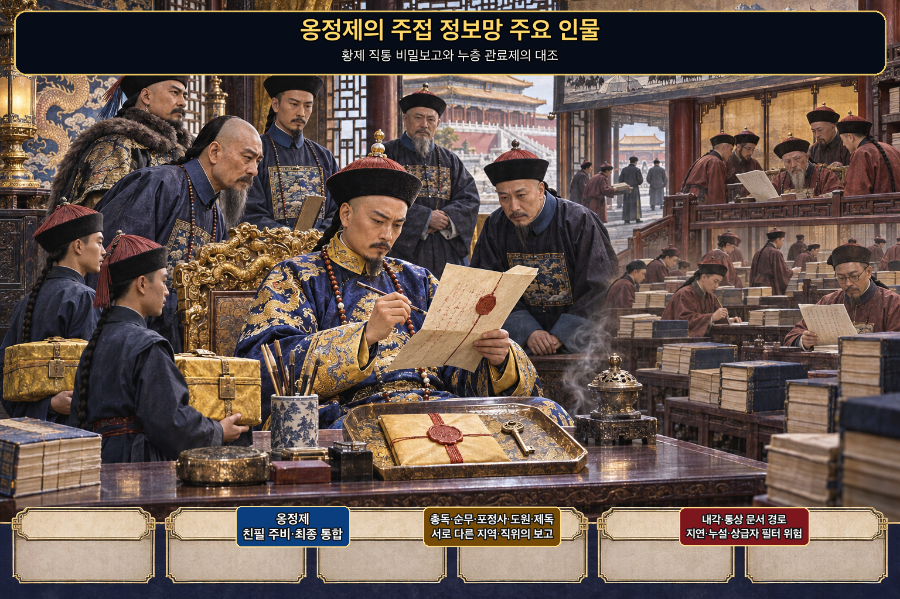

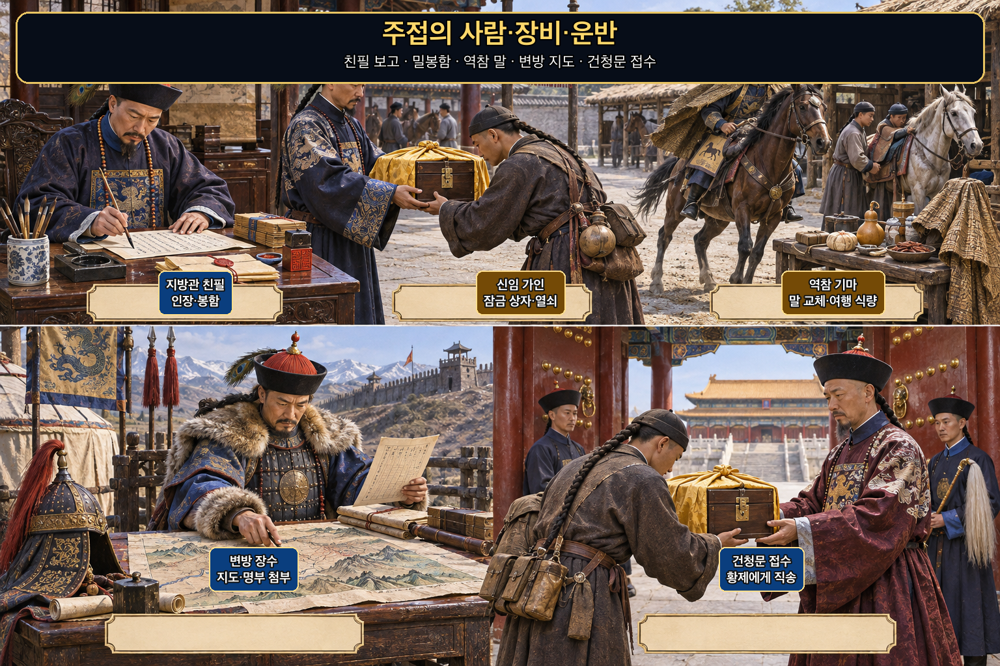

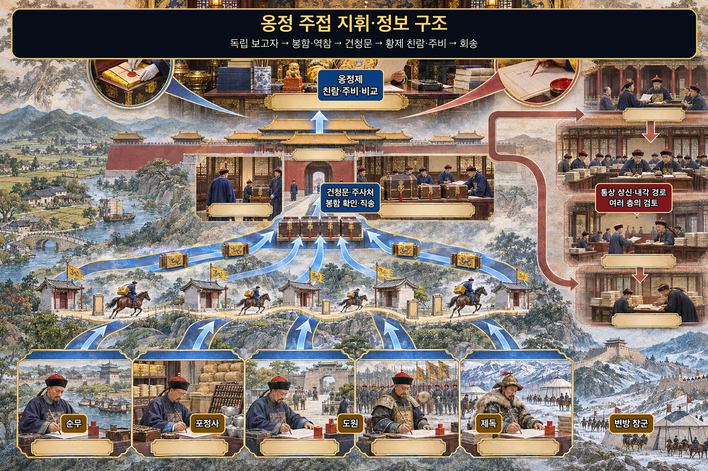

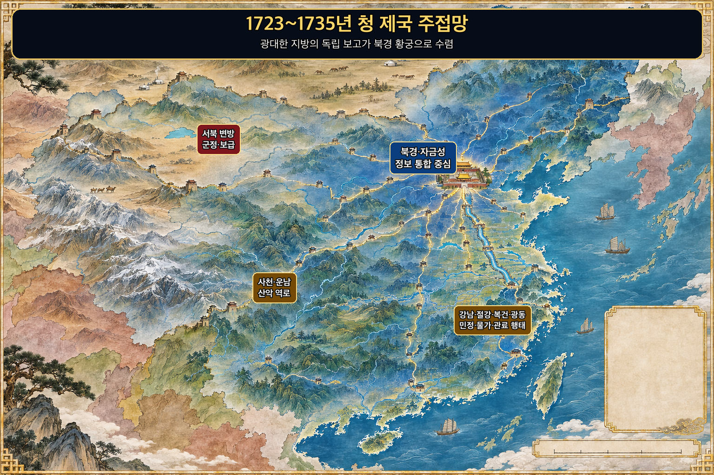

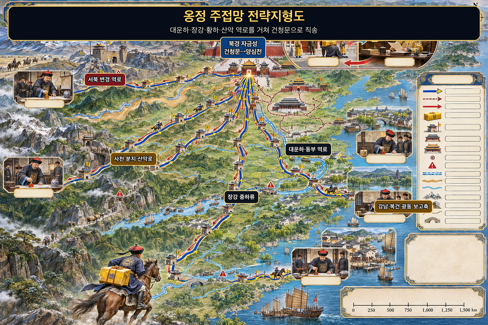

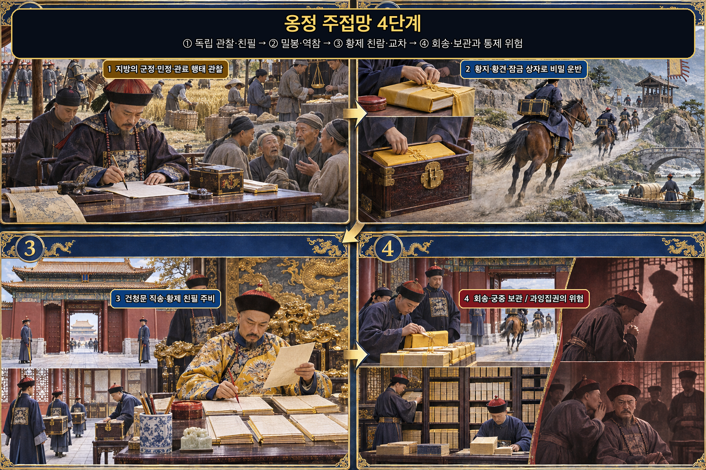

궁중주접은 전투의 첩자망과 같지는 않지만, 서로 다른 지방과 직위의 보고를 비밀 직통경로로 결합한 역사적 정보체계였다. 강희제 때 시작된 제도를 **옹정제(雍正帝)**가 확대·정규화했다. 총독·순무뿐 아니라 포정사·도원·제독 등 더 다양한 고위 관원이 민정·군정·물가·풍속·관리 행태를 친필로 보고하면서, 상급자 한 명이 지방의 모든 정보를 걸러 올리는 구조를 우회했다.

**뒤에서 반복될 지형을 먼저 잡아두기**

- **▰** **북경(北京)**의 자금성은 보고가 수렴하는 중심이었다. 건청문 부근의 주사처를 통과한 봉함은 황제에게 직접 전달됐다.
- 🌊 **대운하(大運河)**와 동부 역로는 강남·절강의 재정·곡물·민정 보고가 북상하는 핵심 축이었다.
- 🌊 **장강(長江)**과 🌊 **황하(黃河)**는 넓은 행정권역을 잇지만 홍수·계절·도하가 전달시간을 바꾸는 자연 장벽이기도 했다.
- ⛰️ **사천 산로(四川山路)**와 ⛰️ **서북 변경(西北邊境)**은 거리와 험로 때문에 역참·말 교체·봉함의 무결성이 특히 중요했다.
- **▰** **건청문(乾清門)**에서 양심전까지의 마지막 짧은 구간은 일반 문서경로와 황제 직통경로를 가르는 제도적 병목이었다.

#### 상세 통치 서사 — 지방의 눈을 늘리되 봉함의 열쇠와 최종 판단은 중앙에 모으다

명·청의 통상 상신은 여러 관청과 상급자의 검토를 거쳐 황제에게 갔다. 이 과정은 행정적 검토를 제공했지만 긴급문서를 늦추고 민감한 내용이 새거나 지방 상급자가 불리한 정보를 걸러낼 여지도 만들었다. 강희제는 별도의 사적 보고경로를 만들었고 옹정제는 이를 넓혀 지방의 서로 다른 직위가 독립적으로 보고하게 했다.

국립고궁박물원 자료에 따르면 보고자는 문서를 직접 써서 봉하고, 신임하는 가인이 말로 운반했다. 문서는 황지와 황견으로 싸고 잠금 상자에 넣었으며, 열쇠와 상자는 내정이 관리했다. 건청문 당직자가 이를 황제에게 올리면 황제는 직접 붉은 글씨로 답하고 같은 보호경로로 돌려보냈다.

이 구조는 보고자 수를 늘리는 데서 끝나지 않았다. 서로 다른 직위가 같은 지방의 군정·세정·관리 행태를 보고하면 황제는 불일치 자체를 질문으로 바꿀 수 있었다. 옹정제는 보고가 개인 수중에 흩어져 망의 기억을 잃지 않도록 연말 회수와 궁중 보관을 명했고, 나중에는 발송 기록의 참조 사본도 남겼다. `神紀`에 가까운 지점은 비밀의 신비화가 아니라 수집·봉함·회송·보관의 반복 가능한 규율이다.

그러나 성공은 곧 한계를 만들었다. 황제에게 정보와 결재가 과도하게 집중되면 독립 보고가 교차검증이 아니라 경쟁적 밀고로 변할 수 있고, 외부 관료제는 책임 있게 판단하기보다 황제의 비공개 의중을 추측하게 된다. 옹정대 주접망은 `莫知其道`의 효과와 함께, 경로를 아는 책임자가 검증·반론·기록을 독점할 때 생기는 위험도 보여 준다.

#### 法 한눈 비교 — 곡제·관도·주용

<table fit-page-width="true" header-row="true">
<tr><td>진영</td><td>곡제(편제)</td><td>관도(지휘)</td><td>주용(보급·지속)</td></tr>
<tr><td>**궁중주접망**</td><td>지역·직위가 다른 보고자를 병렬로 두고 황제가 통합했다.</td><td>친필·봉함·건청문 직송·황제 주비·원보고자 회송으로 경로를 줄였다.</td><td>역참 말·잠금함·황지·황견·궁중 보관으로 장거리 지속성을 확보했다.</td></tr>
<tr><td>**통상 문서경로**</td><td>하급 보고가 상급자와 중앙 관청을 차례로 거쳤다.</td><td>검토층이 많아 전문성은 얻지만 지연·누설·선별 위험이 컸다.</td><td>공식 문서망은 넓고 안정적이지만 긴급·민감 보고에 둔했다.</td></tr>
</table>

#### **누층 관료제의 정보 필터(패)**

<table fit-page-width="true" header-row="true">
<tr><td>요소</td><td>판단</td></tr>
<tr><td color="orange_bg">🤝 **道**</td><td>하급자가 상급자에게 불리한 사실을 올릴 유인이 약해지면 보고가 실제보다 일치된 목소리로 변했다. (지기·결속)</td></tr>
<tr><td color="blue_bg">🌤️ **天**</td><td>거리와 계절뿐 아니라 중간 검토자의 선택이 도착 정보의 분포를 바꾸는 외부변수였다. (지피·타이밍·확률 관점)</td></tr>
<tr><td color="green_bg">🧭 **地**</td><td>광대한 제국과 강·산·변경의 거리가 문서 지연과 정보 비대칭을 키웠다. (원근·험이)</td></tr>
<tr><td color="purple_bg">🎖️ **將**</td><td>상급 관원이 자기 평가에 불리한 보고까지 전달하는지에 따라 중앙의 현실 인식이 달라졌다. (신·엄)</td></tr>
<tr><td color="yellow_bg">⚙️ **法**</td><td>누층 결재는 책임 분산과 누설 지점을 늘려 민감 정보의 속도와 원형을 훼손할 수 있었다. (곡제·관도·주용)</td></tr>
</table>

**직관·편향 한 줄:** 여러 단계에서 다듬어진 보고를 객관적 합의로 보는 판단에는 같은 위계의 필터를 거친 상관된 보고를 독립 증거로 착각하는 편향이 작동할 수 있으며, 지방의 나쁜 소식을 늦게 발견하게 한다.

🏳️ **패군 측 결과** — 전투의 六敗에 직접 대응시키면 명령·보고경로가 실제를 흐리는 `亂(란)`의 제도적 형태다. 🔀 **패군 측 회피 분기점**은 통상 경로를 폐기하는 것이 아니라, 긴급·민감 사안에 독립 직통보고와 사후 대조를 허용하는 것이었다.

#### **옹정제(雍正帝, 승)**

<table fit-page-width="true" header-row="true">
<tr><td>요소</td><td>판단</td></tr>
<tr><td color="orange_bg">🤝 **道**</td><td>**옹정제**는 서로 다른 직위의 보고자를 황제와 직접 연결해 상급자 한 사람의 정보독점을 약화했다. (지기·결속)</td></tr>
<tr><td color="blue_bg">🌤️ **天**</td><td>지방관의 관찰 범위와 이해관계가 다르다는 변수를 없애지 않고 보고 수와 위치를 늘려 단일 실패 확률을 낮췄다. (지피·확률 관점)</td></tr>
<tr><td color="green_bg">🧭 **地**</td><td>역참과 잠금 상자를 통해 강·산·장거리의 전달손실을 줄였지만 거리 자체는 없애지 못했다. (원근·험이)</td></tr>
<tr><td color="purple_bg">🎖️ **將**</td><td>**옹정제**가 직접 읽고 주비하면서 통합 책임을 졌으나 과도한 집중은 반론 통로를 약화시키는 위험도 만들었다. (지·엄과 한계)</td></tr>
<tr><td color="yellow_bg">⚙️ **法**</td><td>친필·밀봉·잠금·직송·회송·연말 회수·보관을 한 절차로 묶었다. (곡제·관도·주용)</td></tr>
</table>

🏆 **승군 측 결과** — `識衆寡之用者勝(식중과지용자승, 많고 적은 수의 쓰임을 아는 자가 이긴다)`에 비유할 수 있다. 보고자를 무작정 늘리지 않고 서로 다른 위치의 제한된 눈을 직통경로와 기록으로 결합했다.

##### 法을 압축하지 않고 보기 — 곡제·관도·주용

**곡제 曲制(곡제): 부대를 어떻게 나누고 결합했는가**
<table fit-page-width="true" header-row="true">
<tr><td>진영</td><td>곡제(편제)</td></tr>
<tr><td>**궁중주접망**</td><td>총독·순무·포정사·도원·제독 등 접근 범위가 다른 보고자를 병렬로 배치했다.</td></tr>
<tr><td>**통상 경로**</td><td>문서가 동일 위계선을 순차 통과해 상급자가 하급자의 관찰을 합치거나 지울 수 있었다.</td></tr>
</table>

**관도 官道(관도): 누가 명령하고 어떻게 전달했는가**
<table fit-page-width="true" header-row="true">
<tr><td>진영</td><td>관도(지휘)</td></tr>
<tr><td>**궁중주접망**</td><td>보고자 친필→신임 가인→역참→건청문→황제 친람·주비→원보고자 회송으로 책임자를 명확히 했다.</td></tr>
<tr><td>**통상 경로**</td><td>지방 상급자·내각 등 여러 검토층이 전문성을 제공하는 동시에 긴급성·기밀성과 충돌했다.</td></tr>
</table>

**주용 主用(주용): 군량·장비·전투 지속 능력을 어떻게 썼는가**
<table fit-page-width="true" header-row="true">
<tr><td>진영</td><td>주용(보급·지속)</td></tr>
<tr><td>**궁중주접망**</td><td>황지·황견·봉랍·잠금 상자·열쇠·역참 말을 표준화하고 회수·보관으로 제도 기억을 만들었다.</td></tr>
<tr><td>**통상 경로**</td><td>기존 관청과 운송망을 넓게 쓸 수 있었지만 문서 복제·대기·누설 지점이 많았다.</td></tr>
</table>

**출처:** [National Palace Museum, Understanding Qing Dynasty Palace Memorials](https://www.npm.gov.tw/Publications-Content.aspx?l=2&sno=04013226) · [National Palace Museum, Palace Memorials](https://theme.npm.edu.tw/selection/Article.aspx?lang=2&sNo=04001049) · [Mark C. Elliott, The Manchu-Language Archives and the Palace Memorial System](https://elliott.scholars.harvard.edu/sites/g/files/omnuum10991/files/elliott/files/elliott_lic_manchu_language_archives_and_palace_memorial_system.pdf) · [Social Forces, Information Foundations of State Capacity](https://academic.oup.com/sf/advance-article/doi/10.1093/sf/soaf106/8208286?guestAccessKey=709dd3a5-1c65-41c7-b235-48e26b177de6)

---
## 5. 핵심 통찰 + 실생활 적용 + 생활루틴

### 핵심 통찰

이 구절의 중심은 비밀스러운 천재가 아니라 **분산된 앎을 결합하면서도 한 번의 노출로 전체가 무너지지 않게 하는 질서**다. 다섯 간첩은 각자 일부만 보고, 지휘부는 그 일부의 접근 범위·시점·의존 관계를 따져 한 판단으로 묶는다. 적은 연결선을 보지 못하지만, 책임자는 근거와 불확실성을 알아야 한다.

`神紀`는 그래서 모순처럼 보이는 두 요구를 함께 만족시킨다. 정보는 공유되어야 쓸 수 있지만, 지나치게 공유되면 출처와 계획이 노출된다. 비밀은 지켜야 하지만, 지나치게 가리면 검증과 책임도 사라진다. **필요한 만큼만 나누고, 독립적으로 확인하며, 한곳에서 책임 있게 통합하는 것**이 이 문장의 가장 예리한 통찰이다.

### 실생활 적용

3교대 현장에서 에러가 나면 상황실 화면, 현장 장비, 이전 조의 인수인계, 오피스 지시, 자동 로그가 서로 다른 일부를 보여 준다. 화면을 본 사람의 말만 반복하거나, 현장 작업자의 체감만으로 전체 원인을 확정하면 여러 보고가 있어도 실제 근거는 하나다. 먼저 관찰 시각과 직접 본 범위, 전해 들은 내용, 로그와 맞는지를 분리해야 한다.

그다음 모든 사람에게 모든 정보를 뿌리지 않는다. 안전 조치 담당자에게는 즉시 필요한 증상과 중단 조건을, 현장 담당자에게는 장비와 위치를, 관리자에게는 영향 범위와 선택지를 전달한다. 한 사람은 기록표에 원출처와 확인 상태를 모아야 한다. 이것이 일상의 `俱起`이며, 개인정보·추측·민감한 책임 판단을 필요 이상으로 퍼뜨리지 않는 것이 `莫知其道`의 윤리적 적용이다.

사용자의 관찰 기록에서 반복되는 근무 위험도 같은 구조로 다룰 수 있다. 피로한 동료가 모니터링을 놓쳤다는 한 장면을 곧바로 성격 전체의 결론으로 만들지 않는다. 당시 수면·역할·화면 알림·메신저·실제 조치 기록을 분리하고, 다음 교대에는 누가 모니터링하고 누가 현장 조치하며 누가 기록할지를 미리 정한다. 사람을 몰래 시험하는 대신 공개된 역할과 독립 확인으로 사고 가능성을 낮춘다.

### 생활루틴 추천

**여러 보고의 원출처와 확인 상태를 적지 않으면 재수가 없다.**

**이유:** 오늘 중요한 보고 하나를 받을 때 1분 안에 `직접 관찰 / 전언 / 로그 / 관찰 시각 / 독립 확인 / 공유 범위`를 한 줄씩 적는다. 이를 생략하면 같은 소문이 여러 사람의 입을 거쳐 독립된 사실처럼 커지고, 민감한 내용은 필요 이상으로 퍼져 출처와 관계까지 손상될 수 있다. `五間俱起`는 많은 말을 모으라는 명령이 아니라 서로 다른 통로를 한 판단으로 엮으라는 원리이고, `莫知其道`는 그 연결선을 책임 있게 보호하라는 조건이다.
