<!-- sunzi-analysis-mode: light -->
> 향간자, 인기향인이용지, 내간자, 인기관인이용지, 반간자, 인기적간이용지. — 사람의 위치와 접근 범위를 구분하지 않고 말을 모으면 재수가 없다.

---
## 1. 원문 + 독음 + 직역 + 한자어 뜻풀이

鄕間者, 因其鄕人而用之, 內間者, 因其官人而用之, 反間者, 因其敵間而用之. 향간자, 인기향인이용지, 내간자, 인기관인이용지, 반간자, 인기적간이용지.

**직역**  
향간은 적지의 고을 사람에게 기대어 그를 쓰는 것이고, 내간은 적국의 관직에 있는 사람에게 기대어 그를 쓰는 것이며, 반간은 적이 보낸 간첩에게 기대어 그를 되돌려 쓰는 것이다.

	앞 구절은 다섯 간첩을 하나의 체계로 함께 일으키라고 했다. 이번 문장은 그 가운데 셋을 **사람이 서 있는 자리와 접근할 수 있는 정보**로 구분한다. 고을 사람은 땅과 생활의 변화를 보고, 관리는 제도와 명령의 안쪽을 보며, 적의 간첩은 적이 무엇을 알고 싶어 하는지와 어떤 경로로 우리를 관찰하는지를 드러낸다.

	세 유형의 차이는 충성심의 높고 낮음이나 정보의 서열이 아니다. 같은 사람도 자기가 닿지 못한 곳의 일은 알 수 없다. 손자는 정보를 들었을 때 먼저 “누가 말했는가”보다 **그 사람이 어디에 있었고 무엇을 직접 볼 수 있었는가**를 묻게 한다. `因`은 그 접근 조건을 발판으로 삼으라는 말이고, `用`은 말을 그대로 믿는 것이 아니라 목적에 맞게 검증하고 배치하는 행위다.

	#### 鄕間(향간) — 지도 밖의 생활 변화를 먼저 아는 현지의 눈

	`鄕`은 사람들이 모여 사는 고을과 지역 공동체를 가리키고, `間`은 두 진영 사이에서 정보를 잇는 사람이다. 향간은 막연한 “민간인 첩자”가 아니라 길·물자·민심·수비 변화처럼 현지인이 일상에서 접하는 사실에 접근한 사람이다. 정규 보고에는 늦게 잡히는 시장의 품귀, 통행의 변화, 낯선 병력의 숙영이 그의 시야에는 먼저 들어올 수 있다.

	그러나 현지성은 전지성을 뜻하지 않는다. 한 마을의 경험을 적국 전체로 확대하거나, 소문을 직접 관찰처럼 받아들이면 향간의 강점이 곧 오류가 된다. 따라서 관찰 시각·장소·직접 본 것과 전해 들은 것을 나누어야 비로소 그 지역 지식이 작전에 쓰인다.

	#### 內間(내간) — 관청 안의 절차와 결정에 닿아 있는 눈

	`內`는 적국 권력과 행정의 안쪽을, `官人`은 그 안에서 직무를 맡은 사람을 가리킨다. 내간의 가치는 높은 직함 자체에 있지 않다. 명령이 어느 부서에서 만들어지고, 군량과 인사가 어떻게 움직이며, 공식 발표와 실제 준비 사이에 어떤 차이가 있는지 볼 수 있는 **직무상의 접근성**에 있다.

	관리는 자기 관할을 자세히 알아도 다른 부서나 최고 지휘부의 의도까지 모두 알지는 못한다. 개인적 불만이나 이해관계도 보고의 선택에 영향을 줄 수 있다. 그러므로 직책·접근 범위·보고 시점·다른 자료와의 일치 여부를 분리해 평가해야 한다. 내부자라는 이름만으로 신뢰도를 보증하면 안 된다.

	#### 反間(반간) — 적이 보낸 관찰선을 거꾸로 정보원과 통로로 바꾸다

	`反`은 돌아오고 뒤집는다는 뜻이다. 반간은 우리 편 사람을 적진에 보내는 유형이 아니라, 적이 우리를 살피려고 보낸 간첩을 알아내어 되돌려 쓰는 유형이다. 그는 적의 질문·우선순위·보고 경로를 알고 있으므로, 적이 무엇을 두려워하거나 기대하는지 보여 주는 특별한 출처가 된다.

	그렇다고 붙잡힌 적 간첩의 말이 곧 진실이 되는 것은 아니다. 그는 살아남기 위해 우리에게 맞는 말을 하거나, 처음부터 이중 역할을 염두에 둘 수 있다. 반간의 운용에는 신원과 접근 범위의 확인, 독립된 검증, 제한된 정보 제공, 역기만 가능성의 지속적 평가가 필요하다. 뒤 구절이 반간을 오간의 중심에 놓는 까닭도 그가 사람 하나가 아니라 **적의 정보 체계와 연결된 통로**이기 때문이다.

	#### 因(인할 인) — 사람을 소유하지 않고 그가 가진 조건을 발판으로 삼다

	`因`은 기대고, 따르고, 말미암는다는 뜻이다. 세 문장에 같은 글자가 반복되는 까닭은 향인·관인·적간이라는 신분표보다 그들이 가진 자리와 관계를 이용하라는 데 있다. 손자는 사람의 이름을 바꾸어 부르는 데서 멈추지 않고, 각자가 실제로 접할 수 있는 사실을 그에 맞는 질문과 임무에 연결한다.

	이 글자는 현대 적용의 한계도 분명히 한다. 전쟁의 적대적 공작을 직장과 인간관계에 옮겨 몰래 사람을 포섭하라는 말로 읽어서는 안 된다. 평시에는 공개된 역할, 적법한 권한, 동의와 개인정보 보호 안에서 **가장 가까운 현장·절차·외부 관찰 경로를 구분하여 확인하는 원리**만 가져와야 한다.

	#### 用(쓸 용) — 보고를 수집하는 데서 멈추지 않고 판단에 맞게 배치하다

	`用`은 단순히 사람을 부린다는 뜻보다, 얻은 접근을 실제 판단과 행동에 쓰는 단계까지 포함한다. 향간에게 궁중의 의도를 묻거나 내간에게 모든 지역 민심을 대표하게 하면 사람은 있어도 제대로 쓴 것이 아니다. 질문은 출처가 볼 수 있는 범위와 맞아야 하고, 중요한 결론은 서로 다른 위치의 근거로 확인되어야 한다.

	따라서 `用之`에는 한계 표시가 붙는다. 무엇을 직접 보았는지, 어디까지 추정인지, 언제의 정보인지, 어떤 조건이면 판단을 바꿀지를 기록해야 한다. 정보원의 말을 존중하는 것과 그 말을 검증 없이 확정하는 것은 다르다.

	#### 글자들이 완성하는 한 장면

	`鄕間`은 적지의 생활과 지형 가까이에서 변화를 보고, `內間`은 관청과 지휘 절차 안에서 결정의 움직임을 본다. `反間`은 적이 우리에게 뻗은 관찰선을 거꾸로 따라가 적의 질문과 기대를 드러낸다. 세 사람은 같은 대상을 보더라도 서로 다른 면을 본다.

	손자는 이 차이를 없애지 않고 `因`으로 각각의 접근 조건에 기대며, `用`으로 그 조건에 맞는 질문과 임무를 준다. **사람 수를 늘리는 것이 아니라 서로 다른 자리에 있는 눈의 한계를 알고 맞물리게 하는 것**, 그것이 이 문장이 보여 주는 정보 운용의 첫 장면이다.

---
## 2. 전통 주석 기반 분석

- **조조(曹操)** — “적국의 고을 사람, 관직에 있는 사람, 우리를 엿보러 온 적의 간첩을 그 자리대로 써라. **누가 무엇에 닿아 있는지 먼저 가려라.**”
- **이전(李筌)** — “향간에게는 그 고을의 사정을, 내간에게는 관청 안의 일을 물어라. **사람의 이름보다 실제 접근 범위에 맞춰 임무를 주어라.**”
- **두목(杜牧)** — “적국 사람 가운데 쓸 만한 자를 골라 지역 사정을 얻고, 관리의 틈을 통해 내부 계획을 살펴라. **서로 다른 자리를 같은 정보원처럼 다루지 마라.**”
- **매요신(梅堯臣)** — “향인은 밖의 형편을 알고 관인은 안의 계책을 안다. **안팎의 보고를 맞대어 한쪽 말만으로 결론 내리지 마라.**”
- **장예(張預)** — “고을 사람으로 지역의 허실을 살피고, 적의 관리를 통해 조정의 일을 들으며, 적의 간첩은 돌려 써라. **각자가 아는 까닭을 따라 이용하라.**”
- **왕석(王晳)** — “적의 간첩이 왔다면 죽이는 데서 그치지 말고 그가 받은 임무와 보고 길을 살펴라. **적의 눈을 돌려 적의 마음을 비추게 하라.**”
- **가림(賈林)** — “향간은 마을의 사람에게서 나오고 내간은 관직의 사람에게서 나온다. **직위가 높다는 이유만으로 모든 일을 안다고 믿지 마라.**”
- **두우(杜佑)** — “현지의 백성과 적국 관리와 적이 보낸 간첩을 분별하여 써라. **출처의 처지와 이해관계를 함께 살펴 보고를 검증하라.**”
- **진호(陳皞)** — “반간은 적이 심은 눈을 우리 쪽으로 돌리는 일이다. **한 번 돌아섰다는 말만 믿지 말고 역기만의 가능성을 끝까지 경계하라.**”

#### 리링의 고증과 현대적 독법

리링의 문헌학적 관점에서 보면 이 문장은 세 개의 평행문이다. `鄕間者 / 內間者 / 反間者` 뒤에 각각 `因其鄕人 / 因其官人 / 因其敵間`이 오고, 모두 `而用之`로 닫힌다. 분류 기준은 추상적인 충성 등급이 아니라 **적 사회 안에서 차지한 위치와 관계**이며, 반복되는 `因`이 그 위치를 이용의 근거로 만든다.

`鄕人`은 적국의 모든 백성을 뭉뚱그린 말이 아니라 특정 지역 사정을 아는 사람이고, `官人`은 현대적 의미의 고위 관료로만 좁힐 수 없다. 관청과 권력 기구 안에서 직무를 가진 사람이라는 폭으로 읽어야 한다. `敵間`도 이미 우리 편이 된 사람을 뜻하는 것이 아니라 적이 보낸 간첩이며, 그를 돌려 쓰는 과정은 뒤의 `必索敵人之間來間我者`에서 더 자세히 펼쳐진다.

현대의 정보 분류를 곧바로 고대 다섯 간첩과 일대일 대응시키는 것도 조심해야 한다. 기술 정보가 거의 없던 시대의 인적 접근 구조를 설명하는 문장이기 때문이다. 오늘날 가져올 수 있는 핵심은 사람을 몰래 지배하는 술수가 아니라, **출처가 놓인 자리·접근 범위·이해관계·보고 경로를 구분해야 정보가 된다**는 원리다.

---
## 3. 교차 설명

### ① 손자병법 내 교차

앞의 `必取於人, 知敵之情者也`(필취어인, 지적지정자야 — 반드시 사람에게서 취하여 적의 실정을 알아야 한다)는 선지의 출처를 사람으로 한정했다. 이번 구절은 그 `人`이 하나의 덩어리가 아님을 보여 준다. 현지인, 내부 관리, 적의 간첩은 서로 다른 사실에 닿아 있으므로 질문과 검증법도 달라야 한다.

바로 앞 `五間俱起, 莫知其道`(오간구기, 막지기도 — 다섯 간첩을 함께 일으키되 그 길을 아무도 알지 못하게 한다)는 결합의 원칙이고, 이번 구절은 결합할 세 통로의 성격을 설명한다. 통로가 서로 독립적이지 않거나 한 사람의 말을 다른 사람이 되풀이한다면 `俱起`처럼 보여도 실제 근거는 하나뿐이다.

뒤의 `必索敵人之間來間我者, 因而利之, 導而舍之`(필색적인지간래간아자, 인이리지, 도이사지 — 우리를 엿보러 온 적의 간첩을 반드시 찾아 이익으로 이끌고 놓아 보낸다)는 반간의 실제 절차를 보충한다. 이번 구절이 유형을 정의한다면 뒤 문장은 탐색·포섭·유도·귀환이라는 운용을 펼친다. 분류만 알고 절차를 생략하면 반간은 붙잡힌 적의 말을 믿는 위험한 이름표가 된다.

### ② 클라우제비츠 『전쟁론』

클라우제비츠는 전쟁에서 들어오는 정보의 상당 부분이 모순되고 거짓되거나 불확실하다고 경고한다. 손자의 세 통로도 이 안개를 자동으로 걷지 않는다. 향인은 지역 소문을, 관인은 조직 안의 이해관계를, 반간은 의도적인 역기만을 섞을 수 있다. 사람에게 접근했다는 사실과 진실을 얻었다는 판단 사이에는 여전히 분석의 마찰이 남는다.

두 사상가는 불확실성을 다루는 초점이 다르다. 손자는 적 사회의 위치별 사람을 구분하고 그 접근을 이용해 먼저 알려 하며, 클라우제비츠는 불완전하고 지연된 정보 속에서도 판단을 잃지 않는 지휘관의 결단을 강조한다. 함께 읽으면 출처를 많이 확보하는 것과 확신을 높이는 것을 구분하게 된다.

또한 전술적으로 유용한 내부 정보가 정치 목적을 정당화하지는 않는다. 적의 제도와 약점을 잘 알아도 전쟁의 목적과 비용이 맞지 않으면 정보 우위는 전략적 승리가 아니다. 현대 조직에서도 내부자의 말은 의사결정 자료이지, 절차·권리·법적 제한을 건너뛸 면허가 아니다.

### ③ 미야모토 무사시 『오륜서』

『오륜서』의 `觀見二眼`(관견이안 — 넓게 꿰뚫는 눈과 가까이 세밀히 보는 눈)은 출처의 시야를 나누어 이해하게 한다. 향간은 생활과 지역의 가까운 변화를 세밀히 볼 수 있고, 내간은 제도 안의 흐름을 보며, 반간은 적이 우리를 보는 방향을 역으로 드러낸다. 어느 한 눈도 전체를 대신하지 않는다.

무사시가 말하는 `拍子`(효시, 박자·리듬)도 중요하다. 같은 보고라도 언제 관찰했고 언제 전달했는지에 따라 가치가 달라진다. 관청 안의 결정이 이미 바뀌었는데 오래된 내간 보고를 붙잡거나, 지역 변화가 시작되기 전의 향간 정보를 현재 사실로 쓰면 접근이 정확해도 판단은 늦는다.

다만 검객 개인의 관찰 숙련과 국가의 인적 정보망은 같은 규모의 문제가 아니다. 개인의 관견은 몸과 칼의 즉각적 대응을 돕지만, 여러 출처의 보호·검증·책임에는 제도가 필요하다. 평시 조직에서는 개인을 몰래 관찰 대상으로 삼지 말고, 공개된 보고 체계와 역할별 확인으로 이 원리를 옮겨야 한다.

### ④ 오자병법·육도삼략

『오자병법』의 `簡募良材`(간모양재 — 좋은 재목을 가려 뽑는다)는 사람을 수만 채우지 말고 능력과 임무를 맞추라는 원리다. 향간·내간·반간도 모두 “사람”이지만 필요한 지식, 위험, 동기, 검증 방식이 다르다. 현지 길을 아는 사람에게 조정의 최종 의도를 묻거나, 내부 관리에게 모든 지역의 분위기를 대표하게 하는 것은 사람과 임무를 어긋나게 한다.

오자는 상벌과 신뢰가 분명해야 명령이 통한다고 본다. 정보원에게도 약속과 보호가 지켜지지 않으면 보고는 왜곡되거나 끊긴다. 그러나 신뢰는 무검증과 다르다. 사람을 존중하면서도 보고의 직접성·시점·접근 범위를 따로 평가해야 한다.

『육도』의 용인론은 군주가 한 사람의 말에 갇히지 않고 각자의 장점을 살려 쓰도록 요구한다. 이는 세 유형을 병렬로 놓은 구조와 통한다. 서로 다른 위치의 보고가 일치할 때도 같은 원출처를 공유한 것은 아닌지 확인해야 숫자만 많은 거짓 합의를 피할 수 있다.

고대 병법의 포섭을 현대 직장에 문자 그대로 옮기면 감시와 관계 조종이 된다. 적용 가능한 범위는 안전사고나 장애 대응에서 현장 관찰자, 절차 담당자, 외부 검증자의 역할을 공개적으로 나누고, 각자가 직접 확인한 범위를 표시하는 데 있다.

### ⑤ 현대 심리학·군사학

미 육군 『FM 2-0 Intelligence』는 HUMINT를 훈련된 수집관이 사람과 매체에서 외국 정보를 모아 상대의 의도·구성·전력·배치·전술·능력을 파악하는 활동으로 정의하고, 모집된 출처뿐 아니라 비모집 출처·디브리핑·연락 활동도 구분한다. 이는 사람을 하나의 균질한 정보원으로 보지 않고 **어떤 관계와 접근을 통해 무엇을 알 수 있는지** 구분한다는 점에서 향간·내간·반간과 구조적으로 닮았다. 다만 현대 교리는 법과 감독 아래의 전문 활동이며 고대 분류와 일대일로 같지는 않다. [U.S. Army, *FM 2-0 Intelligence* (2023)](https://rdl.train.army.mil/catalog-ws/view/100.ATSC/B6B654D9-7553-4B08-9DD6-0891F8F04039-1360339759307/fm2_0.pdf)

미 합동 정보교리는 정보 생산을 단일 또는 복수 출처의 자료를 통합·평가·분석·해석하는 과정으로 구분한다. 또한 HUMINT와 방첩을 서로 다른 정보 분야로 다루면서, 적의 정보 활동을 파악하고 수집 공백을 메우도록 요구한다. 반간을 단순한 “배신자 한 명”이 아니라 적 정보망의 목적과 경로를 이해하는 방첩 문제로 읽게 해 준다. [U.S. Joint Chiefs of Staff, *JP 2-0 Joint Intelligence*](https://irp.fas.org/doddir/dod/jp2_0.pdf)

리처즈 호이어의 CIA 분석 교재는 기만 가설을 즉시 버리지 말고 다른 타당한 가설과 함께 검토하라고 권한다. 반간의 보고는 특히 우리가 듣고 싶은 내용일 가능성이 있으므로, `진짜 전향 / 생존을 위한 맞춤 보고 / 적이 설계한 역기만`을 동시에 가설로 두고 무엇이 각 가설을 반증하는지 찾아야 한다. [CIA, *Psychology of Intelligence Analysis*](https://www.cia.gov/resources/csi/static/Pyschology-of-Intelligence-Analysis.pdf)

사용자의 「생각에대한 생각」 메모가 경계한 한 가지 시나리오 집중과 분모 무시도 여기에 적용된다. 내부자 한 명의 생생한 말은 기억에 잘 남아 그 조직 전체를 대표하는 듯 보이지만, 그 사람이 실제로 접한 부서·기간·사건은 전체 가운데 작은 분자일 수 있다. 출처 유형마다 `직접 본 범위 / 전해 들은 범위 / 보지 못한 범위 / 대안 설명`을 함께 적어야 생생함이 확률 판단을 삼키지 않는다.

현대 적용의 핵심은 더 많은 사람을 몰래 모으는 것이 아니다. 중요한 판단마다 현장 관찰, 절차 기록, 독립된 외부 확인처럼 합법적이고 공개된 서로 다른 경로를 정하고, 각 경로가 결론을 바꿀 수 있는 질문에 실제로 접근하는지 확인하는 것이다.

---
## 4. 역사적 실증 사례

### 서양 — 🇬🇧 연합군 기만조직 vs 🏛️ 나치 독일 정보·지휘체계 │ 포티튜드 사우스 작전(Operation Fortitude South, 1944)

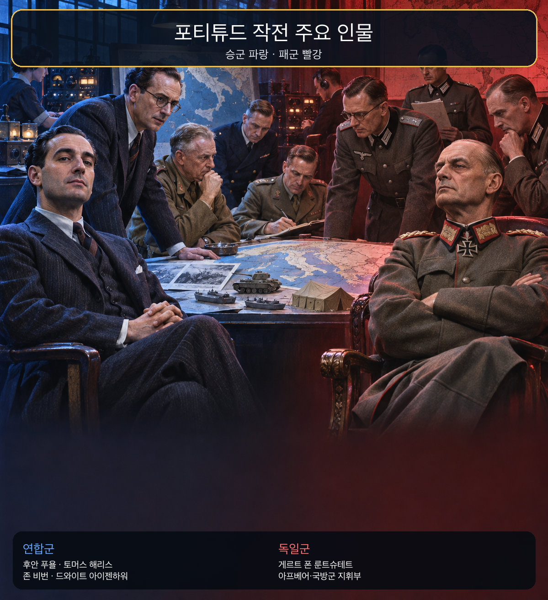
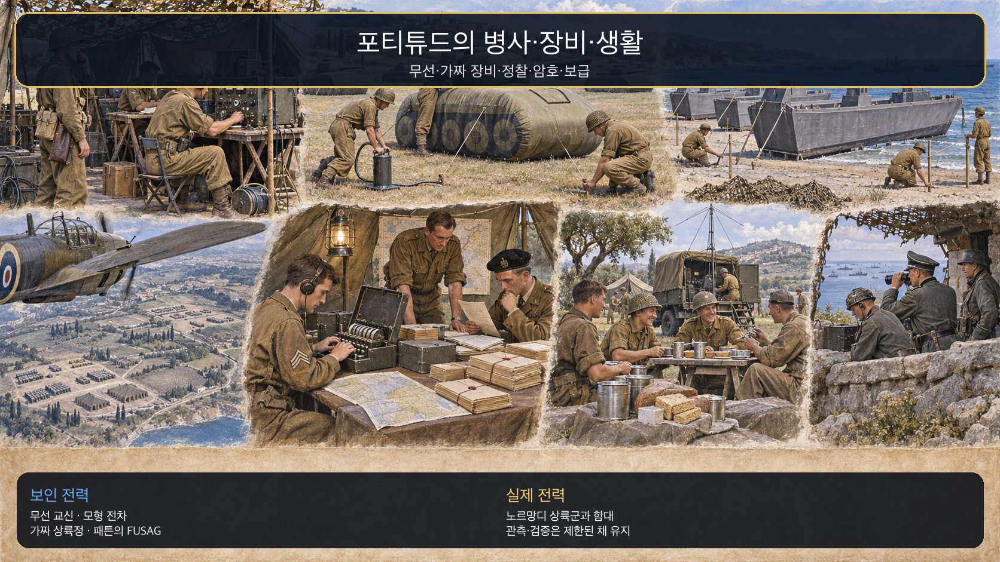
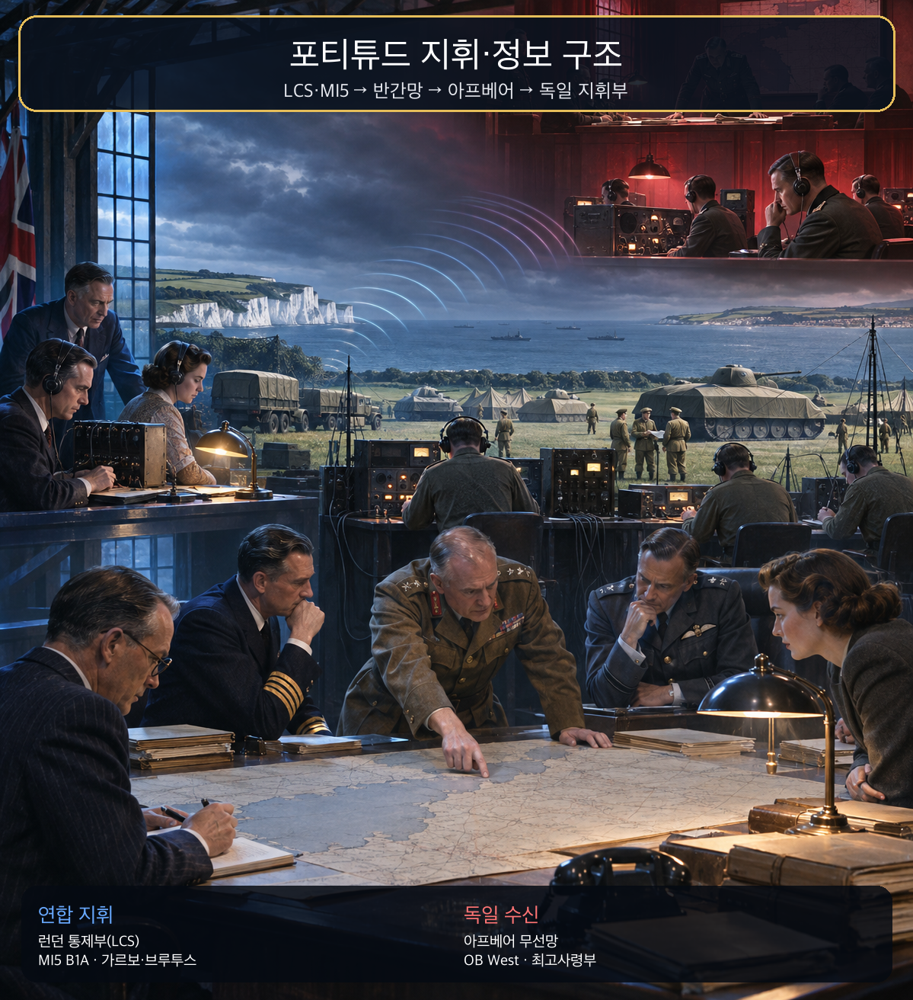
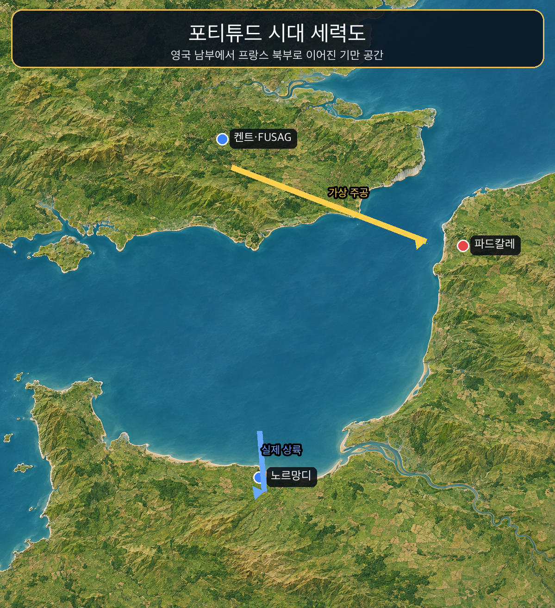
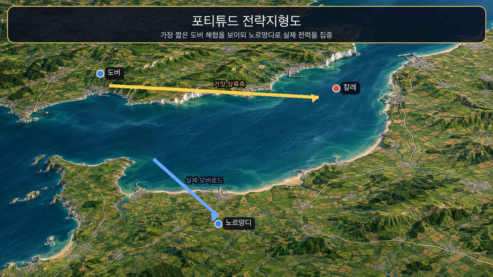
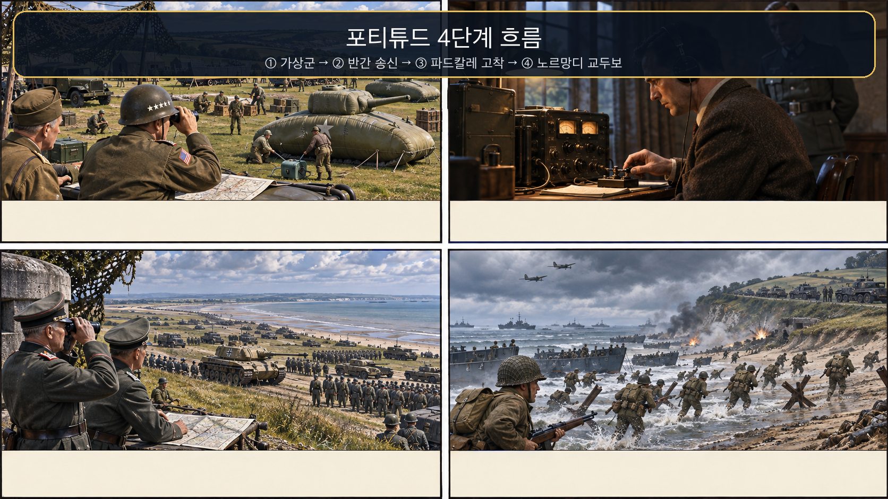

**뒤에서 반복될 지형을 먼저 잡아두기**

- **▰** **런던(London)**은 연합군 기만 통제와 MI5의 반간 운용이 결합된 중심이었다. 여기서 만든 이야기는 무선·가짜 편제·이중간첩 보고를 통해 서로 독립된 증거처럼 보이게 설계되었다.
- **▰** **도버(Dover)**와 켄트는 🌊 **도버 해협(Strait of Dover)**의 최단 횡단축을 마주한다. 연합군은 이 지리적 상식을 이용해 파드칼레 주공설을 그럴듯하게 만들었다.
- **▰** **파드칼레(Pas-de-Calais)**는 독일이 가장 짧고 항공 엄호가 쉬운 상륙축으로 예상한 곳이다. 가상 제1미집단군(FUSAG)의 신호는 이 기존 기대를 강화했다.
- **▰** **노르망디(Normandy)**는 실제 상륙지였다. 파드칼레와 충분히 떨어져 있어 그곳에 묶인 독일 예비대가 즉시 교두보를 압박하기 어려웠다.
- 🌊 **영국 해협(English Channel)**은 같은 바다이지만 도버의 짧은 횡단과 노르망디의 긴 항해를 동시에 제공했다. 기만은 지리를 부정하지 않고, 적이 더 자연스럽다고 믿는 한쪽만 과대평가하게 했다.

#### 상세 전역 서사 — 서로 다른 정보 통로가 한 거짓 결론을 독립적으로 지지하게 만들다

연합군의 문제는 상륙 지점을 비밀로 하는 데서 끝나지 않았다. 상륙 뒤 독일 예비대가 노르망디로 몰려오는 시간을 늦춰야 했다. 런던 통제부는 켄트에 실재하지 않는 대규모 편제와 무선 활동을 보이게 하고, **후안 푸욜 가르시아(Juan Pujol García)**를 비롯한 이중간첩망이 독일이 이미 기대하던 파드칼레 주공설을 사람의 보고로 되받치게 했다.

가르보라는 암호명의 **푸욜**은 27명의 가상 하위 정보원을 꾸몄다. 지역별 생활·부대 이동·무선 보고가 서로 다른 향간처럼 보였지만 실제로는 영국 측이 통제한 이야기였다. MI5는 적이 보낸 간첩을 붙잡아 돌려 쓰는 반간 체계와, 스스로 독일 측에 접근한 **푸욜**의 독특한 경로를 하나의 검증된 송신망으로 묶었다.

1944년 6월 6일 실제 상륙이 시작된 뒤에도 기만은 끝나지 않았다. 6월 9일 가르보의 메시지는 노르망디를 양동으로, 파드칼레 공격을 아직 오지 않은 주공으로 해석하도록 유도했다. 🏛️ 독일 지휘부는 자신이 신뢰해 온 출처와 짧은 해협이라는 지리, 가상 편제의 무선 흔적이 같은 결론을 가리킨다고 보았다.

영국 국립문서보관소는 독일이 7~8월에도 파드칼레에 기갑 2개 사단과 보병 19개 사단을 유지했다고 설명한다. 모든 지연을 반간 하나의 효과로 돌릴 수는 없지만, 서로 다른 통로처럼 보이는 신호가 독일의 기존 기대를 강화한 것은 노르망디 교두보에 시간을 주었다.

#### 전투에서 사용된 속임수 — 가상 하위 정보원과 적이 신뢰한 반간망

속인 주체는 연합군 기만기구와 MI5였고, 실제 의도는 노르망디 상륙 뒤에도 독일 예비대를 파드칼레에 묶는 것이었다. 독일에는 켄트의 가상군, 무선 교신, 가르보의 지역별 하위망이 보였다. 독일이 이를 믿은 까닭은 파드칼레가 지리적으로 가장 짧은 횡단축이라는 기존 기대와, 가르보가 오랜 기간 쌓은 신뢰가 맞물렸기 때문이다. 그 믿음은 예비대의 잔류를 낳았고, 실제 타격은 노르망디에서 이루어졌다.

#### 속임수 작동 구조

**주체와 의도.** 연합군은 존재하지 않는 편제를 보이려는 데 그치지 않고 독일 정보기관이 스스로 수집·대조했다고 느끼는 구조를 만들었다.

**보인 신호와 믿은 이유.** 짧은 도버 해협, 패튼의 명성, 무선 활동, 가르보망의 세부 보고가 동일한 파드칼레 결론을 지지했다. 서로 독립적으로 보였다는 점이 신뢰를 키웠다.

**유발된 행동과 결과.** 독일 지휘부는 노르망디 상륙 뒤에도 제2공격 가능성을 남겨 두고 파드칼레 전력을 유지했다. 이는 연합군의 노르망디 증원 시간을 늘렸다.

**사료의 경계.** 독일의 예비대 운용에는 히틀러의 지휘방식, 연합군 제공권, 수송망 파괴도 함께 작용했다. 포티튜드만으로 노르망디의 성패를 단일 설명해서는 안 된다.

#### 속임수 일곱 질문

1. **누가 누구를 속였는가?** 연합군 기만조직과 MI5의 이중간첩망이 독일 정보기관과 지휘부를 속였다.
2. **어떤 사실이 거짓이었는가?** 켄트의 대규모 FUSAG 편제와 파드칼레 주공 계획은 조작된 것이었다.
3. **어떤 사실은 진실이지만 오해를 유도했는가?** 패튼이 실제 장군이고 도버 해협이 최단거리라는 사실은 참이었지만, 그것이 실제 주공을 뜻하지는 않았다.
4. **상대는 왜 그것을 믿고 싶어 했는가?** 가장 짧은 횡단축이 주공일 것이라는 기존 계획 가정과 장기간 신뢰한 정보원이 결론을 편안하게 만들었다.
5. **속임수가 없었어도 같은 오판이 발생했을까?** 가능성은 있었지만 지속 기간은 짧았을 것이다. 노르망디 상륙 자체가 반대 증거였기 때문이다.
6. **속은 사람은 어떤 독립 확인을 생략했는가?** 사람 보고·무선·가상 편제가 실제 상륙 준비와 연결되는지, 각 증거의 원천이 정말 독립적인지 충분히 분리하지 못했다.
7. **신뢰·동의·안전을 해치지 않으면서 같은 원리를 어디서 연습할 수 있는가?** 보안 모의훈련에서 여러 채널의 경보가 같은 원천을 공유하는지 추적하고, 레드팀이 만든 가상 신호를 화이트팀이 독립 검증하는 방식으로 연습할 수 있다.

#### 시계편 兵者詭道也 — 이 전장에 해당하는 속이는 길

<table fit-page-width="true" header-row="true">
<tr>
<td>해당 구절·독음·뜻</td>
<td>전장의 장면</td>
</tr>
<tr>
<td>近而示之遠 근이시지원 — 가까운 것을 멀리 보인다</td>
<td>실제 노르망디 상륙 준비를 가리고, 지리적으로 가까운 파드칼레를 아직 오지 않은 주공으로 보였다.</td>
</tr>
<tr>
<td>用而示之不用 용이시지불용 — 쓰면서 쓰지 않는 듯 보인다</td>
<td>실제 상륙군은 노르망디로 움직였지만 가상 편제의 신호가 진짜 주공은 대기 중인 듯 보이게 했다.</td>
</tr>
</table>

#### 法 한눈 비교 — 곡제·관도·주용

<table fit-page-width="true" header-row="true">
<tr>
<td>진영</td>
<td>곡제(편제)</td>
<td>관도(지휘)</td>
<td>주용(보급·지속)</td>
</tr>
<tr>
<td>
**연합군**
</td>
<td>실제 상륙 편제와 가상 FUSAG·반간망을 분리해 결합했다.</td>
<td>LCS·MI5·SHAEF가 신호와 실제 작전의 노출을 통제했다.</td>
<td>가짜 장비는 적은 비용으로 신호를 만들고 실제 함대·병력은 노르망디에 집중했다.</td>
</tr>
<tr>
<td>
**독일군**
</td>
<td>해안방어와 기갑 예비대가 여러 지휘권 아래 나뉘었다.</td>
<td>OB West·국방군 최고사령부·히틀러의 권한 중첩이 전환을 늦췄다.</td>
<td>연합군 공습으로 철도·도로 이동이 제한되어 잘못 배치된 전력의 전환 비용이 컸다.</td>
</tr>
</table>

#### **게르트 폰 룬트슈테트(Gerd von Rundstedt, 패)**

<table fit-page-width="true" header-row="true">
<tr>
<td>요소</td>
<td>판단</td>
</tr>
<tr>
<td color="orange_bg">🤝 **道**</td>
<td>서부전선 지휘권이 히틀러·OB West·기갑집단 사이에 갈려 신속한 공동 판단이 어려웠다. (지기·결속)</td>
</tr>
<tr>
<td color="blue_bg">🌤️ **天**</td>
<td>노르망디 상륙이라는 강한 새 증거보다 파드칼레 제2공격 가능성을 오래 남겼다. 여러 증거가 같은 기만 설계에서 나왔을 가능성을 낮게 보았다. (지피·타이밍·확률 관점)</td>
</tr>
<tr>
<td color="green_bg">🧭 **地**</td>
<td>🌊 **도버 해협(Strait of Dover)**의 최단거리 이점이 실제 선택을 보증한다고 과대평가했다. (원근·광협)</td>
</tr>
<tr>
<td color="purple_bg">🎖️ **將**</td>
<td>
**룬트슈테트**는 경험이 풍부했지만 상위 지휘의 승인 구조를 깨고 예비대를 집중할 권한이 제한되었다. (지신인용엄)</td>
</tr>
<tr>
<td color="yellow_bg">⚙️ **法**</td>
<td>분산 지휘와 손상된 수송망 때문에 파드칼레 병력을 노르망디로 신속히 돌리기 어려웠다. (곡제·관도·주용)</td>
</tr>
</table>

**직관·편향 한 줄:** 노르망디 상륙 뒤에도 파드칼레 주공 가설을 오래 유지한 명령과 배치는 기존 계획에 맞는 가르보 보고를 더 무겁게 본 확증편향이 작동한 것으로 볼 수 있으며, 예비대 전환을 늦췄다.

🏳️ **패군 측 결과** — 六敗 가운데 지휘권과 명령선이 흔들린 `亂(란)`의 성격이 강하다. 🔀 **패군 측 회피 분기점**은 6월 9일 이후 사람 보고·무선 신호·가상 편제의 원출처 독립성을 다시 계산하고, 파드칼레 전력을 단계적으로 노르망디에 전환하는 것이었다.

#### **후안 푸욜 가르시아(Juan Pujol García, 승)**

<table fit-page-width="true" header-row="true">
<tr>
<td>요소</td>
<td>판단</td>
</tr>
<tr>
<td color="orange_bg">🤝 **道**</td>
<td>
**푸욜**과 **토머스 해리스**는 장기간 일관된 보고 체계로 독일 측 신뢰를 쌓되 영국 통제 아래 움직였다. (지기·신뢰)</td>
</tr>
<tr>
<td color="blue_bg">🌤️ **天**</td>
<td>독일이 파드칼레를 기대한다는 외부 변수를 이용했지만 성공을 가정하지 않고 감청과 독일 반응으로 신뢰를 확인했다. (지피·타이밍·확률 관점)</td>
</tr>
<tr>
<td color="green_bg">🧭 **地**</td>
<td>도버의 짧은 거리와 노르망디의 실제 상륙축을 하나의 대조 구조로 사용했다. (원근·광협)</td>
</tr>
<tr>
<td color="purple_bg">🎖️ **將**</td>
<td>
**푸욜**은 세부 생활 보고와 지연·실수까지 포함해 출처의 인간적 신빙성을 유지했다. (지·신)</td>
</tr>
<tr>
<td color="yellow_bg">⚙️ **法**</td>
<td>27명 가상 하위망, 무선, 가상 부대, 실제 작전을 각각 다른 신호층으로 편제했다. (곡제·관도·주용)</td>
</tr>
</table>

🏆 **승군 측 결과** — `以虞待不虞者勝(이우대불우자승 — 준비한 채 준비되지 않은 적을 상대하는 자가 이긴다)`에 해당한다. 반간 한 사람을 믿은 것이 아니라 적이 믿는 경로를 장기간 시험하고 여러 신호를 통제했다.

##### 法을 압축하지 않고 보기 — 곡제·관도·주용

**곡제 曲制(곡제): 부대를 어떻게 나누고 결합했는가**
<table fit-page-width="true" header-row="true">
<tr>
<td>진영</td>
<td>곡제(편제)</td>
</tr>
<tr>
<td>
**연합군**
</td>
<td>LCS·MI5·무선부대·가상 FUSAG·실제 상륙군을 역할별로 분리했다.</td>
</tr>
<tr>
<td>
**독일군**
</td>
<td>해안군·기갑예비대·정보기관의 판단이 통합되지 못했다.</td>
</tr>
</table>
**관도 官道(관도): 누가 명령하고 어떻게 전달했는가**
<table fit-page-width="true" header-row="true">
<tr>
<td>진영</td>
<td>관도(지휘)</td>
</tr>
<tr>
<td>
**연합군**
</td>
<td>기만 메시지는 승인·조정 절차를 거쳐 실제 작전과 충돌하지 않게 했다.</td>
</tr>
<tr>
<td>
**독일군**
</td>
<td>현장·서부사령부·최고사령부 사이 권한 중첩이 예비대 전환을 늦췄다.</td>
</tr>
</table>
**주용 主用(주용): 군량·장비·전투 지속 능력을 어떻게 썼는가**
<table fit-page-width="true" header-row="true">
<tr>
<td>진영</td>
<td>주용(보급·지속)</td>
</tr>
<tr>
<td>
**연합군**
</td>
<td>가짜 장비·무선은 실제 대군보다 적은 비용으로 지속 가능한 신호를 냈다.</td>
</tr>
<tr>
<td>
**독일군**
</td>
<td>파괴된 철도·도로와 연료 부족은 잘못 배치된 병력의 재배치를 더 어렵게 했다.</td>
</tr>
</table>

**출처:** [영국 국립문서보관소 — Operation Overlord and D-Day](https://www.nationalarchives.gov.uk/explore-the-collection/explore-by-time-period/second-world-war/operation-overlord-and-d-day/) · [영국 국립문서보관소 — Double Agent Operations](https://www.nationalarchives.gov.uk/double-agent-operations/) · [MI5 Official Secrets](https://www.nationalarchives.gov.uk/whats-on/exhibitions/mi5-official-secrets/)

### 동양 — 🏛️ 조조군 vs 🏛️ 원소군 │ 관도대전(官渡之戰, 200년)

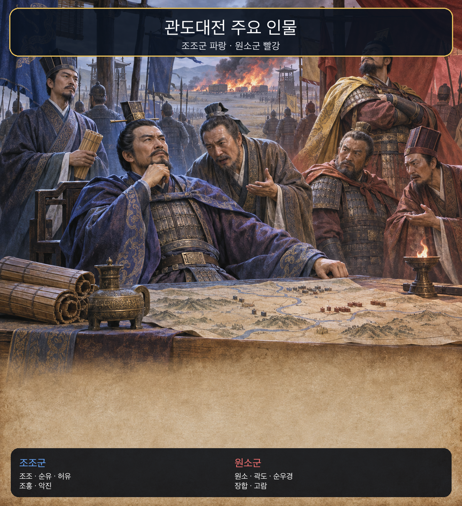
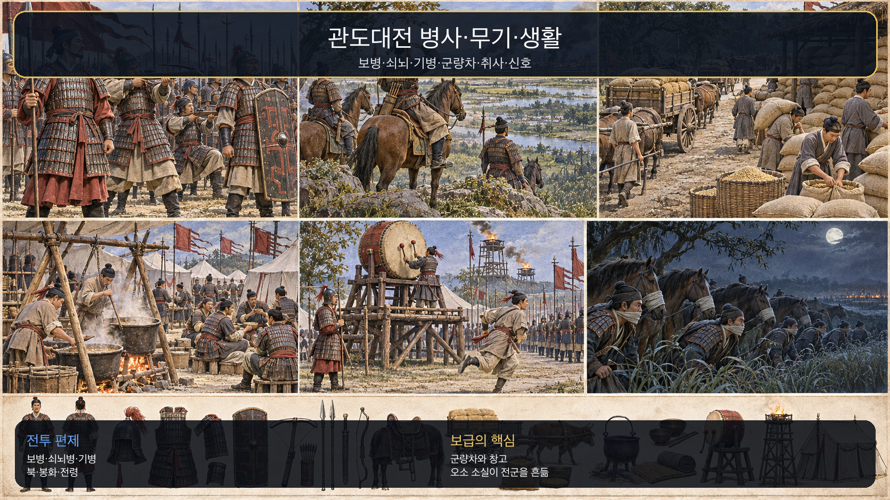
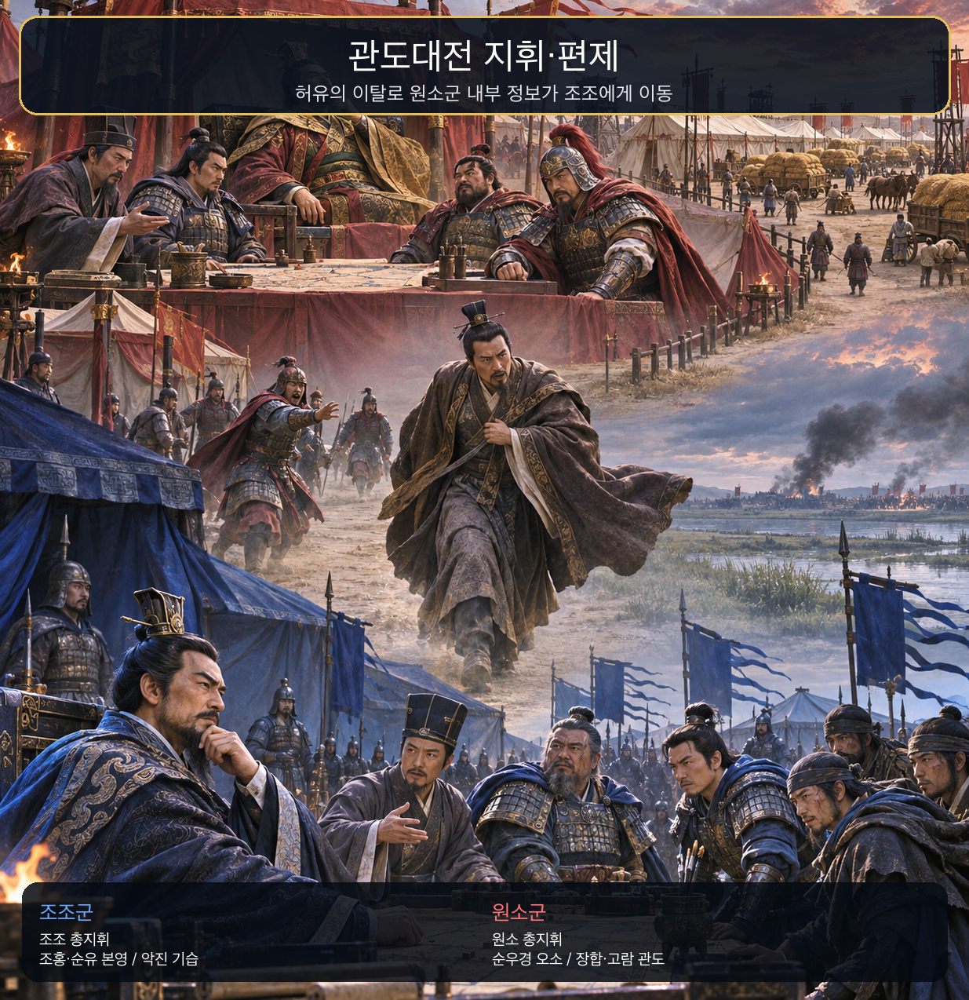
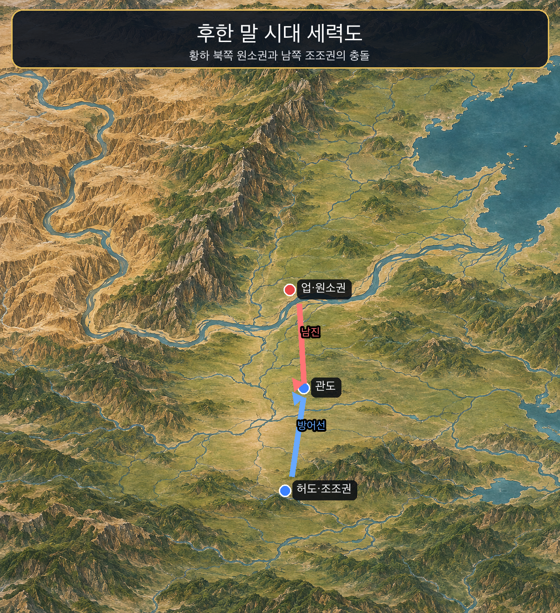
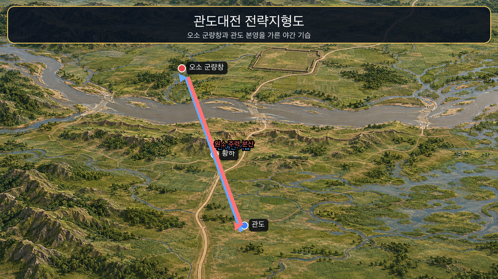
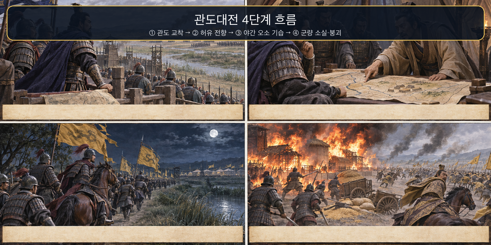

**뒤에서 반복될 지형을 먼저 잡아두기**

- 🌊 **황하(黃河)**는 원소 세력권과 조조의 중원 방어권을 가르는 큰 장벽이었다. 백마·연진의 나루는 원소군의 남진과 조조군의 지연전이 만나는 통로였다.
- **▰** **여양(黎陽)**은 원소군이 황하 남진을 준비한 전진 거점이었다.
- **▰** **관도(官渡)**는 허도로 향하는 길목의 조조군 방어 거점이었다. 장기 교착이 이어지면서 조조군의 군량도 한계에 가까워졌다.
- **▰** **오소(烏巢)**는 원소군의 대규모 군량이 모인 후방 창고였다. 본영과 떨어진 이 거점의 위치·수비 상태를 아는 내부자 정보가 전환점을 만들었다.
- **▰** **허도(許都)**는 조조의 정치·보급 중심이었다. 허유는 원소에게 이곳을 기습하자고 했으나 받아들여지지 않았다.

#### 상세 전역 서사 — 받아들여지지 않은 내부자의 계책이 반대 진영의 표적으로 바뀌다

관도의 교착은 병력이 적고 군량이 빠듯한 **조조(曹操)**에게 시간이 불리한 싸움이었다. 원소군 내부에서는 **저수(沮授)**가 오소 바깥에 별도 부대를 두어 후방 약탈을 막자고 건의했으나 채택되지 않았다. 원소의 모사 **허유(許攸)**도 허도를 기습하자는 계책이 받아들여지지 않은 뒤 조조 진영으로 넘어갔다.

《삼국지》 계열 기록에서 **허유**는 원소군 군량 수레 만여 승이 고시·오소에 있고 수비가 엄하지 않다고 알렸다. 이 정보는 내부자의 직무·관계로 닿은 `官人`형 접근을 보여 주지만, 조조는 옛 지인이라는 이유만으로 곧바로 믿은 것이 아니다. **순유(荀攸)**와 **가후(賈詡)**의 판단을 거쳐 본영 수비와 기습 위험을 나눴다.

**조조**는 **조홍(曹洪)**과 **순유**에게 관도 본영을 맡기고 보병·기병 5천을 골라 밤에 오소로 향했다. 병사들은 원소군 깃발을 들고 마주친 이들에게 후방 방비를 증원하러 간다고 답했다. 내부 정보가 표적을 정했고, 위장 깃발과 야간 기동이 접근을 완성했다.

오소에 불이 붙자 **원소(袁紹)**는 주력을 관도 본영 공격에 보내고 오소에는 제한된 구원만 보냈다. **장합(張郃)**과 **고람(高覽)**의 본영 공격은 실패했고, 군량 소실 소식과 내부 비난이 겹치자 두 장수는 조조군에 투항했다. 내부 접근을 보호하지 못한 조직에서 한 번의 전향은 표적 정보, 후속 기만, 지휘체계 붕괴로 연쇄되었다.

#### 전투에서 사용된 속임수 — 원소군 깃발과 후방 증원이라는 통과 신호

속인 주체는 **조조**의 오소 기습대였다. 실제 목표는 군량창 소각이었지만 원소군 깃발과 “후방 방비 증원”이라는 설명을 보였다. 원소군 영역 안에서 자기 깃발과 후방 이동을 보는 경계병에게 이 신호는 합리적으로 보였다. 그 결과 기습대는 야간 접근에 성공했고 오소 군량을 불태웠다.

#### 속임수 작동 구조

**주체와 의도.** **조조**는 정면 교착을 계속하는 대신 내부자가 알려 준 후방 표적을 작은 정예대로 치려 했다.

**보인 신호와 믿은 이유.** 원소군 깃발, 야간 이동, 후방 방비라는 설명은 원소군의 실제 경계 임무와 맞아 보였다.

**유발된 행동과 결과.** 길목의 원소군은 기습대를 통과시켰고, 오소의 군량이 소실되면서 원소군의 보급·사기·지휘가 함께 무너졌다.

**사료의 경계.** 허유의 전향 동기와 조조와의 대화는 《후한서》·《삼국지》 주석 자료 사이에 세부 차이가 있다. 확실한 골격은 전향, 오소 정보, 야간 기습, 군량 소실이다.

#### 속임수 일곱 질문

1. **누가 누구를 속였는가?** 조조의 오소 기습대가 이동로의 원소군 경계와 오소 수비를 속였다.
2. **어떤 사실이 거짓이었는가?** 기습대가 원소군의 후방 증원부대라는 표지와 설명이 거짓이었다.
3. **어떤 사실은 진실이지만 오해를 유도했는가?** 오소가 실제로 후방 방비가 필요한 군량거점이라는 사실이 거짓 설명을 자연스럽게 했다.
4. **상대는 왜 그것을 믿고 싶어 했는가?** 자기 깃발과 자기 후방으로 향하는 부대를 정상 증원으로 보는 것이 당시 경계병에게 합리적이었다.
5. **속임수가 없었어도 같은 오판이 발생했을까?** 가능성은 낮다. 깃발·설명이 없었다면 야간 정예대는 더 일찍 저지되었을 것이다.
6. **속은 사람은 어떤 독립 확인을 생략했는가?** 증원 명령의 발신자, 부대 지휘관, 이동 암구호를 별도 전령으로 확인하지 못했다.
7. **신뢰·동의·안전을 해치지 않으면서 같은 원리를 어디서 연습할 수 있는가?** 보안 훈련에서 유니폼·메일 발신자만 믿지 않고 작업지시 번호와 별도 승인채널을 확인하는 모의훈련으로 연습할 수 있다.

#### 시계편 兵者詭道也 — 이 전장에 해당하는 속이는 길

<table fit-page-width="true" header-row="true">
<tr>
<td>해당 구절·독음·뜻</td>
<td>전장의 장면</td>
</tr>
<tr>
<td>能而示之不能 능이시지불능 — 능하면서 능하지 않은 듯 보인다</td>
<td>오소로 향하는 적대 기습대를 원소군 후방을 지키러 가는 우군처럼 보였다.</td>
</tr>
<tr>
<td>近而示之遠 근이시지원 — 가까운 것을 멀리 보인다</td>
<td>본영 정면이 아니라 내부자가 알려 준 수비가 약한 군량창을 정예 5천으로 쳤다.</td>
</tr>
</table>

#### 法 한눈 비교 — 곡제·관도·주용

<table fit-page-width="true" header-row="true">
<tr>
<td>진영</td>
<td>곡제(편제)</td>
<td>관도(지휘)</td>
<td>주용(보급·지속)</td>
</tr>
<tr>
<td>
**조조군**
</td>
<td>본영 수비와 오소 정예대를 분리했다.</td>
<td>조홍·순유가 본영, 조조·악진이 기습을 맡았다.</td>
<td>열세 군량을 적의 군량 소각으로 뒤집었다.</td>
</tr>
<tr>
<td>
**원소군**
</td>
<td>대군과 군량창이 떨어졌고 별도 외곽호위 건의가 거부되었다.</td>
<td>오소 구원과 관도 공격의 우선순위가 갈렸다.</td>
<td>대군의 지속능력이 오소 한 거점에 과도하게 집중되었다.</td>
</tr>
</table>

#### **원소(袁紹, 패)**

<table fit-page-width="true" header-row="true">
<tr>
<td>요소</td>
<td>판단</td>
</tr>
<tr>
<td color="orange_bg">🤝 **道**</td>
<td>모사들의 파벌과 상충하는 진언을 통합하지 못했고 전향과 투항이 연쇄되었다. (지기·사기·충성)</td>
</tr>
<tr>
<td color="blue_bg">🌤️ **天**</td>
<td>오소 피습 뒤 본영 공격이 먼저 성공할 한 시나리오에 기대고, 군량 소실이 전군 붕괴로 번질 위험을 낮게 보았다. (지피·타이밍·확률 관점)</td>
</tr>
<tr>
<td color="green_bg">🧭 **地**</td>
<td>🌊 **황하(黃河)** 남쪽 장기전에서 관도와 오소 사이 거리가 약점이 되었다. (원근·사생)</td>
</tr>
<tr>
<td color="purple_bg">🎖️ **將**</td>
<td>
**원소**는 큰 세력을 모았지만 저수·허유·장합의 서로 다른 경고를 임무로 전환하지 못했다. (지신인용엄)</td>
</tr>
<tr>
<td color="yellow_bg">⚙️ **法**</td>
<td>군량창의 외곽 호위와 비상 지휘경로가 부족했고 구원·본영공격으로 병력이 나뉘었다. (곡제·관도·주용)</td>
</tr>
</table>

**직관·편향 한 줄:** 오소가 공격받은 뒤에도 관도 본영을 치면 위기를 상쇄할 수 있다는 한 시나리오에 병력을 건 명령은 확증편향과 계획 오류가 작동한 것으로 볼 수 있으며, 군량·사기 붕괴의 연쇄 위험을 과소평가했다.

🏳️ **패군 측 결과** — 六敗의 `亂(란)`과 `北(배)`가 겹친다. 지휘가 갈리고 정예의 임무가 분산된 가운데 적의 작은 기습대가 핵심 지속능력을 끊었다. 🔀 **패군 측 회피 분기점**은 저수의 건의대로 오소 바깥에 별도 호위대를 두고, 피습 즉시 관도 공격보다 군량창 구원에 전력을 집중하는 것이었다.

#### **조조(曹操, 승)**

<table fit-page-width="true" header-row="true">
<tr>
<td>요소</td>
<td>판단</td>
</tr>
<tr>
<td color="orange_bg">🤝 **道**</td>
<td>
**조조**는 내부자의 정보에 흔들리지 않고 순유·가후의 재검토를 거쳐 본영과 기습대의 역할을 나눴다. (지기·결속)</td>
</tr>
<tr>
<td color="blue_bg">🌤️ **天**</td>
<td>허유의 전향이라는 외부 변수를 기회로 보되 본영 함정 가능성을 남겨 두고 수비대를 배치했다. (지피·타이밍·확률 관점)</td>
</tr>
<tr>
<td color="green_bg">🧭 **地**</td>
<td>관도 정면이 아니라 떨어진 오소를 표적으로 삼아 원소군의 넓은 전선을 약점으로 바꿨다. (원근·광협)</td>
</tr>
<tr>
<td color="purple_bg">🎖️ **將**</td>
<td>
**조조**는 위험한 야간 기습을 직접 지휘하면서도 본영 방어를 유능한 참모에게 맡겼다. (지·용·엄)</td>
</tr>
<tr>
<td color="yellow_bg">⚙️ **法**</td>
<td>5천 정예의 경량 기습, 위장 깃발, 본영 분리 수비를 한 목표에 결합했다. (곡제·관도·주용)</td>
</tr>
</table>

🏆 **승군 측 결과** — `識衆寡之用者勝(식중과지용자승 — 대군과 소수 병력을 각각 쓸 줄 아는 자가 이긴다)`에 해당한다. 내부자의 접근 범위를 정확한 표적으로 바꾸고 소수 정예를 집중했다.

##### 法을 압축하지 않고 보기 — 곡제·관도·주용

**곡제 曲制(곡제): 부대를 어떻게 나누고 결합했는가**
<table fit-page-width="true" header-row="true">
<tr>
<td>진영</td>
<td>곡제(편제)</td>
</tr>
<tr>
<td>
**조조군**
</td>
<td>조홍·순유의 본영 수비와 조조·악진의 보병·기병 5천 기습대를 분리했다.</td>
</tr>
<tr>
<td>
**원소군**
</td>
<td>순우경의 오소 수비, 장합·고람의 관도 공격, 소수 기병 구원이 분산되었다.</td>
</tr>
</table>
**관도 官道(관도): 누가 명령하고 어떻게 전달했는가**
<table fit-page-width="true" header-row="true">
<tr>
<td>진영</td>
<td>관도(지휘)</td>
</tr>
<tr>
<td>
**조조군**
</td>
<td>조조가 기습 목표를 단일화하고 본영은 순유의 판단 아래 버티게 했다.</td>
</tr>
<tr>
<td>
**원소군**
</td>
<td>곽도의 본영 공격안과 장합의 오소 구원안이 충돌했고 실패 뒤 책임 전가가 투항을 불렀다.</td>
</tr>
</table>
**주용 主用(주용): 군량·장비·전투 지속 능력을 어떻게 썼는가**
<table fit-page-width="true" header-row="true">
<tr>
<td>진영</td>
<td>주용(보급·지속)</td>
</tr>
<tr>
<td>
**조조군**
</td>
<td>자군 군량이 빠듯한 상황에서 적 군량을 파괴해 시간의 불리를 뒤집었다.</td>
</tr>
<tr>
<td>
**원소군**
</td>
<td>대군의 식량을 오소에 집중하고 외곽호위를 충분히 두지 않아 단일 실패점이 생겼다.</td>
</tr>
</table>

**출처:** [《통전》 수록 관도 기록](https://ivantsoi.myds.me/web/schoolebook/pdf/043014.pdf) · [대만 국방부 군사 연구](https://www.mnd.gov.tw/File/28958) · [군량 보급 관점의 관도대전 연구](https://journal.kci.go.kr/kucsi/archive/articlePdf?artiId=ART001713713)

---
## 5. 핵심 통찰 + 실생활 적용 + 생활루틴

### 핵심 통찰

이 구절의 예리함은 사람을 세 부류로 나눈 이름표보다 **앎은 사람이 서 있는 자리에 의해 제한된다**는 통찰에 있다. 현지인은 생활과 지형을, 관리는 절차와 명령을, 적의 간첩은 적의 질문과 관찰 경로를 볼 수 있다. 각자의 말은 그 자리 안에서는 귀하지만, 그 경계를 넘어가면 추정이 된다.

`因其…而用之`가 세 번 반복되는 까닭도 여기에 있다. 사람을 추상적으로 믿거나 불신하지 말고, 그 사람이 가진 접근 조건을 따라 질문과 임무를 맞추어야 한다. **출처의 신분보다 접근 범위, 확신의 세기보다 직접 관찰과 독립 확인**이 먼저다.

### 실생활 적용

3교대 현장에서 장애가 생기면 현장 작업자는 냄새·소리·진동과 실제 장비 상태를 가장 가까이서 본다. 상황실 근무자는 알람 순서와 여러 설비의 동시 변화를 보고, 오피스 담당자는 작업 허가·정비 이력·변경 지시를 확인할 수 있다. 세 사람의 말은 경쟁하는 의견이 아니라 서로 다른 접근 범위의 보고다.

따라서 현장 작업자에게 정책 변경의 최종 의도를 단정하게 하거나, 오피스 지시만으로 현장 상태가 정상이라고 결론 내리면 안 된다. 보고할 때 `직접 본 것 / 로그에서 확인한 것 / 전해 들은 것 / 아직 모르는 것`을 나누고, 역할별로 한 가지씩 독립 확인한다. 이렇게 해야 목소리가 크거나 직위가 높은 한 사람의 시야가 전체 사실처럼 굳지 않는다.

인물사건관찰시리즈에서 사람마다 피로·직위·정보·업무 숙련이 다른 상황도 같은 방식으로 다룰 수 있다. 전씨·이씨·안씨의 한 행동을 성격 전체의 증거로 확대하지 않고, 그 장면에서 누가 현장을 직접 보았는지, 누가 지시와 기록에 접근했는지, 누가 다른 사람의 전언만 들었는지부터 나눈다. 관찰 사실을 분리하면 사람을 낙인찍지 않으면서도 다음 교대의 확인 책임을 구체적으로 정할 수 있다.

예를 들어 설비 이상을 발견한 교대라면 현장 담당자는 사진과 계기값을, 상황실 담당자는 알람 발생 시각과 전후 추세를, 인수인계 담당자는 미완료 조치와 다음 확인 시각을 남긴다. 관리자는 이 세 경로를 맞대어 중단·재가동 기준을 정한다. 한 경로가 빠지면 그 사실을 숨기지 않고 불확실성으로 표시해야 한다.

### 생활루틴 추천

**사람의 위치와 접근 범위를 적지 않고 말을 모으면 재수가 없다.**

**이유:** 오늘 중요한 보고 하나를 받을 때 1분 안에 `현장 관찰 / 절차·기록 접근 / 전언 / 관찰 시각 / 독립 확인`을 구분해 적는다. 이를 생략하면 직위가 높거나 말이 생생한 사람의 제한된 시야가 전체 사실처럼 굳고, 잘못된 조치가 다음 교대까지 이어진다. 향간·내간·반간을 나눈 원리는 사람을 낙인찍으라는 뜻이 아니라, **각자가 실제로 볼 수 있었던 범위에 맞춰 질문하고 검증하라**는 행동 규칙이다.
