<!-- sunzi-analysis-mode: light -->
> 사간자, 위광사어외, 영오문지지, 이전어적간야. 생간자, 반보야. — 확인되지 않은 이야기를 퍼뜨리고 결과 보고를 받지 않으면 재수가 없다.

---
## 1. 원문 + 독음 + 직역 + 한자어 뜻풀이

死間者, 爲誑事於外, 令吾聞知之, 而傳於敵間也. 生間者, 反報也. 사간자, 위광사어외, 영오문지지, 이전어적간야. 생간자, 반보야.

**직역**  
사간은 속이는 일을 밖에서 만들어, 우리가 그것을 들어 알게 하고, 적의 간첩에게 전하게 하는 것이다. 생간은 돌아와 보고하는 것이다.

	앞 구절이 향간·내간·반간을 **사람이 서 있는 자리**로 나누었다면, 이번 구절은 남은 두 유형을 정보가 움직이는 방향으로 나눈다. 사간의 정보는 아군 내부에서 외부로 나가 적의 판단에 닿는다. 생간의 정보는 적지에서 아군으로 돌아와 결과를 보고한다. 하나는 적에게 보일 이야기를 만들고, 다른 하나는 실제로 무엇이 일어났는지를 되가져온다.

	여기서 긴장은 선명하다. `誑事`는 사실을 알아내는 정보가 아니라 적에게 믿게 할 거짓된 사건과 정황이다. 그것이 적의 정보망에 들어가려면 아군 쪽에서도 자연스럽게 들리는 이야기처럼 보여야 한다. 그러나 거짓 정보가 적에게 전해졌다는 사실만으로 공작이 성공한 것은 아니다. 적이 믿었는지, 어떤 명령과 이동을 했는지, 아군 작전에 어떤 결과가 났는지는 `反報`가 돌아와야 비로소 확인된다.

	#### 死間(사간) — 살아 돌아옴을 보장할 수 없는 거짓 이야기의 운반선

	`死間`은 문자 그대로 죽을 위험을 감수하는 간첩이다. 전통 주석은 그가 아군이 꾸민 거짓 일을 적에게 알리고, 일이 드러난 뒤에는 적에게 죽임을 당할 수 있다고 보았다. 핵심은 영웅적 희생을 찬양하는 데 있지 않다. 지휘자가 타인을 소모시킬 수 있는 고위험 공작을 명령한다는 점, 그러므로 목적·필요성·대가·보호와 책임을 더 엄격히 따져야 한다는 데 있다.

	`死`는 정보의 신빙성을 높이는 장식도 아니다. 붙잡히거나 버림받을 가능성이 큰 사람에게 거짓 이야기를 맡기면, 그 사람은 생존을 위해 다른 말을 하거나 적에게 역이용될 수 있다. 사간을 쓴다는 말은 정보의 경로와 노출 위험까지 계산한다는 뜻이지, 사람의 목숨을 값싼 전달 수단으로 취급해도 된다는 허가가 아니다.

	#### 誑事(광사) — 한 문장의 거짓말이 아니라 적이 확인할 수 있다고 느끼는 사건

	`誑`은 속이고 미혹한다는 뜻이고, `事`는 말만이 아니라 벌어진 일과 정황을 가리킨다. 그래서 `誑事`는 거짓 문장 하나를 흘리는 데 그치지 않는다. 적이 이미 가진 기대와 맞고, 다른 관찰 신호와도 이어져, 스스로 사실이라고 결론 내리게 하는 **그럴듯한 사건의 구성**이다.

	그러나 그럴듯함만으로 충분하지 않다. 거짓 이야기가 아군의 실제 계획을 방해하거나 민간인·비전투원·우군에게 피해를 주면 전술적 효과보다 비용이 커질 수 있다. 현대 군사 교리가 기만의 목표·대상·종료 조건과 법적 제한을 함께 요구하는 까닭도, `誑事`가 한번 퍼지면 만든 사람의 통제를 벗어날 수 있기 때문이다.

	#### 爲誑事於外(위광사어외) — 거짓을 밖에 놓되 출처와 진짜 계획을 갈라놓다

	`爲`는 만들어 실행한다는 동작이고, `於外`는 그 일이 적의 관찰이 닿는 바깥에 나타남을 뜻한다. 사간 공작은 적이 보지도 못할 이야기를 내부에서 상상하는 일이 아니다. 적의 간첩이 보고 가져갈 수 있는 관찰 가능한 흔적을 만들되, 그 흔적이 진짜 작전과 분리되도록 통제하는 일이다.

	`外`는 동시에 경계다. 필요한 허위 신호만 밖으로 내보내고, 진짜 의도와 내부의 전체 계획은 보호해야 한다. 거짓 이야기를 널리 퍼뜨릴수록 믿음이 커진다고 생각하면 아군까지 속아 잘못 움직이거나, 공작 자체가 새어 적이 역으로 이용할 수 있다.

	#### 令吾聞知之(영오문지지) — 아군이 우연히 들은 듯한 경로를 만들다

	`令`은 그렇게 되게 한다는 사역이고, `吾聞知之`는 우리 쪽에서 그 일을 들어 알게 한다는 구조다. 고주석은 아군 진영 안에 거짓 일을 일부러 드러내어, 적의 간첩이 아군이 알고 말하는 내용을 탐지하게 하는 장면으로 읽었다. 적에게 직접 거짓말을 건네기보다 **적의 수집 체계가 스스로 주워 갔다고 믿게 하는 것**이 더 설득력 있을 수 있기 때문이다.

	바로 이 대목 때문에 보안 통제가 필요하다. 누가 진짜 계획을 알고 누가 기만 이야기만 아는지 구분하지 않으면, 아군의 판단과 기록까지 오염된다. 기만을 끝낸 뒤에도 거짓 정보가 남아 후속 결정을 흐리지 않도록 종료와 정정 절차가 있어야 한다.

	#### 傳於敵間(전어적간) — 적의 정보 수집선을 통해 적의 판단권자에게 닿다

	`傳`은 단순 노출이 아니라 전달되어 이어진다는 뜻이다. `敵間`은 앞 구절의 반간과 연결된다. 적의 간첩이 무엇을 찾고 어떤 보고 경로를 쓰는지 알아야, 거짓 이야기가 중간에서 버려지지 않고 실제 결정을 내리는 사람에게 닿을 수 있다.

	그렇다고 전달 자체가 효과는 아니다. 적의 간첩이 보고했어도 분석관이 의심하거나 지휘관이 무시하면 공작은 작동하지 않는다. 성공은 적이 거짓을 들었다는 데 있지 않고, 그 결과 적이 아군에게 유리한 행동 또는 부작위를 선택했는지로 평가해야 한다.

	#### 生間·反報(생간·반보) — 돌아온 사람이 공작의 효과와 오류를 닫아 주다

	`生間`은 적지에 갔다가 살아 돌아오는 간첩이고, `反`은 돌아옴, `報`는 알림과 보고다. 이 정의는 짧지만 결정적이다. 생간은 단순히 정보를 많이 가져오는 사람이 아니라, 적이 무엇을 보았고 어떻게 해석했으며 어떤 행동을 준비하는지를 되돌려 **기만과 판단의 결과를 검증하는 사람**이다.

	보고는 성공담만 전해서는 안 된다. 적이 속지 않았다는 징후, 예상과 다른 반응, 정보가 새어 나간 경로, 아군에게 생긴 부작용까지 돌아와야 다음 행동을 고칠 수 있다. 돌아온 사람을 처벌이 두려워 좋은 소식만 말하게 만들면 `反報`는 형식만 남는다.

	#### 글자들이 완성하는 한 장면

	지휘자는 `誑事`를 만들어 적의 관찰이 닿는 `外`에 놓고, 아군이 자연스럽게 `聞知`한 듯한 흔적을 만든다. 적의 간첩은 그것을 자기 수집의 성과라고 여겨 `傳`한다. 그러나 그때까지는 적의 귀에 이야기가 들어갔을 뿐이다.

	적지에서 돌아온 `生間`이 적의 실제 반응을 `反報`해야 비로소 고리가 닫힌다. **사간이 적의 인식을 움직이는 위험한 외향선이라면, 생간은 그 움직임을 사실로 확인하고 수정하게 하는 귀환선**이다. 이 둘을 함께 읽어야 기만이 자기 확신이나 무책임한 희생으로 변하지 않는다.

---
## 2. 전통 주석 기반 분석

- **조조(曹操)** — “거짓 일을 밖에 드러내 적의 간첩이 듣고 전하게 하라. 다만 **돌아온 생간의 보고로 적이 실제로 움직였는지 확인하라.**”
- **이전(李筌)** — “사간에게 거짓 형세를 보이되 진짜 계책은 감추어라. **적이 들은 것과 믿은 것을 같다고 여기지 마라.**”
- **두목(杜牧)** — “사간은 허위의 일을 적에게 알리다 죽을 수 있고, 생간은 돌아와 적정을 아뢴다. **두 임무의 위험과 쓰임을 뒤섞지 마라.**”
- **매요신(梅堯臣)** — “거짓 일을 밖에 행하여 적의 간첩에게 전하게 하고, 살아 돌아온 자에게 결과를 물어라. **보낸 이야기보다 돌아온 증거를 중히 여겨라.**”
- **장예(張預)** — “사간으로 적의 판단을 그릇되게 하고 생간으로 적의 허실을 보고받아라. **유포·반응·검증의 순서를 끊지 마라.**”
- **왕석(王晳)** — “사간은 적이 믿을 만한 정황을 맡고, 생간은 적의 반응을 몸소 살펴 돌아와야 한다. **말 한마디만 흘리고 계책이라 부르지 마라.**”
- **가림(賈林)** — “아군의 거짓 일을 적의 간첩이 알게 하되, 사간에게 모든 진실을 내주지 마라. **기만의 통로와 진짜 계획을 분리하라.**”
- **두우(杜佑)** — “죽을 위험이 있는 사람을 쓰는 일은 가볍지 않다. **목적과 대가를 분명히 하고 헛되이 사람을 버리지 마라.**”
- **진호(陳皞)** — “생간의 돌아온 보고가 없다면 적이 속았는지 알 수 없다. **불리한 반응까지 숨김없이 보고하게 하라.**”

#### 리링의 고증과 현대적 독법

리링의 문헌학적 관점에서 이 문장은 긴 정의와 짧은 정의를 대조한다. `死間者` 뒤에는 `爲―令―傳`의 세 동작이 이어지지만, `生間者` 뒤에는 `反報也` 네 글자만 놓인다. 사간은 거짓 사건을 만들고, 아군 쪽에 들리게 하고, 적의 간첩에게 전달되게 하는 복잡한 외향 과정이다. 생간의 본질은 살아남았다는 상태보다 **돌아와 보고한다는 기능**으로 압축된다.

`令吾聞知之`의 `吾`는 사간 자신이 아니라 아군 쪽을 가리키는 것으로 읽는 것이 문장 흐름에 맞다. 적의 간첩이 아군 내부에서 통용되는 듯한 이야기를 듣고 가져가게 한다는 뜻이다. 판본 차이를 억지로 만들 필요는 없으며, 핵심은 `誑事`가 적에게 직접 던지는 문장이 아니라 적의 정보 수집 경로를 통과하도록 설계된 일이라는 데 있다.

현대의 정보전 용어를 고대 분류에 그대로 덮어씌우면 안 된다. 사간은 오늘날의 모든 허위정보 활동과 같지 않고, 생간도 모든 현장 보고자를 뜻하지 않는다. 오늘 가져올 수 있는 구조는 **외부에 보인 신호 → 상대의 수집과 해석 → 관찰 가능한 반응 → 귀환 보고와 수정**의 폐쇄 고리다. 평시 사회에서는 타인을 속이는 기술이 아니라, 가설과 시험 결과를 분리하고 안전·동의·법적 한계를 지키는 검증 절차로 제한해야 한다.

---
## 3. 교차 설명

### ① 손자병법 내 교차

앞의 `鄕間者…內間者…反間者`(향간자…내간자…반간자 — 현지인·관리·적의 간첩을 그 위치에 따라 쓴다)는 사람의 접근 경로를 정의했다. 이번 구절은 반간이 드러낸 적의 정보 수요와 전달망을 이용해 사간의 `誑事`를 흘리고, 생간의 `反報`로 결과를 확인하는 다음 단계다. 오간은 다섯 개의 고립된 이름이 아니라 서로의 조건을 만드는 체계다.

뒤의 `因是而知之, 故死間爲誑事可使告敵`(인시이지지, 고사간위광사가사고적 — 이로써 알기 때문에 사간으로 거짓 일을 만들어 적에게 알릴 수 있다)는 반간의 선행 역할을 명시한다. 적이 무엇을 찾고 무엇을 믿을지 모르면 그럴듯한 `誑事`를 만들 수 없다. 기만은 창의적인 거짓말보다 적의 정보 체계에 대한 선지에 의존한다.

또 `此兵家之勝, 不可先傳也`(차병가지승, 불가선전야 — 병가의 승리는 미리 전할 수 없다)는 작전의 비밀을 지키라는 경고다. 사간의 이야기를 널리 퍼뜨리는 것과 진짜 계획을 누설하는 것은 정반대다. 보여 줄 허위 신호와 보호할 핵심 정보를 나누지 못하면 기만은 스스로를 속이는 누설이 된다.

### ② 클라우제비츠 『전쟁론』

클라우제비츠는 전쟁에서 정보가 모순되고 불완전하며, 실제 상황은 마찰 속에서 계획과 다르게 전개된다고 보았다. 사간의 `誑事`는 그 불확실성을 이용하지만, 생간의 `反報`가 없는 지휘자는 자신이 만든 이야기와 현실을 구분하지 못한다. 적이 속았을 것이라는 기대 역시 전쟁의 안개 속 가설일 뿐이다.

두 사상가의 강조점은 다르다. 손자는 적의 정보 통로를 역이용해 판단을 바꾸는 적극적 기만을 구체적으로 분류한다. 클라우제비츠는 기만이 큰 비용과 복잡성을 요구하며, 실제 힘의 집중을 대신할 수 없다고 경계한다. 함께 읽으면 기만을 실력 없는 측의 만능술로 만들지 않게 된다.

정치 목적도 상위에 남는다. 적을 잠시 잘못 움직이게 했더라도 그 기만이 전쟁 목적에 기여하지 않거나 장기 신뢰·동맹·법적 정당성을 훼손하면 전략적 성공이 아니다. 사간의 위험과 생간의 보고는 모두 목적에 비례해 평가되어야 한다.

### ③ 미야모토 무사시 『오륜서』

『오륜서』의 `陰を動かす`(인을 움직이다 — 드러나지 않은 상대의 뜻을 움직여 보게 한다)는 상대가 감춘 판단을 반응으로 드러내게 하는 원리다. 사간의 거짓 신호도 상대가 그것을 듣는 데서 끝나지 않고, 병력 이동·경계 강화·보고 변화 같은 반응을 일으킬 때 의미가 생긴다. 생간은 그 반응을 보고 돌아오는 눈이다.

무사시의 `観見二つの目付`(관견 두 눈매 — 넓게 꿰뚫어 보는 관과 가까이 살피는 견)도 두 간첩의 결합을 비춘다. 사간이 적에게 보일 전체 형상을 설계한다면, 생간은 적진에서 나타난 구체적 변화를 살핀다. 형상만 있고 세부 관찰이 없으면 성공을 과신하고, 세부 보고만 있고 전체 목적이 없으면 정보가 쌓여도 계책이 되지 않는다.

다만 개인 검술의 페인트와 국가 전쟁의 인적 공작은 위험과 윤리가 다르다. 평시 적용은 스포츠·게임·모의훈련처럼 상대가 규칙에 동의한 환경, 또는 시스템 변경을 제한된 범위에서 시험하고 결과를 관측하는 절차에 머물러야 한다.

### ④ 오자병법·육도삼략

『오자병법』의 `用兵之害, 猶豫最大`(용병지해, 유예최대 — 용병의 해악 가운데 머뭇거림이 가장 크다)는 반응을 얻고도 판단을 미루는 위험을 일깨운다. 사간이 만든 신호에 적이 움직였는데 생간의 보고를 검토하지 않거나, 예상 밖 반응을 보고도 원안을 고집하면 기만이 만든 짧은 기회는 사라진다.

그러나 빠른 행동은 검증 생략과 다르다. 생간의 `反報`에는 보고 시각·직접 관찰·추정·확인하지 못한 범위를 나누는 절차가 필요하다. 오자의 엄정한 지휘와 상벌은 나쁜 소식을 숨기지 않게 하는 신뢰와 결합될 때만 효과가 있다.

『육도』의 음부·음서 체계는 비밀 명령을 분절하고 전달 경로를 통제하는 문제를 다룬다. 이는 사간에게 전체 진짜 계획을 알려 주지 않고 필요한 이야기만 맡기는 원리와 맞닿는다. 다만 분절이 지나치면 아군이 거짓 이야기를 진짜로 믿는 역효과가 생기므로, 통합 책임자와 종료 뒤 정정이 필요하다.

현대 조직에서는 이를 동료에게 거짓말하라는 처세술로 바꾸면 안 된다. 장애 대응의 테스트 메시지, 보안 모의훈련, 재난 훈련처럼 사전 권한과 안전 범위가 정해진 상황에서만 가짜 신호를 쓰고, 종료 뒤 실제 결과와 오탐을 공개적으로 복기해야 한다.

### ⑤ 현대 심리학·군사학

미 육군의 군사 기만 교리는 기만을 적 의사결정자를 표적으로 삼아 특정 행동 또는 부작위를 유도하는 계획된 과정으로 설명한다. 기만 이야기는 적의 기존 믿음과 정보 처리 주기에 맞아야 하며, 목표·대상·관찰 가능한 신호·평가 기준·종료 계획을 함께 세워야 한다. 이는 `爲誑事於外`를 거짓말 한마디가 아니라 상대의 수집 체계가 볼 일관된 이야기로 읽게 한다. 동시에 성공 기준을 “적이 들었다”가 아니라 “적이 의도한 방식으로 행동했다”에 둔다. [U.S. Army, *FM 6-0 Commander and Staff Organization and Operations*, ch. 11](https://www.moore.army.mil/infantry/DoctrineSupplement/ATP3-21.8/PDFs/fm6_0.pdf)

미 육군의 2026년 보호 연구는 센서가 많아진 전장에서도 기만이 적의 가설을 공격하고 수집 자산과 화력을 잘못 배분하게 할 수 있다고 설명한다. 그러나 여러 센서가 교차 확인하는 환경에서는 한 종류의 가짜 신호만으로는 쉽게 무너진다. 사간의 `誑事`도 적이 기대하는 서사와 여러 관찰 흔적이 맞아야 하며, 생간의 `反報`는 적이 실제로 어느 신호를 믿었는지 확인해야 한다. [U.S. Army, “A Layered Approach to Active Protection” (2026)](https://www.lineofdeparture.army.mil/Journals/Protection/Protection-Archive/2026-Edition/A-Layered-Approach-to-Active-Protection/)

리처즈 호이어의 CIA 분석 지침은 하나의 설명에 매달리지 말고 경쟁 가설을 나란히 검토하라고 권한다. 생간이 “적이 이동했다”고 보고했을 때도 `기만을 믿어서 이동 / 원래 계획에 따른 이동 / 제3의 위협에 대응 / 우리 반응을 유도하는 역기만`을 함께 놓아야 한다. 어떤 증거가 각 가설과 모순되는지를 보는 방식은 성공을 바라는 마음이 보고를 삼키는 것을 막는다. [CIA, *Psychology of Intelligence Analysis*](https://www.cia.gov/resources/csi/books-monographs/psychology-of-intelligence-analysis-2/)

사용자의 「생각에대한 생각」 메모는 생생한 한 시나리오에 주목하면 그 확률을 과대평가하기 쉽다고 경고한다. 기만 설계자는 “적은 틀림없이 속을 것”이라는 한 장면을 떠올리기 쉽고, 귀환 보고자는 눈에 띄는 한 번의 반응을 전체 성공으로 확대하기 쉽다. 따라서 시작 전에 가능한 반응을 `믿음 / 의심 / 무시 / 역이용`으로 나누고 합이 100%가 되도록 범위를 잡으며, 각 반응을 판별할 관찰 신호와 중단 조건을 적어야 한다.

현대 적용에는 분명한 한계가 있다. 군사 기만은 무력충돌의 엄격한 법과 지휘 책임 아래 다루는 수단이며, 민간인·대중·동료를 몰래 조종하는 일반 기술이 아니다. 일상에서는 거짓 정보 유포가 아니라 **가설을 제한된 안전 환경에서 시험하고, 반응을 측정하고, 불리한 결과까지 보고받아 수정하는 폐쇄 고리**만 가져와야 한다.

---
## 4. 역사적 실증 사례

### 서양 — 🇬🇧 연합군 정보조직 vs 🏛️ 추축국 정보·지휘체계 │ 민스미트 작전(Operation Mincemeat, 1943)

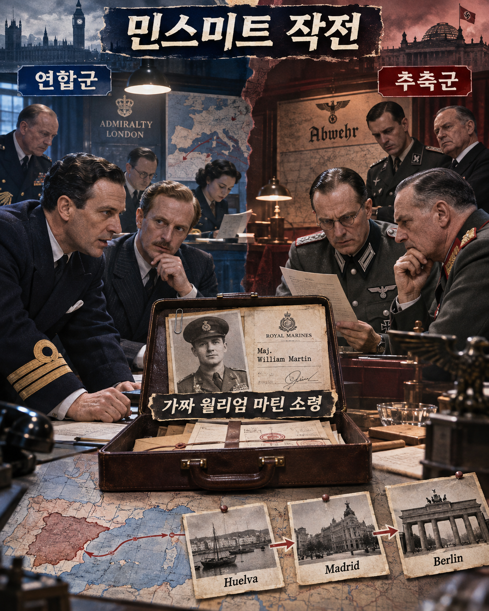

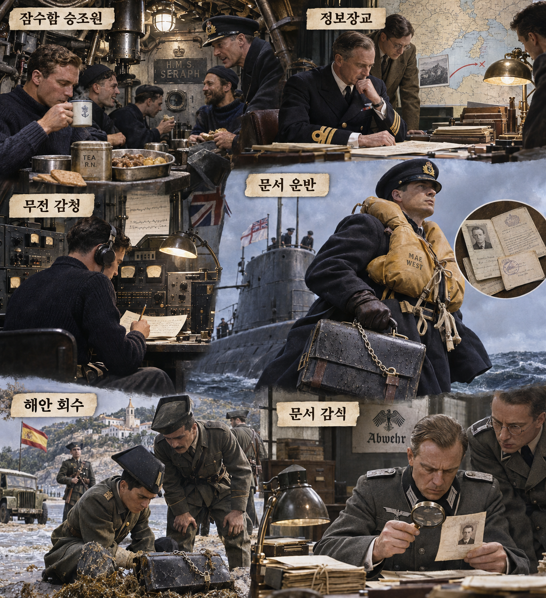

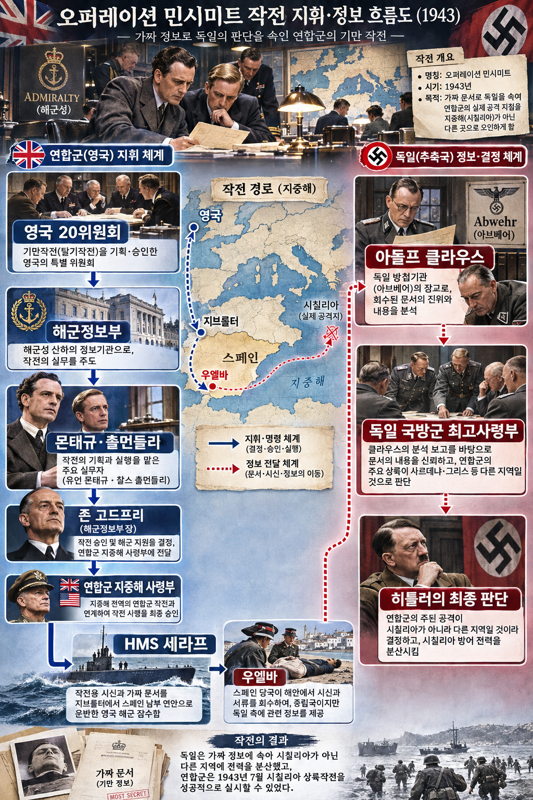

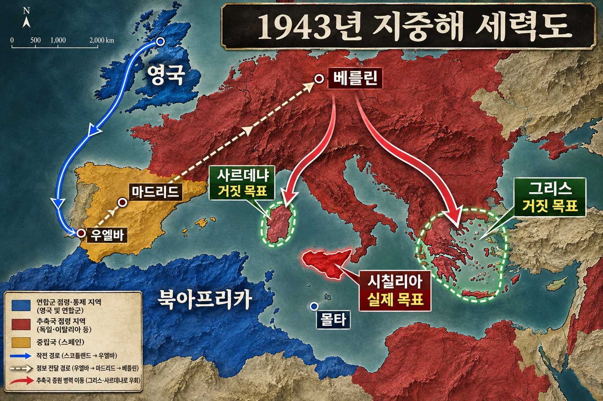

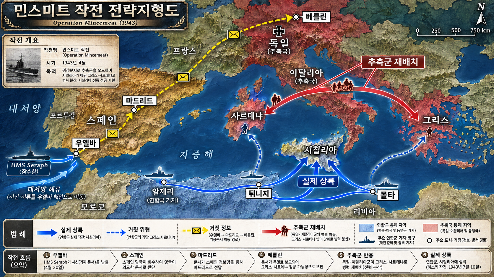

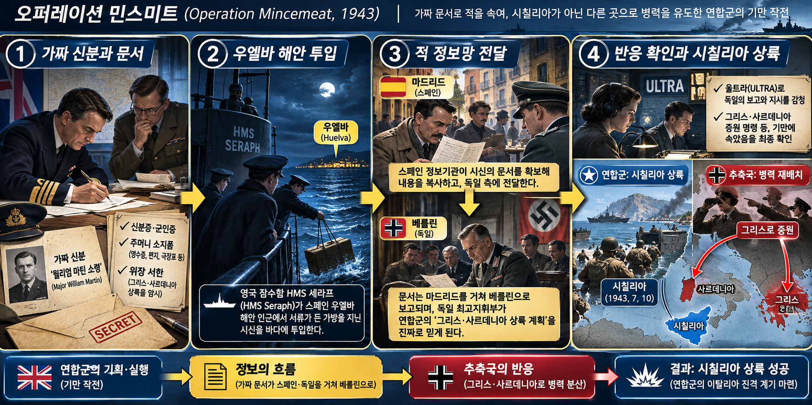

**뒤에서 반복될 지형을 먼저 잡아두기**

- 🌊 **대서양(Atlantic Ocean) 우엘바 연안**은 조류가 투입물을 중립국 해안으로 운반하게 한 출발점이다. 스페인 당국이 회수하고 독일 정보망이 접근할 수 있다는 지역 조건이 작전 통로를 만들었다.
- **▰** **마드리드(Madrid)**는 회수 문서가 독일 정보기관으로 복사·전달되는 중계점이었다. 문서가 실제로 열렸다는 흔적은 영국이 회수 뒤 검사할 수 있었다.
- **▰** **베를린(Berlin)**은 보고가 군 최고지휘부와 히틀러의 배치 판단으로 바뀌는 종착점이었다.
- **▰** **시칠리아(Sicily)**는 실제 허스키 작전의 목표였고, 🏛️ **그리스**와 **▰** **사르데냐(Sardinia)**는 문서가 가리킨 허위 축이었다.
- 🌊 **지중해(Mediterranean Sea)**의 북아프리카·몰타 기지는 실제 상륙군을 모으는 공간이었다. 허위 문서만이 아니라 바클레이 작전의 다른 신호와 실제 병력 준비가 함께 움직였다.

#### 상세 전역 서사 — 죽은 운반체의 문서가 적 정보망을 통과하고 울트라가 반응을 되돌려주다

1943년 연합군은 북아프리카 승리 뒤 다음 목표가 시칠리아임을 감추려 했다. 영국 해군정보부의 **이언 플레밍** 계열 아이디어를 **이언 몬태규**와 **찰스 촐먼들리**가 실행안으로 만들었다. 신원을 알 수 없는 사망자에게 ‘윌리엄 마틴 소령’이라는 가공의 경력과 편지·영수증·사진을 붙이고, 그리스와 사르데냐가 주공이며 시칠리아는 양동이라는 비공식 서신을 휴대시켰다.

잠수함 HMS 세라프는 4월 30일 우엘바 앞바다에 운반체를 투입했다. 스페인 당국이 서류가 든 가방을 회수했고, 현지 독일 정보망은 문서를 촬영해 상부로 보냈다. 문서가 돌아왔을 때 봉투와 종이의 흔적은 비밀 열람이 있었음을 보여 주었고, 5월 14일 울트라 해독은 독일 측이 내용을 신뢰한다는 보고를 포착했다.

이 `反報`는 한 명의 생간이 귀환한 형태가 아니었다. 문서 물리검사, 통신감청, 외교·군사 배치 관찰이 나뉘어 귀환 보고 기능을 수행했다. 독일은 그리스와 사르데냐 방어를 강화했고, 연합군은 7월 10일 시칠리아에 상륙했다. 성공은 시신 한 구의 기발함만이 아니라 전체 기만체계, 해공군 우세, 실제 상륙 준비가 결합한 결과였다.

#### 전투에서 사용된 속임수 — 개인의 삶처럼 보이는 `誑事`와 적의 자발적 회수

#### 속임수 작동 구조

**주체와 의도.** 연합군 정보조직은 시칠리아 방어 집중을 낮추려 그리스·사르데냐 침공 서사를 만들었다.

**보인 신호와 믿은 이유.** 공식 전문이 아니라 사적 편지와 생활 흔적을 섞어 적이 우연히 얻은 진짜 문서로 보이게 했다. 추축군은 연합군이 지중해 여러 지점을 노릴 수 있다는 기존 기대를 갖고 있었다.

**유발된 행동과 결과.** 문서는 우엘바·마드리드·베를린을 거쳐 지휘 판단에 들어갔고 그리스·사르데냐 방어 강화에 기여했다. 연합군은 시칠리아 상륙에서 전략적 기습 효과를 얻었다.

**사료의 경계.** 독일 지휘부 전체가 같은 정도로 속았는지는 논쟁이 있으며, 재배치를 민스미트 한 건의 단독 효과로 돌릴 수 없다. 공식 전사와 독일 기록·울트라를 함께 봐야 한다.

#### 속임수 일곱 질문

1. **누가 누구를 속였는가?** 영국 기만조직이 스페인 내 독일 정보망과 독일 최고지휘부의 판단을 겨냥했다.
2. **어떤 사실이 거짓이었는가?** 그리스가 주공이고 시칠리아가 양동이라는 문서 내용과 윌리엄 마틴 소령의 신분이 꾸며졌다.
3. **어떤 사실은 진실이지만 오해를 유도했는가?** 연합군이 지중해 상륙을 준비한다는 사실과 실제 고위 장교 형식의 서신은 진짜 작전 범위를 잘못 해석하게 했다.
4. **상대는 왜 그것을 믿고 싶어 했는가?** 방어해야 할 해안은 넓었고, 우연히 회수한 비공식 서신은 기존 정보 부족을 해소하는 뜻밖의 획득물처럼 보였다.
5. **속임수가 없었어도 같은 오판이 발생했을까?** 일부 분산은 가능했지만, 특정 문서가 그리스·사르데냐 가설의 신뢰도를 높였다.
6. **속은 사람은 어떤 독립 확인을 생략했는가?** 문서의 서사와 실제 상륙수단·항공권역·집결지의 모순을 충분히 반증하지 못했다.
7. **신뢰·동의·안전을 해치지 않으면서 같은 원리를 어디서 연습할 수 있는가?** 합법적 보안 모의훈련에서 가짜 표식의 전파 경로를 기록하고 종료 뒤 참가자에게 공개·복기할 수 있다.

#### 시계편 兵者詭道也 — 이 전장에 해당하는 속이는 길

<table fit-page-width="true" header-row="true">
<tr><td>해당 구절·독음·뜻</td><td>전장의 장면</td></tr>
<tr><td>近而示之遠 근이시지원 — 가까우면서도 멀리 있는 듯 보임</td><td>실제 목표 시칠리아를 양동으로 낮추고 그리스·사르데냐를 주공처럼 보였다.</td></tr>
<tr><td>能而示之不能 능이시지불능 — 능하면서도 능하지 못한 듯 보임</td><td>연합군은 시칠리아 상륙 준비 능력을 다른 축의 위협 신호 속에 감췄다.</td></tr>
</table>

#### 法 한눈 비교 — 곡제·관도·주용

<table fit-page-width="true" header-row="true">
<tr><td>진영</td><td>곡제(편제)</td><td>관도(지휘)</td><td>주용(보급·지속)</td></tr>
<tr><td>**연합군**</td><td>해군정보·잠수함·울트라·상륙군을 분업했다.</td><td>20위원회와 지중해 지휘부가 기만과 실제 작전을 분리했다.</td><td>북아프리카·몰타의 실제 전력이 허위 서사의 배경을 지탱했다.</td></tr>
<tr><td>**추축군**</td><td>광범위한 해안 방어를 여러 축에 나눴다.</td><td>현지 획득 보고가 마드리드·베를린의 판단으로 올라갔다.</td><td>그리스·사르데냐 증원이 시칠리아 집중 여력을 낮췄다.</td></tr>
</table>

#### **아돌프 클라우스(Adolf Clauss, 패)**

<table fit-page-width="true" header-row="true">
<tr><td>요소</td><td>판단</td></tr>
<tr><td color="orange_bg">🤝 **道**</td><td>희귀한 획득물을 반증보다 성과로 받아들이는 정보조직의 압력이 작동했다. (지기·사기)</td></tr>
<tr><td color="blue_bg">🌤️ **天**</td><td>우연히 떠밀려온 문서라는 한 시나리오에 높은 확률을 두고 연합군의 역기만 가능성을 충분히 갱신하지 못했다. (지피·타이밍·확률 관점)</td></tr>
<tr><td color="green_bg">🧭 **地**</td><td>중립 스페인 해안과 외교 중계망이 진위 확인을 어렵게 했다. (원근·험이)</td></tr>
<tr><td color="purple_bg">🎖️ **將**</td><td>문서의 생활 세부와 획득 경로를 신빙성의 대체물로 받아들였다. (지신인용엄)</td></tr>
<tr><td color="yellow_bg">⚙️ **法**</td><td>현지 획득·복사·보고는 빨랐으나 경쟁 가설 검증이 약했다. (곡제·관도·주용)</td></tr>
</table>

**직관·편향 한 줄:** **클라우스**와 상급 분석선이 문서의 풍부한 생활 흔적을 진실성으로 읽은 판단에는 대표성·확증편향이 작동했을 가능성이 있으며, 독립 반증보다 서사의 일관성이 앞섰다.

🏳️ **패군 측 결과**: 추축군은 대비 자원을 허위 축에 더 배분해 北(배, 적정을 충분히 헤아리지 못한 배치)에 가까운 정보전 패배를 입었다.

🔀 **패군 측 회피 분기점**: 문서 내용과 연합군 상륙정·항공 엄호·집결지의 실제 분포를 별도 팀이 반증했다면 시칠리아 방어 집중의 전면 약화는 줄일 수 있었다.

#### **이언 몬태규(Ewen Montagu, 승)**

<table fit-page-width="true" header-row="true">
<tr><td>요소</td><td>판단</td></tr>
<tr><td color="orange_bg">🤝 **道**</td><td>기만팀·잠수함·감청·상륙지휘부를 실제 목표 보호에 묶었다. (지기·사기)</td></tr>
<tr><td color="blue_bg">🌤️ **天**</td><td>적이 문서를 회수할 가능성과 믿지 않을 가능성을 모두 남겨 두고, 물리 흔적과 울트라로 반응을 확인했다. (지피·타이밍·확률 관점)</td></tr>
<tr><td color="green_bg">🧭 **地**</td><td>우엘바의 조류·중립국 행정·독일 정보망 접근을 하나의 전달 경로로 사용했다. (원근·험이·사생)</td></tr>
<tr><td color="purple_bg">🎖️ **將**</td><td>기발한 아이디어를 문서·인물·전달·검증의 통제된 체계로 바꾸었다. (지신인용엄)</td></tr>
<tr><td color="yellow_bg">⚙️ **法**</td><td>사간형 운반체와 생간형 검증 채널을 분리해 닫힌 정보순환을 만들었다. (곡제·관도·주용)</td></tr>
</table>

🏆 **승군 측 결과**: 연합군은 준비된 기만과 실제 전력을 결합해 以虞待不虞者勝(이우대불우자승, 대비한 자가 대비하지 못한 적을 이김)에 해당했다.

##### 法을 압축하지 않고 보기 — 곡제·관도·주용

**곡제 曲制(곡제): 부대를 어떻게 나누고 결합했는가**
<table fit-page-width="true" header-row="true">
<tr><td>진영</td><td>실제 운용</td></tr>
<tr><td>**연합군**</td><td>20위원회·해군정보부·HMS 세라프·울트라·허스키 상륙군을 역할별로 분리했다.</td></tr>
<tr><td>**추축군**</td><td>현지 아프베어·외교 중계·최고지휘부·지역 방어군이 긴 보고선으로 연결됐다.</td></tr>
</table>

**관도 官道(관도): 누가 명령하고 어떻게 전달했는가**
<table fit-page-width="true" header-row="true">
<tr><td>진영</td><td>실제 운용</td></tr>
<tr><td>**연합군**</td><td>기만 승인은 제한된 선에서 관리하고, 적 반응은 암호 해독과 배치 관찰로 최고지휘부에 보고했다.</td></tr>
<tr><td>**추축군**</td><td>우엘바에서 복사된 문서가 마드리드와 베를린을 거쳐 배치 명령에 영향을 주었다.</td></tr>
</table>

**주용 主用(주용): 군량·장비·전투 지속 능력을 어떻게 썼는가**
<table fit-page-width="true" header-row="true">
<tr><td>진영</td><td>실제 운용</td></tr>
<tr><td>**연합군**</td><td>잠수함·암호해독·상륙함대와 북아프리카 보급기지를 실제 작전 자원으로 유지했다.</td></tr>
<tr><td>**추축군**</td><td>제한된 병력과 수송력을 그리스·사르데냐·시칠리아 등 여러 축에 나누었다.</td></tr>
</table>

**사료와 연구:** [영국 제국전쟁박물관 안내서](https://www.iwm.org.uk/sites/default/files/files/2023-10/spies_large_print_guide.pdf) · [미 국립2차대전박물관](https://www.nationalww2museum.org/war/articles/secret-agents-secret-armies-operation-mincemeat) · [미 육군 군사기만 연구](https://www.govinfo.gov/content/pkg/GOVPUB-D110-PURL-gpo115577/pdf/GOVPUB-D110-PURL-gpo115577.pdf) · [CIA, 독일 기록을 통한 평가](https://www.cia.gov/resources/csi/static/Masterman-Revisited.pdf)

### 동양 — 🏛️ 후한·우전 연합군 vs 🏛️ 구자·온숙 연합군 │ 반초의 사차 원정(莎車之戰, 87년)

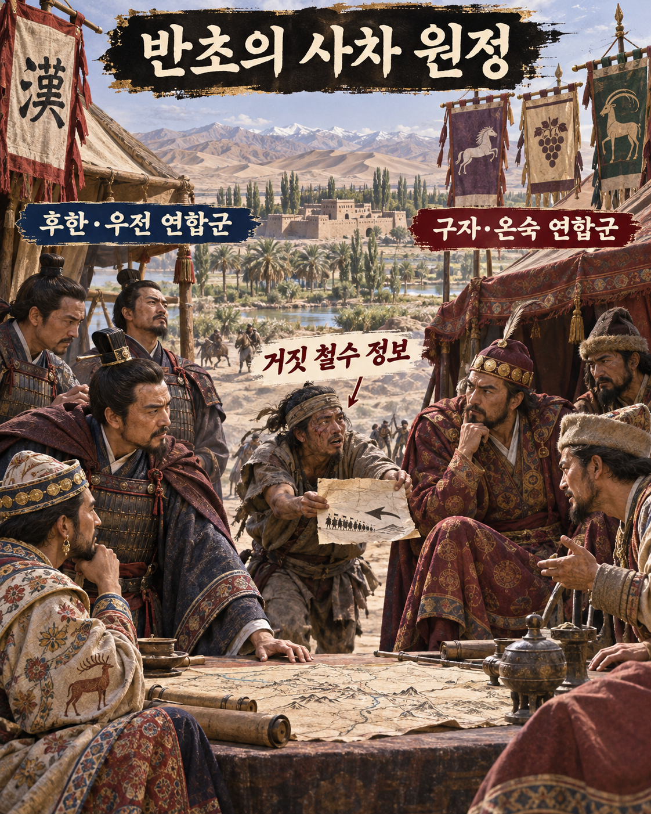
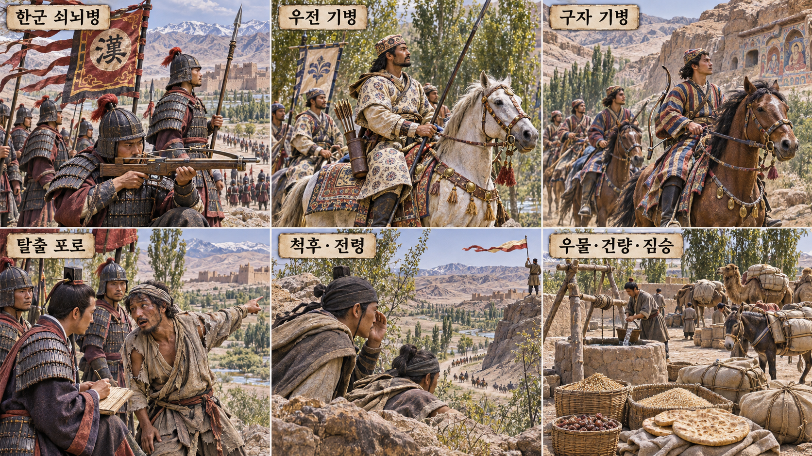
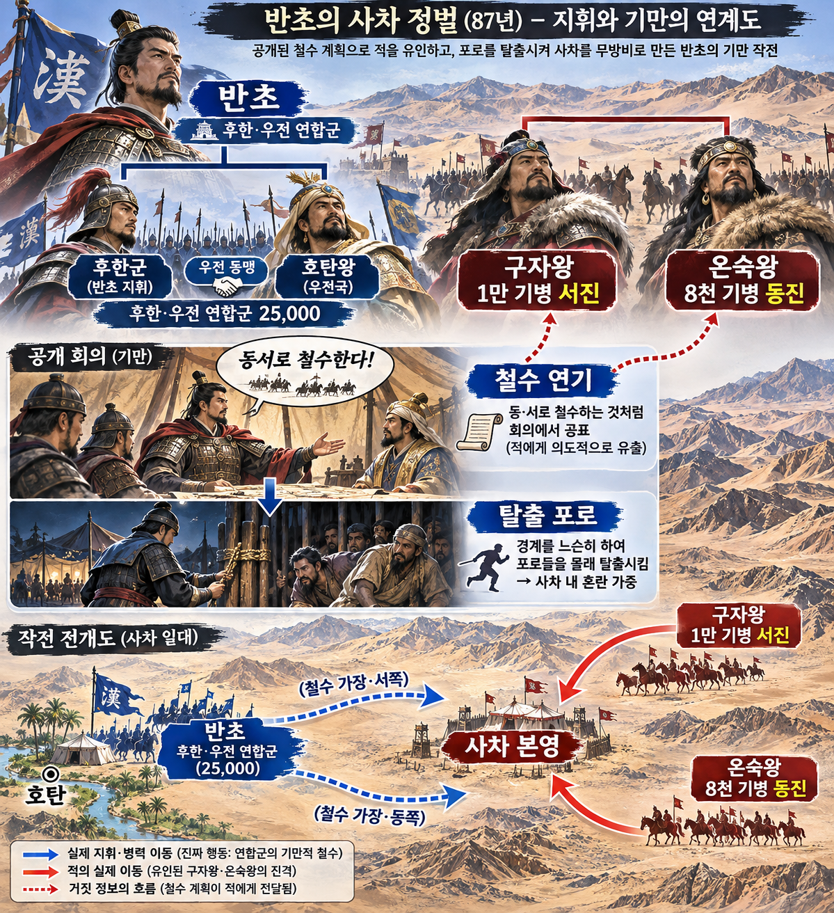
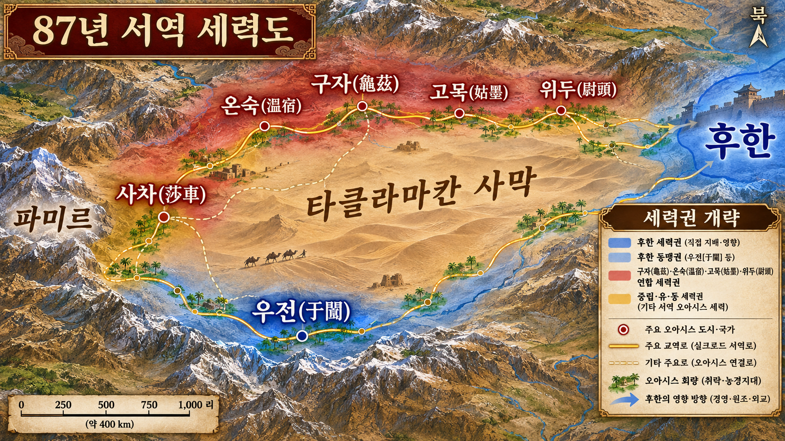
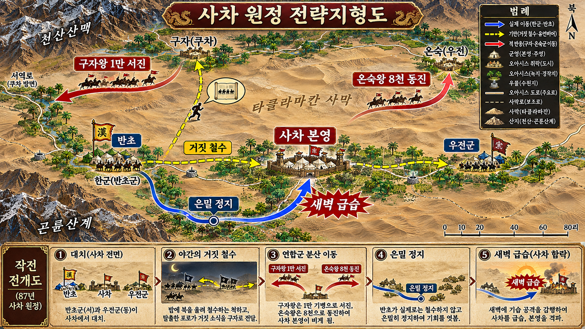
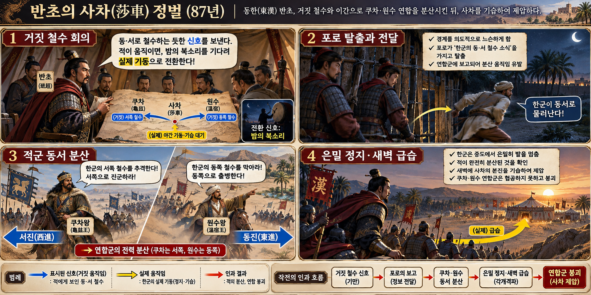

**뒤에서 반복될 지형을 먼저 잡아두기**

- **▰** **우전(于闐)**은 반초와 동맹한 남도 오아시스였다. 우전군이 동쪽으로 물러난다는 거짓 신호가 온숙군을 끌어냈다.
- **▰** **사차(莎車)**는 연합군의 목표이자 구자·온숙 원군이 보호해야 할 본영이었다.
- **▰** **구자(龜茲)**와 **▰** **온숙(溫宿)**은 북도에서 내려온 구원축이었다. 양쪽 차단에 병력을 나누자 사차 본영이 비었다.
- 🏜️ **타클라마칸 사막(Taklamakan Desert) 오아시스 회랑**은 대군의 이동을 우물·도로에 묶었다. 거짓 철수 방향은 적 기병의 실제 이동을 멀리 벌렸다.
- ⛰️ **곤륜산계(Kunlun Mountains)**와 천산 남록은 남북 회랑을 제한했다. 한 번 동서로 분산된 원군은 새벽 전에 사차로 돌아오기 어려웠다.

#### 상세 전역 서사 — 포로가 전한 철수 신호를 적의 동서 분산으로 확인하다

『후한서·반초열전』은 87년 **반초**가 우전 등 2만5천을 동원해 사차를 공격했고, 구자왕이 온숙·고묵·위두의 5만 구원군을 보냈다고 기록한다. 열세인 **반초**는 회의에서 우전군은 동쪽으로, 자신은 서쪽으로 밤 북소리에 맞춰 흩어져 물러나자고 말했다.

그는 붙잡은 포로의 경계를 일부러 느슨하게 했다. 탈출자는 구자왕에게 철수 계획을 전했고, 구자왕은 1만 기병을 이끌고 서쪽의 **반초**를 막으러 갔다. 온숙왕은 8천 기병으로 동쪽 우전군을 막으러 갔다. 거짓 이야기는 적의 수집 경로를 타고 실제 병력 분산으로 바뀌었다.

**반초**는 적이 계책에 빠졌다는 보고를 확인한 뒤 은밀히 진군을 멈추고 새벽에 사차 본영을 급습했다. 구원군이 멀리 떨어진 동안 사차군은 붕괴했고 사차는 항복했다. 포로의 운명은 기록에 남지 않으므로 ‘죽도록 버린 사간’이라고 단정하지 않는다. 다만 거짓 정보를 적에게 전달할 위험한 운반체로 썼다는 점과, 정찰·보고가 적의 분산을 확인해 `反報` 기능을 수행했다는 점은 분명하다.

#### 전투에서 사용된 속임수 — 공개 철수 회의와 의도적으로 느슨해진 포로 경계

#### 속임수 작동 구조

**주체와 의도.** **반초**는 수적 열세를 정면전이 아니라 구원군 분산으로 바꾸려 했다.

**보인 신호와 믿은 이유.** 연합군 회의에서 실제처럼 동서 철수를 말하고 포로가 탈출하도록 했다. 구자왕에게는 열세인 반초가 도망친다는 설명이 지형과 병력비에 맞아 보였다.

**유발된 행동과 결과.** 구자왕 1만은 서쪽, 온숙왕 8천은 동쪽으로 나뉘었다. 반초는 그 이동을 확인한 뒤 철수를 취소하고 사차 본영을 급습했다.

**사료의 경계.** 병력·전과 숫자는 『후한서』 서술에 의존하며 현대의 정밀 통계처럼 취급하지 않는다. 탈출 포로의 생사와 보고 뒤 처우도 사료상 불명이다.

#### 속임수 일곱 질문

1. **누가 누구를 속였는가?** 반초가 탈출 포로를 경로로 구자왕과 온숙왕을 속였다.
2. **어떤 사실이 거짓이었는가?** 한군과 우전군이 밤 북소리에 맞춰 동서로 철수한다는 계획이 거짓이었다.
3. **어떤 사실은 진실이지만 오해를 유도했는가?** 반초군이 수적으로 열세였고 양쪽으로 갈 수 있는 길이 있다는 사실은 진짜였다.
4. **상대는 왜 그것을 믿고 싶어 했는가?** 도주하는 열세군을 양쪽에서 차단하면 사차를 지키면서 쉽게 격파할 수 있다고 보였다.
5. **속임수가 없었어도 같은 오판이 발생했을까?** 가능성은 낮다. 구원군이 사차 근처에 집중했다면 본영 급습은 훨씬 어려웠다.
6. **속은 사람은 어떤 독립 확인을 생략했는가?** 구자왕은 한군 본대가 실제로 출발했는지 연속 정찰로 확인하지 않고 포로의 한 보고에 병력을 걸었다.
7. **신뢰·동의·안전을 해치지 않으면서 같은 원리를 어디서 연습할 수 있는가?** 보드게임·모의훈련에서 허위 철수와 정찰 확인을 규칙 안에서 연습하고 종료 뒤 정보 경로를 복기할 수 있다.

#### 시계편 兵者詭道也 — 이 전장에 해당하는 속이는 길

<table fit-page-width="true" header-row="true">
<tr><td>해당 구절·독음·뜻</td><td>전장의 장면</td></tr>
<tr><td>近而示之遠 근이시지원 — 가까우면서도 멀리 가는 듯 보임</td><td>사차 가까이 있던 한·우전군이 동서로 멀리 철수할 듯 보였다.</td></tr>
<tr><td>利而誘之 이이유지 — 이익으로 유인함</td><td>열세군을 추격해 차단할 쉬운 승리처럼 보여 구원군을 본영 밖으로 끌어냈다.</td></tr>
</table>

#### 法 한눈 비교 — 곡제·관도·주용

<table fit-page-width="true" header-row="true">
<tr><td>진영</td><td>곡제(편제)</td><td>관도(지휘)</td><td>주용(보급·지속)</td></tr>
<tr><td>**후한·우전 연합군**</td><td>서·동 철수 연기와 급습 본대를 한 계획에 묶었다.</td><td>반초가 공개 신호와 비밀 전환 시점을 통제했다.</td><td>오아시스 회랑에서 짧은 새벽 급습으로 열세를 상쇄했다.</td></tr>
<tr><td>**구자·온숙 연합군**</td><td>1만·8천 기병이 반대 방향으로 분산됐다.</td><td>탈출 포로의 단일 보고가 각 왕의 추격 명령으로 이어졌다.</td><td>사막 회랑에서 멀어진 기병은 사차 본영을 즉시 지원하지 못했다.</td></tr>
</table>

#### **구자왕(龜茲王, 패)**

<table fit-page-width="true" header-row="true">
<tr><td>요소</td><td>판단</td></tr>
<tr><td color="orange_bg">🤝 **道**</td><td>연합군을 사차 방어라는 공통 목적보다 각 방향 추격으로 흩었다. (지기·사기)</td></tr>
<tr><td color="blue_bg">🌤️ **天**</td><td>탈출 포로 한 명의 보고를 철수 확정으로 보고 기만·정지·역습 시나리오를 낮게 평가했다. (지피·타이밍·확률 관점)</td></tr>
<tr><td color="green_bg">🧭 **地**</td><td>사막 오아시스 길에서 동서로 멀어지면 본영 복귀가 늦어진다는 원근을 놓쳤다. (원근·험이·광협)</td></tr>
<tr><td color="purple_bg">🎖️ **將**</td><td>쉬운 추격의 이익에 급해 정찰 확인보다 먼저 주력을 움직였다. (지신인용엄·장유오위)</td></tr>
<tr><td color="yellow_bg">⚙️ **法**</td><td>구원군·본영·정찰의 보고선을 유지하지 못한 채 기병을 분산했다. (곡제·관도·주용)</td></tr>
</table>

**직관·편향 한 줄:** **구자왕**이 열세군은 도주할 것이라는 대표적 장면에 맞춰 포로 보고를 즉시 채택한 판단에는 대표성·확증편향이 작동했을 가능성이 있으며, 실제 출발 확인을 생략해 본영을 비웠다.

🏳️ **패군 측 결과**: 연합군은 지휘관이 적정을 헤아리지 못하고 병력을 반대 방향에 나눈 北(배)에 가까운 패배를 입었다.

🔀 **패군 측 회피 분기점**: 기병 일부만 추적에 내보내고 사차 근처에 주력을 둔 채 한군 본대의 실제 이동을 재확인했더라면 본영 급습과 연합군 붕괴는 피할 가능성이 컸다.

#### **반초(班超, 승)**

<table fit-page-width="true" header-row="true">
<tr><td>요소</td><td>판단</td></tr>
<tr><td color="orange_bg">🤝 **道**</td><td>한군과 우전 동맹군이 서로 다른 철수 역할을 연기하면서도 실제 전환 명령에는 함께 움직이게 했다. (지기·사기)</td></tr>
<tr><td color="blue_bg">🌤️ **天**</td><td>적이 포로 보고를 믿을 가능성을 이용하되, 분산을 확인한 뒤에만 급습해 실패 확률을 낮췄다. (지피·타이밍·확률 관점)</td></tr>
<tr><td color="green_bg">🧭 **地**</td><td>오아시스 회랑의 긴 동서 거리를 적의 복귀 지연으로 바꾸고 사차까지 짧은 축을 택했다. (원근·험이·사생)</td></tr>
<tr><td color="purple_bg">🎖️ **將**</td><td>열세에서 정면 결전을 피하고 정보 전달·적 반응·급습의 순서를 통제했다. (지신인용엄)</td></tr>
<tr><td color="yellow_bg">⚙️ **法**</td><td>포로·척후·북 신호·기병 이동을 결합해 거짓 신호를 실제 기동 우세로 바꾸었다. (곡제·관도·주용)</td></tr>
</table>

🏆 **승군 측 결과**: 반초는 적의 분산을 확인한 뒤 대비 없는 본영을 쳐 以虞待不虞者勝(이우대불우자승, 대비한 자가 대비하지 못한 적을 이김)에 해당했다.

##### 法을 압축하지 않고 보기 — 곡제·관도·주용

**곡제 曲制(곡제): 부대를 어떻게 나누고 결합했는가**
<table fit-page-width="true" header-row="true">
<tr><td>진영</td><td>실제 운용</td></tr>
<tr><td>**후한·우전 연합군**</td><td>동서 철수 연기와 새벽 급습을 분리하되 전환 시점에 본대를 결합했다.</td></tr>
<tr><td>**구자·온숙 연합군**</td><td>구자왕 1만과 온숙왕 8천이 반대 방향 차단 임무로 나뉘어 사차 방어와 분리됐다.</td></tr>
</table>

**관도 官道(관도): 누가 명령하고 어떻게 전달했는가**
<table fit-page-width="true" header-row="true">
<tr><td>진영</td><td>실제 운용</td></tr>
<tr><td>**후한·우전 연합군**</td><td>반초가 공개 회의와 밤 북소리를 거짓 신호로 쓰고 실제 정지·급습 명령은 좁게 통제했다.</td></tr>
<tr><td>**구자·온숙 연합군**</td><td>탈출 포로의 보고가 독립 확인 없이 왕들의 동서 추격 명령으로 바뀌었다.</td></tr>
</table>

**주용 主用(주용): 군량·장비·전투 지속 능력을 어떻게 썼는가**
<table fit-page-width="true" header-row="true">
<tr><td>진영</td><td>실제 운용</td></tr>
<tr><td>**후한·우전 연합군**</td><td>우물·건량·짐승에 의존하는 오아시스 보급에서 장기전 대신 짧은 급습을 택했다.</td></tr>
<tr><td>**구자·온숙 연합군**</td><td>기병의 속도를 추격에 썼으나 서로 반대 방향으로 멀어져 사차의 지속 방어력을 잃었다.</td></tr>
</table>

**사료와 연구:** [『후한서·반초열전』 원문](https://dudianji.com/book/%E5%90%8E%E6%B1%89%E4%B9%A6/%E7%8F%AD%E8%B6%85%E5%88%97%E4%BC%A0) · [중국 지방지의 해당 기록 인용](https://dfz.shaanxi.gov.cn/zslm/fzzlk/xbsxsxz/xbsxz/xys_16200/201405/P020240923610952878171.pdf)

---
## 5. 핵심 통찰 + 실생활 적용 + 생활루틴

### 핵심 통찰

이 구절의 핵심은 사간과 생간의 생사 대비보다 **밖으로 보낸 이야기와 안으로 돌아온 보고의 비대칭**이다. 사간은 적의 정보망이 가져갈 거짓 형상을 만든다. 생간은 적이 그 형상을 어떻게 해석하고 행동했는지를 돌아와 보고한다. 외향선만 있으면 지휘자는 자기가 만든 이야기에 취하고, 귀환선만 있으면 적의 판단을 움직일 설계가 없다.

`傳於敵間`과 `反報` 사이에는 반드시 현실의 반응이 있어야 한다. 적이 정보를 받았다는 사실, 믿었다는 판단, 실제 행동했다는 증거는 서로 다르다. **전달·해석·행동·결과를 분리해 기록하는 것**이 기만을 검증 가능한 작전으로 바꾸고, 예상 밖 결과를 숨기지 않는 보고가 다음 실패를 막는다.

### 실생활 적용

3교대 현장에서 설비 이상 가설을 확인할 때는 동료를 속이는 가짜 장애를 만들면 안 된다. 대신 안전 권한이 있는 시험 범위에서 테스트 신호나 제한된 설정 변경을 사용하고, 시작 전에 목적·영향 범위·중단 조건·복구 담당자를 공개한다. 밖으로 보이는 테스트 신호는 사간의 `誑事`와 구조적으로 비슷하지만, 사람을 기만하는 것이 아니라 시스템의 반응을 안전하게 드러내는 통제된 시험이어야 한다.

예를 들어 특정 알람 경로를 확인한다면, 담당자의 승인 아래 시험 태그를 명시하고 한 지점만 자극한다. 상황실은 알람 발생 시각과 전달 경로를, 현장 담당자는 실제 장비 상태를, 다음 교대는 잔여 영향과 복구 완료를 기록한다. 시험 신호가 떴다는 사실과 실제 보호 동작이 작동했다는 결론을 분리해야 한다.

인물사건관찰시리즈의 근무 기록을 적용할 때도 사람의 의도를 시험하려고 거짓말을 던져 반응을 보는 방식은 쓰지 않는다. 전씨·이씨·안씨를 포함한 동료에게는 확인할 업무 사실과 요청을 직접 말하고, 관찰한 행동만 기록한다. 대응 가설이 필요하면 `수락 / 거절 / 지연 / 다른 담당자 필요`를 미리 적고, 실제 응답이 어느 경우였는지 확인한다. 이 방식은 관계를 조종하지 않으면서도 한 가지 기대에 갇히는 것을 막는다.

교대 인계에서는 생간의 `反報` 원리를 더 직접적으로 쓸 수 있다. 조치를 맡긴 뒤 “완료” 한마디만 받지 말고 `무엇을 했는가 / 무엇이 실제로 변했는가 / 예상과 달랐던 점 / 아직 남은 위험 / 다음 확인 시각`을 받는다. 불리한 결과를 말한 사람에게 책임을 전가하면 좋은 소식만 돌아오므로, 보고와 문책을 분리하고 사실 확인을 먼저 해야 한다.

### 생활루틴 추천

**확인되지 않은 이야기를 퍼뜨리고 결과 보고를 받지 않으면 재수가 없다.**

**이유:** 오늘 시험·요청·조치 하나를 시작하기 전에 2분 동안 `목적 / 보낼 신호 / 예상 반응 네 가지 / 중단 조건 / 돌아와 보고할 사람과 시각`을 적는다. 이 절차를 빼면 머릿속의 한 시나리오가 사실처럼 퍼지고, 상대나 시스템이 다르게 반응해도 성공했다고 믿어 오류가 다음 교대까지 이어진다. 사간과 생간을 함께 둔 원리는 **밖으로 보낸 가설은 반드시 돌아온 결과로 닫아야 한다**는 규칙이다.
